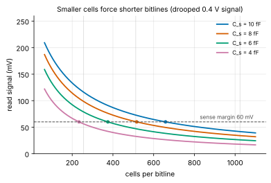
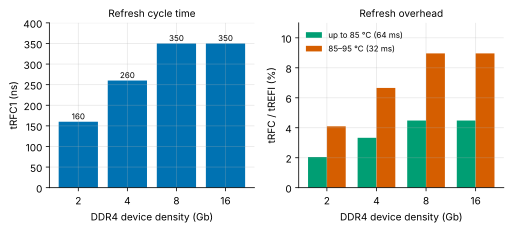
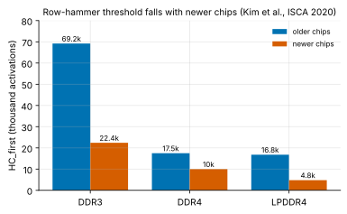

<!-- status: verified -->
# 23-03 · DRAM Cells, Arrays and Refresh

| | |
|---|---|
| **Course** | [23 · Memory and Storage Technology](../README.md) |
| **University equivalent** | The DRAM lectures of a senior memory or advanced-VLSI elective, with the DRAM-system part of a graduate computer-architecture course: the 1T1C cell and charge sharing, sense amplifiers, array and bank organization, timing parameters, retention and refresh, read disturbance, and cell scaling (Keeth, Baker, Johnson & Lin, *DRAM Circuit Design: Fundamental and High-Speed Topics*; Jacob, Ng & Wang, *Memory Systems: Cache, DRAM, Disk*, DRAM chapters; Rabaey, Chandrakasan & Nikolić, *Digital Integrated Circuits*, ch. on memories) |
| **Prerequisites** | [04-04](../../04-physics-for-ee/chapters/04-04-potential-capacitance-and-dielectrics.md) (capacitance, dielectrics, charge sharing), [09-10](../../09-semiconductor-devices/chapters/09-10-short-channel-effects-and-leakage.md) (leakage paths, GIDL), [14-09](../../14-computer-organization-and-architecture/chapters/14-09-memory-hierarchy-and-caches.md) (where main memory sits), [23-01](23-01-memory-hierarchy-and-memory-wall.md) (activation energy, Little's law), [23-02](23-02-sram-technology.md) (sigma for an array) |
| **Estimated study hours** | 7 |
| **Last verified** | 2026-11-25 |

**Learning objectives.** After this chapter you can:

1. Derive a 1T1C cell's read signal from charge conservation, and use it to size bitlines against a sense-amplifier margin.
2. Explain why a DRAM read is destructive and why the wordline is boosted, and compute write and sense-amplifier regeneration times.
3. Decode a DRAM device's organization (banks, rows, pages), and compute row-hit, row-miss and row-conflict latencies and the bank parallelism random traffic needs.
4. Compute refresh overhead, refresh power and retention requirements, including the effect of temperature and of the weak-cell tail.
5. Quantify row hammer: activations possible within a refresh window, measured thresholds, and probabilistic and counter-based mitigations.
6. Explain what limits the 6F² cell (capacitance, aspect ratio, sense margin), and assess 4F², vertical-channel and 3D DRAM roadmaps skeptically.

## 1. Big picture

Dynamic RAM stores each bit as a few femtofarads of charge on a capacitor, reached through one transistor. That makes it about fourteen times smaller per cell than SRAM (Example 23-03.5), and it is why every computer's main memory, and every HBM stack beside an AI accelerator, is DRAM. The price of that density is everywhere in the design. The signal is tiny and must be amplified. Reading destroys the data, which must be written back. The charge leaks, so every row must be refreshed every few tens of milliseconds. And because the cells are packed so tightly, hammering one row can flip bits in its neighbours. This chapter derives each of those facts from the physics of one cell, then builds up to the array, the device and its timing.

- **Datacenters:** DRAM capacity per server sets how large a model or database fits in memory. Denser dies such as Samsung's 32 Gb DDR5 let a 128 GB module be built without stacking dies through silicon vias [9].
- **AI accelerators:** HBM is a stack of DRAM dies (23-05). Its bandwidth, energy per bit and refresh overhead come from the same cells and arrays as this chapter's.
- **Phones, wearables and cars:** LPDDR's self-refresh power sets standby drain, and hot automotive environments force faster refresh.
- **Security:** row hammer turned a reliability quirk into an attack that crosses process and virtual-machine boundaries, and it reshaped the DDR5 standard (§3.8).
- **Economics:** DRAM is sold by the bit, so bits per wafer drive the business. Each node fights to shrink the cell while keeping its capacitance (§3.9).

## 2. Intuition first

Picture a DRAM cell as a small water tank with a tap, connected by a pipe to a much larger tank: the bitline. Before a read, the large tank is filled to exactly half height. Opening the tap lets the levels equalize. If the small tank was full, the big tank's level rises a little; if it was empty, it falls a little. Because the big tank is five or more times wider, the change is small: tens of millivolts, not hundreds. A **sense amplifier** compares the bitline's level with a twin bitline still at half height and decides which way it moved.

This analogy is exact for charge sharing. Charge is the water's volume, capacitance is the tank's cross-section, and voltage is the water's height: connected tanks reach a common height, and the volume is conserved. It breaks down in three places. The tap is a transistor that only conducts fully if its gate is well above both sides (§3.3). The sense amplifier is not a gauge but a positive-feedback latch that drives the bitline all the way to full or empty, which also refills the cell (§3.4). And the small tank leaks through mechanisms that speed up exponentially with temperature (§3.7).

The sense amplifier's destructive-read-then-restore cycle is why DRAM has an "open row": once a row's cells have been sensed, the whole row sits latched in the sense amplifiers (the **row buffer**), and further reads of that row are fast. A different row must first be written back and the bitlines precharged again. Almost every DRAM timing parameter in §3.6 follows from that sequence.

```text
   wordline WL ─────────┬─────────────────────── (one wordline gates a whole row of cells)
                        │
                     ┌──┴──┐ access transistor
   bitline BL ───────┤     ├───┐
          │          └─────┘   ┴ C_s  storage capacitor (a few fF), other plate at a fixed voltage
          │                    ┬
          │                    ⏚
       ┌──┴──────────────┐
       │ sense amplifier │  cross-coupled latch: compares BL with BL̄,
       │  (latch + EQ)   │  then drives one to V_ARY and the other to 0
       └──┬──────────────┘
          │
   bitline BL̄ (reference) ── precharged to V_ARY/2, no cell selected on it
   C_BL: each bitline's total capacitance (wire + junctions of all cells on it), 5–10× C_s
```

## 3. Theory

### 3.1 The 1T1C cell and its signal

A cell is one access transistor and one capacitor $C_s$, the **storage capacitance**. The capacitor's other plate is held at a fixed voltage. A 1 is stored as the array voltage $V_{ARY}$ on the storage node and a 0 as 0 V. Before a read, each bitline, with total capacitance $C_{BL}$, is precharged to $V_{pre} = V_{ARY}/2$.

When the wordline rises, the transistor connects $C_s$ to the bitline. No charge leaves the pair, so the total charge before equals the total charge after, when both sit at a common voltage $V_f$:

$$
C_s V_{cell} + C_{BL} V_{pre} = (C_s + C_{BL})\,V_f .
$$

The bitline's change is therefore

$$
\Delta V = V_f - V_{pre} = (V_{cell} - V_{pre})\,\frac{C_s}{C_s + C_{BL}} .
$$

The factor $C_s/(C_s + C_{BL})$ is the **transfer ratio**. With $V_{pre} = V_{ARY}/2$, a stored 1 gives $+\tfrac12V_{ARY}$ times the ratio and a stored 0 gives the same magnitude negative. Units: F/F is dimensionless, so ΔV is in volts. ✓

Half-$V_{ARY}$ precharge has three advantages. The 0 and 1 signals are symmetric, so one reference works for both. The reference costs nothing: after a read, one bitline of each pair sits at $V_{ARY}$ and the other at 0, and shorting them together (equalization) lands both at $V_{ARY}/2$ by the same charge-sharing argument, with no current from the supply. And the cell's dielectric sees at most $V_{ARY}/2$ if its plate is also held at $V_{ARY}/2$, which allows a thinner, higher-capacitance film.

Typical numbers make the problem plain. With $C_s$ = 8 fF and $C_{BL}$ = 40 fF (both assumed, in the range §7 gives), the transfer ratio is 1/6. A 1 V array then delivers only 83.3 mV (Example 23-03.1), from about 5 × 10⁴ electrons.

### 3.2 How long can a bitline be?

The sense amplifier needs a minimum signal $\Delta V_{min}$ to decide reliably, against its own offset, coupling noise from neighbouring bitlines and the cell's leakage since the last refresh. Write $V_{sig}$ for the worst-case $V_{cell} - V_{pre}$, the signal of a 1 that has drooped for a full refresh interval. Then the read works only if

$$
V_{sig}\,\frac{C_s}{C_s + C_{BL}} \ge \Delta V_{min}
\quad\Longrightarrow\quad
C_{BL} \le C_s\left(\frac{V_{sig}}{\Delta V_{min}} - 1\right) .
$$

The bitline's capacitance grows with the number of cells $N$ on it: $C_{BL} = N c_b + C_0$, where $c_b$ is the capacitance each cell adds (its junction and its share of the wire) and $C_0$ is the sense amplifier's and wiring's fixed part. So

$$
N_{max} = \frac{C_s\left(V_{sig}/\Delta V_{min} - 1\right) - C_0}{c_b} .
$$

This one inequality ties together the whole array. Every sense amplifier costs area. Long bitlines spread that area over more cells, so array efficiency wants large $N$. Small capacitors (from scaling) and low array voltages shrink $N_{max}$. When a new node loses capacitance, the designer must shorten bitlines, adding sense amplifiers and losing some of the density the node was meant to deliver (Example 23-03.2).

> **Going deeper — open and folded bitlines.** In a *folded* architecture the reference bitline runs beside the active one in the same array, so coupling noise appears on both and cancels; but each wordline can only cross a cell on every other bitline, which costs area (the classic 8F² cell). Today's 6F² cells use an *open* architecture: the reference bitline lies in the neighbouring array, across the sense amplifier. It is denser but less immune to noise, which is one reason modern sense amplifiers include offset cancellation and why bitline-to-bitline coupling is a scaling limit [3].

### 3.3 Writing and restoring: why the wordline is boosted

The access transistor is an n-channel MOSFET with its gate on the wordline, one terminal on the bitline and the other on the storage node. To store a 1, the bitline is driven to $V_{ARY}$ and the transistor must pull the storage node up to it. The terminal at the lower voltage acts as the source, here the storage node at voltage $V$. With the wordline at $V_{WL}$, the gate-source voltage is $V_{WL} - V$, and the transistor stops conducting when $V$ reaches $V_{WL} - V_{TH}$.

**Wordline at the array voltage.** If $V_{WL} = V_{ARY}$, the bitline (drain) is above $V_{WL} - V_{TH}$, so the transistor is saturated throughout. In the square-law model (09-09) with $k = \mu C_{ox}W/L$ and $a \equiv V_{WL} - V_{TH}$:

$$
C_s\frac{dV}{dt} = \frac{k}{2}(a - V)^2 .
$$

Separate the variables: $dV/(a - V)^2 = (k/2C_s)\,dt$. Integrating from $V = 0$ at $t = 0$ gives $1/(a - V) - 1/a = kt/(2C_s)$, so

$$
V(t) = a - \frac{1}{1/a + kt/(2C_s)} .
$$

The cell approaches $V_{ARY} - V_{TH}$, and only as $1/t$. Access transistors have a high threshold (to keep leakage low, §3.7), so a stored 1 would be badly weak. Units: $k$ in A/V², $t/C_s$ in s/F = V/A, so $kt/C_s$ is 1/V, matching $1/a$. ✓

**Boosted wordline.** If the wordline is driven to $V_{PP} > V_{ARY} + V_{TH}$, the transistor is in its linear region throughout and the cell reaches the full $V_{ARY}$. Micron's DDR5 data sheet lists a separate $V_{PP}$ supply of 1.8 V nominal, the "activating power supply", beside the 1.1 V $V_{DD}$ [1]. With $u = V_{ARY} - V$ the remaining shortfall and $b = V_{PP} - V_{TH} - V_{ARY} > 0$, the linear-region current $k\left[(V_{PP} - V - V_{TH})(V_{ARY} - V) - \tfrac12(V_{ARY} - V)^2\right]$ becomes $k(bu + \tfrac12u^2)$, so

$$
C_s\frac{du}{dt} = -k\left(bu + \tfrac12u^2\right) .
$$

> **Math refresher — partial fractions.** To integrate $1/[u(b + cu)]$, write it as $\frac{1}{b}\left[\frac1u - \frac{c}{b + cu}\right]$ (combine the right side to check). Each term integrates to a logarithm, so $\int \frac{du}{u(b + cu)} = \frac1b \ln\frac{u}{b + cu}$.

With $c = \tfrac12$ and $u = u_0 = V_{ARY}$ at $t = 0$:

$$
\frac{u}{b + u/2} = \frac{u_0}{b + u_0/2}\,e^{-bkt/C_s}
\quad\Longrightarrow\quad
u = \frac{b\,r}{1 - r/2},\quad r = \frac{u_0}{b + u_0/2}\,e^{-bkt/C_s} .
$$

The shortfall now decays exponentially with time constant $C_s/(bk)$, so the cell reaches full voltage within nanoseconds (Example 23-03.3). The cost is a third supply rail, charge pumps, and a high field across the access transistor's gate oxide and drain junction, which raises gate-induced drain leakage (09-10) and limits how far $V_{PP}$ can go.

The same transistor writes a 0 easily: the bitline at 0 V is the source, the gate overdrive is the full $V_{PP} - V_{TH}$, and the node discharges to exactly 0.

### 3.4 The sense amplifier: a latch that amplifies and restores

The sense amplifier is two cross-coupled inverters between the bitline pair. During precharge both bitlines sit at $V_{ARY}/2$ and the latch's supply lines (one pulled toward $V_{ARY}$, one toward 0) also sit at $V_{ARY}/2$, so it is off. After charge sharing has produced ΔV, the supply lines are driven apart and the latch turns on.

Around its balance point each inverter is a transconductance $g_m$ driving the other's capacitance $C$, the bitline's. With $v_1$ and $v_2$ the two bitlines' small deviations from balance:

$$
C\frac{dv_1}{dt} = -g_m v_2, \qquad C\frac{dv_2}{dt} = -g_m v_1 .
$$

Subtracting, the difference $v_d = v_1 - v_2$ obeys $C\,dv_d/dt = g_m v_d$: positive feedback. It grows exponentially, $v_d(t) = \Delta V\,e^{t/\tau}$ with $\tau = C/g_m$, so the time to grow to a full swing $V_{final}$ is

$$
t_{sense} = \tau \ln\frac{V_{final}}{\Delta V} .
$$

Halving the signal costs only one extra $\tau\ln 2$: the logarithm is forgiving. The linear model is optimistic, because the latch's devices start nearly off and its supply lines take time to move; the lab's simulation of a full read takes about 1.5 times as long as this estimate. What the logarithm does not forgive is offset: if the two inverters' thresholds differ by more than ΔV, the latch resolves the wrong way. Each sense amplifier's offset is a random variable (Pelgrom's law, 20-11), and a device has tens of millions of them: a 16 Gib device with 512-cell bitlines has 2²⁵ bitlines. Using 23-02's array-sigma argument, 2²⁵ sense amplifiers at 99% yield need the worst-case signal to sit about 6.19 standard deviations of offset away from zero.

When the latch resolves, it drives one bitline to $V_{ARY}$ and the other to 0. The cell, still connected through its boosted wordline, is pulled back to full strength. The read was destructive (charge sharing left the cell at the bitline's intermediate voltage) but it ends with a **restore**. The whole row's worth of sense amplifiers now holds the row: this is the open page or row buffer. Closing the row lowers the wordline, then equalizes and precharges the bitlines for the next activation.

### 3.5 From cell to device: subarrays, banks and pages

A modern DRAM die organizes billions of cells in a hierarchy:


A **bank** is the unit that can have one open row. Its rows are divided into **subarrays** (also called mats), each with its own short bitlines and sense amplifiers, because §3.2 forbids long bitlines; the wordline is likewise segmented, with local drivers. An activation opens one row in one bank and latches a **page** of bits. Banks are independent enough to work in parallel, and DDR4 and DDR5 group them into **bank groups**, which add timing rules between groups.

Micron's 16 Gb DDR5 device in its x8 version has 32 banks in 8 groups of 4, 65,536 rows per bank (row address R0–R15), 1,024 columns (C0–C9) and a 1 KB page [1]. The page is the number of columns times the data width: $2^{10} \times 8$ bits = 8,192 bits. The x16 part keeps 16 banks and a 2 KB page. Its 16 Gb DDR4 part (x8) has 16 banks in 4 groups, 131,072 rows (A[16:0]) and the same 1 KB page [2]. Counting bits confirms the organization (Example 23-03.5).

**Cell area.** Today's cells occupy $6F^2$, where $F$ is the half-pitch design rule: a 3F × 2F footprint with the bitline contact shared between two cells. TechInsights measured a 15.9 nm design rule on Micron's first DDR5 node (D1z) and a 66.26 mm² die for 16 Gb [7]. Example 23-03.5 turns those into a cell area, a bit density and the fraction of the die that is cells: about 39%. The rest is sense amplifiers, wordline drivers, decoders, I/O, refresh logic and on-die ECC.

### 3.6 Timing: activate, read, precharge

A DRAM access is a sequence of commands to a bank:

- **ACT** (activate) opens a row: decode, raise the wordline, share charge, enable the sense amplifiers. Column commands may follow after **tRCD** (row-to-column delay).
- **RD** (read) selects columns from the open row. The first data appear **CL** (CAS latency) after the command, also given in nanoseconds as **tAA**.
- **PRE** (precharge) closes the row. It is allowed only **tRAS** after the ACT (the restore must have finished), and the bank can accept the next ACT **tRP** after the PRE. The minimum time between ACTs to one bank is **tRC** = tRAS + tRP.

Three cases follow for a read arriving at a bank:

| Case | Bank state | Commands needed | Latency to first data |
|---|---|---|---|
| Row hit | the needed row is open | RD | $t_{CL}$ |
| Row miss (closed bank) | precharged, no row open | ACT, RD | $t_{RCD} + t_{CL}$ |
| Row conflict | a different row is open | PRE, ACT, RD | $t_{RP} + t_{RCD} + t_{CL}$ |

Micron's DDR4-3200 speed bin specifies tAA = tRCD = tRP = 13.75 ns and tRAS ≥ 32 ns, so tRC = 45.75 ns [2]. Its DDR5-6400 bins specify tAA = tRCD = tRP = 16.0 ns [1]. Each of these is a few tens of nanoseconds. They are set by bitline RC and sense-amplifier physics, which have barely changed, while the data rate per pin doubled. Lee et al. found that over an 11-year span tRCD and tRC fell by only about 30% and 26% [R-462].

**Page policy.** A controller that leaves rows open (open-page) wins on hits and loses on conflicts; one that precharges after every access (closed-page) always pays $t_{RCD} + t_{CL}$. If a fraction $h$ of accesses hit and the rest conflict, the open policy wins when $h\,t_{CL} + (1 - h)(t_{RP} + t_{RCD} + t_{CL}) < t_{RCD} + t_{CL}$, that is when

$$
h > h^* = \frac{t_{RP}}{t_{RP} + t_{RCD}} .
$$

With equal tRP and tRCD, $h^*$ = 0.50: the open-page policy pays only if more than half the accesses hit.

**Bank parallelism.** A bank serving random rows completes at most one access per tRC. To keep a channel's data bus busy with random traffic, enough banks must work in parallel to cover tRC, which is Little's law from 23-01 in another form (Example 23-03.6). Additional rules, such as a limit on activates within a rolling window, cap how fast a device may activate at all, because each activation draws a burst of current from the array supply.

### 3.7 Retention and refresh

**Why charge leaks.** A stored 1 leaks away through the storage node's junction to the substrate, through gate-induced drain leakage where the wordline overlaps the node, through the access transistor's subthreshold current to the bitline, and through the capacitor dielectric (09-10). If a cell may lose $\Delta V_{allowed}$ before its signal falls below the §3.2 margin, its retention time is

$$
t_{ret} = \frac{C_s\,\Delta V_{allowed}}{I_{leak}} .
$$

An 8 fF cell allowed to lose 0.1 V over 64 ms must leak less than 12.5 fA (Example 23-03.8). Junction and GIDL leakage rise steeply with temperature. A common rule of thumb models retention as halving for each 10 °C rise; the halving interval is an assumption here, not a datasheet value. The standards treat temperature the same way: DDR4 refreshes every row within 64 ms up to 85 °C and within 32 ms from 85 to 95 °C [2], and DDR5 within 32 ms and 16 ms [1].

**Refresh commands.** The controller issues 8,192 REF commands per refresh window, one every $t_{REFI}$: 64 ms/8192 = 7.8125 µs for DDR4 at normal temperature [2], [4], and 32 ms/8192 = 3.906 µs for DDR5 [1]. Each REF refreshes a fixed slice of rows in every bank (16 rows per bank in the 16 Gb DDR4 x8 part, 8 in the DDR5 part). The device is busy for $t_{RFC}$, so the fraction of time lost is

$$
\text{refresh overhead} = \frac{t_{RFC}}{t_{REFI}} .
$$

Micron's DDR4 data sheet lists $t_{RFC1}$ = 160, 260, 350 and 350 ns for 2, 4, 8 and 16 Gb [2]. Capacity grew eightfold while $t_{RFC}$ grew 2.19 times, because each REF refreshes more rows in parallel, which costs peak current. The overhead still rose with density, and it doubles when hot (Example 23-03.7, Figure 2). Refresh also costs energy: every row is activated and restored once per window whether or not anyone needs its data.

DDR5 adds **same-bank refresh**: a REF that refreshes one bank in each bank group while the others keep serving requests, which hides much of the overhead [1]. It also halved the refresh window relative to DDR4, because smaller cells retain charge less well.

**The weak-cell tail.** Most cells retain data for seconds. Refresh is set by the rare cells that do not. If retention times are spread lognormally across cells, the number of cells failing a window $t_w$ in an $N$-bit device is $N\,\Phi\!\left(\ln(t_w/t_{50})/\sigma_{\ln}\right)$, where $t_{50}$ is the median retention and $\Phi$ the standard normal CDF. Because the tail falls steeply, halving the window removes most failures (Lab Part 3). The few thousand remaining weak cells are replaced by spare rows and columns at test, and since DDR5, by **post-package repair** and on-die ECC [1]. Retention can also vary over time in a single cell (variable retention time), which makes testing for the weakest cells hard.

### 3.8 Row hammer and read disturbance

Repeatedly activating one row (the **aggressor**) disturbs cells in physically adjacent rows (the **victims**). The wordline's toggling couples to neighbouring storage nodes and injects or traps charge, so a victim can lose its data well before its next refresh. Kim et al. demonstrated this on commodity DDR3 at ISCA 2014. Among 129 modules, 110 showed errors, and some needed as few as 139K activations of a row [5]. Since then:

- **Thresholds fell.** Kim et al. (ISCA 2020) tested 1,580 chips. The first-bit-flip hammer count $HC_{first}$ fell between older and newer chips from 69.2k to 22.4k (DDR3), 17.5k to 10k (DDR4) and 16.8k to 4.8k (LPDDR4). The most vulnerable chip flipped after 9.6k activations, 4.8k to each of two aggressors on either side of the victim [6] (Figure 3). The 2014 and 2020 thresholds are defined differently (one aggressor against two), so the 29-fold ratio overstates the fall somewhat.
- **In-DRAM fixes were bypassed.** Vendors added target row refresh (TRR), which tracks frequently activated rows and refreshes their neighbours during REF. Frigo et al. showed that patterns with many aggressors (up to 19) defeated it: 13 of 42 DDR4 modules from all three major vendors flipped bits [10].
- **A second mechanism appeared.** Holding a row open for a long time, rather than toggling it, also disturbs neighbours. RowPress cut the activations needed by one to two orders of magnitude on 164 DDR4 chips, and in extreme cases one activation sufficed [11].

The arithmetic shows why this is serious. With tRC = 45.75 ns, one row can be activated 1.40 × 10⁶ times in a 64 ms window, ten times the 2014 threshold (Example 23-03.9).

**Mitigations.**

- *Refresh faster.* Halving the window halves the activations possible, at twice the refresh cost. It does not keep up with thresholds that fall by large factors.
- *Probabilistic adjacent row activation (PARA).* Each time a row closes, the controller refreshes one of its neighbours with probability $p$, each neighbour with probability $p/2$ [5]. It needs no counters, but its protection is statistical (below).
- *Refresh management (RFM) and per-row activation counting (PRAC).* DDR5 added an RFM command that gives the device time to refresh victims. The April 2024 update of the JEDEC DDR5 standard added PRAC: the device counts activations per row and, through a back-off signal, forces the controller to stop and issue RFMs when a counter nears its threshold [12]. Counting lengthens precharge, so tRP and tRC grow. Canpolat et al. found PRAC can be configured securely as long as no bitflip occurs before 20 accesses. Its overhead is under 13% for benign workloads on today's chips, but reaches up to 94% (85% on average) for more vulnerable future chips [12].
- *ECC.* On-die ECC corrects some disturbance flips but was not designed against an adversary, and multiple flips per word defeat it.

**PARA's guarantee.** Each of the aggressor's $N_{th}$ closes refreshes a given victim with probability $p/2$, independently. The victim is never refreshed, and so flips, with probability

$$
P_{miss} = \left(1 - \frac{p}{2}\right)^{N_{th}} \approx e^{-pN_{th}/2} .
$$

Holding $P_{miss}$ fixed therefore requires $p \propto 1/N_{th}$: as thresholds fall, $p$ must rise, and the extra activations, a fraction $p$ of all activations, are PARA's cost (Example 23-03.9).

### 3.9 Scaling the cell

A 6F² cell uses a recessed (buried) wordline transistor, whose channel wraps down into the silicon to be long enough to keep leakage low, and a capacitor stacked over the bitline [8]. Shrinking $F$ shrinks the footprint, but $C_s$ must stay large enough for §3.2's signal and §3.7's retention.

**Why DRAM capacitors are skyscrapers.** A thin-film capacitor has $C = \varepsilon_0\varepsilon_r A/t$, so it needs electrode area $A = C t/(\varepsilon_0\varepsilon_r)$. For 8 fF with a 6 nm dielectric of relative permittivity 25 (zirconium oxide-based films are in this range, 04-04), $A$ = 0.217 µm². That is 143 times the cell's footprint at a 15.9 nm design rule. The only way to fit it is vertically: a pillar 30 nm across would have to be 2.30 µm tall to get this area from its outer wall. Using both walls of a hollow cylinder halves the height, but its interior must then be wide enough to coat. The capacitor's height-to-width ratio is the core etch problem of every DRAM node.

TechInsights reports that cell capacitance has fallen below 10 fF in D1z and D1a cells, that dielectrics are down to 6–7 nm, and that capacitors have moved from cylinders to quasi-cylindrical pillars. It projects 5–6 fF for D1c, while makers would like to stay above 6–7 fF. It also notes that keeping over 7 fF while scaling further would need dielectrics with $\varepsilon_r$ above 50 [8]. The design-rule shrink per generation has slowed to factors above 0.92 [8].

**Beyond 6F².** Three paths are being pursued (§9 has their dated status):

- **EUV lithography** extends 6F². Micron's 1γ node, its first using EUV, combined with DUV multipatterning [13].
- **4F²** cells (2F × 2F) use a vertical-channel transistor with the capacitor directly above it. That cuts cell area by 33.3% for 1.5 times the cell density, at the cost of new materials and of building the periphery on a separate wafer bonded underneath [14], [15].
- **3D DRAM** stacks cells horizontally in layers, as 3D NAND does (23-06), trading the capacitor-height problem for a layer-count and etch problem.

> **Going deeper — capacitorless cells.** Two-transistor, zero-capacitor (2T0C) gain cells store charge on the gate of a read transistor. With oxide-semiconductor channels such as IGZO, whose leakage is extremely low, they are a candidate for 3D DRAM [8]. Their read is non-destructive, so they avoid this chapter's sensing problem. However, they trade the capacitor's linearity and density for transistor variability.

## 4. Worked examples

### Example 23-03.1 · Reading a cell by charge sharing (tier A)

**Setup.** A cell of $C_s$ = 8 fF hangs on a bitline of $C_{BL}$ = 40 fF precharged to 0.5 V; the array voltage is 1.0 V (all assumed). Find (a) the signal for a stored 1, (b) the transfer ratio, (c) the number of electrons a stored 1 holds relative to a 0, (d) the signal from a 1 that has drooped to 0.9 V and (e) the signal for a stored 0.

**Solution.**

- (a) $\Delta V = (1.0 - 0.5) \times 8/(8 + 40)$ = **83.3** mV.
- (b) $8/48$ = **0.167**.
- (c) $Q = C_sV$ = 8 fF × 1.0 V = 8 fC; $8 \times 10^{-15}/1.602 \times 10^{-19}$ = **4.99** × 10⁴ electrons.
- (d) $(0.9 - 0.5) \times 8/48$ = **66.7** mV.
- (e) $(0 - 0.5) \times 8/48$ = **−83.3** mV.

**Units check.** V × F/F = V; C/(C per electron) = electrons. ✓

**Sanity check.** A 100 mV droop in the cell costs only 16.7 mV of signal, because the transfer ratio scales every change by 1/6. The lab's ngspice run reproduces (a) to within 0.001%.

### Example 23-03.2 · How long can a bitline be? (tier B)

**Setup.** The worst-case cell signal after droop is $V_{sig}$ = 0.4 V and the sense amplifier needs 60 mV. Each cell adds 0.08 fF to the bitline and the fixed part is 4 fF (all assumed). For $C_s$ = 8 fF find (a) the largest bitline capacitance and (b) the largest number of cells per bitline. (c) Repeat (a) and (b) for $C_s$ = 6 fF. With a 6F² cell at $F$ = 15.9 nm and 0.15 µm² of sense amplifier per bitline (assumed), find (d) the array area per bit with 512 cells per bitline, (e) with 256 and (f) the increase.

**Solution.**

- (a) $C_{BL} \le 8\,(0.4/0.06 - 1) = 136/3$ = **45.3** fF.
- (b) $N \le (136/3 - 4)/0.08$ = **516.7**. A power-of-two design uses 512.
- (c) $6\,(0.4/0.06 - 1)$ = **34.0** fF, so $N \le (34.0 - 4)/0.08$ = **375**: the design drops to 256.
- (d) The cell is $6 \times 15.9^2$ nm² = 0.00151686 µm² (exact); adding $0.15/512$ gives **0.001810** µm².
- (e) $0.00151686 + 0.15/256$ = **0.002103** µm².
- (f) $0.002103/0.001810 - 1$ = **16.2** %.

**Units check.** fF × (V/V) = fF; fF/(fF per cell) = cells. ✓

**Sanity check.** Losing a quarter of the capacitance forced half-length bitlines and cost 16% in area, more than a quarter of what a typical node shrink gains. This is why makers fight so hard to hold capacitance (§3.9).

### Example 23-03.3 · Writing a 1, with and without a boosted wordline (tier B)

**Setup.** The access transistor has $V_{TH}$ = 0.5 V and $k$ = 20 µA/V²; $C_s$ = 8 fF; the bitline is driven to 1.0 V and the cell starts at 0 (all assumed). Find the cell voltage after 10 ns (a) with the wordline at 1.0 V and (b) its limit as $t \to \infty$. (c) With the wordline at 1.8 V, find the remaining shortfall after 10 ns. (d) What is the lowest wordline voltage that can store a full 1?

**Solution.**

- (a) $a = 0.5$ V and $k/(2C_s) = 1.25 \times 10^9$ /(V·s), so $kt/(2C_s)$ = 12.5 V⁻¹ and $V = 0.5 - 1/(1/0.5 + 12.5)$ = **0.431** V.
- (b) $a = V_{WL} - V_{TH}$ = **0.5** V.
- (c) $b = 1.8 - 0.5 - 1.0 = 0.3$ V and $bk/C_s = 7.5 \times 10^8$ s⁻¹ (a time constant of 1.33 ns), so $r = 1.0/(0.3 + 0.5)\,e^{-7.5} = 6.91 \times 10^{-4}$ and $u = 0.3r/(1 - r/2)$ = **0.2075** mV.
- (d) $V_{ARY} + V_{TH}$ = **1.5** V.

**Units check.** (V⁻¹)⁻¹ = V; $bk/C_s$ in V·(A/V²)/F = 1/s. ✓

**Sanity check.** Without the boost, the stored 1 (0.431 V) is below the 0.5 V precharge: it would read as a 0. With it, the cell is within a fraction of a millivolt of full after 10 ns. A wordline at exactly 1.5 V reaches the full level only slowly (the lab finds 0.926 V at 10 ns), so real boosts carry margin above $V_{ARY} + V_{TH}$. The ngspice run matches (a) and (c).

### Example 23-03.4 · Sense-amplifier regeneration (tier B)

**Setup.** Each inverter of a latch has $g_m$ = 40 µS around balance, and each bitline has 40 fF (assumed). Find (a) the latch time constant, (b) the linear-model time to grow Example 23-03.1's 83.3 mV signal to 1.0 V, (c) the signal from a 1 that has drooped to 0.75 V and (d) the time for it. (e) How much does each halving of the signal add?

**Solution.**

- (a) $\tau = C/g_m = 40\ \text{fF}/40\ \mu\text{S}$ = **1.00** ns.
- (b) $1.00\ \text{ns} \times \ln(1.0/0.0833) = \ln 12$ ns = **2.48** ns.
- (c) $(0.75 - 0.5) \times 8/48$ = **41.7** mV.
- (d) $\ln(1.0/0.0417) = \ln 24$ ns = **3.18** ns.
- (e) $\tau \ln 2$ = **0.693** ns.

**Units check.** F/S = F·Ω = s. ✓

**Sanity check.** Halving the signal costs only 0.7 ns of sensing time, but it halves the margin against offset. In DRAM, small signals are a reliability problem before they are a speed problem.

### Example 23-03.5 · Inside a 16 Gb DDR5 device (tier A)

**Setup.** Use Micron's 16 Gb DDR5 x8 organization (§3.5) [1] and TechInsights' measurements of Micron's D1z DDR5 die (66.26 mm², 15.9 nm design rule) [7]. Find (a) the bits in 32 banks × 65,536 rows × 8,192-bit pages, and (b) the share of an open page that one 16-byte burst from this chip uses (16n prefetch × 8 bits [1]). Refreshing every row in 8,192 REF commands, find (c) the rows refreshed per bank per REF here and (d) in the 16 Gb DDR4 x8 part (131,072 rows per bank). Find (e) the bit density, (f) the 6F² cell area, (g) the total cell area, (h) its share of the die and (i) how much smaller the cell is than 23-02's 0.021 µm² SRAM bitcell.

**Solution.**

- (a) $2^5 \times 2^{16} \times 2^{13} = 2^{34}$ = **17179869184** bits, exactly 16 Gib.
- (b) 16 B of a 1,024 B page = **1.56** %.
- (c) $65{,}536/8{,}192$ = **8** rows; (d) $131{,}072/8{,}192$ = **16** rows.
- (e) $2^{34}/66.26$ = **0.259** × 10⁹ bits/mm² (16/66.26 = 0.241 Gib/mm²).
- (f) $6 \times 15.9^2$ = **1517** nm².
- (g) $2^{34} \times 1516.86\ \text{nm}^2$ = **26.06** mm²; (h) $26.06/66.26$ = **39.3** %.
- (i) $0.021/0.00151686$ = **13.8** times.

**Units check.** banks × rows/bank × bits/row = bits; nm² × 10⁻¹² mm²/nm² = mm². ✓

**Sanity check.** A cell 14 times smaller than SRAM gives a die only about 7 times denser than the best SRAM macro (38.1 × 10⁶ bits/mm², 23-02), because DRAM spends the other 61% of the die on periphery. Each activation also latches 64 times more bits than one burst uses, which is why row-buffer hits matter so much for energy (Example 23-03.7).

### Example 23-03.6 · Latency and bank parallelism (tier B)

**Setup.** Using the speed bins in §3.6, find (a) the row-hit, (b) row-miss and (c) row-conflict latencies for DDR4-3200, and (d) the average for 60% hits, 10% misses and 30% conflicts (assumed). (e) Repeat (d) for DDR5-6400. (f) For DDR4-3200, find how many bytes per second one bank delivers when every 64-byte access opens a new row, (g) the peak of a 64-bit channel and (h) how many banks must work in parallel to sustain that peak with random rows.

**Solution.**

- (a) **13.75** ns; (b) $13.75 + 13.75$ = **27.5** ns; (c) $3 \times 13.75$ = **41.25** ns.
- (d) $0.6 \times 13.75 + 0.1 \times 27.5 + 0.3 \times 41.25$ = **23.4** ns.
- (e) With 16, 32 and 48 ns: $0.6 \times 16 + 0.1 \times 32 + 0.3 \times 48$ = **27.2** ns.
- (f) tRC = 32 + 13.75 = 45.75 ns, so $64\ \text{B}/45.75\ \text{ns}$ = **1.40** GB/s.
- (g) $3200 \times 10^6\ \text{transfers/s} \times 8\ \text{B}$ = **25.6** GB/s.
- (h) $25.6/1.40$ = **18.3** banks.

**Units check.** B/ns = GB/s. ✓

**Sanity check.** DDR5-6400 moves data twice as fast per pin, yet its average latency is about 16% longer than DDR4-3200's. Eighteen banks is more than one DDR4 rank has, and activate-rate limits bite first, so a random-access workload cannot reach peak bandwidth. This is why controllers reorder requests to hit open rows.

### Example 23-03.7 · Refresh overhead and energy (tier B)

**Setup.** For the 16 Gb DDR4 device ($t_{RFC}$ = 350 ns [2]), find the refresh overhead (a) at up to 85 °C ($t_{REFI}$ = 7.8125 µs) and (b) at 85–95 °C. (c) Find it for the 2 Gb part ($t_{RFC}$ = 160 ns). With 8,192 bitlines of 40 fF swinging at 1.0 V (assumed), find (d) the energy to sense and restore one row, and (e) the refresh power for the 16 Gb x8 device (16 banks × 131,072 rows in 64 ms). Find the activation energy per useful bit (f) when a row is opened for one 16-byte burst and (g) when the whole page is read.

**Solution.**

- (a) $350/7812.5$ = **4.48** %; (b) $350/3906.25$ = **8.96** %; (c) $160/7812.5$ = **2.05** %.
- (d) Each bitline pair draws $C_{BL}V/2$ of charge from the supply at $V$ while the latch swings one bitline up and the other down; precharge then equalizes them for free. So $E = 8192 \times 40\ \text{fF} \times 1.0^2/2$ = **0.1638** nJ.
- (e) $16 \times 131{,}072/0.064\ \text{s} = 3.277 \times 10^7$ rows/s; × 0.1638 nJ = **5.37** mW.
- (f) $0.1638\ \text{nJ}/128$ bits = **1.28** pJ/bit; (g) $0.1638\ \text{nJ}/8192$ = **0.0200** pJ/bit.

**Units check.** F × V² = J; rows/s × J = W. ✓

**Sanity check.** Five milliwatts per chip is small in a server but significant in self-refresh, where nothing else runs; real refresh costs more, because this counts only the bitlines. The 64-fold spread between (f) and (g) is the energy case for row-buffer locality, and HBM's bank designs chase it too (23-01, 23-05).

### Example 23-03.8 · Retention and temperature (tier B)

**Setup.** (a) What leakage lets an 8 fF cell lose at most 0.1 V in 64 ms? A weak cell retains data for 1.0 s at 45 °C, and retention halves every 10 °C (assumed). Find its retention at (b) 85 °C and (c) 95 °C. Does it pass DDR4's windows? Retention times follow a lognormal distribution with median 10 s and $\sigma_{\ln}$ = 1.0 (assumed). For 2³⁴ cells, find the expected number failing (d) a 64 ms window and (e) a 32 ms window.

**Solution.**

- (a) $I = 8\ \text{fF} \times 0.1\ \text{V}/64\ \text{ms}$ = **12.5** fA.
- (b) $1.0\ \text{s} \times 2^{-4}$ = **62.5** ms, which fails the 64 ms window at 85 °C.
- (c) $1.0 \times 2^{-5}$ = **31.25** ms, which fails the 32 ms window at 95 °C too.
- (d) $2^{34}\,\Phi(\ln(0.064/10)/1.0) = 2^{34}\,\Phi(-5.0515)$ = **3.77** × 10³ cells.
- (e) $2^{34}\,\Phi(\ln(0.032/10)/1.0)$ = **79.1** cells.

**Units check.** F × V/s = A. ✓

**Sanity check.** A cell that holds data for a full second at room temperature still fails when hot: the weak tail, not the typical cell, sets refresh. Halving the window cuts the failing cells by a factor of 48, and the rest are repaired with spare rows at test.

### Example 23-03.9 · Row hammer arithmetic and PARA (tier C)

**Setup.** With DDR4-3200's tRC = 45.75 ns, find (a) how many times one row can be activated in a 64 ms window, (b) how many activations fit in one tREFI and (c) how long the 9.6k activations that flipped the most vulnerable chip in [6] take. For PARA with $p$ = 0.001 and a threshold $N_{th}$ = 100,000, find (d) the probability of missing a victim in one attack window and (e) the expected number of misses in a year of back-to-back 64 ms windows (Kim et al. tabulate 1.9 × 10⁻²² and 9.4 × 10⁻¹⁴ [5]). For $N_{th}$ = 4,800, find the $p$ that gives the same miss probability as (d), (f) exactly and (g) for $N_{th}$ = 1,000.

**Solution.**

- (a) $64\ \text{ms}/45.75\ \text{ns}$ = **1.40** × 10⁶ activations.
- (b) $7812.5/45.75$ = **170.8**.
- (c) $9600 \times 45.75\ \text{ns}$ = **0.439** ms.
- (d) $(1 - 0.0005)^{100000} = e^{-50.01}$ = **1.905** × 10⁻²².
- (e) A 365-day year is 31,536,000 s, or $31{,}536{,}000/0.064 = 4.9275 \times 10^8$ windows, so $1.905 \times 10^{-22} \times 4.9275 \times 10^8$ = **9.39** × 10⁻¹⁴, matching [5].
- (f) $p = 2\left(1 - P^{1/N_{th}}\right) = 2(1 - e^{-50.01/4800})$ = **0.0207**.
- (g) For 1,000: **0.0976**.

**Units check.** s/s = count; probabilities dimensionless. ✓

**Sanity check.** An attacker needs well under a millisecond, so faster refresh cannot help. PARA's cost (a fraction $p$ of extra activations) grows from 0.1% to about 10% as the threshold falls from 100k to 1k. That pressure led the industry to counter-based schemes such as PRAC.

<!-- answer-key -->

| ID | Quantity | Value | Unit |
|---|---|---|---|
| Ex 23-03.1a | signal, stored 1 | 83.3 | mV |
| Ex 23-03.1b | transfer ratio | 0.167 | |
| Ex 23-03.1c0 | stored charge | 8 | fC |
| Ex 23-03.1c | electrons in a stored 1 | 4.99e4 | |
| Ex 23-03.1d | signal, drooped 1 | 66.7 | mV |
| Ex 23-03.1e | signal, stored 0 | -83.3 | mV |
| Ex 23-03.2a | largest bitline capacitance, 8 fF | 45.3 | fF |
| Ex 23-03.2b | largest cells per bitline, 8 fF | 516.7 | |
| Ex 23-03.2c | largest bitline capacitance, 6 fF | 34.0 | fF |
| Ex 23-03.2cn | largest cells per bitline, 6 fF | 375 | |
| Ex 23-03.2a0 | largest bitline capacitance, exact (136/3) | 45.333 | fF |
| Ex 23-03.2d0 | 6F² cell area | 0.00151686 | µm² |
| Ex 23-03.2d | area per bit, 512 cells | 0.001810 | µm² |
| Ex 23-03.2e | area per bit, 256 cells | 0.002103 | µm² |
| Ex 23-03.2f | area increase | 16.2 | % |
| Ex 23-03.3a1 | k/(2C_s) | 1.25e9 | 1/(V·s) |
| Ex 23-03.3a2 | kt/(2C_s) at 10 ns | 12.5 | 1/V |
| Ex 23-03.3a | cell voltage, unboosted, 10 ns | 0.431 | V |
| Ex 23-03.3b | unboosted limit | 0.5 | V |
| Ex 23-03.3c1 | b, boosted overdrive margin | 0.3 | V |
| Ex 23-03.3c2 | bk/C_s | 7.5e8 | 1/s |
| Ex 23-03.3c3 | shortfall time constant | 1.33 | ns |
| Ex 23-03.3c4 | exponent at 10 ns | 7.5 | |
| Ex 23-03.3c5 | r at 10 ns | 6.91e-4 | |
| Ex 23-03.3c | shortfall, boosted, 10 ns | 0.2075 | mV |
| Ex 23-03.3d | lowest wordline for a full 1 | 1.5 | V |
| Ex 23-03.4a | latch time constant | 1.00 | ns |
| Ex 23-03.4b1 | swing ratio, 83.3 mV | 12 | |
| Ex 23-03.4b | sensing time, 83.3 mV | 2.48 | ns |
| Ex 23-03.4c | signal, 0.75 V cell | 41.7 | mV |
| Ex 23-03.4d1 | swing ratio, 41.7 mV | 24 | |
| Ex 23-03.4d | sensing time, 41.7 mV | 3.18 | ns |
| Ex 23-03.4e | time per halving | 0.693 | ns |
| Ex 23-03.5a | bits in the device | 17179869184 | |
| Ex 23-03.5b | page share of one burst | 1.56 | % |
| Ex 23-03.5c | rows per bank per REF, DDR5 | 8 | |
| Ex 23-03.5d | rows per bank per REF, DDR4 | 16 | |
| Ex 23-03.5e | bit density | 0.259 | 10⁹/mm² |
| Ex 23-03.5e1 | bit density in Gib | 0.241 | Gib/mm² |
| Ex 23-03.5f | 6F² cell area | 1517 | nm² |
| Ex 23-03.5f1 | 6F² cell area, exact | 1516.86 | nm² |
| Ex 23-03.5g | total cell area | 26.06 | mm² |
| Ex 23-03.5h | cell share of the die | 39.3 | % |
| Ex 23-03.5i | SRAM-to-DRAM cell area ratio | 13.8 | |
| Ex 23-03.6a | row-hit latency, DDR4-3200 | 13.75 | ns |
| Ex 23-03.6b | row-miss latency, DDR4-3200 | 27.5 | ns |
| Ex 23-03.6c | row-conflict latency, DDR4-3200 | 41.25 | ns |
| Ex 23-03.6d | average latency, DDR4-3200 | 23.4 | ns |
| Ex 23-03.6e | average latency, DDR5-6400 | 27.2 | ns |
| Ex 23-03.6f | random-row bandwidth per bank | 1.40 | GB/s |
| Ex 23-03.6g | channel peak bandwidth | 25.6 | GB/s |
| Ex 23-03.6h | banks needed | 18.3 | |
| Ex 23-03.7a | refresh overhead, ≤ 85 °C | 4.48 | % |
| Ex 23-03.7b | refresh overhead, 85–95 °C | 8.96 | % |
| Ex 23-03.7c | refresh overhead, 2 Gb | 2.05 | % |
| Ex 23-03.7d | energy per row activation | 0.1638 | nJ |
| Ex 23-03.7e1 | rows refreshed per second | 3.277e7 | 1/s |
| Ex 23-03.7e | refresh power | 5.37 | mW |
| Ex 23-03.7f | activation energy per bit, one burst | 1.28 | pJ/bit |
| Ex 23-03.7g | activation energy per bit, full page | 0.0200 | pJ/bit |
| Ex 23-03.8a | leakage limit | 12.5 | fA |
| Ex 23-03.8b | weak-cell retention, 85 °C | 62.5 | ms |
| Ex 23-03.8c | weak-cell retention, 95 °C | 31.25 | ms |
| Ex 23-03.8d1 | normalized log retention, 64 ms | -5.0515 | |
| Ex 23-03.8d | cells failing 64 ms | 3.77e3 | |
| Ex 23-03.8e | cells failing 32 ms | 79.1 | |
| Ex 23-03.9a | activations in 64 ms | 1.40e6 | |
| Ex 23-03.9b | activations per tREFI | 170.8 | |
| Ex 23-03.9c | time for 9.6k activations | 0.439 | ms |
| Ex 23-03.9d1 | exponent | -50.01 | |
| Ex 23-03.9d | PARA miss probability, one window | 1.905e-22 | |
| Ex 23-03.9e1 | seconds in a 365-day year | 31536000 | s |
| Ex 23-03.9e2 | 64 ms windows in a year | 4.9275e8 | |
| Ex 23-03.9e | PARA misses per year | 9.39e-14 | |
| Ex 23-03.9f | PARA probability for 4,800 | 0.0207 | |
| Ex 23-03.9g | PARA probability for 1,000 | 0.0976 | |
| Txt 23-03.a | DDR4 tREFI | 7.8125 | µs |
| Txt 23-03.b | DDR5 tREFI | 3.906 | µs |
| Txt 23-03.c | DDR4-3200 tRC | 45.75 | ns |
| Txt 23-03.d | DDR4 tRFC growth, 2 Gb to 16 Gb | 2.19 | |
| Txt 23-03.e | page-policy break-even hit rate | 0.50 | |
| Txt 23-03.f | sigma for 2²⁵ sense amplifiers | 6.19 | |
| Txt 23-03.g | electrode area for 8 fF | 0.217 | µm² |
| Txt 23-03.h | electrode area over cell footprint | 143 | |
| Txt 23-03.i | pillar height, 30 nm diameter | 2.30 | µm |
| Txt 23-03.j | 4F² area saving over 6F² | 33.3 | % |
| Txt 23-03.k | 4F² density gain | 1.5 | |
| Txt 23-03.l | ratio of 2014 to 2020 thresholds | 29 | |
| Txt 23-03.m | latch time, simulated over linear estimate | 1.5 | |
| Txt 23-03.n | DDR5 over DDR4 average latency | 16 | % |
| Txt 23-03.o | DRAM die over SRAM macro density | 7 | |
| Txt 23-03.p | weak-cell reduction from halving the window | 48 | |
| Txt 23-03.q | activations in 64 ms over the 2014 threshold | 10 | |
| Txt 23-03.r | periphery share of the die | 61 | % |
| Txt 23-03.s | page bits over burst bits | 64 | |
| Txt 23-03.t | signal lost to a 100 mV droop | 16.7 | mV |
| Txt 23-03.u | electrons in a stored 1, rounded (§3.1) | 5e4 | |

## 5. Simulate it

The lab is [labs/23-03-lab/](../labs/23-03-lab/README.md). `dramtech.py` holds the chapter's models. The netlist `dram_cell.cir` uses square-law (level-1) transistors with no parasitic capacitance, so its results can be compared exactly with §3:

- a cell sharing charge with its bitline (Example 23-03.1);
- three cells written from 0 with the wordline at 1.0 V, 1.5 V and 1.8 V (Example 23-03.3);
- a full read: charge sharing, then a cross-coupled latch enabled at 5 ns, which resolves the bitlines and restores the cell.



*Figure 1. The sense margin sets how many cells a bitline can carry, so every femtofarad lost to scaling costs sense amplifiers and area.*

**Predict, then run:**

1. *Predict* the bitline voltage after charge sharing, and the three written-cell voltages at 10 ns. Then run `ngspice -b dram_cell.cir`.
2. *Predict* how long the latch takes, after it is enabled, to grow the bitline difference to 0.9 V, using §3.4 with $g_m$ = 40 µS (each inverter's two transistors at 0.2 V of overdrive) and 40 fF. Compare with the simulation and explain the gap.
3. In the notebook, plot refresh overhead against device density for DDR4's $t_{RFC}$ values at both temperatures (Figure 2). *Predict* the 16 Gb overhead when hot.
4. With a lognormal retention distribution, count the weak cells for 64 ms and 32 ms windows. *Predict* whether halving the window removes half the failures or far more.
5. Run a PARA Monte Carlo at a deliberately weak setting ($p$ = 0.002, $N_{th}$ = 2,000) so that misses are frequent enough to count, and compare with $(1 - p/2)^{N_{th}}$.



*Figure 2. Refresh time grows more slowly than capacity, but the overhead still rises, and doubles when the device runs hot.*



*Figure 3. Newer DRAM chips flip bits after fewer activations, while a 64 ms window allows over a million activations of a row.*

## 6. Engineering tradeoffs

| Knob | Improves | Costs | Typical decision owner |
|---|---|---|---|
| Larger storage capacitance (taller, thinner, higher-k) | Signal, retention, bitline length | Etch aspect ratio, dielectric leakage, process cost | DRAM process integration |
| Shorter bitlines (fewer cells per sense amplifier) | Signal, sensing speed, tRCD | Sense-amplifier area, bits per wafer | Array architect |
| Higher wordline boost (V_PP) | Full writes, faster restore | Gate-oxide stress, GIDL, pump power | Circuit and reliability teams |
| Higher access-transistor threshold | Retention (less subthreshold leakage) | Needs more boost; slower writes | Device engineer |
| More banks and bank groups | Parallelism, sustained bandwidth on random traffic | Periphery area, timing rules | DRAM product architect |
| Open-page controller policy | Latency and energy on row hits | Conflict latency on random traffic | Memory-controller designer |
| Faster refresh (shorter window) | Retention margin, some row-hammer margin | Bandwidth, refresh power | JEDEC, DRAM vendor, system integrator |
| Per-row activation counting (PRAC) | Deterministic row-hammer protection | Longer tRP/tRC, counter area, back-off stalls | JEDEC, DRAM vendor |
| 4F² vertical-channel cell | Cell density | New materials, wafer bonding, yield risk | DRAM vendor roadmap |

## 7. Numbers to know

| Quantity | Typical value | Note |
|---|---|---|
| Storage capacitance | below 10 fF (D1z, D1a); 5–6 fF projected for D1c | [Industry estimate], TechInsights [8] |
| Bitline-to-cell capacitance ratio | about 5–10 | assumed in this chapter's examples |
| Read signal | tens of millivolts | §3.1 |
| Cell size | 6F²; about 1,500 nm² at F = 15.9 nm | §3.5, [7] |
| DDR5 supplies | $V_{DD}$ = 1.1 V, $V_{PP}$ = 1.8 V | Micron data sheet [1] |
| Refresh window and interval | DDR4: 64 ms, 7.8125 µs (≤ 85 °C); DDR5: 32 ms, 3.906 µs | [1], [2] |
| DDR4 tRFC1 | 160 / 260 / 350 / 350 ns for 2 / 4 / 8 / 16 Gb | [2] |
| Core timings | DDR4-3200: 13.75 ns; DDR5-6400: 16 ns (tAA = tRCD = tRP) | [1], [2] |
| Refresh overhead | a few percent; doubles when hot | Example 23-03.7 |
| Row-hammer threshold | 139K (DDR3, 2014); down to 4.8k per aggressor (LPDDR4, 2020) | [5], [6] |
| Banks per device | DDR4 x8: 16 in 4 groups; DDR5 x8: 32 in 8 groups | [1], [2] |

## 8. Common mistakes

- **Treating the read as non-destructive.** Charge sharing leaves the cell at the bitline's voltage. Every read must end in a restore, which is why tRAS exists.
- **Forgetting the threshold drop.** A wordline at the array voltage stores only $V_{ARY} - V_{TH}$, and that only asymptotically. Boosting is not optional.
- **Using the cell's voltage as the signal.** The sense amplifier sees $(V_{cell} - V_{pre})\,C_s/(C_s + C_{BL})$: a few percent of the array voltage, not half of it.
- **Quoting CAS latency as "the" DRAM latency.** CL is the row-hit case. Misses and conflicts add tRCD and tRP, and a loaded system adds queueing on top.
- **Pairing DDR5's tREFI with DDR4's window.** DDR5 refreshes 8,192 times in 32 ms, not 64 ms [1].
- **Assuming refresh overhead is fixed.** It doubles above 85 °C, and grows with density because tRFC grows.
- **Treating row-hammer thresholds as comparable across papers.** Some count activations of one aggressor, some of each of two; some test with ECC that cannot be disabled [6].
- **Believing a mitigation because it has a name.** TRR was bypassed [10]; PRAC's security depends on its configuration and its cost on the threshold [12].

## 9. Practitioner lens

**State of the art (as of Nov 2026).**

- *Production nodes* [Established for dates; Industry estimate for performance claims]. Micron's 1γ, its sixth 10 nm-class node and its first using EUV, promises 20% lower power, 15% higher performance and 30% higher bit density than 1β. It is made in Japan, and Micron was the last major maker to adopt EUV [13]. Samsung announced a 12 nm-class 32 Gb DDR5 die in Sep 2023, enabling 128 GB modules without through-silicon vias at about 10% lower power than modules built from 16 Gb dies [9].
- *Micron's roadmap* [Contested: a press summary of a webinar]. Micron's CTO said 4F² is not "on the roadmap right now" after more than 20 years of evaluation; bit density is set mainly by capacitor pitch. The next node, 1δ, is expected in volume in 2H 2027 with a mid-20% density gain, and 1ε adds wafer bonding. 3D DRAM is developed in parallel [14].
- *SK hynix and CXMT* [Contested]. SK hynix plans to extend 6F² with EUV while keeping 4F² (vertical gate, with the periphery bonded under the cell array) and 3D DRAM as later options. CXMT aims to ship a 4F²-based DDR5 RDIMM by the end of 2026 [15].
- *Samsung* [Contested: a trade-press report]. Samsung reportedly confirmed a working die on "10a", its first sub-10 nm-class node. It uses a 4F² cell with a vertical-channel transistor and an IGZO channel, and targets mass production in 2028 [16].
- *Read disturbance* [Established]. The April 2024 DDR5 update added PRAC [12]. Its overhead for future, more vulnerable chips is [Contested]: up to 94% in academic simulation [12], against vendor descriptions of it as a data-integrity improvement.

**Why it matters commercially.** DRAM is a commodity sold by the bit, so a maker's margin depends on bits per wafer, yield and how few process steps each node adds. The 6F²-versus-4F² split is a cost bet, not just a technical one. Bonding a separate periphery wafer under the array can raise density, but it adds a wafer and a bonding step to every die. For a buyer, the practical consequences are capacity per module (32 Gb dies), refresh and row-hammer overheads that eat bandwidth, and the speed with which each vendor's node ramps.

**Marketing vs Reality.**

- *"30% higher bit density."* That is the cell array's gain on a node, quoted at mature yield. Ask what die size, yield and wafer-cost increase come with it: EUV layers and extra steps can absorb much of the cost saving.
- *"DDR5 doubles performance."* It doubles peak bandwidth per pin. The core timings in nanoseconds are slightly longer than DDR4's (Example 23-03.6), so latency-bound workloads may not gain.
- *"Row hammer is solved."* Each generation's fix has been followed by a new pattern [10], [11]. Ask what threshold the mitigation is configured for, and what it costs at that threshold [12].
- *"4F² delivers 50% more density."* That is the cell-footprint ratio (§3.9). Whether a die gets anywhere near it depends on the periphery, the capacitor pitch [14] and yield.

**Questions for engineering leaders.**

1. **"What is your storage capacitance and sense margin at end of life, and how many cells per bitline do you use?"** *Strong:* fF per cell, the worst-case signal after retention droop, offset statistics and the bitline length they imply. *Evasive:* "we have plenty of margin."
2. **"What refresh overhead do you see at 95 °C, and how do you hide it?"** *Strong:* tRFC, same-bank refresh scheduling, measured bandwidth loss on real traffic. *Evasive:* only the 85 °C figure.
3. **"What row-hammer threshold do you design for, and how is it verified?"** *Strong:* a measured $HC_{first}$ distribution, the mitigation (PRAC, RFM rate), its overhead and third-party testing. *Evasive:* "our DRAM is TRR-protected."
4. **"What does your next node add in process steps and EUV layers, and what does that do to cost per bit?"** *Strong:* cost-per-bit trajectory with yield assumptions. *Evasive:* density gain alone.
5. **"Why 4F² now, or why not?"** *Strong:* the periphery-wafer cost, the bonding yield, the capacitor-pitch limit and the timeline against 6F² with EUV. *Evasive:* "it's the industry direction."
6. **"How do you repair and screen weak cells in the field?"** *Strong:* spare rows, post-package repair, ECC policy and retention-time test coverage. *Evasive:* "we test at the factory."

## 10. Concept check

**Q1.** Why is a DRAM read destructive, and what restores the data?

<details><summary>Answer</summary>

Charge sharing leaves the cell at the bitline's voltage, a few tens of millivolts from the precharge level, so the stored level is lost. The sense amplifier then latches the bitline to full $V_{ARY}$ or 0, and because the wordline is still raised, the cell is driven back to its full level before the row is closed.

</details>

**Q2.** Why are bitlines precharged to $V_{ARY}/2$?

<details><summary>Answer</summary>

It makes the 0 and 1 signals symmetric about one reference. It costs no supply energy, because equalizing a bitline at $V_{ARY}$ with its partner at 0 lands both at $V_{ARY}/2$. And it halves the field across a cell dielectric whose plate is at $V_{ARY}/2$.

</details>

**Q3.** A new node keeps the bitline the same but cuts $C_s$ from 8 to 6 fF. What happens to the signal, and what does the designer do?

<details><summary>Answer</summary>

The transfer ratio falls (from 8/48 to 6/46), so the signal drops by about 22%. To restore the margin the designer shortens the bitlines (Example 23-03.2), adding sense amplifiers and losing area, or raises the array voltage or improves the sense amplifier's offset.

</details>

**Q4.** Why does the wordline need a voltage above the array supply?

<details><summary>Answer</summary>

The access transistor's source is the storage node when writing a 1, so it stops conducting when the node reaches $V_{WL} - V_{TH}$. Only a wordline above $V_{ARY} + V_{TH}$ lets the node reach $V_{ARY}$, and then quickly, because the transistor stays in its linear region.

</details>

**Q5.** A workload's row-hit rate is 40% and the rest of its accesses conflict. Should the controller use an open-page or a closed-page policy, if tRP = tRCD?

<details><summary>Answer</summary>

Closed-page. The open policy wins only above $h^* = t_{RP}/(t_{RP} + t_{RCD})$ = 0.5 (§3.6); at 40% hits it would pay the conflict penalty too often.

</details>

**Q6.** Why does refresh overhead double above 85 °C?

<details><summary>Answer</summary>

Leakage rises steeply with temperature, so cells hold charge for less time. The standards halve the refresh window (DDR4: 64 to 32 ms), so REF commands come twice as often while each still takes tRFC.

</details>

**Q7.** Why can't faster refresh alone stop row hammer?

<details><summary>Answer</summary>

An attacker can reach a modern threshold in well under a millisecond (Example 23-03.9), far less than any practical refresh window. Halving the window only halves the activations available, while thresholds have fallen by much larger factors. Targeted refresh of the victims is needed.

</details>

**Q8.** Why do DRAM capacitors have to be so tall?

<details><summary>Answer</summary>

A few femtofarads through a 6 nm film of permittivity 25 needs about 0.2 µm² of electrode, over a hundred times the cell's footprint (§3.9). The only room is vertical, so the electrode is a pillar or cylinder over a micrometre tall.

</details>

Problem set: [23-03 problems](../problems/23-03-problems.md).

## 11. Key terms

[1T1C cell](../../../reference/glossary.md#1t1c-cell) · [Storage capacitance](../../../reference/glossary.md#storage-capacitance) · [Charge sharing](../../../reference/glossary.md#charge-sharing) · [Transfer ratio](../../../reference/glossary.md#transfer-ratio) · [DRAM sense amplifier](../../../reference/glossary.md#dram-sense-amplifier) · [Boosted wordline (VPP)](../../../reference/glossary.md#boosted-wordline-vpp) · [Row buffer](../../../reference/glossary.md#row-buffer) · [DRAM bank](../../../reference/glossary.md#dram-bank) · [Row activation timing (tRCD, tRAS, tRP, tRC)](../../../reference/glossary.md#row-activation-timing-trcd-tras-trp-trc) · [Refresh interval (tREFI) and refresh cycle time (tRFC)](../../../reference/glossary.md#refresh-interval-trefi-and-refresh-cycle-time-trfc) · [Retention time](../../../reference/glossary.md#retention-time) · [Row hammer](../../../reference/glossary.md#row-hammer) · [Per-row activation counting (PRAC)](../../../reference/glossary.md#per-row-activation-counting-prac) · [6F² cell](../../../reference/glossary.md#6f-cell)

## 12. Connections

- **Previous:** [23-02](23-02-sram-technology.md) built memory from latches; this chapter replaces the latch with a capacitor and borrows the latch for sensing. [04-04](../../04-physics-for-ee/chapters/04-04-potential-capacitance-and-dielectrics.md) introduced charge sharing (Example 04-04.7); [09-10](../../09-semiconductor-devices/chapters/09-10-short-channel-effects-and-leakage.md) the leakage that limits retention.
- **Next:** [23-04](23-04-dram-interfaces.md) takes the device's pins: DDR, LPDDR and GDDR signalling, training and channels.
- **Used later:** [23-05](23-05-hbm-in-depth.md) stacks these dies into HBM; [23-08](23-08-emerging-memories.md) compares DRAM with emerging memories; [23-09](23-09-compute-in-memory.md) computes inside DRAM arrays.

## 13. Further study

- B. Keeth, R. J. Baker, B. Johnson and F. Lin, *DRAM Circuit Design: Fundamental and High-Speed Topics*, 2nd ed., Wiley-IEEE Press, 2008: the array, sense amplifiers and peripheral circuits from the designers' side.
- B. Jacob, S. W. Ng and D. T. Wang, *Memory Systems: Cache, DRAM, Disk*, Morgan Kaufmann, 2008: DRAM device organization, timing and controller policies.
- Y. Kim et al. [5] and J. S. Kim et al. [6], the two row-hammer characterization papers, and O. Mutlu's lecture series on memory systems (ETH Zürich, freely online).
- A DRAM data sheet read cover to cover, such as [2]: the command truth table, timing tables and refresh section.

## 14. Sources

1. Micron Technology, "16Gb DDR5 SDRAM Addendum, Die Revision D" (MT60B4G4, MT60B2G8, MT60B1G16), Rev. F 04/2024, <https://mm.digikey.com/Volume0/opasdata/d220001/medias/docus/7969/16gb-ddr5-sdram-dierevd.pdf>. [R-465]
2. Micron Technology, "16Gb DDR4 SDRAM" data sheet, Rev. H 8/2021, <https://mm.digikey.com/Volume0/opasdata/d220001/medias/docus/8827/16gb-ddr4-sdram.pdf>. [R-465]
3. B. Keeth, R. J. Baker, B. Johnson and F. Lin, *DRAM Circuit Design: Fundamental and High-Speed Topics*, 2nd ed., Wiley-IEEE Press, 2008.
4. Y. Kim et al. [5], §2: "8192 REF commands during 64ms, once every 7.8us".
5. Y. Kim, R. Daly, J. Kim et al., "Flipping Bits in Memory Without Accessing Them: An Experimental Study of DRAM Disturbance Errors," ISCA 2014, pp. 361–372, doi:10.1109/ISCA.2014.6853210, <https://users.ece.cmu.edu/~yoonguk/papers/kim-isca14.pdf>. [R-466]
6. J. S. Kim, M. Patel, A. G. Yağlıkçı et al., "Revisiting RowHammer: An Experimental Analysis of Modern DRAM Devices and Mitigation Techniques," ISCA 2020, pp. 638–651, doi:10.1109/ISCA45697.2020.00059, <https://arxiv.org/abs/2005.13121>. [R-466]
7. TechInsights (J. Choe), "Industry-leading DDR5 Technology," undated blog describing the first DDR5 dies, <https://www.techinsights.com/blog/industry-leading-ddr5-technology>. [R-467]
8. TechInsights (J. Choe), "DRAM Scaling Trend and Beyond," undated blog, <https://www.techinsights.com/ja/node/37840>. [R-467]
9. Samsung Electronics, "Samsung Electronics Unveils Industry's Highest-Capacity 12nm-Class 32Gb DDR5 DRAM, Ideal for the AI Era," 1 Sep 2023, <https://news.samsung.com/global/samsung-electronics-unveils-industrys-first-and-highest-capacity-12nm-class-32gb-ddr5-dram-ideal-for-the-ai-era>. [R-468]
10. P. Frigo, E. Vannacci, H. Hassan et al., "TRRespass: Exploiting the Many Sides of Target Row Refresh," IEEE S&P 2020, pp. 747–762, doi:10.1109/SP40000.2020.00090, <https://arxiv.org/abs/2004.01807>. [R-466]
11. H. Luo, A. Olgun, A. G. Yağlıkçı et al., "RowPress: Amplifying Read Disturbance in Modern DRAM Chips," ISCA 2023, doi:10.1145/3579371.3589063, <https://arxiv.org/abs/2306.17061>. [R-466]
12. O. Canpolat, A. G. Yağlıkçı, G. F. Oliveira, A. Olgun, O. Ergin and O. Mutlu, "Understanding the Security Benefits and Overheads of Emerging Industry Solutions to DRAM Read Disturbance," arXiv:2406.19094v3, 8 Aug 2024, <https://arxiv.org/abs/2406.19094>. [R-466]
13. A. Shilov, "Micron samples ground-breaking EUV-based memory — new DRAM process slashes power consumption by 20% and boosts performance by 15%," Tom's Hardware, 26 Jun 2025, <https://www.tomshardware.com/pc-components/dram/micron-samples-ground-breaking-euv-based-memory-new-dram-process-slashes-power-consumption-by-20-percent-and-boosts-performance-by-15-percent>. [R-468]
14. TrendForce, "Micron Reportedly Rules Out 4F² DRAM Scaling, Backs 6F² and 3D DRAM in Next-Gen Memory Roadmap," 22 Oct 2026, <https://www.trendforce.com/news/2026/10/22/news-micron-reportedly-rules-out-4f%C2%B2-dram-scaling-backs-6f%C2%B2-and-3d-dram-in-next-gen-memory-roadmap/>. [R-469]
15. TrendForce, "SK hynix Eyes EUV-Driven 6F² Scaling, Keeps 4F² and 3D DRAM in Play as Micron Holds Back," 28 Oct 2026, <https://www.trendforce.com/news/2026/10/28/news-sk-hynix-eyes-euv-driven-6f%C2%B2-scaling-keeps-4f%C2%B2-and-3d-dram-in-play-as-micron-holds-back/>. [R-469]
16. TrendForce, "Samsung Reportedly Produces Sub-10nm 10a DRAM Working Die Using 4F Square, VCT, Targets 2028 Production," 24 Apr 2026, <https://www.trendforce.com/news/2026/04/24/news-samsung-reportedly-produces-sub-10nm-10a-dram-working-die-using-4f-square-and-vct-targets-2028-production/>. [R-469]
