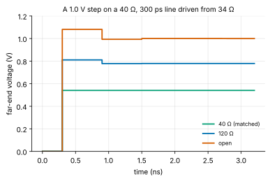
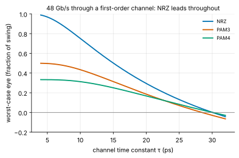

<!-- status: verified -->
# 23-04 · DRAM Interfaces: DDR, LPDDR and GDDR

| | |
|---|---|
| **Course** | [23 · Memory and Storage Technology](../README.md) |
| **University equivalent** | The memory-interface lectures of a senior high-speed digital design or memory-systems elective: prefetch and burst organization, terminated single-ended signaling and its power, timing and training on multi-gigabit buses, equalization and multilevel signaling, and the DDR/LPDDR/GDDR families (Jacob, Ng & Wang, *Memory Systems: Cache, DRAM, Disk*, interface chapters; Hall & Heck, *Advanced Signal Integrity for High-Speed Digital Designs*; Dally & Poulton, *Digital Systems Engineering*) |
| **Prerequisites** | [23-03](23-03-dram-cells-arrays-refresh.md) (banks, pages, core timings), [23-01](23-01-memory-hierarchy-and-memory-wall.md) (bandwidth and I/O energy), [13-07](../../13-electromagnetics/chapters/13-07-transmission-lines-time-domain.md) (transmission lines, reflections), [17-04](../../17-communication-systems/chapters/17-04-baseband-digital-transmission.md) (intersymbol interference, eye diagrams, PAM) |
| **Estimated study hours** | 6 |
| **Last verified** | 2026-11-25 |

**Learning objectives.** After this chapter you can:

1. Explain prefetch and burst length, and compute the core rate and access granularity of DDR4, DDR5 and LPDDR5X.
2. Compute the peak bandwidth of DIMM, LPDDR and GDDR systems and the pin counts they imply.
3. Derive termination current, signal swing and energy per bit for pseudo-open-drain and low-voltage-swing I/O, and the saving from data bus inversion.
4. Use transmission-line reflections and propagation delay to explain on-die termination, fly-by routing and interface training.
5. Quantify intersymbol interference on a lossy channel and the eye that decision-feedback equalization recovers, and compare NRZ, PAM3 and PAM4.
6. Choose among DDR, LPDDR and GDDR for a product, and assess vendors' bandwidth and power claims.

## 1. Big picture

A DRAM die's core runs at a few hundred megahertz, set by the bitline and sense-amplifier physics of 23-03, but its pins now carry 6 to 30 gigabits per second each. The interface bridges that gap. Inside, it reads many bits in parallel (prefetch) and serializes them. Outside, it drives terminated transmission lines with precisely trained timing, and increasingly with equalization and multilevel signaling. The interface sets a memory system's bandwidth, much of its energy per bit, its access granularity and its cost in pins. Three families make different tradeoffs among those: DDR for capacity, LPDDR for energy, and GDDR for bandwidth per pin. HBM (23-05) takes the fourth path of very many slow pins.

- **Servers:** DDR5 DIMMs carry terabytes per socket; multiplexed-rank DIMMs (MRDIMMs) raise bandwidth without faster DRAM cores [12].
- **Phones, laptops and some AI servers:** LPDDR5X soldered beside or on the processor package trades capacity flexibility for energy. NVIDIA's Grace CPU uses it in a data-center chip [11].
- **Graphics and inference cards:** GDDR7 reaches 28 Gb/s per pin on shipping cards and has moved to three-level signaling [5], [8].
- **Cost:** pins, package balls and board layers cost money, so bandwidth per pin and per millimetre of chip edge matter as much as bandwidth itself (23-01).

## 2. Intuition first

Think of the DRAM core as a warehouse that can fetch a whole pallet of boxes in one slow trip, and the interface as a loading dock whose conveyor belts run very fast but carry one box at a time. To keep the belts full, each trip into the warehouse must bring back as many boxes as the belts carry during the trip. That ratio is the **prefetch**: DDR4 fetches 8 bits per pin per core access, DDR5 and LPDDR5X 16 (and LPDDR5X up to 32) [1], [2], [4]. The warehouse barely got faster in twenty years. The dock got faster by bringing back bigger pallets.

The belts have problems of their own. At several gigabits per second, a bit lasts about 100–150 ps, while a signal takes about 7 ps to travel each millimetre of board trace. So a 50 mm route holds a few bits in flight at once, and the wire behaves as a transmission line (13-07). Unless the end of the line absorbs the wave (termination), the wave reflects back, and the echoes land on later bits. Termination stops the echoes but burns static power whenever current flows through it, so the interface families differ mainly in how they terminate and at what voltage.

Where the analogy breaks: pallets are not free. A bigger prefetch means a longer minimum burst, so every access moves more bytes whether the processor wanted them or not. That is why DDR5 split each DIMM into two narrower subchannels (§3.1).

## 3. Theory

### 3.1 Prefetch, burst length and access granularity

A DRAM's I/O pin transfers data at rate $R$ (transfers per second, often written MT/s). Its core delivers one column access every $t_{CCD}$ (column-to-column delay). Each access must supply enough bits per pin to keep the pin busy until the next access:

$$
n_{prefetch} = R \cdot t_{CCD}
\qquad\Longleftrightarrow\qquad
f_{core} = \frac{R}{n_{prefetch}} .
$$

Micron's data sheets give an 8n prefetch for DDR4, 16n for DDR5 and 16n or 32n for LPDDR5X [1], [2], [4]. So DDR4-3200 and DDR5-6400 both need a core column rate of 400 MHz (Example 23-04.1): DDR5 doubled the pin rate by doubling the prefetch, not by speeding up the core.

The **burst length** (BL) is the number of transfers one column command produces. To use the whole prefetch it equals $n$: BL8 for DDR4 and BL16 for DDR5. A channel of $W$ data bits therefore moves $W \cdot BL/8$ bytes per access, the **access granularity**. DDR4's 64-bit channel with BL8 moves 64 bytes, one processor cache line. Had DDR5 kept a 64-bit channel with BL16, every access would move 128 bytes, half of it often unwanted. DDR5 modules therefore have **two independent 32-bit subchannels**; each uses BL16 for a 64-byte payload [3]. Two subchannels also double the number of independent requests a module can serve at once. LPDDR5X's 16-bit channels give 32 bytes at BL16 or 64 at BL32 [4].

### 3.2 Bandwidth and pins

Peak bandwidth is the transfer rate times the bits per transfer:

$$
B = R \cdot \frac{W}{8}\quad\text{bytes/s} .
$$

A DDR5-6400 DIMM's 64 data bits give 51.2 GB/s. A GDDR7 card with a 512-bit bus at 28 Gb/s per pin gives 1,792 GB/s [7], [8]. The same bandwidth from DDR5-6400 would need 2,240 data pins (Example 23-04.2). Bandwidth per pin is the figure of merit wherever pins are scarce: at the edge of a GPU die, in a package's ball count, and in a phone's board area. "Peak" means every transfer slot is used. Real systems lose some to refresh, bank conflicts, read-write turnarounds and command overhead (23-03).

### 3.3 Why the bus must be terminated

A trace is a transmission line with characteristic impedance $Z_0$ and delay per unit length $\sqrt{\varepsilon_{eff}}/c$ (13-07). A driver with source resistance $R_s$ launches a wave $V_s Z_0/(R_s + Z_0)$. At a termination $R$, a fraction

$$
\Gamma = \frac{R - Z_0}{R + Z_0}
$$

reflects. The echo returns to the source, partly reflects again with $\Gamma_S = (R_s - Z_0)/(R_s + Z_0)$, and so on. The far-end voltage therefore steps toward its final value, overshooting or undershooting at each round trip of $2T_d$. If the line's round trip is short compared with the signal's rise time, the echoes blur into a smooth settle and nobody notices. If the round trip spans several bits, each echo lands on a later bit as interference. At 6400 MT/s, a unit interval (UI) is 156.25 ps, while a 50 mm trace has a one-way delay of about 334 ps, so DRAM buses must be terminated (Example 23-04.5).

DRAMs terminate on the die (**on-die termination**, ODT), with resistances programmable per rank and per operation. Micron's DDR4 parts offer 34 to 240 Ω of nominal termination and 34 or 48 Ω drivers [2]. DDR5 extended programmable ODT to the clock, chip-select and command/address pins as well [3].

### 3.4 Where the termination goes: POD and LVSTL

**Pseudo-open-drain (POD).** DDR4 and DDR5 terminate each data line to the I/O supply $V_{DDQ}$ (1.2 V for DDR4, 1.1 V for DDR5) [1], [2]. A 1 is sent by leaving the line at $V_{DDQ}$ (the driver's pull-up matches the termination, so no current flows). A 0 is sent by pulling down through the driver's on-resistance $R_{on}$ against the termination $R_{TT}$. Applying Ohm's law to the series path from $V_{DDQ}$ through $R_{TT}$ and $R_{on}$ to ground:

$$
I = \frac{V_{DDQ}}{R_{on} + R_{TT}},\qquad
V_{L} = V_{DDQ}\,\frac{R_{on}}{R_{on} + R_{TT}},\qquad
P_0 = V_{DDQ}\,I = \frac{V_{DDQ}^2}{R_{on} + R_{TT}} .
$$

The swing is $V_{DDQ} - V_L = V_{DDQ}R_{TT}/(R_{on} + R_{TT})$. Static current flows only while a 0 is driven, so the termination energy per bit is $P_0 \cdot \text{UI}$ times the fraction of zeros. Units: V/Ω = A; V·A = W; W·s = J. ✓

**Data bus inversion (DBI).** Because zeros cost energy and ones do not, DDR4 adds one wire per byte. On reads, if more than four of a byte's eight bits are 0, the DRAM inverts the byte and drives the DBI pin low; otherwise it sends the byte unchanged with DBI high [2]. A byte with $k$ zeros then puts $k$ low wires on the bus if $k \le 4$, and $(8 - k) + 1$ if $k > 4$. With random data, each $k$ occurs with probability $\binom{8}{k}/256$, so the expected number of low wires is

$$
\frac{1}{256}\left[\sum_{k=0}^{4} k\binom{8}{k} + \sum_{k=5}^{8}(9 - k)\binom{8}{k}\right]
= \frac{512 + 325}{256} = \frac{837}{256} = 3.27 ,
$$

against 4 without DBI: an 18.3% cut in termination energy. DBI also caps the number of wires switching low at once to 4 of 9, which reduces simultaneous-switching noise on $V_{DDQ}$.

**Low-voltage-swing terminated logic (LVSTL).** LPDDR5X terminates to ground instead, with $V_{DDQ}$ of only 0.5 V (0.3 V with termination off) [4]. Now a 1 costs current and a 0 is free, and the same formulas apply with $V_{DDQ}$ = 0.5 V. Termination power scales as $V_{DDQ}^2$, so dropping from 1.1 V to 0.5 V cuts it by a factor of 4.84 at equal resistances. That, with short soldered traces, is much of why LPDDR moves a bit for a fraction of DDR's energy (Example 23-04.4).

### 3.5 Timing at gigabits per second

At 6400 MT/s the data eye is 156.25 ps wide before any jitter or noise, and every source of skew eats into it. The biggest is routing topology. On a DIMM, data lines run point to point from the controller to each DRAM, but the clock and command/address signals run in a **fly-by** chain past all the DRAMs in turn [3]. The clock therefore reaches the last DRAM of a rank hundreds of picoseconds, several UIs, after the first (Example 23-04.6). The controller must compensate by launching each byte's data strobe with its own delay. It measures those delays at power-up by **training**:

- **Write leveling:** the DRAM samples the arriving clock with the data strobe and reports the result on a data pin; the controller sweeps the strobe delay until the edges align [2].
- **Read training and $V_{REF}$ training:** the controller reads known patterns and centres its sampling point and reference voltage in each data eye.
- **Command/address and chip-select training:** new in DDR5, these align the command bus to the clock without risking invalid commands [3].

Training results drift with temperature and voltage, so controllers retrain periodically. Every picosecond of uncorrected skew is margin lost.

### 3.6 Intersymbol interference and decision-feedback equalization

Board traces, connectors and package wiring are low-pass channels: a one-UI pulse comes out smeared over several UIs. Model the channel as a first-order low-pass with time constant τ. Its response to a pulse of height 1 lasting one UI $T$ rises to $1 - a$ by the end of the UI, where $a = e^{-T/\tau}$, then decays by a factor $a$ each further UI. Sampling at the ends of successive UIs gives the **cursors**:

$$
h_0 = 1 - a,\qquad h_k = (1 - a)\,a^k\ \ (k \ge 1),\qquad \sum_{k \ge 1} h_k = a .
$$

With symbols of ±1, the received sample for the current bit is $h_0x_0 + \sum_k h_kx_{-k}$. The worst case for a 1 has every earlier bit at −1, so the eye's half-opening, as a fraction of the full swing, is

$$
\text{eye} = h_0 - \sum_{k \ge 1} |h_k| = 1 - 2a .
$$

The eye closes when $a = 1/2$, that is when $T = \tau\ln 2$: without equalization this channel supports at most $1/(\tau\ln 2)$ bits per second.

A **decision-feedback equalizer** (DFE) subtracts $h_kx_{-k}$ for the last few decided bits, which it already knows. A one-tap DFE removes $h_1$ and a full DFE all post-cursors, leaving $h_0$ (Example 23-04.7). The catch is timing: the first tap's decision must feed back within one UI, which is hard at tens of gigabits per second, and a wrong decision is fed back as interference (error propagation). DDR5 and LPDDR5X DRAMs include DFE on their receivers [1], [3], [4]. Course 24 develops equalization in full.

### 3.7 Multilevel signaling: PAM3 and PAM4

Instead of two levels per UI, $M$ levels carry $\log_2 M$ bits per symbol, so the same bit rate needs a lower symbol rate and a lower **Nyquist frequency** (half the symbol rate), where channel loss is smaller. The cost is amplitude: with the same total swing, the $M - 1$ stacked eyes are each $1/(M - 1)$ as tall, an SNR penalty of $20\lg(M - 1)$ dB (6.02 dB for PAM3, 9.54 dB for PAM4). GDDR6X used PAM4. GDDR7 uses PAM3, sending 3 bits in 2 symbols (1.5 bits per symbol, using 8 of the 9 two-symbol combinations) [5]. Micron describes PAM3's tradeoff as fewer bits per cycle than PAM4 but "50% higher voltage margin" [6]: the ratio of eye heights is $(1/2)/(1/3) = 1.5$.

When does multilevel signaling pay? Compare, at the same bit rate, each scheme's eye amplitude: the channel's attenuation at its Nyquist frequency, divided by $M - 1$. If the loss in decibels grows linearly with frequency at α dB/GHz, PAM-$M$ beats NRZ when the extra loss NRZ suffers at its higher Nyquist frequency exceeds PAM's $20\lg(M - 1)$ penalty:

$$
\alpha\,(f_{N,NRZ} - f_{N,M}) > 20\lg(M - 1) .
$$

For a gently sloped channel NRZ wins; for a steep one PAM wins, and PAM3 crosses over before PAM4 does (Example 23-04.8). Real decisions also weigh the receiver's noise and its circuits' speed: a slower symbol clock is easier to build, which is part of GDDR7's case [6].

> **Going deeper — why a first-order channel never favours PAM.** For the RC channel of §3.6, the eye of PAM-$M$ is $(1 - a)/(M - 1) - a$ with $a = e^{-T_{sym}/\tau}$. Longer symbols shrink $a$, but only exponentially in $T_{sym}/\tau$, while the $1/(M - 1)$ factor is a fixed loss. Work through Lab Part 3 and you will find NRZ ahead of PAM3 and PAM4 at every τ where any eye is open; Problem 23-04.14 proves it. Real channels add skin-effect and dielectric losses that grow with $\sqrt f$ and $f$, plus reflections, so their loss at high frequency is far steeper than an RC's.

### 3.8 The families compared

| | DDR5 | LPDDR5X | GDDR7 |
|---|---|---|---|
| Pin rate (top bin, Nov 2026) | 7200 MT/s in Micron's Rev D bins; 8800 MT/s MRDIMMs [1], [12] | 9600 MT/s (Micron), 10.7 Gb/s (Samsung) [4], [9] | 28 Gb/s shipping [8]; 192 GB/s per device in the standard [5] |
| Channel | Two 32-bit subchannels per DIMM [3] | x16 channels, two per die [4] | Four independent channels per device [5] |
| Prefetch / burst | 16n, BL16 [1], [3] | 16n or 32n, BL16 or BL32 [4] | — |
| Signaling | POD, $V_{DDQ}$ = 1.1 V [1] | LVSTL, $V_{DDQ}$ = 0.5 V [4] | PAM3 [5] |
| Placement | DIMMs in sockets (expandable) | Soldered on board or package | Soldered beside the GPU, point to point |
| Optimized for | Capacity, serviceability | Energy per bit, standby power | Bandwidth per pin |

**DDR** keeps memory on removable modules so a server can carry terabytes and replace failures. The price is long, multi-drop routes (two DIMMs per channel share the bus), hence termination, buffering and modest pin rates. Registered DIMMs buffer the command bus. MRDIMMs add data buffers that interleave two ranks, so the host bus runs at twice each rank's rate: 8800 MT/s from ranks running 4400 [12].

**LPDDR** sits millimetres from the processor, usually soldered or in the same package, with no sockets and short point-to-point routes. That allows the low-swing LVSTL I/O and aggressive power states. The price is fixed capacity per package and no field upgrades.

**GDDR** is soldered in a ring around a GPU, one device per 32-bit slice of the bus, which allows the highest pin rates. The price is capacity: a 512-bit card with 32 GB is about as large as GDDR systems get [7].

**HBM** stacks DRAM dies on the processor's package with thousands of slow pins (23-05).

## 4. Worked examples

### Example 23-04.1 · Prefetch and access granularity (tier A)

**Setup.** Find the core column rate for (a) DDR4-3200 with an 8n prefetch, (b) DDR5-6400 with 16n, and LPDDR5X at 9600 MT/s with (c) 32n and (d) 16n. Find the bytes per access for (e) a 64-bit DDR4 channel at BL8, (f) a 32-bit DDR5 subchannel at BL16, (g) a hypothetical 64-bit DDR5 channel at BL16, and an LPDDR5X x16 channel at (h) BL32 and (i) BL16.

**Solution.**

- (a) $3200/8$ = **400** MHz; (b) $6400/16$ = **400** MHz; (c) $9600/32$ = **300** MHz; (d) $9600/16$ = **600** MHz.
- (e) $64 \times 8/8$ = **64** B; (f) $32 \times 16/8$ = **64** B; (g) $64 \times 16/8$ = **128** B.
- (h) $16 \times 32/8$ = **64** B; (i) $16 \times 16/8$ = **32** B.

**Units check.** (transfers/s)/(transfers per access) = accesses/s; bits × transfers/8 = bytes. ✓

**Sanity check.** Across two generations the core rate stayed at 400 MHz while the pin rate doubled. Without subchannels, (g) would have doubled every DDR5 access to two cache lines.

### Example 23-04.2 · Bandwidth and pins (tier A)

**Setup.** Find the peak bandwidth of (a) one DDR5-6400 DIMM (64 data bits) and (b) a 12-channel server socket, (c) one LPDDR5X x16 channel at 9600 MT/s, (d) the RTX 5090's 512-bit GDDR7 bus at 28 Gb/s and (e) the RTX 4090's 384-bit GDDR6X bus at 21 Gb/s [8]. (f) What is the ratio of (d) to (e)? (g) How many DDR5-6400 data pins would deliver (d)? (h) JEDEC quotes GDDR7 at up to 192 GB/s per device [5]: what pin rate does that imply for a 32-bit device? (i) An MRDIMM's host bus runs at 8800 MT/s by interleaving two ranks [12]: at what rate does each rank run?

**Solution.**

- (a) $6400 \times 10^6 \times 64/8$ = **51.2** GB/s; (b) × 12 = **614.4** GB/s.
- (c) $9600 \times 10^6 \times 16/8$ = **19.2** GB/s, matching Micron's per-channel maximum [4].
- (d) $28 \times 10^9 \times 512/8$ = **1792** GB/s; (e) $21 \times 10^9 \times 384/8$ = **1008** GB/s; (f) **1.78**.
- (g) $1792 \times 10^9 \times 8/(6.4 \times 10^9)$ = **2240** pins, 4.375 times the GPU's 512.
- (h) $192 \times 8/32$ = **48** Gb/s per pin.
- (i) $8800/2$ = **4400** MT/s.

**Units check.** transfers/s × bits/8 = bytes/s. ✓

**Sanity check.** Tom's Hardware gives 1,792 and 1,008 GB/s and a 78% increase [8]. The GPU reaches its bandwidth with a quarter of the pins DDR5 would need, at the cost of capacity.

### Example 23-04.3 · Pseudo-open-drain termination and DBI (tier B)

**Setup.** A DDR5 data line has $V_{DDQ}$ = 1.1 V [1], a 34 Ω driver and 40 Ω termination (both assumed, within the range of DDR4's settings [2]). Find (a) the low level, (b) the swing, (c) the current and (d) the power while a 0 is driven. At 6400 MT/s find (e) the UI, (f) the energy of one 0 and (g) the average termination energy per bit for random data. With DBI, find (h) the expected low wires per byte, (i) the energy per data bit and (j) the saving.

**Solution.**

- (a) $V_L = 1.1 \times 34/74$ = **0.505** V; (b) $1.1 - 0.505$ = **0.595** V.
- (c) $I = 1.1/74$ = **14.9** mA; (d) $P_0 = 1.1 \times 14.86$ mA = **16.4** mW.
- (e) $1/(6.4 \times 10^9)$ = **156.25** ps; (f) $16.35\ \text{mW} \times 156.25\ \text{ps}$ = **2.55** pJ; (g) half the bits are 0: **1.28** pJ/bit.
- (h) **3.27** (§3.4); (i) $2.555\ \text{pJ} \times 3.27/8$ = **1.04** pJ per data bit; (j) $1 - 3.27/4$ = **18.3** %.

**Units check.** V/Ω = A; W × s = J. ✓

**Sanity check.** A few picojoules per bit at the pin is the same order as 23-01's I/O energy budgets. DBI's saving is free in energy terms, at the cost of one extra wire per byte. The ngspice run confirms (a), (c) and (d).

### Example 23-04.4 · LVSTL termination in LPDDR5X (tier B)

**Setup.** An LPDDR5X line has $V_{DDQ}$ = 0.5 V [4], a 40 Ω driver and 40 Ω termination to ground (both assumed). Find (a) the high level, (b) the current and (c) the power while a 1 is driven. At 9600 MT/s find (d) the UI, (e) the energy of one 1 and (f) the average per bit for random data. (g) By what factor is that lower than Example 23-04.3(g)?

**Solution.**

- (a) $0.5 \times 40/80$ = **0.25** V; (b) $0.5/80$ = **6.25** mA; (c) $0.5 \times 6.25$ mA = **3.125** mW.
- (d) $1/(9.6 \times 10^9)$ = **104.2** ps; (e) $3.125\ \text{mW} \times 104.17\ \text{ps}$ = **0.326** pJ; (f) half of that: **0.163** pJ/bit.
- (g) $1.277/0.1628$ = **7.85** times.

**Units check.** As in Example 23-04.3. ✓

**Sanity check.** The factor comes from $(1.1/0.5)^2$ = 4.84 in power and a 1.5 times shorter UI. NVIDIA's claim that Grace's LPDDR5X uses one-eighth the power per GB/s of an eight-channel DDR5 design [11] is a system comparison (DRAM core, buffers and controller included), so the similar factor here is a coincidence, not a confirmation.

### Example 23-04.5 · Reflections on a DRAM line (tier B)

**Setup.** A 1.0 V step from a 34 Ω driver enters a 40 Ω line with a one-way delay of 300 ps. Find (a) the launched wave and (b) the source reflection coefficient. For a 120 Ω far-end termination, find (c) its reflection coefficient, the far-end voltage (d) after the first arrival and (e) after the second, and (f) its final value. With the far end open, find the far-end voltage (g) after the first arrival and (h) after the second.

**Solution.**

- (a) $1.0 \times 40/74$ = **0.541** V. With a matched 40 Ω end, this is also the far end's final value.
- (b) $\Gamma_S = (34 - 40)/74$ = **−0.0811**.
- (c) $\Gamma_L = (120 - 40)/160$ = **0.5**.
- (d) $0.5405 \times (1 + 0.5)$ = **0.811** V.
- (e) The reflected 0.2703 V returns to the source, reflects as $0.2703 \times (-0.0811) = -0.0219$ V, and arrives at the far end as $-0.0219 \times 1.5 = -0.0329$ V: **0.778** V.
- (f) $1.0 \times 120/154$ = **0.779** V.
- (g) $0.5405 \times 2$ = **1.081** V; (h) $1.081 + 0.5405 \times (-0.0811) \times 2$ = **0.993** V.

**Units check.** Reflection coefficients are dimensionless; every term is volts. ✓

**Sanity check.** A light termination (120 Ω) settles in one round trip with a small undershoot, because the 34 Ω driver nearly matches the line. An open end overshoots by 8%, and that overshoot rings down only because the source end is close to matched. The ngspice run confirms every value.

### Example 23-04.6 · Fly-by skew and write leveling (tier B)

**Setup.** A rank's eight DRAMs sit 15 mm apart along a fly-by clock route with an effective permittivity of 4 (assumed). Find (a) the delay per millimetre, (b) the clock skew from the first DRAM to the last, and that skew in (c) DDR5-6400 UIs and (d) clock periods (a clock period is two UIs). (e) How much trace length corresponds to a 5% UI timing budget?

**Solution.**

- (a) $\sqrt{4}/c = 2/(3.00 \times 10^8\ \text{m/s})$ = **6.67** ps/mm.
- (b) $7 \times 15$ mm = 105 mm, so **700** ps.
- (c) $700/156.25$ = **4.48** UI; (d) **2.24** periods.
- (e) $0.05 \times 156.25\ \text{ps}/6.67\ \text{ps/mm}$ = **1.17** mm.

**Units check.** s/m × 10⁻³ m/mm = s/mm. ✓

**Sanity check.** The skew is several bits, and a millimetre of length mismatch spends the whole budget. No layout can match lengths that well across a module, so the controller measures each byte's delay (write leveling) and corrects it in silicon.

### Example 23-04.7 · Intersymbol interference and DFE (tier C)

**Setup.** A DDR5-8800 data line behaves as a first-order low-pass with τ = 80 ps (assumed). Find (a) $a = e^{-\text{UI}/\tau}$, the cursors (b) $h_0$, (c) $h_1$ and (d) $h_2$, and the worst-case eye as a fraction of the swing (e) with no equalization, (f) with a one-tap DFE and (g) with a full DFE. (h) What is the highest bit rate at which this channel has any eye without equalization?

**Solution.**

- (a) UI = 113.64 ps, so $a = e^{-113.64/80}$ = **0.242**.
- (b) $h_0 = 1 - a$ = **0.758**; (c) $h_1 = h_0 a$ = **0.183**; (d) $h_2 = h_0a^2$ = **0.0443**.
- (e) $1 - 2a$ = **0.517**.
- (f) $h_0 - (a - h_1)$ = **0.700**.
- (g) $h_0$ = **0.758**.
- (h) $1/(\tau\ln 2)$ = **18.0** Gb/s.

**Units check.** UI/τ is dimensionless; 1/s = bits/s for NRZ. ✓

**Sanity check.** One tap recovers 0.18 of the swing, about three-quarters of what a full DFE can, because $h_1$ dominates the post-cursors. The ngspice pulse response gives the same cursors to within 0.1%.

### Example 23-04.8 · NRZ, PAM3 or PAM4? (tier C)

**Setup.** A link must carry 48 Gb/s per pin. For NRZ, PAM3 (1.5 bits per symbol) and PAM4, find (a) the symbol rates and (b) the Nyquist frequencies. (c) Find the eye-height penalties of PAM3 and PAM4 against NRZ, and (d) PAM3's eye-height advantage over PAM4. A channel loses α = 1 dB/GHz (assumed, linear in frequency). Find each scheme's eye amplitude at its Nyquist frequency, as a fraction of the transmitted swing: (e) NRZ, (f) PAM3 and (g) PAM4. Find the loss slopes above which (h) PAM3 beats NRZ, (i) PAM4 beats NRZ and (j) PAM4 beats PAM3.

**Solution.**

- (a) **48**, **32** and **24** GBd; (b) **24**, **16** and **12** GHz.
- (c) $20\lg 2$ = **6.02** dB and $20\lg 3$ = **9.54** dB; (d) $(1/2)/(1/3)$ = **1.5**.
- (e) $10^{-24/20}$ = **0.0631**; (f) $10^{-16/20}/2$ = **0.0792**; (g) $10^{-12/20}/3$ = **0.0837**.
- (h) $6.02/(24 - 16)$ = **0.753** dB/GHz; (i) $9.54/(24 - 12)$ = **0.795** dB/GHz; (j) $20\lg 1.5/(16 - 12)$ = **0.880** dB/GHz.

**Units check.** dB/(dB/GHz) = GHz; amplitudes are ratios. ✓

**Sanity check.** At 1 dB/GHz all three crossovers have passed, so PAM4 has the tallest eye, but only by 6% over PAM3. Below about 0.75 dB/GHz NRZ wins outright. GDDR7's choice of PAM3 trades a little eye height on very lossy channels for a simpler encoder and more margin against noise [6].

<!-- answer-key -->

| ID | Quantity | Value | Unit |
|---|---|---|---|
| Ex 23-04.1a | core rate, DDR4-3200 | 400 | MHz |
| Ex 23-04.1b | core rate, DDR5-6400 | 400 | MHz |
| Ex 23-04.1c | core rate, LPDDR5X-9600, 32n | 300 | MHz |
| Ex 23-04.1d | core rate, LPDDR5X-9600, 16n | 600 | MHz |
| Ex 23-04.1e | access, DDR4 x64 BL8 | 64 | B |
| Ex 23-04.1f | access, DDR5 x32 BL16 | 64 | B |
| Ex 23-04.1g | access, x64 BL16 | 128 | B |
| Ex 23-04.1h | access, LPDDR5X x16 BL32 | 64 | B |
| Ex 23-04.1i | access, LPDDR5X x16 BL16 | 32 | B |
| Ex 23-04.2a | DDR5-6400 DIMM | 51.2 | GB/s |
| Ex 23-04.2b | 12 channels | 614.4 | GB/s |
| Ex 23-04.2c | LPDDR5X x16 channel | 19.2 | GB/s |
| Ex 23-04.2d | RTX 5090 | 1792 | GB/s |
| Ex 23-04.2e | RTX 4090 | 1008 | GB/s |
| Ex 23-04.2f | bandwidth ratio | 1.78 | |
| Ex 23-04.2g | DDR5-6400 pins for 1,792 GB/s | 2240 | |
| Ex 23-04.2g1 | pin ratio | 4.375 | |
| Ex 23-04.2h | GDDR7 pin rate for 192 GB/s | 48 | Gb/s |
| Ex 23-04.2i | MRDIMM rank rate | 4400 | MT/s |
| Ex 23-04.3a | POD low level | 0.505 | V |
| Ex 23-04.3b | POD swing | 0.595 | V |
| Ex 23-04.3c | POD current | 14.9 | mA |
| Ex 23-04.3c1 | POD current, 4 s.f. | 14.86 | mA |
| Ex 23-04.3d | POD power | 16.4 | mW |
| Ex 23-04.3d1 | POD power, 4 s.f. | 16.35 | mW |
| Ex 23-04.3e | UI at 6400 MT/s | 156.25 | ps |
| Ex 23-04.3f | energy of one 0 | 2.55 | pJ |
| Ex 23-04.3f1 | energy of one 0, 4 s.f. | 2.555 | pJ |
| Ex 23-04.3g | energy per bit, random | 1.28 | pJ |
| Ex 23-04.3h | low wires per byte with DBI | 3.27 | |
| Ex 23-04.3i | energy per data bit with DBI | 1.04 | pJ |
| Ex 23-04.3j | DBI saving | 18.3 | % |
| Ex 23-04.4a | LVSTL high level | 0.25 | V |
| Ex 23-04.4b | LVSTL current | 6.25 | mA |
| Ex 23-04.4c | LVSTL power | 3.125 | mW |
| Ex 23-04.4d | UI at 9600 MT/s | 104.2 | ps |
| Ex 23-04.4d1 | UI at 9600 MT/s, 5 s.f. | 104.17 | ps |
| Ex 23-04.4e | energy of one 1 | 0.326 | pJ |
| Ex 23-04.4f | energy per bit, random | 0.163 | pJ |
| Ex 23-04.4f1 | energy per bit, random, 4 s.f. | 0.1628 | pJ |
| Ex 23-04.4g | POD over LVSTL energy | 7.85 | |
| Ex 23-04.4g0 | POD energy per bit, 4 s.f. | 1.277 | pJ |
| Ex 23-04.5a | launched wave | 0.541 | V |
| Ex 23-04.5a1 | launched wave, 4 s.f. | 0.5405 | V |
| Ex 23-04.5b | source reflection coefficient | -0.0811 | |
| Ex 23-04.5bL | load reflection coefficient, 120 Ω | 0.5 | |
| Ex 23-04.5c | far end, first arrival, 120 Ω | 0.811 | V |
| Ex 23-04.5c1 | wave reflected from the far end | 0.2703 | V |
| Ex 23-04.5c2 | wave re-reflected at the source | -0.0219 | V |
| Ex 23-04.5c3 | second far-end increment | -0.0329 | V |
| Ex 23-04.5d | far end, second arrival, 120 Ω | 0.778 | V |
| Ex 23-04.5e | far end, final, 120 Ω | 0.779 | V |
| Ex 23-04.5f | far end, first arrival, open | 1.081 | V |
| Ex 23-04.5g | far end, second arrival, open | 0.993 | V |
| Ex 23-04.6a | delay per millimetre | 6.67 | ps/mm |
| Ex 23-04.6a1 | speed of light | 3.00e8 | m/s |
| Ex 23-04.6b0 | fly-by length | 105 | mm |
| Ex 23-04.6b | clock skew | 700 | ps |
| Ex 23-04.6c | skew in UIs | 4.48 | |
| Ex 23-04.6d | skew in clock periods | 2.24 | |
| Ex 23-04.6e | trace length for 5% of a UI | 1.17 | mm |
| Ex 23-04.7a0 | DDR5-8800 UI | 113.64 | ps |
| Ex 23-04.7a | a | 0.242 | |
| Ex 23-04.7b | h0 | 0.758 | |
| Ex 23-04.7c | h1 | 0.183 | |
| Ex 23-04.7d | h2 | 0.0443 | |
| Ex 23-04.7e | eye, no equalization | 0.517 | |
| Ex 23-04.7f | eye, one-tap DFE | 0.700 | |
| Ex 23-04.7g | eye, full DFE | 0.758 | |
| Ex 23-04.7h | highest unequalized rate | 18.0 | Gb/s |
| Ex 23-04.8a1 | NRZ symbol rate | 48 | GBd |
| Ex 23-04.8a2 | PAM3 symbol rate | 32 | GBd |
| Ex 23-04.8a3 | PAM4 symbol rate | 24 | GBd |
| Ex 23-04.8b1 | NRZ Nyquist frequency | 24 | GHz |
| Ex 23-04.8b2 | PAM3 Nyquist frequency | 16 | GHz |
| Ex 23-04.8b3 | PAM4 Nyquist frequency | 12 | GHz |
| Ex 23-04.8c1 | PAM3 penalty | 6.02 | dB |
| Ex 23-04.8c2 | PAM4 penalty | 9.54 | dB |
| Ex 23-04.8d | PAM3 over PAM4 eye height | 1.5 | |
| Ex 23-04.8e | NRZ eye amplitude at 1 dB/GHz | 0.0631 | |
| Ex 23-04.8f | PAM3 eye amplitude | 0.0792 | |
| Ex 23-04.8g | PAM4 eye amplitude | 0.0837 | |
| Ex 23-04.8h | slope where PAM3 beats NRZ | 0.753 | dB/GHz |
| Ex 23-04.8i | slope where PAM4 beats NRZ | 0.795 | dB/GHz |
| Ex 23-04.8j | slope where PAM4 beats PAM3 | 0.880 | dB/GHz |
| Txt 23-04.a | expected low wires with DBI, sums | 837 | |
| Txt 23-04.b | first DBI sum | 512 | |
| Txt 23-04.c | second DBI sum | 325 | |
| Txt 23-04.d | V_DDQ² ratio, 1.1 V to 0.5 V | 4.84 | |
| Txt 23-04.e | one-way delay of a 50 mm trace | 334 | ps |
| Txt 23-04.f | PAM4 lead over PAM3 at 1 dB/GHz | 6 | % |
| Txt 23-04.g | UI ratio, 9600 over 6400 MT/s | 1.5 | |
| Txt 23-04.h | overshoot of the open end | 8 | % |
| Txt 23-04.i | eye recovered by one tap | 0.18 | |
| Txt 23-04.j | one-tap share of the full-DFE gain | 0.76 | |
| Txt 23-04.k | raw LPDDR6 channel bandwidth at 14,400 MT/s | 43.2 | GB/s |
| Txt 23-04.l | Grace memory energy per bit | 4.0 | pJ/bit |

## 5. Simulate it

The lab is [labs/23-04-lab/](../labs/23-04-lab/README.md). `ddrio.py` holds the chapter's models. The netlist `dram_io.cir` contains:

- a POD driver against termination to $V_{DDQ}$ and an LVSTL driver against termination to ground (Examples 23-04.3 and 23-04.4);
- a 1.0 V step on a 40 Ω, 300 ps line with a matched, a 120 Ω and an open far end (Example 23-04.5);
- a first-order channel driven by one DDR5-8800 UI, sampled at the ends of successive UIs (Example 23-04.7).

The notebook enumerates DBI codes, simulates eyes for NRZ, PAM3 and PAM4 through an RC channel, and tabulates the families' bandwidths.

*Figure 1. Termination decides whether a line settles in one flight or rings over several round trips; at gigabits per second each round trip spans several bits.*

**Predict, then run:**

1. *Predict* the POD low level, current and power, the LVSTL high level, and the first three far-end voltages for each termination. Then run `ngspice -b dram_io.cir`.
2. *Predict* the three cursors of the RC channel and compare with the simulation.
3. In the notebook, enumerate all 256 bytes with and without DBI. *Predict* the largest number of low wires in each case.
4. Simulate NRZ, PAM3 and PAM4 eyes at 48 Gb/s through an RC channel with τ = 15 ps. *Predict* which has the tallest eye before running, then compare with the loss-slope channel of Example 23-04.8.

*Figure 2. A gently sloped (first-order) channel never favours multilevel signaling; steep real-world losses do (§3.7).*

## 6. Engineering tradeoffs

| Knob | Improves | Costs | Typical decision owner |
|---|---|---|---|
| Larger prefetch and burst | Pin rate at a fixed core speed | Access granularity (wasted bytes); needs narrower channels | JEDEC, DRAM architect |
| Narrower subchannels | Granularity, request concurrency | More command pins and controller queues | JEDEC, memory-controller designer |
| Stronger termination (lower R_TT) | Signal integrity, settling | Static power, smaller swing | Board and SI engineer, controller firmware |
| Lower V_DDQ (LVSTL) | I/O energy (∝ V²) | Noise margin; short routes only | LPDDR standard, SoC architect |
| Data bus inversion | Termination energy, switching noise | One wire per byte; encode logic | JEDEC, controller designer |
| DFE taps | Eye opening on lossy channels | Receiver power, timing closure, error propagation | DRAM and PHY designers |
| PAM3/PAM4 signaling | Lower Nyquist frequency for a bit rate | 6–9.5 dB eye penalty; encoders, linear drivers | JEDEC, GPU and DRAM vendors |
| DIMMs vs soldered memory | Capacity, field repair, upgrades | Pin rate, I/O energy, board area | System architect, platform owner |

## 7. Numbers to know

| Quantity | Typical value | Note |
|---|---|---|
| Prefetch | DDR4 8n; DDR5 16n; LPDDR5X 16n or 32n | [1], [2], [4] |
| Core column rate | about 300–600 MHz | Example 23-04.1 |
| UI | 156 ps at 6400 MT/s; 104 ps at 9600 MT/s | |
| I/O supply | DDR4 1.2 V POD; DDR5 1.1 V POD; LPDDR5X 0.5 V LVSTL | [1], [2], [4] |
| Termination and driver | tens of ohms (DDR4: 34–240 Ω ODT, 34 or 48 Ω drivers) | [2] |
| Trace delay | about 6–7 ps/mm on FR-4-class boards | Example 23-04.6 (assumed permittivity) |
| Top pin rates (as of Nov 2026) | DDR5 MRDIMM 8800 MT/s; LPDDR5X 10.7 Gb/s; GDDR7 28 Gb/s shipping | [9], [8], [12] |
| Peak bandwidth | DDR5-6400 DIMM 51.2 GB/s; LPDDR5X x16 channel 19.2 GB/s; RTX 5090 1.79 TB/s | Example 23-04.2 |
| PAM eye penalty | PAM3 6.02 dB; PAM4 9.54 dB | §3.7 |

## 8. Common mistakes

- **Confusing MT/s with MHz.** DDR transfers twice per clock: DDR5-6400 has a 3.2 GHz clock and 6400 MT/s on each data pin.
- **Forgetting the burst.** Bandwidth comes from bursts; a single random 8-byte read still costs a whole 64-byte burst and possibly an activation (23-03).
- **Treating peak bandwidth as delivered.** Refresh, bank conflicts, turnarounds and command overhead cut it, often substantially for random traffic.
- **Assuming termination power is symmetric.** POD burns power on zeros, LVSTL on ones. DBI helps only because of that asymmetry.
- **Ignoring flight time.** At 6–7 ps/mm, a module's routes are several UIs long. Without training, nothing works.
- **Assuming multilevel signaling always wins.** It trades amplitude for bandwidth, and wins only on steep-loss channels (§3.7).
- **Comparing energy claims with different baselines.** "One-eighth the power" depends on what is compared: per GB/s or total, against 8 or 12 channels, and whether the DRAM core is included.

## 9. Practitioner lens

**State of the art (as of Nov 2026).**

- *DDR5* [Established for data sheets; Industry estimate for vendor claims]. Micron's 16 Gb die bins run to DDR5-7200 (advance) [1]. MRDIMMs reach 8800 MT/s on the host bus by interleaving two ranks. Micron and Intel claim up to 40% lower loaded latency than a DDR5-6400 RDIMM, and the next generation targets 12,800 MT/s [12].
- *LPDDR5X and LPDDR6* [Established for announcements; Industry estimate for rates]. Samsung announced 10.7 Gb/s LPDDR5X on 17 Apr 2024 [9]. JEDEC published LPDDR6 (JESD209-6) in Jul 2025. Reporting gives 10,667–14,400 MT/s and 28.5–38.4 GB/s per 24-bit channel, split into two 12-bit subchannels, with a 32-byte minimum granularity and per-row activation counting [10]. The reported bandwidth is below the raw 24 bits × rate (43.2 GB/s at 14,400 MT/s), consistent with part of each burst carrying metadata; this has not been checked against the standard.
- *GDDR7* [Established]. JESD239 (5 Mar 2024) is the first JEDEC DRAM standard with PAM signaling, with up to 192 GB/s per device, four channels instead of GDDR6's two, and on-die ECC [5]. NVIDIA's RTX 5090 uses 32 GB on a 512-bit bus [7] at 28 Gb/s per pin [8].
- *LPDDR in the data center* [Industry estimate: vendor comparison]. NVIDIA says Grace's LPDDR5X "provides up to 53% more bandwidth at one-eighth the power per gigabyte per second" than an eight-channel DDR5 design, at similar cost [11]. Its tuning guide instead quotes up to 500 GB/s in about 16 W, "one fifth the power of 12 channels of conventional DDR5 memory" [13]. Taken at face value, 16 W for 500 GB/s is 4.0 pJ/bit for the whole memory subsystem.

**Why it matters commercially.** The interface decides the memory bill of materials and much of a platform's power budget. A server CPU's channel count and DIMM speed set its bandwidth per core. A phone's LPDDR generation sets its standby battery drain. A GPU's GDDR or HBM choice sets both its bandwidth and its capacity ceiling. For an investor or acquirer, interface IP (controllers and PHYs), module buffer chips (RCDs and data buffers for MRDIMMs) and test and training expertise are distinct businesses from the DRAM die itself.

**Marketing vs Reality.**

- *"DDR5-8800."* For MRDIMMs that is the host bus. Each rank runs at half the rate [12], so latency to a single rank does not improve.
- *"One-eighth the power."* Check the baseline: per GB/s or total, against how many DDR5 channels, and with which parts of the subsystem. NVIDIA's own tuning guide states the comparison differently, as one fifth of the power of 12 DDR5 channels [13].
- *"192 GB/s per device."* That is the standard's ceiling at 48 Gb/s per pin (Example 23-04.2). Shipping parts run slower: 28 Gb/s on the RTX 5090 [8].
- *"PAM3 is better than PAM4."* Each wins on different channels (Example 23-04.8). PAM3's real advantages are noise margin and simpler circuits [6].

**Questions for engineering leaders.**

1. **"What fraction of peak bandwidth do you deliver on our access pattern?"** *Strong:* measured efficiency with random and streaming traffic, refresh and turnaround losses broken out. *Evasive:* the peak number.
2. **"What is your energy per bit at the pins and in total, and against what baseline?"** *Strong:* pJ/bit split into I/O, DRAM core and controller, with matched comparisons. *Evasive:* "eight times better."
3. **"How much timing margin is left after training, across temperature and voltage?"** *Strong:* eye width and height after training at corners, retraining cadence and its cost. *Evasive:* "it passes."
4. **"Why this interface family, and what do we give up?"** *Strong:* the capacity, upgradeability, bandwidth and cost tradeoff for the product. *Evasive:* "it's the industry standard."
5. **"What happens to your PHY at the next speed grade?"** *Strong:* the channel-loss budget, equalization headroom and the plan for multilevel signaling or shorter channels. *Evasive:* "we'll scale."

## 10. Concept check

**Q1.** Why did DDR5 split each DIMM into two 32-bit subchannels?

Answer

DDR5 doubled the prefetch and burst length to 16 to double the pin rate at the same core speed. On a 64-bit channel, BL16 would move 128 bytes per access, two cache lines. Two 32-bit subchannels keep 64 bytes per access and add concurrency [3].

**Q2.** Why does a POD driver burn power only when sending a 0?

Answer

The line is terminated to $V_{DDQ}$. Sending a 1 leaves it at $V_{DDQ}$, so no current flows through the termination. Sending a 0 pulls it down through the driver, so current $V_{DDQ}/(R_{on} + R_{TT})$ flows for the whole UI.

**Q3.** Why does DBI cut average termination energy by about 18% for random data?

Answer

It inverts any byte with more than four zeros, so no byte ever drives more than four low wires (counting the DBI pin). The expected count falls from 4 to 837/256 = 3.27 per byte (§3.4).

**Q4.** Why must DRAM buses be terminated, and why on the die?

Answer

A route's round-trip delay spans several bits, so unabsorbed reflections land on later bits as interference (§3.3). On-die termination puts the resistor at the receiver with no stub, and lets the controller program it per rank and per operation.

**Q5.** What does write leveling correct, and why can't layout correct it instead?

Answer

It corrects the fly-by clock's different arrival time at each DRAM relative to its directly routed data strobe. The skew is several UIs (Example 23-04.6), and a 5% UI budget is about a millimetre of trace, far tighter than any module can be length-matched across all its routes.

**Q6.** A link has a gently sloped first-order channel. Should it move from NRZ to PAM4?

Answer

No. On a first-order channel the eye penalty of PAM4 (9.54 dB) outweighs the loss saved by halving the Nyquist frequency (§3.7). Multilevel signaling pays only when loss rises steeply with frequency, above about 0.8 dB/GHz in Example 23-04.8.

**Q7.** Why does LPDDR use a 0.5 V I/O supply when DDR5 uses 1.1 V?

Answer

Termination power scales as $V_{DDQ}^2$, so 0.5 V cuts it almost fivefold. The smaller swing is affordable because LPDDR's routes are short and point to point, with no DIMM sockets or multiple loads, so less noise and loss must be overcome.

Problem set: [23-04 problems](../problems/23-04-problems.md).

## 11. Key terms

[Prefetch (DRAM)](../../../reference/glossary.md#prefetch-dram) · [Burst length](../../../reference/glossary.md#burst-length) · [Access granularity](../../../reference/glossary.md#access-granularity) · [DDR5 subchannel](../../../reference/glossary.md#ddr5-subchannel) · [On-die termination (ODT)](../../../reference/glossary.md#on-die-termination-odt) · [Pseudo-open-drain (POD) I/O](../../../reference/glossary.md#pseudo-open-drain-pod-i-o) · [Low-voltage-swing terminated logic (LVSTL)](../../../reference/glossary.md#low-voltage-swing-terminated-logic-lvstl) · [Data bus inversion (DBI)](../../../reference/glossary.md#data-bus-inversion-dbi) · [Fly-by topology](../../../reference/glossary.md#fly-by-topology) · [Write leveling](../../../reference/glossary.md#write-leveling) · [PAM3](../../../reference/glossary.md#pam3) · [MRDIMM](../../../reference/glossary.md#mrdimm) · [Reflection coefficient](../../../reference/glossary.md#reflection-coefficient) · [Decision-feedback equalizer (DFE)](../../../reference/glossary.md#decision-feedback-equalizer-dfe) · [PAM4](../../../reference/glossary.md#pam4)

## 12. Connections

- **Previous:** [23-03](23-03-dram-cells-arrays-refresh.md) built the DRAM core whose slow column cycle this interface hides; [13-07](../../13-electromagnetics/chapters/13-07-transmission-lines-time-domain.md) derived the reflections; [17-04](../../17-communication-systems/chapters/17-04-baseband-digital-transmission.md) the eye diagram and PAM.
- **Next:** [23-05](23-05-hbm-in-depth.md) takes the opposite path: thousands of slow pins through a silicon interposer.
- **Used later:** [24-01](../../24-high-speed-io-signal-integrity-and-photonics/chapters/24-01-signal-integrity-fundamentals.md) and [24-03](../../24-high-speed-io-signal-integrity-and-photonics/chapters/24-03-serdes-architecture.md) develop channel loss and equalization in full; [24-06](../../24-high-speed-io-signal-integrity-and-photonics/chapters/24-06-d2d-memory-phys-scale-up.md) covers memory PHYs and die-to-die links.

## 13. Further study

- B. Jacob, S. W. Ng and D. T. Wang, *Memory Systems: Cache, DRAM, Disk*, Morgan Kaufmann, 2008: DRAM interfaces, signaling and controllers.
- S. H. Hall and H. L. Heck, *Advanced Signal Integrity for High-Speed Digital Designs*, Wiley-IEEE Press, 2009: transmission lines, termination, equalization.
- W. J. Dally and J. W. Poulton, *Digital Systems Engineering*, Cambridge University Press, 1998: signaling conventions and their energy.
- A DRAM data sheet's sections on ODT, write leveling and DBI, such as [2].

## 14. Sources

1. Micron Technology, "16Gb DDR5 SDRAM Addendum, Die Revision D," Rev. F 04/2024, <https://mm.digikey.com/Volume0/opasdata/d220001/medias/docus/7969/16gb-ddr5-sdram-dierevd.pdf>. [R-465]
2. Micron Technology, "16Gb DDR4 SDRAM" data sheet, Rev. H 8/2021, <https://mm.digikey.com/Volume0/opasdata/d220001/medias/docus/8827/16gb-ddr4-sdram.pdf>. [R-465], [R-470]
3. Micron Technology, "Micron DDR5: Client Module Features," white paper, Rev. A 10/2021 (copy hosted by a distributor), <https://www.simms.co.uk/Uploads/Resources/27/357d2ced-2662-46ad-9d63-22f3ae58a98f.pdf>. [R-470]
4. Micron Technology, "Automotive LPDDR5X SDRAM, MT62F512M32D1," data sheet, Rev. G 05/2025, <https://mm.digikey.com/Volume0/opasdata/d220001/medias/docus/7182/MT62F512M32D1.pdf>. [R-470]
5. JEDEC, "JEDEC Publishes GDDR7 Graphics Memory Standard," press release, 5 Mar 2024, as reproduced by Design & Reuse, <https://us.design-reuse.com/news/55819/jedec-gddr7-graphics-memory-standard.html>. [R-471]
6. Micron Technology, "GDDR7 – the next generation of graphics memory," blog, 4 Jun 2024, <https://www.micron.com/about/blog/memory/dram/unveiling-the-next-generation-of-graphics-memory-gddr7>. [R-471]
7. NVIDIA, "GeForce RTX 5090 Graphics Cards" product page (specifications), <https://www.nvidia.com/en-us/geforce/graphics-cards/50-series/rtx-5090/>. [R-471]
8. J. Walton, "Nvidia GeForce RTX 5090 Founders Edition review," Tom's Hardware, 23 Jan 2025, <https://www.tomshardware.com/pc-components/gpus/nvidia-geforce-rtx-5090-review>. [R-471]
9. Samsung Electronics, "Samsung Develops Industry's Fastest 10.7Gbps LPDDR5X DRAM, Optimized for AI Applications," 17 Apr 2024, <https://news.samsung.com/global/samsung-develops-industrys-fastest-10-7gbps-lpddr5x-dram-optimized-for-ai-applications>. [R-472]
10. N. Ali, "JEDEC releases LPDDR6 standard – data rates reach 14,400 MT/s," Notebookcheck, 11 Jul 2025, <https://www.notebookcheck.net/JEDEC-releases-LPDDR6-standard-data-rates-reach-14-400-MT-s.1055771.0.html>. [R-472]
11. J. Evans et al., "NVIDIA Grace CPU Superchip Architecture In Depth," NVIDIA Technical Blog, 20 Jan 2023, <https://developer.nvidia.com/blog/nvidia-grace-cpu-superchip-architecture-in-depth>. [R-473]
12. A. Shilov, "Micron unveils MRDIMMs for Intel Xeon 6: Up to 256GB DDR5-8800 modules," Tom's Hardware, 19 Jul 2024, <https://www.tomshardware.com/desktops/servers/micron-unveils-mrdimms-for-intel-xeon-6-up-to-256gb-ddr5-8800-modules>. [R-472]
13. NVIDIA, "Grace Performance Tuning Guide" (online documentation, read Nov 2026), <https://docs.nvidia.com/dccpu/grace-perf-tuning-guide/index.html>. [R-473]
