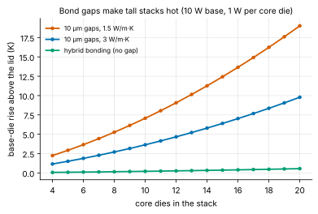
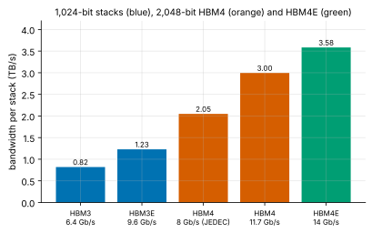

<!-- status: reviewed -->
# 23-05 · HBM in Depth

| | |
|---|---|
| **Course** | [23 · Memory and Storage Technology](../README.md) |
| **University equivalent** | The 3D-integration and high-bandwidth-memory lectures of a graduate memory-systems or advanced-packaging course: die stacking with through-silicon vias, the base die, wide parallel interfaces on silicon interposers, thermal and yield limits of stacks, and the HBM generations (Lau, *Chiplet Design and Heterogeneous Integration Packaging*; Jacob, Ng & Wang, *Memory Systems: Cache, DRAM, Disk*, DRAM chapters) |
| **Prerequisites** | [23-03](23-03-dram-cells-arrays-refresh.md) (DRAM arrays, refresh, temperature), [23-04](23-04-dram-interfaces.md) (bandwidth, termination and I/O energy), [23-01](23-01-memory-hierarchy-and-memory-wall.md) (the memory wall, CV² energy, decode intensity), [04-03](../../04-physics-for-ee/chapters/04-03-gauss-law.md) (Gauss's law) |
| **Estimated study hours** | 7 |
| **Last verified** | 2026-11-25 |

**Learning objectives.** After this chapter you can:

1. Compute an HBM stack's bandwidth and capacity from its width, pin rate, layer count and die density, and check vendors' claims against them.
2. Explain why a wide, slow, unterminated interface on an interposer costs far less energy per bit than DDR or GDDR signaling, and compute its I/O energy.
3. Derive a through-silicon via's capacitance and resistance and estimate the die area that TSVs consume.
4. Budget a stack's height and heat flow, and show why bonding layers, not silicon, dominate its thermal resistance.
5. Compute stack yield and explain why HBM consumes two to three times as many DRAM wafers per bit as conventional DRAM.
6. Connect HBM to the accelerator business: stacks per GPU, CoWoS capacity, pricing and the generations from HBM3 to HBM4E.

## 1. Big picture

An AI accelerator's speed on large models is set by memory bandwidth (23-01), and the pins at a processor's edge are scarce (23-04). High Bandwidth Memory solves both by stacking 8 to 16 DRAM dies on a logic base die, joining them with thousands of vertical through-silicon vias (TSVs), and placing the stack millimetres from the processor on a silicon interposer. There it can use 1,024 or 2,048 data wires, each running at a modest rate with no termination. One HBM4 stack moves 2 to 3 TB/s [2], [4], more than a whole server socket of DDR5. HBM is also the most complex product in the memory industry: it needs thinner dies, new bonding steps, a logic process for the base die and a share of scarce advanced-packaging capacity. Its economics now shape the whole DRAM market.

- **AI accelerators:** every leading training and inference GPU uses HBM. NVIDIA's Blackwell Ultra carries 288 GB in eight 12-high stacks [10]; Rubin carries 288 GB of HBM4 at 19.2 TB/s [11], revised down from the 22 TB/s NVIDIA quoted earlier in 2026 [22].
- **DRAM economics:** HBM takes several times more wafer area per bit than ordinary DRAM (Example 23-05.7), so its demand tightens supply and lifts prices for all DRAM [14].
- **Packaging:** each accelerator needs an interposer from capacity-limited lines such as TSMC's CoWoS [15].
- **Competition:** stack height, bonding method, base-die process and pin rate are where SK hynix, Samsung and Micron now differentiate (§9).

## 2. Intuition first

Think of a city that needs to move a million commuters an hour from the suburbs. One way is a few motorways with fast cars: that is DDR and GDDR, a few dozen pins per device at very high rates, each pin an expensive, carefully terminated transmission line. The other is to build the suburb right next to the city and connect them with two thousand footpaths: HBM. Each path is slow, about 8 to 12 Gb/s, but there are so many and they are so short that the total flow is enormous, and walking costs almost no energy. The price is that the suburb must be built on the city's doorstep, on a shared foundation (the interposer), and must be very tall to hold enough people (stacked dies).

The analogy breaks in two places. A tall stack of dies is not like a tall building that cools from all sides: all its heat must leave through the top, so every layer's bond adds thermal resistance (§3.5). And the footpaths are not free to build: each data wire needs a microbump on the processor, a trace on the interposer and a TSV path through the stack, and the interposer area is itself scarce (§3.6).

```text
          heat sink / lid
   ┌──────────────────────────┐
   │ core die 12 (DRAM)       │ ┐
   │ ...                      │ │  core dies, thinned to tens of µm,
   │ core die 2               │ │  joined by microbumps (or hybrid bonds)
   │ core die 1               │ ┘  and pierced by >20,000 TSVs
   │ base die (logic: PHY,    │    TSVs carry data, command and power vertically
   │ test, repair, power)     │
   └───────────┬──────────────┘
   ════════════╧════════════════════════╤═════════ silicon interposer: 2,048 short data wires
                                ┌───────┴───────┐
                                │   GPU / SoC   │
                                └───────────────┘
   ════════════════════ package substrate ═════════════════════
```

## 3. Theory

### 3.1 Wide and slow: bandwidth per stack

Peak bandwidth is width times pin rate, as for any interface (23-04):

$$
B_{stack} = W \cdot R / 8 .
$$

HBM3 defines 1,024 data bits at up to 6.4 Gb/s, which JEDEC states as 819 GB/s per device. It organizes them as 16 independent channels, each split into two pseudo-channels [1]. HBM4 doubles the width to 2,048 bits and the channels to 32, again with two pseudo-channels each. At up to 8 Gb/s it reaches 2 TB/s [2]. Vendors run faster than the standard: Samsung's HBM4 at 11.7 Gb/s and up to 13 Gb/s [4], SK hynix's at 10 Gb/s [7].

Capacity is layers times die density: $C_{stack} = N_{layers} \times D_{die}/8$ bytes. HBM3 spans 4 GB (8 Gb dies, 4-high) to 64 GB (32 Gb dies, 16-high) [1]. HBM4 uses 24 Gb or 32 Gb dies in 4- to 16-high stacks, up to 64 GB [2]. A 12-high stack of 24 Gb dies holds 36 GB, the common size today.

The many channels matter as much as the width. Each pseudo-channel is an independent DRAM with its own banks (23-03), so a stack has 64 (HBM4) independent request streams. That keeps bank conflicts manageable at terabytes per second.

### 3.2 Why short, unterminated wires save energy

DDR and GDDR lines are long enough to need termination (23-04 §3.3), so they burn static current for every bit at one of the two levels. An HBM data wire runs a few millimetres across the interposer. Its round trip is not negligible: in oxide ($\varepsilon_r$ = 3.9) a 5 mm wire takes about 66 ps there and back, against a 100 ps bit at 10 Gb/s. What saves it is resistance. Interposer wires are narrow and thin, so they behave as damped, distributed RC lines whose reflections die out within the bit, and they need no termination. For energy, the wire, bumps and pads act as one lumped capacitance $C$. Charging it from 0 to $V$ draws $CV^2$ from the supply, whatever the driver's resistance (23-01). With random data, a 0-to-1 transition happens on a quarter of the bits, so

$$
E_{bit} = \tfrac14 CV^2 .
$$

JEDEC specifies low-swing (0.4 V) signaling for HBM3's host interface [1], and HBM4 lets vendors choose $V_{DDQ}$ from 0.7 to 0.9 V for the I/O supply [2]. Example 23-05.3 shows the interface energy falling by a factor of about 25 against DDR5-style terminated signaling. The DRAM core, base die and controller then dominate HBM's energy per bit, which is why vendors' power-efficiency claims now focus on the core dies and the TSV power network [4].

### 3.3 The through-silicon via

A TSV is a copper pillar through the thinned silicon, insulated from it by a thin oxide liner. It is a coaxial capacitor: copper of radius $a$ inside oxide out to radius $b = a + t_{ox}$, with the silicon as the outer conductor.

**Capacitance from Gauss's law.** Put charge λ per unit length on the copper. By symmetry the field in the oxide is radial, and a Gaussian cylinder of radius $r$ and length $\ell$ gives $E\,(2\pi r\ell) = \lambda\ell/\varepsilon$, so $E = \lambda/(2\pi\varepsilon r)$ (04-03). The voltage across the liner is

$$
V = \int_a^b \frac{\lambda}{2\pi\varepsilon r}\,dr = \frac{\lambda}{2\pi\varepsilon}\ln\frac{b}{a},
\qquad\text{so}\qquad
C = \frac{\lambda L}{V} = \frac{2\pi\varepsilon_0\varepsilon_r L}{\ln(b/a)}
$$

for a TSV of length $L$. Units: F/m × m = F. ✓ The silicon around the liner depletes under bias and adds a series capacitance, so this oxide value is an upper bound. The TSV's resistance is that of a copper cylinder, $R = \rho L/(\pi a^2)$.

For a TSV a few micrometres across and a few tens of micrometres long, $C$ is about a hundred femtofarads, $R$ tens of milliohms and $RC$ a few femtoseconds (Example 23-05.4). Its RC delay is negligible, but its capacitance is not. A signal bused up through a stack drives the TSV of every die it passes, so a 12-high stack adds over a picofarad of load per signal, comparable to the whole interposer path (Example 23-05.4). That is one reason vendors work on the TSV network. The other costs are physical. Each TSV needs a **keep-out zone** where no transistors can sit, because the copper's thermal-expansion mismatch strains the nearby silicon and shifts transistor characteristics. And every die in the stack must carry every TSV path to the dies above it. SK hynix's HBM4 has over 20,000 TSVs and 16,148 base micro-bumps on a 12.8 × 11 mm footprint (the same report also gives 12.4 × 11 mm) [9], so TSVs take a noticeable share of each core die (Example 23-05.4).

### 3.4 The height budget

A stack must fit within a fixed package height so that it sits level with the processor under one lid. JEDEC reportedly set HBM4's nominal package thickness at 775 µm for both 12-high and 16-high stacks [3]. Subtract the base die and the mold cap above the top die, $H_0$, and divide by the layer count:

$$
h_{layer} = \frac{H - H_0}{N} ,
$$

which each core die shares with its bond gap. Going from 12 to 16 layers in the same height cuts every layer by a quarter, so dies must be thinned to a few tens of micrometres (Example 23-05.5). SK hynix's 12-high HBM3E added four layers to its 8-high stack "while keeping the same thickness" [6]. For its 16-high HBM3E it cut "chip thickness, gap height, and bump pitch roughly in half" [9]. Thin dies warp, crack and are hard to handle, so each step in stack height is a manufacturing problem first.

**Bonding methods.** Dies are joined by microbumps and filled between with an insulating material, either by thermo-compression with non-conductive film (TC-NCF) or by mass reflow with molded underfill (MR-MUF). Which conducts heat better is **[Contested]**: ServeTheHome's account of SK hynix's Hot Chips 2026 talk says TC-NCF has the lower thermal resistance [9], while SK hynix's own newsroom says MR-MUF's molded underfill has "stronger heat dissipation qualities than NCF" and carries up to four times as many thermal dummy bumps [20]. Both agree that TC-NCF is sensitive to warpage and that MR-MUF handles thin, warped dies better [9]. **Hybrid bonding** joins copper pads and oxide directly, with no bumps or gap, at pitches below 18 µm. SK hynix positions it as the path to stacks of 20 or more dies [9].

### 3.5 Heat must leave through the top

Each core die dissipates power when accessed and refreshed, and the base die, with its PHY and logic, dissipates the most. The heat sink sits on top, so every watt generated low in the stack must cross every layer above it. Model each layer (bond gap plus core die) as a thermal resistance $R_L$, the base die as dissipating $P_b$ and each core die $P_c$. Layer $j$ from the bottom carries the base die's heat plus that of the $j - 1$ core dies below it. Summing the temperature drops across the $N$ layers:

$$
\Delta T_{base} = R_L\sum_{j=1}^{N}\left[P_b + (j - 1)P_c\right] = R_L\left[NP_b + P_c\,\frac{N(N - 1)}{2}\right] .
$$

The second term grows as $N^2$: tall stacks run hot at the bottom. Each layer's resistance is $t/(kA)$ for silicon plus the same for the bond gap, and silicon conducts about a hundred times better than underfill. So the gaps, not the dies, set $R_L$ (Example 23-05.6). Removing them is the thermal case for hybrid bonding. Temperature matters doubly for DRAM: retention halves for roughly every 10 °C (23-03 §3.7), so a hot stack needs faster refresh, which costs bandwidth and adds more heat.

### 3.6 Yield, wafers and the interposer

**Stack yield.** A stack works only if every die and every bond works. With $N$ layers, a bond yield $Y_b$ and a die yield $Y_d$,

$$
Y_{stack} = (Y_bY_d)^N .
$$

Untested dies would be ruinous: at 90% die yield a 12-high stack works only 28% of the time (Example 23-05.7). So every die is tested before stacking (known-good die), and every stack is tested again before it goes onto an interposer (known-good stacked die), because a bad stack found after assembly would scrap the expensive processor and interposer too [9]. Spare rows, columns and TSVs repair what testing finds.

**Wafers per bit.** An HBM core die holds fewer bits per square millimetre than a commodity die of the same node, because of TSV areas, wider I/O and extra test and repair logic; HBM4's larger I/O count enlarges it further [13]. Stack yield losses compound this. TrendForce estimates HBM's share of DRAM wafer starts at 18% in 2025 and forecasts 22% and about 30% for 2026 and 2027, against only 8%, 9% and about 13% of DRAM bits [14]. If a fraction $w$ of wafers yields a fraction $b$ of bits, HBM's wafers per bit relative to conventional DRAM is

$$
\frac{w/b}{(1 - w)/(1 - b)} ,
$$

which these estimates put at about 2.5 to 2.9 (Example 23-05.7). That is the mechanism behind "HBM eats wafers": each HBM bit displaces nearly three conventional bits.

**The interposer.** HBM's thousands of wires per stack need a silicon interposer (or silicon bridges) with fine wiring. A finite number of such interposers fit on a 300 mm wafer, and each accelerator needs one. Packaging capacity therefore caps accelerator and HBM output together (Example 23-05.8).

### 3.7 The base die moves to a logic process

Through HBM3E, the base die was made in the DRAM maker's own process and acted mainly as a pass-through: PHY, test and power distribution. For HBM4, makers are moving to logic-process base dies, which give faster, lower-power PHYs and room for customer logic. TrendForce describes SK hynix and Samsung collaborating with foundries on logic-based base dies [13]. Samsung's HBM4 pairs its 1c DRAM with its own 4 nm logic base die [4]. Micron's HBM4 uses a base die made in its own CMOS process, and Micron has announced TSMC-made standard and custom base dies for HBM4E, targeted for 2027 [18], [19]. Customer-specific base dies ("custom HBM") would let an accelerator vendor move some memory-controller or near-memory compute functions into the stack, with the base die becoming a co-designed chiplet (23-09).

**Power, packaging and reliability.** Three system issues sit beside bandwidth:

- *Power delivery.* Every core die's supply current flows up through the power TSVs and microbumps of the dies below it, so the IR drop accumulates up the stack just as heat does in §3.5, and the top dies see the lowest supply. A large share of the TSVs and bumps carry power and ground, not signals.
- *Interposer choices.* TSMC's CoWoS-S uses a full silicon interposer. CoWoS-L embeds small silicon bridges in a larger organic redistribution interposer, so packages can exceed one interposer's size. Intel's EMIB embeds bridges in the package substrate itself. All of them aim to give the fine wiring pitch HBM needs only where the processor meets the stacks.
- *Reliability.* HBM3 added on-die ECC inside each DRAM, and stacks carry spare rows, columns and TSVs that are repaired at test and, through post-package repair, in the field. A failed stack is bonded beside an expensive processor and cannot be replaced, so RAS features decide whether a memory fault scraps the whole module.

## 4. Worked examples

### Example 23-05.1 · Bandwidth across generations (tier A)

**Setup.** Find the per-stack bandwidth of (a) HBM3 at 6.4 Gb/s on 1,024 bits [1], (b) HBM3E at 9.6 Gb/s [6], (c) HBM4 at the JEDEC rate of 8 Gb/s on 2,048 bits [2], and Samsung's HBM4 at (d) 11.7 Gb/s and (e) 13 Gb/s [4]. (f) Samsung claims 2.7 times HBM3E's bandwidth: check it against (e) and (b). (g) Samsung's HBM4E runs at 14 Gb/s [5]: what is its bandwidth? (h) Micron quotes HBM3E at more than 9.2 Gb/s and more than 1.2 TB/s [12]: what bandwidth does 9.2 Gb/s give, and (i) what pin rate does 1.2 TB/s need?

**Solution.**

- (a) $1024 \times 6.4/8$ = **819.2** GB/s; (b) $1024 \times 9.6/8$ = **1228.8** GB/s.
- (c) $2048 \times 8/8$ = **2048** GB/s.
- (d) $2048 \times 11.7/8$ = **2995** GB/s; (e) $2048 \times 13/8$ = **3328** GB/s.
- (f) $3328/1228.8$ = **2.71**, consistent with the claim.
- (g) $2048 \times 14/8$ = **3584** GB/s, Samsung's "up to 3.6 TB/s" [5].
- (h) $1024 \times 9.2/8$ = **1177.6** GB/s; (i) $1.2 \times 10^{12} \times 8/1024$ = **9.375** Gb/s.

**Units check.** bits × Gb/s per bit/8 = GB/s. ✓

**Sanity check.** Vendor claims are internally consistent when the pin rate is stated exactly. Micron's two "more than" figures are only loosely consistent: 9.2 Gb/s gives 1.18 TB/s, so 1.2 TB/s needs at least 9.375 Gb/s.

### Example 23-05.2 · An accelerator's memory system (tier B)

**Setup.** NVIDIA's Blackwell Ultra has eight 12-high HBM3E stacks on 16 × 512-bit controllers (8,192 bits) and 288 GB at 8 TB/s [10]. Find (a) the effective pin rate, (b) the bandwidth per stack and (c) the capacity per stack. Rubin has 288 GB of HBM4 at 19.2 TB/s [11]; assume eight 2,048-bit stacks. Find (d) the bandwidth per stack, (e) the pin rate and (f) how many 24 Gb dies make each stack's capacity. (g) How long does each GPU take to read its whole memory once? (h) SK hynix says a GPU with four 12-high HBM3E stacks at 9.6 Gb/s can read Llama 3 70B's parameters 35 times per second [6]: check this for 2-byte parameters.

**Solution.**

- (a) $8 \times 10^{12} \times 8/8192$ = **7.8125** Gb/s; (b) $8/8$ = **1.0** TB/s; (c) $288/8$ = **36** GB.
- (d) $19.2/8$ = **2.4** TB/s; (e) $2.4 \times 10^{12} \times 8/2048$ = **9.375** Gb/s.
- (f) 36 GB = 288 Gb, which is **12** dies of 24 Gb.
- (g) $288\ \text{GB}/8\ \text{TB/s}$ = **36** ms (Blackwell Ultra); $288/19.2$ = **15** ms (Rubin).
- (h) $4 \times 1228.8\ \text{GB/s}/(70 \times 10^9 \times 2\ \text{B})$ = **35.1** reads per second.

**Units check.** (B/s × 8 bits/B)/bits = bits/s per pin. ✓

**Sanity check.** At batch size 1, a model's decode speed is bounded by how often the GPU can read its weights (23-01), so (h) is also an upper bound on tokens per second. Rubin's per-pin rate sits between the JEDEC HBM4 rate and the vendors' top bins.

### Example 23-05.3 · Interface energy of a short, unterminated link (tier B)

**Setup.** An HBM data wire, with its driver, microbumps, interposer trace and receiver, presents 1.3 pF (assumed) and swings 0.4 V (HBM3's low-swing level [1]). Find (a) the supply energy of one 0-to-1 transition and (b) the energy per bit for random data. (c) What interface power does 8 TB/s cost at this energy? (d) What would it cost at Example 23-04.3's DDR5-style POD energy of 1.277 pJ/bit, and (e) what is the ratio?

**Solution.**

- (a) $CV^2 = 1.3\ \text{pF} \times 0.4^2$ = **0.208** pJ; (b) a quarter of that: **0.052** pJ/bit.
- (c) $8 \times 10^{12} \times 8\ \text{bits} \times 0.052\ \text{pJ}$ = **3.33** W.
- (d) $64 \times 10^{12} \times 1.277\ \text{pJ}$ = **81.7** W; (e) **24.6** times.

**Units check.** F × V² = J; bits/s × J = W. ✓

**Sanity check.** Some 82 W just for pins would be untenable on a GPU whose whole package can draw up to 1,400 W [10]. The interposer makes HBM's pins nearly free, leaving the energy in the DRAM core and base die. The ngspice run confirms (a), whatever the driver resistance.

### Example 23-05.4 · A through-silicon via (tier B)

**Setup.** A TSV has a 2.5 µm copper radius, a 0.2 µm oxide liner ($\varepsilon_r$ = 3.9) and a length of 50 µm (all assumed). Find (a) its oxide capacitance, (b) its resistance (ρ = 1.72 × 10⁻⁸ Ω·m) and (c) its RC time constant. A 12.8 × 11 mm HBM4 die has over 20,000 TSVs [9]. For 20,000 TSVs, find (d) the fraction of the die the copper occupies and (e) the fraction blocked if each TSV needs a 25 µm square keep-out zone (assumed).

**Solution.**

- (a) $C = 2\pi \times 3.9 \times 8.854 \times 10^{-12} \times 50\ \mu\text{m}/\ln(2.7/2.5)$ = **141** fF.
- (b) $R = 1.72 \times 10^{-8} \times 50\ \mu\text{m}/(\pi \times (2.5\ \mu\text{m})^2)$ = **43.8** mΩ.
- (c) $RC$ = **6.17** fs.
- (d) The die is 140.8 mm²; $20{,}000 \times \pi(2.5\ \mu\text{m})^2/140.8\ \text{mm}^2$ = **0.279** %.
- (e) $20{,}000 \times (25\ \mu\text{m})^2/140.8\ \text{mm}^2$ = **8.88** %.

**Units check.** (F/m × m) = F; Ω·m × m/m² = Ω; Ω × F = s. ✓

**Sanity check.** The RC is negligible, but the capacitance adds up. A signal bused through all twelve core dies of Example 23-05.5's 12-high stack, whose 41.25 µm dies carry shorter TSVs than this 50 µm one, sees $12 \times 141\ \text{fF} \times 41.25/50$ = 1.40 pF before microbumps and ESD, more than Example 23-05.3's whole 1.3 pF interposer path. At an assumed 1.0 V core-side swing that is $\tfrac14 \times 1.40\ \text{pF} \times 1.0^2$ = 0.35 pJ per bit, about 7 times Example 23-05.3's figure. Meanwhile the keep-out zones claim almost a tenth of the die. That area, not the copper, is why an HBM die holds fewer bits than a commodity die.

### Example 23-05.5 · The stack-height budget (tier B)

**Setup.** A stack must fit within 775 µm [3]. The base die and mold cap take 160 µm and each bond gap 10 µm (both assumed). Find the layer pitch and core-die thickness for (a, b) 8, (c, d) 12 and (e, f) 16 layers. (g) How much thinner must each die be at 16 layers than at 12? (h) If four layers are added to an 8-high stack at the same height, with the overhead held fixed, what fraction of its pitch does each layer keep?

**Solution.**

- (a) $(775 - 160)/8$ = **76.9** µm; (b) $76.9 - 10$ = **66.9** µm.
- (c) $615/12$ = **51.25** µm; (d) **41.25** µm.
- (e) $615/16$ = **38.4** µm; (f) **28.4** µm.
- (g) $1 - 28.44/41.25$ = **31.1** %.
- (h) $8/12$ = **0.667**: each layer keeps two-thirds of its pitch. With the 10 µm gap fixed, the die itself thins from 66.9 to 41.25 µm, by **38.3** %, close to the 40% SK hynix reported for its 12-high HBM3E dies [21].

**Units check.** µm/layers = µm per layer. ✓

**Sanity check.** Dies under 30 µm are thinner than a human hair is wide. A 20-high stack in the same height would leave dies only about 21 µm thick once the gaps are taken out, which is why hybrid bonding, with no gap, becomes necessary [9].

### Example 23-05.6 · Heat in a tall stack (tier C)

**Setup.** Each layer of a 12.8 × 11 mm stack has a 30 µm silicon die (k = 150 W/m·K) and a 10 µm bond gap (effective k = 1.5 W/m·K), both assumed. The base die dissipates 10 W and each core die 1 W (assumed); heat leaves through the top. Find (a) the silicon's and (b) the gap's thermal resistance, (c) the layer's total, and the base die's temperature rise for (d) 12 and (e) 16 layers. (f) Repeat (e) with hybrid bonding (no gap).

**Solution.**

- (a) $30\ \mu\text{m}/(150 \times 140.8\ \text{mm}^2)$ = **0.00142** K/W; (b) $10\ \mu\text{m}/(1.5 \times 140.8\ \text{mm}^2)$ = **0.0473** K/W; (c) **0.0488** K/W.
- (d) $0.04877 \times [12 \times 10 + 1 \times 66]$ = **9.071** K.
- (e) $0.04877 \times [16 \times 10 + 1 \times 120]$ = **13.66** K.
- (f) $0.00142 \times 280$ = **0.398** K.

**Units check.** m/(W/(m·K) × m²) = K/W; K/W × W = K. ✓

**Sanity check.** The gaps hold 97% of the resistance. Four more layers add 4.6 K at the base, enough to cross a refresh-rate threshold in a hot accelerator. The ngspice thermal ladder reproduces (d) and (e).

### Example 23-05.7 · Stack yield and wafers per bit (tier C)

**Setup.** Find the yield of (a) a 12-high and (b) a 16-high stack of tested dies with a 99.5% yield per bond (assumed). (c) What would a 12-high stack of untested dies with 90% yield achieve, with perfect bonds? (d) What if tested dies are 99% good and bonds 99.5%? From TrendForce's estimates of HBM's share of DRAM wafers and bits [14], find HBM's wafers per bit relative to conventional DRAM in (e) 2025 (18%, 8%), (f) 2026 (22%, 9%) and (g) 2027 (30%, 13%).

**Solution.**

- (a) $0.995^{12}$ = **0.942**; (b) $0.995^{16}$ = **0.923**.
- (c) $0.9^{12}$ = **0.282**; (d) $(0.99 \times 0.995)^{12}$ = **0.835**.
- (e) $(0.18/0.08)/(0.82/0.92)$ = **2.52**; (f) $(0.22/0.09)/(0.78/0.91)$ = **2.85**; (g) $(0.30/0.13)/(0.70/0.87)$ = **2.87**.

**Units check.** Probabilities and ratios are dimensionless. ✓

**Sanity check.** Yield losses explain only part of the factor of nearly 3. The rest is HBM dies' lower bit density (TSVs, I/O, repair) and the TSV and stacking process steps. HBM4's larger die pushes the ratio up [13].

### Example 23-05.8 · Packaging capacity (tier B)

**Setup.** An accelerator package uses a 2,500 mm² interposer (assumed). Find (a) the whole interposers per 300 mm wafer, using the estimate $\pi d^2/(4A) - \pi d/\sqrt{2A}$. At 130,000 interposer wafers per month (within TrendForce's reported 120,000–140,000 for TSMC in 2026 [15]) and perfect yield, find (b) packages per month and (c) HBM stacks per month at eight per package. (d) How many interposers fit if the area grows to 3,000 mm²?

**Solution.**

- (a) $\pi \times 300^2/(4 \times 2500) - \pi \times 300/\sqrt{5000}$ = 14.9, so **14** whole interposers.
- (b) $14 \times 130{,}000$ = **1.82** million; (c) × 8 = **14.6** million stacks.
- (d) **11.4**, so 11 whole interposers per wafer.

**Units check.** mm²/mm² and mm/mm are counts. ✓

**Sanity check.** The estimate is conservative for dies this large: a carefully placed grid of 50 mm squares fits 21 on the wafer, so real counts depend on shape and placement. Assembly yields below 100% pull the other way. Larger interposers waste more of the round wafer's edge, which is one motivation for rectangular panel-based packaging [15].

<!-- answer-key -->

| ID | Quantity | Value | Unit |
|---|---|---|---|
| Ex 23-05.1a | HBM3 stack bandwidth | 819.2 | GB/s |
| Ex 23-05.1b | HBM3E stack bandwidth | 1228.8 | GB/s |
| Ex 23-05.1c | HBM4 stack bandwidth, 8 Gb/s | 2048 | GB/s |
| Ex 23-05.1d | HBM4 at 11.7 Gb/s | 2995 | GB/s |
| Ex 23-05.1e | HBM4 at 13 Gb/s | 3328 | GB/s |
| Ex 23-05.1f | ratio to HBM3E | 2.71 | |
| Ex 23-05.1g | HBM4E at 14 Gb/s | 3584 | GB/s |
| Ex 23-05.1h | HBM3E at 9.2 Gb/s | 1177.6 | GB/s |
| Ex 23-05.1h1 | HBM3E at 9.2 Gb/s, in TB/s | 1.18 | TB/s |
| Ex 23-05.1i | pin rate for 1.2 TB/s | 9.375 | Gb/s |
| Ex 23-05.2a | Blackwell Ultra pin rate | 7.8125 | Gb/s |
| Ex 23-05.2b | Blackwell Ultra per stack | 1.0 | TB/s |
| Ex 23-05.2c | capacity per stack | 36 | GB |
| Ex 23-05.2d | Rubin per stack | 2.4 | TB/s |
| Ex 23-05.2e | Rubin pin rate | 9.375 | Gb/s |
| Ex 23-05.2f0 | stack capacity in gigabits | 288 | Gb |
| Ex 23-05.2f | 24 Gb dies per stack | 12 | |
| Ex 23-05.2g1 | Blackwell Ultra memory sweep | 36 | ms |
| Ex 23-05.2g2 | Rubin memory sweep | 15 | ms |
| Ex 23-05.2h | Llama 3 70B reads per second | 35.1 | |
| Ex 23-05.3a | energy per 0-to-1 transition | 0.208 | pJ |
| Ex 23-05.3b | energy per bit | 0.052 | pJ |
| Ex 23-05.3c | interface power, HBM | 3.33 | W |
| Ex 23-05.3d | interface power, POD | 81.7 | W |
| Ex 23-05.3e | power ratio | 24.6 | |
| Ex 23-05.4a | TSV capacitance | 141 | fF |
| Ex 23-05.4b | TSV resistance | 43.8 | mΩ |
| Ex 23-05.4c | TSV RC | 6.17 | fs |
| Ex 23-05.4d0 | die area | 140.8 | mm² |
| Ex 23-05.4d | copper area fraction | 0.279 | % |
| Ex 23-05.4e | keep-out area fraction | 8.88 | % |
| Ex 23-05.5a | layer pitch, 8 layers | 76.9 | µm |
| Ex 23-05.5b | die thickness, 8 layers | 66.9 | µm |
| Ex 23-05.5c0 | height for layers | 615 | µm |
| Ex 23-05.5c | layer pitch, 12 layers | 51.25 | µm |
| Ex 23-05.5d | die thickness, 12 layers | 41.25 | µm |
| Ex 23-05.5e | layer pitch, 16 layers | 38.4 | µm |
| Ex 23-05.5f | die thickness, 16 layers | 28.4 | µm |
| Ex 23-05.5f1 | die thickness, 16 layers, 4 s.f. | 28.44 | µm |
| Ex 23-05.5g | thinning from 12 to 16 layers | 31.1 | % |
| Ex 23-05.5h | pitch kept from 8 to 12 layers | 0.667 | |
| Ex 23-05.6a | silicon resistance | 0.00142 | K/W |
| Ex 23-05.6b | gap resistance | 0.0473 | K/W |
| Ex 23-05.6c | layer resistance | 0.0488 | K/W |
| Ex 23-05.6c1 | layer resistance, 4 s.f. | 0.04877 | K/W |
| Ex 23-05.6d | base rise, 12 layers | 9.071 | K |
| Ex 23-05.6e | base rise, 16 layers | 13.66 | K |
| Ex 23-05.6f | base rise, 16 layers, hybrid bonded | 0.398 | K |
| Ex 23-05.7a | 12-high stack yield | 0.942 | |
| Ex 23-05.7b | 16-high stack yield | 0.923 | |
| Ex 23-05.7c | untested 12-high yield | 0.282 | |
| Ex 23-05.7d | 12-high with 99% dies | 0.835 | |
| Ex 23-05.7e | wafers per bit, 2025 | 2.52 | |
| Ex 23-05.7f | wafers per bit, 2026 | 2.85 | |
| Ex 23-05.7g | wafers per bit, 2027 | 2.87 | |
| Ex 23-05.8a0 | interposer estimate | 14.9 | |
| Ex 23-05.8a | whole interposers per wafer | 14 | |
| Ex 23-05.8b | packages per month | 1.82e6 | |
| Ex 23-05.8c | stacks per month | 14.6e6 | |
| Ex 23-05.8d | interposers at 3,000 mm² | 11.4 | |
| Txt 23-05.a | 12-high, 24 Gb stack capacity | 36 | GB |
| Txt 23-05.b | pseudo-channels per HBM4 stack | 64 | |
| Txt 23-05.c | gap share of layer resistance | 97 | % |
| Txt 23-05.d | extra base rise from 4 more layers | 4.6 | K |
| Txt 23-05.e | die thickness at 20 layers | 21 | µm |
| Txt 23-05.n | round trip of a 5 mm oxide wire | 66 | ps |
| Txt 23-05.o | bit time at 10 Gb/s | 100 | ps |
| Txt 23-05.p | TSV load of a 12-high stack | 1.40 | pF |
| Txt 23-05.q | TSV energy per bit at 1.0 V | 0.35 | pJ |
| Txt 23-05.r | TSV energy over interposer energy | 7 | |
| Txt 23-05.s | Rubin bandwidth at 10.75 Gb/s | 22 | TB/s |
| Txt 23-05.t | Rubin bandwidth at 9.375 Gb/s | 19.2 | TB/s |
| Txt 23-05.u | Rubin bandwidth cut | 12.8 | % |
| Txt 23-05.v | SK hynix reported die thinning | 40 | % |
| Ex 23-05.5h1 | die thinning, 8-high to 12-high | 38.3 | % |
| Txt 23-05.f | DDR5-style interface power, rounded | 82 | W |
| Txt 23-05.g | wafers per bit, range low | 2.5 | |
| Txt 23-05.h | wafers per bit, range high | 2.9 | |
| Txt 23-05.i | interface-energy factor, rounded | 25 | |
| Txt 23-05.j | HBM3E stack over RTX 5090 bandwidth | 69 | % |
| Txt 23-05.k | SK hynix 3Q26 operating margin | 79.7 | % |
| Txt 23-05.l | HBM3E pin rate over GDDR7's | 0.34 | |
| Txt 23-05.m | 50 mm squares on an optimized grid | 21 | |

## 5. Simulate it

The lab is [labs/23-05-lab/](../labs/23-05-lab/README.md). `hbm.py` holds the chapter's models. The netlist `hbm_lab.cir` has two parts:

- **The stack's thermal ladder by electrical analogy.** 1 V stands for 1 K, 1 A for 1 W and 1 Ω for 1 K/W. A chain of layer resistances is fed by current sources for the base and core dies, for 12 and 16 layers (Example 23-05.6).
- **An interposer link.** A 50 Ω driver charges a five-section RC line and its load to 0.4 V, and the supply energy is integrated (Example 23-05.3).

The notebook sweeps stack height, gap conductivity and pin rate.



*Figure 1. The bond gaps, not the silicon, make tall stacks hot; hybrid bonding removes them.*

**Predict, then run:**

1. *Predict* the base-die temperature rise for 12 and 16 layers, and the supply energy per rising transition. Then run `ngspice -b hbm_lab.cir`.
2. Double the driver resistance in the netlist. *Predict* whether the energy changes.
3. In the notebook, find the largest layer count that keeps the base rise below 10 K, and the gap conductivity that would let 16 layers run as cool as 12.



*Figure 2. Width doubled at HBM4; since then vendor pin rates have run well above the standard.*

## 6. Engineering tradeoffs

| Knob | Improves | Costs | Typical decision owner |
|---|---|---|---|
| More layers per stack | Capacity per stack and per GPU | Thinner dies, height budget, stack yield, heat | Memory vendor, accelerator architect |
| Wider interface (1,024 → 2,048 bits) | Bandwidth at a given pin rate | Bigger dies, more TSVs and bumps, interposer wiring | JEDEC, memory vendor |
| Higher pin rate | Bandwidth without more wires | I/O power, signal integrity on the interposer | Memory vendor, PHY designer |
| Hybrid bonding instead of microbumps | Thermal resistance, taller stacks, finer pitch | New equipment, process maturity, yield risk | Memory vendor process team |
| Logic-process base die | Faster, lower-power PHY; room for custom logic | Foundry wafer cost, supply dependence | Memory vendor, accelerator customer |
| More stacks per accelerator | Bandwidth and capacity | Interposer size, package cost, CoWoS capacity | Accelerator architect |
| Testing before stacking (KGD, KGSD) | Stack and package yield | Test time and equipment | Memory vendor test team |

## 7. Numbers to know

| Quantity | Typical value | Note |
|---|---|---|
| Interface width | 1,024 bits (HBM3/3E); 2,048 bits (HBM4) | [1], [2] |
| Channels | 16 × 2 pseudo-channels (HBM3); 32 × 2 (HBM4) | [1], [2] |
| Pin rate | 6.4 Gb/s (HBM3 spec); 9.6 Gb/s (HBM3E); 8 Gb/s (HBM4 spec), 10–13 Gb/s shipping or announced | [1], [2], [4], [6], [7] |
| Bandwidth per stack | 0.82 TB/s (HBM3) → 1.2 (HBM3E) → 2–3.3 TB/s (HBM4) | Example 23-05.1 |
| Capacity per stack | 24–36 GB common; up to 48–64 GB | [2], [4], [5] |
| Stack height | 775 µm (HBM4, reported) | [3], [9] |
| TSVs per die | over 20,000 (SK hynix HBM4) | [9] |
| Wafers per bit vs conventional DRAM | about 2.5–2.9× (derived from TrendForce shares) | Example 23-05.7 |
| GPU memory | 288 GB at 8 TB/s (Blackwell Ultra); 288 GB at 19.2 TB/s (Rubin) | [10], [11] |

## 8. Common mistakes

- **Comparing pin rates across interfaces.** HBM3E's 9.6 Gb/s per pin is about a third of GDDR7's 28 Gb/s, yet one HBM3E stack (1.23 TB/s) delivers 69% of an RTX 5090's entire GDDR7 bandwidth (23-04). Compare bandwidth per stack, per package and per watt.
- **Confusing the JEDEC rate with shipping rates.** HBM4's standard says up to 8 Gb/s; vendors ship 10–11.7 Gb/s parts and quote 13 Gb/s headroom [2], [4], [7].
- **Treating capacity and bandwidth as independent.** More layers add capacity but not bandwidth: all layers share the stack's interface.
- **Dismissing TSVs electrically.** Their RC is femtoseconds, but a stack's TSV column adds about a picofarad of load per signal, comparable to the interposer. Their area, stress and yield matter too.
- **Ignoring heat in the stack.** The base die sits under every layer, and DRAM retention falls with temperature.
- **Reading HBM's share of DRAM bits as its share of supply.** HBM's wafer share is two to three times its bit share.
- **Assuming vendor "firsts" are comparable.** "Mass production", "shipping" and "samples" mean different things, and companies announce on different dates for the same milestone (§9).

## 9. Practitioner lens

**State of the art (as of Nov 2026).**

- *Standards* [Established]. JEDEC's HBM3 (27 Jan 2022) and HBM4 (JESD270-4, 16 Apr 2025) [1], [2]. HBM4 doubled the width to 2,048 bits and the channels to 32, keeps controller compatibility with HBM3, and adds directed refresh management against row hammer [2]. JEDEC reportedly confirmed a 775 µm nominal package thickness for 12- and 16-high HBM4 [3].
- *HBM4 production* [Established for company statements; "first" claims Contested]. Samsung announced mass production and commercial shipments on 12 Feb 2026, at 11.7 Gb/s with up to 13 Gb/s, in 24–36 GB 12-high stacks, with a 4 nm base die [4]. SK hynix completed HBM4 development in Sep 2025 at 10 Gb/s with MR-MUF packaging [7]. At Hot Chips 2026 it reported 12-high in production and 16-high in qualification [9]. Micron sampled 36 GB 12-high HBM4 in Jun 2025 [8].
- *Next* [Established as announced]. Samsung began shipping HBM4E samples on 29 May 2026: 14 Gb/s, scalable to 16 Gb/s, up to 3.6 TB/s and 48 GB per 12-high stack [5].
- *Packaging* [Industry estimate]. TSMC's CoWoS capacity was reported at 120,000–140,000 wafers per month for 2026, with the supply–demand gap narrowing from about 20% to about 10% by year-end [15].
- *Pricing and mix* [Industry estimate]. TrendForce put HBM3E's launch premium at about 20% and expected HBM4's to exceed 30%. It expected HBM shipments to exceed 30 billion gigabits in 2026, with SK hynix holding over 50% share [13]. In 2026 it also reported that HBM's revenue per wafer had been overtaken by DDR5 64 GB RDIMMs in 1Q26 [14].
- *Company results* [Established]. SK hynix reported 3Q26 revenue of 104.6 trillion won and operating profit of 83.33 trillion won [16], an operating margin of 79.7%.

**Why it matters commercially.** HBM is where memory makers earn their highest margins, and it ties them tightly to a few accelerator customers' qualification cycles. Each generation's winner is decided by who qualifies first at the customer's pin rate and stack height. Because HBM takes nearly three times the wafer area per bit, its growth tightens commodity DRAM supply, which is why conventional DRAM prices and even HBM's own relative profitability move with it [14]. For accelerator makers, HBM and CoWoS capacity, not GPU dies, have often been the binding constraint on shipments.

**Marketing vs Reality.**

- *"Industry first."* Samsung announced the "industry-first" mass production and shipment of HBM4 on 12 Feb 2026 [4]; a day earlier Micron's CFO said Micron had started high-volume HBM4 production and shipped to customers [17]. Samples, qualification, mass production and volume shipments are different milestones, and each company picks the one it reached first.
- *"2.7× the bandwidth of HBM3E."* True per stack at 13 Gb/s (Example 23-05.1), but much of it is the doubled width, which also doubles TSVs, bumps and interposer wiring.
- *"40% better power efficiency."* Per bit, against the previous generation, at a stated speed. Ask for pJ/bit at the pin rate the customer will run [4], [9].
- *"64 GB stacks."* The standard allows them [2]; shipping parts are 24–36 GB, with 48 GB 16-high in qualification [4], [9].
- *Launch bandwidth figures.* NVIDIA first quoted Rubin at 22 TB/s of HBM4 (8 × 2,048 bits at 10.75 Gb/s) and later listed 19.2 TB/s (9.375 Gb/s), a 12.8% cut, while one of its own product pages still showed 22 TB/s [11], [22]. Pin rates are set by what stacks yield in volume; treat pre-production bandwidth as a target.

**Questions for engineering leaders.**

1. **"What pin rate and stack height are you qualified at, with which customers?"** *Strong:* specific bins, qualification dates and yields. *Evasive:* "we are sampling to all major customers."
2. **"What is your stack yield, and where do you lose it?"** *Strong:* die test, bonding and final-test yields with trends. *Evasive:* "yields are mature."
3. **"How do you manage the base die's temperature in a 16-high stack?"** *Strong:* thermal resistance per layer, bonding choice (MR-MUF, TC-NCF, hybrid) and the refresh policy at temperature. *Evasive:* "our thermal performance improved 10%."
4. **"What does a custom base die let a customer do, and who owns the design?"** *Strong:* a clear interface, IP ownership and foundry plan. *Evasive:* "full customization."
5. **"How many DRAM wafers does each HBM bit cost you, and how does that change at HBM4E?"** *Strong:* die size, yield and wafer-per-bit trends. *Evasive:* "HBM is very profitable."

## 10. Concept check

**Q1.** Why does HBM use 1,024 or 2,048 slow pins instead of fewer fast ones?

<details><summary>Answer</summary>

On a silicon interposer, wires are short and cheap, so width is affordable. Short wires need no termination and can swing at low voltage, so each bit costs a small $\tfrac14CV^2$ (Example 23-05.3). Fast pins would need terminated, equalized links with far more energy per bit.

</details>

**Q2.** A stack goes from 12 to 16 layers. What happens to its bandwidth, capacity and base-die temperature?

<details><summary>Answer</summary>

Bandwidth is unchanged, because the interface is the same. Capacity rises by a third. The base die runs hotter, because the base's heat and the lower dies' heat cross more bond layers (Example 23-05.6), and the dies must be thinner (Example 23-05.5).

</details>

**Q3.** Why does a TSV's tiny RC not make it free?

<details><summary>Answer</summary>

Its cost is area and process. Each TSV needs a keep-out zone free of transistors, claiming almost a tenth of the die (Example 23-05.4). It also needs etch, fill and thinning steps that add process cost and yield loss.

</details>

**Q4.** Why must dies be tested before they are stacked?

<details><summary>Answer</summary>

A stack works only if every die works, so yield falls as the product of die yields. At 90% die yield, a 12-high stack would work only 28% of the time (Example 23-05.7). Testing first, and testing the stack again before it goes onto an expensive interposer, keeps losses manageable.

</details>

**Q5.** Why does HBM growth raise prices for ordinary DRAM?

<details><summary>Answer</summary>

Each HBM bit takes about 2.5 to 2.9 times the wafer area of a conventional bit (Example 23-05.7), so shifting wafers to HBM removes more commodity bits than it adds HBM bits. Total DRAM bit supply grows more slowly, and commodity prices rise.

</details>

**Q6.** What changes when the base die moves to a logic process?

<details><summary>Answer</summary>

The PHY and logic can be faster and more energy-efficient, and there is room for customer-specific functions (custom HBM). In exchange, the memory maker depends on a foundry's wafers and pays logic-wafer prices (§3.7).

</details>

Problem set: [23-05 problems](../problems/23-05-problems.md).

## 11. Key terms

[High Bandwidth Memory (HBM)](../../../reference/glossary.md#high-bandwidth-memory-hbm) · [Through-silicon via (TSV)](../../../reference/glossary.md#through-silicon-via-tsv) · [Base die](../../../reference/glossary.md#base-die) · [Pseudo-channel](../../../reference/glossary.md#pseudo-channel) · [Silicon interposer](../../../reference/glossary.md#silicon-interposer) · [TSV keep-out zone](../../../reference/glossary.md#tsv-keep-out-zone) · [Mass reflow molded underfill (MR-MUF)](../../../reference/glossary.md#mass-reflow-molded-underfill-mr-muf) · [Thermo-compression bonding with non-conductive film (TC-NCF)](../../../reference/glossary.md#thermo-compression-bonding-with-non-conductive-film-tc-ncf) · [Hybrid bonding](../../../reference/glossary.md#hybrid-bonding) · [Known-good die (KGD)](../../../reference/glossary.md#known-good-die-kgd) · [CoWoS](../../../reference/glossary.md#cowos) · [Custom HBM](../../../reference/glossary.md#custom-hbm)

## 12. Connections

- **Previous:** [23-04](23-04-dram-interfaces.md) built narrow, fast interfaces; HBM takes the opposite path. [23-03](23-03-dram-cells-arrays-refresh.md) supplied the arrays and the refresh-temperature link; [23-01](23-01-memory-hierarchy-and-memory-wall.md) the CV² energy and the decode bandwidth bound.
- **Next:** [23-06](23-06-nand-flash-and-3d-nand.md) stacks memory again, but by building layers monolithically rather than bonding dies.
- **Used later:** [23-09](23-09-compute-in-memory.md) puts compute into the base die and DRAM; [24-06](../../24-high-speed-io-signal-integrity-and-photonics/chapters/24-06-d2d-memory-phys-scale-up.md) covers memory PHYs and die-to-die links; [25-07](../../25-fabrication-packaging-test-and-reliability/chapters/25-07-advanced-packaging-and-chiplets.md) covers 2.5D, 3D and hybrid bonding in manufacturing depth.

## 13. Further study

- J. H. Lau, *Chiplet Design and Heterogeneous Integration Packaging*, Springer, 2023: TSVs, interposers, hybrid bonding and HBM packaging.
- The JEDEC HBM3 and HBM4 announcements [1], [2], and the vendor HBM papers presented each year at ISSCC (DRAM session) and in the packaging sessions of ECTC.
- SK hynix's Hot Chips 2026 tutorial on HBM packaging, as summarized in [9].

## 14. Sources

1. JEDEC, "JEDEC Publishes HBM3 Update to High Bandwidth Memory (HBM) Standard," press release, 27 Jan 2022, as reproduced by HPCwire, <https://www.hpcwire.com/off-the-wire/jedec-publishes-hbm3-updated-to-high-bandwidth-memory-hbm-standard/>. [R-474]
2. JEDEC, press release announcing JESD270-4 HBM4, 16 Apr 2025, as reproduced by HPCwire, <https://www.hpcwire.com/?p=179974>. [R-474]
3. TrendForce, "JEDEC Finalizes HBM4 Standard, Potentially Easing Pressure on Hybrid Bonding Adoption," 21 Apr 2025 (citing ZDNet Korea), <https://www.trendforce.com/news/2025/04/21/news-jedec-finalizes-hbm4-standard-potentially-easing-pressure-on-hybrid-bonding-adoption/>. [R-474]
4. Samsung Electronics, "Samsung Ships Industry-First Commercial HBM4 With Ultimate Performance for AI Computing," 12 Feb 2026, <https://news.samsung.com/global/samsung-ships-industry-first-commercial-hbm4>. [R-475]
5. Samsung Electronics, "Samsung Electronics Begins Shipment of Industry-First HBM4E Samples," 29 May 2026, <https://news.samsung.com/global/samsung-electronics-begins-shipment-of-industry-first-hbm4e-samples>. [R-475]
6. The Register, "SK hynix begins mass production of 36 GB 12-layer HBM3E," 26 Sep 2024, <https://www.theregister.com/2024/09/26/sk_hynix_hbm3e_production/>. [R-475]
7. A. Shilov, "SK hynix completes development of next-gen HBM4 — 2,048-bit interface and 10 GT/s speeds promised for next-gen AI accelerators," Tom's Hardware, 12 Sep 2025, <https://www.tomshardware.com/pc-components/dram/sk-hynix-completes-development-of-hbm4-2-048-bit-interface-and-10-gt-s-speeds-promised>. [R-475]
8. A. Shilov, "Micron starts to ship samples of HBM4 memory to clients — 36 GB capacity and bandwidth of 2 TB/s," Tom's Hardware, 12 Jun 2025, <https://www.tomshardware.com/pc-components/dram/micron-starts-to-ship-samples-of-hbm4-memory-to-clients-36-gb-capacity-and-bandwidth-of-2-tb-s>. [R-475]
9. ServeTheHome, "SK hynix HBM Packaging at Hot Chips 2026," 23 Aug 2026, <https://www.servethehome.com/sk-hynix-hbm-packaging-at-hot-chips-2026/>. [R-476]
10. NVIDIA Technical Blog, "Inside NVIDIA Blackwell Ultra: The Chip Powering the AI Factory Era," Aug 2025, <https://developer.nvidia.com/blog/inside-nvidia-blackwell-ultra-the-chip-powering-the-ai-factory-era>. [R-460]
11. NVIDIA, "Vera Rubin NVL72" product page (read 25 Nov 2026), <https://www.nvidia.com/en-us/data-center/vera-rubin-nvl72/>. [R-460]
12. Micron Technology, HBM3E product page, <https://www.micron.com/products/memory/hbm/hbm3e>. [R-460]
13. TrendForce, "HBM4 Raises the Bar on Manufacturing Complexity, Premium Expected to Exceed 30%," press release, 22 May 2025, <https://www.trendforce.com/presscenter/news/20250522-12589.html>. [R-477]
14. TechNews (Taiwan), report of TrendForce's HBM and DRAM wafer and bit analysis, 2 Jun 2026 (in Chinese), <https://technews.tw/?p=1565421>. [R-477]
15. TrendForce, "TSMC CoWoS Supply-Demand Gap Reportedly Seen Narrowing from 20% to 10% by End-2026 as Capacity Expands," 15 Jun 2026, <https://www.trendforce.com/news/2026/06/15/news-tsmc-cowos-supply-demand-gap-reportedly-seen-narrowing-from-20-to-10-by-end-2026-as-capacity-expands>. [R-477]
16. The Korea Times, "SK hynix pledges to return $75 bil. to shareholders," 28 Oct 2026, <https://www.koreatimes.co.kr/business/companies/20261028/sk-hynix-logs-record-q3-operating-profit-of-628-bil>. [R-477]
17. The Register, "Samsung and Micron start shipping HBM4," 13 Feb 2026, <https://www.theregister.com/2026/02/13/samsung_and_micron_start_shipping/>. [R-475]
18. Micron Technology, Form 10-K for fiscal 2026, filed 9 Oct 2026, <https://www.sec.gov/Archives/edgar/data/723125/000072312526000023/mu-20260903.htm>. [R-494]
19. Tom's Hardware, "Micron hands TSMC the keys to HBM4E," 25 Sep 2025, <https://www.tomshardware.com/micron-hands-tsmc-the-keys-to-hbm4e>. [R-494]
20. SK hynix newsroom, "[Rulebreakers' Revolutions] How MR-MUF's Heat Control Breakthrough Elevated HBM to New Heights," 30 Jul 2024, <https://news.skhynix.com/en/rulebreaker-revolutions-mr-muf-unlocks-hbm-heat-control/>. [R-496]
21. SK hynix newsroom, "SK hynix Begins Volume Production of the World's First 12-Layer HBM3E," 26 Sep 2024, <https://news.skhynix.com/en/sk-hynix-begins-volume-production-of-the-world-first-12-layer-hbm3e/>. [R-496]
22. ServeTheHome, "NVIDIA Updates Rubin GPU Specs as First Production Hardware Arrives," 1 Nov 2026, <https://www.servethehome.com/nvidia-updates-rubin-gpu-specs-as-first-production-hardware-arrives/>. [R-501]
