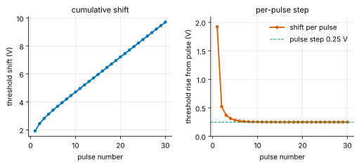
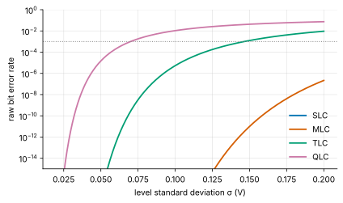

<!-- status: reviewed -->
# 23-06 · NAND Flash and 3D NAND

| | |
|---|---|
| **Course** | [23 · Memory and Storage Technology](../README.md) |
| **University equivalent** | The nonvolatile-memory lectures of a senior semiconductor-memory or device elective: floating-gate and charge-trap cells, Fowler–Nordheim tunneling and incremental-step programming, multi-level cells and their error rates, NAND array organization, 3D NAND, and endurance and retention (Brewer & Gill, eds., *Nonvolatile Memory Technologies with Emphasis on Flash*; Micheloni, Crippa & Marelli, *Inside NAND Flash Memories*; Sze & Ng, *Physics of Semiconductor Devices*, nonvolatile-memory chapter) |
| **Prerequisites** | [09-09](../../09-semiconductor-devices/chapters/09-09-long-channel-mosfet.md) (MOSFET threshold), [04-10](../../04-physics-for-ee/chapters/04-10-intro-quantum-mechanics.md) (tunneling), [03-02](../../03-probability-statistics-and-random-variables/chapters/03-02-random-variables-and-distributions.md) (the normal tail), [23-05](23-05-hbm-in-depth.md) (stacking and bonding) |
| **Estimated study hours** | 7 |
| **Last verified** | 2026-11-25 |

**Learning objectives.** After this chapter you can:

1. Derive a flash cell's threshold shift from stored charge and its control-gate coupling, and count the electrons that separate its levels.
2. Explain Fowler–Nordheim programming and show why incremental-step pulse programming raises the threshold by exactly one step per pulse.
3. Compute the level spacing and raw bit error rate of SLC, MLC, TLC and QLC cells, and explain why each extra bit per cell costs so much margin.
4. Describe NAND's string, page and block organization and the 3D structure, and estimate density, stack height and channel-hole aspect ratio.
5. Quantify endurance, retention and its temperature acceleration, and connect them to drive ratings.
6. Compute die and drive throughput from page size, planes and program time, and assess vendors' layer-count and density claims.

## 1. Big picture

NAND flash stores data as charge trapped next to a transistor's channel. It keeps that charge for years with no power, packs several bits into each cell, and is built in stacks of hundreds of layers. It is the cheapest fast storage there is, and every phone, laptop SSD and data-center flash array runs on it. Its costs are equally distinctive. Writes are slow and done page by page, erases only in whole blocks, and every write wears the cell a little. Each extra bit per cell more than halves the margin between levels. The controller (23-07) spends much of its effort hiding these facts.

- **AI and the data center:** high-capacity QLC SSDs feed training data and store checkpoints, and the five largest listed NAND suppliers' combined revenue rose 77% in one quarter of 2026 on AI-server demand [8].
- **Phones and PCs:** UFS and NVMe flash sets app-launch times and capacity tiers.
- **The layer race:** suppliers compete on layer count, bit density and interface speed, with stacks of 218 to 332 layers in production or sampling by 2026 [2], [3], [5].
- **Manufacturing:** 3D NAND is an etch-and-deposition problem more than a lithography one. Its key step is drilling channel holes through hundreds of layers (§3.5).

## 2. Intuition first

Picture a transistor with an extra, insulated bucket between its gate and its channel: the **floating gate** (or, in today's cells, a **charge-trap** layer of silicon nitride). Electrons put in the bucket stay there because they are surrounded by insulator. Their negative charge partly cancels the gate's attraction for the channel, so the transistor needs a higher gate voltage to turn on: its threshold voltage $V_{TH}$ rises. Reading means asking, "Does the transistor conduct at this gate voltage?" A single question distinguishes two levels (one bit). Three questions at different voltages distinguish four levels (two bits), and fifteen questions distinguish sixteen (four bits).

Filling the bucket is the strange part. The insulator is too thick for electrons to cross at normal voltages, so programming applies about 15–20 V to the gate. That bends the oxide's energy barrier until electrons **tunnel** through it quantum-mechanically (04-10). The tunneling current depends extremely steeply on the field, so the cell almost regulates itself: once enough charge has arrived to weaken the field, tunneling nearly stops.

The analogy breaks down on scale. A modern cell's "bucket" holds only a few hundred electrons in all, and tens of electrons separate adjacent levels (Example 23-06.1). Losing a dozen electrons over a year, or gaining a few from a neighbour being programmed, can move a cell into the next level.

## 3. Theory

### 3.1 Stored charge and threshold voltage

Model the storage node (floating gate or trap layer) as a conductor coupled to the control gate through $C_{CG}$ and to the channel, source and drain through a total $C_{other}$. Its potential is set by charge conservation:

$$
V_{FG} = \frac{C_{CG}V_{CG} + Q}{C_{CG} + C_{other}} = \alpha_G V_{CG} + \frac{Q}{C_T},
\qquad \alpha_G = \frac{C_{CG}}{C_T},\quad C_T = C_{CG} + C_{other},
$$

with the channel, source and drain at 0 V, where $Q$ is the stored charge and $\alpha_G$ the **gate coupling ratio**. The transistor turns on when $V_{FG}$ reaches its own threshold $V_{TH0}$. The control-gate voltage needed is then

$$
V_{TH} = \frac{V_{TH0} - Q/C_T}{\alpha_G} = \frac{V_{TH0}}{\alpha_G} - \frac{Q}{C_{CG}} .
$$

Stored electrons ($Q < 0$) raise the threshold by $\Delta V_{TH} = -Q/C_{CG}$. One electron shifts it by $q/C_{CG}$. With $C_{CG}$ around 16 aF (assumed), that is 10 mV per electron, about a hundred electrons per volt (Example 23-06.1). Units: C/F = V. ✓

### 3.2 Programming by tunneling, and why ISPP works

**Fowler–Nordheim tunneling.** Under a strong field $E$, electrons tunnel from the channel through the triangular barrier of the tunnel oxide. The current density has the form

$$
J = A E^2 \exp\left(-\frac{B}{E}\right),
$$

where $A$ and $B$ depend on the barrier height and the electron's effective mass. With the representative constants of Example 23-06.2, raising the field from 12 to 14.5 MV/cm multiplies $J$ about 42-fold, and from 10 to 14.5 MV/cm about 2,900-fold, because the exponential dominates. Erasing reverses the field. Planar floating-gate cells were erased by a high voltage on the substrate, with the gates at 0 V, which pulled electrons out through the oxide. A 3D charge-trap string has no substrate under each cell. It is erased instead by generating holes at its select transistors through gate-induced drain leakage (GIDL), and the high erase voltage drives those holes into the trap layer, where they cancel the stored electrons.

**Incremental step pulse programming (ISPP).** A NAND page is programmed with a staircase of gate pulses, each $\Delta V_{pgm}$ higher than the last, with a **verify** read between pulses. Cells that have reached their target are inhibited from further pulses. The key property, derived here, is that in steady state each pulse raises $V_{TH}$ by exactly $\Delta V_{pgm}$.

Because $J$ is so steep, each pulse effectively runs until the oxide field falls to the value at which tunneling stalls, $E^*$. The pulse ends with $V_{FG} \approx E^* t_{ox}$, the same value every time. (More precisely: equal-length pulses map the field at the end of one pulse, raised by the next step, to the field at the end of the next. Because $J$ is so steep, that map is strongly contracting, so the end-of-pulse field converges to a fixed point $E^*$ within a few pulses. The first pulse, starting from an uncharged cell, moves the threshold much more.) From §3.1, $V_{FG} = \alpha_GV_{CG} + Q/C_T$ during the pulse. For two successive pulses $k$ and $k + 1$, that gives

$$
\alpha_G V_{pgm,k} + \frac{Q_k}{C_T} = \alpha_G V_{pgm,k+1} + \frac{Q_{k+1}}{C_T}
\;\Longrightarrow\;
Q_{k+1} - Q_k = -\alpha_G C_T\,\Delta V_{pgm} = -C_{CG}\,\Delta V_{pgm} .
$$

The threshold change is therefore $\Delta V_{TH} = -(Q_{k+1} - Q_k)/C_{CG} = \Delta V_{pgm}$, whatever the cell's coupling ratio, oxide thickness or tunneling constants. Cells with different parameters all end up moving in lockstep with the staircase. The **verify-inhibit** step sets the final width: each cell is inhibited at the first verify that finds it above its target, so it overshoots the target by between 0 and $\Delta V_{pgm}$, and the programmed distribution is about one step wide. A smaller step gives tighter distributions, which more bits per cell need, at the cost of more pulses and longer program time (Example 23-06.3). The lab confirms the property in a circuit simulator with a Fowler–Nordheim current source.

### 3.3 More bits per cell

With $n$ bits per cell, $L = 2^n$ threshold levels share a usable window $W$, so adjacent level centres are

$$
d = \frac{W}{2^n - 1}
$$

apart. Each level is not a single voltage but a distribution, set by the program step, cell-to-cell interference, noise and charge loss. Model each as Gaussian with standard deviation σ and place read references midway between levels. A cell is then misread into a neighbour with probability $Q(d/2\sigma)$ per side. Interior levels have two neighbours and the two end levels one, so, averaged over equiprobable levels, a cell is misread with probability $2(L - 1)Q(d/2\sigma)/L$. **Gray coding** assigns adjacent levels bit patterns that differ in one bit, so each misread costs one of the $n$ bits:

$$
\text{RBER} = \frac{2(L - 1)}{L\,n}\,Q\!\left(\frac{d}{2\sigma}\right) .
$$

Going from TLC to QLC shrinks $d$ from $W/7$ to $W/15$, to 0.467 of its TLC value, and the Q-function's tail turns that into a jump of nearly nine orders of magnitude (8.9) in raw error rate (Example 23-06.4). This is why QLC drives need strong error correction (LDPC, 23-07), why they have lower endurance (wear widens σ), and why five bits per cell (PLC) is so hard (§9).

> **Going deeper — reading a multi-level page.** A TLC cell's three bits usually belong to three different logical pages (lower, middle, upper). With a 2-3-2 Gray code, reading one page needs two or three of the seven reference comparisons, not all seven. Read latency then differs by page, which SSD firmware takes into account.

### 3.4 Strings, pages and blocks

NAND connects cells in series: a **string** of tens to hundreds of cells shares one bitline contact at the top and a source line at the bottom. That eliminates a contact per cell, the main reason NAND is so dense. Reading a cell means turning on every other cell in the string with a pass voltage $V_{pass}$ well above any programmed threshold, applying a read voltage $V_{read}$ to the selected wordline, and sensing whether the string conducts.

- A **page** is the set of cells that are programmed and read together: in planar NAND, one wordline across all bitlines; in 3D NAND, the cells of one wordline in one string-select row. Typically 16 KB of data per plane, plus spare bytes for ECC.
- A **block** is all the strings sharing a set of wordlines, hundreds to thousands of pages. Erase works only on whole blocks, because it biases the shared substrate or channel.
- A **plane** is an independent array with its own page buffer. A die with several planes operates them in parallel.

**Programming one page on a shared wordline.** Every string in the block shares the wordline, so the program pulse reaches cells that must not change. They are protected by **self-boosting**. Their bitlines are raised so that the string's select transistor turns off and the channel floats. As the wordlines rise, the floating channel is capacitively boosted toward the program voltage, leaving too little field across the tunnel oxide for tunneling. Only strings whose bitlines are held at 0 V keep their channels grounded and are programmed. Reading uses the bitlines the other way: each bitline's sense amplifier precharges it and detects whether the string, with the selected cell at $V_{read}$, discharges it within a fixed time.

Because pages cannot be overwritten in place and erase is block-wide, a controller must write new data to fresh pages, remap addresses and later reclaim blocks by moving their valid pages: garbage collection (23-07).

### 3.5 Going vertical: 3D NAND

Planar NAND stopped shrinking in the mid-2010s, at feature sizes where a cell held too few electrons and neighbours interfered too much. 3D NAND turns the string on its side. It deposits a stack of alternating layers (later converted to wordlines), etches round **channel holes** through the whole stack, and lines each hole with a blocking oxide, a charge-trap nitride, a tunnel oxide and a thin polysilicon channel. Each hole becomes a vertical string, and each layer a wordline wrapping around every hole.

Density then grows with layer count instead of lithography:

$$
D \approx \frac{N_{layers}\,n_{bits}}{A_{col}} ,
$$

where $A_{col}$ is the die area per vertical string, including the share of staircases (the stepped wordline contacts at the array's edges), slits and periphery. Comparing published densities per layer and per bit reveals the lateral improvements makers achieve beyond layer count (Example 23-06.5).

**The etch problem.** Each layer is a few tens of nanometres thick, so a 300-layer stack is over 10 µm tall, and the hole must stay round and straight to the bottom. The taller the hole relative to its diameter, the harder that is, so makers build stacks in **decks**: etch through one stack of layers, fill, build the next deck on top and connect them. Samsung's V9 uses a "double-stack structure", and Samsung credits its channel-hole etching with "simultaneous drilling of the industry's highest cell layer count in a double-stack structure" [1]; SK hynix's 321-layer NAND uses three decks ("3 plugs") [3].

**Where the periphery goes.** The CMOS that drives the array (page buffers, decoders, charge pumps, I/O) once sat beside the array. Makers moved it under the array, and now increasingly build it on a separate wafer bonded face to face to the array wafer. Kioxia calls this CMOS directly Bonded to Array (CBA). It avoids exposing the CMOS to the array's high-temperature steps, so the logic can be faster [4]. Kioxia credits CBA, with its On-Pitch Select Gate Drain technology, for BiCS10's 4.8 Gb/s interface [5].

### 3.6 Endurance, retention and disturbs

**Endurance.** Every program and erase drives electrons through the tunnel oxide and slowly creates traps in it. Trapped charge shifts thresholds and widens distributions. After enough program/erase (P/E) cycles, errors exceed what ECC can correct. Cells storing more bits fail sooner, because they have less margin to lose (§3.3).

**Retention.** Stored charge slowly leaks through the oxides and redistributes in the trap layer, so thresholds drift down. Leakage mechanisms are thermally activated. Their rate scales roughly as $e^{-E_a/kT}$, so a bake at high temperature can stand in for years at room temperature. The **Arrhenius acceleration factor** between use temperature $T_u$ and stress temperature $T_s$ (in kelvin) is

$$
AF = \exp\left[\frac{E_a}{k}\left(\frac{1}{T_u} - \frac{1}{T_s}\right)\right] .
$$

JEDEC's SSD endurance standard (JESD218) defines retention at end of life. A client drive must keep data for 1 year at 30 °C after its rated wear; an enterprise drive 3 months at 40 °C, at uncorrectable bit error rates of at most 10⁻¹⁵ and 10⁻¹⁶ [7]. The enterprise requirement is shorter, because enterprise drives are expected to stay powered.

**Disturbs.** Reading a cell puts $V_{pass}$ on every other wordline of its block, which slowly injects charge into them (**read disturb**). Programming one wordline couples to its neighbours (**program disturb** and cell-to-cell interference). Controllers count reads per block and refresh blocks before disturbs accumulate.

### 3.7 Performance: pages, planes and interfaces

A die's write throughput is the data per program operation divided by the program time: $T = (\text{page} \times \text{planes})/t_{PROG}$. TLC program times are hundreds of microseconds and QLC's longer, while reads ($t_R$) take tens of microseconds. To raise throughput, makers add planes: Kioxia's 2 Tb QLC die is its first QLC product with six planes [6]. Interface speeds have risen to move pages on and off the die faster: Samsung V9's Toggle 5.1 runs at 3.2 Gb/s [1], and Kioxia's BiCS10 at 4.8 Gb/s [5]. An SSD reaches its bandwidth by spreading data across many dies on several channels (Example 23-06.8, 23-07).

## 4. Worked examples

### Example 23-06.1 · Counting electrons (tier A)

**Setup.** A cell's control-gate coupling capacitance is 16 aF (assumed). Find (a) the threshold shift per stored electron and (b) the electrons per volt. A QLC cell spreads 16 levels over a 6 V window (assumed): find (c) the level spacing and (d) the electrons that separate adjacent levels. (e) If the cell loses 10 electrons over its life, how far does its threshold drop, and (f) what fraction of a QLC level spacing is that?

**Solution.**

- (a) $q/C_{CG} = 1.602 \times 10^{-19}/16 \times 10^{-18}$ = **10.0** mV; (b) **99.9** electrons per volt.
- (c) $6/(16 - 1)$ = **0.4** V; (d) $0.4 \times 99.9$ = **39.9** electrons.
- (e) $10 \times 10.0$ mV = **0.100** V; (f) $0.100/0.4$ = **25.0** %.

**Units check.** C/F = V. ✓

**Sanity check.** Forty electrons per level is why a dozen lost electrons matter. It is also why charge-trap cells, which hold charge in discrete traps that do not all drain through one oxide defect, replaced conductive floating gates for most makers.

### Example 23-06.2 · Coupling and the programming field (tier B)

**Setup.** The cell of Example 23-06.1 has a 7 nm tunnel oxide (ε_r = 3.9) over a 50 nm × 50 nm channel area (assumed), with no other significant capacitance. Find (a) the tunnel-oxide capacitance, (b) the coupling ratio, and, for an uncharged cell at 18 V on the control gate, (c) the storage-node voltage and (d) the oxide field. With representative constants $A = 1.25 \times 10^{-6}$ A/V² and $B = 2.33 \times 10^{10}$ V/m, find (e) the tunneling current density, (f) the current and (g) the time for 100 electrons to arrive at that current.

**Solution.**

- (a) $3.9 \times 8.854 \times 10^{-12} \times (50\ \text{nm})^2/7\ \text{nm}$ = **12.3** aF.
- (b) $16/(16 + 12.33)$ = **0.565**.
- (c) $0.5647 \times 18$ = **10.2** V; (d) $10.16/7\ \text{nm}$ = **14.5** MV/cm.
- (e) $1.25 \times 10^{-6} \times (1.452 \times 10^9)^2 \times e^{-2.33 \times 10^{10}/1.452 \times 10^9}$ = **2.83** × 10⁵ A/m²; (f) × 2.5 × 10⁻¹⁵ m² = **0.709** nA.
- (g) $100 \times 1.602 \times 10^{-19}/0.709\ \text{nA}$ = **22.6** ns.

**Units check.** F/m × m²/m = F; V/m; A/V² × V²/m² = A/m². ✓

**Sanity check.** A hundred electrons arrive in tens of nanoseconds at the start of a pulse, but each one lowers the field, and the current collapses exponentially. In the lab's pulse train, the field at the end of the 30th 10 µs pulse has fallen to 10.1 MV/cm, close to the 8–10 MV/cm programming fields quoted in [04-10](../../04-physics-for-ee/chapters/04-10-intro-quantum-mechanics.md). That self-limiting behaviour is what ISPP exploits. The 14.5 MV/cm at the start of a pulse is near the oxide's breakdown range, which is one reason the staircase starts low and climbs, rather than applying the final voltage at once.

### Example 23-06.3 · Programming with ISPP (tier B)

**Setup.** A TLC page must move cells from the erased level at −2 V to the top level at +4.5 V (assumed). Each pulse-and-verify loop takes 20 µs (assumed). Find (a) the threshold rise per pulse in steady state with a 0.25 V step, (b) the pulses needed and (c) the program time. With a 0.15 V step, find (d) the pulses and (e) the time.

**Solution.**

- (a) **0.25** V (§3.2).
- (b) $(4.5 - (-2))/0.25$ = **26** pulses; (c) $26 \times 20\ \mu\text{s}$ = **520** µs.
- (d) $6.5/0.15$ = 43.3, so **44** pulses; (e) **880** µs.

**Units check.** V/(V per pulse) = pulses. ✓

**Sanity check.** Hundreds of microseconds is the right order for TLC program time. Tighter distributions (smaller steps) cost time almost in proportion, which is the basic speed-reliability tradeoff of multi-level flash. In the lab's circuit model, the first 15 V pulse moves the threshold 1.917 V; by the 30th pulse each pulse adds 0.2500 V.

### Example 23-06.4 · Margins and raw bit error rate (tier B)

**Setup.** A 6 V window holds 2ⁿ levels with σ = 0.06 V (assumed). Find the level spacing for (a) SLC, (b) MLC, (c) TLC and (d) QLC, and the raw bit error rate of (e) TLC and (f) QLC. (g) After wear widens σ to 0.08 V (assumed), what is QLC's raw bit error rate?

**Solution.**

- (a) $6/1$ = **6** V; (b) $6/3$ = **2** V; (c) $6/7$ = **0.857** V; (d) $6/15$ = **0.4** V.
- (e) $d/2\sigma = 7.14$, so $\tfrac{2 \times 7}{8 \times 3}Q(7.14)$ = **2.67** × 10⁻¹³.
- (f) $d/2\sigma = 3.33$, so $\tfrac{2 \times 15}{16 \times 4}Q(3.33)$ = **2.01** × 10⁻⁴.
- (g) $d/2\sigma = 2.5$: **2.91** × 10⁻³.

**Units check.** Ratios of volts; error rates dimensionless. ✓

**Sanity check.** With the same σ, TLC is nearly error-free while QLC needs ECC that corrects a raw rate of order 10⁻⁴, and more after wear. The σ here is illustrative and Gaussian. Real TLC and QLC distributions are wider, with non-Gaussian tails from retention loss, disturb and noise, so both need strong error correction as they wear, which is why 23-07's LDPC is universal. SLC's and MLC's error rates here are negligible: their margins are 50 and 16.7 sigma.

### Example 23-06.5 · Density and the channel hole (tier B)

**Setup.** Samsung's 280-layer QLC die reaches 28.5 Gb/mm² [2], and Kioxia's 332-layer QLC die 37.6 Gb/mm² [6]. Find each one's density per layer and per bit, (a) and (b), and (c) Kioxia's lateral advantage. (d) What die area per vertical string does (a) imply? A 332-layer stack has a 45 nm layer pitch and a 110 nm channel hole (both assumed). Find (e) the stack height and the hole's aspect ratio if it is etched (f) in one deck, (g) in two and (h) in three.

**Solution.**

- (a) $28.5/(280 \times 4)$ = **0.0254** Gb/mm²; (b) $37.6/(332 \times 4)$ = **0.0283** Gb/mm²; (c) **11.3** % more per layer-bit.
- (d) $1/(0.02545 \times 10^9\ \text{mm}^{-2})$ = **0.0393** µm².
- (e) $332 \times 45\ \text{nm}$ = **14.9** µm.
- (f) $14.94\ \mu\text{m}/110\ \text{nm}$ = **136**; (g) **67.9**; (h) **45.3**.

**Units check.** Gb/mm² per (layers × bits); µm/nm is a ratio. ✓

**Sanity check.** About 0.04 µm² per string column includes the staircase, slit and periphery overhead; the hole itself is far smaller. Hundreds-to-one aspect ratios are beyond any single etch, which is why every maker stacks decks.

### Example 23-06.6 · Retention and temperature (tier B)

**Setup.** A retention mechanism has an activation energy of 1.1 eV (assumed). Find (a) the acceleration factor of an 85 °C bake over use at 30 °C and (b) the bake time equivalent to JESD218's client requirement of 1 year at 30 °C. Find (c) the acceleration from 30 °C to 40 °C and (d) the 30 °C equivalent of the enterprise requirement of 3 months at 40 °C.

**Solution.**

- (a) $\exp[1.1/(8.617 \times 10^{-5})\,(1/303.15 - 1/358.15)]$ = **643**; (b) $8{,}760\ \text{h}/643$ = **13.6** h.
- (c) **3.84**; (d) $3 \times 3.84$ = **11.5** months.

**Units check.** eV/(eV/K) × 1/K is dimensionless. ✓

**Sanity check.** At this activation energy, the two requirements are similar once temperature is accounted for. A powered-off drive in a hot warehouse loses data far faster than one at room temperature. Real qualification uses measured activation energies for each mechanism, not one number.

### Example 23-06.7 · Endurance budgets (tier B)

**Setup.** A 7.68 TB TLC drive's NAND is rated for 3,000 P/E cycles and its controller runs at a write amplification of 2.5 (both assumed). Find (a) the host data it can absorb over its life and (b) its rating in drive writes per day over 5 years. Repeat for a 30.72 TB QLC drive with 1,000 cycles and a write amplification of 1.5 (assumed): (c) and (d).

**Solution.**

- (a) $7.68 \times 3000/2.5$ = **9216** TB; (b) $9216/(7.68 \times 365 \times 5)$ = **0.658** DWPD.
- (c) $30.72 \times 1000/1.5$ = **20480** TB; (d) **0.365** DWPD.

**Units check.** TB × cycles = TB written to NAND; dividing by WAF gives host TB. ✓

**Sanity check.** The QLC drive absorbs more total data, because it is four times larger, but fewer drive writes per day. Both sit below the 1 DWPD that SNIA describes as typical for read-intensive enterprise drives [7], so they suit read-heavy workloads. Write amplification (23-07) matters as much as the cell's rating.

### Example 23-06.8 · Die and drive throughput (tier B)

**Setup.** A die has 4 planes of 16 KiB pages, $t_{PROG}$ = 500 µs and $t_R$ = 50 µs (assumed). Find its (a) write and (b) read throughput. A 4.8 Gb/s, 8-bit channel moves 4.8 GB/s (Kioxia's BiCS10 rate [5]). How many dies does one channel need to stay busy with (c) writes and (d) reads? (e) How many dies does a 14 GB/s write rate need?

**Solution.**

- (a) $16{,}384 \times 4/500\ \mu\text{s}$ = **131** MB/s; (b) $16{,}384 \times 4/50\ \mu\text{s}$ = **1.31** GB/s.
- (c) $4800/131.1$ = 36.6, so **37** dies; (d) $4800/1311$ = 3.66, so **4** dies.
- (e) $14{,}000/131.1$ = 106.8, so **107** dies.

**Units check.** bytes/s. ✓

**Sanity check.** Writes are the bottleneck: a fast SSD needs about a hundred dies working in parallel just to absorb writes at PCIe 5.0 speeds, which sets a minimum drive capacity for full performance. Kioxia reports over 85 MB/s of write throughput for its 2 Tb QLC die [6], the same order as (a).

<!-- answer-key -->

| ID | Quantity | Value | Unit |
|---|---|---|---|
| Ex 23-06.1a | threshold shift per electron | 10.0 | mV |
| Ex 23-06.1b | electrons per volt | 99.9 | |
| Ex 23-06.1c | QLC level spacing | 0.4 | V |
| Ex 23-06.1d | electrons per QLC level | 39.9 | |
| Ex 23-06.1e | shift from 10 lost electrons | 0.100 | V |
| Ex 23-06.1f | fraction of a level | 25.0 | % |
| Ex 23-06.2a | tunnel-oxide capacitance | 12.3 | aF |
| Ex 23-06.2a1 | tunnel-oxide capacitance, 4 s.f. | 12.33 | aF |
| Ex 23-06.2b | coupling ratio | 0.565 | |
| Ex 23-06.2b1 | coupling ratio, 4 s.f. | 0.5647 | |
| Ex 23-06.2c | storage-node voltage | 10.2 | V |
| Ex 23-06.2c1 | storage-node voltage, 4 s.f. | 10.16 | V |
| Ex 23-06.2d | oxide field | 14.5 | MV/cm |
| Ex 23-06.2d1 | oxide field in V/m | 1.452e9 | V/m |
| Ex 23-06.2e | current density | 2.83e5 | A/m² |
| Ex 23-06.2f | tunneling current | 0.709 | nA |
| Ex 23-06.2g | time for 100 electrons | 22.6 | ns |
| Ex 23-06.2h | field at the end of the 30th lab pulse | 10.1 | MV/cm |
| Ex 23-06.3a | threshold rise per pulse | 0.25 | V |
| Ex 23-06.3b | pulses, 0.25 V step | 26 | |
| Ex 23-06.3c | program time, 0.25 V step | 520 | µs |
| Ex 23-06.3d0 | pulse ratio, 0.15 V step | 43.3 | |
| Ex 23-06.3d | pulses, 0.15 V step | 44 | |
| Ex 23-06.3e | program time, 0.15 V step | 880 | µs |
| Ex 23-06.3f | lab model, first-pulse shift | 1.917 | V |
| Ex 23-06.3g | lab model, 30th-pulse step | 0.2500 | V |
| Ex 23-06.4a | SLC spacing | 6 | V |
| Ex 23-06.4b | MLC spacing | 2 | V |
| Ex 23-06.4c | TLC spacing | 0.857 | V |
| Ex 23-06.4d | QLC spacing | 0.4 | V |
| Ex 23-06.4a0 | SLC margin in sigma | 50 | |
| Ex 23-06.4b0 | MLC margin in sigma | 16.7 | |
| Ex 23-06.4e0 | TLC margin in sigma | 7.14 | |
| Ex 23-06.4e | TLC raw bit error rate | 2.67e-13 | |
| Ex 23-06.4f0 | QLC margin in sigma | 3.33 | |
| Ex 23-06.4f | QLC raw bit error rate | 2.01e-4 | |
| Ex 23-06.4g0 | worn QLC margin in sigma | 2.5 | |
| Ex 23-06.4g | worn QLC raw bit error rate | 2.91e-3 | |
| Ex 23-06.5a | density per layer-bit, 280-layer QLC | 0.0254 | Gb/mm² |
| Ex 23-06.5b | density per layer-bit, 332-layer QLC | 0.0283 | Gb/mm² |
| Ex 23-06.5c | lateral advantage | 11.3 | % |
| Ex 23-06.5d | area per string | 0.0393 | µm² |
| Ex 23-06.5e | stack height | 14.9 | µm |
| Ex 23-06.5e1 | stack height, 4 s.f. | 14.94 | µm |
| Ex 23-06.5f | aspect ratio, one deck | 136 | |
| Ex 23-06.5g | aspect ratio, two decks | 67.9 | |
| Ex 23-06.5h | aspect ratio, three decks | 45.3 | |
| Ex 23-06.6a | acceleration factor, 30 to 85 °C | 643 | |
| Ex 23-06.6b | equivalent bake time | 13.6 | h |
| Ex 23-06.6c | acceleration factor, 30 to 40 °C | 3.84 | |
| Ex 23-06.6d | enterprise requirement at 30 °C | 11.5 | months |
| Ex 23-06.7a | TLC host writes | 9216 | TB |
| Ex 23-06.7b | TLC DWPD | 0.658 | |
| Ex 23-06.7c | QLC host writes | 20480 | TB |
| Ex 23-06.7d | QLC DWPD | 0.365 | |
| Ex 23-06.8a | die write throughput | 131 | MB/s |
| Ex 23-06.8a1 | die write throughput, 4 s.f. | 131.1 | MB/s |
| Ex 23-06.8b | die read throughput | 1.31 | GB/s |
| Ex 23-06.8c0 | dies per channel for writes, unrounded | 36.6 | |
| Ex 23-06.8c | dies per channel for writes | 37 | |
| Ex 23-06.8d0 | dies per channel for reads, unrounded | 3.66 | |
| Ex 23-06.8d | dies per channel for reads | 4 | |
| Ex 23-06.8e0 | dies for 14 GB/s, unrounded | 106.8 | |
| Ex 23-06.8e | dies for 14 GB/s | 107 | |
| Txt 23-06.a | current-density ratio, 12 to 14.5 MV/cm | 42 | |
| Txt 23-06.a1 | current-density ratio, 10 to 14.5 MV/cm | 2.9e3 | |
| Txt 23-06.b | RBER jump from TLC to QLC, orders of magnitude | 8.9 | |
| Txt 23-06.c | TLC to QLC spacing ratio | 0.467 | |
| Txt 23-06.d | 2Q26 implied total NAND revenue | 78.7 | $B |
| Txt 23-06.e | top-five share | 87.5 | % |
| Txt 23-06.f | hours in a year | 8760 | h |
| Txt 23-06.g | interface over QLC die write rate, Problem 23-06.14 | 122 | |

## 5. Simulate it

The lab is [labs/23-06-lab/](../labs/23-06-lab/README.md). `nand.py` holds the chapter's models. The netlist `ispp.cir` models a cell as its two capacitances (control-gate coupling and tunnel oxide) with a Fowler–Nordheim current source, and drives it with 30 program pulses rising from 15 V in 0.25 V steps, with 0 V verify windows between them.

*Figure 1. Whatever the cell's parameters, incremental-step programming settles into raising the threshold by one step per pulse. (Computed with flat 10 µs pulses; the netlist's 0.1 µs edges change the first step slightly.)*

**Predict, then run:**

1. *Predict* the threshold rise per pulse after the first few pulses. Run `ngspice -b ispp.cir` and compare the 29th and 30th steps.
2. Change the tunnel oxide to 6 nm in the netlist (three edits: `tox`, `ctox` and the `dvt` line, as the lab handout lists). *Predict* what happens to the first step and to the steady-state step.
3. In the notebook, plot the raw bit error rate of SLC to QLC against σ (Figure 2), and find the σ at which QLC's raw error rate reaches 10⁻³.
4. Simulate 100,000 QLC cells with Gaussian levels and count misreads. Compare with the formula.

*Figure 2. Each extra bit per cell roughly halves the level spacing; the Gaussian tail turns that into orders of magnitude of error rate. SLC's rate stays below the plotted range, and the dotted line marks 10⁻³.*

## 6. Engineering tradeoffs

| Knob | Improves | Costs | Typical decision owner |
|---|---|---|---|
| More bits per cell (TLC → QLC → PLC) | Cost per bit | Margin, endurance, write speed, ECC strength | NAND product planning |
| Smaller ISPP step | Tighter distributions, more levels | Program time | NAND design |
| More layers | Bits per die area | Etch aspect ratio, decks, deposition time, yield | NAND process integration |
| CMOS bonded to array (CBA, wafer bonding) | Faster periphery, smaller die | A second wafer and bonding step | NAND process integration |
| More planes per die | Parallelism, throughput | Die area, power, page-buffer area | NAND design |
| Charge trap vs floating gate | Scalability in 3D, defect tolerance | Charge-spreading and retention behaviour differ | Vendor technology choice |
| Stronger ECC (23-07) | Usable RBER, endurance | Controller area, latency, power | SSD controller team |

## 7. Numbers to know

| Quantity | Typical value | Note |
|---|---|---|
| Electrons per volt of threshold shift | about 100 | Example 23-06.1 (assumed 16 aF) |
| Program voltage | about 15–20 V | §3.2 |
| Endurance | falls with bits per cell | Die ratings are rarely published; Example 23-06.7's cycle counts are assumptions [7] |
| JESD218 retention | client 1 year at 30 °C; enterprise 3 months at 40 °C | [7] |
| Layer counts | 218 (Kioxia BiCS8) to 321 (SK hynix) in production by late 2024; 332 (BiCS10) sampling in Jul 2026 | [2], [3], [5] |
| Areal density | 28.5 Gb/mm² (Samsung 280-layer QLC); 37.6 Gb/mm² (Kioxia 2 Tb QLC) | [2], [6] |
| Interface speed | 3.2 Gb/s (V9) to 4.8 Gb/s (BiCS10) | [1], [5] |
| Page size | 16 KiB per plane (typical) | |

## 8. Common mistakes

- **Treating levels as voltages, not distributions.** Margin is spacing measured in standard deviations, not volts.
- **Assuming more layers means proportionally more density.** Staircases, decks and periphery take area. Compare densities per layer and per bit (Example 23-06.5).
- **Confusing layer counts.** Vendors count active wordlines, total gates or "layers" differently. Samsung's V9 announcement gives no layer count; the 280-layer figure comes from its ISSCC 2024 paper title, as reported in [2].
- **Forgetting that erase is block-wide.** Everything about SSD controllers (23-07) follows from that.
- **Quoting endurance without write amplification.** A drive's life in host writes is P/E cycles × capacity / WAF.
- **Ignoring temperature in retention.** A rating at 30 °C says little about a drive stored at 55 °C.

## 9. Practitioner lens

**State of the art (as of Nov 2026).**

- *Production* [Established]. Samsung announced mass production of 1 Tb TLC 9th-generation V-NAND on 23 Apr 2024, with about 50% higher bit density than the 8th generation, a double-stack structure and a Toggle 5.1 interface at 3.2 Gb/s [1]. SK hynix announced mass production of 321-layer NAND on 21 Nov 2024 using a three-deck ("3 plugs") process, and reported 12% faster data transfer and 13% better read performance than its 238-layer generation [3].
- *Density records* [Established as presented]. Samsung's ISSCC 2024 paper describes a 280-layer 1 Tb QLC die at 28.5 Gb/mm² [2]. Kioxia and Sandisk's ISSCC 2026 paper describes a 332-layer 2 Tb QLC die at 37.6 Gb/mm², with six planes and over 85 MB/s of write throughput [6].
- *Sampling* [Established as announced]. Kioxia began sampling 1 Tb TLC BiCS10 on 3 Jul 2026: 332 layers, 4.8 Gb/s (33% above BiCS8), 59% higher bit density, and 18% and 30% better write and read power efficiency [5].
- *Bonded periphery* [Established]. Kioxia's CBA builds CMOS and array on separate wafers joined by copper direct bonding [4]. Others are moving the same way (§3.5).
- *Market* [Industry estimate]. TrendForce put the top five publicly listed NAND brands' combined 2Q26 revenue at $68.87 billion, up 77% quarter on quarter on AI-server demand. Samsung led with about $23.06 billion and a 29.3% share, followed by SK hynix with Solidigm ($14.27 billion), Micron ($11.85 billion), Kioxia ($10.72 billion, 13.6%) and SanDisk ($8.97 billion) [8]. Those figures imply a total market of about $78.7 billion and a top-five share of 87.5%.
- *Five bits per cell* [Contested]. Whether PLC reaches volume is debated. By §3.3's logic, its 32 levels would have under half of QLC's spacing, $W/31$ against $W/15$.

**Why it matters commercially.** NAND is a cyclical commodity whose cost per bit falls mainly by adding layers and bits per cell, while each step adds process cost and reliability risk. Capital efficiency now drives strategy: reusing development platforms across generations (SK hynix reportedly improved 321-layer production by 59% by reusing its 238-layer development platform [3]), running a lower-investment product line beside the leading edge (Kioxia's "dual-axis" strategy of 9th- and 10th-generation products [5]), and timing capacity to an AI-driven demand cycle. For a buyer, the drive's controller and firmware (23-07) matter as much as the NAND.

**Marketing vs Reality.**

- *"Industry's highest layer count."* Layer counts are defined differently by each vendor, and density per mm² is the comparable metric (Example 23-06.5).
- *"59% higher bit density."* Against the vendor's own previous generation, often with more layers and lateral shrink combined [5].
- *"4.8 Gb/s interface."* That is the pin rate. A die's sustained write throughput is set by program time and planes, one to two orders of magnitude lower: 37 times for Example 23-06.8's TLC die and 122 times for Problem 23-06.14's QLC die.
- *"QLC is as reliable as TLC."* Only with stronger ECC, lower drive-write ratings and suitable workloads (Examples 23-06.4 and 23-06.7).

**Questions for engineering leaders.**

1. **"What is your raw bit error rate at end of life and at retention, and what ECC margin is left?"** *Strong:* RBER against P/E cycles and bake time, with the ECC's correction limit. *Evasive:* "our NAND exceeds JEDEC requirements."
2. **"How many decks, and what is the yield cost of each?"** *Strong:* deck count, interconnect yield and cycle time. *Evasive:* layer count alone.
3. **"What is the die's write throughput, and how many dies does a drive need for full speed?"** *Strong:* $t_{PROG}$, planes and the minimum capacity for full bandwidth. *Evasive:* the interface speed.
4. **"What does CBA or wafer bonding cost you, and what does it buy?"** *Strong:* the extra wafer and bonding cost against die-size and speed gains. *Evasive:* "it improves performance."
5. **"What retention do you guarantee at what temperature after rated wear?"** *Strong:* JESD218 class, activation energies used and test data. *Evasive:* "ten years."

## 10. Concept check

**Q1.** Why does a stored electron raise the threshold voltage, and by how much?

Answer

Its negative charge cancels part of the control gate's coupling to the storage node, so the gate needs more voltage to bring the node to the transistor's own threshold. Each electron raises $V_{TH}$ by $q/C_{CG}$, about 10 mV for 16 aF (§3.1).

**Q2.** Why does ISPP raise $V_{TH}$ by one step per pulse, whatever the cell's parameters?

Answer

The tunneling current is so steep in field that each pulse effectively ends at the same storage-node voltage. Raising the gate by $\Delta V_{pgm}$ therefore adds exactly $C_{CG}\Delta V_{pgm}$ of charge, which shifts $V_{TH}$ by $\Delta V_{pgm}$ (§3.2).

**Q3.** Why does QLC need far stronger ECC than TLC?

Answer

Its 16 levels share the same window, so the spacing falls from $W/7$ to $W/15$. Measured in standard deviations the margin halves, and the Gaussian tail turns that into a raw error rate many orders of magnitude higher (Example 23-06.4).

**Q4.** Why can NAND not overwrite a page in place?

Answer

Programming only adds electrons, raising thresholds. Lowering them needs an erase, which acts on a whole block because it biases the shared channel or substrate. Rewriting one page would mean erasing the entire block.

**Q5.** Why are 3D NAND stacks built in decks?

Answer

A single channel-hole etch through hundreds of layers would need an aspect ratio over 100 (Example 23-06.5) and could not stay round and straight. Etching a few hundred layers in two or three decks keeps each etch manageable, at the cost of aligning and connecting the decks.

**Q6.** Why does a retention test at 85 °C for hours stand in for a year at 30 °C?

Answer

Charge-loss mechanisms are thermally activated, so their rate scales as $e^{-E_a/kT}$. With an activation energy around 1 eV, 85 °C speeds them up several hundredfold over 30 °C (Example 23-06.6). The equivalence holds only if the same mechanism dominates at both temperatures.

Problem set: [23-06 problems](../problems/23-06-problems.md).

## 11. Key terms

[Floating gate](../../../reference/glossary.md#floating-gate) · [Charge-trap flash](../../../reference/glossary.md#charge-trap-flash) · [Gate coupling ratio](../../../reference/glossary.md#gate-coupling-ratio) · [Fowler–Nordheim tunneling](../../../reference/glossary.md#fowler-nordheim-tunneling) · [Incremental step pulse programming (ISPP)](../../../reference/glossary.md#incremental-step-pulse-programming-ispp) · [Multi-level cell (MLC, TLC, QLC)](../../../reference/glossary.md#multi-level-cell-mlc-tlc-qlc) · [Raw bit error rate (RBER)](../../../reference/glossary.md#raw-bit-error-rate-rber) · [NAND string](../../../reference/glossary.md#nand-string) · [Page and block (NAND)](../../../reference/glossary.md#page-and-block-nand) · [3D NAND](../../../reference/glossary.md#3d-nand) · [Channel hole](../../../reference/glossary.md#channel-hole) · [CMOS bonded to array (CBA)](../../../reference/glossary.md#cmos-bonded-to-array-cba) · [P/E cycle endurance](../../../reference/glossary.md#p-e-cycle-endurance) · [Arrhenius model](../../../reference/glossary.md#arrhenius-model) · [Self-boosting (NAND program inhibit)](../../../reference/glossary.md#self-boosting-nand-program-inhibit)

## 12. Connections

- **Previous:** [23-05](23-05-hbm-in-depth.md) stacked separate dies; 3D NAND builds its layers in one structure, and now bonds the periphery wafer. [09-09](../../09-semiconductor-devices/chapters/09-09-long-channel-mosfet.md) supplied the threshold voltage; [04-10](../../04-physics-for-ee/chapters/04-10-intro-quantum-mechanics.md) tunneling; [03-02](../../03-probability-statistics-and-random-variables/chapters/03-02-random-variables-and-distributions.md) the Gaussian tail.
- **Next:** [23-07](23-07-ssd-controllers.md) builds an SSD from these dies: the flash translation layer, garbage collection, wear leveling and LDPC error correction.
- **Used later:** [23-08](23-08-emerging-memories.md) compares flash with MRAM, ReRAM, PCM and FeRAM; [25-09](../../25-fabrication-packaging-test-and-reliability/chapters/25-09-reliability-physics.md) treats Arrhenius acceleration and oxide wear-out generally.

## 13. Further study

- R. Micheloni, L. Crippa and A. Marelli, *Inside NAND Flash Memories*, Springer, 2010: cells, arrays, ISPP and reliability.
- J. E. Brewer and M. Gill (eds.), *Nonvolatile Memory Technologies with Emphasis on Flash*, Wiley-IEEE Press, 2008.
- The ISSCC NAND session each February, where each maker's newest die is presented [2], [6].

## 14. Sources

1. Samsung Electronics, "Samsung Electronics Begins Industry's First Mass Production of 9th-Gen V-NAND," 23 Apr 2024, <https://news.samsungsemiconductor.com/global/samsung-electronics-begins-industrys-first-mass-production-of-9th-gen-v-nand/>. [R-478]
2. Blocks & Files, "Samsung gives the 280-layer 3D NAND game away," 30 Jan 2024 (reporting the ISSCC 2024 paper "A 280-Layer 1Tb 4b/cell 3D-NAND Flash Memory with a 28.5Gb/mm² Area Density and a 3.2GB/s High-Speed IO Rate"), <https://www.blocksandfiles.com/flash/2024/01/30/samsung-gives-the-280-layer-3d-nand-game-away/1588319>. [R-478]
3. A. Klotz, "SK hynix announces production of its 321-layer NAND flash — shipments will start in the first half of 2025," Tom's Hardware, 21 Nov 2024, <https://www.tomshardware.com/pc-components/storage/sk-hynix-announces-production-of-its-321-layer-nand-flash-shipments-will-start-in-the-first-half-of-2025>. [R-478]
4. Kioxia, "What is CMOS directly Bonded to Array (CBA) Technology?" (R&D web page), <https://www.kioxia.com/en-jp/rd/technology/cba.html>. [R-479]
5. Kioxia, "Kioxia Commences Sample Shipments of 10th-Generation BiCS FLASH™ Devices," 3 Jul 2026, <https://apac.kioxia.com/en-apac/about/news/2026/20260703-1.html>. [R-479]
6. Kioxia, "Development of a 10th Generation 2Tb 4b/cell BiCS FLASH™ product" (R&D web page on the ISSCC 2026 paper), <https://www.kioxia.com/en-jp/rd/technology/topics/topics-92.html>. [R-479]
7. J. Hands, "Endurance of NVMe, SAS, and SATA SSDs," SNIA white paper, 2021 (its Table 1 reproduces JESD218B.01's classes), <https://www.snia.org/sites/default/files/SSSI/NVMe_SAS_SATA_Endurance_White_Paper.pdf>. [R-480]
8. TrendForce, "Combined Revenue of Top Five NAND Flash Brands Rises 77% QoQ in 2Q26; Micron Moves Up to Third Place, Says TrendForce," press release, 18 Aug 2026, <https://www.trendforce.com/presscenter/news/20260818-13186.html>. [R-480]
