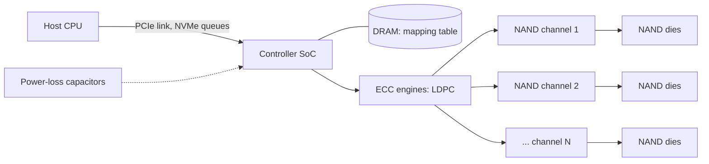
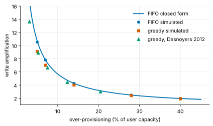
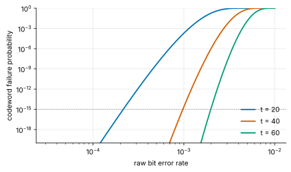

<!-- status: reviewed -->
# 23-07 · SSD Controllers and Storage Systems

| | |
|---|---|
| **Course** | [23 · Memory and Storage Technology](../README.md) |
| **University equivalent** | The flash-storage lectures of a graduate storage-systems or computer-architecture course: flash translation layers, garbage collection and write amplification, wear leveling, error-correcting codes for flash, the NVMe interface and host-managed placement (Micheloni, Marelli & Eshghi, *Inside Solid State Drives*; Desnoyers, "Analytic Modeling of SSD Write Performance"; Cai et al., "Error Characterization, Mitigation, and Recovery in Flash-Memory-Based Solid-State Drives") |
| **Prerequisites** | [23-06](23-06-nand-flash-and-3d-nand.md) (NAND pages, blocks, RBER, endurance), [17-08](../../17-communication-systems/chapters/17-08-channel-coding.md) (channel coding), [17-07](../../17-communication-systems/chapters/17-07-information-theory-and-shannon.md) (channel capacity), [07-01](../../07-circuit-analysis-2-transient-and-ac/chapters/07-01-capacitors-and-inductors.md) (capacitor energy) |
| **Estimated study hours** | 5 |
| **Last verified** | 2026-11-25 |

**Learning objectives.** After this chapter you can:

1. Sketch an SSD's architecture and check its bandwidth budget from the host link down to the NAND channels.
2. Explain the flash translation layer and size its mapping table, including the effect of the indirection unit.
3. Derive the write amplification of garbage collection under random writes and use it to trade over-provisioning against endurance.
4. Size the error correction a NAND page needs from its raw bit error rate, and explain why soft-decision LDPC replaced BCH.
5. Relate queue depth, latency and IOPS with Little's law, and size a drive's power-loss-protection capacitors.
6. Evaluate SSD specifications and host-managed placement (ZNS, FDP) claims with the models of this chapter.

## 1. Big picture

A NAND die (23-06) is a strange device to store data on. It writes in pages but erases only in blocks of hundreds of pages, it cannot overwrite in place, it wears out after thousands of cycles, and it returns raw data with one wrong bit in every few thousand. An SSD controller turns that into something an operating system can treat as a perfect array of sectors that can be rewritten forever, at millions of operations per second. It does this with a remapping layer, background garbage collection, wear leveling, error-correcting codes and deep command queues, all running on a small multicore chip with its own DRAM. The controller decides most of what a buyer sees: sustained speed, latency under load, endurance and price per terabyte.

- **AI data centers:** training checkpoints, data lakes and inference caches sit on enterprise NVMe SSDs. PCIe 6.0 drives reached mass production in 2026 [5], and single drives reached 245 TB [8].
- **Hyperscalers** push data placement into host software (ZNS, FDP) to cut write amplification and tail latency [10], [11], [12].
- **Client devices:** phone and laptop storage uses the same principles in smaller controllers.
- **Semiconductor business:** controllers are sold as merchant chips, such as Silicon Motion's [9], and several NAND makers design their own.

## 2. Intuition first

Think of the SSD as a warehouse where shelves can only be filled, never edited, and an entire aisle must be emptied before any of its shelves can be reused. When a customer updates an item, the warehouse puts the new version on a fresh shelf and crosses out the old one in its catalog: that catalog is the **flash translation layer (FTL)**. Eventually the warehouse runs short of empty aisles. Staff then pick an aisle, move its still-current items to a fresh aisle, and empty it: **garbage collection**. Every item moved is extra work the customer never asked for, and the ratio of total shelf-fillings to customer deliveries is the **write amplification**.

Spare space is the main lever. With a lot of spare space, aisles chosen for emptying hold few current items, and little is moved. With almost none, nearly every aisle is full of current items, and the staff spend most of their time moving goods. The analogy breaks down in one important way: in an SSD, every "move" also wears out the shelves, so wasted work costs both speed and lifetime.

*Figure 1. An SSD: the controller terminates the host link, keeps its mapping table in DRAM, encodes and decodes every page and drives NAND channels in parallel.*

## 3. Theory

### 3.1 Architecture and the bandwidth budget

An enterprise SSD has four parts:

- a **host interface**, today PCIe with the NVMe protocol;
- a **controller SoC**, with several processor cores running the FTL firmware, hardware ECC engines and one NAND interface per channel;
- **DRAM**, mainly for the mapping table;
- **NAND packages**, several dies per channel on 8 to 16 channels.

Silicon Motion's SM8366 enterprise controller, for example, has 16 NAND channels at 2,400 MT/s and claims over 14 GB/s of sequential reads [9].

Each layer must carry the drive's rated bandwidth. A PCIe 5.0 lane runs 32 GT/s with 128b/130b encoding [3], so four lanes carry, per direction,

$$
B = \frac{32 \times 10^9 \times 4 \times \tfrac{128}{130}}{8} = 15.75\ \text{GB/s} .
$$

PCIe 6.0 doubles the rate to 64 GT/s using PAM4 and moves data in 256-byte flits, of which 236 bytes carry transaction-layer packets [4]. The NAND side must be wider still, because the controller also moves garbage-collection traffic and ECC parity. Sixteen 8-bit channels at 2,400 MT/s carry 38.4 GB/s. Behind the channels, the dies themselves set the sustained write rate: 23-06 showed that a TLC die writes only one to a few hundred megabytes per second, so a fast drive needs tens to a hundred dies writing at once.

### 3.2 The flash translation layer

Because NAND pages cannot be overwritten, every host write of a logical block address (LBA) goes to a fresh physical page, and the FTL records the new location. A **page-mapped** FTL keeps one entry per **indirection unit (IU)**, the smallest chunk it maps, usually 4 KiB. The table's size is

$$
S_{map} = \frac{U}{IU} \times b_e ,
$$

where $U$ is the user capacity (one entry per logical unit) and $b_e$ the bytes per entry. With 4 KiB units and 4-byte entries, the table is $U/1024$: about 1 GB of DRAM per terabyte of flash. That DRAM is a real cost in a 30 TB drive (Example 23-07.2). Each entry holds a *physical* address, so its width is set by the raw flash, not the user capacity: a 32-bit entry reaches only $2^{32}$ units, or 17.6 TB of raw flash at 4 KiB. Larger drives use 5-byte or bit-packed entries.

Large QLC drives therefore use larger indirection units: Solidigm's D5-P5336 maps 16 KB units and its predecessor, the D5-P5316, 64 KB [16], [17]. A 16 KiB unit cuts the table fourfold. The cost appears on small random writes: a 4 KiB host write inside a 16 KiB unit forces the controller to read the unit, merge the new data and write all 16 KiB elsewhere, an extra fourfold write amplification for that workload. This is one reason large QLC drives are positioned for read-heavy and sequential-write workloads.

The FTL also keeps **metadata**: which pages of each block are still valid, each block's erase count and the blocks' ages. It must make the table and metadata survive power loss (§3.6).

**Drives without a full table in DRAM.** Client drives cannot afford a gigabyte of DRAM per terabyte. A *DRAM-less* controller caches only the recently used part of the table in on-chip SRAM and keeps the rest in flash, loading entries on demand, the idea of the demand-based FTL (DFTL) [15]. A table miss then costs an extra flash read before the data read. Many such drives also borrow tens of megabytes of host DRAM through NVMe's Host Memory Buffer feature to hold more of the table. Random reads spread across the whole drive miss most often, so DRAM-less drives fall furthest behind on exactly that workload.

### 3.3 Garbage collection and write amplification

Writes fill blocks in sequence. A rewritten LBA leaves an **invalid** page behind in an older block. When free blocks run low, **garbage collection (GC)** picks a victim block, copies its still-valid pages to the write frontier and erases it. The **write amplification factor** is

$$
A = \frac{\text{pages written to NAND}}{\text{pages written by the host}} = \frac{1}{1 - u} ,
$$

where $u$ is the average fraction of a victim block that is still valid. Reclaiming a block frees $(1 - u)$ of its pages for new host data, at the cost of rewriting $u$ of them.

**Over-provisioning (OP)** is the flash the host cannot see. This chapter defines it relative to user capacity, $OP = (T - U)/U$, where $T$ is the physical and $U$ the user capacity, and writes $\alpha = T/U = 1 + OP$. Some papers instead use the **spare factor** $S_f = (T - U)/T$, so always check which is meant.

**Derivation for random writes and FIFO cleaning.** Take the worst common case: the host overwrites uniformly random LBAs of a full drive, and the cleaner always takes the oldest block (FIFO, also called LRU). Consider one page written at the head of the log. Before its block reaches the tail and is cleaned, the log must wrap around once: every one of the $T$ physical pages is written once. Of those writes, a fraction $u$ are GC copies and $(1 - u)$ are host writes, so $(1 - u)T$ host writes occur during the page's journey. Each host write hits our page's LBA with probability $1/U$. The page therefore survives, still valid, with probability

$$
u = \left(1 - \frac{1}{U}\right)^{(1 - u)T} \approx e^{-(1 - u)T/U} = e^{-\alpha(1 - u)} .
$$

Every page in the victim block has the same history, so this survival probability is also the expected valid fraction of the victim. The fixed point $u = e^{-\alpha(1 - u)}$ is transcendental. Writing $x = -\alpha u$ turns it into $x e^{x} = -\alpha e^{-\alpha}$, whose solution is the Lambert W function, giving Desnoyers' closed form [1]:

$$
A = \frac{1}{1 - u} = \frac{\alpha}{\alpha + W\!\left(-\alpha e^{-\alpha}\right)} .
$$

With 7% OP, $A$ = 7.82; with 28%, $A$ = 2.48 (Example 23-07.3). Raising OP from 7% to 28% cuts the extra work about threefold. **Greedy** cleaning, which takes the block with the fewest valid pages, is optimal for uniform random writes and does somewhat better for small blocks: for 64-page blocks, Desnoyers' model and simulation give $A$ = 6.62 at a spare factor of 0.07, where the FIFO formula gives 7.32 [1]. The advantage shrinks as blocks grow, because a large block's valid count varies less from block to block, so the emptiest block is barely emptier than the oldest. For the thousands of pages in a 3D NAND block, and the multi-die superblocks controllers actually clean, greedy and FIFO are almost the same under uniform random writes [1]. Skewed traffic does not rescue greedy: cold pages dilute every victim, and separating hot and cold data into different blocks helps more than the choice of victim (lab, Part 2). The lab reproduces both results and lets you vary the block size. A third policy, **cost-benefit** cleaning, weighs each block's reclaimable space against the age of its data, preferring old, cold blocks. It approaches greedy's efficiency while also separating hot and cold data.

> **Math refresher — Lambert W.** $W(y)$ is the number $x$ with $x e^x = y$. For $-1/e < y < 0$ there are two real solutions; the formula above needs the principal branch $W_0$, which gives the nontrivial $u < 1$. (The other branch returns the trivial $u = 1$.) SciPy provides it as `scipy.special.lambertw`.

**What lowers write amplification in practice:**

- **Sequential writes** invalidate whole blocks together, so $u \approx 0$ and $A \approx 1$.
- **TRIM** (the host telling the drive which LBAs are deleted) and leaving part of the drive empty raise the effective OP.
- **Hot/cold separation:** data rewritten often (hot) mixed with rarely rewritten data (cold) makes victims carry cold pages around repeatedly. Writing data with similar lifetimes into the same blocks helps. The host knows lifetimes far better than the drive, which motivates **Zoned Namespaces (ZNS)**, where the host writes zones sequentially and resets them itself, and **Flexible Data Placement (FDP)**, where the host tags writes with a placement handle and the drive keeps differently tagged data in different blocks [10], [11], [12].

### 3.4 Wear leveling and endurance

Each block survives a limited number of program/erase (P/E) cycles (23-06). **Dynamic wear leveling** sends new writes to the least-worn free blocks. **Static wear leveling** also moves cold data that has sat on lightly worn blocks, so those blocks rejoin the rotation. That costs some extra writes but stops hot blocks from wearing out years before cold ones. With good leveling, the drive's life in host writes is

$$
TBW = \frac{T \times N_{PE}}{A} ,
$$

with $T$ the raw (physical) capacity and $N_{PE}$ the rated cycles. Over-provisioning therefore helps twice: it lowers $A$ and it adds raw capacity. That is why a vendor can sell the same flash as a larger read-intensive drive or a smaller mixed-use drive with about three times the drive writes per day (Example 23-07.4; Kioxia's CM10 offers 1 and 3 DWPD options [7]).

### 3.5 Error correction: from BCH to soft LDPC

23-06's examples gave raw bit error rates of order $10^{-4}$ to $10^{-3}$ for multi-level cells, and more once they wear, while JEDEC's SSD classes require uncorrectable bit error rates of $10^{-15}$ or $10^{-16}$ (23-06). Error-correcting codes must bridge about twelve orders of magnitude.

**Hard-decision codes and the binomial cliff.** A code over an $n$-bit codeword that corrects any $t$ errors fails when more than $t$ bits are wrong. With independent bit errors at rate $p$, the number of errors is binomial, so

$$
P_{fail} = \sum_{k = t + 1}^{n} \binom{n}{k} p^k (1 - p)^{n - k} .
$$

The mean error count $np$ sits far below $t$ when the drive is new and creeps up as it wears. Near $np \approx t$ the failure probability rises by many orders of magnitude over a small change in $p$, a **cliff** (Example 23-07.5). A binary BCH code over GF($2^m$) corrects $t$ errors with at most $mt$ parity bits, and its codeword can be at most $2^m - 1$ bits long. That rule sets the field: a 1 KiB codeword (8,192 data bits plus parity) needs $m$ = 14, and a 2 KiB one $m$ = 15. BCH served planar SLC and MLC well.

**From codeword failures to UBER.** JEDEC's targets count wrong *bits* per bit read, not failed codewords. A failed codeword of $k$ data bits usually holds just over $t$ errors, so the uncorrectable bit error rate is about

$$
\text{UBER} \approx \frac{(t + 1)P_{fail}}{k} ,
$$

several hundred times below the codeword failure rate for a 1 KiB code (Example 23-07.5). Comparing $P_{fail}$ directly against a UBER target is a common, conservative shortcut.

**The capacity limit.** Information theory (17-07) bounds what any code can do. If a read returns only hard bits with error rate $p$, the page is a binary symmetric channel with capacity

$$
C_{BSC} = 1 - H(p) = 1 + p\log_2 p + (1 - p)\log_2(1 - p)
$$

bits of data per stored bit. A page with 16 KiB of data and 2 KiB of spare area (assumed) has code rate 16/18 = 0.889. No hard-decision code at that rate works reliably above $p$ = 1.48%. A real code must stay some way below that limit (Example 23-07.6).

**Soft decisions.** Reading a page again at slightly shifted reference voltages tells the controller which cells sit near a boundary and are therefore unreliable. That soft information effectively raises the channel's capacity. **Low-density parity-check (LDPC)** codes decode iteratively with exactly this kind of probabilistic information and come close to capacity. The controller first tries a fast hard decode; if that fails, it rereads for soft information and decodes again, level by level. In Cai et al.'s example flow, each soft level adds a reread and a decode of order 80 µs, and the last resort, rebuilding the page from parity stored across other dies, takes about 10 ms [2]. Error correction is therefore also a **latency** problem: a worn drive returns correct data, but more of its reads take the slow path. Controllers also track the optimal read voltages as cells age (**read-retry**) to keep most reads on the fast path [2].

### 3.6 Queues, latency and power-loss protection

**NVMe and Little's law.** NVMe gives each CPU core its own submission and completion queues in host memory, so thousands of commands can be outstanding without locks. In steady state, **Little's law** relates the average number of commands in flight $N$, the throughput $X$ (IOPS) and the average latency $R$:

$$
N = X R .
$$

A drive rated for millions of random-read IOPS reaches that rate only with hundreds of commands outstanding (Example 23-07.7). At queue depth 1, IOPS is simply $1/R$, typically tens of thousands. Datasheet IOPS are queue-depth-dependent maxima.

**Where the IOPS come from.** A 4 KiB random read occupies one plane for one $t_R$ (23-06). A die with four planes that can read independently delivers at most $4/t_R$ random reads per second, so millions of IOPS need dozens of dies reading in parallel, plus ECC engines and channel bandwidth to match.

**Garbage collection and tail latency.** A read that arrives while its plane is busy programming or erasing must wait, and both take far longer than a read (23-06). Under a heavy write load, background garbage collection keeps planes busy, so the *tail* of the read-latency distribution (the 99.9th or 99.99th percentile) grows long even when the average looks fine. NAND dies therefore support *program suspend* and *erase suspend*: the controller pauses the long operation, serves the waiting reads and resumes. Suspending trades some write throughput, and firmware complexity, for read latency, and it is one reason enterprise drives quote latency percentiles under mixed load rather than averages.

**Power-loss protection (PLP).** Enterprise drives buffer recently written data and mapping updates in DRAM. If power fails, they must write those to flash before shutting down. A bank of capacitors charged to a high voltage supplies a DC-DC converter that holds the drive's rails up. A capacitor discharging from $V_1$ to $V_2$ releases

$$
E = \tfrac{1}{2}C\left(V_1^2 - V_2^2\right) ,
$$

so the required capacitance, for a flush power $P$ over a hold-up time $t_h$ through a converter of efficiency $\eta$, is

$$
C = \frac{2Pt_h}{\eta\left(V_1^2 - V_2^2\right)} .
$$

Charging to a higher voltage stores energy as $V^2$, which is why PLP banks charge well above the drive's logic rails (Example 23-07.8). Many client drives omit full PLP, and so may lose recently written data on sudden power loss unless the host has flushed it.

> **Going deeper — the SLC cache.** Client drives write first to blocks run in SLC mode, which program several times faster than TLC or QLC (23-06). Later, during idle time, they fold the data into dense blocks. A burst of writes runs at SLC speed until the cache fills, then falls to the native TLC or QLC rate, the "write cliff" seen in reviews. Enterprise drives are rated at steady state, after the drive has been filled and preconditioned, so their write figures are lower but sustained.

## 4. Worked examples

### Example 23-07.1 · The bandwidth budget (tier A)

**Setup.** Find (a) the per-direction bandwidth of a PCIe 5.0 x4 link and (b) the raw per-direction rate of a PCIe 6.0 x4 link before flit overhead. (c) What fraction of (b) is Micron 9650's 28 GB/s sequential read [5]? (d) Using 236 TLP bytes per 256-byte flit, what is the PCIe 6.0 x4 TLP-byte ceiling, and (e) what fraction of it is 28 GB/s? (f) What do 16 NAND channels at 2,400 MT/s carry? (g) Each transaction-layer packet (TLP) also carries a header of about 16 bytes. What is the data ceiling with 512-byte payloads, and (h) what fraction of it is 28 GB/s?

**Solution.**

- (a) $32 \times 10^9 \times 4 \times (128/130)/8$ = **15.75** GB/s.
- (b) $64 \times 10^9 \times 4/8$ = **32** GB/s; (c) $28/32$ = **87.5** %.
- (d) $32 \times 236/256$ = **29.5** GB/s; (e) $28/29.5$ = **94.9** %.
- (f) $16 \times 2400 \times 10^6 \times 1\ \text{byte}$ = **38.4** GB/s.
- (g) $29.5 \times 512/528$ = **28.6** GB/s; (h) $28/28.6$ = **97.9** %. With the common 256-byte payloads the data ceiling would be $29.5 \times 256/272$ = **27.8** GB/s.

**Units check.** transfers/s × lanes × bits/transfer / 8 = bytes/s. ✓

**Sanity check.** Once headers are counted, the first PCIe 6.0 drives essentially saturate the link on sequential reads, so the link, not the flash, limits reads. Writes, at 14 GB/s [5], are limited by the NAND.

### Example 23-07.2 · Sizing the mapping table (tier B)

**Setup.** (a) How many 4 KiB indirection units does a 30.72 TB drive have, and (b) how large is its mapping table with 4-byte entries? (c) What capacity can 32-bit entries address at 4 KiB, and (d) how many address bits does the 30.72 TB drive need? For a 61.44 TB drive with 16 KiB units, find (e) the entries, (f) the table size and (g) the largest capacity 32-bit entries can address. (h) What is the write amplification from read-modify-write when the host writes random 4 KiB blocks to the 16 KiB-unit drive?

**Solution.**

- (a) $30.72 \times 10^{12}/4096$ = **7.5** × 10⁹; (b) $\times 4$ bytes = **30.0** GB.
- (c) $2^{32} \times 4096$ = **17.6** TB; (d) $\log_2(7.5 \times 10^9)$ = 32.8, so **33** bits.
- (e) $61.44 \times 10^{12}/16{,}384$ = **3.75** × 10⁹; (f) **15.0** GB; (g) $2^{32} \times 16{,}384$ = **70.4** TB.
- (h) $16/4$ = **4**.

**Units check.** bytes/(bytes per unit) = units; units × bytes per entry = bytes. ✓

**Sanity check.** A tenth of a percent of capacity sounds small until the capacity is tens of terabytes: 30 GB of DRAM costs real money and power. Part (b) assumed 4-byte entries for simplicity, but (d) shows the drive needs 33 bits, so a real design uses 5-byte or packed entries (37.5 GB here; Problem 23-07.2). The width is set by the raw flash: at 7% OP the 61.44 TB drive holds $61.44 \times 1.07$ = 65.7 TB raw, inside (g)'s 70.4 TB reach, but at 28% OP it would hold 78.6 TB and need a 33rd bit. A 16 KiB unit cuts the table fourfold, at the price of punishing small random writes.

### Example 23-07.3 · Write amplification from over-provisioning (tier B)

**Setup.** A drive receives uniformly random writes and uses FIFO garbage collection. For (a) 7% and (b) 28% over-provisioning, find the victim blocks' valid fraction $u$ and the write amplification $A$. (c) What is $A$ for a spare factor $S_f$ = 0.07? Compare with Desnoyers' greedy result of 6.62 at the same spare factor for 64-page blocks [1].

**Solution.**

- (a) $\alpha$ = 1.07. Solve $u = e^{-1.07(1 - u)}$: $u$ = **0.872**, so $A = 1/(1 - u)$ = **7.82**.
- (b) $\alpha$ = 1.28: $u$ = **0.597**, $A$ = **2.48**.
- (c) $\alpha = 1/(1 - 0.07)$ = **1.075**, $A$ = **7.32**. Greedy's 6.62 is 9.5% lower for 64-page blocks; for blocks of thousands of pages the gap almost vanishes (§3.3).

**Units check.** Ratios of page counts are dimensionless. ✓

**Sanity check.** At 7% OP, each host write costs nearly eight NAND writes under uniform random writes, the worst case for FIFO. Moving to 28% OP cuts that to two and a half. Real workloads, with TRIM and some locality, sit well below these bounds.

### Example 23-07.4 · Same flash, two drives (tier B)

**Setup.** A drive holds 8.8 TB of raw TLC rated for 3,000 P/E cycles (assumed). It is sold as (a) a 7.68 TB drive or (b) a 6.4 TB drive. For each, find the over-provisioning, the worst-case random-write amplification (FIFO model), the host TBW and the DWPD over 5 years. (c) What is the ratio of their DWPD ratings?

**Solution.**

- (a) $OP = 8.8/7.68 - 1$ = **14.6** %; $A$ = **4.11**; $TBW = 8.8 \times 3000/4.111$ = **6422** TB; $DWPD = 6422/(7.68 \times 1825)$ = **0.458**.
- (b) $OP = 8.8/6.4 - 1$ = **37.5** %; $A$ = **2.04**; $TBW$ = **12954** TB; $DWPD$ = **1.11**.
- (c) $1.109/0.4582$ = **2.42**.

**Units check.** TB × cycles / (dimensionless) = TB. ✓

**Sanity check.** Giving up 17% of the capacity more than doubles the worst-case endurance. Vendors' "read-intensive" and "mixed-use" versions of one drive, rated at about 1 and 3 DWPD [7], follow this logic. Their absolute ratings are higher than this worst case because rating workloads are not fully random and real cycle limits differ.

### Example 23-07.5 · The ECC cliff (tier B)

**Setup.** A codeword holds 1 KiB of data (8,192 bits) and a BCH code over GF($2^{14}$) correcting 40 errors. Find (a) the parity bits and (b) the codeword length. At raw bit error rates of (c) 10⁻³, (d) 3 × 10⁻³ and (e) 4 × 10⁻³, find the mean number of errors per codeword and the probability that the codeword fails.

**Solution.**

- (a) $14 \times 40$ = **560** bits (70 bytes); (b) $8192 + 560$ = **8752** bits.
- (c) mean $8752 \times 10^{-3}$ = **8.75**; $P_{fail}$ = **2.38** × 10⁻¹⁵.
- (d) mean **26.3**; $P_{fail}$ = **4.57** × 10⁻³.
- (e) mean **35.0**; $P_{fail}$ = **0.175**.

**Units check.** Counts and probabilities are dimensionless. ✓

**Sanity check.** At 10⁻³ the UBER is about $41 \times 2.38 \times 10^{-15}/8192$ = **1.2** × 10⁻¹⁷, inside the enterprise target and about 200 times below $P_{fail}$. Tripling the raw error rate takes the code from essentially perfect to failing about one codeword in 220. A drive designed with this code must retire blocks, or switch to stronger decoding, well before the mean error count approaches $t$.

### Example 23-07.6 · The capacity limit (tier B)

**Setup.** A page stores 16 KiB of data and 2 KiB of spare (assumed). Find (a) its code rate and the capacity of a hard-decision read at raw error rates of (b) 1% and (c) 2%. (d) What is the highest raw error rate at which any hard-decision code of this rate can work?

**Solution.**

- (a) $16/18$ = **0.889**.
- (b) $1 - H(0.01)$ = **0.919** > 0.889: possible in principle.
- (c) $1 - H(0.02)$ = **0.859** < 0.889: impossible with hard decisions.
- (d) Solve $1 - H(p) = 0.889$: $p$ = **1.48** %.

**Units check.** Capacity and rate in bits per stored bit. ✓

**Sanity check.** At a 2% raw error rate no hard-decision code fits in this spare area, however clever. Only soft information (rereads) or more spare can recover the data. This is the information-theoretic reason worn QLC needs soft-decision LDPC.

### Example 23-07.7 · Queue depth and dies for millions of IOPS (tier B)

**Setup.** A drive delivers 5.4 million random 4 KiB reads per second (Micron 9650's rating [5]). If the average latency is 100 µs (assumed), find (a) the commands in flight and (b) the data rate. (c) With $t_R$ = 50 µs and four independent planes per die (assumed), how many reads per second can one die deliver, and (d) how many dies must be busy?

**Solution.**

- (a) $5.4 \times 10^6 \times 100 \times 10^{-6}$ = **540** commands.
- (b) $5.4 \times 10^6 \times 4096$ = **22.1** GB/s.
- (c) $4/50\ \mu\text{s}$ = **80000** reads/s.
- (d) $5.4 \times 10^6/80{,}000$ = **67.5**, so at least **68** dies.

**Units check.** (1/s) × s = dimensionless count. ✓

**Sanity check.** Random 4 KiB reads at full rate move less data than the 28 GB/s sequential rating, so for small reads the limit is the number of dies and the controller's command processing, not the link. A host that issues one command at a time sees only $1/R$ = 10,000 IOPS.

### Example 23-07.8 · Power-loss-protection capacitors (tier B)

**Setup.** On power loss, a drive needs 20 W for 25 ms to flush its buffers (assumed). Its capacitor bank is charged to 35 V and the converter works down to 12 V with 90% efficiency (assumed). Find (a) the energy drawn from the bank and (b) the capacitance needed. (c) What capacitance would charging to only 12.5 V, discharging to 5 V, require?

**Solution.**

- (a) $20 \times 0.025/0.9$ = **0.556** J.
- (b) $2 \times 0.5556/(35^2 - 12^2) = 1.111/1081$ = **1.03** mF.
- (c) $1.111/(12.5^2 - 5^2) = 1.111/131.25$ = **8.47** mF.

**Units check.** J/V² = C/V = F. ✓

**Sanity check.** Charging the bank to a higher voltage cuts the capacitance eightfold, because stored energy grows as $V^2$. That is why PLP circuits boost the input to a few tens of volts and use a buck converter to hold up the rails.

<!-- answer-key -->

| ID | Quantity | Value | Unit |
|---|---|---|---|
| Ex 23-07.1a | PCIe 5.0 x4 bandwidth | 15.75 | GB/s |
| Ex 23-07.1b | PCIe 6.0 x4 raw rate | 32 | GB/s |
| Ex 23-07.1c | 28 GB/s as share of raw | 87.5 | % |
| Ex 23-07.1d | PCIe 6.0 x4 TLP-byte ceiling | 29.5 | GB/s |
| Ex 23-07.1e | 28 GB/s as share of TLP-byte ceiling | 94.9 | % |
| Ex 23-07.1f | 16-channel NAND bandwidth | 38.4 | GB/s |
| Ex 23-07.1g | data ceiling, 512-byte payloads | 28.6 | GB/s |
| Ex 23-07.1h | 28 GB/s as share of data ceiling | 97.9 | % |
| Ex 23-07.1g1 | data ceiling, 256-byte payloads | 27.8 | GB/s |
| Ex 23-07.2a | indirection units, 30.72 TB | 7.5e9 | |
| Ex 23-07.2b | mapping table, 30.72 TB | 30.0 | GB |
| Ex 23-07.2c | 32-bit reach at 4 KiB | 17.6 | TB |
| Ex 23-07.2d0 | address bits, unrounded | 32.8 | |
| Ex 23-07.2d | address bits needed | 33 | |
| Ex 23-07.2e | indirection units, 61.44 TB at 16 KiB | 3.75e9 | |
| Ex 23-07.2f | mapping table, 61.44 TB at 16 KiB | 15.0 | GB |
| Ex 23-07.2g | 32-bit reach at 16 KiB | 70.4 | TB |
| Ex 23-07.2h | read-modify-write amplification | 4 | |
| Ex 23-07.3a0 | alpha at 7% OP | 1.07 | |
| Ex 23-07.3a1 | valid fraction at 7% OP | 0.872 | |
| Ex 23-07.3a | write amplification at 7% OP | 7.82 | |
| Ex 23-07.3b0 | alpha at 28% OP | 1.28 | |
| Ex 23-07.3b1 | valid fraction at 28% OP | 0.597 | |
| Ex 23-07.3b | write amplification at 28% OP | 2.48 | |
| Ex 23-07.3c0 | alpha at spare factor 0.07 | 1.075 | |
| Ex 23-07.3c | FIFO write amplification at spare factor 0.07 | 7.32 | |
| Ex 23-07.3c1 | greedy advantage | 9.5 | % |
| Ex 23-07.4a0 | OP, 7.68 TB | 14.6 | % |
| Ex 23-07.4a1 | write amplification, 7.68 TB | 4.11 | |
| Ex 23-07.4a1x | write amplification, 7.68 TB, 4 s.f. | 4.111 | |
| Ex 23-07.4a2 | TBW, 7.68 TB | 6422 | TB |
| Ex 23-07.4a | DWPD, 7.68 TB | 0.458 | |
| Ex 23-07.4a3 | DWPD, 7.68 TB, 4 s.f. | 0.4582 | |
| Ex 23-07.4b0 | OP, 6.4 TB | 37.5 | % |
| Ex 23-07.4b1 | write amplification, 6.4 TB | 2.04 | |
| Ex 23-07.4b2 | TBW, 6.4 TB | 12954 | TB |
| Ex 23-07.4b | DWPD, 6.4 TB | 1.11 | |
| Ex 23-07.4b3 | DWPD, 6.4 TB, 4 s.f. | 1.109 | |
| Ex 23-07.4c | DWPD ratio | 2.42 | |
| Ex 23-07.4c1 | capacity given up | 17 | % |
| Ex 23-07.5a | BCH parity bits | 560 | |
| Ex 23-07.5a1 | BCH parity bytes | 70 | |
| Ex 23-07.5b | codeword length | 8752 | |
| Ex 23-07.5c0 | mean errors at 1e-3 | 8.75 | |
| Ex 23-07.5c | failure probability at 1e-3 | 2.38e-15 | |
| Ex 23-07.5d0 | mean errors at 3e-3 | 26.3 | |
| Ex 23-07.5d | failure probability at 3e-3 | 4.57e-3 | |
| Ex 23-07.5e0 | mean errors at 4e-3 | 35.0 | |
| Ex 23-07.5e | failure probability at 4e-3 | 0.175 | |
| Ex 23-07.5f | codewords per failure at 3e-3 | 2.2e2 | |
| Ex 23-07.6a | code rate | 0.889 | |
| Ex 23-07.6b | capacity at 1% | 0.919 | |
| Ex 23-07.6c | capacity at 2% | 0.859 | |
| Ex 23-07.6d | highest raw error rate | 1.48 | % |
| Ex 23-07.7a | commands in flight | 540 | |
| Ex 23-07.7b | data rate | 22.1 | GB/s |
| Ex 23-07.7c | reads per second per die | 80000 | |
| Ex 23-07.7d0 | dies, unrounded | 67.5 | |
| Ex 23-07.7d | dies | 68 | |
| Ex 23-07.7e | IOPS at queue depth 1 | 10000 | |
| Ex 23-07.8a | energy from the bank | 0.556 | J |
| Ex 23-07.8a1 | energy from the bank, 4 s.f. | 0.5556 | J |
| Ex 23-07.8a2 | doubled energy | 1.111 | J |
| Ex 23-07.8b0 | voltage-squared difference, 35 to 12 V | 1081 | V² |
| Ex 23-07.8b | capacitance, 35 V bank | 1.03 | mF |
| Ex 23-07.8c0 | voltage-squared difference, 12.5 to 5 V | 131.25 | V² |
| Ex 23-07.8c | capacitance, 12.5 V bank | 8.47 | mF |
| Ex 23-07.8d | capacitance ratio | 8 | |
| Txt 23-07.a | DRAM per terabyte at 4 KiB and 4 bytes | 1 | GB |
| Txt 23-07.b | NAND writes per host write, 7% OP | 8 | |
| Txt 23-07.c | FIFO-to-28% improvement factor | 3 | |
| Txt 23-07.d | DWPD ratio, read-intensive to mixed-use (vendor) | 3 | |
| Txt 23-07.i | raw flash of 61.44 TB at 7% OP | 65.7 | TB |
| Txt 23-07.j | raw flash of 61.44 TB at 28% OP | 78.6 | TB |
| Txt 23-07.k | 30.72 TB table with 5-byte entries | 37.5 | GB |
| Txt 23-07.l | BCH field exponent for 1 KiB | 14 | |
| Txt 23-07.m | BCH field exponent for 2 KiB | 15 | |
| Txt 23-07.n | UBER at 1e-3 | 1.2e-17 | |
| Txt 23-07.o | ratio of codeword failure rate to UBER | 2e2 | |
| Txt 23-07.p | errors in a failed codeword, t + 1 | 41 | |
| Txt 23-07.f | orders of magnitude between RBER and UBER | 12 | |
| Txt 23-07.g | QD1 latency for 15,000 IOPS | 67 | µs |
| Txt 23-07.h | IOPS seen in concept check | 15000 | |

## 5. Simulate it

The lab is [labs/23-07-lab/](../labs/23-07-lab/README.md). `ssd.py` holds the chapter's models and a page-mapped FTL simulator with FIFO or greedy garbage collection; the notebook runs it.

*Figure 2. Write amplification falls steeply with over-provisioning. The simulated FIFO points land on the closed form; greedy cleaning is a little better for these 64-page blocks, and the gap closes as blocks grow.*

**Predict, then run:**

1. *Predict* the write amplification at 7%, 14% and 28% OP from the closed form. Run the simulator with FIFO cleaning and compare, then switch to greedy. *Predict* what happens to greedy's advantage at 512 pages per block, then run it.
2. Send 90% of the writes to 10% of the LBAs. *Predict* whether greedy cleaning gets better or worse than under uniform writes, then run it, with and without separating hot and cold data into different blocks (what FDP lets a host do).
3. Plot the codeword failure probability of Example 23-07.5 against raw error rate for $t$ = 20, 40 and 60 (Figure 3), and find the raw error rate at which each fails one codeword in 10¹⁵.

*Figure 3. Hard-decision codes fail abruptly once the mean error count approaches their correction capability.*

## 6. Engineering tradeoffs

| Knob | Improves | Costs | Typical decision owner |
|---|---|---|---|
| Over-provisioning | Write amplification, endurance, steady-state write speed | Sellable capacity | SSD product management |
| Indirection unit (4 → 16 KiB) | DRAM size and cost, addressable capacity | Small random-write performance and amplification | Controller and firmware architects |
| Greedy vs FIFO vs cost-benefit GC | Write amplification (mainly for small blocks) | Firmware complexity, metadata | Firmware team |
| Soft-decision LDPC levels | Correctable raw error rate, endurance | Read latency on the slow path, decoder area and power | Controller architects |
| Spare area per page | Code strength | Data capacity | NAND and controller teams jointly |
| Power-loss-protection capacitance | Data safety on power failure | Board area, cost, capacitor aging | Hardware team |
| Host-managed placement (ZNS, FDP) | Write amplification near 1, tail latency | Host software changes | Hyperscaler storage teams |
| SLC caching | Burst write speed | Write cliff when full, extra folding writes | Client SSD product teams |

## 7. Numbers to know

| Quantity | Typical value | Note |
|---|---|---|
| Mapping-table DRAM | about 1 GB per TB at 4 KiB units | §3.2 |
| Random-write amplification | 7.8 at 7% OP, 2.5 at 28% OP (FIFO model) | Example 23-07.3; real workloads lower |
| Enterprise endurance options | 1 DWPD (read-intensive), 3 DWPD (mixed use) | Kioxia CM10 [7]; Micron 9650 PRO 1 DWPD [6] |
| PCIe 5.0 x4 / PCIe 6.0 x4 | 15.75 GB/s / 32 GB/s raw per direction | [3], [4] |
| PCIe 6.0 enterprise SSD (Feb 2026) | 28 GB/s read, 14 GB/s write, 5.4 M IOPS, up to 25 W | Micron 9650 [5], [6] |
| Largest shipping SSD (May 2026) | 245 TB, up to 30 W | Micron 6600 ION [8] |
| JESD218 UBER targets | 10⁻¹⁵ client, 10⁻¹⁶ enterprise | 23-06 |

## 8. Common mistakes

- **Quoting write amplification without the workload.** $A$ is near 1 for sequential writes and near 8 for random writes at 7% OP. A single number means nothing without its workload.
- **Confusing over-provisioning with spare factor.** 7% relative to user capacity is a spare factor of 6.5%; the literature uses both.
- **Reading datasheet IOPS as latency.** Millions of IOPS come from hundreds of queued commands. An application that waits for each read sees $1/R$.
- **Assuming ECC strength grows linearly with parity.** Failure probability is a cliff, and capacity bounds every hard-decision code.
- **Ignoring the indirection unit.** A drive with 16 KiB units looks fine in sequential benchmarks and much worse under small random writes.
- **Comparing fresh-out-of-box and steady-state numbers.** Client reviews often measure an empty drive with its SLC cache. Enterprise specifications assume a full, preconditioned drive.

## 9. Practitioner lens

**State of the art (as of Nov 2026).**

- *PCIe 6.0* [Established: vendor specifications]. Micron's 9650 entered mass production in February 2026 as the first PCIe 6.0 enterprise SSD. It uses G9 TLC in E1.S and E3.S forms, rated at 28 GB/s sequential read, 14 GB/s write, 5.4–5.5 million random-read IOPS and up to 25 W, with optional liquid cooling; the PRO version is rated 1 DWPD over five years [5], [6]. Kioxia announced its CM10 on 30 Jul 2026: PCIe 6.0, NVMe 2.1, BiCS10 TLC, 1.6 to 61.44 TB, 1 or 3 DWPD, and about 92% higher sequential and 85% higher random read than its PCIe 5.0 predecessor [7].
- *Capacity* [Established: vendor announcements]. Solidigm introduced the 122.88 TB QLC D5-P5336 in November 2024, marketed with "unlimited random write endurance for five years" [13]. Micron announced on 6 May 2026 that its 245 TB 6600 ION (G9 QLC, U.2 and E3.L) was shipping, consuming up to 30 W [8].
- *Controllers* [Established]. Merchant enterprise controllers such as Silicon Motion's SM8366 (2022) combine 16 NAND channels at 2,400 MT/s, PCIe 5.0 x4 and LDPC [9].
- *Host-managed placement* [Established for the standards; deployment Contested]. NVMe 2.1 (August 2024) added Flexible Data Placement [10]. A 2025 study using Meta and Twitter traces on CacheLib reports device write amplification of about 1 with FDP [11]. The ZNS paper reported 2–4× lower 99.9th-percentile read latency and 2× write throughput for a zone-specialized RocksDB [12]. How widely hyperscalers deploy either is not public.
- *Flash vs disk economics* [Contested]. VDURA's August 2026 index put a 30 TB TLC enterprise SSD at $22,600 against $1,216 for a 30 TB HDD, 18.6 times more per terabyte, after a 2026 NAND price surge [14]. VDURA sells hybrid flash-and-disk systems and has revised its own historical figures, so treat its ratio as one vendor's view.

**Why it matters commercially.** The controller and firmware decide whether a given NAND die becomes a client drive, a read-intensive QLC capacity drive or a 3 DWPD mixed-use drive, and much of the price difference between them is over-provisioning and firmware. For AI data centers, the questions are sustained bandwidth per watt, capacity per rack and tail latency under mixed load. For investors, the controller is where merchant-silicon vendors and vertically integrated NAND makers compete.

**Marketing vs Reality.**

- *"28 GB/s."* Sequential reads at high queue depth. Random 4 KiB reads at the rated IOPS move about 22 GB/s, and a single-threaded application sees a small fraction (Example 23-07.7).
- *"Unlimited random write endurance."* Plausible for a very large QLC drive with large indirection units and generous over-provisioning, because the drive cannot physically be written fast enough to exhaust it in five years. Check the rated PBW and the workload definition.
- *"82% fewer racks than HDD"* [8] and "half the power of an HDD deployment" [8] compare one vendor's best case with an assumed disk configuration. Recompute with your own drive counts, rack power and data-protection overhead.
- *"Write amplification of 1 with FDP"* [11] holds for workloads whose data lifetimes the host can separate, such as caches and log-structured stores, not for arbitrary random writes.

**Questions for engineering leaders.**

1. **"What is your steady-state random-write performance and write amplification at the rated over-provisioning?"** *Strong:* preconditioned numbers, the workload and the measured WAF. *Evasive:* fresh-out-of-box figures.
2. **"What happens to read latency at end of life?"** *Strong:* percentile latencies with soft-decode rates at rated P/E and retention. *Evasive:* "our LDPC corrects everything."
3. **"What indirection unit do you use, and how do 4 KiB random writes perform?"** *Strong:* the IU, the DRAM per TB and measured small-write numbers. *Evasive:* only sequential figures.
4. **"How much hold-up energy does your power-loss protection have, and what does it cover?"** *Strong:* capacitance, voltage, flush time and testing. *Evasive:* "enterprise-grade PLP."
5. **"Do you support FDP or ZNS, and what do customers measure with it?"** *Strong:* named workloads and WAF before and after. *Evasive:* "on our roadmap."

## 10. Concept check

**Q1.** Why does an SSD need a mapping table at all?

Answer

NAND cannot overwrite a page in place, so every write of a logical address goes to a new physical page. The table records where each logical address currently lives (§3.2).

**Q2.** Why does write amplification fall so steeply as over-provisioning grows?

Answer

With more spare space, more host writes happen between a block's writing and its cleaning, so more of its pages have been invalidated. The valid fraction $u$ satisfies $u = e^{-\alpha(1 - u)}$ and falls quickly with $\alpha$, and $A = 1/(1 - u)$ falls even faster (§3.3).

**Q3.** Why do sequential writes have write amplification near 1?

Answer

Data written together is overwritten together, so whole blocks become invalid at once and garbage collection finds empty victims with nothing to copy.

**Q4.** Why can a stronger hard-decision code not rescue a page whose raw error rate exceeds the capacity limit?

Answer

Shannon's theorem bounds the rate of any reliable code by $1 - H(p)$. If the page's code rate exceeds that, no decoder can work reliably. Only more spare area (a lower rate) or soft information (a better channel) helps (Example 23-07.6).

**Q5.** A drive is rated at 5 million IOPS. Why does your database see only 15,000?

Answer

If it issues one read at a time, Little's law gives IOPS = $1/R$: 15,000 IOPS means a latency of about 67 µs. Rated IOPS need hundreds of commands in flight (§3.6).

**Q6.** Why do PLP banks charge to tens of volts?

Answer

Stored energy is $\tfrac{1}{2}CV^2$, so a higher voltage stores far more energy in the same capacitance. Discharging over a wide voltage range through a converter extracts most of it (Example 23-07.8).

Problem set: [23-07 problems](../problems/23-07-problems.md).

## 11. Key terms

[Flash translation layer (FTL)](../../../reference/glossary.md#flash-translation-layer-ftl) · [Indirection unit](../../../reference/glossary.md#indirection-unit) · [Garbage collection (SSD)](../../../reference/glossary.md#garbage-collection-ssd) · [Write amplification factor (WAF)](../../../reference/glossary.md#write-amplification-factor-waf) · [Over-provisioning](../../../reference/glossary.md#over-provisioning) · [Wear leveling](../../../reference/glossary.md#wear-leveling) · [TRIM](../../../reference/glossary.md#trim) · [LDPC code](../../../reference/glossary.md#ldpc-code) · [Soft decision](../../../reference/glossary.md#soft-decision) · [NVMe](../../../reference/glossary.md#nvme) · [Little's law](../../../reference/glossary.md#littles-law) · [Power-loss protection (PLP)](../../../reference/glossary.md#power-loss-protection-plp) · [Zoned Namespaces (ZNS)](../../../reference/glossary.md#zoned-namespaces-zns) · [Flexible Data Placement (FDP)](../../../reference/glossary.md#flexible-data-placement-fdp) · [SLC cache](../../../reference/glossary.md#slc-cache) · [Uncorrectable bit error rate (UBER)](../../../reference/glossary.md#uncorrectable-bit-error-rate-uber) · [DRAM-less SSD](../../../reference/glossary.md#dram-less-ssd) · [Program suspend](../../../reference/glossary.md#program-suspend)

## 12. Connections

- **Previous:** [23-06](23-06-nand-flash-and-3d-nand.md) supplied the NAND's pages, blocks, raw error rates and endurance. [17-07](../../17-communication-systems/chapters/17-07-information-theory-and-shannon.md) and [17-08](../../17-communication-systems/chapters/17-08-channel-coding.md) supplied capacity and coding; [07-01](../../07-circuit-analysis-2-transient-and-ac/chapters/07-01-capacitors-and-inductors.md) capacitor energy.
- **Next:** [23-08](23-08-emerging-memories.md) compares flash with MRAM, ReRAM, PCM and FeRAM.
- **Used later:** [24-05](../../24-high-speed-io-signal-integrity-and-photonics/chapters/24-05-pcie-cxl-ethernet.md) treats PCIe and CXL in depth; [27-01](../../27-system-architectures/chapters/27-01-system-analysis-method.md) analyses whole systems, storage included.

> **Deeper:** see companion repo *Datacenter Networking* for NVMe over Fabrics and storage networks.

## 13. Further study

- R. Micheloni, A. Marelli and K. Eshghi, *Inside Solid State Drives (SSDs)*, 2nd ed., Springer, 2018: controller architecture, FTL and ECC.
- P. Desnoyers, "Analytic Modeling of SSD Write Performance," SYSTOR 2012 [1]: the write-amplification models of §3.3.
- Y. Cai et al., "Error Characterization, Mitigation, and Recovery in Flash-Memory-Based Solid-State Drives," *Proc. IEEE*, 2017 [2]: errors, read-retry and LDPC flows.
- M. Bjørling et al., "ZNS: Avoiding the Block Interface Tax for Flash-based SSDs," USENIX ATC 2021 [12].

## 14. Sources

1. P. Desnoyers, "Analytic Modeling of SSD Write Performance," *Proc. SYSTOR 2012*, <https://www.ccs.neu.edu/home/pjd/papers/pjd-systor12.pdf>. [R-481]
2. Y. Cai, S. Ghose, E. F. Haratsch, Y. Luo and O. Mutlu, "Error Characterization, Mitigation, and Recovery in Flash-Memory-Based Solid-State Drives," *Proc. IEEE*, Sep 2017 (arXiv:1706.08642), <https://arxiv.org/pdf/1706.08642>. [R-481]
3. D. Das Sharma, "What's the Difference Going from PCIe 3.0 to PCIe 6.0?", *Electronic Design*, for PCIe rates and encodings, <https://www.electronicdesign.com/industrial-automation/article/21136215/whats-the-difference-going-from-pcie-30-to-pcie-60>. [R-216]
4. D. Das Sharma, PCIe 7.0 specification slides, SNIA SDC 2023, for the PCIe 6.0 flit format, <https://www.snia.org/sites/default/files/2025-05/SNIA-SDC23-DasSharma-PCIe-7.0-Specification-Bandwidth.pdf>. [R-273]
5. A. Klotz, "First PCIe 6.0 SSD enters mass production with 28GB/s speeds, 5.5 million IOPS, and liquid cooling," Tom's Hardware, 14 Feb 2026, <https://www.tomshardware.com/pc-components/ssds/worlds-first-pcie-6-0-ssd-enters-mass-production-with-28gb-s-speeds-micron-9650-series-ssds-support-air-and-liquid-cooling>. [R-482]
6. L. Smith, "Micron 9650 NVMe SSD Enters Mass Production as First PCIe Gen6 Enterprise SSD," StorageReview, 13 Feb 2026, <https://www.storagereview.com/news/micron-9650-nvme-ssd-enters-mass-production-as-first-pcie-gen6-enterprise-ssd>. [R-482]
7. Kioxia, "Kioxia Introduces First PCIe® 6.0 Enterprise SSDs Utilizing Newest BiCS FLASH™ Generation 10 Flash Memory," 30 Jul 2026, <https://www.kioxia.com/en-jp/business/news/2026/20260730-1.html>. [R-482]
8. Micron Technology, "Micron Ships 245TB 6600 ION SSD for Rack-Scale AI Storage," 6 May 2026 (HPCwire reprint), <https://www.hpcwire.com/off-the-wire/micron-ships-245tb-6600-ion-ssd-for-rack-scale-ai-storage/>. [R-483]
9. A. Shilov, "Silicon Motion's MonTitan PCIe 5.0 SSD: 14GB/s, 3M IOPS, 128TB Capacity," Tom's Hardware, 28 Jul 2022, <https://www.tomshardware.com/news/silicon-motion-unveils-montitan-sm8366-pcie-5-ssd-controller>. [R-482]
10. NVM Express, "Changes in NVM Express® Specifications" (Revision 2.1 changes), Aug 2024, <https://nvmexpress.org/wp-content/uploads/NVM-Express-Revision-2.1-Changes-09_05_24.pdf>. [R-484]
11. M. Allison et al., "Towards Efficient Flash Caches with Emerging NVMe Flexible Data Placement SSDs," arXiv:2503.11665, 2025, <https://arxiv.org/abs/2503.11665>. [R-484]
12. M. Bjørling et al., "ZNS: Avoiding the Block Interface Tax for Flash-based SSDs," USENIX ATC 2021, <https://www.pdl.cmu.edu/ftp/Storage/USENIX_ATC_2021_ZNS.pdf>. [R-484]
13. Solidigm, "Solidigm Extends AI Portfolio Leadership with the Introduction of 122TB Drive, the World's Highest Capacity PCIe SSD," 13 Nov 2024, <https://news.solidigm.com/en-WW/243441-solidigm-122tb-drive>. [R-483]
14. L. James, "Enterprise SSDs cost 18.6 times more than HDDs as 30TB drives hit $22,600," Tom's Hardware, 21 Aug 2026, <https://tomshardware.com/pc-components/ssds/enterprise-ssds-now-cost-18-times-more-than-hard-drives-per-terabyte>. [R-483]
15. A. Gupta, Y. Kim and B. Urgaonkar, "DFTL: A Flash Translation Layer Employing Demand-based Selective Caching of Page-level Address Mappings," *Proc. ASPLOS*, 2009.
16. Solidigm, D5-P5336 product brief (specification table), <https://www.solidigm.com/content/dam/solidigm/en/site/products/technology/p5336-product-brief/documents/solidigm-d5-p5336-product-brief.pdf>. [R-493]
17. StorageReview, "Intel D5-P5316 SSD Review (15.36TB)," 30 Dec 2021, <https://www.storagereview.com/review/intel-p5316-series-ssd-review-15-36tb>. [R-493]
