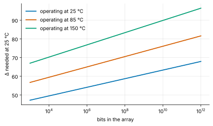
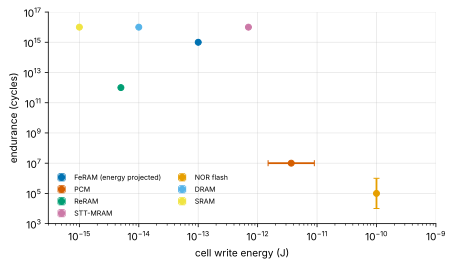

<!-- status: reviewed -->
# 23-08 · Emerging Memories: MRAM, ReRAM, PCM, FeRAM

| | |
|---|---|
| **Course** | [23 · Memory and Storage Technology](../README.md) |
| **University equivalent** | The emerging-memory lectures of a graduate semiconductor-memory or nanoelectronics course: magnetic tunnel junctions and spin-transfer torque, phase-change and resistive switching, ferroelectric memories, and their place in embedded and standalone products (Yu, ed., *Semiconductor Memory Devices and Circuits*; Hellenbrand et al., "Progress of emerging non-volatile memory technologies in industry," *MRS Communications*, 2024) |
| **Prerequisites** | [04-06](../../04-physics-for-ee/chapters/04-06-magnetic-fields-and-forces.md) (magnetism), [04-10](../../04-physics-for-ee/chapters/04-10-intro-quantum-mechanics.md) (tunneling), [04-04](../../04-physics-for-ee/chapters/04-04-potential-capacitance-and-dielectrics.md) (dielectrics and polarization), [23-03](23-03-dram-cells-arrays-refresh.md) (charge sharing), [23-06](23-06-nand-flash-and-3d-nand.md) (flash, retention and Arrhenius) |
| **Estimated study hours** | 5 |
| **Last verified** | 2026-11-25 |

**Learning objectives.** After this chapter you can:

1. Explain how MRAM, PCM, ReRAM and FeRAM store a bit, and what physical quantity each reads.
2. Compute an MTJ's read margin and the thermal stability an MRAM array needs for a given retention, and explain the stability–write-energy tradeoff.
3. Model PCM programming thermally (heating, melt-quench and crystallization) and quantify resistance drift.
4. Relate ReRAM filament resistance to the conductance quantum, and FeRAM signal to switched polarization charge.
5. Compare the four technologies with flash, DRAM and SRAM on endurance, retention, speed, energy and density, using dated industry data.
6. Assess adoption claims and business cases for embedded and standalone emerging memories.

## 1. Big picture

Every memory in 23-02 to 23-06 stores a bit as charge: on a capacitor (DRAM), in a latch (SRAM), or trapped next to a channel (flash). Charge leaks, needs high voltage to inject through an oxide, or needs constant power. **Emerging memories** store a bit as a material state instead: the magnetic orientation of a thin layer (MRAM), the crystal phase of a chalcogenide glass (PCM), a conductive filament through an oxide (ReRAM) or the polarization of a ferroelectric (FeRAM). All four are nonvolatile, write at low voltage in nanoseconds, and can be built between the metal layers of a CMOS chip. None has displaced DRAM or NAND in volume, but several have found real, growing markets.

- **Embedded memory in MCUs and SoCs** is the main near-term target: replacing embedded flash, which industry has been integrating at around 28 nm [1]. TSMC offers embedded MRAM and ReRAM [2], [3], and ST embedded PCM [4].
- **Automotive and industrial controllers** use them for code storage that updates quickly and survives 150 °C [3], [4].
- **Wearables and IoT** value MRAM's low standby power.
- **AI accelerators and data centers** are the speculative frontier: nonvolatile DRAM-like memory [5], [6] and storage-class memory, whose best-known attempt, 3D XPoint, was abandoned [7], [8].

## 2. Intuition first

Each technology encodes a bit in something other than stored charge, and each reads it as a resistance or a charge:

- **MRAM:** two thin magnets separated by an oxide only about a nanometre thick. Electrons tunnel through more easily when the magnets point the same way (low resistance) than opposite ways (high resistance). Writing flips one magnet by pushing a spin-polarized current through it.
- **PCM:** a tiny volume of chalcogenide glass (typically germanium-antimony-tellurium). Crystalline, it conducts well; amorphous, it conducts poorly. Melting it with a short current pulse and letting it cool in nanoseconds freezes it amorphous; heating it more gently for longer lets it crystallize.
- **ReRAM:** an oxide in which a voltage drives oxygen vacancies or metal ions to form a conductive filament a few atoms wide. Reversing the voltage partly dissolves it.
- **FeRAM:** a capacitor whose dielectric is ferroelectric, with an internal electric polarization that points up or down and stays there. Reversing it releases a burst of charge that a sense amplifier detects, as in DRAM.

**An analogy, and its limits.** A light switch, a padlock, a footpath across a lawn and a weathervane that sticks: each holds its state without power, and each takes a different kind of effort to change. The analogy fails on scale and statistics. Every one of these mechanisms is thermally activated or stochastic, and in an array of millions of bits the rare cell that flips, drifts or fails to switch sets the design, not the typical one.

## 3. Theory

### 3.1 What a memory must deliver

Compare memories on six axes: **density** (bits per mm², and cost per bit), **read and write latency**, **write energy**, **endurance** (write cycles before failure), **retention** (how long data survives without power, at what temperature), and **process cost** (extra masks and materials on top of logic CMOS). DRAM and SRAM have essentially unlimited endurance but no retention; NAND has density and retention but slow writes and limited endurance (23-06). The emerging memories sit between, and each trades the axes differently (§3.6).

### 3.2 MRAM: the magnetic tunnel junction

**Reading.** A **magnetic tunnel junction (MTJ)** has a fixed **reference layer**, a thin MgO **tunnel barrier** and a **free layer** whose magnetization can point parallel (P) or antiparallel (AP) to the reference. Tunneling (04-10) depends on the spin-dependent density of states on each side, so the resistances differ. The **tunnel magnetoresistance ratio** is

$$
\text{TMR} = \frac{R_{AP} - R_P}{R_P} .
$$

A read applies a small voltage across the MTJ in series with its access transistor and compares the current with a reference. The series resistance dilutes the contrast: the sense amplifier sees $I_P/I_{AP} - 1$, which is smaller than the TMR (Example 23-08.1). MRAM's read margin is modest compared with PCM's or ReRAM's resistance ratios, which is why MRAM sense amplifiers are carefully designed.

**Retention: the thermal stability factor.** The free layer's two states are separated by an energy barrier $E_b$, set by its magnetic anisotropy and volume. Thermal fluctuations attempt to cross it at an attempt frequency $f_0$ of about $10^9$ s⁻¹, so a single bit flips at the rate

$$
r = f_0\, e^{-\Delta}, \qquad \Delta = \frac{E_b}{k T} ,
$$

the Néel–Arrhenius law, the same thermal activation as 23-06's retention. $\Delta$ is the **thermal stability factor**. An array of $N$ bits held for time $t$ expects $N t f_0 e^{-\Delta}$ flips. Requiring at most one,

$$
\Delta \geq \ln\left(N t f_0\right) .
$$

Because $\Delta = E_b/kT$ falls as temperature rises, a cell must have a larger room-temperature $\Delta$ to hold data at 85 °C or 150 °C (Example 23-08.2). The logarithm is what makes MRAM practical: a million times more bits or time costs only $\ln 10^6 \approx 14$ more units of $\Delta$.

**Writing: spin-transfer torque.** In **STT-MRAM**, a current passed through the MTJ becomes spin-polarized by the reference layer and exerts a torque on the free layer. Above a critical current $I_{c0}$, the free layer switches.

An angular-momentum balance gives $I_{c0}$. Treat the free layer as one macroscopic magnet (the *macrospin* model) with moment $m = M_sV$, where $M_s$ is its saturation magnetization (A/m) and $V$ its volume. Its angular momentum is $m/\gamma$, with $\gamma$ the gyromagnetic ratio (rad s⁻¹ T⁻¹). Disturbed from its easy axis, it precesses at $\omega = \gamma\mu_0H_k$, where $H_k$ is the anisotropy field (A/m). Gilbert damping, of dimensionless strength $\alpha$, drains angular momentum at the rate $\alpha\omega m/\gamma = \alpha\mu_0H_kM_sV$ and pulls it back. Each electron of the current $I$ carries $\hbar/2$ of spin angular momentum, delivered with efficiency $\eta$, so the current supplies $\eta(\hbar/2)(I/q)$ per second. Switching begins when supply beats damping:

$$
\eta\frac{\hbar}{2}\frac{I_{c0}}{q} = \alpha\mu_0H_kM_sV
\quad\Longrightarrow\quad
I_{c0} = \frac{2q\alpha}{\hbar\eta}\mu_0H_kM_sV = \frac{4q\alpha}{\hbar\eta}E_b = \frac{4q\alpha kT}{\hbar\eta}\Delta ,
$$

using the perpendicular free layer's barrier $E_b = \mu_0M_sH_kV/2$. Units: C/(J·s) × J = A. ✓ With $\alpha$ = 0.01 and $\eta$ = 0.5 (assumed, typical orders) at 300 K this is about 0.50 µA per unit of $\Delta$. The barrier that makes data stable is the same barrier the write current must overcome. ($I_{c0} \propto \Delta$ holds at a fixed temperature; at a fixed $E_b$, $I_{c0}$ is set by the barrier, not by $\Delta$.) A stable, flash-replacement MRAM therefore needs more write current and energy than a less stable, cache-like MRAM that accepts shorter retention and refreshes or corrects errors (Example 23-08.3). The write energy is $E = V I t$, of order a picojoule. Writing is also stochastic: a pulse slightly above $I_{c0}$ switches most cells but not all, so designs use margin, verify or ECC.

**Read disturb.** The read current flows through the same junction, so it also pushes on the free layer. A current $I$ below $I_{c0}$ lowers the effective barrier to about $\Delta(1 - I/I_{c0})$. For a cache-like cell with $\Delta$ = 40 and $I_{c0}$ = 40 µA (Example 23-08.3), Example 23-08.1's 25 µA read leaves an effective barrier of 15, and a 10 ns read then flips the cell with probability $f_0te^{-15}$ ≈ 3.1 × 10⁻⁶: far too often. Reads must therefore use a small fraction of $I_{c0}$, which caps the read current and so the sensing margin. TMR also falls as the read bias rises, so a higher read voltage buys less signal than Ohm's law suggests. Read margin, read disturb and write energy are one coupled design problem.

**Endurance.** Every write passes current through a tunnel barrier about a nanometre thick, at a substantial fraction of a volt. Repeated stress slowly creates defects until the MgO breaks down, and that sets MRAM's endurance. Device demonstrations at low write stress reach 10¹⁶ cycles (Table 1), but a product must guarantee every bit at worst-case temperature and write margin. Embedded products are therefore rated at far fewer cycles, $10^6$ in the TSMC/NXP automotive part of §9.

> **Going deeper — SOT and VCMA.** Spin-orbit-torque (SOT) MRAM writes through a separate heavy-metal line under the MTJ, so the write current does not pass through the tunnel barrier. That improves endurance and speed at the cost of a three-terminal cell. Voltage-controlled magnetic anisotropy (VCMA) lowers the barrier with an electric field during writing. As of Nov 2026 neither had reached a high-volume product: imec reported SOT-MRAM results on a 4 kb characterization array at IEDM 2025, a start-up showed an 8 Mb SOT-MRAM demonstrator, and reviews still list VCMA's practical challenges [13], [14].

### 3.3 PCM: switching by heat

**The cell.** A phase-change cell is a small volume of chalcogenide in series with a narrow **heater** electrode and an access device. Its crystalline (SET) state has low resistance and its amorphous (RESET) state a resistance higher by orders of magnitude.

**Threshold switching.** A RESET cell's amorphous resistance is megohms, too high to pass a heating current at a low voltage. Above a *threshold voltage*, the amorphous chalcogenide switches electronically into a conducting state without changing phase (threshold switching), and its resistance collapses. Programming current then flows whichever state the cell started in, so during a programming pulse both states conduct through a similar, low on-resistance. A read stays below the threshold voltage, so it sees the stored resistance.

**A thermal model.** Treat the active region as a thermal capacitance $C_{th}$ (J/K) connected to the surroundings through a thermal resistance $R_{th}$ (K/W). A current $I$ through the cell's resistance $R$ dissipates $P = I^2R$, and the temperature rise $\Delta T$ obeys

$$
C_{th}\frac{d\,\Delta T}{dt} = P - \frac{\Delta T}{R_{th}}
\quad\Longrightarrow\quad
\Delta T(t) = P R_{th}\left(1 - e^{-t/\tau}\right), \qquad \tau = R_{th}C_{th} ,
$$

the same first-order equation as an RC circuit (07-02), with temperature as voltage and power as current. Nanoscale volumes have thermal time constants of nanoseconds.

- **RESET (amorphize):** a short, large pulse drives $\Delta T$ above the melting point. When it ends, the region cools as $e^{-t/\tau}$. If it falls below the crystallization temperature faster than atoms can rearrange, the melt freezes as glass. The cooling time from melt to below crystallization is $\tau \ln(\Delta T_{melt}/\Delta T_x)$ (Example 23-08.4).
- **SET (crystallize):** a longer, smaller pulse holds the region between the crystallization and melting temperatures for long enough to crystallize, typically tens to hundreds of nanoseconds. The SET pulse is the slower operation.
- **Read:** a small current that heats the cell negligibly.

**Drift.** The amorphous phase slowly relaxes, and its resistance rises with time as

$$
R(t) = R(t_0)\left(\frac{t}{t_0}\right)^{\nu} ,
$$

with a drift exponent $\nu$ of order 0.1 for common chalcogenides (an assumed, representative value; it depends on material and state). Drift barely matters for one bit per cell, where the SET and RESET resistances differ by orders of magnitude. For multi-level PCM it is a serious problem, because intermediate levels drift into each other (Example 23-08.5).

### 3.4 ReRAM: a filament of atoms

In a **ReRAM** cell, typically a transition-metal oxide between two electrodes, a first high-voltage **forming** step creates a conductive filament of oxygen vacancies or metal atoms. Afterwards, a **SET** voltage reconnects the filament (low-resistance state, LRS) and an opposite **RESET** voltage ruptures it near one electrode (high-resistance state, HRS). The filament's narrowest point may be only a few atoms wide, and there conduction is quantized: a single-atom constriction conducts about one **conductance quantum**,

$$
G_0 = \frac{2q^2}{h} \approx 77.5\ \mu\text{S}, \qquad \frac{1}{G_0} \approx 12.9\ \text{k}\Omega .
$$

An LRS of a few kilohms therefore corresponds to a constriction a few atoms across (Example 23-08.6). This explains ReRAM's main weakness: adding or removing a handful of atoms changes the resistance by a large fraction, so resistances vary from cycle to cycle and cell to cell. Its strengths are a simple two-terminal stack in the back-end metal layers, low switching voltage and a large resistance window.

**Selectors and sneak paths.** A two-terminal cell can sit at every crossing of a wordline and a bitline, with no transistor, in a *cross-point* array 4F² per bit per layer. Without a transistor, though, current from the selected row leaks through unselected cells along paths that loop back through other rows and columns (*sneak paths*), and it swamps the selected cell's signal. Each cell therefore needs a series **selector**, a two-terminal device that conducts only above a threshold. Arrays are biased so the selected cell sees the full voltage while half-selected cells see only half. Intel and Micron's 3D XPoint stacked a PCM cell on an ovonic threshold switch (OTS) selector, and the selector's leakage and threshold variation limit how large such arrays can be.

### 3.5 FeRAM and FeFET: polarization

A **ferroelectric** has a spontaneous electric polarization $P$ (charge per area) that can be reversed by a field above the **coercive field** $E_c$. After the field is removed, a **remanent polarization** $\pm P_r$ remains. Reversing it moves charge $2P_rA$ through a capacitor of area $A$.

**FeRAM (1T1C).** The cell is a DRAM-like transistor and capacitor with a ferroelectric dielectric. Reading drives the capacitor toward one polarization: if the cell held the other state, the reversal dumps $2P_rA$ onto the bitline, producing a voltage of about $2P_rA/C_{BL}$, as in DRAM charge sharing (23-03). The read is **destructive**, so the cell is rewritten afterwards. Unlike DRAM, the state survives without refresh. Classic FeRAM used perovskites such as PZT that are hard to integrate and scale. The discovery of ferroelectricity in thin, CMOS-compatible doped hafnium oxide revived the field: Micron's 32 Gb NVDRAM research chip uses a 5.7 nm ferroelectric capacitor [5].

**FeFET (1T).** Putting the ferroelectric in a transistor's gate stack makes the polarization shift the threshold voltage, as stored charge does in flash (23-06). The **memory window** follows from the coercive field. The polarization reverses when the field across the ferroelectric reaches $\pm E_c$, a voltage $\pm E_ct_{FE}$ for a film of thickness $t_{FE}$. Each remanent state therefore shifts the gate voltage at which the ferroelectric carries no net field by $E_ct_{FE}$, in opposite directions, so the transistor's threshold, measured from the gate, differs between the states by about $2E_ct_{FE}$ (Example 23-08.7). Real windows are smaller: depolarization fields and charge trapping at the interface eat into it. The read is nondestructive and the cell is as small as a single transistor, but endurance and the thin-film physics of the window remain active research.

### 3.6 Comparing the technologies

Table 1 collects the best values that named companies have demonstrated for each metric, from a 2024 industry review [1]. The best numbers in each row come from different devices and are not achieved together in one product.

| Metric | FeRAM | PCM | ReRAM | STT-MRAM | NOR flash | DRAM | SRAM |
|---|---|---|---|---|---|---|---|
| Endurance (cycles) | 10¹⁵ | >10⁷ | 10¹² | 10¹⁶ | 10⁴–10⁶ | 10¹⁶ | 10¹⁶ |
| Retention without power | 121 years at 85 °C | >10 years at 150 °C | 10 years at 105 °C | 20 years at 150 °C | >10 years | 100 µs* | none |
| Write speed | 2 ns | ≤20 ns | 5/1 ns set/reset | 1.5 ns | 0.1–1 ms | ~10 ns | ~1 ns |
| Read speed | 2 ns | ≤30 ns | <5 ns | 4 ns | ~10 ns | ~10 ns | ~1 ns |
| Switching voltage | 0.5 V | <3 V | <1–1.5 V | 0.8–2.0 V | >5 V | <1 V | <1 V |
| Cell write energy | <100 fJ (projected) | <2.63 / 1.5–9 pJ set/reset | 5 fJ | 0.7 pJ | ~100 pJ | ~10 fJ | ~fJ |

*Table 1. Top industry-demonstrated metrics, as collected by Hellenbrand, Teck and MacManus-Driscoll (2024), Table 2 [1]. Each entry is attributed in the source to a specific company or collaboration. \*The source lists 100 µs for DRAM; JEDEC parts guarantee retention over the 64 ms (32 ms when hot) refresh window, and typical cells hold data for seconds (23-03).*

Read across the rows and the tradeoffs appear. MRAM and FeRAM have DRAM-like endurance in device demonstrations (products are rated lower, §3.2); PCM and ReRAM sit between flash and DRAM. PCM's write energy, set by heating, is the highest of the four. All four write at far lower voltage and energy than NOR flash. Density is the gap that the table does not show: emerging memories are built at logic-like cell sizes in a single layer, while NAND stacks hundreds of layers (Example 23-08.8). That is why none of them competes with NAND on cost per bit, and why their natural market is embedded memory, where the comparison is with embedded flash and SRAM.

## 4. Worked examples

### Example 23-08.1 · An MTJ read margin (tier A)

**Setup.** An MTJ has $R_P$ = 4 kΩ and a TMR of 150% (assumed). It is read at 0.15 V through an access transistor of 2 kΩ (assumed). Find (a) $R_{AP}$, the read currents in (b) the P and (c) the AP state, (d) their difference and (e) the effective contrast $I_P/I_{AP} - 1$.

**Solution.**

- (a) $4 \times (1 + 1.5)$ = **10** kΩ.
- (b) $0.15/(4 + 2)\ \text{k}\Omega$ = **25.0** µA; (c) $0.15/(10 + 2)\ \text{k}\Omega$ = **12.5** µA.
- (d) **12.5** µA; (e) $25/12.5 - 1$ = **100** %.

**Units check.** V/Ω = A. ✓

**Sanity check.** The access transistor cuts the 150% TMR to a 100% current contrast. A sense amplifier comparing against a reference midway between the two currents has 6.25 µA of margin on each side, which device variation and noise must not consume.

### Example 23-08.2 · Thermal stability for retention (tier B)

**Setup.** A 32 Mib (2²⁵-bit) MRAM array must keep data for 10 years with at most one expected thermal flip. Take $f_0 = 10^9$ s⁻¹ and a year of 365.25 days. Find (a) $N t f_0$ and (b) the required $\Delta$ at the operating temperature. Assuming a temperature-independent barrier, what room-temperature (25 °C) $\Delta$ does the cell need to meet (b) at (c) 85 °C and (d) 150 °C?

**Solution.**

- (a) $2^{25} \times 3.156 \times 10^8\ \text{s} \times 10^9$ = **1.06** × 10²⁵.
- (b) $\ln(1.059 \times 10^{25})$ = **57.6**.
- (c) $57.62 \times 358.15/298.15$ = **69.2**; (d) $57.62 \times 423.15/298.15$ = **81.8**.

**Units check.** Δ is dimensionless; temperatures in kelvin. ✓

**Sanity check.** Automotive retention at 150 °C needs a room-temperature $\Delta$ above 80, which is why automotive eMRAM is a demanding design point. In practice the barrier itself also falls with temperature, so real cells need more margin than this estimate.

### Example 23-08.3 · Stability against write energy (tier B)

**Setup.** Assume $I_{c0}$ = 1 µA per unit of $\Delta$, a write current of 1.5 $I_{c0}$, and 20 ns pulses at 0.5 V. For (a) $\Delta$ = 60 and (b) $\Delta$ = 40, find the write current and energy. For $\Delta$ = 40, find (c) one bit's mean retention time in years and (d) the mean time to the first flip in a 1 Mib (2²⁰-bit) array.

**Solution.**

- (a) $I = 1.5 \times 60$ = **90** µA; $E = 0.5 \times 90\ \mu\text{A} \times 20\ \text{ns}$ = **0.9** pJ.
- (b) $I$ = **60** µA; $E$ = **0.6** pJ.
- (c) $\tau = e^{40}/10^9$ = 2.35 × 10⁸ s = **7.46** years.
- (d) $2.354 \times 10^8/2^{20}$ = **224** s.

**Units check.** V × A × s = J. ✓

**Sanity check.** Cutting $\Delta$ by a third cuts the write energy by a third, but a 1 Mib array then loses a bit every few minutes. That is acceptable for a cache with ECC and scrubbing, not for code storage. The 0.9 pJ is the same order as the 0.7 pJ in Table 1 [1]. The assumed 1 µA per unit of $\Delta$ corresponds, in §3.2's macrospin formula with $\eta$ = 0.5, to a damping of about 0.02.

### Example 23-08.4 · Melting and quenching a PCM cell (tier B)

**Setup.** A PCM cell conducts with 2 kΩ during programming and must reach a 600 K rise to melt (assumed). Its thermal time constant is 2 ns (assumed). A RESET pulse of 200 µA lasts 50 ns. Find (a) the power, (b) the thermal resistance needed and (c) the RESET pulse energy. (d) If crystallization stops below a 125 K rise (assumed), how long does the melt take to cool through that range? (e) What current holds the cell at a 300 K rise for SET, and (f) what energy does a 150 ns SET pulse use?

**Solution.**

- (a) $(200\ \mu\text{A})^2 \times 2\ \text{k}\Omega$ = **80** µW; (b) $600/80\ \mu\text{W}$ = **7.5** K/µW.
- (c) $80\ \mu\text{W} \times 50\ \text{ns}$ = **4.0** pJ.
- (d) $2\ \text{ns} \times \ln(600/125)$ = **3.14** ns.
- (e) $P = 300/7.5\ \text{K/µW} = 40$ µW, so $I = \sqrt{40\ \mu\text{W}/2\ \text{k}\Omega}$ = **141** µA.
- (f) $40\ \mu\text{W} \times 150\ \text{ns}$ = **6.0** pJ.

**Units check.** A² × Ω = W; K/W × W = K. ✓

**Sanity check.** A few nanoseconds of cooling is far shorter than crystallization takes, so the melt freezes amorphous. The SET pulse uses more energy than RESET despite its lower current, because it is three times longer. RESET's 4.0 pJ lies within Table 1's 1.5–9 pJ RESET range [1]; this example's long SET pulse (6.0 pJ) is above the best demonstrated SET energy of under 2.63 pJ. Both are far more than MRAM's write. The 2 kΩ is the threshold-switched on-resistance during programming (§3.3), not the stored resistance.

### Example 23-08.5 · Resistance drift (tier B)

**Setup.** An amorphous PCM state drifts with $\nu$ = 0.1 (assumed), measured from $t_0$ = 1 s. By what factor has its resistance grown after (a) one hour, (b) one day and (c) ten years? (d) A 2-bit PCM cell places its levels a factor of 2 apart in resistance. How long until a level has drifted by that factor?

**Solution.**

- (a) $3600^{0.1}$ = **2.27**; (b) $86{,}400^{0.1}$ = **3.12**; (c) $(3.156 \times 10^8)^{0.1}$ = **7.08**.
- (d) $t = 2^{1/0.1}$ s = $2^{10}$ s = **1024** s, about 17 minutes.

**Units check.** A ratio of times raised to a power is dimensionless. ✓

**Sanity check.** Within about 17 minutes an intermediate level has drifted by a full level spacing against fixed read references. The neighbouring levels drift too, at different rates (the crystalline level hardly at all), and $\nu$ varies from cell to cell, so the levels both move and spread. Multi-level PCM therefore needs drift-tolerant reading (references that track time, or ratios between cells), and most products store one bit per cell.

### Example 23-08.6 · How many atoms is a filament? (tier A)

**Setup.** Find (a) the conductance quantum and (b) its resistance. A ReRAM cell's LRS is 3 kΩ and its HRS 100 kΩ (assumed). Find (c) the LRS conductance in quanta, the read currents at 0.2 V in (d) the LRS and (e) the HRS, and (f) their ratio.

**Solution.**

- (a) $2q^2/h$ = **77.5** µS; (b) $1/G_0$ = **12.9** kΩ.
- (c) $12.906/3$ = **4.30** quanta.
- (d) $0.2/3\ \text{k}\Omega$ = **66.7** µA; (e) $0.2/100\ \text{k}\Omega$ = **2.0** µA; (f) **33.3**.

**Units check.** C²/(J·s) = A/V = S. ✓

**Sanity check.** The LRS behaves like a constriction about four atoms across. Moving one atom changes the conductance by about 23%, which is why ReRAM resistances vary from cycle to cycle.

### Example 23-08.7 · Ferroelectric signals (tier B)

**Setup.** A hafnium-oxide FeRAM capacitor is 80 nm × 80 nm with $P_r$ = 20 µC/cm² (assumed). Find (a) the switched charge and (b) the bitline signal on a 30 fF bitline. (c) What memory window does a FeFET with a 10 nm ferroelectric and $E_c$ = 1 MV/cm (assumed) have?

**Solution.**

- (a) $2 \times 20\ \mu\text{C/cm}^2 \times 6.4 \times 10^{-11}\ \text{cm}^2$ = **2.56** fC.
- (b) $2.56\ \text{fC}/30\ \text{fF}$ = **85.3** mV.
- (c) $2 \times 10^8\ \text{V/m} \times 10 \times 10^{-9}\ \text{m}$ = **2.0** V.

**Units check.** C/m² × m² = C; C/F = V; V/m × m = V. ✓

**Sanity check.** Tens of millivolts of signal is DRAM-like (23-03), so FeRAM sensing borrows DRAM's sense amplifiers. A 2 V FeFET window is comparable to a few flash levels' worth of threshold shift.

### Example 23-08.8 · Density and market scale (tier B)

**Setup.** TechInsights measured Everspin's 1 Gb (1,024 Mb) STT-MRAM die at 105.1 mm², with a cell of 0.0396 µm² on a 28 nm process [9]. Find (a) its bit density and (b) its cell size in units of $F^2$ ($F$ = 28 nm). (c) How much denser is Kioxia's 37.6 Gb/mm² QLC NAND (23-06)? (d) Everspin's fourth-quarter 2025 revenue was \$14.8 million [10]; the top five NAND makers' combined revenue in 2Q26 was \$68.87 billion (23-06). What is the ratio?

**Solution.**

- (a) $1024/105.1$ = **9.74** Mb/mm² (TechInsights quotes 9.75).
- (b) $0.0396/0.028^2$ = **50.5** $F^2$.
- (c) $37.6 \times 1024/9.75$ = **3949**, using TechInsights' 9.75 Mb/mm².
- (d) $68.87 \times 10^9/14.8 \times 10^6$ = **4653**.

**Units check.** Mb/mm²; µm²/µm² is dimensionless. ✓

**Sanity check.** A 50 $F^2$ cell in a single layer cannot compete with NAND's hundreds of stacked layers on cost per bit, and the leading standalone MRAM business is thousands of times smaller than NAND (the two quarters differ, so the ratio is indicative). Standalone MRAM sells into niches that value endurance, speed and robustness; the volume opportunity is embedded.

<!-- answer-key -->

| ID | Quantity | Value | Unit |
|---|---|---|---|
| Ex 23-08.1a | antiparallel resistance | 10 | kΩ |
| Ex 23-08.1b | parallel-state current | 25.0 | µA |
| Ex 23-08.1c | antiparallel-state current | 12.5 | µA |
| Ex 23-08.1d | current difference | 12.5 | µA |
| Ex 23-08.1e | effective contrast | 100 | % |
| Ex 23-08.1f | margin each side of a midpoint reference | 6.25 | µA |
| Ex 23-08.2a | N t f0 | 1.06e25 | |
| Ex 23-08.2a1 | N t f0, 4 s.f. | 1.059e25 | |
| Ex 23-08.2b | required Delta | 57.6 | |
| Ex 23-08.2b1 | required Delta, 4 s.f. | 57.62 | |
| Ex 23-08.2c | room-temperature Delta for 85 °C | 69.2 | |
| Ex 23-08.2d | room-temperature Delta for 150 °C | 81.8 | |
| Ex 23-08.2e | seconds in 10 years | 3.156e8 | s |
| Ex 23-08.3a1 | write current, Delta 60 | 90 | µA |
| Ex 23-08.3a | write energy, Delta 60 | 0.9 | pJ |
| Ex 23-08.3b1 | write current, Delta 40 | 60 | µA |
| Ex 23-08.3b | write energy, Delta 40 | 0.6 | pJ |
| Ex 23-08.3c0 | retention time, Delta 40 | 2.35e8 | s |
| Ex 23-08.3c1 | retention time, Delta 40, 4 s.f. | 2.354e8 | s |
| Ex 23-08.3c | retention time, Delta 40 | 7.46 | years |
| Ex 23-08.3d | mean time to first flip, 1 Mb | 224 | s |
| Ex 23-08.4a | RESET power | 80 | µW |
| Ex 23-08.4b | thermal resistance | 7.5 | K/µW |
| Ex 23-08.4c | RESET energy | 4.0 | pJ |
| Ex 23-08.4d | quench time | 3.14 | ns |
| Ex 23-08.4e0 | SET power | 40 | µW |
| Ex 23-08.4e | SET current | 141 | µA |
| Ex 23-08.4f | SET energy | 6.0 | pJ |
| Ex 23-08.5a | drift factor, 1 hour | 2.27 | |
| Ex 23-08.5b | drift factor, 1 day | 3.12 | |
| Ex 23-08.5c | drift factor, 10 years | 7.08 | |
| Ex 23-08.5d | time to drift by 2x | 1024 | s |
| Ex 23-08.5e | time to drift by 2x in minutes | 17 | min |
| Ex 23-08.6a | conductance quantum | 77.5 | µS |
| Ex 23-08.6b | quantum resistance | 12.9 | kΩ |
| Ex 23-08.6b1 | quantum resistance, 5 s.f. | 12.906 | kΩ |
| Ex 23-08.6c | LRS in quanta | 4.30 | |
| Ex 23-08.6d | LRS read current | 66.7 | µA |
| Ex 23-08.6e | HRS read current | 2.0 | µA |
| Ex 23-08.6f | current ratio | 33.3 | |
| Ex 23-08.6g | conductance change per atom | 23 | % |
| Ex 23-08.7a0 | capacitor area | 6.4e-11 | cm² |
| Ex 23-08.7a | switched charge | 2.56 | fC |
| Ex 23-08.7b | bitline signal | 85.3 | mV |
| Ex 23-08.7c | FeFET memory window | 2.0 | V |
| Ex 23-08.8a | MRAM bit density | 9.74 | Mb/mm² |
| Ex 23-08.8b | MRAM cell size | 50.5 | F² |
| Ex 23-08.8c | NAND density advantage | 3949 | |
| Ex 23-08.8d | revenue ratio | 4653 | |
| Txt 23-08.a | Delta cost of a millionfold more bits or time | 14 | |
| Txt 23-08.b | SET-to-RESET pulse-length ratio | 3 | |
| Txt 23-08.c | critical current per unit Delta, alpha 0.01, eta 0.5, 300 K | 0.50 | µA |
| Txt 23-08.d | effective barrier during a 25 µA read | 15 | |
| Txt 23-08.e | flip probability of a 10 ns read | 3.1e-6 | |
| Txt 23-08.f | damping implied by 1 µA per unit Delta | 0.02 | |
| Txt 23-08.h | critical current at Delta 40 | 40 | µA |

## 5. Simulate it

The lab is [labs/23-08-lab/](../labs/23-08-lab/README.md). `emem.py` holds the chapter's models. The netlist `pcm_thermal.cir` models a PCM cell's thermal behaviour as an RC circuit in ngspice: temperature as a node voltage, Joule heating as a behavioural current source.

*Figure 1. The thermal stability an MRAM array needs grows only with the logarithm of its size, but strongly with temperature.*

**Predict, then run:**

1. *Predict* the peak temperature rise of the RESET pulse and the time to cool from a 500 K to a 125 K rise. Run `ngspice -b pcm_thermal.cir` and compare.
2. Halve the thermal time constant (halve the thermal capacitance). *Predict* the change in quench time and peak temperature.
3. In the notebook, plot the required $\Delta$ against array size (Figure 1) and simulate thermal flips in a small array with a low $\Delta$.
4. Plot the endurance and write energy of Table 1's technologies (Figure 2) and locate each against DRAM and NOR flash.

*Figure 2. Best demonstrated endurance against cell write energy (Table 1 [1]). The emerging memories fill the gap between DRAM and NOR flash.*

## 6. Engineering tradeoffs

| Knob | Improves | Costs | Typical decision owner |
|---|---|---|---|
| MRAM thermal stability $\Delta$ | Retention, temperature range | Write current, energy and access-transistor size | MRAM device and product teams |
| MTJ TMR and resistance | Read margin and speed | Barrier reliability, process control | MRAM process integration |
| PCM cell volume and heater size | RESET current and energy | Variability, fabrication difficulty | PCM process integration |
| PCM bits per cell | Density | Drift, read complexity | Product planning |
| ReRAM compliance (SET current limit) | LRS stability, endurance | Read current, resistance window | Circuit and device teams jointly |
| Ferroelectric thickness | FeFET memory window | Switching voltage, scaling | FeFET device teams |
| eNVM choice for an MCU (MRAM vs ReRAM vs PCM) | Fit to endurance, temperature and cost needs | Foundry availability, masks, IP licensing | SoC architects and foundry partners |

## 7. Numbers to know

| Quantity | Typical value | Note |
|---|---|---|
| Conductance quantum | 77.5 µS (12.9 kΩ) | Physical constant |
| MRAM thermal stability for 10-year retention | about 60 at operating temperature | Example 23-08.2 |
| MRAM write energy | about 1 pJ | Table 1 [1]; Example 23-08.3 |
| PCM RESET energy | a few pJ | Table 1 [1] |
| Endurance | MRAM/FeRAM 10¹⁵–10¹⁶; ReRAM 10¹²; PCM >10⁷; NOR 10⁴–10⁶ | Best demonstrated [1] |
| TSMC 16 nm automotive eMRAM | 1 M cycles, 20-year retention at 150 °C | [3] |
| TSMC eReRAM (2020) | 10-year retention at 125 °C, 10,000 cycles | [2] |
| Everspin 1 Gb STT-MRAM (28 nm) | 105.1 mm², 9.75 Mb/mm², 0.0396 µm² cell | [9] |

## 8. Common mistakes

- **Comparing best-case numbers across technologies.** Table 1's best values come from different devices and papers; one product never achieves them all at once.
- **Treating "nonvolatile" as unconditional.** Retention depends on temperature and array size; quote both.
- **Ignoring the read path.** A 150% TMR does not mean a 150% read contrast once the access transistor is included.
- **Assuming lower $\Delta$ is free.** It saves write energy but costs retention exponentially.
- **Forgetting drift and variability.** PCM drift and ReRAM filament variability make multi-level storage much harder than the resistance window suggests.
- **Conflating embedded and standalone markets.** Emerging memories compete with embedded flash and SRAM, not with NAND on cost per bit.

## 9. Practitioner lens

**State of the art (as of Nov 2026).**

- *Embedded MRAM* [Established]. NXP and TSMC announced on 16 May 2023 the first automotive embedded MRAM in 16 nm FinFET, citing one-million-cycle endurance, solder-reflow support and 20-year retention at 150 °C; product samples were scheduled for early 2025 [3]. *[Industry estimate: vendor claim]* NXP also claims that MRAM updates 20 MB of code in about 3 seconds where flash takes about a minute [3]. In 2020 TSMC said 22 nm eMRAM was ready for production and was taking MRAM to 16 nm [2].
- *Embedded ReRAM* [Established]. TSMC said in 2020 that it had brought both ReRAM and MRAM into production at 40 nm and 22 nm, quoting 10-year retention at 125 °C and 10,000 cycles for ReRAM, with Infineon an adopter [2]. Weebit Nano reported a ReRAM license to Texas Instruments and JEDEC-based qualification at DB HiTek in early 2026 [11].
- *Embedded PCM* [Established for 28 nm; xMemory production announced]. ST describes its embedded PCM as the first 28 nm eNVM qualified for automotive. In April 2025 it said that Stellar MCUs with "xMemory", based on its PCM, would start production later in 2025, and that PCM made at 18 nm and 28 nm gives twice the memory density of other technologies [4].
- *Standalone MRAM* [Established]. Everspin's 1 Gb STT-MRAM on a 28 nm GlobalFoundries process was analysed by TechInsights in 2021 [9]. Everspin reported $14.8 million of fourth-quarter 2025 revenue and a goal of $100 million annual revenue within three to five years [10].
- *Storage-class memory* [Established]. Micron said in March 2021 that it would cease 3D XPoint development and sell its fab, citing "insufficient market validation" [8]. Intel began winding down Optane in July 2022 with a $559 million inventory write-off, citing a shift to CXL [7].
- *Ferroelectric revival* [Contested for products]. Micron presented a 32 Gb dual-layer "NVDRAM" with a 5.7 nm ferroelectric capacitor at IEDM 2023 [5]; analysts suggested it may never become a product in its own right [6]. FMC, a Dresden ferroelectric-memory company, raised €100 million in November 2025 to take its FeRAM technology into AI data centers [12].

**Why it matters commercially.** For MCU and SoC makers, the choice of embedded NVM determines which foundry and node they can use, how fast firmware updates are, and whether parts qualify for automotive temperatures. For memory makers, emerging memories have mostly been a source of losses (3D XPoint) or niche revenue (standalone MRAM), while foundries capture the value of embedded versions. For investors, the useful question is not "which memory wins?" but "which socket, at what cost per bit and what qualification?"

**Marketing vs Reality.**

- *"Universal memory: as fast as DRAM, as dense as NAND, nonvolatile."* No technology does all three; Table 1's best values come from different devices [1], and density lags NAND by thousands of times (Example 23-08.8).
- *"Unlimited endurance."* MRAM's endurance is very high but finite: barrier breakdown limits it, and a product rating (10⁶ cycles for the TSMC/NXP part [3]) sits far below device demonstrations. A stable cell also needs more write energy (Example 23-08.3).
- *"20-year retention."* At a specified temperature and for a specified array size; check both, and the failure criterion.
- *"Replaces DRAM."* 3D XPoint shows that a technically working memory can fail commercially if it cannot beat incumbents on cost or open a new use [7], [8].

**Questions for engineering leaders.**

1. **"What are your endurance and retention at the same time, at temperature, for the full array?"** *Strong:* one qualification report with both. *Evasive:* best-case numbers from different tests.
2. **"What thermal stability do your cells have at 150 °C, and how do you handle write errors?"** *Strong:* $\Delta$ distributions, write-error rates, ECC. *Evasive:* "our MRAM is automotive-grade."
3. **"How many extra masks and what yield does the eNVM add over the base logic process?"** *Strong:* mask count, defect density, cost per wafer. *Evasive:* "it's a back-end module."
4. **"How does PCM drift or ReRAM variability limit bits per cell?"** *Strong:* measured distributions over time. *Evasive:* "we can do multi-level."
5. **"Who is buying it, at what volume, and against what incumbent?"** *Strong:* named sockets and the flash or SRAM they replace. *Evasive:* a total addressable market figure.

## 10. Concept check

**Q1.** What physical quantity does each of MRAM, PCM, ReRAM and FeRAM store?

Answer

MRAM: the magnetization direction of a free layer, read as tunnel resistance. PCM: crystalline or amorphous phase, read as resistance. ReRAM: a conductive filament, read as resistance. FeRAM: ferroelectric polarization, read as switched charge (FeFET: as a threshold shift) (§2, §3).

**Q2.** Why does MRAM's required thermal stability grow only logarithmically with array size?

Answer

The expected flips are $N t f_0 e^{-\Delta}$. Keeping that below one needs $\Delta \geq \ln(Nt f_0)$, so multiplying $N$ by a million adds only about 14 to $\Delta$ (§3.2).

**Q3.** Why does lowering $\Delta$ save MRAM write energy, and what does it cost?

Answer

The STT critical current is roughly proportional to the barrier, hence to $\Delta$. Lowering $\Delta$ lowers the write current and energy proportionally, but retention falls exponentially (Example 23-08.3).

**Q4.** Why does a PCM RESET pulse need a fast fall time, and why is SET slower?

Answer

The melt must cool below the crystallization temperature faster than crystallization can occur, or it would recrystallize; with nanosecond thermal time constants a sharp fall suffices. SET must hold the material between crystallization and melting long enough for crystals to grow (§3.3).

**Q5.** Why are ReRAM resistances so variable?

Answer

The filament's narrowest point is only a few atoms across, each contributing roughly one conductance quantum. Adding or removing a single atom changes the conductance by tens of percent (Example 23-08.6).

**Q6.** Why are emerging memories mainly embedded rather than standalone?

Answer

Their single-layer cells are thousands of times less dense than 3D NAND, so they cannot compete on cost per bit. Embedded, they replace embedded flash, which is hard to scale with logic, and add only back-end layers (§3.6, Example 23-08.8).

Problem set: [23-08 problems](../problems/23-08-problems.md).

## 11. Key terms

[Magnetic tunnel junction](../../../reference/glossary.md#magnetic-tunnel-junction) · [Tunnel magnetoresistance (TMR)](../../../reference/glossary.md#tunnel-magnetoresistance-tmr) · [Thermal stability factor](../../../reference/glossary.md#thermal-stability-factor) · [Spin-transfer torque (STT)](../../../reference/glossary.md#spin-transfer-torque-stt) · [Phase-change memory (PCM)](../../../reference/glossary.md#phase-change-memory-pcm) · [Resistance drift](../../../reference/glossary.md#resistance-drift) · [Resistive RAM (ReRAM)](../../../reference/glossary.md#resistive-ram-reram) · [Conductance quantum](../../../reference/glossary.md#conductance-quantum) · [Ferroelectric RAM (FeRAM)](../../../reference/glossary.md#ferroelectric-ram-feram) · [Ferroelectric FET (FeFET)](../../../reference/glossary.md#ferroelectric-fet-fefet) · [Remanent polarization](../../../reference/glossary.md#remanent-polarization) · [Embedded nonvolatile memory (eNVM)](../../../reference/glossary.md#embedded-nonvolatile-memory-envm) · [Storage-class memory](../../../reference/glossary.md#storage-class-memory) · [Threshold switching](../../../reference/glossary.md#threshold-switching) · [Selector (memory)](../../../reference/glossary.md#selector-memory) · [Sneak path](../../../reference/glossary.md#sneak-path)

## 12. Connections

- **Previous:** [23-07](23-07-ssd-controllers.md) completed the flash story. [23-06](23-06-nand-flash-and-3d-nand.md) supplied retention and Arrhenius statistics; [23-03](23-03-dram-cells-arrays-refresh.md) charge sharing; [04-10](../../04-physics-for-ee/chapters/04-10-intro-quantum-mechanics.md) tunneling; [04-06](../../04-physics-for-ee/chapters/04-06-magnetic-fields-and-forces.md) magnetism.
- **Next:** [23-09](23-09-compute-in-memory.md) uses ReRAM, PCM and SRAM arrays as analog matrix multipliers.
- **Used later:** [25-09](../../25-fabrication-packaging-test-and-reliability/chapters/25-09-reliability-physics.md) treats thermal activation and qualification generally.

## 13. Further study

- M. Hellenbrand, I. Teck and J. L. MacManus-Driscoll, "Progress of emerging non-volatile memory technologies in industry," *MRS Communications* 14, 1099–1112 (2024) [1]: the industry state of the four technologies.
- S. Yu (ed.), *Semiconductor Memory Devices and Circuits*, CRC Press, 2022: device physics and circuits for each technology.
- H.-S. P. Wong et al., "Phase change memory," *Proc. IEEE* 98(12), 2010, and "Metal–oxide RRAM," *Proc. IEEE* 100(6), 2012: classic tutorial reviews.

## 14. Sources

1. M. Hellenbrand, I. Teck and J. L. MacManus-Driscoll, "Progress of emerging non-volatile memory technologies in industry," *MRS Communications* 14, 1099–1112, 2024, doi:10.1557/s43579-024-00660-2 (open access; read via Europe PMC, PMC11618178). [R-485]
2. P. Clarke, "TSMC offers 22nm RRAM, taking MRAM on to 16nm," eeNews Europe, 25 Aug 2020, <https://www.eenewseurope.com/en/tsmc-offers-22nm-rram-taking-mram-on-to-16nm>. [R-486]
3. NXP Semiconductors, "NXP and TSMC to Deliver Industry's First Automotive 16 nm FinFET Embedded MRAM," 16 May 2023 (Design & Reuse reprint), <https://www.design-reuse.com/news/news54040.html>. [R-486]
4. STMicroelectronics, "STMicroelectronics future-proofs the development of next-gen cars with innovative memory solution for automotive microcontrollers," 16 Apr 2025, <https://newsroom.st.com/media-center/press-item.html/t4687.html>. [R-486]
5. P. Clarke, "IEDM: Micron to present DRAM-like non-volatile memory for AI," eeNews Europe, 5 Oct 2023, <https://www.eenewseurope.com/en/iedm-micron-to-present-dram-like-non-volatile-memory-for-ai/>. [R-487]
6. C. Mellor, "Micron NVDRAM may never become a product," Blocks & Files, 9 Jan 2024, <https://www.blocksandfiles.com/flash/2024/01/09/micron-nvdram-may-never-become-a-product/1602216>. [R-487]
7. P. Alcorn, "Intel Kills Optane Memory Business, Pays $559 Million Inventory Write-Off," Tom's Hardware, updated 2 Aug 2022, <https://www.tomshardware.com/news/intel-kills-optane-memory-business-for-good>. [R-488]
8. P. Alcorn, "Micron to Sell 3D XPoint Memory Fab and Cease Further Development," Tom's Hardware, 16 Mar 2021, <https://www.tomshardware.com/news/micron-sell-3d-xpoint-fab-stop-development-intel>. [R-488]
9. TechInsights, "World's First 1 Gb 28 nm STT-MRAM Product - by Everspin," 30 Mar 2021, <https://www.techinsights.com/blog/memory/worlds-first-1-gb-28-nm-stt-mram-product-everspin>. [R-489]
10. The Motley Fool, "Everspin (MRAM) Q4 2025 Earnings Call Transcript," 4 Mar 2026, <https://www.fool.com/earnings/call-transcripts/2026/03/04/everspin-mram-q4-2025-earnings-call-transcript>. [R-489]
11. "Weebit Nano Signs Largest Customer to Date – Technology Qualified at DB HiTek," StorageNewsletter, 3 Feb 2026, <https://www.storagenewsletter.com/2026/02/03/weebit-nano-signs-largest-customer-to-date-technology-qualified-at-db-hitek/>. [R-486]
12. C. Mellor, "FMC gets FERAM cash to kill Optane's ghost," Blocks & Files, 14 Nov 2025, <https://www.blocksandfiles.com/ai-ml/2025/11/14/fmc-gets-feram-cash-to-kill-optanes-ghost/1704708>. [R-487]
13. imec, SOT-MRAM paper at IEDM 2025 (4 kb characterization array), record <https://zenodo.org/records/18451467>; and MRAM-Info, "Truth Memory Corporation developed the world's first 8Mb SOT-MRAM chip," 31 Jan 2026, <https://www.mram-info.com/truth-memory-corporation-developed-worlds-first-8mb-sot-mram-chip-using-110-nm-process>. [R-498]
14. Review abstracts on VCMA and spintronic memory: J. Appl. Phys. (2024), doi:10.1063/5.0201648; Advances in Physics: X (2025), doi:10.1080/23746149.2025.2557918. [R-498]
