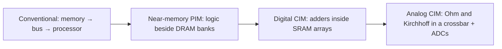
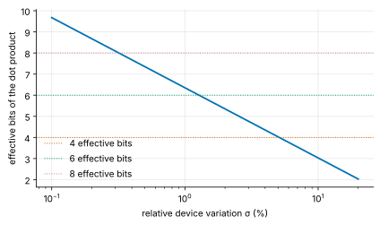
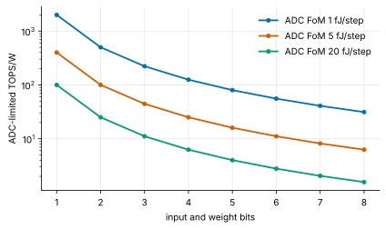

<!-- status: verified -->
# 23-09 · Compute-in-Memory and Near-Memory Computing

| | |
|---|---|
| **Course** | [23 · Memory and Storage Technology](../README.md) |
| **University equivalent** | The in-memory-computing lectures of a graduate hardware-for-machine-learning course: analog crossbars, compute SNR and ADC costs, digital in-memory computing, processing-in-memory in DRAM, and how to benchmark accelerators (Sze, Chen, Yang & Emer, *Efficient Processing of Deep Neural Networks*; Sze et al., "TOPS/W (alone) considered harmful," *IEEE Solid-State Circuits Magazine*, 2020) |
| **Prerequisites** | [23-01](23-01-memory-hierarchy-and-memory-wall.md) (the energy of data movement), [23-08](23-08-emerging-memories.md) (resistive memories), [06-03](../../06-circuit-analysis-1-dc/chapters/06-03-kirchhoffs-laws.md) (Kirchhoff's laws), [20-06](../../20-analog-and-mixed-signal-ic-design/chapters/20-06-data-converter-fundamentals.md) (ADC figures of merit) |
| **Estimated study hours** | 5 |
| **Last verified** | 2026-11-25 |

**Learning objectives.** After this chapter you can:

1. Explain why moving data, not arithmetic, dominates the energy of memory-bound workloads, and classify compute-in-memory (CIM) and near-memory (PIM) approaches.
2. Derive an analog crossbar's matrix-vector product from Ohm's and Kirchhoff's laws, including signed weights.
3. Relate device variation to compute SNR and effective bits, and compute the ADC resolution and energy an analog array needs.
4. Compute the throughput and bandwidth of bank-level processing-in-memory, and bound its speedup with the roofline and Amdahl's law.
5. Recompute TOPS/W at different measurement boundaries and precisions, and judge CIM claims skeptically.

## 1. Big picture

23-01 showed that fetching a 32-bit word from DRAM costs over a hundred times more energy than multiplying it. Neural-network inference, especially token-by-token LLM decoding, reads every weight once per step and does only one or two operations with it. Such workloads are memory-bound: the processor waits for data, and most of the energy goes into moving it. **Compute-in-memory** attacks this by doing arithmetic where the data already sits: inside a memory array (analog or digital CIM) or beside its banks (**processing-in-memory**, PIM, or near-memory computing). The ideas are decades old. What is new is AI's demand for multiply-accumulates, and a crop of products that let the claims be tested.

- **DRAM makers** build PIM into HBM and LPDDR so that memory-bound phases of inference run inside the memory [1], [2], and general-purpose PIM modules exist for other memory-bound workloads [3].
- **Analog AI start-ups and research labs** compute in SRAM, flash, phase-change or capacitor arrays, promising tens of TOPS per watt [4], [5], [6].
- **Digital in-memory accelerators** surround SRAM with adder logic for data-center inference [7].
- **Hyperscalers and chip architects** must decide whether these gains survive real models, precision, utilization and software, which is the skeptical half of this chapter [8].

## 2. Intuition first

A conventional processor is a factory whose warehouse is across town: every part travels to the factory and back, and the truck costs more than the work. Near-memory computing builds small workshops next to the warehouse's loading docks. Compute-in-memory turns the shelves themselves into workbenches.

The analog version uses physics as the calculator. Put voltages proportional to inputs on the rows of a grid of resistors and hold the columns at 0 V. Each resistor passes a current $V/R = VG$ by Ohm's law, a multiplication, and each column collects the sum of its resistors' currents by Kirchhoff's current law, an addition. A whole matrix-vector multiply happens in one step, with the weights never leaving the array.

The analogy breaks down on accuracy. A factory's output is exact. Analog sums are only as precise as the resistors, the wires and the converter that reads them out, and that converter can cost more than the arithmetic it replaced. Digital CIM is exact, but it gives up much of the analog advantage. Near-memory PIM helps only the memory-bound part of a workload.

*Figure 1. From moving data to the arithmetic, to moving the arithmetic to the data.*

## 3. Theory

### 3.1 Why move the computation

For a multiply-accumulate (MAC) whose weight is fetched from memory, the energy is roughly

$$
E_{MAC} \approx E_{fetch} + E_{arith} .
$$

With Horowitz's 45 nm numbers (23-01), a 32-bit DRAM read costs 640 pJ against 4.6 pJ for a floating-point multiply and add, a ratio of 139 [9], so the fetch is over 99% of the total (Example 23-09.1). Caches help only if each fetched weight is reused many times. Matrix-matrix workloads, such as training or batched inference, reuse each weight across many inputs. Matrix-vector workloads, such as decoding one token for one user, use each weight once. A workload's **arithmetic intensity** (operations per byte fetched) decides whether it is memory-bound, and a decode-phase LLM is the extreme case (23-01).

### 3.2 The analog crossbar

**The matrix-vector product.** Rows $i = 1 \ldots M$ carry voltages $V_i$; columns $j = 1 \ldots N$ are held at 0 V by transimpedance amplifiers; a device of conductance $G_{ij}$ joins row $i$ to column $j$. By Ohm's law the device carries $V_iG_{ij}$, and by Kirchhoff's current law the column collects

$$
I_j = \sum_{i=1}^{M} V_i G_{ij} \qquad \Longleftrightarrow \qquad \mathbf{I} = \mathbf{G}^{\mathsf{T}}\mathbf{V} ,
$$

a full matrix-vector product in one read. Units: V × S = A. ✓

**Signed weights.** Conductances are positive, so a signed weight $w$ is stored as a pair, $G^+ = g\max(w, 0) + G_{min}$ and $G^- = g\max(-w, 0) + G_{min}$, in two columns, and the output is the difference $I^+ - I^-$. Any common offset, such as a device's minimum conductance $G_{min}$, cancels (Example 23-09.2). Multi-bit weights use several devices per weight (**bit slicing**), and multi-bit inputs are applied one bit at a time (**bit-serial** inputs) or as pulse widths.

**Why the columns must be held at 0 V.** If a column is read through a resistor instead of a virtual ground, its voltage rises with its current, every cell on it sees less voltage, and the product is wrong in a data-dependent way. The lab shows a 40% error from a 10 kΩ sense resistor. Wire resistance along long rows and columns (IR drop) causes the same kind of error, which is one reason arrays are kept to a few hundred rows.

### 3.3 Precision: compute SNR and effective bits

Suppose each product term $w_ix_i$ is realized with a random relative error $\epsilon_i$ of standard deviation $\sigma$ (device-to-device conductance variation, read noise or drift), independent between cells. The column output is

$$
y = \sum_i w_ix_i(1 + \epsilon_i), \qquad \text{error } e = \sum_i w_ix_i\epsilon_i .
$$

The error variance is $\sigma^2\sum_i(w_ix_i)^2$. For a typical neural-network layer the products have zero mean and are uncorrelated, so the signal power is $E[y^2] = \sum_i E[(w_ix_i)^2]$ as well. Their ratio is the **compute SNR**:

$$
\text{SNR}_a = \frac{E[y^2]}{E[e^2]} = \frac{1}{\sigma^2} .
$$

Adding more rows does not help: signal and error grow together. Precision is set by the devices. Expressed as an ADC-style **effective number of bits**, $\text{ENOB} = (\text{SNR}_{dB} - 1.76)/6.02$ (20-06), a 5% device variation gives about 4 effective bits, and 1% about 6 (Example 23-09.3). This is why analog CIM chips quote "8-bit inputs and outputs" while their effective computational precision is lower, and why accuracy must be demonstrated on real networks [4]. Gonugondla et al. formalize this: an analog in-memory computer's accuracy is fundamentally limited by the compute SNR of its analog core, which energy, area and voltage swing bound from above [10].

> **Going deeper — when SNR grows with rows.** If all products are positive and equal, the signal grows as $M^2$ and the error variance as $M$, so the SNR grows with the number of rows. Real layers have both signs and mostly cancel, so the zero-mean estimate is the useful one.

### 3.4 The ADC tax

Every column's analog sum must be digitized. To represent every possible sum of $M$ products of $b_x$-bit inputs and $b_w$-bit weights exactly needs

$$
B = \log_2\!\left[M(2^{b_x} - 1)(2^{b_w} - 1) + 1\right]
$$

bits: 8 bits for 256 rows of binary products. A converter's energy per conversion is roughly $\text{FoM}_W \times 2^B$ by the Walden figure of merit, and grows as $4^B$ once thermal noise dominates (20-06). With bit-serial inputs and bit-sliced weights, one 8-bit × 8-bit MAC needs $b_x b_w = 64$ binary partial products, each sharing a conversion with the other rows. The ADC energy per MAC is then

$$
E_{ADC/MAC} = \frac{\text{FoM}_W\,2^B\,b_xb_w}{M} ,
$$

which with plausible numbers caps the whole macro at single-digit TOPS/W at 8-bit precision, before any array, driver or digital energy (Example 23-09.4). Lowering precision raises the ceiling quadratically ($b_xb_w$), which is why headline TOPS/W figures are often quoted at 4 bits or below. Kavishwar and Shanbhag describe ADC energy as the factor limiting analog in-memory efficiency, and show that choosing ADC precision against compute SNR, rather than worst-case quantization noise, can save about 3 bits for a 256-row binary dot product [11].

**Design responses** include sharing ADCs across columns (time multiplexing), using fewer bits than exact and accepting the noise, charge-domain summation on capacitors whose matching is better than resistors' [6], and digital CIM, which has no ADCs at all.

### 3.5 Digital CIM and near-memory PIM

**Digital CIM** places adder trees beside the bitcells of SRAM arrays. Each bitcell supplies one bit of a weight, gated by an input bit, and adders sum the partial products exactly. There is no ADC and no analog error, so precision scales freely, but the adders cost area and energy, and the gain comes mainly from avoiding data movement, not from cheaper arithmetic. d-Matrix's Corsair card is a data-center example: 2,048 digital in-memory compute cores and 2 GB of on-chip SRAM at 150 TB/s [7].

**Processing-in-memory in DRAM** puts simple SIMD units beside the banks of a DRAM die. A DRAM die's internal bandwidth, summed across its banks, far exceeds what its external pins carry, because each bank reads a wide row internally (23-03, 23-04). Logic at the banks can use that bandwidth for simple operations: multiply-add, reduction, activation. Samsung's HBM-PIM placed 32 programmable computing units (PCUs) among the banks of each PIM die, each a 16-wide SIMD engine for FP16 at 300 MHz, on four of the eight dies in a stack, for a claimed 1.2 TFLOPS. The PIM dies held half the usual capacity, making a 6 GB stack [1]. Samsung's LPDDR5X-PIM raises its effective bandwidth from 76.8 GB/s to 614 GB/s, eightfold [2].

**The roofline and Amdahl's law.** A memory-bound workload's speed is bandwidth divided by bytes per result. For token-by-token decoding, tokens per second ≤ bandwidth / model bytes. PIM's bandwidth gain is an upper bound on its speedup. Only the memory-bound fraction $f$ of the run time speeds up by $S$, so by **Amdahl's law** the overall speedup is

$$
\text{speedup} = \frac{1}{(1 - f) + f/S} .
$$

Samsung reported a 3.01× tokens-per-second gain for LPDDR5X-PIM, well below its 8× bandwidth gain [2]. Amdahl's law says that implies about three quarters of the run time was accelerated (Example 23-09.6). PIM also needs software that maps operations onto memory banks, and DRAM processes make slow, area-expensive logic, so only simple operations fit.

> **Going deeper — a general-purpose PIM system.** UPMEM's DRAM modules put small general-purpose processors beside DRAM banks. Gómez-Luna et al. characterized the first publicly available real-world PIM architecture and released a 16-workload benchmark suite, PrIM, spanning linear algebra, databases, graph processing, neural networks and bioinformatics [3].

### 3.6 Benchmarking: TOPS/W and its boundaries

**TOPS/W** (tera-operations per second per watt) equals operations per picojoule, counting a MAC as two operations. Sze, Chen, Yang and Emer's "TOPS/W (alone) considered harmful" lists what the number hides [8]:

- **Precision.** 4-bit operations cost far less than 8-bit; a TOPS/W number without its precision means little.
- **Utilization.** Throughput is the peak operations per processing element × the number of elements × their **utilization** [8]. Peak TOPS assumes 100% utilization; real layers rarely fill every array.
- **Boundary.** A macro, a chip, a card and a system have very different power: ADCs, digital logic, I/O, memory, power conversion and cooling are added at each step outward.
- **Accuracy, latency, cost and flexibility** must be reported alongside.

Example 23-09.7 recomputes several published figures at different boundaries. The spread is large: one start-up's chip-level 150 TOPS/W [12] becomes 24 TOPS/W at its card's rated power [6].

## 4. Worked examples

### Example 23-09.1 · The cost of fetching a weight (tier A)

**Setup.** Using Horowitz's 45 nm energies from 23-01 (32-bit DRAM read 640 pJ, 8 KB SRAM read 5 pJ, FP32 multiply 3.7 pJ, FP32 add 0.9 pJ) [9], find the energy of a MAC whose weight is read from (a) DRAM and (b) SRAM, and (c) their ratio. (d) A 7-billion-parameter FP32 model is decoded one token at a time with every weight read from DRAM: what energy does one token's MACs take?

**Solution.**

- (a) $640 + 3.7 + 0.9$ = **644.6** pJ; (b) $5 + 3.7 + 0.9$ = **9.6** pJ.
- (c) $644.6/9.6$ = **67.1**.
- (d) $7 \times 10^9 \times 644.6\ \text{pJ}$ = **4.51** J.

**Units check.** pJ × count = pJ. ✓

**Sanity check.** Joules per token at 45 nm and FP32 explains why decoding is dominated by memory energy. Modern nodes and 8-bit weights cut every number, but the ratio between fetching and computing remains large.

### Example 23-09.2 · A crossbar multiply (tier B)

**Setup.** Activations $\mathbf{x} = (2, 1, 0, 3)$ drive four rows at 0.1 V per unit. Signed weights

$$
\mathbf{W} = \begin{pmatrix} 1 & -2 \\ 3 & 0 \\ -1 & 2 \\ 2 & 1 \end{pmatrix}
$$

are stored as conductance pairs with $g$ = 10 µS per unit and $G_{min}$ = 1 µS (assumed). Find (a) the exact products $\mathbf{x}^{\mathsf{T}}\mathbf{W}$, the currents in (b) column 1's positive and (c) negative halves, (d) column 2's positive and (e) negative halves, and the differential outputs (f) and (g).

**Solution.**

- (a) $y_1 = 2 + 3 + 0 + 6$ = **11**; $y_2 = -4 + 0 + 0 + 3$ = **−1**.
- (b) $0.1\ \text{V} \times 10\ \mu\text{S} \times (2 \cdot 1 + 1 \cdot 3 + 3 \cdot 2) + 0.6\ \text{V} \times 1\ \mu\text{S}$ = **11.6** µA; (c) $0 + 0.6$ = **0.6** µA.
- (d) $1\ \mu\text{A} \times 3 + 0.6$ = **3.6** µA; (e) $1\ \mu\text{A} \times 4 + 0.6$ = **4.6** µA.
- (f) $11.6 - 0.6$ = **11.0** µA; (g) $3.6 - 4.6$ = **−1.0** µA.

**Units check.** V × S = A; 0.1 V × 10 µS = 1 µA per unit product. ✓

**Sanity check.** The outputs equal 1 µA times the exact products, and the 0.6 µA offset from $G_{min}$ cancels in each pair. The lab's ngspice netlist reproduces these currents.

### Example 23-09.3 · Device variation and effective bits (tier B)

**Setup.** Each product's analog realization has an independent relative error. Find the compute SNR in dB and the effective bits for (a) $\sigma$ = 5% and (b) $\sigma$ = 1%.

**Solution.**

- (a) $10\log_{10}(1/0.05^2)$ = **26.0** dB; ENOB $= (26.02 - 1.76)/6.02$ = **4.03** bits.
- (b) $10\log_{10}(1/0.01^2)$ = **40.0** dB; ENOB = **6.35** bits.

**Units check.** SNR as a power ratio in dB; ENOB in bits. ✓

**Sanity check.** IBM's 64-core PCM chip reports 8-bit inputs and outputs [4], but a few percent of conductance variation limits the computation to around 4–6 effective bits. Networks tolerate this only if they are trained or calibrated for it.

### Example 23-09.4 · The ADC ceiling (tier B)

**Setup.** A 256-row array computes binary partial products. Find (a) the exact ADC resolution needed. With $\text{FoM}_W$ = 5 fJ per conversion step (assumed) and 8-bit conversions, find (b) the energy per conversion and (c) the ADC energy per binary MAC. For 8-bit × 8-bit MACs done bit-serially and bit-sliced, find (d) the ADC energy per MAC and (e) the TOPS/W ceiling it sets. Repeat for 4-bit × 4-bit: (f) and (g).

**Solution.**

- (a) $\log_2 257$ = **8.01**, so 8 bits plus a rare overflow, or 9 bits exactly.
- (b) $5\ \text{fJ} \times 2^8$ = **1.28** pJ; (c) $1.28\ \text{pJ}/256$ = **5.0** fJ.
- (d) $5\ \text{fJ} \times 64$ = **320** fJ; (e) $2/0.32\ \text{pJ}$ = **6.25** TOPS/W.
- (f) $5\ \text{fJ} \times 16$ = **80** fJ; (g) **25** TOPS/W.

**Units check.** J per step × steps = J; ops/J = ops/s per W. ✓

**Sanity check.** The ADC alone caps an 8-bit analog macro in this example at about 6 TOPS/W, before drivers, arrays and digital logic. Halving the precision quadruples the ceiling, which is why low-precision figures dominate headlines.

### Example 23-09.5 · Bank-level PIM (tier B)

**Setup.** Samsung's HBM-PIM has 32 PCUs per PIM die on 4 PIM dies, each a 16-wide FP16 SIMD unit at 300 MHz [1]. (a) Counting a multiply-add as two operations, what is its peak throughput? (b) What is the peak bandwidth of a 64-bit LPDDR5X-9600 interface, and (c) by what factor does Samsung's 614 GB/s LPDDR5X-PIM bandwidth exceed it [2]?

**Solution.**

- (a) $4 \times 32 \times 16 \times 2 \times 300 \times 10^6$ = **1.23** TFLOPS, matching the claimed 1.2 TFLOPS.
- (b) $9.6 \times 10^9 \times 64/8$ = **76.8** GB/s; (c) $614/76.8$ = **7.99**.

**Units check.** units × lanes × ops × Hz = ops/s; transfers/s × bits/8 = bytes/s. ✓

**Sanity check.** 1.2 TFLOPS is modest beside a GPU's hundreds; PIM's value is bandwidth for memory-bound work, not raw compute.

### Example 23-09.6 · Roofline and Amdahl (tier B)

**Setup.** A 7-billion-parameter model with 8-bit weights (7 GB) is decoded one token at a time. Find the bandwidth-bound token rate at (a) 76.8 GB/s and (b) 614 GB/s. (c) Samsung reported a 3.01× tokens-per-second gain with LPDDR5X-PIM [2]; if PIM accelerates a fraction $f$ of the run time by 8×, what $f$ does this imply? (d) Samsung also reported a 2.28× model-run-time gain; what $f$ does that imply?

**Solution.**

- (a) $76.8/7$ = **11.0** tokens/s; (b) $614/7$ = **87.7** tokens/s.
- (c) Solving $1/[(1 - f) + f/8] = 3.01$: $f = (1 - 1/3.01)/(1 - 1/8)$ = **0.763**.
- (d) $f = (1 - 1/2.28)/(1 - 1/8)$ = **0.642**.

**Units check.** (GB/s)/(GB/token) = tokens/s. ✓

**Sanity check.** An 8× bandwidth gain gives at most 8× on purely memory-bound work. Everything else (attention over the cache, sampling, host overheads, compute phases) is untouched, so the measured gains imply that 24% to 36% of the run time was not accelerated.

### Example 23-09.7 · TOPS/W at different boundaries (tier B)

**Setup.** Recompute each figure: (a) EnCharge's EN100 card, 200 TOPS at 8.25 W [6], and (b) how far that falls below the chip-level 150 TOPS/W claimed for its technology [12]; (c) d-Matrix's Corsair card, 2,400 TFLOPS at 8 bits within its 600 W TDP [7]; (d) the power implied by IBM's 63.1 TOPS at 9.76 TOPS/W [4].

**Solution.**

- (a) $200/8.25$ = **24.2** TOPS/W; (b) $150/24.24$ = **6.19** times lower.
- (c) $2400/600$ = **4.0** TOPS/W.
- (d) $63.1/9.76$ = **6.47** W.

**Units check.** TOPS/W = TOPS/W. ✓

**Sanity check.** Card-level figures include memory, I/O and power conversion; chip- or macro-level figures do not. Neither is wrong, but comparing them is. The d-Matrix figure is at the card's maximum power, so typical efficiency could be higher.

### Example 23-09.8 · Utilization (tier B)

**Setup.** IBM's chip delivers 63.1 TOPS at peak [4]. If a network keeps only 30% of its arrays busy (assumed) and the power stays at the 6.47 W of Example 23-09.7, find (a) the delivered throughput and (b) the effective TOPS/W.

**Solution.**

- (a) $63.1 \times 0.3$ = **18.9** TOPS; (b) $18.93/6.47$ = **2.93** TOPS/W.

**Units check.** TOPS/W. ✓

**Sanity check.** Utilization multiplies straight into efficiency when power does not fall in proportion. Sze et al. list utilization as one of the main reasons peak figures mislead [8]. Real chips gate idle arrays and lose less, but rarely nothing.

<!-- answer-key -->

| ID | Quantity | Value | Unit |
|---|---|---|---|
| Ex 23-09.1a | MAC energy, DRAM weight | 644.6 | pJ |
| Ex 23-09.1b | MAC energy, SRAM weight | 9.6 | pJ |
| Ex 23-09.1c | ratio | 67.1 | |
| Ex 23-09.1d | energy per token | 4.51 | J |
| Ex 23-09.1e | fetch share of a DRAM-fed MAC | 99 | % |
| Ex 23-09.2a | first output | 11 | |
| Ex 23-09.2a1 | second output | -1 | |
| Ex 23-09.2b | column 1 positive current | 11.6 | µA |
| Ex 23-09.2c | column 1 negative current | 0.6 | µA |
| Ex 23-09.2d | column 2 positive current | 3.6 | µA |
| Ex 23-09.2e | column 2 negative current | 4.6 | µA |
| Ex 23-09.2f | output 1 current | 11.0 | µA |
| Ex 23-09.2g | output 2 current | -1.0 | µA |
| Ex 23-09.2h | current per unit product | 1 | µA |
| Ex 23-09.2i | input-voltage sum times G_min | 0.6 | µA |
| Ex 23-09.3a0 | SNR at 5% | 26.0 | dB |
| Ex 23-09.3a1 | SNR at 5%, 4 s.f. | 26.02 | dB |
| Ex 23-09.3a | ENOB at 5% | 4.03 | bits |
| Ex 23-09.3b0 | SNR at 1% | 40.0 | dB |
| Ex 23-09.3b | ENOB at 1% | 6.35 | bits |
| Ex 23-09.4a | exact ADC bits | 8.01 | |
| Ex 23-09.4b | energy per conversion | 1.28 | pJ |
| Ex 23-09.4c | ADC energy per binary MAC | 5.0 | fJ |
| Ex 23-09.4d | ADC energy per 8-bit MAC | 320 | fJ |
| Ex 23-09.4e | TOPS/W ceiling, 8-bit | 6.25 | TOPS/W |
| Ex 23-09.4f | ADC energy per 4-bit MAC | 80 | fJ |
| Ex 23-09.4g | TOPS/W ceiling, 4-bit | 25 | TOPS/W |
| Ex 23-09.4h | binary products per 8-bit MAC | 64 | |
| Ex 23-09.4i | binary products per 4-bit MAC | 16 | |
| Ex 23-09.5a | HBM-PIM peak throughput | 1.23 | TFLOPS |
| Ex 23-09.5b | LPDDR5X-9600 x64 bandwidth | 76.8 | GB/s |
| Ex 23-09.5c | PIM bandwidth factor | 7.99 | |
| Ex 23-09.5d | PIM bandwidth factor, rounded | 8 | |
| Ex 23-09.6a | token rate at 76.8 GB/s | 11.0 | tokens/s |
| Ex 23-09.6b | token rate at 614 GB/s | 87.7 | tokens/s |
| Ex 23-09.6c | accelerated fraction for 3.01x | 0.763 | |
| Ex 23-09.6d | accelerated fraction for 2.28x | 0.642 | |
| Ex 23-09.6e | unaccelerated share, 3.01x | 24 | % |
| Ex 23-09.6f | unaccelerated share, 2.28x | 36 | % |
| Ex 23-09.7a | EN100 card efficiency | 24.2 | TOPS/W |
| Ex 23-09.7a1 | EN100 card efficiency, 4 s.f. | 24.24 | TOPS/W |
| Ex 23-09.7b | chip claim over card figure | 6.19 | |
| Ex 23-09.7c | Corsair card efficiency at TDP | 4.0 | TOPS/W |
| Ex 23-09.7d | HERMES implied power | 6.47 | W |
| Ex 23-09.8a | delivered throughput | 18.9 | TOPS |
| Ex 23-09.8a1 | delivered throughput, 4 s.f. | 18.93 | TOPS |
| Ex 23-09.8b | effective TOPS/W | 2.93 | TOPS/W |
| Txt 23-09.a | DRAM-read to FP-MAC energy ratio | 139 | |
| Txt 23-09.b | ADC bits saved by CSNR-optimal design | 3 | bits |
| Txt 23-09.c | sense-resistor error in the lab | 40 | % |
| Txt 23-09.d | effective bits at 5% and 1% variation | 4 | bits |
| Txt 23-09.e | effective bits at 1% variation, rounded | 6 | bits |

## 5. Simulate it

The lab is [labs/23-09-lab/](../labs/23-09-lab/README.md). `cim.py` holds the chapter's models. The netlist `crossbar.cir` builds Example 23-09.2's 4 × 4 resistive crossbar in ngspice, first with ideal virtual-ground columns and then with each column read through a 10 kΩ resistor.

*Figure 2. Analog precision is set by device variation: a few percent of spread leaves 4–6 effective bits.*

**Predict, then run:**

1. *Predict* the four column currents and the two differential outputs. Run `ngspice -b crossbar.cir` and compare Part A.
2. *Predict* whether resistive column sensing (Part B) makes the outputs larger or smaller, and by how much for output 1.
3. In the notebook, simulate a 256-row array with random signed weights and 5% conductance variation, and compare the measured SNR with $1/\sigma^2$.
4. Plot the ADC-limited TOPS/W ceiling against precision and figure of merit (Figure 3), and place Example 23-09.7's published figures on it.

*Figure 3. The ADC alone sets a ceiling on analog CIM efficiency that falls steeply with precision.*

## 6. Engineering tradeoffs

| Knob | Improves | Costs | Typical decision owner |
|---|---|---|---|
| Analog vs digital CIM | Energy per MAC (analog) | Precision, calibration, ADC area (analog); adder area (digital) | Accelerator architects |
| Rows per array | ADC energy per MAC (amortized over more rows) | IR drop, larger ADC range, utilization | Macro designers |
| ADC resolution | Accuracy | Energy (×2 to ×4 per bit), area | Mixed-signal designers |
| Input/weight precision | Model accuracy | Energy and throughput (quadratic in bits for bit-serial schemes) | ML and hardware co-design |
| Device technology (SRAM, flash, PCM, ReRAM, capacitors) | Density, nonvolatility, matching | Variation, drift, endurance, process cost | Technology and product teams |
| Near-memory PIM in DRAM | Bandwidth for memory-bound phases | Capacity (die area), DRAM-process logic, software | DRAM makers with system customers |
| Measurement boundary for TOPS/W | Headline number | Credibility | Marketing (and skeptical buyers) |

## 7. Numbers to know

| Quantity | Typical value | Note |
|---|---|---|
| DRAM read vs FP32 MAC (45 nm) | 640 pJ vs 4.6 pJ | Horowitz [9], 23-01 |
| Effective bits from device variation | about 4 at 5%, 6 at 1% | Example 23-09.3 |
| HBM-PIM (2021) | 1.2 TFLOPS FP16 per 6 GB stack | [1] |
| LPDDR5X-PIM (Hot Chips 2026) | 614 GB/s vs 76.8 GB/s; 3.01× tokens/s | [2] |
| IBM HERMES (PCM, 14 nm) | 64 cores of 256 × 256; 63.1 TOPS at 9.76 TOPS/W, 8-bit I/O | [4] |
| EnCharge EN100 card | 200 TOPS at 8.25 W | [6] |
| d-Matrix Corsair card | 2,400 TFLOPS (8-bit dense), 600 W TDP | [7] |

## 8. Common mistakes

- **Quoting TOPS/W without precision, utilization and boundary.** Each changes the number by large factors.
- **Equating 8-bit I/O with 8-bit accuracy.** Analog arrays compute at their compute SNR (Example 23-09.3).
- **Forgetting the ADC.** In many analog designs it costs more energy than the array.
- **Expecting PIM's bandwidth gain as a speedup.** Only the memory-bound fraction speeds up (Amdahl's law).
- **Ignoring weight updates.** Analog CIM with nonvolatile devices suits fixed inference weights; writing them is slow and wears devices (23-08).
- **Comparing on-chip SRAM bandwidth with HBM bandwidth.** They are different tiers; 150 TB/s on-chip is not 150 TB/s of HBM.

## 9. Practitioner lens

**State of the art (as of Nov 2026).**

- *DRAM PIM* [Established as products and prototypes; gains are vendor claims]. Samsung announced HBM-PIM in February 2021, claiming 1.2 TFLOPS and, on its Aquabolt HBM2, twice the system performance and more than 70% less energy [1]. At Hot Chips 2026 Samsung presented LPDDR5X-PIM: a standard 561-ball package, 614 GB/s effective bandwidth against 76.8 GB/s, and 2.28× and 3.01× gains in model run time and tokens per second [2]. UPMEM's DRAM modules with processors beside the banks have been characterized independently [3].
- *Analog CIM* [Established for research chips; Contested for products]. IBM's 64-core, 14 nm chip with back-end PCM reached near software-equivalent accuracy on ResNet and LSTM networks, with a peak of 63.1 TOPS at 9.76 TOPS/W for 8-bit input/output matrix-vector multiplication [4]. EnCharge AI (Princeton, N. Verma) builds capacitor-based charge-domain arrays in the copper interconnect; IEEE Spectrum reported its EN100 at 200 TOPS in 8.25 W for laptops and a four-chip, 1,000-TOPS card [6], while the company has claimed 150 TOPS/W at 8 bits for its chip [12].
- *Digital CIM at data-center scale* [Industry estimate]. d-Matrix's Corsair card lists 2,048 digital in-memory compute cores, 2,400 TFLOPS at 8 bits, 2 GB of on-chip SRAM at 150 TB/s, up to 256 GB of capacity memory at 400 GB/s, and a 600 W TDP [7].
- *Near-memory architecture* [Established]. IBM's NorthPole (12 nm, 22 billion transistors, 800 mm², 256 cores, 2,048 operations per core per cycle at 8 bits) keeps all of a network's memory on chip; IBM reports large energy and latency gains on ResNet-50 against GPUs and CPUs, against baselines of its choosing [13].

**Why it matters commercially.** For DRAM makers, PIM is a way to sell more value per bit to AI customers without HBM's cost, but it needs standards and software before system makers will design it in. For accelerator start-ups, analog CIM promises an order-of-magnitude efficiency gain at the edge, where power is the constraint, but competes against digital NPUs that keep improving. For investors and acquirers, the key diligence questions are about accuracy at precision, utilization on real models and the software stack, not about peak TOPS/W.

**Marketing vs Reality.**

- *"150 TOPS/W."* At what precision, utilization and boundary? The same company's card works out at 24 TOPS/W [6], [12].
- *"8× the bandwidth."* The measured speedup was 3.01× tokens per second [2]; Amdahl's law explains the gap.
- *"8-bit."* Analog compute SNR may support only 4–6 effective bits (Example 23-09.3).
- *"Eliminates the von Neumann bottleneck."* Only for weights that fit in the arrays; larger models must be tiled, and activations and KV caches still move.

**Questions for engineering leaders.**

1. **"What is your accuracy on a standard model at the precision you quote TOPS/W for?"** *Strong:* an accuracy table at the same operating point. *Evasive:* "near software-equivalent."
2. **"What is the TOPS/W at the card or system boundary, at realistic utilization?"** *Strong:* measured power on named models. *Evasive:* macro-level peak.
3. **"How much of the energy goes to ADCs and digital periphery?"** *Strong:* a breakdown. *Evasive:* "the analog array is extremely efficient."
4. **"How do you handle models larger than on-chip capacity, and weight updates?"** *Strong:* tiling strategy, reload bandwidth and endurance. *Evasive:* "our arrays scale."
5. **"What is the software stack, and what fraction of a model maps onto the arrays?"** *Strong:* compiler support and coverage numbers. *Evasive:* "we support PyTorch."

## 10. Concept check

**Q1.** Why are matrix-vector workloads, such as LLM decoding, memory-bound?

Answer

Each weight is used once per step, so every multiply-accumulate requires fetching its weight. With a DRAM read costing over a hundred times a MAC (23-01), the fetch dominates time and energy (§3.1).

**Q2.** How does a resistive crossbar compute a matrix-vector product?

Answer

Ohm's law multiplies each row voltage by a conductance, and Kirchhoff's current law sums the currents on each virtual-ground column: $I_j = \sum_i V_iG_{ij}$ (§3.2).

**Q3.** Why doesn't adding more rows improve an analog array's precision?

Answer

For zero-mean products, the signal power and the error power both grow in proportion to the number of rows, so their ratio stays $1/\sigma^2$, set by the device variation (§3.3).

**Q4.** Why do analog CIM efficiency claims usually use low precision?

Answer

With bit-serial inputs and bit-sliced weights, the number of conversions per MAC grows as the product of the bit widths, and the ADC energy per conversion grows with its resolution. Halving the precision raises the ADC-limited TOPS/W fourfold or more (Example 23-09.4).

**Q5.** An 8× bandwidth gain gave a 3× speedup. Is that a failure?

Answer

No. Amdahl's law: only the memory-bound fraction accelerates. A 3.01× gain with 8× acceleration implies about 76% of the time was accelerated; the rest was untouched (Example 23-09.6).

**Q6.** Why must TOPS/W comparisons state the boundary?

Answer

Each boundary step outward (macro, chip, card, system) adds power for ADCs, digital logic, memory, I/O and power conversion. The same technology can be 150 TOPS/W at the chip and 24 TOPS/W at the card (Example 23-09.7).

Problem set: [23-09 problems](../problems/23-09-problems.md).

## 11. Key terms

[Compute-in-memory (CIM)](../../../reference/glossary.md#compute-in-memory-cim) · [Processing-in-memory (PIM)](../../../reference/glossary.md#processing-in-memory-pim) · [Analog crossbar](../../../reference/glossary.md#analog-crossbar) · [Differential conductance pair](../../../reference/glossary.md#differential-conductance-pair) · [Bit slicing](../../../reference/glossary.md#bit-slicing) · [Compute SNR](../../../reference/glossary.md#compute-snr) · [Arithmetic intensity](../../../reference/glossary.md#arithmetic-intensity) · [Amdahl's law](../../../reference/glossary.md#amdahls-law) · [TOPS/W](../../../reference/glossary.md#tops-w) · [Utilization (accelerator)](../../../reference/glossary.md#utilization-accelerator) · [Digital in-memory computing](../../../reference/glossary.md#digital-in-memory-computing)

## 12. Connections

- **Previous:** [23-08](23-08-emerging-memories.md) supplied the resistive devices; [23-01](23-01-memory-hierarchy-and-memory-wall.md) the memory wall; [20-06](../../20-analog-and-mixed-signal-ic-design/chapters/20-06-data-converter-fundamentals.md) ADC figures of merit; [06-03](../../06-circuit-analysis-1-dc/chapters/06-03-kirchhoffs-laws.md) Kirchhoff's laws.
- **Next:** this chapter closes Course 23. Course 24 moves data between chips: [24-01](../../24-high-speed-io-signal-integrity-and-photonics/chapters/24-01-signal-integrity-fundamentals.md).
- **Used later:** [27-01](../../27-system-architectures/chapters/27-01-system-analysis-method.md) analyses AI systems end to end, including where memory-bound phases dominate.

> **Deeper:** see companion repo *LLM Inference Engineering* for decode-phase roofline analysis and serving systems.

## 13. Further study

- V. Sze, Y.-H. Chen, T.-J. Yang and J. S. Emer, "How to Evaluate Deep Neural Network Processors: TOPS/W (Alone) Considered Harmful," *IEEE Solid-State Circuits Magazine* 12(3), 2020 [8].
- S. K. Gonugondla, C. Sakr, H. Dbouk and N. R. Shanbhag, "Fundamental Limits on Energy-Delay-Accuracy of In-memory Architectures in Inference Applications," arXiv:2012.13645 [10].
- M. Le Gallo et al., "A 64-core mixed-signal in-memory compute chip based on phase-change memory for deep neural network inference," *Nature Electronics*, 2023 (arXiv:2212.02872) [4].
- J. Gómez-Luna et al., "Benchmarking a New Paradigm: An Experimental Analysis of a Real Processing-in-Memory Architecture," arXiv:2105.03814 [3].

## 14. Sources

1. P. Alcorn, "Samsung's New HBM2 Memory Has 1.2 TFLOPS of Embedded Processing Power," Tom's Hardware, 17 Feb 2021, <https://www.tomshardware.com/news/samsung-hbm2-hbm-pim-memory-tflops>. [R-490]
2. J. Roach, "Hot Chips 2026: Samsung makes LPDDR5X smart with logic unit in memory — LPDDR5X-PIM is 3.01x faster than LPDDR5X in AI inference with 8x the bandwidth," Tom's Hardware, 25 Aug 2026, <https://www.tomshardware.com/pc-components/dram/hot-chips-2026-samsung-makes-lpddr5x-smart-with-logic-unit-in-memory-lpddr5x-pim-is-3-01x-faster-than-lpddr5x-in-ai-inference-with-8x-the-bandwidth>. [R-490]
3. J. Gómez-Luna, I. El Hajj, I. Fernandez, C. Giannoula, G. F. Oliveira and O. Mutlu, "Benchmarking a New Paradigm: An Experimental Analysis of a Real Processing-in-Memory Architecture," arXiv:2105.03814, 2021 (revised 2022), <https://arxiv.org/abs/2105.03814>. [R-490]
4. M. Le Gallo et al., "A 64-core mixed-signal in-memory compute chip based on phase-change memory for deep neural network inference," arXiv:2212.02872 (published in *Nature Electronics*, 2023), <https://arxiv.org/abs/2212.02872>. [R-491]
5. IBM Research, "IBM's new analog AI chip" (research blog), <https://research.ibm.com/blog/analog-ai-chip-inference>. [R-491]
6. S. K. Moore, "EnCharge's Analog AI Chip Promises Low-Power and Precision," IEEE Spectrum, 2025, <https://spectrum.ieee.org/encharge-ai>. [R-491]
7. d-Matrix, "Corsair Product Brief," <https://d-matrix.ai/pdf/d-Matrix-Corsair-Product-Brief-FINAL.pdf>. [R-492]
8. V. Sze, Y.-H. Chen, T.-J. Yang and J. S. Emer, "How to Evaluate Deep Neural Network Processors: TOPS/W (Alone) Considered Harmful," *IEEE Solid-State Circuits Magazine* 12(3), 28–41, 2020, <https://www.rle.mit.edu/eems/wp-content/uploads/2020/09/2020_sscs_dnn.pdf>. [R-492]
9. M. Horowitz, "Computing's energy problem (and what we can do about it)," ISSCC 2014, as used in 23-01. [R-458]
10. S. K. Gonugondla, C. Sakr, H. Dbouk and N. R. Shanbhag, "Fundamental Limits on Energy-Delay-Accuracy of In-memory Architectures in Inference Applications," arXiv:2012.13645, <https://arxiv.org/abs/2012.13645>. [R-492]
11. K. Kavishwar and N. R. Shanbhag, "Compute SNR-Optimal Analog-to-Digital Converters for Analog In-Memory Computing," arXiv:2507.09776, 2025, <https://arxiv.org/abs/2507.09776>. [R-492]
12. T. Mann, "Startup gets $100M funding for low-power analog AI chips," The Register, 17 Feb 2025, <https://www.theregister.com/2025/02/17/encharge_ai_compute/>. [R-491]
13. IBM Research, "NorthPole" (research blog), 19 Oct 2023, <https://research.ibm.com/blog/northpole-ibm-ai-chip>. [R-492]
