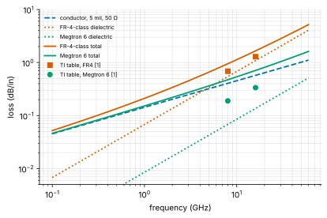
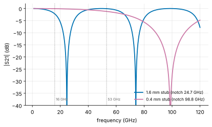

<!-- status: verified -->
# 24-01 · Signal Integrity Fundamentals

| | |
|---|---|
| **Course** | [24 · High-Speed I/O, Signal Integrity and Photonics](../README.md) |
| **University equivalent** | The opening lectures of a senior or graduate high-speed digital design and signal-integrity course: lossy interconnect, conductor and dielectric loss, S-parameters, discontinuities, crosstalk on coupled lines, return paths and the link to power integrity (Bogatin, *Signal and Power Integrity — Simplified*, chapters on loss, crosstalk and S-parameters; Hall & Heck, *Advanced Signal Integrity for High-Speed Digital Designs*, chapters on lossy lines and crosstalk) |
| **Prerequisites** | [13-05](../../13-electromagnetics/chapters/13-05-plane-waves.md) (skin depth, surface resistance, dielectric loss), [13-07](../../13-electromagnetics/chapters/13-07-transmission-lines-time-domain.md) (reflections), [13-08](../../13-electromagnetics/chapters/13-08-transmission-lines-sinusoidal-steady-state.md) (propagation constant, low-loss attenuation), [19-05](../../19-digital-vlsi-design/chapters/19-05-interconnect.md) (on-chip coupling), [23-04](../../23-memory-and-storage-technology/chapters/23-04-dram-interfaces.md) (termination and ISI on DRAM buses) |
| **Estimated study hours** | 7 |
| **Last verified** | 2026-11-25 |

**Learning objectives.** After this chapter you can:

1. Find a link's Nyquist frequency and derive the conductor and dielectric loss per unit length of a board trace, including surface roughness.
2. Build an insertion-loss budget from package, trace, via and connector losses and compute the trace reach it allows.
3. Read S-parameters (insertion loss, return loss, mixed-mode terms) and compute the return loss and ripple of an impedance mismatch.
4. Predict the notch frequency of a via stub and the stub length a data rate can tolerate.
5. Derive near-end and far-end crosstalk on weakly coupled lines and explain why far-end crosstalk vanishes in stripline.
6. Estimate ground bounce from a return path's inductance and a power-delivery network's target impedance, and relate supply noise to jitter.

## 1. Big picture

Every bit that leaves a chip travels down a package trace, a board trace, vias, perhaps a connector and a cable, and into another package before a receiver decides what it was. Below a few hundred megabits per second that path is "just wires". At 16 to 53 GHz of Nyquist frequency it is a lossy, dispersive, reflective, leaky transmission-line network, and it decides how far a link can reach, what laminate a board must use and how much a SerDes must equalize. Signal integrity (SI) is the discipline of predicting and budgeting those effects.

- **Data-center hardware:** PCIe, Ethernet and accelerator links are specified by end-to-end loss budgets of 32 to 40 dB at their Nyquist frequencies, and the budget sets how many inches of which laminate a server can use [1], [5], [9].
- **AI clusters:** at 200 Gb/s per lane, passive copper cables reach about 1 m, half the reach at 100 Gb/s per lane, which is why rack-scale systems pack switches and GPUs tightly and why optics creep inward (24-07 to 24-09) [5].
- **Chip packaging:** a package trace can cost as much loss as several inches of board; package substrates are now SI-critical parts [2].
- **Mobile and auto:** shorter reaches, but tighter cost and power budgets, many layers of crosstalk and power-noise coupling, and harsh temperature ranges.

## 2. Intuition first

Think of a high-speed trace as a pipe that leaks more the faster you pump. At low frequency the signal current spreads through the whole copper cross-section and the insulator stores energy almost perfectly. At gigahertz frequencies the current crowds into a thin skin at the copper surface, so the resistance climbs as $\sqrt f$, and the insulator's molecules lag the field, turning a fixed fraction of the stored energy into heat each cycle, so its loss climbs as $f$. The highest frequencies of a pulse, which carry its sharp edges, are attenuated most. A crisp bit leaves the transmitter and arrives smeared over its neighbours: intersymbol interference (23-04, 24-02).

Three other effects ride on top:

- **Reflections.** Every change of impedance (a via, a connector, a package ball, a stub) sends part of the wave back. Echoes arriving bits later add to later symbols.
- **Crosstalk.** Neighbouring traces share electric and magnetic fields. An aggressor's edge pushes small copies of itself onto a victim, backwards and forwards.
- **Return paths.** Current flows in loops. The "ground" under a trace carries the return current, and anything that forces that current to detour adds inductance, which turns fast current changes into voltage noise.

**Analogy and its limits.** A finance analogy fits the loss budget: a link has a fixed "loss capital" of, say, 36 dB, and every component spends some. Package, vias and connectors are fixed costs; trace length is the variable cost, at so many dB per inch. Where it breaks down: decibels add exactly only for matched, cascaded sections. Reflections and crosstalk are not losses that subtract; they are interference that adds coherently at some frequencies and cancels at others, and a receiver's equalizer can undo loss but not all of them.

*Figure 1. A typical chip-to-chip channel. Each block has insertion loss and an impedance discontinuity at each end.*

## 3. Theory

### 3.1 What frequency matters: the Nyquist frequency

A link sending symbols at rate $f_{sym}$ (baud) has a unit interval $UI = 1/f_{sym}$. The fastest repeating pattern, alternating symbols, is a square wave of period $2\,UI$, whose fundamental is

$$
f_N = \frac{f_{sym}}{2} ,
$$

the **Nyquist frequency** (17-04). Channel specifications quote loss at $f_N$ because it is the highest frequency the receiver must recover with full amplitude. For NRZ the symbol rate equals the bit rate; for PAM4, with 2 bits per symbol, it is half. PCIe 5.0 at 32 GT/s NRZ and PCIe 6.0 at 64 GT/s PAM4 both run 32 GBd, so both have $f_N$ = 16 GHz; 200 Gb/s Ethernet lanes run 106.25 GBd, so $f_N$ = 53.125 GHz (Example 24-01.1).

### 3.2 Conductor loss: the skin effect at board scale

13-08 showed that a low-loss line attenuates as

$$
\alpha \approx \underbrace{\frac{R'}{2Z_0}}_{\alpha_c} + \underbrace{\frac{G'Z_0}{2}}_{\alpha_d}\quad \text{(Np/m)} ,
$$

where $R'$ and $G'$ are the series resistance and shunt conductance per unit length and $Z_0$ the characteristic impedance. 13-05 derived the surface resistance of a good conductor,

$$
R_s = \frac{1}{\sigma\delta} = \sqrt{\frac{\pi f\mu_0}{\sigma}}, \qquad \delta = \frac{1}{\sqrt{\pi f\mu_0\sigma}} ,
$$

with σ the conductivity (5.8 × 10⁷ S/m for copper) and δ the skin depth: 0.52 µm at 16 GHz.

**A board trace.** For a trace of width $w$ over a return plane, the high-frequency current crowds into one skin depth on the face nearest the return plane. To first order the trace's resistance per unit length is that of a sheet $w$ wide:

$$
R' \approx \frac{R_s}{w} .
$$

This ignores the current on the trace's other faces and edges (which lowers $R'$) and the return current in the plane (which raises it). The two partly cancel, so the estimate is usually within tens of percent of a field solver's. Substituting,

$$
\alpha_c \approx \frac{R_s}{2wZ_0} = \frac{1}{2wZ_0}\sqrt{\frac{\pi f\mu_0}{\sigma}} .
$$

Units: Ω/(m·Ω) = 1/m. ✓ Conductor loss grows as $\sqrt f$ and falls with wider traces and higher impedance.

**The rule of thumb.** Convert to the units boards use: decibels (1 Np = 8.686 dB), inches, mils (1 mil = 25.4 µm) and gigahertz. With copper's $R_s$ = 8.25 mΩ at 1 GHz,

$$
\alpha_c\,[\text{dB/in}] \approx \frac{8.686 \times 8.25\ \text{m}\Omega \times 0.0254\ \text{m}}{2 \times 25.4\ \mu\text{m}}\cdot\frac{\sqrt{f_{GHz}}}{w_{mil}Z_0} = \frac{36\sqrt{f_{GHz}}}{w_{mil}\,Z_0} ,
$$

the rule SI engineers carry in their heads. A 5-mil, 50 Ω trace loses about 0.57 dB/in at 16 GHz from smooth copper alone (Example 24-01.2).

**Surface roughness.** Copper foil is deliberately roughened so it bonds to the laminate. Once δ shrinks to the size of the bumps, the current must follow a longer, bumpier path. The widely used Hammerstad–Jensen correction multiplies the smooth-copper loss by

$$
K_r = 1 + \frac{2}{\pi}\arctan\!\left[1.4\left(\frac{\Delta_{rms}}{\delta}\right)^2\right] ,
$$

where $\Delta_{rms}$ is the rms roughness [10]. $K_r$ rises from 1 toward 2 as δ falls below $\Delta_{rms}$. At 16 GHz, 1 µm of roughness nearly doubles conductor loss; "very low profile" foils with a few tenths of a micrometre cost much less (Example 24-01.2). The correction saturates at 2, and more detailed models (Huray's "snowball" model) are used above about 30 GHz, where it is known to underestimate.

### 3.3 Dielectric loss

A dielectric with relative permittivity $\varepsilon_r$ and loss tangent $\tan\delta$ (data sheets call it the dissipation factor, $D_f$) has a shunt conductance $G' = \omega C'\tan\delta$ (13-04, 13-08). Then

$$
\alpha_d = \frac{G'Z_0}{2} = \frac{\omega C'\tan\delta}{2}\sqrt{\frac{L'}{C'}} = \frac{\omega\tan\delta}{2}\sqrt{L'C'} = \frac{\pi f\sqrt{\varepsilon_r}\tan\delta}{c} ,
$$

using $\sqrt{L'C'} = \sqrt{\varepsilon_r}/c$ for a line whose fields lie in the dielectric (stripline; for microstrip use the effective permittivity). Units: (1/s)/(m/s) = 1/m. ✓ Dielectric loss grows as $f$ and does not depend on the trace geometry or $Z_0$ at all: only the material matters. In board units,

$$
\alpha_d\,[\text{dB/in}] = \frac{8.686\,\pi \times 10^9 \times 0.0254}{c}\,f_{GHz}\tan\delta\sqrt{\varepsilon_r} = 2.3\,f_{GHz}\tan\delta\sqrt{\varepsilon_r} .
$$

Because dielectric loss grows faster than conductor loss, it dominates at high frequency in ordinary laminates. An FR-4-class material ($\varepsilon_r$ = 4.4, $\tan\delta$ = 0.014) loses 1.09 dB/in at 16 GHz from the dielectric alone, while an ultra-low-loss laminate such as Megtron 6 ($\varepsilon_r$ = 3.4, $\tan\delta$ = 0.002) loses 0.14 dB/in (Example 24-01.3). Both $\varepsilon_r$ and $\tan\delta$ vary with frequency, temperature and humidity; Texas Instruments notes insertion loss "up to 8% higher at temperature" for Megtron 6 and 11% for FR-4 [1].

> **Going deeper — causality.** A loss tangent that is constant over frequency is not physically possible: the Kramers–Kronig relations tie the frequency dependence of the loss to that of $\varepsilon_r$, so a lossy dielectric's permittivity must fall slowly with frequency. Simulators use causal models such as the wideband Debye (Djordjevic–Sarkar) model, which fit a constant-looking $\tan\delta$ over decades while keeping the time-domain response causal. A non-causal model shows a pulse response that starts before the pulse arrives.

### 3.4 S-parameters: how channels are specified

A channel is characterized as a two-port (or, for a differential pair, a four-port) by its **scattering parameters**: ratios of outgoing to incoming waves with every port terminated in the reference impedance $Z_{ref}$, usually 50 Ω per line (13-09, 21-02). For a two-port:

- $S_{21}$, the **insertion loss** (IL) when written as $-20\log_{10}\lvert S_{21}\rvert$, is the fraction of the wave that gets through.
- $S_{11}$, the **return loss** (RL) as $-20\log_{10}\lvert S_{11}\rvert$, is the fraction reflected back.

High-speed links are differential. A four-port measurement converts into **mixed-mode** parameters: $S_{DD21}$ (differential in, differential out), the one that carries the signal; $S_{DD11}$, differential return loss; and $S_{CD21}$, conversion from differential to common mode, which measures how asymmetry (a length mismatch between the two lines of a pair, an asymmetric via) turns signal into common-mode noise that radiates and couples.

**Cascading.** For matched sections, insertion losses in dB add. That is what makes loss budgets work. Mismatches spoil the addition: waves bounce between discontinuities, and $\lvert S_{21}\rvert$ ripples with frequency.

**A single mismatch.** At a junction between a line of impedance $Z_1$ and one of $Z_2$, the reflection coefficient is $\Gamma = (Z_2 - Z_1)/(Z_2 + Z_1)$ (13-07). A lossless junction conserves power, so the transmitted power fraction is $1 - \lvert\Gamma\rvert^2$ and the **mismatch loss** is $-10\log_{10}(1 - \lvert\Gamma\rvert^2)$. Return loss is $-20\log_{10}\lvert\Gamma\rvert$. PCIe boards use 85 Ω differential (42.5 Ω single-ended) traces [8]; measured in a 100 Ω (50 Ω) system, each end has $\Gamma$ = −0.081, a return loss of 21.8 dB and a mismatch loss of only 0.029 dB (Example 24-01.5). Return loss specifications matter less for the energy lost than for the echoes they allow.

**Two mismatches.** Two identical discontinuities separated by a line make a resonator. Waves reflected twice arrive back in phase with the through wave at some frequencies and out of phase at others, so the transmission ripples between $1$ and $(1 - \lvert\Gamma\rvert^2)/(1 + \lvert\Gamma\rvert^2)$, a peak-to-peak ripple of $20\log_{10}[(1 + \lvert\Gamma\rvert^2)/(1 - \lvert\Gamma\rvert^2)]$ dB, with a period in frequency of $1/(2T_d)$ for a line of one-way delay $T_d$. In the time domain the same echo lands $2T_d$ after the main signal.

### 3.5 Vias and stubs

A via carries a signal between layers through the board. If the signal enters at the top and leaves on an inner layer, the part of the via barrel below that layer is a **stub**: a short transmission line open at its far end. At the frequency where the stub is a quarter wavelength long, its open end transforms to a short at the junction (13-08), and the through path sees a short to ground. The notch frequency is

$$
f_{stub} = \frac{c}{4\,\ell_{stub}\sqrt{\varepsilon_r}} ,
$$

where $\ell_{stub}$ is the stub length. A 1.6 mm (63 mil) stub in $\varepsilon_r$ = 3.6 notches at 24.7 GHz, uncomfortably close to PCIe 5.0's 16 GHz Nyquist (Example 24-01.6). Designers keep the notch well above the Nyquist frequency, often at 1.5 times it or more, by routing to layers near the bottom, using blind or buried vias, or **back-drilling** the stub away. At 53 GHz the tolerable stub is about half a millimetre, which is why 200 Gb/s boards back-drill nearly every via.

### 3.6 Crosstalk on coupled lines

Two parallel lines share fields. Per unit length, line 2 (the **victim**) couples to line 1 (the **aggressor**) through a mutual capacitance $C_m$ and a mutual inductance $L_m$. Let $L$ and $C$ be each line's own inductance and total capacitance per unit length, so $Z_0 = \sqrt{L/C}$ and $v = 1/\sqrt{LC}$. Assume weak coupling: the aggressor's wave is unaffected by the victim, and the victim is terminated in $Z_0$ at both ends.

**Distributed sources.** As the aggressor's edge $V_a(t)$ passes position $z$, a length $dz$ of victim receives two sources:

- through $C_m$, a shunt current $i = C_m\,dz\,\partial V_a/\partial t$. A current injected into a line sees $Z_0$ in each direction, $Z_0/2$ in all, so it launches waves of $\tfrac12 Z_0C_m\,dz\,\partial V_a/\partial t$ both forward and backward;
- through $L_m$, a series voltage $L_m\,dz\,\partial I_a/\partial t$, with $I_a = V_a/Z_0$. A series source launches waves of half its value in each direction, with opposite signs: $-\tfrac12(L_m/Z_0)\,dz\,\partial V_a/\partial t$ forward and $+\tfrac12(L_m/Z_0)\,dz\,\partial V_a/\partial t$ backward.

Using $Z_0C_m = (C_m/C)/v$ and $L_m/Z_0 = (L_m/L)/v$, the forward and backward wave densities are

$$
dV_f = \frac{1}{2v}\left(\frac{C_m}{C} - \frac{L_m}{L}\right)\frac{\partial V_a}{\partial t}\,dz, \qquad
dV_b = \frac{1}{2v}\left(\frac{C_m}{C} + \frac{L_m}{L}\right)\frac{\partial V_a}{\partial t}\,dz .
$$

**Near-end crosstalk (NEXT).** A backward wave born at $z$ when the aggressor edge passes it (time $z/v$) reaches the near end after another $z/v$, at $2z/v$. Integrating over a coupled length ℓ with one-way delay $T_D = \ell/v$,

$$
V_{NEXT}(t) = \frac{1}{2v}\left(\frac{C_m}{C} + \frac{L_m}{L}\right)\int_0^{\ell}V_a'\!\left(t - \frac{2z}{v}\right)dz = K_b\left[V_a(t) - V_a(t - 2T_D)\right], \qquad K_b = \frac14\left(\frac{C_m}{C} + \frac{L_m}{L}\right) .
$$

NEXT is a plateau of height $K_bV_a$ lasting $2T_D$. It saturates once $2T_D$ exceeds the rise time $t_r$, so for coupled lengths beyond $\ell_{sat} = vt_r/2$ (a few millimetres at modern edge rates) longer coupling makes it last longer, not taller.

**Far-end crosstalk (FEXT).** Forward waves travel with the aggressor's edge, so every contribution arrives at the far end at the same moment, $T_D$:

$$
V_{FEXT}(t) = \frac{\ell}{2v}\left(\frac{C_m}{C} - \frac{L_m}{L}\right)\frac{dV_a(t - T_D)}{dt} .
$$

FEXT is a pulse shaped like the derivative of the aggressor's edge. It grows with coupled length and edge rate, and its area, $(\ell/2v)(C_m/C - L_m/L)\,\Delta V_a$, does not depend on the edge shape. In **stripline**, where the fields lie in one homogeneous dielectric, $C_m/C = L_m/L$ exactly and FEXT vanishes. In **microstrip**, part of the field is in air, the inductive ratio exceeds the capacitive one and FEXT is negative and can be large (Example 24-01.7). That is one reason long, fast buses are routed in stripline.

**Differential pairs.** Coupling within a pair is wanted (it sets the differential impedance). Coupling between pairs is crosstalk, but a symmetric aggressor pair couples nearly equally onto both lines of a victim pair, and the receiver rejects the common part. Spacing between pairs of about three times the trace-to-plane height is a common rule; the residual is budgeted, as PCIe's 4–5 dB "crosstalk mitigation" allowance shows [1].

> **Going deeper — the exact modal picture.** Two coupled lines carry an even and an odd mode, with inductances $L \pm L_m$, capacitances $C \mp C_m$ (in this chapter's convention) and delays $T_{e,o} = \ell\sqrt{(L \pm L_m)(C \mp C_m)}$. The aggressor's step splits equally between them, and the far-end victim sees half the difference of two steps arriving $\Delta T = T_e - T_o$ apart. For weak coupling, $\Delta T \approx T_D(L_m/L - C_m/C)$, and the pulse's area, $\tfrac12V_a\,\Delta T$, reproduces the FEXT formula above. In a homogeneous dielectric the two modes have the same velocity and the difference vanishes.

### 3.7 Return paths and ground bounce

A signal's current returns in the plane under the trace, concentrated directly beneath it at high frequency because that path has the least inductance. If the signal changes layers through a via, its return current must change planes too. When the two planes are at the same potential, a nearby **stitching via** gives the return a short path. When they are different supplies, the return current must cross through decoupling capacitance, or worse, find a path around a gap. Every detour encloses more loop area and adds inductance $L_{ret}$.

Inductance converts current changes into voltage, $v = L\,di/dt$. When $N$ drivers sharing a return inductance switch together, each changing its current by $\Delta I$ within $t_r$,

$$
V_{bounce} \approx L_{ret}\,\frac{N\,\Delta I}{t_r} .
$$

This **simultaneous switching noise** (SSN), or ground bounce, shifts the local reference of every driver and receiver sharing that return. Eight drivers each switching 8 mA in 100 ps through 0.2 nH bounce the ground by 128 mV (Example 24-01.8). Differential signalling, with its nearly constant total current, largely avoids SSN, which is one reason all fast serial links use it.

### 3.8 The link to power integrity

The transistors in a SerDes draw current from a **power-delivery network** (PDN): the voltage regulator, board planes, decoupling capacitors, package and on-die capacitance (22-08). If a load step $\Delta I$ must not disturb the supply by more than $\Delta V$, the PDN's impedance seen from the die must stay below a **target impedance**

$$
Z_{target} = \frac{\Delta V}{\Delta I}
$$

from DC up to the frequencies in the load current. A 0.9 V SerDes supply allowed 2% (18 mV) of noise under a 2 A step needs 9 mΩ. Every capacitor has an equivalent series inductance (ESL), so above its self-resonance it behaves as an inductor, $\lvert Z\rvert \approx \omega L_{ESL}$; at 200 MHz a 0.4 nH board capacitor is about 0.5 Ω, and meeting 9 mΩ would take more than 50 of them in parallel (Example 24-01.8). Board capacitors therefore cover only up to tens of megahertz; package and on-die capacitance must cover the rest.

Supply noise matters to SI because delays depend on supply voltage. A buffer whose delay shifts by $k_V$ picoseconds per millivolt turns supply noise into **jitter** (24-02): 18 mV at an assumed 1 ps/mV is 18 ps, more than half a 31.25 ps UI. SerDes therefore put their most sensitive circuits (clock buffers, VCOs) on separately regulated, heavily filtered supplies.

## 4. Worked examples

### Example 24-01.1 · Nyquist frequencies (tier A)

**Setup.** Find the symbol rate, Nyquist frequency and unit interval of (a) PCIe 5.0 at 32 GT/s NRZ, (b) PCIe 6.0 at 64 GT/s PAM4, (c) PCIe 7.0 at 128 GT/s PAM4 and (d) an Ethernet lane at 212.5 Gb/s PAM4.

**Solution.**

- (a) 32 GBd; $f_N$ = **16** GHz; UI = **31.25** ps.
- (b) $64/2$ = **32** GBd, so $f_N$ is again **16** GHz.
- (c) $128/2$ = **64** GBd; $f_N$ = **32** GHz; UI = **15.625** ps.
- (d) $212.5/2$ = **106.25** GBd; $f_N$ = **53.125** GHz; UI = **9.412** ps.

**Units check.** symbols/s ÷ 2 = Hz; 1/(symbols/s) = s. ✓

**Sanity check.** PAM4 let PCIe 6.0 double the data rate without raising the Nyquist frequency, at the cost of a smaller eye (23-04, 24-03). PCIe 7.0 then doubled the symbol rate, and with it the frequency at which the channel's loss is measured.

### Example 24-01.2 · Conductor loss of a board trace (tier B)

**Setup.** A 5-mil-wide, 50 Ω trace of smooth copper (σ = 5.8 × 10⁷ S/m) carries PCIe 5.0. At 16 GHz find (a) the skin depth, (b) the surface resistance, (c) the resistance per metre and per inch, (d) the conductor attenuation in Np/m and dB/in, and (e) the rule-of-thumb value. (f) With 1 µm rms roughness, find the Hammerstad–Jensen factor and (g) the rough-copper loss.

**Solution.**

- (a) $\delta = 1/\sqrt{\pi \times 16 \times 10^9 \times 4\pi \times 10^{-7} \times 5.8 \times 10^7}$ = **0.522** µm.
- (b) $R_s = 1/(\sigma\delta)$ = **33.0** mΩ.
- (c) $R' = R_s/w = 0.0330/(127\ \mu\text{m})$ = **260** Ω/m, or **6.60** Ω/in.
- (d) $\alpha_c = R'/(2Z_0)$ = **2.60** Np/m; × 8.686 × 0.0254 = **0.573** dB/in.
- (e) $36\sqrt{16}/(5 \times 50)$ = **0.576** dB/in.
- (f) $K_r = 1 + (2/\pi)\arctan[1.4 \times (1/0.5225)^2]$ = **1.88**.
- (g) $0.5733 \times 1.877$ = **1.08** dB/in.

**Units check.** Ω/m ÷ Ω = 1/m (Np/m); Np × dB/Np × m/in = dB/in. ✓

**Sanity check.** The skin depth is half a micrometre, so ordinary 1 µm roughness is twice the depth the current lives in, and the loss nearly doubles. That is why fast boards specify low-profile copper, a cost item as real as the laminate.

### Example 24-01.3 · Dielectric loss and total loss (tier B)

**Setup.** At 16 GHz, find the dielectric loss of (a) an FR-4-class laminate ($\varepsilon_r$ = 4.4, $\tan\delta$ = 0.014) and (b) Megtron 6 ($\varepsilon_r$ = 3.4, $\tan\delta$ = 0.002), using the materials' values in TI's table [1]. Adding Example 24-01.2's smooth-copper loss, find (c) each total. (d) TI's table lists 1.289 and 0.336 dB/in for the two materials [1]; what conductor loss do those totals imply, and (e) what trace width at 50 Ω would give it?

**Solution.**

- (a) $\alpha_d = \pi f\sqrt{\varepsilon_r}\tan\delta/c = \pi \times 16 \times 10^9 \times 2.098 \times 0.014/(2.998 \times 10^8)$ = **4.92** Np/m, or **1.086** dB/in.
- (b) Similarly **0.136** dB/in.
- (c) FR-4: $0.573 + 1.086$ = **1.66** dB/in; Megtron 6: $0.573 + 0.136$ = **0.710** dB/in.
- (d) $1.289 - 1.086$ = **0.203** and $0.336 - 0.136$ = **0.200** dB/in: about **0.20** dB/in in both cases.
- (e) From $36\sqrt{16}/(w \times 50)$ = 0.201: $w$ ≈ **14** mil.

**Units check.** (1/s)/(m/s) = 1/m. ✓

**Sanity check.** The dielectric parts of TI's two numbers match the formula, and the remainder is the same for both materials, as conductor loss should be: TI's model evidently assumes a wider trace than 5 mils. In FR-4 the dielectric dominates; in Megtron 6 the copper does, so on premium laminates the next dollar goes to smoother copper and wider traces.

### Example 24-01.4 · A loss budget and the reach it allows (tier B)

**Setup.** TI's PCIe 5.0 budget allocates 36 dB at 16 GHz: CPU package 9 dB, system board 16 dB, CEM connector 1.5 dB and a 4-inch add-in card 9.5 dB [1]. (a) Check the total. If the board's two vias cost 0.5 dB each (assumed), how far can a 5-mil, smooth-copper trace run in (b) the FR-4-class laminate and (c) Megtron 6 (Example 24-01.3), at room temperature? (d, e) Repeat when loss is 11% and 8% higher at temperature [1]. (f) In the 802.3dj copper-cable budget, a nominal host is allowed 11.5 dB at 53.125 GHz, of which a package takes 5 dB and the BGA transition 0.5 dB [4]. How much trace does the rest buy at 1.4 dB/in [3]?

**Solution.**

- (a) $9 + 16 + 1.5 + 9.5$ = **36** dB.
- (b) $(16 - 1)/1.660$ = **9.04** in; (c) $15/0.7097$ = **21.1** in.
- (d) $15/(1.660 \times 1.11)$ = **8.14** in; (e) $15/(0.7097 \times 1.08)$ = **19.6** in.
- (f) $11.5 - 5 - 0.5$ = **6** dB, so $6/1.4$ = **4.29** in.

**Units check.** dB ÷ dB/in = in. ✓

**Sanity check.** TI's budget assumes a 9-inch board trace in "high-loss material", 16/9 = 1.78 dB/in, close to the FR-4-class estimate here [1]. At 53 GHz a nominal host has room for only about four inches of the best laminates: 200 Gb/s links are short by necessity, not by choice.

### Example 24-01.5 · Return loss of an 85 Ω channel (tier B)

**Setup.** A PCIe channel built with 85 Ω differential traces (42.5 Ω per line) [8] is measured with a 100 Ω differential (50 Ω per line) instrument. Find (a) the reflection coefficient at each end, (b) the return loss, (c) the mismatch loss of one interface and (d) the peak-to-peak ripple in $\lvert S_{21}\rvert$ caused by the two ends.

**Solution.**

- (a) $\Gamma = (42.5 - 50)/(42.5 + 50)$ = **−0.0811** (the same for 85 against 100 Ω).
- (b) $-20\log_{10}0.0811$ = **21.8** dB.
- (c) $-10\log_{10}(1 - 0.0811^2)$ = **0.0286** dB.
- (d) $20\log_{10}[(1 + 0.00657)/(1 - 0.00657)]$ = **0.114** dB.

**Units check.** Ratios of impedances; decibels of power ratios. ✓

**Sanity check.** The energy lost is negligible, a few hundredths of a decibel. The echo is what matters: 8% of the signal comes back and, after a second reflection, arrives later as interference. A good channel keeps every discontinuity's return loss above about 15–20 dB across the band.

### Example 24-01.6 · A via stub (tier B)

**Setup.** A via enters at the top layer and exits on an inner layer, leaving a 1.6 mm (63 mil) stub in a dielectric of $\varepsilon_r$ = 3.6 (assumed). Find (a) the stub's notch frequency. What is the longest stub that keeps the notch above 1.5 times the Nyquist frequency at (b) 16 GHz and (c) 53.125 GHz?

**Solution.**

- (a) $f = c/(4 \times 1.6\ \text{mm} \times \sqrt{3.6})$ = **24.69** GHz.
- (b) $\ell = c/(4 \times 1.5 \times 16\ \text{GHz} \times 1.897)$ = **1.65** mm (65 mil).
- (c) The same at 53.125 GHz: **0.496** mm (19.5 mil).

**Units check.** (m/s)/m = 1/s. ✓

**Sanity check.** The stub notch sits only 1.54 times above PCIe 5.0's Nyquist frequency: just acceptable at 16 GHz, hopeless at 53 GHz. The ngspice lab confirms the notch with an open-stub transmission line.

### Example 24-01.7 · Crosstalk between microstrip traces (tier C)

**Setup.** Two 50 Ω microstrip traces are coupled over ℓ = 50 mm with $C_m/C$ = 0.04 and $L_m/L$ = 0.06 and an effective permittivity of 3.0 (all assumed). The aggressor launches a 0.4 V step with a 30 ps linear rise; both lines are terminated in 50 Ω. Find (a) the propagation velocity, (b) the coupled delay, (c) the backward coefficient $K_b$, (d) the NEXT amplitude, (e) the saturation length, (f) the FEXT amplitude and (g) the area of the FEXT pulse. (h) What would FEXT be in stripline?

**Solution.**

- (a) $v = c/\sqrt{3.0}$ = **1.731** × 10⁸ m/s; (b) $T_D = 50\ \text{mm}/v$ = **288.9** ps.
- (c) $K_b = \tfrac14(0.04 + 0.06)$ = **0.025**; (d) $0.025 \times 0.4$ V = **10.0** mV.
- (e) $\ell_{sat} = vt_r/2$ = **2.60** mm, so 50 mm is far into saturation: NEXT lasts $2T_D$ = 578 ps.
- (f) $V_{FEXT} = \tfrac12 \times 288.9\ \text{ps} \times (0.04 - 0.06) \times 0.4\ \text{V}/30\ \text{ps}$ = **−38.5** mV.
- (g) Area $= \tfrac12 \times 288.9\ \text{ps} \times (-0.02) \times 0.4$ V = **−1.155** ps·V.
- (h) **0**: in a homogeneous dielectric $C_m/C = L_m/L$.

**Units check.** s × (V/s) = V; s × V for the area. ✓

**Sanity check.** FEXT is 3.85 times NEXT here, because it grows with coupled length and edge rate while NEXT saturates. Halving the rise time doubles FEXT. The ngspice lab's 200-section ladder reproduces the NEXT plateau to 0.1% and the FEXT area to better than 0.1%; its FEXT peak comes out larger than the ideal ramp's because the ladder rings at the ramp's sharp corners.

### Example 24-01.8 · Ground bounce and the PDN target (tier B)

**Setup.** (a) Eight single-ended drivers each switch 8 mA within 100 ps through a shared return inductance of 0.2 nH (assumed). Find the ground bounce. A SerDes supply of 0.9 V may vary by 2% under a 2 A load step (assumed). Find (b) the target impedance, (c) the impedance of one 0.4 nH-ESL board capacitor at 200 MHz, (d) how many in parallel meet the target there and (e) the self-resonance of a 1 µF capacitor with that ESL. (f) If the receiver's sampling clock moves 1 ps per mV of supply noise (assumed), what jitter does the allowed 18 mV cause, as a fraction of PCIe 5.0's UI?

**Solution.**

- (a) $0.2\ \text{nH} \times 8 \times 8\ \text{mA}/100\ \text{ps}$ = **128** mV.
- (b) $0.9 \times 0.02/2$ = **9.0** mΩ.
- (c) $2\pi \times 200\ \text{MHz} \times 0.4\ \text{nH}$ = **0.503** Ω; (d) $0.5027/0.009$ = 55.9, so **56** capacitors.
- (e) $1/(2\pi\sqrt{0.4\ \text{nH} \times 1\ \mu\text{F}})$ = **7.96** MHz.
- (f) **18** ps, or $18/31.25$ = **0.576** UI.

**Units check.** H × A/s = V; V/A = Ω; 1/√(H·F) = 1/s. ✓

**Sanity check.** A 128 mV bounce on a 0.4 V-swing single-ended bus would be fatal, which is why fast links are differential. The capacitor count shows that board decoupling cannot reach hundreds of megahertz; on-package and on-die capacitance must, and the clock path needs its own quiet supply.

<!-- answer-key -->

| ID | Quantity | Value | Unit |
|---|---|---|---|
| Ex 24-01.1a | PCIe 5.0 symbol rate | 32 | GBd |
| Ex 24-01.1a1 | PCIe 5.0 Nyquist frequency | 16 | GHz |
| Ex 24-01.1a2 | PCIe 5.0 UI | 31.25 | ps |
| Ex 24-01.1b | PCIe 6.0 symbol rate | 32 | GBd |
| Ex 24-01.1b1 | PCIe 6.0 Nyquist frequency | 16 | GHz |
| Ex 24-01.1c | PCIe 7.0 symbol rate | 64 | GBd |
| Ex 24-01.1c1 | PCIe 7.0 Nyquist frequency | 32 | GHz |
| Ex 24-01.1c2 | PCIe 7.0 UI | 15.625 | ps |
| Ex 24-01.1d | 212.5 Gb/s PAM4 symbol rate | 106.25 | GBd |
| Ex 24-01.1d1 | 212.5 Gb/s PAM4 Nyquist frequency | 53.125 | GHz |
| Ex 24-01.1d2 | 212.5 Gb/s PAM4 UI | 9.412 | ps |
| Ex 24-01.2a | skin depth at 16 GHz | 0.522 | µm |
| Ex 24-01.2a1 | skin depth at 16 GHz, 4 s.f. | 0.5225 | µm |
| Ex 24-01.2b | surface resistance at 16 GHz | 33.0 | mΩ |
| Ex 24-01.2c | resistance per metre | 260 | Ω/m |
| Ex 24-01.2c1 | resistance per inch | 6.60 | Ω/in |
| Ex 24-01.2d | conductor attenuation | 2.60 | Np/m |
| Ex 24-01.2d1 | conductor loss | 0.573 | dB/in |
| Ex 24-01.2d2 | conductor loss, 4 s.f. | 0.5733 | dB/in |
| Ex 24-01.2e | rule-of-thumb conductor loss | 0.576 | dB/in |
| Ex 24-01.2f | roughness factor, 1 µm rms | 1.88 | |
| Ex 24-01.2f1 | roughness factor, 4 s.f. | 1.877 | |
| Ex 24-01.2g | rough-copper loss | 1.08 | dB/in |
| Ex 24-01.3a | FR-4 dielectric attenuation | 4.92 | Np/m |
| Ex 24-01.3a1 | FR-4 dielectric loss | 1.086 | dB/in |
| Ex 24-01.3a2 | square root of 4.4 | 2.098 | |
| Ex 24-01.3b | Megtron 6 dielectric loss | 0.136 | dB/in |
| Ex 24-01.3c | FR-4 total loss | 1.66 | dB/in |
| Ex 24-01.3c1 | Megtron 6 total loss | 0.710 | dB/in |
| Ex 24-01.3c2 | FR-4 total loss, 4 s.f. | 1.660 | dB/in |
| Ex 24-01.3c3 | Megtron 6 total loss, 4 s.f. | 0.7097 | dB/in |
| Ex 24-01.3d | implied conductor loss, FR-4 | 0.203 | dB/in |
| Ex 24-01.3d1 | implied conductor loss, Megtron 6 | 0.200 | dB/in |
| Ex 24-01.3d2 | implied conductor loss, both | 0.20 | dB/in |
| Ex 24-01.3d3 | implied conductor loss, mean, 3 s.f. | 0.201 | dB/in |
| Ex 24-01.3e | implied trace width | 14 | mil |
| Ex 24-01.4a | PCIe 5.0 budget total | 36 | dB |
| Ex 24-01.4b | FR-4 reach | 9.04 | in |
| Ex 24-01.4c | Megtron 6 reach | 21.1 | in |
| Ex 24-01.4d | FR-4 reach, hot | 8.14 | in |
| Ex 24-01.4e | Megtron 6 reach, hot | 19.6 | in |
| Ex 24-01.4f0 | trace allocation, 802.3dj nominal host | 6 | dB |
| Ex 24-01.4f | trace reach at 1.4 dB/in | 4.29 | in |
| Ex 24-01.4g | TI board loss per inch | 1.78 | dB/in |
| Ex 24-01.5a | reflection coefficient, 42.5 vs 50 Ω | -0.0811 | |
| Ex 24-01.5b | return loss | 21.8 | dB |
| Ex 24-01.5c | mismatch loss | 0.0286 | dB |
| Ex 24-01.5d | ripple, peak to peak | 0.114 | dB |
| Ex 24-01.5d1 | squared reflection coefficient | 0.00657 | |
| Ex 24-01.6a | via-stub notch, 1.6 mm | 24.69 | GHz |
| Ex 24-01.6b | stub limit at 16 GHz | 1.65 | mm |
| Ex 24-01.6b1 | stub limit at 16 GHz, mils | 65 | mil |
| Ex 24-01.6c | stub limit at 53.125 GHz | 0.496 | mm |
| Ex 24-01.6c1 | stub limit at 53.125 GHz, mils | 19.5 | mil |
| Ex 24-01.6d | notch over PCIe 5.0 Nyquist | 1.54 | |
| Ex 24-01.6e | square root of 3.6 | 1.897 | |
| Ex 24-01.7a | propagation velocity | 1.731e8 | m/s |
| Ex 24-01.7b | coupled delay | 288.9 | ps |
| Ex 24-01.7c | backward coefficient | 0.025 | |
| Ex 24-01.7d | NEXT amplitude | 10.0 | mV |
| Ex 24-01.7e | saturation length | 2.60 | mm |
| Ex 24-01.7e1 | NEXT duration | 578 | ps |
| Ex 24-01.7f | FEXT amplitude | -38.5 | mV |
| Ex 24-01.7g | FEXT pulse area | -1.155 | ps·V |
| Ex 24-01.7h | stripline FEXT | 0 | mV |
| Ex 24-01.8a | ground bounce | 128 | mV |
| Ex 24-01.8b | target impedance | 9.0 | mΩ |
| Ex 24-01.8c | capacitor impedance at 200 MHz | 0.503 | Ω |
| Ex 24-01.8c1 | capacitor impedance, 4 s.f. | 0.5027 | Ω |
| Ex 24-01.8d0 | capacitors needed, unrounded | 55.9 | |
| Ex 24-01.8d | capacitors needed | 56 | |
| Ex 24-01.8e | self-resonance of 1 µF | 7.96 | MHz |
| Ex 24-01.8f | supply-induced jitter | 18 | ps |
| Ex 24-01.8f1 | jitter in PCIe 5.0 UI | 0.576 | UI |
| Txt 24-01.a | skin depth at 16 GHz, 2 s.f. | 0.52 | µm |
| Txt 24-01.b | conductor rule constant | 36 | |
| Txt 24-01.c | dielectric rule constant | 2.3 | |
| Txt 24-01.d | copper surface resistance at 1 GHz | 8.25 | mΩ |
| Txt 24-01.e | rule example, 5 mil at 16 GHz, 2 s.f. | 0.57 | dB/in |
| Txt 24-01.f | FR-4 dielectric loss at 16 GHz, 3 s.f. | 1.09 | dB/in |
| Txt 24-01.g | Megtron 6 dielectric loss at 16 GHz, 2 s.f. | 0.14 | dB/in |
| Txt 24-01.h | via-stub notch, 3 s.f. | 24.7 | GHz |
| Txt 24-01.i | Np to dB | 8.686 | dB |
| Txt 24-01.j | allowed supply noise | 18 | mV |
| Txt 24-01.k | 802.3dj Nyquist frequency, 4 s.f. | 53.13 | GHz |
| Txt 24-01.l | magnitude of PCIe reflection coefficient, 2 s.f. | 0.081 | |
| Txt 24-01.m | PCIe mismatch loss, 2 s.f. | 0.029 | dB |
| Txt 24-01.n | 1.6 mm in mils | 63 | mil |
| Txt 24-01.o | notch of a 0.4 mm stub | 98.8 | GHz |
| Txt 24-01.p | mismatch loss at 20 dB return loss | 0.04 | dB |
| Txt 24-01.q | skin depth at 50 GHz | 0.3 | µm |
| Txt 24-01.r | 0.4 nH capacitor at 500 MHz | 1.26 | Ω |
| Txt 24-01.s | FEXT over NEXT | 3.85 | |
| Txt 24-01.t | three-quarter-wave notch, 1.6 mm stub | 74.1 | GHz |

## 5. Simulate it

The lab is [labs/24-01-lab/](../labs/24-01-lab/README.md). `si.py` holds the chapter's models and an exact lossy-line solver; the notebook computes insertion loss, pulse responses and stub notches, and two ngspice netlists confirm the stub notch and the crosstalk theory.

*Figure 2. Loss per inch of a 5-mil, 50 Ω trace. Conductor loss grows as √f, dielectric loss as f; in FR-4 the dielectric dominates above a few gigahertz. TI's model values [1], with a wider trace, lie below the curves by a nearly constant conductor term.*

*Figure 3. A via stub is a quarter-wave notch filter, with further notches at odd multiples (74.1 GHz for the 1.6 mm stub). Back-drilling a 1.6 mm stub to 0.4 mm moves the first notch from 24.7 GHz to 98.8 GHz, above 1.5 times even a 53 GHz Nyquist frequency.*

**Predict, then run:**

1. *Predict* the frequency at which FR-4's dielectric loss overtakes the 5-mil trace's conductor loss. Plot both in the notebook and check.
2. *Predict* the stub notch for 1.6 mm and for 0.4 mm. Run `ngspice -b via_stub.cir` and compare with Example 24-01.6.
3. *Predict* the NEXT plateau, its duration and the FEXT pulse area for Example 24-01.7. Run `ngspice -b crosstalk.cir`. Then double the rise time and predict what happens to each.
4. In the notebook, send a single 31.25 ps pulse through 10 inches of each laminate and *predict* which keeps more of its peak.

## 6. Engineering tradeoffs

| Knob | Improves | Costs | Typical decision owner |
|---|---|---|---|
| Lower-loss laminate (FR-4 → Megtron 6/7/8 class) | Dielectric loss, reach | Laminate cost (several times FR-4), fabrication yield | System hardware architect, PCB fabricator |
| Smoother (low-profile) copper | Conductor loss above ~10 GHz | Peel strength, cost | PCB fabricator, SI engineer |
| Wider traces | Conductor loss | Routing density, layer count | SI engineer, layout lead |
| Back-drilling and blind vias | Stub notches, return loss | Fabrication steps, cost, drill tolerance | SI engineer, PCB fabricator |
| Stripline instead of microstrip | Far-end crosstalk, EMI | Extra layers and vias, slightly higher loss | Layout lead |
| Wider pair-to-pair spacing | Crosstalk | Density | SI engineer |
| Cabled or flyover hosts | Loss per inch (0.35 against 1.5 dB/in at 53 GHz) | Mechanical complexity, cost | System architect |
| More on-package decoupling | PDN impedance at hundreds of MHz | Package area and cost | Package and power-integrity engineers |

## 7. Numbers to know

| Quantity | Typical value | Source |
|---|---|---|
| Copper skin depth | 2.09 µm at 1 GHz; 0.52 µm at 16 GHz | 13-05; Example 24-01.2 |
| Conductor-loss rule | $36\sqrt{f_{GHz}}/(w_{mil}Z_0)$ dB/in, smooth copper | §3.2 |
| Dielectric-loss rule | $2.3\,f_{GHz}\tan\delta\sqrt{\varepsilon_r}$ dB/in | §3.3 |
| Laminate loss at 16 GHz (TI model, as of Jun 2023) | FR-4 1.289, Megtron 6 0.336 dB/in | [1] |
| PCB loss at 53 GHz (802.3dj working values, 2023–2025) | 1.27–1.8 dB/in; cabled host about 0.35 dB/in | [2], [3] |
| Package trace loss at 53 GHz | 0.15–0.21 dB/mm | [2] |
| PCIe 5.0 budget | 36 dB at 16 GHz | [1] |
| PCIe 6.0 budget | 32 dB at 16 GHz | [9] |
| PCIe 7.0 budget (as reported, 2024–2025) | 36 dB at 32 GHz | [7] |
| 802.3dj die-to-die budget | 40 dB at 53.125 GHz; passive copper about 1 m | [5] |
| PCIe trace impedance | 85 Ω differential (42.5 Ω per line) | [8] |

## 8. Common mistakes

- **Quoting loss without a frequency.** "1 dB/in" means nothing without the frequency, the trace width, the copper roughness and the temperature.
- **Adding dB across mismatched parts.** Losses add only for matched cascades; reflections make the real $S_{21}$ ripple around the sum.
- **Assuming dielectric loss depends on geometry.** It depends only on the material; trace width changes conductor loss and impedance.
- **Treating NEXT as growing with length.** It saturates beyond $vt_r/2$; FEXT is the one that grows.
- **Expecting FEXT in stripline.** In a homogeneous dielectric it cancels; residual FEXT there comes from inhomogeneity (resin and glass) and discontinuities.
- **Ignoring the return path.** A trace crossing a plane split, or changing layers without a nearby return via, adds inductance and couples to everything sharing that return.
- **Specifying return loss for its power.** Mismatch loss is tiny; the reflected wave's echo is the problem.

## 9. Practitioner lens

**State of the art (as of Nov 2026).**

- *PCIe budgets* [Established as vendor guidance; Industry estimate for PCIe 7.0]. TI's PCIe Gen3–Gen5 tables allocate 23.5, 28 and 36 dB at the respective Nyquist frequencies, with Gen5 needing a further 4–5 dB for crosstalk mitigation and 2–3 dB for temperature and humidity [1]. PCIe 6.0 kept 16 GHz with PAM4 and tightened the budget to 32 dB [9]. Connector and SerDes vendors report that PCIe 7.0 restores 36 dB at 32 GHz, which they say requires about 1 dB/in at 32 GHz ("such as Megtron-8 or equivalent") [7]. The PCI-SIG specifications are members-only and were not read.
- *200 Gb/s per lane* [Established for objectives; Industry estimate for working budgets]. IEEE P802.3dj targets a die-to-die loss of 40 dB at 53.125 GHz and passive copper of at least 1 m, against 2 m at 100 Gb/s per lane [5]. Its adopted copper-cable baseline splits 40 dB as 11.5 dB per host and 17 dB for the cable assembly [4]. Task-force contributions use 1.27–1.8 dB/in for advanced PCB at 53 GHz, 0.35 dB/in for cabled hosts, 0.15–0.21 dB/mm for package traces, about 0.8 dB per host via and 1.6 dB per OSFP connector [2], [3].
- *Cable manufacturability* [Industry estimate: one vendor's data]. TE reported that 1 m, 26 and 25 AWG cables built to robust processes reached only 15% assembly yield against a 24 dB limit at 53.12 GHz, rising to 62% at 25 dB, and proposed moving 1 dB of budget from the hosts to the cable [6].

**Why it matters commercially.** Laminate grade, layer count, back-drilling and copper profile are a large share of an AI server board's cost, and they scale with the SerDes rate. A SerDes that tolerates 2 dB more loss can save a laminate grade or a retimer chip per lane, so loss tolerance is a competitive feature, and retimers, cabled backplanes and active copper cables exist to sell reach where passive channels run out.

**Marketing vs Reality.**

- *"Supports 40 dB channels."* At what BER, with which crosstalk and reflections, at what temperature? Loss alone does not define a channel; IEEE uses a channel operating margin (COM) that combines them (24-02, 24-03).
- *"0.3 dB/in laminate."* Usually a model value at a stated frequency for a reference trace, as in TI's table [1]. Ask for measured $S_{DD21}$ on the buyer's stack-up, hot and humid.
- *"1 m copper at 200G."* The objective is 1 m [5]; whether cables meet it at volume yield is a separate question [6].
- *"Copper is dead."* Each generation has halved copper's reach, but within a rack copper remains cheaper and lower-power than optics (24-07 to 24-09).

**Questions for engineering leaders.**

1. **"What is your end-to-end loss at Nyquist, and how is it split?"** *Strong:* a table by element, measured or simulated, hot and humid, with margin. *Evasive:* "we're within spec."
2. **"What laminate, copper profile and via strategy does the board use, and what do they cost?"** *Strong:* named materials, back-drill depth, cost per board. *Evasive:* "standard high-speed materials."
3. **"How much of your margin goes to crosstalk and reflections rather than loss?"** *Strong:* COM or simulated eye budget by impairment. *Evasive:* a loss number only.
4. **"Where do you need retimers, and why?"** *Strong:* reach calculation by topology. *Evasive:* "we add them where needed."
5. **"What is your PDN target impedance and how do you meet it above 100 MHz?"** *Strong:* target, on-package and on-die capacitance, measured impedance plot. *Evasive:* "we follow the reference design."

## 10. Concept check

**Q1.** Why are PCIe 5.0 and PCIe 6.0 channels specified at the same frequency?

Answer

Both run 32 GBd: PCIe 5.0 sends 32 GT/s NRZ and PCIe 6.0 64 GT/s PAM4 with 2 bits per symbol. The Nyquist frequency depends on the symbol rate, so both are 16 GHz.

**Q2.** Which loss mechanism dominates at high frequency in FR-4, and why?

Answer

Dielectric loss, because it grows as $f$ while conductor loss grows as $\sqrt f$. At 16 GHz FR-4's dielectric loss is about twice a 5-mil trace's conductor loss (Example 24-01.3).

**Q3.** Why does copper roughness matter more at 50 GHz than at 1 GHz?

Answer

The skin depth falls as $1/\sqrt f$. At 1 GHz it is about 2 µm, larger than typical roughness; at 50 GHz it is about 0.3 µm, so the current follows the surface bumps and its path lengthens, raising the loss by up to about 2 times.

**Q4.** A connector has a return loss of 20 dB. How much power does its mismatch cost, and why do designers still care?

Answer

$\lvert\Gamma\rvert$ = 0.1, so the mismatch loss is $-10\log_{10}(0.99)$ ≈ 0.04 dB, negligible. The reflected 10% returns as an echo that interferes with later symbols, and it combines with other reflections into ripple and ISI.

**Q5.** Why does NEXT saturate with coupled length while FEXT keeps growing?

Answer

Backward contributions from different points along the line arrive at the near end at different times, spread over $2T_D$, so beyond the saturation length they add duration, not height. Forward contributions travel with the aggressor's edge and all arrive together, so they add up in proportion to length.

**Q6.** Why is FEXT zero in an ideal stripline but not in microstrip?

Answer

In a homogeneous dielectric the capacitive and inductive coupling ratios are equal, $C_m/C = L_m/L$, so the two forward sources cancel. Microstrip's fields are partly in air, which lowers $C_m/C$ relative to $L_m/L$.

**Q7.** Why can't a board full of 0402 capacitors hold a SerDes supply steady at 500 MHz?

Answer

Each capacitor's ESL makes it an inductor above its self-resonance of a few to tens of megahertz; at 500 MHz a 0.4 nH part is 1.26 Ω, so hundreds would be needed, and the board-to-die path adds its own inductance. Package and on-die capacitance must supply the high frequencies.

Problems: [24-01 problem set](../problems/24-01-problems.md) · Solutions: [24-01 solutions](../solutions/24-01-solutions.md)

## 11. Key terms

[Nyquist frequency](../../../reference/glossary.md#nyquist-frequency) · [Insertion loss](../../../reference/glossary.md#insertion-loss) · [Return loss](../../../reference/glossary.md#return-loss) · [Skin effect](../../../reference/glossary.md#skin-effect) · [Surface roughness (conductor)](../../../reference/glossary.md#surface-roughness-conductor) · [Loss tangent](../../../reference/glossary.md#loss-tangent) · [Mixed-mode S-parameters](../../../reference/glossary.md#mixed-mode-s-parameters) · [Via stub](../../../reference/glossary.md#via-stub) · [Back-drilling](../../../reference/glossary.md#back-drilling) · [Near-end crosstalk (NEXT)](../../../reference/glossary.md#near-end-crosstalk-next) · [Far-end crosstalk (FEXT)](../../../reference/glossary.md#far-end-crosstalk-fext) · [Simultaneous switching noise (SSN)](../../../reference/glossary.md#simultaneous-switching-noise-ssn) · [Target impedance](../../../reference/glossary.md#target-impedance) · [Loss budget](../../../reference/glossary.md#loss-budget)

## 12. Connections

- **Previous:** Course 13 derived skin depth and surface resistance ([13-05](../../13-electromagnetics/chapters/13-05-plane-waves.md)), reflections ([13-07](../../13-electromagnetics/chapters/13-07-transmission-lines-time-domain.md)) and the lossy line's propagation constant ([13-08](../../13-electromagnetics/chapters/13-08-transmission-lines-sinusoidal-steady-state.md)). [19-05](../../19-digital-vlsi-design/chapters/19-05-interconnect.md) covered capacitive crosstalk on chip, and [23-04](../../23-memory-and-storage-technology/chapters/23-04-dram-interfaces.md) termination and ISI on memory buses. [22-08](../../22-power-electronics-and-energy-conversion/chapters/22-08-pmics.md) covered power delivery.
- **Next:** [24-02](24-02-eye-diagrams-jitter-ber.md) turns loss, reflections and crosstalk into eye diagrams, jitter and BER; [24-03](24-03-serdes-architecture.md) shows how equalizers undo loss.
- **Used later:** the standards of [24-05](24-05-pcie-cxl-ethernet.md) and [24-06](24-06-d2d-memory-phys-scale-up.md) are defined by the budgets here, and the reach limits motivate optics in [24-07](24-07-photonics-fundamentals.md) to [24-09](24-09-lpo-and-cpo.md).

## 13. Further study

- E. Bogatin, *Signal and Power Integrity — Simplified*, 3rd ed., chapters on lossy lines, S-parameters, crosstalk and power delivery.
- S. H. Hall and H. L. Heck, *Advanced Signal Integrity for High-Speed Digital Designs*, chapters on coupled lines, conductor and dielectric loss and causal models.
- W. J. Dally and J. W. Poulton, *Digital Systems Engineering*, chapters on transmission lines and noise.
- S. Palermo, Texas A&M ECEN 720 *High-Speed Links* lecture notes (channel modeling).

## 14. Sources

1. V. Flores Prado, "High-Speed PCB Layout for PCIe Gen 5," Texas Instruments application note SNLA426, Jun 2023 (Tables 2-1, 2-2 and 9-1), <https://www.ti.com/lit/pdf/snla426>. [R-502]
2. A. Ghiasi, B. Gore and R. Mellitz, "Bottom-Up Analysis of Medium and High Loss AUI," IEEE 802.3dj Task Force, 18 Jan 2023, <https://www.ieee802.org/3/dj/public/23_01/23_0116/ghiasi_3dj_02a_230116.pdf>. [R-503]
3. M. P. Li et al., "Host Channel/PCB Model Parameters for P802.3dj," IEEE 802.3dj Task Force, Sep 2024, <https://ieee802.org/3/dj/public/24_09/lim_3dj_01a_2409.pdf>; and M. Brown, K. Lusted, N. Tracy et al., "A Baseline Proposal To Enable More Flexible Architectures and Longer Reach 200Gb/Lane Passive Copper Cables," Nov 2023, <https://www.ieee802.org/3/dj/public/23_11/tracy_3dj_01a_2311.pdf>. [R-503]
4. C. DiMinico, "802.3dj - CR Considerations for Insertion Loss Budget Baseline," Sep 2023, <https://www.ieee802.org/3/dj/public/23_09/diminico_3dj_01a_2309.pdf>; and IEEE 802.3dj Key Motions (16 May 2024), <https://www.ieee802.org/3/dj/projdoc/KeyMotions_3dj_240516.pdf>. [R-503]
5. IEEE P802.3dj adopted objectives, 14 Mar 2024, <https://www.ieee802.org/3/dj/projdoc/objectives_P802d3dj_240314.pdf>; and IEEE 802.3ck objectives, Mar 2018, <https://grouper.ieee.org/groups/802/3/ck/P802_3ck_Objectives_2018mar.pdf>. [R-141], [R-503]
6. N. Tracy, H. Heck et al. (TE Connectivity), "Cable Assembly TP1-TP4 Insertion Loss (Comment #358)," IEEE 802.3dj, Sep 2025, <https://www.ieee802.org/3/dj/public/25_09/heck_3dj_02_2509.pdf>. [R-504]
7. A. Wander, "Navigating Signal Integrity Challenges: Transitioning From PCIe Gen6 to Gen7," *Signal Integrity Journal*, 21 Feb 2024, <https://www.signalintegrityjournal.com/articles/3462-navigating-signal-integrity-challenges-transitioning-from-pcie-gen6-to-gen7>; A. Wander, "Evolution of PCIe Beyond Gen7: PCIe Gen8," *SIJ*, 13 Dec 2025, <https://www.signalintegrityjournal.com/articles/4156-evolution-of-pcie-beyond-gen7-pcie-gen8>; Synopsys, "How PCIe 7.0 Addresses AI's Bandwidth Demands," 2024, <https://www.synopsys.com/articles/pcie-7-design-ai-bandwidth.html>. [R-504]
8. Texas Instruments, SLAAE45, Sep 2021 (trace impedance table), <https://www.ti.com/lit/pdf/slaae45>. [R-198]
9. M. Mazumder, PCI-SIG Electrical Work Group, SNIA SDC 2021 and 2024 presentations on PCIe 6.0 and 7.0 channels (PCIe 6.0: 32 dB at 16 GHz). [R-141]
10. E. Hammerstad and Ø. Jensen, "Accurate Models for Microstrip Computer-Aided Design," *IEEE MTT-S International Microwave Symposium Digest*, 1980, pp. 407–409.
