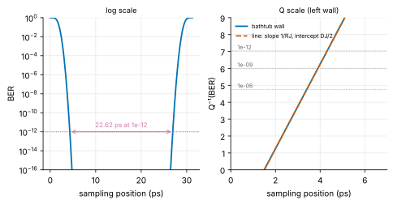
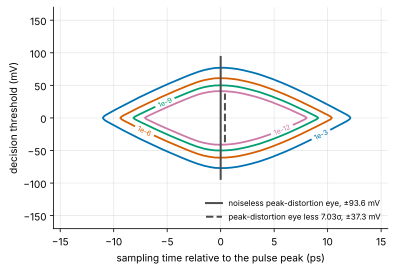

<!-- status: verified -->
# 24-02 · Eye Diagrams, Jitter and BER

| | |
|---|---|
| **Course** | [24 · High-Speed I/O, Signal Integrity and Photonics](../README.md) |
| **University equivalent** | The link-margin lectures of a graduate high-speed links course: pulse responses and peak-distortion analysis, statistical eyes, jitter decomposition and the dual-Dirac model, bathtub curves, clock-and-data-recovery jitter tolerance and BER testing (Dally & Poulton, *Digital Systems Engineering*, chapters on noise and timing; Palermo, Texas A&M ECEN 720 lecture notes on link modeling and jitter; Bogatin, *Signal and Power Integrity — Simplified*, chapter on eyes) |
| **Prerequisites** | [24-01](24-01-signal-integrity-fundamentals.md) (channel loss, crosstalk), [17-04](../../17-communication-systems/chapters/17-04-baseband-digital-transmission.md) (ISI, eye diagrams), [17-05](../../17-communication-systems/chapters/17-05-matched-filters-and-detection.md) (Q-function error probabilities), [20-10](../../20-analog-and-mixed-signal-ic-design/chapters/20-10-plls-and-jitter.md) (phase noise and jitter), [03-02](../../03-probability-statistics-and-random-variables/chapters/03-02-random-variables-and-distributions.md) (Gaussian tails) |
| **Estimated study hours** | 6 |
| **Last verified** | 2026-11-25 |

**Learning objectives.** After this chapter you can:

1. Compute a channel's pulse-response cursors and its worst-case (peak-distortion) eye for NRZ and PAM4, and explain how a statistical eye differs.
2. Turn a vertical eye opening and noise into a bit error rate for NRZ and PAM4.
3. Decompose jitter into random and deterministic parts and compute total jitter at a target BER with the dual-Dirac model.
4. Read and extrapolate a bathtub curve, and build a jitter budget.
5. Derive the jitter tolerance of a first-order clock-and-data-recovery loop and explain jitter masks and reference-clock limits.
6. Relate BER targets to FEC, burst errors and test time.

## 1. Big picture

24-01 described what a channel does to a signal in the frequency domain. A receiver, though, makes a decision once per symbol, at one instant, against one threshold. Whether it decides correctly depends on how far the signal is from the threshold at that instant (the vertical margin) and how close the instant is to a symbol boundary (the horizontal, or timing, margin). The **eye diagram** shows both at once, and **jitter** and **noise** eat into them from the two directions. Link specifications are, in the end, statements about the probability that one of them wins: the **bit error rate** (BER).

- **Specifications:** PCIe 1.0 to 5.0 required a BER of 10⁻¹²; PCIe 6.0 and 7.0, with PAM4 and forward error correction, target a first-bit-error rate of 10⁻⁶ before correction; 200 Gb/s Ethernet lanes budget detector error ratios of about 10⁻⁴ [6], [7].
- **Clocking:** a reference clock's jitter budget has shrunk from 86 ps rms for PCIe 1.1 to 67 fs for PCIe 7.0 [3], [4].
- **Test and qualification:** proving a BER of 10⁻¹² takes minutes of error-free data at 32 Gb/s; proving 10⁻¹⁵ takes a day, so test engineers extrapolate.
- **Products:** the same analysis sets the timing margin of DDR interfaces (23-04), camera and display links in phones and cars, and the optical modules of 24-08.

## 2. Intuition first

Picture a long sequence of received bits, cut into two-UI slices and laid on top of each other on an oscilloscope. Where the traces cross zero you see the transitions; in the middle of each UI you see an open "eye" bounded above by the lowest 1s and below by the highest 0s. Intersymbol interference smears those bounds: a 1 preceded by 0s rises less than a 1 preceded by 1s. Noise blurs every trace vertically. Jitter, the wander of each transition in time, blurs the crossings horizontally. The receiver samples at the centre; the eye's height and width are its margins.

Two kinds of disturbance shape the eye, and they behave differently:

- **Bounded** disturbances, such as ISI, duty-cycle distortion and crosstalk from a finite set of aggressors, have a worst case. Add up the worst case and you know the eye can never close further.
- **Unbounded** disturbances, such as thermal noise and random jitter, are Gaussian. Their worst case is infinite; you can only ask how often they exceed a margin. That is why every eye has to be quoted at a BER.

**Analogy and its limits.** A credit analyst separates a portfolio's losses into known exposures (bounded, add them up) and market noise (Gaussian, quoted at a confidence level such as a 99% value-at-risk). Total jitter at a BER is the same idea: a deterministic part plus a multiple of the Gaussian sigma. Where it breaks down: real tails are not exactly Gaussian, and a single "bad" pattern or burst can dominate, which is why SI engineers, unlike VaR models in 2008, are expected to check their tail assumptions against measurements.

## 3. Theory

### 3.1 The pulse response and the peak-distortion eye

Send one isolated symbol of amplitude 1 through the channel and sample the output once per UI, at the instant of its peak. The samples are the **cursors**: $h_0$ (the main cursor), $h_1, h_2, \ldots$ (post-cursors) and $h_{-1}, \ldots$ (pre-cursors). Because the channel is linear, a symbol stream $a_n$ produces, at the sampling instant of symbol $n$,

$$
y_n = h_0a_n + \sum_{k \ne 0}h_ka_{n-k} + \text{noise} .
$$

The sum is the **ISI** (17-04). For NRZ with $a_n = \pm1$ the worst case for a 1 has every other symbol arranged to subtract, so the lowest 1 sits at $h_0 - \sum_{k\ne0}\lvert h_k\rvert$ and the highest 0 at its mirror image. The worst-case vertical opening, as a fraction of the full swing of 2, is

$$
E_{NRZ} = h_0 - \sum_{k\ne0}\lvert h_k\rvert ,
$$

the **peak-distortion** eye (23-04 derived it for a first-order channel). For PAM-$M$ with levels evenly spaced from −1 to +1, adjacent levels are $2/(M - 1)$ apart, so the noiseless opening between them is $2h_0/(M - 1)$. The worst-case ISI still swings by $\sum\lvert h_k\rvert$ on each side, because the outer symbols still reach ±1. As a fraction of the full swing,

$$
E_{PAM\text{-}M} = \frac{h_0}{M - 1} - \sum_{k\ne0}\lvert h_k\rvert .
$$

For PAM4 the signal shrinks to a third but the ISI does not: the same channel at the same symbol rate opens a PAM4 eye far smaller than an NRZ eye, and can close it entirely (Example 24-01.2's channel, Example 24-02.2).

**A two-pole channel.** A channel with two equal real poles at time constant τ has the step response $s(t) = 1 - (1 + t/\tau)e^{-t/\tau}$ (07-03). A one-UI pulse produces $p(t) = s(t) - s(t - UI)$. Sampling at its peak and at whole UIs either side gives the cursors. With τ = 0.4 UI, $h_0$ = 0.734, $h_1$ = 0.211 and $h_{-1}$ = 0.022: a strong first post-cursor, the signature of a low-pass channel, and a small pre-cursor (Example 24-02.2). The lab confirms these cursors in ngspice.

### 3.2 The statistical eye

The peak-distortion eye assumes the single worst pattern. That pattern needs every one of $N$ significant cursors to line up, which for random data happens with probability $2^{-N}$ per symbol. With 10 cursors that is once per thousand symbols, often enough to matter; with 40 small cursors it may never happen in the life of the link, and the peak-distortion eye is needlessly pessimistic.

A **statistical eye** treats the ISI as a random variable. For random NRZ data each term $h_ka_{n-k}$ is $\pm h_k$ with probability ½, so the ISI's probability density is the convolution of $N$ pairs of Dirac deltas at $\pm h_k$, and adding Gaussian noise convolves once more with a Gaussian. The probability of error at a threshold is then an integral over that density, and contours of constant probability (say 10⁻¹²) draw the eye that the link actually has at that BER. IEEE's channel operating margin (COM) and modern simulators do exactly this (§3.9) [5].

### 3.3 Vertical margin: noise and BER

Let the eye's vertical opening at the sampling instant be $V_{eye}$ and the receiver's input-referred noise be Gaussian with rms value $\sigma_n$. With the threshold midway, an error needs the noise to exceed $V_{eye}/2$ in the wrong direction, so for NRZ

$$
\text{BER} = Q\!\left(\frac{V_{eye}}{2\sigma_n}\right) ,
$$

where $Q(x)$ is the Gaussian tail probability (17-05). Using the worst-case eye makes this an upper bound. For PAM-$M$ with Gray coding (17-06), the inner levels can err in two directions and the outer ones in one, so the symbol error rate is $2(1 - 1/M)\,Q(V_{eye}/2\sigma_n)$, and with one bit wrong per symbol error,

$$
\text{BER}_{PAM4} \approx \frac{1}{\log_2 4}\cdot\frac32\,Q\!\left(\frac{V_{eye}}{2\sigma_n}\right) = \frac34\,Q\!\left(\frac{V_{eye}}{2\sigma_n}\right) .
$$

Because $Q$ falls so steeply, the BER is extremely sensitive to the margin: $Q(x)$ = 10⁻¹² at $x$ = 7.03, 10⁻⁶ at 4.75 (Example 24-02.1). A 1.5× drop in eye height can take a link from 10⁻¹² to 10⁻⁶.

### 3.4 Jitter and its components

**Jitter** is the deviation of a signal's transitions from their ideal times. It is classified by its statistics and its cause:

| Component | Statistics | Typical causes |
|---|---|---|
| Random jitter (RJ) | Gaussian, unbounded; quoted as rms σ | Thermal and flicker noise in oscillators and buffers, reference-clock phase noise (20-10) |
| Data-dependent jitter (DDJ) | Bounded; depends on the bit pattern | ISI (a transition's timing depends on prior bits), duty-cycle distortion (DCD) |
| Periodic jitter (PJ) | Bounded; sinusoidal | Power-supply ripple, spread-spectrum clocking, coupling from switching regulators |
| Bounded uncorrelated jitter (BUJ) | Bounded; random with respect to the data | Crosstalk from neighbouring lanes |

Deterministic jitter (DJ) is the bounded part: DDJ, PJ and BUJ. **Total jitter** (TJ) is quoted at a BER because its random part is unbounded: the peak-to-peak value of a Gaussian keeps growing the more samples you take.

**Combining jitter.** Independent Gaussian sources add in quadrature: $\sigma_{RJ} = \sqrt{\sum\sigma_i^2}$. Bounded sources add linearly in the worst case. A jitter budget therefore root-sum-squares the random terms and sums the deterministic ones (Example 24-02.6).

### 3.5 The dual-Dirac model and total jitter at a BER

Instruments and standards fit measured jitter with the **dual-Dirac model**: the deterministic part is replaced by two Dirac deltas separated by $DJ(\delta\delta)$, and each is smeared by the random part's Gaussian of rms $\sigma = RJ$. Far out in the tails, which is all that matters at 10⁻¹², only the outer Dirac's Gaussian contributes, so the probability that a transition lies more than $x$ beyond the eye's ideal crossing is approximately $Q((x - DJ/2)/\sigma)$.

Setting that probability on each side equal to the BER, the eye closes by $DJ/2 + Q(\text{BER})\,\sigma$ from each side, and the total jitter at that BER is

$$
TJ(\text{BER}) = 2Q(\text{BER})\cdot RJ + DJ(\delta\delta) .
$$

At BER = 10⁻¹², $2Q$ = 14.07, the multiplier Teledyne LeCroy quotes [1]. The eye width at that BER is $UI - TJ$.

Three cautions apply:

- **$DJ(\delta\delta)$ is a fitted parameter, not a peak-to-peak measurement.** A real DJ distribution (say, sinusoidal PJ) has most of its mass inside its extremes, so the dual-Dirac fit to the tails gives a smaller separation than the peak-to-peak DJ: "Dj(δδ) is not a 'peak-to-peak' or 'full scale' measure" [1].
- **Conventions differ slightly.** The multiplier 14.07 sets the one-sided Gaussian tail $Q(x)$ equal to the BER. Keysight's white paper reaches the same value by writing $\text{BER} = \rho_T\,\text{erfc}(Q/\sqrt2)$ with a transition density $\rho_T$ = ½ (only about half of all bits have a transition) [2]. With $\rho_T$ = 1 the same formula gives 14.26, and setting $\tfrac12Q(x)$ equal to the BER gives 13.87. The spread is small because $Q$ is so steep, but an instrument or specification must state which it uses (Example 24-02.1).
- **Extrapolation assumes Gaussian tails.** If the tail is not Gaussian, for example from rare crosstalk alignments, the dual-Dirac extrapolation can be badly optimistic.

### 3.6 Bathtub curves

Sweep the receiver's sampling instant $x$ across the UI and plot BER on a log scale: the result is a **bathtub curve**, high near each crossing and plunging toward the centre. In the dual-Dirac model, with $x$ measured from the left crossing,

$$
\text{BER}(x) \approx Q\!\left(\frac{x - DJ/2}{\sigma}\right) + Q\!\left(\frac{UI - x - DJ/2}{\sigma}\right) .
$$

The eye width at a target BER is the width of the bathtub at that BER. On a **Q-scale** plot, where the vertical axis is $Q^{-1}(\text{BER})$, each wall becomes a straight line: $Q^{-1}(\text{BER}) = (x - DJ/2)/\sigma$. Its slope gives $1/\sigma$ and its intercept $DJ/2$. That is how test equipment extrapolates: measure the walls at BERs that take seconds (10⁻⁶ to 10⁻⁹), fit the lines, and read off the opening at 10⁻¹² or 10⁻¹⁵ (Example 24-02.5).

### 3.7 Clock and data recovery, jitter transfer and jitter tolerance

A receiver's **clock and data recovery** (CDR) circuit adjusts its sampling phase to follow the incoming transitions (24-03). It is a phase-locked loop whose input is the data's phase. For a first-order loop with bandwidth $f_c$, the recovered clock's phase follows the input's through

$$
H(f) = \frac{1}{1 + jf/f_c} ,
$$

a low-pass. Jitter below $f_c$ is tracked: the sampling clock moves with the data and the jitter does no harm. What matters is the **tracking error**, the difference between data phase and clock phase, which passes through

$$
1 - H(f) = \frac{jf/f_c}{1 + jf/f_c} ,
$$

a high-pass. Sinusoidal jitter of peak-to-peak amplitude $A$ at frequency $f$ leaves a tracking error of $A\,(f/f_c)/\sqrt{1 + (f/f_c)^2}$. If the eye can absorb a peak-to-peak timing error of $M$ UI, the largest tolerable jitter amplitude is

$$
A_{tol}(f) = M\sqrt{1 + \left(\frac{f_c}{f}\right)^2} .
$$

Above $f_c$ the tolerance flattens at $M$: the CDR cannot follow, and the eye's own margin must absorb the jitter. Below $f_c$ it rises at 20 dB per decade. A **jitter-tolerance mask** specifies sinusoidal jitter amplitudes the receiver must tolerate at each frequency, a shape that follows this curve. Standards fix the corner: for 200 Gb/s Ethernet lanes the task force adopted 4 MHz, written as the baud rate divided by 26,562.5 [6].

**Jitter transfer** is the opposite concern for a device that passes a clock on (a retimer, a PLL): its $H(f)$ must not amplify jitter, so standards limit its peaking.

**Reference clocks.** In PCIe's common-clock architecture, transmitter and receiver share one reference clock, and much of its low-frequency jitter cancels; standards specify the reference clock's jitter after weighting functions that model the PLLs and CDR at each end. The limit has fallen with every generation: 86 ps rms (PCIe 1.1), 3.1 ps (2.1), 1.0 ps (3.1), 0.5 ps (4.0), 0.15 ps (5.0), 0.1 ps (6.0) and 67 fs (7.0) [3], [4]. In UI terms the limit fell from 0.215 UI for PCIe 1.1 to between 0.003 and 0.008 UI from PCIe 3.0 on: since then it has tightened in step with the UI. Phase-noise integration (20-10) turns an oscillator's phase-noise plot into these numbers (Example 24-02.8).

### 3.8 BER targets, FEC and test time

**Targets.** Early serial links demanded a raw BER of 10⁻¹² on the wire. Once forward error correction is in the link, the target moves to the FEC's input. Ethernet's RS(544,514) "KP4" code meets a frame loss ratio equivalent to a BER of 10⁻¹³ with a random-error input BER of about 3 × 10⁻⁴; burst errors tighten that to under 2 × 10⁻⁴ [8]. PCIe 6.0 introduced a first-bit-error rate (FBER) of 10⁻⁶ with a lightweight FEC and retry, and the PCIe 7.0 work kept it [7]. Raising the allowed raw error rate by six orders of magnitude lowers the required $Q$ from 7.03 to 4.75, a factor worth 3.4 dB of SNR, which helps pay for PAM4's smaller eye.

**Burst errors and DER.** A decision-feedback equalizer (24-03) feeds its decisions back; one wrong decision raises the chance of the next, so errors come in bursts. FEC codes correct symbols, not bits, and bursts that fit inside a symbol are cheap. 802.3dj therefore budgets a **detector error ratio** (DER₀) per link, for example 2 × 10⁻⁴ for backplane and copper cable, and splits a combined 2.67 × 10⁻⁵ between chip-to-chip and chip-to-module interfaces [6].

**Test time.** If $N$ bits are received with zero errors, the BER is below $-\ln(1 - CL)/N$ with confidence $CL$ (03-05, [9]). At 95% confidence that is $3.0/N$: verifying 10⁻¹² needs 3 × 10¹² bits, 94 s at 32 Gb/s; verifying 10⁻¹⁵ needs a day (Example 24-02.8). Hence bathtub extrapolation, and hence the appeal of FEC-era targets of 10⁻⁶.

### 3.9 Putting it together: channel operating margin

IEEE 802.3 standards since 25 Gb/s per lane qualify a channel with a single figure, the **channel operating margin** (COM). A reference transmitter and receiver (with specified equalizers) process the channel's S-parameters; the statistical eye at the target DER gives the signal amplitude $A_s$ and the combined amplitude of noise and interference $A_{ni}$, and

$$
\text{COM} = 20\log_{10}\frac{A_s}{A_{ni}}\ \text{dB}
$$

must be at least 3 dB [5]. COM combines loss, reflections, crosstalk, jitter and noise into one margin, which is why loss alone (24-01) never decides whether a channel passes. The 200 Gb/s reference receiver includes a feed-forward equalizer, a one-tap DFE, maximum-likelihood sequence detection and a 6-bit ADC, while the 100 Gb/s one relied on a 12-tap DFE: the shift to DSP receivers described in 24-03 and 24-04 [5].

## 4. Worked examples

### Example 24-02.1 · The Q multiplier (tier A)

**Setup.** Find $Q^{-1}$ and the dual-Dirac multiplier $2Q$ at BERs of (a) 10⁻⁶, (b) 10⁻⁹, (c) 10⁻¹² and (d) 10⁻¹⁵. What multiplier results at 10⁻¹² under the other conventions of §3.5: (e) $\tfrac12Q(x) = 10^{-12}$ and (f) Keysight's formula with $\rho_T$ = 1, which gives $2Q(x) = 10^{-12}$?

**Solution.**

- (a) $Q^{-1}(10^{-6})$ = **4.753**; $2Q$ = **9.507**.
- (b) **5.998**; **11.996**.
- (c) **7.034**; **14.07**.
- (d) **7.941**; **15.88**.
- (e) $2Q^{-1}(2 \times 10^{-12})$ = **13.87**.
- (f) $2Q^{-1}(5 \times 10^{-13})$ = **14.26**.

**Units check.** Q is dimensionless; multiplying it by an rms jitter gives seconds. ✓

**Sanity check.** Each factor of 1,000 in BER costs only about one more sigma: the Gaussian tail is so steep that small changes in margin swing the BER enormously.

### Example 24-02.2 · Peak-distortion eyes, NRZ against PAM4 (tier B)

**Setup.** A channel has two equal poles with τ = 12.5 ps. At 32 GBd (UI = 31.25 ps, τ = 0.4 UI), find (a) the pulse response's peak time, (b) the cursors $h_{-1}$, $h_0$, $h_1$ and $h_2$, (c) the sum of the ISI magnitudes, (d) the NRZ peak-distortion eye and (e) the PAM4 eye, both as fractions of the swing. (f) Running PAM4 at 16 GBd (the same 32 Gb/s), τ = 0.2 UI; find its eye.

**Solution.**

- (a) The step response's slope is $s'(t) = (t/\tau^2)e^{-t/\tau}$, so $p'(t) = 0$ when $te^{-t/\tau} = (t - UI)e^{-(t - UI)/\tau}$. Solving, $t_{pk} = UI/(1 - e^{-UI/\tau}) = 1/(1 - e^{-2.5})$ UI = **1.0894** UI after the pulse starts.
- (b) $h_{-1}$ = **0.0216**, $h_0$ = **0.7340**, $h_1$ = **0.2109**, $h_2$ = **0.0297** (and $h_3$ = 0.00345).
- (c) $\sum\lvert h_k\rvert$ = **0.2660**.
- (d) $0.7340 - 0.2660$ = **0.468**.
- (e) $0.7340/3 - 0.2660$ = **−0.021**: closed.
- (f) At τ = 0.2 UI, $h_0$ = 0.9601 and $\sum\lvert h_k\rvert$ = 0.0399, so the eye is $0.9601/3 - 0.0399$ = **0.280**.

**Units check.** Cursors are fractions of the input amplitude. ✓

**Sanity check.** At the same symbol rate PAM4 cannot open on a channel where NRZ easily does. At the same bit rate PAM4 opens, but at 0.280 against NRZ's 0.468: on a gentle channel like this one, NRZ is still better (23-04 reached the same conclusion for first-order channels). PAM4 pays off only when the loss at NRZ's higher Nyquist frequency is much steeper.

### Example 24-02.3 · From eye to BER (tier B)

**Setup.** The receiver of Example 24-02.2 sees a 400 mV peak-to-peak swing. (a) For NRZ at 32 GBd, find the worst-case eye in millivolts and the largest rms noise that keeps the BER at or below 10⁻¹². (b) Find the BER if the noise is 8 mV rms. (c) For PAM4 at 16 GBd, find the eye in millivolts, and the symbol error rate and BER at 8 mV rms.

**Solution.**

- (a) $0.4680 \times 400$ = **187.2** mV, so $\sigma_n \le 93.61/7.034$ = **13.3** mV.
- (b) $Q(93.61/8) = Q(11.70)$ = **6.3** × 10⁻³².
- (c) $0.2802 \times 400$ = **112.1** mV; SER $= 1.5\,Q(56.04/8)$ = **1.86** × 10⁻¹²; BER = SER/2 = **9.3** × 10⁻¹³.

**Units check.** mV/mV is dimensionless. ✓

**Sanity check.** At the same 8 mV of noise the PAM4 link sits right at 10⁻¹² while the NRZ link is error-free for practical purposes: the PAM4 eye's 40% smaller half-opening costs 19 orders of magnitude.

### Example 24-02.4 · Total jitter with the dual-Dirac model (tier B)

**Setup.** A 32 GBd receiver measures RJ = 0.4 ps rms and DJ(δδ) = 3.0 ps. Find (a) TJ at 10⁻¹², (b) the eye width there in ps and UI, and (c) TJ at 10⁻¹⁵. (d) If RJ doubles, what is TJ at 10⁻¹²?

**Solution.**

- (a) $14.07 \times 0.4 + 3.0$ = **8.63** ps.
- (b) $31.25 - 8.63$ = **22.62** ps, or $1 - 8.628/31.25$ = **0.724** UI.
- (c) $15.88 \times 0.4 + 3.0$ = **9.35** ps.
- (d) $14.07 \times 0.8 + 3.0$ = **14.26** ps.

**Units check.** Dimensionless multiplier times ps, plus ps. ✓

**Sanity check.** Going from 10⁻¹² to 10⁻¹⁵ adds only 0.73 ps, but doubling the random jitter adds 5.6 ps: at low BERs the rms jitter, multiplied by 14 to 16, dominates the budget.

### Example 24-02.5 · Extrapolating a bathtub (tier B)

**Setup.** A bit-error-rate tester measures the left wall of a 32 GBd bathtub at BER 10⁻⁶ at 3.40 ps and at 10⁻⁹ at 3.90 ps from the crossing. Assuming a dual-Dirac tail, find (a) σ, (b) DJ(δδ), (c) the wall's position at 10⁻¹² and (d) the eye width at 10⁻¹², assuming a symmetric right wall.

**Solution.**

- (a) On the Q scale the wall is a line: $\sigma = (3.90 - 3.40)/(5.998 - 4.753)$ = **0.402** ps.
- (b) $DJ/2 = 3.40 - 4.753 \times 0.4018$ = 1.490 ps, so $DJ(\delta\delta)$ = **2.98** ps.
- (c) $1.490 + 7.034 \times 0.4018$ = **4.32** ps.
- (d) $31.25 - 2 \times 4.3165$ = **22.62** ps.

**Units check.** ps per unit of Q gives ps. ✓

**Sanity check.** Two quick measurements recover Example 24-02.4's jitter (0.4 ps and 3 ps) to within the rounding of the data, and predict the 10⁻¹² eye without the 94 s test. The extrapolation is only as good as the Gaussian-tail assumption.

### Example 24-02.6 · A jitter budget (tier B)

**Setup.** A 32 GBd link has random jitter of 0.15 ps rms from the reference clock (after its filters), 0.25 ps from the transmitter PLL and 0.20 ps from the receiver; and deterministic jitter of 1.0 ps duty-cycle distortion, 4.0 ps residual ISI and 1.5 ps crosstalk-induced jitter (all assumed). Find (a) the total RJ, (b) the total DJ, (c) TJ at 10⁻¹² and (d) TJ as a fraction of the UI.

**Solution.**

- (a) $\sqrt{0.15^2 + 0.25^2 + 0.20^2}$ = **0.354** ps.
- (b) $1.0 + 4.0 + 1.5$ = **6.5** ps.
- (c) $14.07 \times 0.3536 + 6.5$ = **11.47** ps.
- (d) $11.47/31.25$ = **0.367** UI.

**Units check.** ps throughout. ✓

**Sanity check.** Root-sum-squaring the random terms is exact for independent Gaussians; summing the deterministic terms linearly is conservative, because their worst cases rarely coincide. Here the deterministic part is the larger share, and most of it is residual ISI, which better equalization would remove.

### Example 24-02.7 · Jitter tolerance of a first-order CDR (tier C)

**Setup.** A receiver's CDR is first-order with $f_c$ = 4 MHz, the corner adopted for 200 Gb/s Ethernet lanes [6], and its eye can absorb 0.3 UI peak-to-peak of tracking error (assumed). (a) Check that 4 MHz equals the 106.25 GBd baud rate divided by 26,562.5. Find the tolerable sinusoidal jitter at (b) 100 kHz, (c) 4 MHz and (d) 40 MHz.

**Solution.**

- (a) $106.25 \times 10^9/26{,}562.5$ = **4.0** MHz.
- (b) $0.3\sqrt{1 + 40^2}$ = **12.0** UI.
- (c) $0.3\sqrt2$ = **0.424** UI.
- (d) $0.3\sqrt{1 + 0.1^2}$ = **0.3015** UI.

**Units check.** UI × dimensionless. ✓

**Sanity check.** Slow wander of many UI (from spread-spectrum clocking or temperature) is harmless because the CDR tracks it; fast jitter above a few megahertz must fit inside the eye. A faster CDR tolerates more jitter but passes more of its own noise and may track the data's pattern-dependent jitter, so the bandwidth is a compromise.

### Example 24-02.8 · Test time and reference-clock jitter (tier B)

**Setup.** (a) How many error-free bits demonstrate BER ≤ 10⁻¹² at 95% confidence, and how long does that take at 32 Gb/s? (b) How long for 10⁻¹⁵? Express (c) PCIe 6.0's 100 fs reference-clock limit at 32 GBd and (d) PCIe 7.0's 67 fs at 64 GBd as fractions of a UI [3], [4]. (e) An oscillator at 100 MHz has a flat phase noise of −150 dBc/Hz from 10 kHz to 20 MHz (assumed). What rms jitter does that band contribute?

**Solution.**

- (a) $N = -\ln(0.05)/10^{-12}$ = **3.0** × 10¹² bits; $3.0 \times 10^{12}/32 \times 10^9$ = **93.6** s.
- (b) 1,000 times longer: **26.0** h.
- (c) $0.1/31.25$ = **0.0032** UI; (d) $0.067/15.625$ = **0.0043** UI.
- (e) $\sigma_t = \sqrt{2 \times 10^{-15} \times (2 \times 10^7 - 10^4)}/(2\pi \times 10^8)$ = **318** fs (20-10).

**Units check.** bits ÷ bits/s = s; √(1/Hz × Hz)/(rad/s) = s. ✓

**Sanity check.** A plain −150 dBc/Hz oscillator floor already exceeds PCIe 7.0's 67 fs limit 4.7-fold before any weighting, which is why PCIe clock generators are specified in tens of femtoseconds and why the weighting filters matter.

<!-- answer-key -->

| ID | Quantity | Value | Unit |
|---|---|---|---|
| Ex 24-02.1a | inverse Q at 1e-6 | 4.753 | |
| Ex 24-02.1a1 | 2Q at 1e-6 | 9.507 | |
| Ex 24-02.1b | inverse Q at 1e-9 | 5.998 | |
| Ex 24-02.1b1 | 2Q at 1e-9 | 11.996 | |
| Ex 24-02.1c | inverse Q at 1e-12 | 7.034 | |
| Ex 24-02.1c1 | 2Q at 1e-12 | 14.07 | |
| Ex 24-02.1d | inverse Q at 1e-15 | 7.941 | |
| Ex 24-02.1d1 | 2Q at 1e-15 | 15.88 | |
| Ex 24-02.1e | multiplier with half-weighted tail | 13.87 | |
| Ex 24-02.1f | multiplier with transition density 1 | 14.26 | |
| Ex 24-02.2a | pulse peak time | 1.0894 | UI |
| Ex 24-02.2b | pre-cursor | 0.0216 | |
| Ex 24-02.2b1 | main cursor | 0.7340 | |
| Ex 24-02.2b2 | first post-cursor | 0.2109 | |
| Ex 24-02.2b3 | second post-cursor | 0.0297 | |
| Ex 24-02.2b4 | third post-cursor | 0.00345 | |
| Ex 24-02.2c | sum of ISI magnitudes | 0.2660 | |
| Ex 24-02.2d | NRZ eye | 0.468 | |
| Ex 24-02.2d1 | NRZ eye, 4 s.f. | 0.4680 | |
| Ex 24-02.2e | PAM4 eye at 32 GBd | -0.021 | |
| Ex 24-02.2f0 | main cursor at 0.2 UI | 0.9601 | |
| Ex 24-02.2f1 | ISI sum at 0.2 UI | 0.0399 | |
| Ex 24-02.2f | PAM4 eye at 16 GBd | 0.280 | |
| Ex 24-02.2f2 | PAM4 eye at 16 GBd, 4 s.f. | 0.2802 | |
| Ex 24-02.3a | NRZ eye | 187.2 | mV |
| Ex 24-02.3a1 | NRZ half eye | 93.61 | mV |
| Ex 24-02.3a2 | largest noise for 1e-12 | 13.3 | mV |
| Ex 24-02.3b0 | Q argument at 8 mV | 11.70 | |
| Ex 24-02.3b | NRZ BER at 8 mV | 6.3e-32 | |
| Ex 24-02.3c | PAM4 eye | 112.1 | mV |
| Ex 24-02.3c0 | PAM4 half eye | 56.04 | mV |
| Ex 24-02.3c1 | PAM4 symbol error rate | 1.86e-12 | |
| Ex 24-02.3c2 | PAM4 BER | 9.3e-13 | |
| Ex 24-02.3d | PAM4 half-opening shortfall | 40 | % |
| Ex 24-02.3e | orders of magnitude between the BERs | 19 | |
| Ex 24-02.4a | TJ at 1e-12 | 8.63 | ps |
| Ex 24-02.4a1 | TJ at 1e-12, 4 s.f. | 8.628 | ps |
| Ex 24-02.4b | eye width at 1e-12 | 22.62 | ps |
| Ex 24-02.4b1 | eye width in UI | 0.724 | UI |
| Ex 24-02.4c | TJ at 1e-15 | 9.35 | ps |
| Ex 24-02.4d | TJ with doubled RJ | 14.26 | ps |
| Ex 24-02.4e | extra TJ from 1e-12 to 1e-15 | 0.73 | ps |
| Ex 24-02.4f | extra TJ from doubling RJ | 5.6 | ps |
| Ex 24-02.5a | fitted sigma | 0.402 | ps |
| Ex 24-02.5a1 | fitted sigma, 4 s.f. | 0.4018 | ps |
| Ex 24-02.5b0 | fitted half DJ | 1.490 | ps |
| Ex 24-02.5b | fitted DJ | 2.98 | ps |
| Ex 24-02.5c | wall at 1e-12 | 4.32 | ps |
| Ex 24-02.5c1 | wall at 1e-12, 5 s.f. | 4.3165 | ps |
| Ex 24-02.5d | eye width at 1e-12 | 22.62 | ps |
| Ex 24-02.6a | total RJ | 0.354 | ps |
| Ex 24-02.6a1 | total RJ, 4 s.f. | 0.3536 | ps |
| Ex 24-02.6b | total DJ | 6.5 | ps |
| Ex 24-02.6c | TJ at 1e-12 | 11.47 | ps |
| Ex 24-02.6d | TJ in UI | 0.367 | UI |
| Ex 24-02.7a | jitter corner | 4.0 | MHz |
| Ex 24-02.7b | tolerance at 100 kHz | 12.0 | UI |
| Ex 24-02.7c | tolerance at 4 MHz | 0.424 | UI |
| Ex 24-02.7d | tolerance at 40 MHz | 0.3015 | UI |
| Ex 24-02.8a | error-free bits for 1e-12 | 3.0e12 | |
| Ex 24-02.8a1 | test time for 1e-12 | 93.6 | s |
| Ex 24-02.8b | test time for 1e-15 | 26.0 | h |
| Ex 24-02.8c | PCIe 6.0 refclk limit in UI | 0.0032 | UI |
| Ex 24-02.8d | PCIe 7.0 refclk limit in UI | 0.0043 | UI |
| Ex 24-02.8e | integrated phase-noise jitter | 318 | fs |
| Ex 24-02.8f | phase-noise jitter over PCIe 7.0 limit | 4.7 | |
| Txt 24-02.a | Q at 1e-12, 3 s.f. | 7.03 | |
| Txt 24-02.b | Q at 1e-6, 3 s.f. | 4.75 | |
| Txt 24-02.c | cursors with 10 significant terms, worst pattern rate | 1e-3 | |
| Txt 24-02.d | PAM4 BER factor | 0.75 | |
| Txt 24-02.e | main cursor, 3 s.f. | 0.734 | |
| Txt 24-02.f | first post-cursor, 3 s.f. | 0.211 | |
| Txt 24-02.g | pre-cursor, 2 s.f. | 0.022 | |
| Txt 24-02.h | margin drop taking 1e-12 to 1e-6 | 1.5 | |
| Txt 24-02.i | 802.3dj combined AUI DER | 2.67e-5 | |
| Txt 24-02.j | PCIe 1.1 refclk limit in UI | 0.215 | UI |
| Txt 24-02.k | smallest refclk limit in UI since PCIe 3.0 | 0.003 | UI |
| Txt 24-02.l | largest refclk limit in UI since PCIe 3.0 | 0.008 | UI |
| Txt 24-02.m | SNR worth of moving from 1e-12 to 1e-6 | 3.4 | dB |
| Txt 24-02.n | test time for 1e-12 at 32 Gb/s, 2 s.f. | 94 | s |
| Txt 24-02.o | inverse Q at 1e-9, 3 s.f. | 6.00 | |
| Txt 24-02.p | inverse Q at 1e-15, 3 s.f. | 7.94 | |
| Txt 24-02.q | statistical eye height at 1e-12 | 80.6 | mV |
| Txt 24-02.r | worst-case eye less noise at 1e-12 | 74.7 | mV |

## 5. Simulate it

The lab is [labs/24-02-lab/](../labs/24-02-lab/README.md). `eye.py` builds pulse responses, peak-distortion and statistical eyes, jitter tails and bathtub curves; `pulse.cir` confirms Example 24-02.2's cursors in ngspice; the notebook ties them together.

*Figure 1. A dual-Dirac bathtub (RJ = 0.4 ps, DJ(δδ) = 3 ps, 32 GBd). On the Q scale (right) each wall is a straight line, which is what makes extrapolation from fast measurements possible.*

*Figure 2. Statistical eye of Example 24-02.2's channel (NRZ, 32 GBd, 400 mV swing, 8 mV rms noise) as contours of constant BER. At the centre the 10⁻¹² contour is 80.6 mV tall, only slightly taller than the worst-case bound with noise, 74.7 mV (dashed bar): this channel's ISI sits mostly in one post-cursor, so the worst pattern is common. With many small cursors the gap is far larger (Problem 24-02.12).*

**Predict, then run:**

1. *Predict* the cursors of Example 24-02.2. Run `ngspice -b pulse.cir` and compare.
2. *Predict* how much taller the statistical eye of Figure 2 is at 10⁻¹² than the peak-distortion eye less $2 \times 7.03\sigma$, then compute both.
3. Combine 0.4 ps rms RJ with 3 ps peak-to-peak sinusoidal PJ, compute the exact tail and *predict* whether the dual-Dirac fit's DJ(δδ) will be larger or smaller than 3 ps.
4. Simulate a first-order CDR tracking sinusoidal jitter at 100 kHz, 4 MHz and 40 MHz and compare the tracking error with §3.7.

## 6. Engineering tradeoffs

| Knob | Improves | Costs | Typical decision owner |
|---|---|---|---|
| Lower BER target with FEC (10⁻¹² → 10⁻⁴–10⁻⁶ pre-FEC) | Margin (several dB), reach | FEC latency, power, area; burst-error sensitivity | Standards body, SerDes architect |
| PAM4 instead of NRZ | Bit rate at a given Nyquist frequency | Eye height (a third), linearity, noise sensitivity | Standards body |
| Higher CDR bandwidth | Jitter tolerance at low frequency | More CDR self-noise passed, pattern tracking, stability | SerDes designer |
| Cleaner reference clock | RJ | Clock-generator cost and power | Board designer, clock vendor |
| Statistical rather than peak-distortion analysis | Less pessimism, more usable channels | Reliance on modelled tail statistics | SI engineer, standards body |
| Longer BER tests | Confidence in low BER | Test time and cost | Test engineering |

## 7. Numbers to know

| Quantity | Value | Source |
|---|---|---|
| $Q^{-1}$ at 10⁻⁶, 10⁻⁹, 10⁻¹², 10⁻¹⁵ | 4.75, 6.00, 7.03, 7.94 | Example 24-02.1 |
| Dual-Dirac multiplier at 10⁻¹² | 14.07 | [1] |
| Zero-error test length at 95% | 3/BER bits | §3.8, [9] |
| PCIe reference-clock limit (as reported) | 0.15 ps (5.0), 0.1 ps (6.0), 67 fs (7.0) rms | [3], [4] |
| PCIe 6.0/7.0 error target | FBER 10⁻⁶ before FEC | [7], [8] |
| KP4 FEC input BER for a 10⁻¹³-equivalent frame loss ratio | about 3 × 10⁻⁴ random; under 2 × 10⁻⁴ with bursts | [8] |
| 802.3dj DER₀ (as adopted, 2023) | 2 × 10⁻⁴ backplane/cable; 2.67 × 10⁻⁵ AUIs combined | [6] |
| 802.3dj jitter corner | 4 MHz (106.25 GBd/26,562.5) | [6] |
| COM pass threshold | 3 dB | [5] |

## 8. Common mistakes

- **Quoting total jitter without a BER.** TJ grows with the BER it is quoted at; "8 ps of jitter" means nothing alone.
- **Adding rms jitters linearly, or peak-to-peak jitters in quadrature.** Independent Gaussians add in quadrature; bounded worst cases add linearly.
- **Treating DJ(δδ) as peak-to-peak DJ.** It is a tail fit and can be smaller than the true DJ.
- **Assuming PAM4 always wins.** At the same bit rate it trades a third of the eye for half the Nyquist frequency; on gentle channels NRZ is better.
- **Testing to 10⁻¹² with 10¹² bits.** Zero errors in 10¹² bits shows only BER < 3 × 10⁻¹² at 95% confidence.
- **Ignoring jitter that the CDR tracks.** Low-frequency jitter can be many UI and still harmless; what counts is the tracking error.

## 9. Practitioner lens

**State of the art (as of Nov 2026).**

- *Error targets* [Established for Ethernet motions; Industry estimate for PCIe 7.0]. IEEE 802.3's BER objective at the MAC is 10⁻¹³ for 400G to 1.6T Ethernet, met through FEC [8]. The 802.3dj task force adopted DER₀ = 2 × 10⁻⁴ for 200 Gb/s per-lane backplane and copper-cable links and split a combined 2.67 × 10⁻⁵ between chip-to-chip (0.67 × 10⁻⁵) and chip-to-module (2 × 10⁻⁵) interfaces [6]. PCIe 6.0 uses an FBER of 10⁻⁶ with a 256-byte flit. Das Sharma's SNIA presentation on PCIe 7.0 (©2023), by the PCI-SIG board member who led the work, keeps the same target, noting the numbers "get worse by 2x at 128.0 GT/s" [7]; the final specification text was not read here.
- *Reference receivers* [Established, as task-force configuration files]. The 802.3ck COM configuration (draft 3.1, 2021) used a 12-tap DFE with floating taps for 100 Gb/s backplanes; the 802.3dj configuration (draft 2.3, Jan 2026) uses a feed-forward equalizer with 6 pre-cursor and 8 post-cursor taps plus floating groups, a 1-tap DFE, MLSE and 6-bit ADC quantization, with COM ≥ 3 dB and random jitter of 0.01 UI [5].
- *Reference clocks* [Established as vendor statements of the PCI-SIG limits]. Clock and test-equipment vendors report PCIe common-clock limits of 0.15 ps (5.0), 0.1 ps (6.0) and 67 fs rms (7.0), the last after 16 weighting transfer functions [3], [4].

**Why it matters commercially.** Clock generators, retimers, BER testers and real-time oscilloscopes are sold on these numbers. A reference clock with 30 fs of headroom against PCIe 7.0's 67 fs commands a premium; a scope whose jitter decomposition disagrees with another's at the dual-Dirac fit can fail a product at qualification. For an M&A or investment analysis of the SI and test-equipment niche, the key driver is that each generation halves the UI while jitter components shrink more slowly, so test complexity and the value of better instruments rise.

**Marketing vs Reality.**

- *"Error-free at 10⁻¹⁵."* Ask how many bits were tested; to demonstrate 10⁻¹⁵ at 95% confidence takes 3 × 10¹⁵ error-free bits, a day per lane at 32 Gb/s. Most such claims are extrapolated.
- *"Total jitter of 8 ps."* At what BER, with which multiplier convention, and with what clock-recovery filter applied?
- *"Wide-open eye."* A captured eye shows perhaps 10⁶ UIs; what matters is the 10⁻¹² contour, which only a statistical or extrapolated eye shows.
- *"Pre-FEC BER of 10⁻⁵."* Raw errors are fine if FEC corrects them, but bursts from DFE error propagation can defeat FEC that random-error analysis says is ample (§3.8).

**Questions for engineering leaders.**

1. **"What is your BER target before and after FEC, and how was the burst behaviour modelled?"** *Strong:* DER or FBER with a burst model, measured post-FEC margin. *Evasive:* a raw BER only.
2. **"How do you get your jitter numbers to 10⁻¹²?"** *Strong:* dual-Dirac or Q-scale extrapolation with a stated convention, cross-checked with long tests. *Evasive:* "the scope says so."
3. **"What jitter-tolerance mask do you pass, and with what margin?"** *Strong:* JTOL curve against the mask at each corner. *Evasive:* "we pass compliance."
4. **"How much of your jitter budget is the reference clock?"** *Strong:* weighted refclk jitter against the limit, and the clock part chosen. *Evasive:* "we use the reference design's clock."

## 10. Concept check

**Q1.** Why must total jitter always be quoted at a BER, but deterministic jitter need not be?

Answer

Deterministic jitter is bounded, so it has a well-defined peak-to-peak value. Random jitter is Gaussian and unbounded: its peak-to-peak value grows the more transitions you observe, so total jitter is defined only for a chosen tail probability.

**Q2.** Why does the same channel give a much worse PAM4 eye than NRZ eye at the same symbol rate?

Answer

PAM4 divides the swing into three eyes, so each eye's signal is a third of NRZ's, but the ISI is set by the outer levels and stays the same size. The eye is $h_0/3 - \sum\lvert h_k\rvert$ against $h_0 - \sum\lvert h_k\rvert$.

**Q3.** Why is a peak-distortion eye pessimistic for a long channel?

Answer

It assumes every cursor's ISI aligns in the worst direction at once. With many cursors that pattern is vanishingly rare (probability $2^{-N}$), so the eye the link actually has at 10⁻¹² is larger.

**Q4.** What does a straight line on a Q-scale bathtub tell you?

Answer

That the wall's tail is Gaussian: its slope is $1/\sigma$ (random jitter) and its intercept at Q = 0 is DJ/2. That is what lets testers extrapolate from 10⁻⁶ or 10⁻⁹ to 10⁻¹².

**Q5.** Why can a receiver tolerate many UIs of jitter at 100 kHz but only a fraction of a UI at 40 MHz?

Answer

Its CDR tracks jitter below its bandwidth, so slow jitter moves the sampling clock along with the data and the tracking error is small. Above the bandwidth the CDR cannot follow, and the eye's own margin must absorb the whole jitter.

**Q6.** Why did PCIe 6.0 move from a BER of 10⁻¹² to an FBER of 10⁻⁶?

Answer

PAM4's eye is a third the height of NRZ's, which costs several decibels of SNR. Allowing raw errors at 10⁻⁶ and correcting them with a lightweight FEC and retry recovers that margin, at the cost of a little latency and bandwidth.

Problems: [24-02 problem set](../problems/24-02-problems.md) · Solutions: [24-02 solutions](../solutions/24-02-solutions.md)

## 11. Key terms

[Eye diagram](../../../reference/glossary.md#eye-diagram) · [Intersymbol interference](../../../reference/glossary.md#intersymbol-interference) · [Peak distortion](../../../reference/glossary.md#peak-distortion) · [Statistical eye](../../../reference/glossary.md#statistical-eye) · [Random jitter (RJ)](../../../reference/glossary.md#random-jitter-rj) · [Deterministic jitter (DJ)](../../../reference/glossary.md#deterministic-jitter-dj) · [Dual-Dirac model](../../../reference/glossary.md#dual-dirac-model) · [Bathtub curve](../../../reference/glossary.md#bathtub-curve) · [Jitter tolerance](../../../reference/glossary.md#jitter-tolerance) · [Clock and data recovery (CDR)](../../../reference/glossary.md#clock-and-data-recovery-cdr) · [Detector error ratio (DER)](../../../reference/glossary.md#detector-error-ratio-der) · [Channel operating margin (COM)](../../../reference/glossary.md#channel-operating-margin-com)

## 12. Connections

- **Previous:** [24-01](24-01-signal-integrity-fundamentals.md) gave the channel's loss and crosstalk; [17-04](../../17-communication-systems/chapters/17-04-baseband-digital-transmission.md) introduced ISI and eyes and [17-05](../../17-communication-systems/chapters/17-05-matched-filters-and-detection.md) the Q-function BER; [20-10](../../20-analog-and-mixed-signal-ic-design/chapters/20-10-plls-and-jitter.md) turned phase noise into jitter.
- **Next:** [24-03](24-03-serdes-architecture.md) builds the equalizers and CDRs that open the eyes measured here; [24-04](24-04-dsp-serdes-and-fec.md) adds ADC-based receivers and FEC.
- **Used later:** [24-05](24-05-pcie-cxl-ethernet.md) applies the BER targets to the standards; the same eye and jitter analysis governs the optical links of [24-08](24-08-silicon-photonics.md).

## 13. Further study

- W. J. Dally and J. W. Poulton, *Digital Systems Engineering*, chapters on noise, timing and signalling.
- S. Palermo, Texas A&M ECEN 720 *High-Speed Links* lecture notes: link modeling, statistical BER and jitter.
- E. Bogatin, *Signal and Power Integrity — Simplified*, chapters on eyes and the interconnect's impact on jitter.
- Teledyne LeCroy and Keysight application notes on the dual-Dirac model and Q-scale extrapolation [1], [2].

## 14. Sources

1. Teledyne LeCroy, "Understanding Jitter Calculations: Why Dj Can Be Less Than DDj (or Pj)," 9 Jul 2014, <https://teledynelecroy.com/doc/docview.aspx?id=8423>. [R-505]
2. R. Stephens, "Jitter Analysis: The dual-Dirac Model, RJ/DJ, and Q-Scale," Keysight white paper 5989-3206EN, <https://www.keysight.com/zz/en/assets/7018-01309/white-papers/5989-3206.pdf>. [R-063]
3. Texas Instruments, "Clocking for PCIe Applications," SNAA386, Nov 2023 (Table 4-1), <https://www.ti.com/lit/pdf/snaa386>. [R-506]
4. Rohde & Schwarz, "Verifying the true jitter performance of clocks in PCI express and high-speed ethernet designs," application card, v04.00, Jun 2026, <https://scdn.rohde-schwarz.com/ur/pws/dl_downloads/pdm/cl_brochures_and_datasheets/application_card/5215_8393_92/Verifying-the-true-jitter-FSWP-FSPN_ac_en_5215-8393-92_v0400.pdf>. [R-506]
5. IEEE 802.3 channel operating margin configuration files: P802.3ck COM 3.70 workbooks (draft 3.1, 2021), <https://www.ieee802.org/3/ck/public/tools/index.html>; and IEEE SA open-source 802-com/com_code, 802.3dj draft 2.3 KR/CR template (Jan 2026), <https://opensource.ieee.org/802-com/com_code>. [R-189], [R-507]
6. IEEE 802.3dj Key Motions (16 May 2024), <https://www.ieee802.org/3/dj/projdoc/KeyMotions_3dj_240516.pdf>; K. Lusted and M. Brown, "200G/lane AUI BER Allocation for Type 1 and Type 2 PHYs," Sep 2023, <https://www.ieee802.org/3/dj/public/23_09/lusted_3dj_05_2309.pdf>. [R-507]
7. D. Das Sharma, "PCIe 7.0 Specification: 128 GT/s Bandwidth for Future Data-Intensive Markets," SNIA SDC presentation, 2023, <https://www.snia.org/sites/default/files/2025-05/SNIA-SDC23-DasSharma-PCIe-7.0-Specification-Bandwidth.pdf>. [R-508]
8. Serial-link BER targets (PCIe 1.0–6.0 and IEEE 802.3) and the RS(544,514) FEC's input-BER requirements: research-log entries [R-059] and [R-067].
9. Zero-error BER tests and confidence: research-log entry [R-060].
