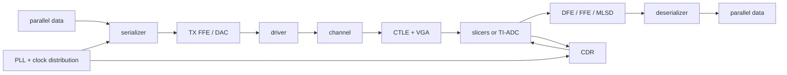
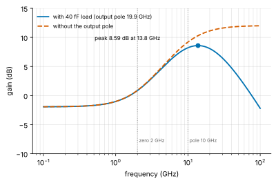
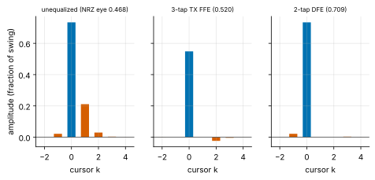

<!-- status: verified -->
# 24-03 · SerDes Architecture and Equalization

| | |
|---|---|
| **Course** | [24 · High-Speed I/O, Signal Integrity and Photonics](../README.md) |
| **University equivalent** | The transceiver-architecture lectures of a graduate high-speed links course: transmitter drivers and feed-forward equalization, CTLE design, decision-feedback equalization and its timing, equalizer adaptation, clock-and-data recovery and clocking (Palermo, Texas A&M ECEN 720 lecture notes; Razavi, *Design of Integrated Circuits for Optical Communications*, chapters on CDR and equalization; Dally & Poulton, *Digital Systems Engineering*, chapters on signalling and timing) |
| **Prerequisites** | [24-02](24-02-eye-diagrams-jitter-ber.md) (cursors, eyes, jitter tolerance), [17-04](../../17-communication-systems/chapters/17-04-baseband-digital-transmission.md) (ISI, zero-forcing equalizers, NRZ against PAM4), [12-01](../../12-electronics-2/chapters/12-01-differential-pairs.md) (differential pairs and CML), [11-08](../../11-signals-and-systems/chapters/11-08-laplace-transform-and-system-functions.md) (poles, zeros and the reference CTLE), [20-10](../../20-analog-and-mixed-signal-ic-design/chapters/20-10-plls-and-jitter.md) (PLLs) |
| **Estimated study hours** | 8 |
| **Last verified** | 2026-11-25 |

**Learning objectives.** After this chapter you can:

1. Draw a SerDes transceiver and compute its symbol rate, clock frequencies, interleaving factors and driver power.
2. Design a zero-forcing transmitter FFE under a peak-swing constraint and compute the equalized eye.
3. Derive a source-degenerated CTLE's zero, poles and peaking, and explain what limits its boost.
4. Explain how a DFE cancels post-cursor ISI, compute its first-tap timing budget and its error-propagation probability, and describe sign-sign LMS adaptation.
5. Analyse a CDR's response to frequency offset for first- and second-order loops, including a bang-bang detector's jitter-dependent gain and slew limit.
6. Estimate energy per bit and SerDes power at the system level, and judge published pJ/b and reach claims.

## 1. Big picture

A **SerDes** (serializer–deserializer) turns a wide, slow parallel bus inside a chip into one or a few fast serial lanes, carries them across a lossy channel, and turns them back. It is the circuit that 24-01 and 24-02 have been describing from the outside: the thing that has to open the eye. Every chip that talks to another chip at more than a few gigabits per second contains one, and in an AI accelerator, a network switch or an optical module they can occupy a large fraction of the die edge and the power budget.

- **Products:** PCIe and CXL lanes in CPUs, GPUs and SSDs (24-05); Ethernet SerDes in switches and NICs; chip-to-module links to optical transceivers (24-08); die-to-die links (24-06) are their short-reach cousins.
- **The job:** equalize 30 to 55 dB of loss at 200 Gb/s per lane, recover the clock from the data, and do it for 2 to 3 pJ per bit of analog power (§9).
- **The architecture shift:** through 50 Gb/s per lane most SerDes used analog equalizers and slicers. At 100 and 200 Gb/s long-reach SerDes digitize the signal with a time-interleaved ADC and equalize in DSP (24-04). The building blocks of this chapter survive in both.
- **Why it matters commercially:** SerDes IP is licensed separately, its power sets how many lanes a switch can carry, and its reach decides whether a rack needs copper or optics.

## 2. Intuition first

A lossy channel is a low-pass filter: it lets the slow parts of the signal through and smears the fast parts into neighbouring symbols. Equalization puts the high frequencies back, and there are three places to do it:

- **Before the channel (transmitter FFE):** shape each transition so that what arrives is sharper. The transmitter cannot exceed its peak swing, so it can only *attenuate the low frequencies* relative to the transitions.
- **At the receiver input (CTLE):** an analog filter with a zero below its poles that boosts the high frequencies, along with the noise and crosstalk that came with them.
- **After the decision (DFE):** once a symbol has been decided, its trailing ISI is known and can simply be subtracted from the next samples, with no noise boost, but only if the decision was right.

A clock-and-data-recovery loop then places the sampling instant in the middle of the opened eye and keeps it there as the transmitter's clock drifts.

**Analogy and its limits.** Think of reconciling a trading account in which each trade settles partly today and partly over the next few days. The FFE is the counterparty sending pre-adjusted amounts; the CTLE is a rule of thumb applied to the raw ledger, which also amplifies its errors; the DFE subtracts the known tails of trades you have already confirmed. Where it breaks down: a reconciler can go back and fix a wrong entry, but a DFE cannot. A wrong decision feeds a wrong correction into the next symbol, which is how errors come in bursts (§3.5).

## 3. Theory

### 3.1 Anatomy of a transceiver

**Transmitter.** A serializer multiplexes a parallel word (64, 128 or 256 bits) through a tree of 2:1 stages up to the symbol rate. Only the last stages run fast, so most of the serializer works at a fraction of the rate. The final stage drives a **feed-forward equalizer** (FFE), now usually built as a segmented driver or a current-steering DAC (a 7-bit DAC at 1/8 rate in one 224 Gb/s design [1]), and the driver launches the signal into the package and channel.

**Receiver.** On-die termination matches the channel. An **analog front end** (AFE) of CTLE and variable-gain amplifier (VGA) conditions the signal. Then either a bank of slicers (comparators) decides each symbol directly, with a DFE correcting post-cursors, or a **time-interleaved ADC** digitizes the signal for a DSP equalizer. The **CDR** adjusts the sampling phase; the deserializer assembles parallel words.

**Clocking and interleaving.** No CMOS flip-flop toggles reliably at 53 GHz, so receivers sample with several clock phases at a fraction of the symbol rate. A **half-rate** receiver uses two clock phases 180° apart at $f_{baud}/2$; a **quarter-rate** one uses four phases 90° apart at $f_{baud}/4$. In general, with $N$ phases,

$$
f_{clk} = \frac{f_{baud}}{N}, \qquad \text{phase spacing} = \frac{360°}{N} = 1\ \text{UI} .
$$

A phase error between clock phases therefore becomes a timing error of the samples they take: at quarter rate, 1° of quadrature error is UI/90 (Example 24-03.1). This deterministic error is part of the DJ budgets of 24-02. ADC-based receivers interleave much further: a 64-way time-interleaved ADC has 64 sub-ADCs, each sampling at $f_{baud}/64$ [R-235].

### 3.2 The driver: current mode against voltage mode

Two driver styles dominate.

A **current-mode logic** (CML) driver (12-01; Figure 1(b)) steers a tail current $I$ to one side of a differential pair whose drains have 50 Ω pull-up resistors. For the differential signal, each output sees its 50 Ω pull-up in parallel with the 50 Ω line, 25 Ω in all. Steering $I$ fully to one side gives a differential current of $\pm I/2$ per side, so each side moves by $\pm 25I/2$ and the differential voltage swings between $+25I$ and $-25I$:

$$
V_{pp,diff} = 50\ \Omega \times I, \qquad P_{CML} = V_{DD}\,I = \frac{V_{DD}V_{pp,diff}}{50\ \Omega} .
$$

A **voltage-mode** or **source-series-terminated** (SST) driver (Figure 1(c)) connects each output to a supply $V_{reg}$ or to ground through a switch whose on-resistance plus series resistor makes 50 Ω. The current path runs from $V_{reg}$ through 50 Ω, the line, the receiver's 100 Ω differential termination, the other line and 50 Ω to ground: 200 Ω in all. The current is $V_{reg}/200\ \Omega$ and the termination sees $\pm V_{reg}/2$, so

$$
V_{pp,diff} = V_{reg}, \qquad P_{SST} = \frac{V_{reg}^2}{200\ \Omega} .
$$

Supplying $V_{reg}$ from $V_{DD}$ through a linear regulator costs $V_{DD}\times V_{reg}/200\ \Omega$, exactly a quarter of the CML driver's power for the same swing. The CML driver wastes power because half its current flows in its own termination and because the tail current flows whether or not the line needs it. Voltage-mode drivers took over at lower rates for this reason. At 100 Gb/s and above, the DAC-based drivers needed for fine FFE taps and PAM4 linearity have brought current-steering structures back in some designs [1]; the choice depends on the required linearity, swing and supply.

*Figure 1. (a) The CTLE's differential half-circuit (§3.4). (b) A CML driver: the tail current $I$ is steered to one 50 Ω pull-up, so half of it flows in the driver's own termination. (c) One side of an SST driver: the output switches between $V_{reg}$ and ground through a segment of about 50 Ω into the line's 50 Ω termination.*

### 3.3 Transmitter feed-forward equalization

The transmitter FFE sends, for symbol $n$,

$$
x_n = \sum_{j}c_ja_{n-j} ,
$$

with a few taps: one or two pre-cursor taps ($j < 0$), the main tap $c_0$ and one or more post-cursor taps. The channel's cursors $h_k$ (24-02) then combine with the taps by convolution, so the received cursors are

$$
g_k = \sum_jc_jh_{k-j} .
$$

**The peak-swing constraint.** The driver's largest output is $\sum_j\lvert c_j\rvert$ times the full-swing amplitude, so the taps are normalized to

$$
\sum_j\lvert c_j\rvert = 1 .
$$

For a channel that needs high-frequency boost, the pre- and post-cursor taps are negative. A long run of identical symbols then produces $\sum_jc_j < 1$, while an alternating pattern produces $\sum_j\lvert c_j\rvert = 1$. The FFE's DC gain is $\sum_jc_j$ and its gain at the Nyquist frequency is $\sum_j(-1)^jc_j = 1$: it equalizes by **de-emphasis**, lowering the low-frequency level rather than raising the high-frequency one. The ratio $1/\sum_jc_j$, in dB, is the de-emphasis.

**Zero-forcing design.** With three taps, choose $c_{-1}$, $c_0$ and $c_1$ so that $g_{-1} = 0$ and $g_1 = 0$, subject to the peak constraint. That is three linear equations:

$$
\begin{aligned}
c_{-1}h_0 + c_0h_{-1} + c_1h_{-2} &= 0 , \\
c_{-1}h_2 + c_0h_1 + c_1h_0 &= 0 , \\
-c_{-1} + c_0 - c_1 &= 1 ,
\end{aligned}
$$

the last written for negative outer taps. Its weakness is visible in the result: the main cursor $g_0$ falls well below the unequalized $h_0$, because about a quarter of the swing is spent cancelling ISI (Example 24-03.3). A transmitter FFE never amplifies noise, since it acts before the noise is added, but it shrinks the signal, which for a noise-limited link is equivalent.

### 3.4 The continuous-time linear equalizer

The standard CTLE is a differential pair with **source degeneration**: a resistor $R_S$ and a capacitor $C_S$ in parallel between the two sources (Figure 1(a) shows its half-circuit). In the differential half-circuit the source sees $R_S/2$ in parallel with $2C_S$ to ground:

$$
Z_S(s) = \frac{R_S/2}{1 + sR_SC_S} .
$$

A degenerated common-source stage with transconductance $g_m$ and drain load $R_D$ has gain $-g_mR_D/(1 + g_mZ_S)$ (10-06). Substituting,

$$
H(s) = -\frac{g_mR_D}{1 + \dfrac{g_mR_S/2}{1 + sR_SC_S}} = -\frac{g_mR_D\,(1 + sR_SC_S)}{1 + g_mR_S/2 + sR_SC_S} .
$$

Reading off the zero and pole:

$$
\omega_z = \frac{1}{R_SC_S}, \qquad \omega_{p1} = \frac{1 + g_mR_S/2}{R_SC_S}, \qquad H(0) = \frac{g_mR_D}{1 + g_mR_S/2}, \qquad H(\infty) = g_mR_D .
$$

At DC the capacitor is open and the resistor degenerates the gain. At high frequency the capacitor shorts the sources and the full $g_mR_D$ returns. The **peaking**, the ratio of high-frequency to DC gain, is

$$
\frac{H(\infty)}{H(0)} = \frac{\omega_{p1}}{\omega_z} = 1 + \frac{g_mR_S}{2} .
$$

Like the transmitter FFE, the CTLE equalizes mostly by losing low-frequency gain: its high-frequency gain is only the undegenerated $g_mR_D$. The load capacitance $C_L$ adds a second pole at $\omega_{p2} = 1/(R_DC_L)$. If $\omega_{p2}$ is not well above $\omega_{p1}$, the boost peaks below the ideal ratio and then rolls off (Example 24-03.4). That is why CTLE design is a fight for bandwidth: inductive peaking, smaller loads and cascaded stages each buy some of it back. The IEEE reference CTLE of 11-08 has exactly this pole–zero form, with a second low-frequency pole–zero pair added [R-189].

The CTLE's cost is that it boosts whatever arrives at high frequency: thermal noise, crosstalk and reflections as well as the signal. A CTLE alone works for moderate loss; at 30 dB and more it is paired with an FFE and DFE, or with an ADC and DSP.

### 3.5 The decision-feedback equalizer

After the receiver has decided symbol $n - k$, it knows $\hat a_{n-k}$, and if the decision is right it knows exactly how much ISI that symbol contributes to the current sample. A **DFE** subtracts it:

$$
z_n = y_n - \sum_{k=1}^{N}b_k\hat a_{n-k}, \qquad b_k = h_k .
$$

With correct decisions the first $N$ post-cursors vanish from $z_n$ without any change to the noise, because the subtracted quantity is noise-free. That is the DFE's great advantage over a linear equalizer. It cannot cancel pre-cursors, because their symbols have not yet been decided.

**The first-tap timing loop.** The correction for $h_1$ needs the decision on the immediately preceding symbol. The decision must be made, fed back and settled at the summing node before the next sampling instant:

$$
t_{clk\text{-}q} + t_{settle} + t_{setup} < 1\ \text{UI} .
$$

At 53 GBd the UI is 18.8 ps, and this loop is often the hardest timing path in the receiver. Interleaving does not help, since the feedback crosses from one interleaved slice to the next within one UI. The usual remedy is **loop unrolling** (speculation): compute both possible answers in advance, with the slicer threshold set to $+h_1$ and to $-h_1$, and let the previous decision select one through a multiplexer. The critical path shrinks to clock-to-q plus the multiplexer plus setup. For PAM-$M$ the cost grows quickly: each of $M - 1$ slicers is replicated for each of $M$ possible previous symbols, $M(M - 1)$ comparators for one tap: 2 for NRZ, 12 for PAM4. That is one reason PAM4 receivers moved to ADCs, with the DFE reduced to a single tap in DSP or replaced by sequence detection [R-507].

**Error propagation.** When a decision is wrong, the DFE subtracts the wrong ISI. For NRZ with a first tap $b_1 = h_1$, the residual on the next sample becomes $2h_1a_{n-1}$ instead of zero. With random data that residual helps or hurts with equal probability, so the probability that an error is followed by another is

$$
P(e_n \mid e_{n-1}) = \tfrac12Q\!\left(\frac{h_0 - 2h_1}{\sigma}\right) + \tfrac12Q\!\left(\frac{h_0 + 2h_1}{\sigma}\right) ,
$$

with σ the noise at the slicer. When $h_1 = h_0/2$ the first term is $\tfrac12Q(0) = 0.25$ whatever the noise. Errors then come in bursts, which is why FEC analyses for DFE receivers carry a burst-continuation probability (03-04, [R-067]), and why precoding (03-04) is used to shorten them.

### 3.6 Adaptation

Channels differ from part to part and drift with temperature, so equalizer coefficients are adapted in the field. The usual criterion is the mean square of the error $e_n = z_n - h_0\hat a_n$ between the equalized sample and its ideal level. For a DFE tap,

$$
\frac{\partial\,e_n^2}{\partial b_k} = -2e_n\hat a_{n-k} ,
$$

so steepest descent gives the **least-mean-squares** (LMS) update $b_k \leftarrow b_k + \mu e_n\hat a_{n-k}$, with a small step size μ. Hardware uses the **sign-sign** version,

$$
b_k \leftarrow b_k + \mu\,\text{sgn}(e_n)\,\text{sgn}(\hat a_{n-k}) ,
$$

which needs only an error slicer (a comparator at the expected level $h_0$) and an up/down counter. At convergence the average update is zero, which happens when the remaining ISI from symbol $n - k$ is zero, that is when $b_k = h_k$. The tap then dithers by ±μ around that value. The lab adapts a two-tap DFE on 24-02's channel this way. The main-cursor level $h_0$ is itself adapted the same way, and the CTLE and FFE settings are adapted from statistics of the same error signal.

### 3.7 Clock and data recovery

The receiver has no clock wire, so it recovers timing from the data's transitions (24-02 §3.7). Two families exist: a **PLL-based CDR** steers a dedicated oscillator, and a **phase-interpolator** (PI) CDR mixes the phases of a shared PLL's clocks to produce any phase under digital control, so many lanes can share one PLL.

**The bang-bang phase detector.** Most CDRs sample each transition's midpoint with an extra "edge" slicer. If the edge sample equals the previous data bit, the edge was sampled before the transition, so the clock is early; if it equals the next bit, the clock is late. This **bang-bang** (Alexander) detector outputs only the sign of the phase error, but random jitter linearizes it. With Gaussian jitter of rms σ (in UI) and a phase error φ, the average output at a transition is

$$
E[\text{sgn}(\varphi + n)] = 1 - 2Q\!\left(\frac{\varphi}{\sigma}\right) \approx \sqrt{\frac{2}{\pi}}\,\frac{\varphi}{\sigma} \quad (\lvert\varphi\rvert \ll \sigma) .
$$

So its gain is about $0.80/\sigma$ per UI, inversely proportional to the jitter, and it saturates at ±1 once the error exceeds a few σ. The CDR's bandwidth therefore depends on the incoming jitter: halve the jitter and the bandwidth doubles. This is one reason a measured jitter tolerance differs from a linear model's prediction.

**Frequency offset and loop order.** The transmitter's and receiver's reference clocks never agree exactly. A fractional frequency offset Δ (100 ppm is Δ = 10⁻⁴) makes the data phase drift at $\Delta \times f_{baud}$ UI per second. A first-order loop, with $d\varphi_c/dt = 2\pi f_c(\varphi_d - \varphi_c)$, follows a ramp only with a lag. In steady state $d\varphi_c/dt$ equals the drift, so

$$
\varphi_d - \varphi_c = \frac{\Delta\,f_{baud}}{2\pi f_c}\ \text{UI} .
$$

A bang-bang loop has a harder limit. If each early/late vote moves the phase by a step δ and votes come at a transition density ρ, the phase can move at most $\rho\delta$ UI per UI. An offset larger than that cannot be tracked at all, and the loop slips cycles. Both problems are solved by a **second-order** loop: an integral path accumulates the votes into a frequency estimate, so in steady state the integral path absorbs the offset and the proportional path handles only jitter. Its jitter transfer then has a little peaking, set by the damping (15-12), which standards limit.

**The clock source.** A PLL (20-10) multiplies the reference clock to the symbol rate or a fraction of it. LC oscillators give the lowest jitter at these frequencies; ring oscillators are smaller but noisier, and are used where jitter budgets allow. The reference-clock limits of 24-02 apply at the PLL's input.

### 3.8 Energy per bit

A SerDes's efficiency is quoted as power divided by bit rate, in pJ/b: 1 pJ/b at 100 Gb/s is 100 mW. Three cautions apply:

- **Analog or total?** Many papers quote "analog" power, which excludes the DSP. Marvell's 128 Gb/s transceiver of 2025 quotes 1.89 pJ/b analog and 4.1 pJ/b in total, a factor of 2.2 [2].
- **At what loss?** Energy per bit rises steeply with the loss to be equalized. A short-reach link needs a fraction of the energy of a long-reach one.
- **Per lane, one direction.** The figure covers a transmitter and receiver pair per lane at the line rate, not the sum of both directions.

Where does the power go? The driver itself is small (§3.2 and Example 24-03.2). Most is in clock generation and distribution, the AFE and the ADC, and, for DSP receivers, the digital equalizer. Long-reach designs have gone from 4.5–6 pJ/b at 112 Gb/s in 2021–22 to about 2–3 pJ/b of analog power at 212–224 Gb/s in 2024–26, while doubling the rate and keeping the equalized loss at 40–55 dB [1], [2], [3]. Process scaling, from 7 and 5 nm to 3 nm, plausibly paid for much of that (the author's inference; the papers do not separate the causes).

### 3.9 NRZ or PAM4, revisited

17-04 compared NRZ and PAM4 before equalization: PAM4 wins when the extra loss NRZ suffers at its doubled Nyquist frequency exceeds PAM4's 9.54 dB eye penalty. Writing the loss at the PAM4 Nyquist frequency as $L$, split into a conductor fraction $\alpha$ growing as $\sqrt f$ and a dielectric fraction $1 - \alpha$ growing as $f$ (24-01), the loss doubles in its dielectric part and grows by $\sqrt2$ in its conductor part when the frequency doubles. NRZ's extra loss is

$$
L\left[\alpha(\sqrt2 - 1) + (1 - \alpha)\right] ,
$$

so PAM4 wins once

$$
L > \frac{9.54\ \text{dB}}{\alpha(\sqrt2 - 1) + 1 - \alpha} .
$$

The break-even loss runs from 9.54 dB for a purely dielectric channel to 23.0 dB for a purely conductor-limited one. Every 100 and 200 Gb/s electrical standard has channels far beyond this, which is why all use PAM4 [R-234]. The heuristic ignores PAM4's other costs, which this chapter has met one by one: residual ISI that does not shrink with the eye (24-02 §3.1), three thresholds to keep aligned, a 12-comparator unrolled DFE tap, and the linearity that pushes the transmitter toward a DAC and the receiver toward an ADC.

> **Going deeper — why "loss at Nyquist" is a proxy.** After ideal equalization the eye is limited by the noise the equalizer amplifies, and for a linear equalizer that enhancement grows roughly with the loss it removes. The loss at the Nyquist frequency is a convenient single number for that, but the full answer depends on the whole channel response, which is why standards qualify channels with COM (24-02 §3.9) rather than loss alone.

## 4. Worked examples

### Example 24-03.1 · Rates, clocks and interleaving (tier A)

**Setup.** A 106.25 Gb/s PAM4 lane uses a quarter-rate clock, a 64-way time-interleaved ADC and a 256-bit parallel interface. Find (a) the symbol rate and UI, (b) the clock frequency, (c) each sub-ADC's sample rate, (d) the parallel word rate and (e) the timing error caused by 1° of quadrature error between the four clock phases.

**Solution.**

- (a) PAM4 carries 2 bits per symbol: **53.125** GBd and UI = **18.82** ps.
- (b) $53.125/4$ = **13.28** GHz.
- (c) $53.125/64$ = **0.830** GS/s.
- (d) $106.25 \times 10^9/256$ = **415.0** MHz.
- (e) Four phases span 360° per 4 UI, so 90° is 1 UI and 1° is $18.82/90$ = **0.209** ps.

**Units check.** GBd/phase count gives GHz; ps per degree. ✓

**Sanity check.** The fastest clock in the receiver is a quarter of the symbol rate and each ADC slice runs below 1 GS/s: interleaving converts a speed problem into a matching problem. A 2° phase error already costs over 0.4 ps of deterministic jitter, comparable to 24-02's random-jitter budgets.

### Example 24-03.2 · Driver power: CML against voltage mode (tier B)

**Setup.** A driver must deliver 800 mV peak-to-peak differential into a 100 Ω differential termination, from a 1.0 V supply. Find (a) the CML tail current and power, (b) the SST driver's power if its supply is exactly 0.8 V and (c) if 0.8 V comes from the 1.0 V supply through a linear regulator. (d) Express (a) and (c) in pJ/b at 106.25 Gb/s.

**Solution.**

- (a) $I = 0.8/50$ = **16.0** mA; $P = 1.0 \times 16$ = **16.0** mW.
- (b) $0.8^2/200$ = **3.20** mW.
- (c) The current is $0.8/200$ = 4.0 mA drawn from 1.0 V: **4.00** mW, a quarter of (a).
- (d) $16/106.25$ = **0.151** pJ/b and $4/106.25$ = **0.038** pJ/b.

**Units check.** V/Ω = A; V·A = W; W ÷ (b/s) = J/b. ✓

**Sanity check.** Even the wasteful CML driver is about 0.15 pJ/b, a small part of the 2–3 pJ/b a 200 Gb/s transceiver spends. The driver's swing matters more for the receiver's SNR than its power matters for the budget; the power goes into clocking, the front end and the ADC and DSP.

### Example 24-03.3 · A zero-forcing transmitter FFE (tier B)

**Setup.** Use the cursors of Example 24-02.2 ($h_{-1}$ = 0.02156, $h_0$ = 0.73402, $h_1$ = 0.21088, $h_2$ = 0.02967, $h_3$ = 0.00345, $h_4$ = 0.00037). Find (a) the three zero-forcing taps with $\sum\lvert c_j\rvert = 1$, (b) the equalized main cursor, (c) the remaining ISI and the NRZ and PAM4 eyes at 32 GBd, and (d) the de-emphasis in dB. (e) Compare with a two-tap DFE that cancels $h_1$ and $h_2$, with no FFE.

**Solution.**

- (a) Solving the three equations of §3.3: $c_{-1}$ = **−0.0223**, $c_0$ = **0.7602**, $c_1$ = **−0.2175**.
- (b) $g_0 = c_{-1}h_1 + c_0h_0 + c_1h_{-1}$ = **0.5486**, down from 0.734.
- (c) The largest residuals are $g_2$ = −0.0234 and $g_3$ = −0.0038, and $\sum\lvert g_k\rvert$ = **0.0283**. NRZ eye: $0.5486 - 0.0283$ = **0.520**, against 0.468 unequalized. PAM4 eye: $0.5486/3 - 0.0283$ = **0.155**, against −0.021: the FFE opens the closed PAM4 eye.
- (d) $\sum c_j$ = 0.5204, so the de-emphasis is $20\log_{10}(1/0.5204)$ = **5.67** dB.
- (e) The DFE leaves $h_{-1}$, $h_3$ and $h_4$: NRZ eye $0.734 - 0.0254$ = **0.709**, PAM4 eye **0.219**.

**Units check.** Taps and cursors are dimensionless fractions of the swing. ✓

**Sanity check.** The FFE removes ISI by spending swing: its NRZ eye improves only 11%, because the main cursor falls by a quarter. The DFE keeps the full main cursor, which is why it does so much better here, but it has to be right about every decision it feeds back.

### Example 24-03.4 · Designing a CTLE (tier B)

**Setup.** A source-degenerated CTLE has $g_m$ = 20 mS, $R_D$ = 200 Ω, $R_S$ = 400 Ω and a load of 40 fF; the zero is to sit at 2 GHz. Find (a) $C_S$, (b) the DC and high-frequency gains, (c) the ideal peaking, (d) the poles, and (e) the actual peak gain, its frequency and its boost over DC. (f) What is the boost at 16 GHz?

**Solution.**

- (a) $C_S = 1/(2\pi \times 400 \times 2 \times 10^9)$ = **199** fF.
- (b) $g_mR_S/2$ = 4, so $H(0) = 4/5$ = **0.80** (**−1.94** dB) and $H(\infty) = g_mR_D$ = **4.0** (**12.04** dB).
- (c) $1 + 4$ = 5, or **13.98** dB.
- (d) $f_{p1} = 5f_z$ = **10.0** GHz and $f_{p2} = 1/(2\pi \times 200 \times 40\ \text{fF})$ = **19.9** GHz.
- (e) Evaluating $\lvert H(j2\pi f)\rvert$ numerically: the peak is **2.69** (**8.59** dB) at **13.8** GHz, a boost of **10.53** dB over DC.
- (f) $\lvert H\rvert$ = 2.664 at 16 GHz, a boost of **10.45** dB.

**Units check.** S × Ω is dimensionless; 1/(Ω·F) is s⁻¹. ✓

**Sanity check.** The output pole at 19.9 GHz, only twice $f_{p1}$, costs 3.4 dB of the ideal 14 dB of peaking. Lowering the load capacitance or adding inductive peaking would recover it. The lab confirms all of this in ngspice.

### Example 24-03.5 · The DFE's first-tap loop (tier B)

**Setup.** A 53.125 GBd NRZ-style DFE slice has a slicer clock-to-q of 8 ps, a summer settling time of 7 ps and a setup time of 5 ps; a multiplexer adds 4 ps (all assumed). (a) Does the direct feedback loop close in one UI? (b) With loop unrolling, what is the slack? (c) How many comparators does one unrolled tap need for NRZ and for PAM4?

**Solution.**

- (a) $8 + 7 + 5$ = **20** ps, more than the **18.82** ps UI: it fails.
- (b) $8 + 4 + 5$ = **17** ps, leaving **1.82** ps of slack.
- (c) NRZ: $2 \times 1$ = **2**. PAM4: $4 \times 3$ = **12**.

**Units check.** ps throughout. ✓

**Sanity check.** Unrolling trades the summer's analog settling for a digital multiplexer, at the cost of doubling (NRZ, 1 → 2) or quadrupling (PAM4, 3 → 12) the slicers and their clock load. Unrolling a second tap multiplies the count by $M$ again (NRZ 4, PAM4 48), which is why analog DFEs unroll only the first tap.

### Example 24-03.6 · Error propagation in a DFE (tier C)

**Setup.** An NRZ receiver with a one-tap DFE is set so that its error rate without propagation is 10⁻⁶, that is $h_0/\sigma = Q^{-1}(10^{-6})$. Find (a) σ for $h_0$ = 1, (b) the probability that an error is followed by another, and (c) the mean burst length, for $h_1 = h_0/2$ and for $h_1 = h_0/4$.

**Solution.**

- (a) $\sigma = 1/4.753$ = **0.2104**.
- (b) For $h_1 = 0.5$: $\tfrac12Q(0) + \tfrac12Q(2/0.2104)$ = **0.25**. For $h_1 = 0.25$: $\tfrac12Q(0.5/0.2104) + \tfrac12Q(1.5/0.2104)$ = **0.0044**.
- (c) Each further error occurs with probability $p$, so burst lengths are geometric with mean $1/(1 - p)$: **1.33** and **1.004**.

**Units check.** Q's argument is a ratio of voltages. ✓

**Sanity check.** A large first post-cursor turns a quarter of all errors into longer bursts; a small one hardly matters. FEC analyses for 200 Gb/s links assume burst-continuation probabilities as high as 0.75 [R-067]. That is the PAM4 limit for a first tap above $h_0/2$: after an error, inner symbols (half of all symbols) always err and outer ones half the time, $\tfrac12 + \tfrac14$. In NRZ a single tap cannot push the probability above 0.5.

### Example 24-03.7 · A CDR against frequency offset (tier B)

**Setup.** At 53.125 GBd the transmitter's clock is 100 ppm faster than the receiver's. (a) What phase drift does that cause in UI per second? (b) For a linear first-order CDR with $f_c$ = 4 MHz, what is the steady-state phase error? A bang-bang CDR instead moves its phase by $2^{-14}$ UI per vote, with NRZ transition density 0.5 and 0.02 UI rms of jitter. Find (c) its linearized detector gain, (d) its loop bandwidth and (e) the largest offset its proportional path alone can track.

**Solution.**

- (a) $10^{-4} \times 53.125 \times 10^9$ = **5.31** × 10⁶ UI/s.
- (b) $5.3125 \times 10^6/(2\pi \times 4 \times 10^6)$ = **0.211** UI, a fifth of the eye spent on tracking.
- (c) $\sqrt{2/\pi}/0.02$ = **39.9** per UI.
- (d) Per symbol, the loop corrects a fraction $G = 2^{-14} \times 0.5 \times 39.9 = 1.22 \times 10^{-3}$ of the error, so $f_c = Gf_{baud}/2\pi$ = **10.3** MHz.
- (e) $\rho\delta = 0.5 \times 2^{-14}$ = 3.05 × 10⁻⁵ UI per UI, that is **30.5** ppm. The 100 ppm offset exceeds it: the loop slips cycles.

**Units check.** ppm × Bd = UI/s; (UI/s)/(rad/s) = UI. ✓

**Sanity check.** The linear analysis says a 10 MHz loop would hold the error to 0.08 UI, but the bang-bang loop cannot even slew fast enough: the linear model holds only while the error stays within a few σ of zero. An integral path that learns the 100 ppm offset removes both problems, which is why every practical CDR is at least second order.

### Example 24-03.8 · Energy per bit at system scale (tier B)

**Setup.** (a) What does one 224 Gb/s lane at 3 pJ/b of analog power dissipate? (b) Marvell's 128 Gb/s transceiver spends 1.89 pJ/b analog and 4.1 pJ/b in total [2]; what multiple of analog power is the total? (c) A switch chip has 51.2 Tb/s of SerDes bandwidth. What is its SerDes power at 3 pJ/b and at 4.5 pJ/b? (d) Compare per-lane power at 112.5 Gb/s and 4.5 pJ/b [3] with 212.5 Gb/s and 2.05 pJ/b of analog power [2].

**Solution.**

- (a) $224 \times 10^9 \times 3 \times 10^{-12}$ = **0.672** W.
- (b) $4.1/1.89$ = **2.2** times.
- (c) $51.2 \times 10^{12} \times 3 \times 10^{-12}$ = **154** W; at 4.5 pJ/b, **230** W.
- (d) **0.506** W and **0.436** W. The comparison is indicative only: the 4.5 pJ/b figure's boundary is not stated in its abstract, while 2.05 pJ/b is analog only. At (b)'s total-to-analog ratio the newer lane would draw about **0.95** W in total.

**Units check.** b/s × J/b = W. ✓

**Sanity check.** SerDes alone can account for a large share of a switch chip's power, so each tenth of a pJ/b is worth about 5 W per 51.2 Tb/s. That is why efficiency, not only reach, decides SerDes IP selections, and why the industry is pursuing linear optics and co-packaging (24-09) to remove some of these lanes.

<!-- answer-key -->

| ID | Quantity | Value | Unit |
|---|---|---|---|
| Ex 24-03.1a | symbol rate | 53.125 | GBd |
| Ex 24-03.1a1 | UI | 18.82 | ps |
| Ex 24-03.1b | quarter-rate clock | 13.28 | GHz |
| Ex 24-03.1c | sub-ADC sample rate | 0.830 | GS/s |
| Ex 24-03.1d | parallel word rate | 415.0 | MHz |
| Ex 24-03.1e | timing error per degree | 0.209 | ps |
| Ex 24-03.1f | timing error for 2 degrees | 0.4 | ps |
| Ex 24-03.2a | CML tail current | 16.0 | mA |
| Ex 24-03.2a1 | CML power | 16.0 | mW |
| Ex 24-03.2b | SST power at 0.8 V | 3.20 | mW |
| Ex 24-03.2c0 | SST current | 4.0 | mA |
| Ex 24-03.2c | SST power through a regulator | 4.00 | mW |
| Ex 24-03.2d | CML energy per bit | 0.151 | pJ/b |
| Ex 24-03.2d1 | SST energy per bit | 0.038 | pJ/b |
| Ex 24-03.3a | pre-cursor tap | -0.0223 | |
| Ex 24-03.3a1 | main tap | 0.7602 | |
| Ex 24-03.3a2 | post-cursor tap | -0.2175 | |
| Ex 24-03.3b | equalized main cursor | 0.5486 | |
| Ex 24-03.3c0 | residual second post-cursor | -0.0234 | |
| Ex 24-03.3c00 | residual third post-cursor | -0.0038 | |
| Ex 24-03.3c | residual ISI | 0.0283 | |
| Ex 24-03.3c1 | NRZ eye with FFE | 0.520 | |
| Ex 24-03.3c3 | NRZ eye unequalized | 0.468 | |
| Ex 24-03.3c4 | PAM4 eye unequalized | -0.021 | |
| Ex 24-03.3b1 | unequalized main cursor | 0.734 | |
| Ex 24-03.3c2 | PAM4 eye with FFE | 0.155 | |
| Ex 24-03.3d0 | sum of taps | 0.5204 | |
| Ex 24-03.3d | de-emphasis | 5.67 | dB |
| Ex 24-03.3e0 | ISI left by the DFE | 0.0254 | |
| Ex 24-03.3e | NRZ eye with DFE | 0.709 | |
| Ex 24-03.3e1 | PAM4 eye with DFE | 0.219 | |
| Ex 24-03.3f | NRZ eye improvement from FFE | 11 | % |
| Ex 24-03.4a | degeneration capacitor | 199 | fF |
| Ex 24-03.4b | DC gain | 0.80 | |
| Ex 24-03.4b1 | DC gain in dB | -1.94 | dB |
| Ex 24-03.4b2 | high-frequency gain | 4.0 | |
| Ex 24-03.4b3 | high-frequency gain in dB | 12.04 | dB |
| Ex 24-03.4c | ideal peaking | 13.98 | dB |
| Ex 24-03.4d | first pole | 10.0 | GHz |
| Ex 24-03.4d1 | output pole | 19.9 | GHz |
| Ex 24-03.4e | peak gain | 2.69 | |
| Ex 24-03.4e1 | peak gain in dB | 8.59 | dB |
| Ex 24-03.4e2 | peak frequency | 13.8 | GHz |
| Ex 24-03.4e3 | peak boost over DC | 10.53 | dB |
| Ex 24-03.4f0 | gain at 16 GHz | 2.664 | |
| Ex 24-03.4f | boost at 16 GHz | 10.45 | dB |
| Ex 24-03.4g | peaking lost to the output pole | 3.4 | dB |
| Ex 24-03.4g1 | ideal peaking, 2 s.f. | 14 | dB |
| Ex 24-03.5a | direct loop delay | 20 | ps |
| Ex 24-03.5a1 | UI | 18.82 | ps |
| Ex 24-03.5b | unrolled loop delay | 17 | ps |
| Ex 24-03.5b1 | slack | 1.82 | ps |
| Ex 24-03.5c | NRZ comparators per unrolled tap | 2 | |
| Ex 24-03.5c1 | PAM4 comparators per unrolled tap | 12 | |
| Ex 24-03.6a | noise sigma | 0.2104 | |
| Ex 24-03.6b | continuation probability, h1 = h0/2 | 0.25 | |
| Ex 24-03.6b1 | continuation probability, h1 = h0/4 | 0.0044 | |
| Ex 24-03.6c | mean burst, h1 = h0/2 | 1.33 | |
| Ex 24-03.6c1 | mean burst, h1 = h0/4 | 1.004 | |
| Ex 24-03.7a | phase drift | 5.31e6 | UI/s |
| Ex 24-03.7b | first-order steady error | 0.211 | UI |
| Ex 24-03.7c | bang-bang detector gain | 39.9 | 1/UI |
| Ex 24-03.7d0 | correction per symbol | 1.22e-3 | |
| Ex 24-03.7d | bang-bang loop bandwidth | 10.3 | MHz |
| Ex 24-03.7e0 | slew limit | 3.05e-5 | UI/UI |
| Ex 24-03.7e | slew limit in ppm | 30.5 | ppm |
| Ex 24-03.7f | linear error at 10.3 MHz | 0.08 | UI |
| Ex 24-03.8a | lane power at 224 Gb/s | 0.672 | W |
| Ex 24-03.8b | total over analog | 2.2 | |
| Ex 24-03.8c | switch SerDes power at 3 pJ/b | 154 | W |
| Ex 24-03.8c1 | switch SerDes power at 4.5 pJ/b | 230 | W |
| Ex 24-03.8d | lane power at 112.5 Gb/s | 0.506 | W |
| Ex 24-03.8d1 | lane power at 212.5 Gb/s | 0.436 | W |
| Ex 24-03.8d2 | lane total at the (b) ratio | 0.95 | W |
| Ex 24-03.8e | power per 0.1 pJ/b at 51.2 Tb/s | 5 | W |
| Txt 24-03.a | CML-to-SST power ratio | 4 | |
| Txt 24-03.b | bang-bang gain coefficient | 0.80 | |
| Txt 24-03.c | break-even loss, dielectric | 9.54 | dB |
| Txt 24-03.d | break-even loss, conductor | 23.0 | dB |
| Txt 24-03.e | UI at 53.125 GBd | 18.8 | ps |
| Txt 24-03.f | 1 pJ/b at 100 Gb/s | 100 | mW |
| Txt 24-03.g | CTLE boost at its peak, 3 s.f. | 10.5 | dB |

## 5. Simulate it

The lab is [labs/24-03-lab/](../labs/24-03-lab/README.md). `ctle.cir` is the small-signal half-circuit of Example 24-03.4 in ngspice; `serdes.py` designs FFEs, applies DFEs, simulates DFE error propagation, adapts DFE taps by sign-sign LMS and simulates CDR loops; the notebook ties them together.

*Figure 2. The CTLE of Example 24-03.4. Without the output pole (dashed) the gain rises from 0.8 at DC and approaches 4 well above 10 GHz, 14 dB of peaking; the 40 fF load's pole at 19.9 GHz (solid) cuts the peak to 10.5 dB of boost at 13.8 GHz.*

*Figure 3. Cursors of 24-02's channel (left), after the zero-forcing three-tap FFE (centre) and after a two-tap DFE (right). The FFE cancels the first pre- and post-cursor but lowers the main cursor; the DFE keeps it.*

**Predict, then run:**

1. *Predict* the CTLE's DC gain, peak gain and peak frequency, then run `ngspice -b ctle.cir`.
2. *Predict* the three FFE taps and the equalized NRZ eye for 24-02's channel, then compute them.
3. Simulate a one-tap DFE at an error rate near 10⁻³ with $h_1 = h_0/2$ and *predict* the fraction of errors that follow another error.
4. Start a two-tap DFE at zero and adapt it by sign-sign LMS. *Predict* where the taps settle.
5. Run a proportional-only bang-bang CDR and a proportional-plus-integral one against a 100 ppm offset and *predict* which keeps lock.

## 6. Engineering tradeoffs

| Knob | Improves | Costs | Typical decision owner |
|---|---|---|---|
| More TX FFE taps | Pre- and post-cursor cancellation without noise boost | Swing (main cursor), DAC resolution, driver power | SerDes architect |
| More CTLE peaking | High-frequency boost at low power | Noise and crosstalk enhancement, bandwidth, linearity | Analog designer |
| More DFE taps | Post-cursor ISI removed without noise boost | Error propagation, first-tap timing, unrolled comparators (12 per PAM4 tap) | SerDes architect |
| ADC/DSP receiver instead of slicers | Long FFEs, MLSD, reflection cancellation, flexibility | ADC power, latency, area | SerDes architect, product line |
| Voltage-mode driver | A quarter of CML's driver power | Swing limited by supply, harder linearity at high rate | Circuit designer |
| Higher CDR bandwidth | Jitter tolerance, faster lock | Passes more jitter, pattern sensitivity | SerDes designer, standards body |
| Quarter-rate or wider interleaving | Slower clocks and circuits | Phase matching, calibration, clock power | Clocking architect |

## 7. Numbers to know

| Quantity | Value | Source |
|---|---|---|
| CML against SST driver power, same swing and supply | 4 : 1 | §3.2 |
| Comparators per unrolled DFE tap | NRZ 2; PAM4 12 | §3.5 |
| Bang-bang detector gain | about 0.8/σ per UI | §3.7 |
| PAM4 break-even loss at its Nyquist frequency | 9.5–23 dB (dielectric to conductor) | §3.9 |
| Long-reach SerDes, 2021–22 | 112 Gb/s, >40–50 dB, 4.5–6 pJ/b (boundary not stated in the abstracts) | [3] |
| Long-reach SerDes, 2024–26 | 212–224 Gb/s, 40–55 dB, about 2–3 pJ/b analog | [1], [2] |
| DSP's share of a DSP SerDes | about half (4.1 against 1.89 pJ/b at 128 Gb/s) | [2] |
| Time-interleaved ADCs | 6–7 bits, 64- to 128-way | [1], [4], [R-235] |

## 8. Common mistakes

- **Thinking a TX FFE amplifies high frequencies.** It cannot exceed its peak swing; it lowers the low frequencies.
- **Quoting CTLE peaking as the zero-to-pole ratio.** Parasitic poles take a large part of it, as Example 24-03.4 shows.
- **Forgetting that a DFE cannot touch pre-cursors.** Pre-cursors need an FFE tap before the decision.
- **Treating DFE errors as independent.** One wrong decision changes the next sample's ISI.
- **Using a linear CDR model for a bang-bang loop with a large error.** The detector saturates and the loop can slip cycles.
- **Comparing pJ/b figures without asking what they include.** Analog only or with DSP, at what loss, and at what BER.

## 9. Practitioner lens

**State of the art (as of Nov 2026).** All figures are as stated in peer-reviewed abstracts [Established for the abstract statements; the vendors' own "lowest power" or "longest reach" descriptions are claims].

- *224 Gb/s, 3 nm (Synopsys).* ISSCC 2024 and JSSC 2025: 224 Gb/s, BER 10⁻⁶ over a 40 dB channel at 3 pJ/b of analog power. Its transmitter is a 7-bit current-mode DAC at 1/8 rate with 55 fs rms random jitter; its receiver an inverter-based AFE with 20 dB of peaking and a 7-bit time-interleaved ADC; a shared 14 GHz all-digital PLL clocks 4 lanes of 0.5 mm² each; the DSP combines MLSD and a DFE. A 2025 follow-up reports post-FEC error-free operation at 42 dB [1].
- *212.5 Gb/s DSP transceivers (Marvell, MediaTek).* Marvell, ISSCC 2025, 5 nm: more than 46 dB at 2.2 pJ/b analog. Marvell, VLSI 2026, 3 nm: pre-FEC BER 2 × 10⁻⁷ at 54.7 dB bump-to-bump at 2.05 pJ/b analog per lane. MediaTek, ISSCC 2025, 4 nm: BER 2.5 × 10⁻⁶ beyond 50 dB, with an extended FFE, floating taps for reflections and MLSD. Marvell, VLSI 2025, 3 nm, 128 Gb/s for PCIe 7.0 rates: more than 45 dB at BER below 2 × 10⁻⁸, 1.89 pJ/b analog and 4.1 pJ/b total [2].
- *2021–22 baselines.* 112 Gb/s ADC/DSP transceivers reached more than 41.5 dB (Inphi, 7 nm) and more than 50 dB at 4.5 pJ/b (Marvell, 5 nm); Huawei reported 45 dB at better than 6 pJ/b. Inphi's abstract notes that 8–10 dB of the budget is package loss [3].
- *Architecture.* Marvell's 2024 optical-DSP transceiver uses a 4-way interleaved DAC with a linear driver and a 128-way interleaved ADC, at 2.69 pJ/b of analog power including a per-lane PLL; Intel's 3 nm design supports 40 dB with a hybrid CTLE and a one-stage transmitter [4], [R-235]. The common chain is TX FFE, CTLE, TI-ADC, long FFE with floating taps, one DFE tap or MLSD, then FEC, the same structure as 802.3dj's reference receiver (24-02 §3.9).

**Why it matters commercially.** SerDes is a make-or-license decision. Merchant switch and accelerator vendors with leading SerDes tend to treat it as a moat (the author's assessment); others license it from IP vendors, and the per-lane pJ/b and reach decide how many lanes fit a power envelope and whether copper reaches the next rack. When a company claims a SerDes advantage, its value depends on how long it lasts: each generation resets the race at twice the rate.

**Marketing vs Reality.**

- *"2 pJ/b SerDes."* Analog only, or with DSP? At what loss, and bump-to-bump or ball-to-ball? DSP can double the total.
- *"Equalizes 55 dB."* At what BER: 10⁻⁶, 2 × 10⁻⁷, or post-FEC? A few dB of loss trade for an order of magnitude of BER.
- *"Error-free."* Post-FEC, over how many bits (24-02 §3.8)?
- *"Works with linear optics."* Which optics, which host channel, and with whose DSP providing the equalization (24-09)?

**Questions for engineering leaders.**

1. **"What is your pJ/b, analog and total, at your maximum-loss channel and target BER?"** *Strong:* both numbers, the loss definition and the BER. *Evasive:* one number without conditions.
2. **"How is your equalization split among TX FFE, CTLE, ADC/DSP FFE, DFE and MLSD, and why?"** *Strong:* explains noise enhancement, error propagation and latency. *Evasive:* "the DSP handles it."
3. **"What limits your CDR: bandwidth, jitter tolerance or frequency offset, and how did you verify it against the mask?"** *Strong:* measured JTOL with margin, loop order and SSC handling. *Evasive:* simulation only.
4. **"What does a process shrink buy you, and what does it not?"** *Strong:* DSP and digital power scale; ADC, AFE and clocking do not scale as well (20-12). *Evasive:* "everything scales."
5. **"How do you calibrate the time-interleaved ADC, and what does it cost in power and start-up time?"** *Strong:* background calibration of offset, gain and timing skew. *Evasive:* no mention.

## 10. Concept check

**Q1.** Why can a transmitter FFE only de-emphasize, not boost?

Answer

The driver's peak output is fixed, and the taps must satisfy $\sum\lvert c_j\rvert \le 1$. An alternating pattern already uses the full swing; any equalization must therefore reduce the level of slow patterns relative to it.

**Q2.** Where does a source-degenerated CTLE get its peaking?

Answer

From losing gain at low frequency: the degeneration resistor reduces the DC gain by $1 + g_mR_S/2$, and the capacitor removes that degeneration at high frequency, restoring $g_mR_D$. Its high-frequency gain is never more than an undegenerated stage's.

**Q3.** Why does a DFE not enhance noise, and what does it pay instead?

Answer

It subtracts ISI computed from noise-free past decisions, so the noise at the slicer is unchanged. It pays with error propagation (a wrong decision subtracts the wrong ISI) and a one-UI timing loop.

**Q4.** Why does an unrolled PAM4 DFE tap need 12 comparators?

Answer

PAM4 has 3 decision thresholds, and the first-tap correction depends on which of 4 levels the previous symbol had. Precomputing every case needs 3 × 4 comparators.

**Q5.** Why does a bang-bang CDR's bandwidth depend on the incoming jitter?

Answer

The detector outputs only the sign of the phase error. Random jitter smears that sign into an average proportional to the error, with slope about $0.8/\sigma$; less jitter means a steeper slope and so a higher loop gain and bandwidth.

**Q6.** Why is every practical CDR at least second order?

Answer

Transmitter and receiver clocks differ by tens to hundreds of ppm. A first-order loop tracks the resulting phase ramp only with a steady error, and a bang-bang one may not track it at all. An integral path learns the frequency offset and removes the error.

**Q7.** What does the break-even formula of §3.9 say about a channel dominated by conductor loss?

Answer

Conductor loss grows only as $\sqrt f$, so doubling the frequency adds just 41% more loss. PAM4 then needs about 23 dB at its Nyquist frequency before its 9.54 dB penalty is repaid, against 9.54 dB for a dielectric-dominated channel.

Problems: [24-03 problem set](../problems/24-03-problems.md) · Solutions: [24-03 solutions](../solutions/24-03-solutions.md)

## 11. Key terms

[Serializer and deserializer](../../../reference/glossary.md#serializer-and-deserializer) · [Feed-forward equalizer (FFE)](../../../reference/glossary.md#feed-forward-equalizer-ffe) · [De-emphasis](../../../reference/glossary.md#de-emphasis) · [Continuous-time linear equalizer (CTLE)](../../../reference/glossary.md#continuous-time-linear-equalizer-ctle) · [Source degeneration](../../../reference/glossary.md#source-degeneration) · [Decision-feedback equalizer (DFE)](../../../reference/glossary.md#decision-feedback-equalizer-dfe) · [Loop unrolling (DFE)](../../../reference/glossary.md#loop-unrolling-dfe) · [Error propagation](../../../reference/glossary.md#error-propagation) · [Sign-sign LMS](../../../reference/glossary.md#sign-sign-lms) · [Bang-bang phase detector](../../../reference/glossary.md#bang-bang-phase-detector) · [Phase interpolator](../../../reference/glossary.md#phase-interpolator) · [Voltage-mode driver](../../../reference/glossary.md#voltage-mode-driver) · [Current-mode logic (CML)](../../../reference/glossary.md#current-mode-logic-cml) · [Energy per bit](../../../reference/glossary.md#energy-per-bit)

## 12. Connections

- **Previous:** [24-02](24-02-eye-diagrams-jitter-ber.md) defined the cursors, eyes and jitter tolerance this chapter acts on; [17-04](../../17-communication-systems/chapters/17-04-baseband-digital-transmission.md) introduced zero-forcing equalizers and the NRZ–PAM4 heuristic; [12-01](../../12-electronics-2/chapters/12-01-differential-pairs.md) the differential pair; [20-10](../../20-analog-and-mixed-signal-ic-design/chapters/20-10-plls-and-jitter.md) the PLL.
- **Next:** [24-04](24-04-dsp-serdes-and-fec.md) moves the equalizer into DSP after a time-interleaved ADC and adds FEC and MLSD.
- **Used later:** [24-05](24-05-pcie-cxl-ethernet.md) maps these architectures onto standards; [24-06](24-06-d2d-memory-phys-scale-up.md) shows how short reach removes most of the equalization; [24-09](24-09-lpo-and-cpo.md) asks what happens when the optics no longer contain a DSP.

## 13. Further study

- S. Palermo, Texas A&M ECEN 720 *High-Speed Links* lecture notes: transmitter equalization, CTLE, DFE, CDR.
- B. Razavi, *Design of Integrated Circuits for Optical Communications*, 2nd ed., chapters on CDR and equalization.
- W. J. Dally and J. W. Poulton, *Digital Systems Engineering*, chapters on signalling and timing.
- A. Chan Carusone, T. Dickson, S. Palermo, S. Shekhar and M. Mansuri, "Modern Wireline Transceivers," *IEEE JSSC*, 2026, doi:10.1109/JSSC.2025.3642231 (tutorial review, open access; not read here).

## 14. Sources

1. D. Pfaff et al. (Synopsys), "A 224 Gb/s 3 pJ/bit 40 dB Insertion Loss Transceiver in 3-nm FinFET CMOS," *IEEE JSSC* 60(1):9–22, Jan 2025, <https://doi.org/10.1109/JSSC.2024.3466092>; ISSCC 2024 paper 7.3, <https://doi.org/10.1109/ISSCC49657.2024.10454537>; CICC 2025, <https://doi.org/10.1109/CICC63670.2025.10983461> (abstracts read). [R-509]
2. Marvell, ISSCC 2025, <https://doi.org/10.1109/ISSCC49661.2025.10904591>; Marvell, VLSI 2026, <https://doi.org/10.1109/VLSITechnologyandCir65830.2026.11577411>; MediaTek, ISSCC 2025, <https://doi.org/10.1109/ISSCC49661.2025.10904601>; Marvell, VLSI 2025, <https://doi.org/10.23919/VLSITechnologyandCir65189.2025.11074819> (abstracts read). [R-509]
3. Marvell, ISSCC 2022, <https://doi.org/10.1109/ISSCC42614.2022.9731650>; Inphi, ISSCC 2021, <https://doi.org/10.1109/ISSCC42613.2021.9365929>; Huawei, ISSCC 2021, <https://doi.org/10.1109/ISSCC42613.2021.9366030> (abstracts read). [R-510]
4. ISSCC 2024 Session 7 overview, <https://doi.org/10.1109/ISSCC49657.2024.10454506>; A. Khairi et al. (Intel), "Beyond 200-Gb/s PAM4 ADC and DAC-Based Transceiver for Wireline and Linear Optics Applications," *IEEE OJ-SSCS*, 2024, <https://doi.org/10.1109/OJSSCS.2024.3501975> (abstracts read). [R-511]
5. Earlier research-log entries: 802.3dj signalling [R-234]; ADC/DSP receivers [R-235]; the 802.3ck reference CTLE [R-189]; RS(544,514) burst analysis [R-067]; 802.3dj reference receiver [R-507].
