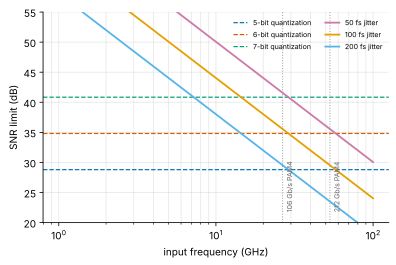
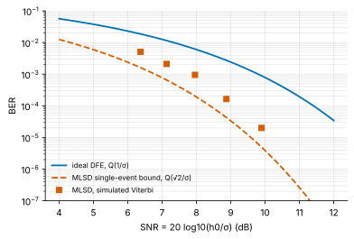

<!-- status: verified -->
# 24-04 · DSP-Based SerDes and FEC

| | |
|---|---|
| **Course** | [24 · High-Speed I/O, Signal Integrity and Photonics](../README.md) |
| **University equivalent** | The ADC-based receiver and link-coding lectures of a graduate high-speed links course: converter requirements for wireline receivers, digital equalization, maximum-likelihood sequence detection, and forward error correction with its latency (Palermo, Texas A&M ECEN 720 lecture notes on ADC-based links; Proakis & Salehi, *Digital Communications*, chapters on equalization and MLSE; Lin & Costello, *Error Control Coding*, on Reed–Solomon and concatenated codes) |
| **Prerequisites** | [24-03](24-03-serdes-architecture.md) (FFE, DFE, error propagation), [20-07](../../20-analog-and-mixed-signal-ic-design/chapters/20-07-nyquist-adcs.md) (time-interleaved ADCs), [17-08](../../17-communication-systems/chapters/17-08-channel-coding.md) (Reed–Solomon codes, the Viterbi algorithm, coding gain), [03-04](../../03-probability-statistics-and-random-variables/chapters/03-04-joint-distributions-and-clt.md) (RS(544,514) failure probability) |
| **Estimated study hours** | 5 |
| **Last verified** | 2026-11-25 |

**Learning objectives.** After this chapter you can:

1. Explain why long-reach SerDes moved from slicers to ADCs and DSP, and what it costs.
2. Size an ADC for a PAM4 receiver from quantization noise, sampling jitter and interleaving skew.
3. Estimate the arithmetic and energy of a digital FFE.
4. Derive the distance gain of maximum-likelihood sequence detection over a DFE for a two-tap channel.
5. Compute FEC coding gain, line rates and latency for Ethernet's RS(544,514) and its concatenated inner code, and compare them with PCIe's flit FEC and retry.

## 1. Big picture

24-03 built a receiver from analog parts: a CTLE, a few slicers and a DFE. At 100 Gb/s per lane and above, every long-reach SerDes instead digitizes the received signal with a time-interleaved ADC and equalizes it in DSP, as a modem does. The ADC and DSP cost power and latency, but they buy long equalizers, cancellation of distant reflections, sequence detection and adaptation that analog circuits cannot match. Forward error correction then allows the raw error rate to be orders of magnitude worse than the delivered one.

- **Products:** 112 and 224 Gb/s Ethernet SerDes in switches and NICs, PCIe 7.0-rate SerDes, and the DSPs inside pluggable optical modules (24-08) all use this architecture.
- **The trade:** the DSP can roughly double a transceiver's power (§3.7), and Ethernet's FEC adds on the order of 100 ns of latency, while PCIe's FEC is designed to add about 2 ns.
- **Why it matters commercially:** the DSP rides process scaling, so the SerDes with the best DSP in the newest node usually wins on reach and power; and the latency of the FEC decides which links can carry memory and cache traffic (24-05, 24-06).

## 2. Intuition first

An analog receiver decides each symbol on the spot, from one sample. A DSP receiver records a stream of samples first, then reasons about them: it can filter over dozens of symbols, compare whole candidate sequences against what was received, and adapt its coefficients from statistics. The price is that every sample must be converted into numbers precisely enough, fast enough and with exact enough timing, and that the computation takes time and energy.

FEC adds redundancy so that the receiver can fix the errors that remain. A strong code lets the link run with a raw error rate of 10⁻⁴ and still deliver 10⁻¹³ or better, which is worth several decibels of SNR. The redundancy costs bandwidth, the decoding costs power, and accumulating a codeword before decoding it costs latency.

**Analogy and its limits.** A loan officer who decides each application on its own number is a slicer; one who reads the whole file and cross-checks it is MLSD; a bank that accepts some bad loans because a reserve fund (the FEC parity) covers the losses is running FEC. Where it breaks: a bank's losses are roughly independent, but receiver errors come in bursts (24-03 §3.5), and a reserve sized for independent losses can be wiped out by one burst. That is why codes are interleaved.

## 3. Theory

### 3.1 Why move to an ADC and DSP

A long-reach 200 Gb/s channel has 40 to 55 dB of loss at Nyquist (24-03 §9). Equalizing it needs:

- **Long FFEs.** Dozens of taps, with "floating" taps placed at the delay of a distant reflection (a connector or via stub tens of UIs away). An analog FFE with dozens of precise taps is impractical.
- **Sequence detection.** Deciding on the most likely *sequence* of symbols, not each symbol separately, recovers some of the signal energy that a DFE discards (§3.4).
- **Adaptation and diagnostics.** Every coefficient can be adapted, logged and inspected; channel and eye statistics come for free.
- **Process scaling.** Digital logic gets cheaper and lower-power with every node; analog circuits do not (20-12).

The costs are the ADC (resolution and timing accuracy at tens of GS/s, §3.2), the DSP's arithmetic (§3.3) and its latency. A transmitter DAC usually comes with it, so the transmitter's FFE and linearity are digital too.

### 3.2 The ADC: how many bits, how little jitter

**Quantization.** An $N$-bit ADC with full-scale range $FS$ has a step $\Delta = FS/2^N$, and its quantization error, uniform over one step, has rms $\Delta/\sqrt{12}$ (20-06). The full scale must exceed the PAM4 levels, because residual ISI and noise spread the received signal beyond them. With PAM4 levels at ±1 and ±1/3 and a full scale of ±1.5 (50% headroom, assumed), a 6-bit ADC has $\Delta$ = 3/64 and a quantization noise of 0.0135, against the 1/3 half-opening of an ISI-free PAM4 eye. The PAM4 signal's rms is $\sqrt{(1 + 1/9)/2} = \sqrt{5/9}$, so the signal-to-quantization-noise ratio is about 35 dB. Each extra bit adds 6 dB (Example 24-04.1).

**Sampling jitter.** A sample of $A\sin(2\pi ft)$ taken $\delta t$ late is off by about $2\pi fA\cos(2\pi ft)\,\delta t$. Averaging the square over a cycle, random jitter of rms $\sigma_t$ produces an error of rms $2\pi fA\sigma_t/\sqrt2$, against a signal rms of $A/\sqrt2$:

$$
\text{SNR}_{jitter} = -20\log_{10}(2\pi f\sigma_t) .
$$

At the 26.56 GHz Nyquist frequency of a 106.25 Gb/s lane, 100 fs rms of jitter limits the SNR to 35.6 dB, about 5.6 effective bits. Doubling the rate halves the jitter allowed for the same SNR, which is why 224 Gb/s transmitters and samplers quote jitter in tens of femtoseconds [R-509].

**Interleaving.** No single converter samples at 100 GS/s, so the ADC is $M$ slices, each sampling in turn at $f_s/M$ (20-07). Mismatches between slices create spurs: offset at multiples of $f_s/M$, gain and timing skew as images around them. Random timing skew between many slices behaves much like jitter, with the same SNR formula, so a 35 dB target at 26.56 GHz requires skews below about 100 fs rms. Background calibration of offset, gain, skew and bandwidth is therefore part of every such ADC, and its convergence time is part of the link's start-up time.

**Resolution in practice.** The 802.3dj reference receiver models a 6-bit ADC [R-507], and published 200 Gb/s-class receivers use 6- to 7-bit time-interleaved ADCs with 64 to 128 slices [R-235], [R-511].

### 3.3 The digital equalizer

**FFE.** The DSP's main equalizer is an FIR filter over the ADC samples:

$$
z_n = \sum_{j=-P}^{F}c_jx_{n-j} .
$$

Unlike the transmitter FFE of 24-03, it has no peak-swing constraint, but it amplifies the noise by $\sum_jc_j^2$ (17-04). Zero forcing removes ISI regardless of noise; a **minimum mean-square error** (MMSE) design instead minimizes $E[(z_n - a_n)^2]$, the sum of residual ISI and amplified noise, and is what adaptive receivers converge to.

**Floating taps.** A reflection from a discontinuity at distance $\ell$ returns after a round trip of $2\ell/v$, possibly 30 to 80 UI later. Rather than build an FFE that long, the DSP places a few taps at the reflection's delay, found by correlation during adaptation. The 802.3dj reference receiver has 6 pre-cursor and 8 post-cursor taps plus 2 floating groups of 4 taps within an 80 UI span [R-507].

**The arithmetic.** A $T$-tap FFE performs $T$ multiply-accumulates per symbol: $T \times f_{baud}$ MAC/s. No logic runs at 100 GHz, so the DSP is parallel: with $P$ parallel lanes, it clocks at $f_{baud}/P$ and needs $T \times P$ multipliers. At 106.25 GBd, a 24-tap FFE in a 128-way-parallel DSP is 3,072 multipliers clocked at 830 MHz (Example 24-04.3). That is why DSP power tracks the process node and why tap counts are budgeted.

**DFE in DSP.** A one-tap DFE survives in many DSP receivers, but its one-symbol feedback loop cannot be pipelined. In a parallel DSP the loop is resolved by look-ahead, computing both outcomes in parallel and selecting, as unrolling did in 24-03.

### 3.4 Maximum-likelihood sequence detection

A DFE uses only the main cursor's energy for its decision: it subtracts the post-cursors as known interference. But the post-cursors carry the same symbol's energy forward. Sequence detection uses it.

**The detector.** With a channel $h = (h_0, h_1, \dots, h_L)$ and white Gaussian noise, the most likely transmitted sequence is the one whose noiseless output is closest to the received samples:

$$
\hat{\mathbf a} = \arg\min_{\mathbf a}\sum_n\left(y_n - \sum_{k=0}^{L}h_ka_{n-k}\right)^2 .
$$

The channel's memory of $L$ symbols makes it a finite-state machine with $M^L$ states, and the Viterbi algorithm (17-08) finds the minimizing path with $M^{L+1}$ branch metrics per symbol. PAM4 with $L$ = 1 needs 4 states and 16 branches per symbol; $L$ = 2 needs 16 and 64. MLSD in SerDes therefore runs on a short residual response after the FFE has shortened the channel.

**The distance gain.** Errors happen when noise pushes the received sequence closer to a wrong one. If the transmitted and wrong sequences differ by an error sequence $\mathbf e$, their noiseless outputs differ by $\mathbf e * h$, and the probability of that confusion is $Q(\lVert\mathbf e * h\rVert/2\sigma)$. A slicer with an ideal DFE confuses adjacent NRZ levels ±1, a difference of 2 in $a$, scaled by $h_0$ only: $d^2 = 4h_0^2$. MLSD's error probability is set by the smallest $\lVert\mathbf e * h\rVert^2$ over all error events, $d_{min}^2$. For the two-tap channel $h = (1, \alpha)$ and a single-symbol error $\mathbf e = (2)$:

$$
\lVert\mathbf e * h\rVert^2 = 4(1 + \alpha^2) .
$$

For $\alpha \le 1$ no longer error event is closer (the lab searches them all), so MLSD's gain over a DFE is

$$
G_{MLSD} = 10\log_{10}(1 + \alpha^2)\ \text{dB} ,
$$

3 dB for the "1 + D" channel with $\alpha$ = 1 and about 1 dB for $\alpha$ = 0.5 (Example 24-04.4). MLSD has no DFE-style error propagation, but its errors are error *events*, often several symbols long, so the errors reaching the FEC are bursty too. The 802.3dj reference receiver includes MLSE alongside a one-tap DFE [R-507], and several 200 Gb/s-class receivers use MLSD [R-509].

### 3.5 FEC in the PHY

17-08 introduced Reed–Solomon codes and 03-04 computed how often an RS(544,514) codeword fails at a given input BER. Here the questions are the system ones: how much SNR the code buys, what a stronger code costs in rate, and how bursts are handled.

**Net coding gain.** A code that turns an input BER $p_{in}$ into an output BER $p_{out}$ lets the link run at the SNR that gives $p_{in}$ rather than $p_{out}$, less the energy spent on parity. In the conventional binary-antipodal (BPSK-equivalent) model, where BER = $Q(x)$ and $x^2$ is proportional to $E_b/N_0$, a code of rate $R$ has

$$
\text{NCG} = 20\log_{10}\frac{Q^{-1}(p_{out})}{Q^{-1}(p_{in})} + 10\log_{10}R\ \text{dB} .
$$

For RS(544,514), $R$ = 514/544, a threshold of $p_{in}$ = 2.2 × 10⁻⁴ gives 6.2 dB of NCG at $p_{out}$ = 10⁻¹³ (Example 24-04.7).

**Concatenated codes.** For 200 Gb/s optical lanes, 802.3dj adds an *inner* code underneath the KP4 code: a (128,120) Hamming-based code that "Appends 8b parity to 120b payload", decoded with **soft decisions**, that is with the ADC's sample values rather than only the sliced bits, and with a convolutional interleaver between the codes. The inner code's decoder tolerates an input BER of 4.85 × 10⁻³, against KP4's 2.2 × 10⁻⁴, at the cost of 128/120 more line rate: 106.25 GBd becomes 113.33 GBd, and padding to a convenient clock multiple makes it 113.4375 GBd [R-513]. Copper and backplane lanes, whose SerDes are in the host, use RS(544,514) alone [R-507].

**Interleaving against bursts.** A burst of $b$ bit errors that falls inside one codeword uses up its correction capacity quickly, but the same burst spread across four codewords costs each only a quarter. The 1.6 Tb/s Ethernet PCS keeps 4 RS codewords "for excellent burst error tolerance", and 200 and 400 Gb/s Ethernet on 200 Gb/s lanes interleave 4 codewords [R-513]. Interleaving multiplies the latency (§3.6).

**PCIe's different answer.** PCIe 6.0 and 7.0 cannot afford Ethernet's latency. They use a lightweight FEC (3-way interleaved, single-symbol correcting, 6 bytes per 256-byte flit) to bring a first-bit error rate of 10⁻⁶ down far enough that a strong CRC detects what remains, and then **retry** the flit [R-059], [R-514]. Retry costs latency only when it happens: about 5 in a million flits.

### 3.6 Latency

FEC latency has two parts:

- **Accumulation.** The decoder cannot finish until the whole codeword has arrived, $n\,m/R_b$ for $n$ symbols of $m$ bits at line rate $R_b$. An RS(544,514) codeword is 5,440 bits: 51.2 ns at 106.25 Gb/s and 25.6 ns at 212.5 Gb/s. Interleaving $I$ codewords multiplies it by up to $I$.
- **Processing.** Syndrome calculation, the key-equation solver, the Chien search and the Forney algorithm take a time set by the implementation. One 2019 analysis for 100 Gb/s lanes put Clause 91's RS(544,514) at 51 ns of block time plus 100 ns of processing, 151 ns, and an interleaved version at 212 ns [R-512].

The inner soft-decision code with its convolutional interleaver adds roughly 56 to 140 ns, depending on its interleaving depth [R-513]. PCIe's flit FEC, by contrast, targets "<10ns adder for Transmitter + Receiver" with the FEC correction itself near 2 ns, because a 256-byte flit accumulates in 2 ns on a x16 link at 64 GT/s [R-514].

The comparison shows why the two worlds diverged. Paying 150 ns on every packet is acceptable for networking, where switch hops and software already cost microseconds. For a load–store interconnect, where a CPU waits on each cache line, it is not: the expected cost of retry, a probability of a few per million times a retry latency of about 100 ns, is under a picosecond per flit (Example 24-04.8).

### 3.7 Where the power goes

In a DSP SerDes the converters, clocking and analog front end take about half the power and the DSP and FEC the rest: one 128 Gb/s transceiver of 2025 spends 1.89 pJ/b on analog and 4.1 pJ/b in total [R-509]. The DSP half improves with each process node; the ADC's power is set by its resolution, speed and jitter, and improves more slowly (20-06, 20-12). That asymmetry drives two current debates: whether optical modules can drop their DSP and rely on the host SerDes ("linear" optics, 24-09), and how far short-reach links can drop the ADC altogether (24-06).

## 4. Worked examples

### Example 24-04.1 · How many ADC bits, how little jitter? (tier B)

**Setup.** A PAM4 receiver's ADC has a full scale of ±1.5 times the outer PAM4 level. (a) For 5, 6 and 7 bits, find the step, the quantization noise, its ratio to the ISI-free half-eye of 1/3 and the SQNR for a PAM4 signal. (b) Find the jitter-limited SNR and effective bits at 26.56 GHz for 100 fs and 50 fs rms. (c) What jitter gives the same SNR as 100 fs at 26.56 GHz when the Nyquist frequency doubles?

**Solution.**

- (a) $FS$ = 3. For 6 bits: $\Delta = 3/64$ = **0.0469**, $\sigma_q = \Delta/\sqrt{12}$ = **0.0135**, half-eye ratio **24.6**, SQNR $= 20\log_{10}(\sqrt{5/9}/0.0135)$ = **34.8** dB. For 5 bits: σ = **0.0271**, ratio **12.3**, **28.8** dB. For 7 bits: σ = **0.0068**, ratio **49.3**, **40.8** dB.
- (b) 100 fs: $-20\log_{10}(2\pi \times 26.5625 \times 10^9 \times 10^{-13})$ = **35.6** dB, or $(35.6 - 1.76)/6.02$ = **5.6** effective bits. 50 fs: **41.6** dB, **6.6** bits.
- (c) **50** fs: SNR depends on the product $f\sigma_t$.

**Units check.** Δ in units of the PAM4 level; Hz × s is dimensionless. ✓

**Sanity check.** A 6-bit ADC's quantization noise and 100 fs of jitter each limit the SNR to about 35 dB, so they are well balanced; an extra bit buys little unless the jitter improves too. The total SNR budget also has to cover thermal noise, crosstalk and residual ISI.

### Example 24-04.2 · Interleaving a 106 GS/s ADC (tier A)

**Setup.** A 106.25 GS/s ADC has 64 slices. (a) At what rate does each slice sample? (b) Treating random inter-slice skew like jitter, what rms skew keeps its SNR at 35 dB for a 26.56 GHz input? (c) And at 53.125 GHz?

**Solution.**

- (a) $106.25/64$ = **1.66** GS/s.
- (b) $\sigma = 10^{-35/20}/(2\pi \times 26.5625 \times 10^9)$ = **107** fs.
- (c) **53** fs.

**Units check.** (dimensionless)/(rad/s) = s. ✓

**Sanity check.** Each slice is a modest 1.66 GS/s converter; the hard part is making 64 of them agree in timing to about 100 fs, under 0.02% of a slice's 602 ps sampling period. That is a calibration problem, not a speed problem.

### Example 24-04.3 · What a digital FFE costs (tier B)

**Setup.** A 212.5 Gb/s PAM4 receiver (106.25 GBd) runs a 24-tap FFE in a 128-way-parallel DSP. (a) How many MAC operations per second? (b) What is the DSP clock, and how many multipliers? (c) At 20 fJ per MAC (assumed), what power and energy per bit does the FFE take?

**Solution.**

- (a) $24 \times 106.25 \times 10^9$ = **2.55** × 10¹² MAC/s.
- (b) $106.25/128$ = **0.830** GHz, with $24 \times 128$ = **3,072** multipliers.
- (c) $2.55 \times 10^{12} \times 20 \times 10^{-15}$ = **51** mW, or $51\ \text{mW}/212.5\ \text{Gb/s}$ = **0.24** pJ/b.

**Units check.** MAC/s × J/MAC = W. ✓

**Sanity check.** The FFE alone is a tenth of a 2–3 pJ/b budget, and the DSP also runs timing recovery, adaptation, MLSD and FEC. Halving the energy per MAC with a process shrink is how DSP SerDes got cheaper; adding taps is how they reach further.

### Example 24-04.4 · The MLSD gain (tier C)

**Setup.** NRZ symbols ±1 cross a channel $h = (1, \alpha)$ with white Gaussian noise. (a) What squared distance limits a slicer with an ideal DFE? (b) Find MLSD's single-error distance for α = 0.5 and α = 1. (c) Show that for α = 1 the double error $\mathbf e$ = (2, −2) is no closer. (d) Find the gains in dB. (e) How many states and branches does a PAM4 Viterbi detector need for a three-tap response?

**Solution.**

- (a) $d^2 = (2h_0)^2$ = **4**.
- (b) $4(1 + 0.25)$ = **5** and $4(1 + 1)$ = **8**.
- (c) $(2, -2) * (1, 1) = (2, 0, -2)$, with $d^2 = 4 + 0 + 4$ = **8**, equal to the single error, not less.
- (d) $10\log_{10}(5/4)$ = **0.97** dB and $10\log_{10}2$ = **3.01** dB.
- (e) Memory $L$ = 2: $4^2$ = **16** states and $4^3$ = **64** branches per symbol.

**Units check.** Distances are squared amplitudes; their ratio is dimensionless. ✓

**Sanity check.** MLSD's gain is the energy of the post-cursor that a DFE throws away. On a channel with a large first post-cursor it is worth up to 3 dB, roughly what the industry's long-reach receivers gain by enabling it.

### Example 24-04.5 · FEC accumulation and processing latency (tier B)

**Setup.** (a) How long does one RS(544,514) codeword take to arrive at 106.25 Gb/s and at 212.5 Gb/s? (b) With 100 ns of decoder processing (one implementation [R-512]), what is the total at 106.25 Gb/s? (c) How long does a 256-byte PCIe flit take to arrive on a x16 link at 64 GT/s, and on a x1 link? (d) What is the ratio of (b) to the x16 flit time?

**Solution.**

- (a) $5440/106.25 \times 10^9$ = **51.2** ns and **25.6** ns.
- (b) $51 + 100$ = **151** ns.
- (c) $2048/(16 \times 64 \times 10^9)$ = **2.0** ns; on x1, **32** ns.
- (d) $151/2.0$ = **75.5**.

**Units check.** bits ÷ (bits/s) = s. ✓

**Sanity check.** Doubling the lane rate halves the accumulation but not the processing, which is set by logic depth. A narrow PCIe link accumulates flits slowly too, which is one reason PCIe's FEC is kept so light.

### Example 24-04.6 · Line rate of the concatenated code (tier A)

**Setup.** 802.3dj's inner code adds 8 parity bits to every 120 [R-513]. (a) What symbol rate does a 106.25 GBd lane need with the inner code? (b) Padding adds 384 bits per 3,264 inner codewords of 128 bits; what rate results? (c) Check that it equals 156.25 MHz × 726. (d) What is the inner code's overhead?

**Solution.**

- (a) $106.25 \times 128/120$ = **113.33** GBd.
- (b) $113.333 \times (1 + 384/(3264 \times 128))$ = **113.4375** GBd.
- (c) $156.25 \times 726$ = **113,437.5** MHz. ✓
- (d) $128/120 - 1$ = **6.67** %.

**Units check.** Ratios of bits multiply a symbol rate. ✓

**Sanity check.** The 6.7% higher rate raises the Nyquist frequency and the loss slightly, which is acceptable on an optical link whose impairment is mostly noise, not loss. That is why the inner code is used for optics and not for copper.

### Example 24-04.7 · Net coding gain (tier B)

**Setup.** Using the BPSK-equivalent convention, find the NCG of (a) RS(544,514) at an input threshold of 2.2 × 10⁻⁴ and (b) the concatenated code (rate $(514/544)(120/128)$) at 4.85 × 10⁻³, each for output BERs of 10⁻¹³ and 10⁻¹⁵. (c) What does the inner code add?

**Solution.** $Q^{-1}$ = 3.515 at 2.2 × 10⁻⁴, 2.586 at 4.85 × 10⁻³, 7.349 at 10⁻¹³ and 7.941 at 10⁻¹⁵. The rates are 0.9449 and 0.8858.

- (a) $20\log_{10}(7.349/3.515) + 10\log_{10}0.9449$ = **6.16** dB at 10⁻¹³; **6.83** dB at 10⁻¹⁵.
- (b) **8.54** dB and **9.22** dB.
- (c) **2.38** dB at either output BER.

**Units check.** Ratios of Q arguments in dB. ✓

**Sanity check.** A vendor's slide quotes about 7 and 9.5 dB for these codes and a 2.5 dB difference [R-513]; the convention (output BER, modulation) is not stated, which explains the few tenths of a dB. Always ask which convention an NCG uses.

### Example 24-04.8 · Retry against always-on FEC latency (tier B)

**Setup.** PCIe 6.0 expects a retry probability of 5 × 10⁻⁶ per flit [R-059]. (a) With a 100 ns retry latency, what is the average added latency per flit? (b) If each retry replays 100 flits, what fraction of bandwidth is lost? (c) Compare (a) with an always-on FEC of 150 ns.

**Solution.**

- (a) $5 \times 10^{-6} \times 100$ ns = **0.5** ps.
- (b) $5 \times 10^{-6} \times 100$ = **0.05** %.
- (c) $150\ \text{ns}/0.5\ \text{ps}$ = **3** × 10⁵ times larger.

**Units check.** probability × time = time. ✓

**Sanity check.** Retry is cheap on average, but it adds a rare 100 ns tail, so it suits traffic whose average latency matters more than its worst case. The bandwidth loss matches the "0.05% even with go-back-n" PCIe's designers quote [R-514].

<!-- answer-key -->

| ID | Quantity | Value | Unit |
|---|---|---|---|
| Ex 24-04.1a | 6-bit step | 0.0469 | |
| Ex 24-04.1a1 | 6-bit quantization noise | 0.0135 | |
| Ex 24-04.1a2 | 6-bit half-eye ratio | 24.6 | |
| Ex 24-04.1a3 | 6-bit SQNR | 34.8 | dB |
| Ex 24-04.1a4 | 5-bit quantization noise | 0.0271 | |
| Ex 24-04.1a5 | 5-bit half-eye ratio | 12.3 | |
| Ex 24-04.1a6 | 5-bit SQNR | 28.8 | dB |
| Ex 24-04.1a7 | 7-bit quantization noise | 0.0068 | |
| Ex 24-04.1a8 | 7-bit half-eye ratio | 49.3 | |
| Ex 24-04.1a9 | 7-bit SQNR | 40.8 | dB |
| Ex 24-04.1b | jitter SNR at 100 fs | 35.6 | dB |
| Ex 24-04.1b1 | effective bits at 100 fs | 5.6 | |
| Ex 24-04.1b2 | jitter SNR at 50 fs | 41.6 | dB |
| Ex 24-04.1b3 | effective bits at 50 fs | 6.6 | |
| Ex 24-04.1c | jitter at doubled frequency | 50 | fs |
| Ex 24-04.2a | slice sample rate | 1.66 | GS/s |
| Ex 24-04.2b | skew for 35 dB at 26.56 GHz | 107 | fs |
| Ex 24-04.2c | skew for 35 dB at 53.125 GHz | 53 | fs |
| Ex 24-04.2d | slice sampling period | 602 | ps |
| Ex 24-04.2d1 | skew as share of slice period | 0.02 | % |
| Ex 24-04.3a | MAC rate | 2.55e12 | MAC/s |
| Ex 24-04.3b | DSP clock | 0.830 | GHz |
| Ex 24-04.3b1 | multipliers | 3072 | |
| Ex 24-04.3c | FFE power | 51 | mW |
| Ex 24-04.3c1 | FFE energy per bit | 0.24 | pJ/b |
| Ex 24-04.4a | DFE squared distance | 4 | |
| Ex 24-04.4b | MLSD distance, alpha 0.5 | 5 | |
| Ex 24-04.4b1 | MLSD distance, alpha 1 | 8 | |
| Ex 24-04.4c | double-error distance, alpha 1 | 8 | |
| Ex 24-04.4d | MLSD gain, alpha 0.5 | 0.97 | dB |
| Ex 24-04.4d1 | MLSD gain, alpha 1 | 3.01 | dB |
| Ex 24-04.4e | PAM4 states, memory 2 | 16 | |
| Ex 24-04.4e1 | PAM4 branches, memory 2 | 64 | |
| Ex 24-04.5a | codeword time at 106.25 Gb/s | 51.2 | ns |
| Ex 24-04.5a1 | codeword time at 212.5 Gb/s | 25.6 | ns |
| Ex 24-04.5b | total latency | 151 | ns |
| Ex 24-04.5c | flit time, x16 | 2.0 | ns |
| Ex 24-04.5c1 | flit time, x1 | 32 | ns |
| Ex 24-04.5d | ratio | 75.5 | |
| Ex 24-04.6a | rate with inner code | 113.33 | GBd |
| Ex 24-04.6b | rate with padding | 113.4375 | GBd |
| Ex 24-04.6c | 156.25 MHz times 726 | 113437.5 | MHz |
| Ex 24-04.6d | inner-code overhead | 6.67 | % |
| Ex 24-04.6d1 | inner-code overhead, 2 s.f. | 6.7 | % |
| Ex 24-04.7a0 | inverse Q at 2.2e-4 | 3.515 | |
| Ex 24-04.7a00 | inverse Q at 4.85e-3 | 2.586 | |
| Ex 24-04.7a01 | inverse Q at 1e-13 | 7.349 | |
| Ex 24-04.7a02 | inverse Q at 1e-15 | 7.941 | |
| Ex 24-04.7a03 | KP4 rate | 0.9449 | |
| Ex 24-04.7a04 | concatenated rate | 0.8858 | |
| Ex 24-04.7a | KP4 NCG at 1e-13 | 6.16 | dB |
| Ex 24-04.7a1 | KP4 NCG at 1e-15 | 6.83 | dB |
| Ex 24-04.7b | concatenated NCG at 1e-13 | 8.54 | dB |
| Ex 24-04.7b1 | concatenated NCG at 1e-15 | 9.22 | dB |
| Ex 24-04.7c | inner-code gain | 2.38 | dB |
| Ex 24-04.8a | average retry latency | 0.5 | ps |
| Ex 24-04.8b | bandwidth lost | 0.05 | % |
| Ex 24-04.8c | FEC latency over average retry latency | 3e5 | |
| Txt 24-04.a | PAM4 signal rms | 0.745 | |
| Txt 24-04.b | KP4 codeword bits | 5440 | |
| Txt 24-04.c | PAM4 states, memory 1 | 4 | |
| Txt 24-04.d | PAM4 branches, memory 1 | 16 | |
| Txt 24-04.e | skew for 35 dB, 1 s.f. | 1e2 | fs |
| Txt 24-04.f | SNR per extra bit | 6 | dB |
| Txt 24-04.g | 6-bit SQNR, 2 s.f. | 35 | dB |
| Txt 24-04.h | KP4 NCG at 1e-13, 2 s.f. | 6.2 | dB |

## 5. Simulate it

The lab is [labs/24-04-lab/](../labs/24-04-lab/README.md). `dsp.py` quantizes, equalizes and detects PAM and NRZ signals, runs a Viterbi detector and searches error events, and computes FEC rates, gains and latencies.

*Figure 1. Quantization (flat) and jitter (falling 20 dB per decade) limits on an ADC's SNR. At 26.56 GHz, 100 fs of jitter matches a 6-bit converter; at 53.125 GHz the same balance needs 50 fs.*

*Figure 2. NRZ on the channel $h = (1, 1)$. MLSD (simulated Viterbi, points) approaches its single-event bound, 3 dB to the left of the ideal DFE, as the error rate falls. At higher error rates its advantage is smaller, because the closest error events are numerous and many cause several bit errors.*

**Predict, then run:**

1. *Predict* how the BER of a PAM4 link with an MMSE FFE changes as its ADC goes from 4 to 8 bits, then simulate it.
2. *Predict* the smallest error-event distance for $h = (1, \alpha)$ at α = 0.5, 1 and 1.25, then run the exhaustive search.
3. Simulate an ideal DFE and a Viterbi detector on $h = (1, 1)$ and *predict* whether the SNR gap at a BER of 10⁻³ is the full 3 dB.
4. *Predict* the KP4 decoder's output BER at an input of 2.4 × 10⁻⁴ for random errors, and what changes if errors arrive in pairs.

## 6. Engineering tradeoffs

| Knob | Improves | Costs | Typical decision owner |
|---|---|---|---|
| ADC bits | Quantization noise, headroom for ISI | Power (each bit roughly doubles to quadruples it), area | SerDes architect, ADC designer |
| Sampling jitter and skew | SNR at high input frequency | Clock power, calibration complexity | Clocking architect |
| FFE taps and floating taps | Reach, reflection tolerance | DSP power and area | DSP architect |
| MLSD memory | Up to about 3 dB on post-cursor-heavy channels | States grow as $M^L$; bursty error events | DSP architect |
| Stronger FEC (concatenated, soft decision) | 2–2.5 dB more coding gain | Line rate (+6.7%), decoder power, 56–140 ns latency | Standards body, module vendor |
| Interleaving codewords | Burst tolerance | Latency multiplied | Standards body |
| Light FEC plus retry (PCIe) | Low average latency | Rare retry tails; needs a low raw error rate | Standards body, system architect |

## 7. Numbers to know

| Quantity | Value | Source |
|---|---|---|
| Jitter-limited SNR | $-20\log_{10}(2\pi f\sigma_t)$; 35.6 dB at 26.56 GHz and 100 fs | §3.2 |
| SerDes ADCs | 6–7 bits, 64- to 128-way interleaved | [R-235], [R-507], [R-511] |
| MLSD gain on $h = (1, \alpha)$, α ≤ 1 | $10\log_{10}(1 + \alpha^2)$, 3 dB at α = 1 | §3.4 |
| KP4 NCG (BPSK convention) | about 6.2–6.8 dB | Example 24-04.7 |
| Inner-code threshold and rate | 4.85 × 10⁻³; 113.4375 GBd lanes | [R-513] |
| RS(544,514) latency, 100 G lanes | about 151 ns (51 + 100), 212 ns interleaved | [R-512] |
| PCIe 6.0 FEC target | "<10ns" TX + RX; flit 2 ns at x16 | [R-514] |
| DSP share of SerDes power | about half (4.1 against 1.89 pJ/b) | [R-509] |

## 8. Common mistakes

- **Sizing the ADC for the PAM4 levels alone.** Residual ISI and noise need headroom; clipping is worse than quantization.
- **Ignoring jitter in the ADC budget.** At tens of GHz, 100 fs of jitter costs as much SNR as dropping to about 5.6 bits.
- **Quoting an MLSD gain without the channel.** The gain is the post-cursor energy it recovers; on a channel already equalized flat it is nothing.
- **Comparing NCGs across conventions.** Output BER, modulation and hard or soft input all change the number.
- **Forgetting that FEC latency multiplies with interleaving and inner codes.** 150 ns can become several hundred.
- **Assuming FEC fixes bursts.** Interleaving and precoding are what make bursts survivable.

## 9. Practitioner lens

**State of the art (as of Nov 2026).**

- *DSP receivers* [Established, from abstracts]. Published 200 Gb/s-class receivers use 6- to 7-bit time-interleaved ADCs (64- and 128-way), long FFEs with floating taps for reflections, and MLSD with a DFE; the best report 46 to 55 dB of loss at 2.05–3 pJ/b of analog power, with the DSP roughly doubling the total [R-509], [R-511].
- *Ethernet FEC* [Established for task-force motions]. 200 Gb/s electrical lanes use RS(544,514) only. Optical PMDs at 200 Gb/s per lane add the Hamming-based (128,120) soft-decision inner code with a convolutional interleaver, at 113.4375 GBd; 1.6 TbE keeps 4 RS codewords for burst tolerance [R-507], [R-513].
- *FEC latency* [Industry estimate: one company's implementation]. About 151 ns for RS(544,514) at 100 Gb/s lanes, 212 ns interleaved [R-512]; the inner code adds roughly 56 to 140 ns [R-513].
- *PCIe* [Industry estimate: pre-release design targets]. A flit FEC of about 2 ns within a TX-plus-RX budget under 10 ns, with retry for the rest [R-514].

**Why it matters commercially.** The DSP is where SerDes vendors differentiate and where process nodes pay off, so leadership tends to follow access to leading-edge wafers. The FEC's latency is why Ethernet-derived links are contested for AI scale-up fabrics, which care about every 100 ns (24-06), and why PCIe and CXL keep their own PHY rules. And the optical module's DSP is the target of linear-drive optics (24-09): removing it saves module power but moves the equalization burden to the host SerDes described here.

**Marketing vs Reality.**

- *"Error-free at 50 dB."* Pre-FEC BER at what level, with which FEC, and is the claim measured or extrapolated?
- *"X dB coding gain."* In which convention? A few tenths of a dB are routinely gained by choosing the output BER.
- *"Low-latency Ethernet."* With which FEC mode and interleaving? Latency can double between modes.
- *"Our DSP is 30% lower power."* At the same reach, BER and node? A node shrink alone can explain that.

**Questions for engineering leaders.**

1. **"What sets your ADC's effective resolution at Nyquist: quantization, jitter or skew?"** *Strong:* an SNR budget with each term. *Evasive:* "we use a 7-bit ADC."
2. **"What does MLSD buy you on your worst channel, and what does it cost in power?"** *Strong:* dB at target BER, mW per lane, burst behaviour. *Evasive:* "MLSD is always on."
3. **"What is your end-to-end PHY latency, including FEC, by mode?"** *Strong:* a table by FEC mode and interleaving. *Evasive:* only the SerDes latency.
4. **"How do you handle burst errors between your MLSD or DFE and the FEC?"** *Strong:* precoding, interleaving, measured burst statistics. *Evasive:* random-error FEC curves only.
5. **"How much of your power advantage survives at the same process node?"** *Strong:* architecture-level comparisons. *Evasive:* node-to-node comparisons only.

## 10. Concept check

**Q1.** Why does a 6-bit ADC suffice for PAM4 when the eye has only four levels?

Answer

Four levels need only 2 bits to represent, but the ADC must resolve the received waveform, which includes ISI spread across many levels, so the DSP can equalize it. Six bits make the quantization noise about 35 dB below the signal, comparable to the other noise sources, so it adds little.

**Q2.** Why does sampling jitter matter more at 224 Gb/s than at 112 Gb/s?

Answer

The sampling error is the signal's slope times the timing error, and the slope at the Nyquist frequency doubles when the rate doubles. Keeping the same SNR needs half the jitter.

**Q3.** What signal energy does a DFE waste that MLSD uses?

Answer

The post-cursors. A DFE subtracts them as interference after deciding from the main cursor alone; MLSD treats them as extra copies of the same symbol and compares whole sequences, so their energy adds to the decision distance.

**Q4.** Why is Ethernet's inner soft-decision code used on optical lanes but not on copper?

Answer

It raises the line rate by 6.7%, which on a loss-limited copper channel raises the Nyquist frequency and the loss. Optical links are mostly noise-limited, so the coding gain is worth the small rate increase.

**Q5.** Why does PCIe use retry where Ethernet uses strong FEC?

Answer

PCIe carries load–store traffic, where a processor waits on every access, so a constant 100 ns or more of FEC latency is unacceptable. A light FEC brings the error rate low enough that rare retries, adding a fraction of a picosecond on average, cover the rest.

**Q6.** How does interleaving codewords help against bursts, and what does it cost?

Answer

A burst spread over several codewords puts only a fraction of its symbol errors in each, so none exceeds its correction capacity. The decoder must wait for all interleaved codewords to arrive, multiplying the accumulation latency.

Problems: [24-04 problem set](../problems/24-04-problems.md) · Solutions: [24-04 solutions](../solutions/24-04-solutions.md)

## 11. Key terms

[Time-interleaved ADC](../../../reference/glossary.md#time-interleaved-adc) · [Aperture jitter](../../../reference/glossary.md#aperture-jitter) · [MMSE equalizer](../../../reference/glossary.md#mmse-equalizer) · [Floating tap](../../../reference/glossary.md#floating-tap) · [Maximum-likelihood sequence detection (MLSD)](../../../reference/glossary.md#maximum-likelihood-sequence-detection-mlsd) · [Error event](../../../reference/glossary.md#error-event) · [Net coding gain (NCG)](../../../reference/glossary.md#net-coding-gain-ncg) · [Concatenated code](../../../reference/glossary.md#concatenated-code) · [Soft decision](../../../reference/glossary.md#soft-decision) · [Interleaving (FEC)](../../../reference/glossary.md#interleaving-fec) · [Flit](../../../reference/glossary.md#flit) · [Link-level retry](../../../reference/glossary.md#link-level-retry)

## 12. Connections

- **Previous:** [24-03](24-03-serdes-architecture.md) built the analog equalizers and the DFE; [20-07](../../20-analog-and-mixed-signal-ic-design/chapters/20-07-nyquist-adcs.md) the time-interleaved ADC; [17-08](../../17-communication-systems/chapters/17-08-channel-coding.md) Reed–Solomon codes and the Viterbi algorithm; [03-04](../../03-probability-statistics-and-random-variables/chapters/03-04-joint-distributions-and-clt.md) the RS(544,514) failure rate.
- **Next:** [24-05](24-05-pcie-cxl-ethernet.md) places these PHYs inside PCIe, CXL and Ethernet.
- **Used later:** [24-06](24-06-d2d-memory-phys-scale-up.md) contrasts them with short-reach links that need no DSP; [24-08](24-08-silicon-photonics.md) and [24-09](24-09-lpo-and-cpo.md) put the same DSP in optical modules and then ask whether to remove it.

## 13. Further study

- S. Palermo, Texas A&M ECEN 720 *High-Speed Links* lecture notes: ADC-based receivers.
- J. G. Proakis and M. Salehi, *Digital Communications*, chapters on MMSE equalization and maximum-likelihood sequence estimation.
- S. Lin and D. J. Costello, *Error Control Coding*, chapters on Reed–Solomon and concatenated codes.
- A. Chan Carusone et al., "Modern Wireline Transceivers," *IEEE JSSC*, 2026 [R-511] (tutorial review; not read here).

## 14. Sources

1. DSP SerDes results and architecture: research-log entries [R-235], [R-509], [R-511].
2. 802.3dj reference receiver and error-ratio allocations [R-507]; KP4 analysis [R-067]; serial-link BER targets and PCIe 6.0 flit parameters [R-059].
3. I. Lyubomirsky, V. Shvydun, A. Farhoodfar and J. Riani (Inphi), "FEC Latency and Power/Area Tradeoffs for 100G KR/CR," IEEE P802.3ck, Sep 2019, <https://grouper.ieee.org/groups/802/3/ck/public/19_09/lyubomirsky_3ck_01_0919.pdf>. [R-512]
4. L. Patra (Marvell), "Updates on Concatenated FEC Proposal for 200G/Lane PMD," IEEE 802.3df, Jul 2022, <https://grouper.ieee.org/groups/802/3/df/public/22_07/patra_3df_01a_2207.pdf>; L. Patra et al., "FEC baseline proposal for 200Gb/s per Lane IM-DD Optical PMDs," IEEE 802.3dj, Mar 2023, <https://www.ieee802.org/3/dj/public/23_03/patra_3dj_01b_2303.pdf>; M. Gustlin et al., "1.6TbE PCS/FEC Baseline Proposal," IEEE 802.3dj, Feb 2023, <https://www.ieee802.org/3/dj/public/23_01/23_0206/gustlin_3dj_01b_230206.pdf>; 802.3dj Key Motions, <https://www.ieee802.org/3/dj/projdoc/KeyMotions_3dj_240516.pdf>. [R-513]
5. D. Das Sharma, "PCI Express 6.0: a low latency, high bandwidth…," IEEE San Diego CAS/SSCS, 27 Aug 2021, <https://ewh.ieee.org/r6/san_diego/sscs/events/slides/2021_08_27_PCIe6.0_IEEE_CAS_iDLP_Debendra.pdf>. [R-514]
