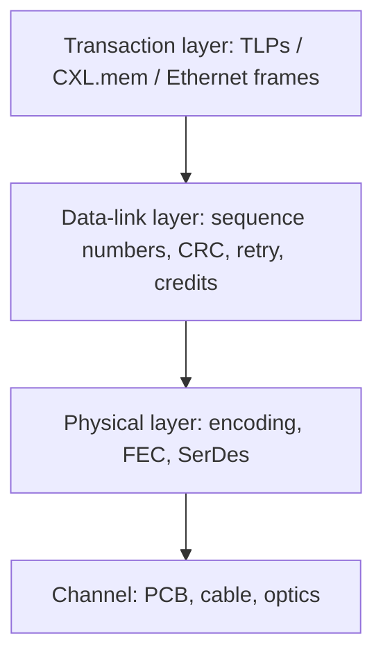
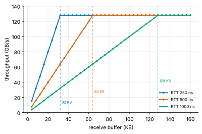
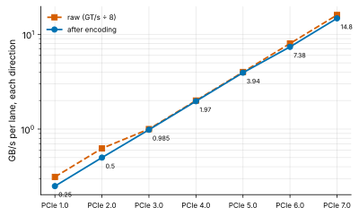

<!-- status: verified -->
# 24-05 · Interconnect Standards: PCIe, CXL and Ethernet

| | |
|---|---|
| **Course** | [24 · High-Speed I/O, Signal Integrity and Photonics](../README.md) |
| **University equivalent** | The I/O-interconnect and datacenter-network lectures of a senior computer-systems course: layered serial protocols, line coding and framing overheads, credit-based flow control, cache-coherent and memory-semantic interconnects, Ethernet PHY structure and switch fabrics (Hennessy & Patterson, *Computer Architecture*, appendix on interconnection networks; Dally & Towles, *Principles and Practices of Interconnection Networks*, chapters on flow control and topology) |
| **Prerequisites** | [24-04](24-04-dsp-serdes-and-fec.md) (FEC, flits and retry), [17-13](../../17-communication-systems/chapters/17-13-computer-networks-fundamentals.md) (layering, Ethernet framing), [23-04](../../23-memory-and-storage-technology/chapters/23-04-dram-interfaces.md) (DDR bandwidth) |
| **Estimated study hours** | 6 |
| **Last verified** | 2026-11-25 |

**Learning objectives.** After this chapter you can:

1. Place the SerDes of 24-03 and 24-04 inside the layered structure of PCIe, CXL and Ethernet.
2. Compute raw and effective bandwidth for any PCIe generation and width from its rate and encoding, and the cost of packet headers.
3. Size credit-based flow-control buffers and link-level retry buffers from the bandwidth-delay product.
4. Explain what CXL adds to PCIe and estimate the bandwidth and latency of CXL-attached memory.
5. Derive Ethernet lane rates from MAC rates and FEC, and the size of switch fabrics from switch radix.
6. Compare the standards' cadences and judge roadmap claims.

## 1. Big picture

Every chip-to-chip link in a server or a datacenter runs one of a handful of standards. **PCIe** connects processors to accelerators, NICs and SSDs. **CXL** reuses PCIe's physical layer to let processors share memory with devices coherently. **Ethernet** connects servers to each other and, increasingly, accelerators to each other. They use the same kind of SerDes, and since 2022 the same PAM4 signalling at the top rates, but they differ in what happens above the wire: what a packet means, how much latency is tolerated, how errors are handled and how far the link reaches.

- **Cadence:** PCIe has doubled its rate about every three years, from 16 GT/s (2017) to 128 GT/s (2025), with 256 GT/s targeted for 2028 [R-216], [R-515]. Ethernet moved from 100 to 200 Gb/s per lane with 802.3dj, awaiting final approval in December 2026 [R-519].
- **The AI shift:** accelerator clusters need memory-like latency between thousands of devices, which has spawned new specifications (UALink, Ultra Ethernet) built on the same 200 Gb/s-class lanes [R-517], [R-518].
- **Why it matters commercially:** standards decide which chips interoperate, which IP blocks every SoC must license, and when a new generation of products can ship, at least 12 to 18 months after a specification is final by one journalist's estimate [R-515].

## 2. Intuition first

Think of a link as layers, each solving one problem:

- the **physical layer** turns bits into symbols on a wire, with the encoding, equalization and FEC of 24-03 and 24-04;
- the **data-link layer** makes the link reliable: it numbers packets, checks them with a CRC, retries bad ones and tells the sender how much buffer space remains (flow control);
- the **transaction layer** gives the bytes meaning: a memory read of 64 bytes at an address, a write, a completion, or an Ethernet frame for a given destination.

PCIe and CXL are **load–store** interconnects: a processor issues a memory read and waits for the answer, so latency matters at the scale of tens of nanoseconds. Ethernet is a **message** network: software sends a frame and moves on, and a few microseconds of latency are acceptable. That single difference explains most of the design choices below.

**Analogy and its limits.** PCIe is a pneumatic-tube system inside one building: short runs, a fixed set of stations, and you stand waiting for the reply. Ethernet is the postal network: anywhere to anywhere, with sorting centres (switches) and no expectation of an immediate answer. CXL is the tube system extended so that the next building's filing cabinets look like your own. The analogy breaks down at scale-up fabrics (24-06), which want the postal network's reach with the tube system's latency, and that is exactly the engineering tension of the AI era.

## 3. Theory

### 3.1 Rates, encodings and effective bandwidth

A link's **raw rate** is quoted in transfers per second (GT/s) per lane: one transfer is one bit for NRZ, or for PAM4 one bit per lane of the specification's accounting (PCIe 6.0's 64 GT/s is 32 GBd PAM4 carrying 64 Gb/s). The usable rate is lower, because some bits are spent on encoding, framing, error checking and FEC. For $N$ lanes at a raw rate $R$ with encoding efficiency η, the bandwidth in each direction is

$$
B = \frac{N R\,\eta}{8}\ \text{bytes/s} .
$$

The encodings have improved with each generation [R-216]:

| Generation | Rate (GT/s) | Encoding | η | Per lane, each direction |
|---|---|---|---|---|
| PCIe 1.0 / 2.0 | 2.5 / 5 | 8b/10b | 0.8 | 0.25 / 0.5 GB/s |
| PCIe 3.0 / 4.0 / 5.0 | 8 / 16 / 32 | 128b/130b | 0.9846 | 0.985 / 1.97 / 3.94 GB/s |
| PCIe 6.0 / 7.0 | 64 / 128 | 256-byte flit | 236/256 for TLP space | 7.375 / 14.75 GB/s |
| PCIe 8.0 (target 2028) | 256 | flit, PAM4 | — | — |

8b/10b maps each byte to a 10-bit symbol with enough transitions for clock recovery and DC balance, at a 20% cost. 128b/130b adds a 2-bit header to 128 scrambled bits, relying on a scrambler for transitions, at a 1.5% cost. The PCIe 6.0 **flit** is 256 bytes: 236 bytes of transaction-layer packets, 6 of data-link information, 8 of CRC and 6 of FEC parity [R-059], so 92.2% of the flit carries TLPs (whose own headers come out of that). PCI-SIG's headline figures are raw and bidirectional: 64 GT/s × 16 lanes × 2 directions / 8 = 256 GB/s for PCIe 6.0, 512 GB/s for 7.0 and 1 TB/s for 8.0 [R-216].

**Packet overhead.** Each TLP carries a header (12 or 16 bytes) and framing and check bytes. With an overhead of $H$ bytes per TLP and a payload of $P$ bytes, the efficiency is

$$
\eta_{TLP} = \frac{P}{P + H} ,
$$

so small transfers waste a large share of the link: with $H$ = 24 bytes (assumed, a 16-byte header plus framing, sequence number and link CRC), a 64-byte payload is 73% efficient and a 256-byte one 91% (Example 24-05.2). Memory traffic at 64-byte cache-line granularity is therefore much less efficient than bulk DMA.

### 3.2 The data-link layer: credits and retry

**Credit-based flow control.** A receiver advertises how much buffer space it has, in credits; the sender spends a credit per packet and stops when it has none; the receiver returns credits as it frees buffers. The sender can keep the link full only if the credits cover everything in flight during one credit round trip, from sending a packet to receiving the credit back:

$$
\text{buffer} \ge B \times t_{RTT} .
$$

This is the **bandwidth-delay product**, the same quantity that sizes TCP windows and switch buffers (17-13). A PCIe 6.0 x16 link carries 128 GB/s each way raw; with a 500 ns credit round trip (assumed, including the far device's processing), the receiver needs 64 KB of buffer to sustain full rate (Example 24-05.3). With less, throughput falls in proportion, which the lab simulates.

**Link-level retry.** PCIe has always numbered TLPs and kept a **replay buffer** of those not yet acknowledged; a CRC failure triggers a NAK and a resend (24-04 §3.5). The replay buffer must also hold a bandwidth-delay product. Ultra Ethernet borrowed the idea for AI networks: its optional Link Level Retry is go-back-N with a replay buffer and a link round trip of about 1 µs, recovering frames lost to uncorrectable FEC symbols or CRC errors [R-517]. At 800 Gb/s that is 100 KB of replay buffer per port (Example 24-05.7).

### 3.3 CXL: memory semantics on PCIe wires

**Compute Express Link** runs three protocols over PCIe's physical layer [R-516]:

- **CXL.io**, essentially PCIe, for discovery, configuration and DMA;
- **CXL.cache**, which lets a device cache host memory coherently;
- **CXL.mem**, which lets the host read and write memory attached to a device with ordinary load and store instructions.

The common device types are accelerators with their own caches (CXL.io and CXL.cache), accelerators with their own memory (all three), and **memory expanders** (CXL.io and CXL.mem): a card or module that adds DRAM capacity and bandwidth beyond the processor's DDR channels.

The generations track PCIe's PHY and add fabric features [R-217], [R-516]:

| CXL | PHY rate | Added |
|---|---|---|
| 1.x (2019) | PCIe 5.0, 32 GT/s | the three protocols, direct attach |
| 2.0 (Nov 2020) | 32 GT/s | switching, memory pooling, link security |
| 3.0 (Aug 2022) | 64 GT/s, 256-byte flit | fabrics, multi-level switching, peer-to-peer, enhanced coherency |
| 3.1 (Nov 2023), 3.2 (Dec 2024) | 64 GT/s | port-based routing switches, host-to-host memory, security, hot-page monitoring for tiering |
| 4.0 (Nov 2025) | 128 GT/s | bundled ports, native x2 links, up to four retimers |

**What it buys and costs.** A x16 CXL 3.x link at 64 GT/s carries 128 GB/s each way raw and about 118 GB/s of flit payload, against 51.2 GB/s for one DDR5-6400 channel (23-04): one link adds the bandwidth of more than two DDR5 channels over far fewer pins. The cost is latency: a CXL memory access crosses the host's root port, the link (with its flit FEC, 24-04) and the device's controller, adding latency to each read. Whether that hurts depends on how often software touches the slower tier, which is why CXL 3.2 added hot-page monitoring to place frequently used pages in local DRAM (Example 24-05.4).

### 3.4 Ethernet's PHY and lanes

Ethernet's MAC rates (100, 200, 400, 800 Gb/s and 1.6 Tb/s) are carried on 1 to 16 lanes. The rate on each lane is set by the MAC rate per lane, a transcoding of the 64b/66b data to 256b/257b, and RS(544,514) FEC (24-04):

$$
R_{lane} = R_{MAC,lane} \times \frac{257}{256} \times \frac{544}{514} .
$$

At 200 Gb/s per lane this is 212.5 Gb/s, 106.25 GBd PAM4 with a 53.125 GHz Nyquist frequency, the number that has appeared throughout this course [R-234]. A 1.6 Tb/s port uses 8 such lanes, 800 Gb/s uses 4.

The PHY types are named by medium: **KR** for backplanes (40 dB die to die at 53.125 GHz for 802.3dj), **CR** for copper cables (at least 1 m at 200 Gb/s per lane), and attachment unit interfaces (**AUI**: chip-to-chip and chip-to-module) between a switch and an optical module, whose DR and FR optics carry the signal further (24-08) [R-270].

**Switch radix and fabric size.** A switch chip's bandwidth divided by the port rate is its **radix** $k$. Two tiers of $k$-port switches in a leaf–spine (folded Clos) arrangement, with half of each leaf's ports facing hosts, connect up to

$$
N_{2\text{-tier}} = \frac{k^2}{2}
$$

hosts at full bisection bandwidth, and three tiers $k^3/4$ (Example 24-05.6). Doubling the radix quadruples a two-tier fabric. This is why switch vendors race for bandwidth per chip, and why port speed is a trade between radix and per-host bandwidth.

### 3.5 Interconnects for AI scale-up

Inside an AI accelerator cluster, devices exchange gradients and activations so often that they want PCIe-like latency with Ethernet-like scale. Three approaches compete (24-06 develops them):

- **Proprietary links** such as NVIDIA's NVLink.
- **UALink**, an open accelerator-to-accelerator specification. Its 200G 1.0 release (April 2025) runs 200 GT/s per lane, signalled at 212.5 GT/s, in x1, x2 or x4 ports of up to 800 Gb/s each way, in pods of up to 1,024 accelerators, pitched as "the same raw speed as Ethernet with the latency of PCIe switches" [R-518], [R-523]. Its lanes are the same 212.5 Gb/s electrical lanes as 802.3dj [R-523].
- **Ethernet extended for AI**: the Ultra Ethernet Consortium's specification 1.0 (June 2025) and 1.1 (October 2026) leave the PHY "essentially unchanged" but add RDMA transport, congestion control, optional credit-based flow control and link-level retry, and in 1.1 a scale-up profile and an optional smaller header [R-517].

The pattern is convergence: Ethernet adopting PCIe's link-level retry and credits, and PCIe-like fabrics adopting Ethernet's SerDes.

### 3.6 Cadence and roadmaps

PCI-SIG describes its cadence as "doubling the IO bandwidth every three years" [R-216]. If a rate doubles every $T$ years, it grows by a factor $2^{t/T}$ after $t$ years, or $2^{1/T} - 1$ per year: 26% per year for $T$ = 3. From PCIe 4.0 (2017, 16 GT/s) to the 8.0 target (2028, 256 GT/s) is four doublings in eleven years, 2.75 years each (Example 24-05.8). Each doubling has to be paid for in the channel: PCIe 7.0 doubled the Nyquist frequency to 32 GHz with a reported 36 dB budget (against 32 dB at 16 GHz for 6.0), which vendors say needs laminates of about 1 dB/in at 32 GHz (24-01, [R-504]), and PCI-SIG says PCIe 8.0 will evaluate new connector technology [R-515].

## 4. Worked examples

### Example 24-05.1 · PCIe bandwidth by generation (tier A)

**Setup.** Find the bandwidth in each direction of a x16 link for (a) PCIe 3.0, (b) PCIe 5.0 and (c) PCIe 6.0 (TLP space within flits). (d) Check PCI-SIG's 256 GB/s figure for PCIe 6.0 x16.

**Solution.**

- (a) $16 \times 8 \times (128/130)/8$ = **15.75** GB/s.
- (b) $16 \times 32 \times (128/130)/8$ = **63.0** GB/s.
- (c) $16 \times 64 \times (236/256)/8$ = **118.0** GB/s.
- (d) $64 \times 16 \times 2/8$ = **256** GB/s: raw, and counting both directions.

**Units check.** GT/s × lanes × bits per transfer ÷ 8 = GB/s. ✓

**Sanity check.** PCIe 6.0 doubles the raw rate over 5.0, but the flit's FEC, CRC and link bytes take back 6.3 points of efficiency compared with 128b/130b, so the encoding alone gives 1.87×, not 2×. Flit mode also drops each TLP's own framing and link CRC (sequence numbers and CRC move to the flit), so for small packets the usable gain recovers much of the difference.

### Example 24-05.2 · The cost of small packets (tier B)

**Setup.** Each TLP carries 24 bytes of header, framing and CRC (assumed). (a) Find the efficiency for payloads of 64, 128, 256 and 512 bytes. (b) What payload bandwidth does a PCIe 5.0 x16 link deliver with 256-byte payloads?

**Solution.**

- (a) $P/(P + 24)$: **72.7**%, **84.2**%, **91.4**% and **95.5**%.
- (b) $63.0 \times 0.914$ = **57.6** GB/s.

**Units check.** Bytes over bytes. ✓

**Sanity check.** Cache-line traffic (64 bytes) loses more than a quarter of the link to overhead, which is one reason memory-semantic protocols pack several requests per flit and why bulk transfers use the largest payload the devices allow.

### Example 24-05.3 · Sizing a credit buffer (tier B)

**Setup.** A PCIe 6.0 x16 receiver must sustain 128 GB/s (raw) with a 500 ns credit round trip (assumed). (a) How much buffer does it need? (b) How many 64-byte credits is that? (c) What if the round trip is 1 µs?

**Solution.**

- (a) $128 \times 10^9 \times 500 \times 10^{-9}$ = **64** KB.
- (b) $64{,}000/64$ = **1,000** credits.
- (c) **128** KB.

**Units check.** B/s × s = B. ✓

**Sanity check.** Buffer grows with both bandwidth and distance. A retimer or switch in the path adds to the round trip and so to the buffer every receiver must provide: one reason each generation's "longer reach" features cost silicon area.

### Example 24-05.4 · CXL memory expansion (tier B)

**Setup.** A CXL 3.x x16 memory expander runs at 64 GT/s. (a) Find its raw and flit-payload bandwidth in each direction. (b) How many DDR5-6400 channels (51.2 GB/s each) is the payload bandwidth equivalent to? (c) Local DRAM latency is 100 ns and a CXL access adds 100 ns (both assumed). If 20% of accesses go to the expander, what is the average latency?

**Solution.**

- (a) $64 \times 16/8$ = **128** GB/s raw and $128 \times 236/256$ = **118** GB/s.
- (b) $118/51.2$ = **2.30** channels.
- (c) $0.8 \times 100 + 0.2 \times 200$ = **120** ns.

**Units check.** GB/s ÷ GB/s; ns. ✓

**Sanity check.** A 20% increase in average latency for a large gain in capacity and bandwidth is often acceptable, but it depends entirely on the hit rate of the slower tier: at 50% the average would be 150 ns. Tiering software and hot-page monitoring exist to keep that share low.

### Example 24-05.5 · From MAC rate to lane rate (tier A)

**Setup.** (a) Find the lane rate of a 200 Gb/s-per-lane Ethernet PHY. (b) Its PAM4 symbol rate and Nyquist frequency. (c) The aggregate line rate of a 1.6 Tb/s port. (d) The fraction of the line rate that is MAC data.

**Solution.**

- (a) $200 \times (257/256) \times (544/514)$ = **212.5** Gb/s.
- (b) **106.25** GBd; **53.125** GHz.
- (c) $8 \times 212.5$ = **1,700** Gb/s.
- (d) $1600/1700$ = **0.941**.

**Units check.** Gb/s × dimensionless ratios. ✓

**Sanity check.** Transcoding plus FEC cost about 6%, close to the RS code's own 5.8% overhead (17-08), because 256b/257b costs only 0.4%.

### Example 24-05.6 · Switch radix and fabric size (tier B)

**Setup.** (a) How many 200 Gb/s lanes does a 51.2 Tb/s switch chip need in each direction, and what radix does it offer at 800 Gb/s and at 1.6 Tb/s? (b) How many hosts can a two-tier fabric of radix-64 switches connect at full bisection, and how many with radix 128? (c) A three-tier fabric of radix-64 switches?

**Solution.**

- (a) $51.2/0.2$ = **256** lanes; radix **64** at 800 Gb/s and **32** at 1.6 Tb/s.
- (b) $64^2/2$ = **2,048** and $128^2/2$ = **8,192** hosts.
- (c) $64^3/4$ = **65,536** hosts.

**Units check.** Counts. ✓

**Sanity check.** Doubling a switch chip's bandwidth at the same port speed doubles its radix and quadruples a two-tier fabric, which can save a whole tier of switches, with its optics, power and latency.

### Example 24-05.7 · A link-level retry buffer (tier B)

**Setup.** Ultra Ethernet's link-level retry assumes a link round trip of about 1 µs [R-517]. (a) What replay buffer does an 800 Gb/s port need to keep sending while it waits for acknowledgements? (b) A 1.6 Tb/s port?

**Solution.**

- (a) $800 \times 10^9 \times 10^{-6}/8$ = **100** KB.
- (b) **200** KB.

**Units check.** b/s × s ÷ 8 = bytes. ✓

**Sanity check.** A 64-port switch would need several megabytes of retry buffering in total if every port supported it, a real cost in on-chip memory.

### Example 24-05.8 · The doubling cadence (tier A)

**Setup.** (a) At a doubling every three years, what is the growth per year? (b) From PCIe 5.0 (2019, 32 GT/s) to 7.0 (2025, 128 GT/s), how many years per doubling? (c) From PCIe 4.0 (2017, 16 GT/s) to the 8.0 target (2028, 256 GT/s)?

**Solution.**

- (a) $2^{1/3} - 1$ = **26**% per year.
- (b) Two doublings in six years: **3.0** years.
- (c) Four doublings in eleven years: **2.75** years.

**Units check.** Years per doubling. ✓

**Sanity check.** The cadence has held, but each doubling halves the UI and doubles the Nyquist frequency, so the channel, not the SerDes, increasingly sets the pace. PCIe 8.0's draft already flags new connectors.

<!-- answer-key -->

| ID | Quantity | Value | Unit |
|---|---|---|---|
| Ex 24-05.1a | PCIe 3.0 x16 per direction | 15.75 | GB/s |
| Ex 24-05.1b | PCIe 5.0 x16 per direction | 63.0 | GB/s |
| Ex 24-05.1c | PCIe 6.0 x16 TLP space per direction | 118.0 | GB/s |
| Ex 24-05.1d | PCIe 6.0 x16 raw bidirectional | 256 | GB/s |
| Ex 24-05.1e | efficiency points lost to the flit | 6.3 | |
| Ex 24-05.1f | usable gain from 5.0 to 6.0 | 1.87 | |
| Ex 24-05.2a | efficiency, 64 B | 72.7 | % |
| Ex 24-05.2a1 | efficiency, 128 B | 84.2 | % |
| Ex 24-05.2a2 | efficiency, 256 B | 91.4 | % |
| Ex 24-05.2a3 | efficiency, 512 B | 95.5 | % |
| Ex 24-05.2b | PCIe 5.0 x16 payload bandwidth | 57.6 | GB/s |
| Ex 24-05.3a | credit buffer at 500 ns | 64 | KB |
| Ex 24-05.3b | 64-byte credits | 1000 | |
| Ex 24-05.3c | credit buffer at 1 us | 128 | KB |
| Ex 24-05.4a | CXL x16 raw per direction | 128 | GB/s |
| Ex 24-05.4a1 | CXL x16 flit payload | 118 | GB/s |
| Ex 24-05.4b | DDR5-6400 channel equivalents | 2.30 | |
| Ex 24-05.4c | average latency | 120 | ns |
| Ex 24-05.4d | average latency at 50% | 150 | ns |
| Ex 24-05.5a | lane rate | 212.5 | Gb/s |
| Ex 24-05.5b | symbol rate | 106.25 | GBd |
| Ex 24-05.5b1 | Nyquist frequency | 53.125 | GHz |
| Ex 24-05.5c | 1.6T line rate | 1700 | Gb/s |
| Ex 24-05.5d | MAC fraction | 0.941 | |
| Ex 24-05.5e | 256b/257b overhead | 0.4 | % |
| Ex 24-05.5f | transcoding plus FEC overhead | 6 | % |
| Ex 24-05.6a | lanes per direction | 256 | |
| Ex 24-05.6a1 | radix at 800G | 64 | |
| Ex 24-05.6a2 | radix at 1.6T | 32 | |
| Ex 24-05.6b | two-tier hosts, radix 64 | 2048 | |
| Ex 24-05.6b1 | two-tier hosts, radix 128 | 8192 | |
| Ex 24-05.6c | three-tier hosts, radix 64 | 65536 | |
| Ex 24-05.7a | replay buffer at 800G | 100 | KB |
| Ex 24-05.7b | replay buffer at 1.6T | 200 | KB |
| Ex 24-05.8a | growth per year | 26 | % |
| Ex 24-05.8b | years per doubling, 5.0 to 7.0 | 3.0 | |
| Ex 24-05.8c | years per doubling, 4.0 to 8.0 | 2.75 | |
| Txt 24-05.a | 8b/10b efficiency | 0.8 | |
| Txt 24-05.b | 128b/130b efficiency | 0.9846 | |
| Txt 24-05.c | PCIe 3.0 per lane | 0.985 | GB/s |
| Txt 24-05.d | PCIe 4.0 per lane | 1.97 | GB/s |
| Txt 24-05.e | PCIe 5.0 per lane | 3.94 | GB/s |
| Txt 24-05.f | PCIe 6.0 per lane | 7.375 | GB/s |
| Txt 24-05.g | PCIe 7.0 per lane | 14.75 | GB/s |
| Txt 24-05.h | flit TLP share | 92.2 | % |
| Txt 24-05.i | PCIe 7.0 x16 raw bidirectional | 512 | GB/s |
| Txt 24-05.j | PCIe 8.0 x16 raw bidirectional | 1 | TB/s |
| Txt 24-05.k | 8b/10b cost | 20 | % |
| Txt 24-05.l | 128b/130b cost | 1.5 | % |
| Txt 24-05.m | PCIe 1.0 per lane | 0.25 | GB/s |
| Txt 24-05.n | PCIe 2.0 per lane | 0.5 | GB/s |
| Txt 24-05.o | rate increase from 2.0 to 3.0 | 60 | % |
| Txt 24-05.p | bandwidth-delay product at 250 ns | 32 | KB |
| Txt 24-05.q | CXL payload over one DDR5-6400 channel | 2 | |

## 5. Simulate it

The lab is [labs/24-05-lab/](../labs/24-05-lab/README.md). `links.py` computes bandwidths for any generation, width and payload size, simulates credit-based flow control cycle by cycle, and does Ethernet lane and fabric arithmetic.

*Figure 1. Simulated throughput of a 128 GB/s link against receive buffer for credit round trips of 250, 500 and 1,000 ns. Each curve rises linearly and saturates where the buffer equals the bandwidth-delay product: 32, 64 and 128 KB.*

*Figure 2. PCIe per-lane bandwidth from 1.0 to 7.0, raw and after encoding. The step from 8b/10b to 128b/130b let 3.0 nearly double 2.0's bandwidth with only a 60% rate increase; the flit's FEC and CRC cost some encoding efficiency, partly recovered by dropping per-TLP framing.*

**Predict, then run:**

1. *Predict* the payload bandwidth of a PCIe 4.0 x8 link with 128-byte TLPs, then compute it.
2. *Predict* the throughput of a 128 GB/s link with a 32 KB buffer and a 500 ns round trip, then simulate it.
3. *Predict* how many hosts a two-tier fabric of 102.4 Tb/s switches connects at 800 Gb/s per host, then compute it.

## 6. Engineering tradeoffs

| Knob | Improves | Costs | Typical decision owner |
|---|---|---|---|
| Higher PCIe generation | Bandwidth per lane | Channel cost (materials, retimers), power, validation | Platform architect, PCI-SIG |
| Wider link (more lanes) | Bandwidth at a given rate | Pins, package and board area, SerDes power | SoC architect |
| Larger TLP payloads | Link efficiency | Latency, buffer size, fairness | System architect |
| More credits and buffers | Full throughput at longer round trips | SRAM area | Controller designer |
| CXL memory expansion | Capacity and bandwidth beyond DDR channels | Added access latency, software tiering | Server architect |
| Faster Ethernet ports | Per-host bandwidth | Radix, so fabric size or tier count | Network architect |
| Link-level retry in Ethernet | Lower loss latency for AI traffic | Replay buffers, complexity | NIC and switch architects, UEC |

## 7. Numbers to know

| Quantity | Value | Source |
|---|---|---|
| PCIe rates | 2.5, 5, 8, 16, 32, 64, 128 GT/s; 256 targeted for 2028 | [R-216], [R-515] |
| PCIe x16 raw bidirectional | 256 GB/s (6.0), 512 GB/s (7.0), 1 TB/s (8.0 target) | [R-216] |
| Encodings | 8b/10b 80%; 128b/130b 98.5%; flit 236 of 256 bytes for TLPs | §3.1 |
| CXL generations | 2.0 (2020) pooling; 3.0 (2022) 64 GT/s fabrics; 4.0 (Nov 2025) 128 GT/s | [R-217], [R-516] |
| Ethernet 200 Gb/s lane | 212.5 Gb/s, 106.25 GBd PAM4, 53.125 GHz Nyquist | [R-234] |
| Spec to product lag | at least 12–18 months (journalist's estimate) | [R-515] |
| UALink | 200G 1.0 April 2025 (200 GT/s lanes, x1–x4 ports, up to 1,024 accelerators); 2.0-series specifications April 2026 | [R-518], [R-523] |
| Ultra Ethernet | 1.0 June 2025; 1.1 October 2026 | [R-517] |

## 8. Common mistakes

- **Quoting PCI-SIG's headline bandwidth as usable throughput.** It is raw and counts both directions.
- **Forgetting packet overhead.** Small TLPs can lose a quarter of the link.
- **Assuming more bandwidth needs no more buffering.** Credits must cover the bandwidth-delay product, which grows with every doubling.
- **Treating CXL memory as local memory.** It is coherent and load–store addressable, but it adds latency.
- **Confusing GT/s, GBd and Gb/s.** PCIe 6.0's 64 GT/s is 32 GBd PAM4; Ethernet's 200 Gb/s lane is 212.5 Gb/s on the wire.
- **Comparing fabrics by port speed alone.** Radix decides how many tiers a fabric needs.

## 9. Practitioner lens

**State of the art (as of Nov 2026).**

- *PCIe* [Established for releases; roadmap dates are PCI-SIG targets]. PCIe 6.0 was released in January 2022 and PCIe 7.0 to members on 11 June 2025, with an Optical Aware Retimer ECN amending PCIe 6.4 and 7.0. PCIe 8.0 was announced in August 2025 at 256 GT/s; a draft 0.5 in May 2026 keeps PAM4 with FEC and flits and is evaluating new connector technology, with final ratification targeted for 2028 [R-216], [R-515].
- *CXL* [Established]. CXL 4.0 (November 2025) doubled the rate to 128 GT/s at the same 256-byte flit, added bundled ports, native x2 links and up to four retimers. As of November 2026 no later version was found [R-217], [R-516].
- *Ethernet* [Established]. P802.3dj (200 Gb/s per lane, up to 1.6 Tb/s) is on the IEEE RevCom agenda for 8 December 2026, not yet approved [R-519]. The Ultra Ethernet specification reached version 1.1 on 12 October 2026 [R-517].
- *UALink* [Established for the release; the latency and power advantages are Contested marketing statements]. UALink 200G 1.0 was released on 8 April 2025, with a 400G follow-on mentioned [R-518]; in April 2026 the consortium released a common specification 2.0, a separate 200G data-link and physical-layer specification 2.0, and a chiplet specification compliant with UCIe 3.0 [R-523].

**Why it matters commercially.** IP vendors license PCIe, CXL and Ethernet controllers and PHYs to nearly every SoC, and their revenue tracks each generation's adoption. CXL memory expansion creates a market for expander controllers and changes server memory economics; Ethernet-versus-proprietary scale-up is a contest between merchant switch vendors and integrated accelerator vendors. For a corporate-development view, standards timing is a leading indicator: products follow a final specification by at least 12 to 18 months (a journalist's estimate), and compliance and interoperability testing add more.

**Marketing vs Reality.**

- *"512 GB/s PCIe 7.0 x16."* Raw, bidirectional. Usable each way is about 236 GB/s of flit payload before TLP headers.
- *"CXL memory is as fast as local memory."* Bandwidth can be comparable per link; latency is not.
- *"Ethernet latency now matches PCIe."* With which FEC mode, which switch, and with or without link-level retry?
- *"UALink cuts network power by half."* A consortium claim; ask for a like-for-like comparison at the same scale.

**Questions for engineering leaders.**

1. **"What effective bandwidth does your workload get on this link, after encoding and TLP overhead?"** *Strong:* measured payload throughput by transfer size. *Evasive:* the headline rate.
2. **"What is your loaded latency to CXL-attached memory, and what share of accesses goes there?"** *Strong:* latency distribution and tiering policy. *Evasive:* "CXL is coherent."
3. **"How much credit and replay buffering do your ports have, and what round trip does that cover?"** *Strong:* bandwidth-delay arithmetic, with switch and retimer delays. *Evasive:* "the spec sets it."
4. **"Which scale-up fabric are you betting on, and what happens if the other one wins?"** *Strong:* PHY reuse, bridging plans and timelines. *Evasive:* a single bet.
5. **"How many months after the final spec do you expect compliant silicon, and what gates it?"** *Strong:* PHY, controller IP, compliance test availability. *Evasive:* "day one."

## 10. Concept check

**Q1.** Why did PCIe 3.0 go to 8 GT/s rather than 10 GT/s?

Answer

Switching from 8b/10b (80% efficient) to 128b/130b (98.5%) let 8 GT/s deliver nearly twice PCIe 2.0's 5 GT/s bandwidth, while a lower rate eased the channel. Encoding efficiency bought most of the doubling.

**Q2.** Why must a receiver's buffer grow when the link gets faster?

Answer

The sender may only send what the receiver's credits cover, and credits return after a round trip. To keep the link full, the buffer must hold one bandwidth-delay product, which doubles when the bandwidth doubles at the same round-trip time.

**Q3.** What does CXL.mem give a processor that PCIe DMA does not?

Answer

Direct load and store access to device-attached memory, coherently and at cache-line granularity, so ordinary programs can use it as memory rather than moving data with DMA.

**Q4.** How is a 200 Gb/s Ethernet lane's 212.5 Gb/s line rate derived?

Answer

The MAC data is transcoded from 64b/66b blocks to 256b/257b (×257/256) and protected by RS(544,514) (×544/514): 200 × 257/256 × 544/514 = 212.5 Gb/s.

**Q5.** Why does switch radix matter more than port speed for fabric size?

Answer

A two-tier fabric connects $k^2/2$ hosts, so doubling the radix quadruples it. Faster ports at the same switch bandwidth halve the radix and quarter the fabric unless a tier is added.

**Q6.** What has Ethernet borrowed from PCIe for AI networks?

Answer

Link-level retry with a replay buffer and credit-based flow control, both optional in Ultra Ethernet, to recover errors and avoid drops without end-to-end retransmission.

Problems: [24-05 problem set](../problems/24-05-problems.md) · Solutions: [24-05 solutions](../solutions/24-05-solutions.md)

## 11. Key terms

[PCI Express (PCIe)](../../../reference/glossary.md#pci-express-pcie) · [Transaction-layer packet (TLP)](../../../reference/glossary.md#transaction-layer-packet-tlp) · [128b/130b encoding](../../../reference/glossary.md#128b-130b-encoding) · [Flit](../../../reference/glossary.md#flit) · [Credit-based flow control](../../../reference/glossary.md#credit-based-flow-control) · [Bandwidth-delay product](../../../reference/glossary.md#bandwidth-delay-product) · [Link-level retry](../../../reference/glossary.md#link-level-retry) · [Compute Express Link (CXL)](../../../reference/glossary.md#compute-express-link-cxl) · [Memory expander](../../../reference/glossary.md#memory-expander) · [Switch radix](../../../reference/glossary.md#switch-radix) · [Leaf–spine fabric](../../../reference/glossary.md#leaf-spine-fabric) · [UALink](../../../reference/glossary.md#ualink) · [Ultra Ethernet](../../../reference/glossary.md#ultra-ethernet)

## 12. Connections

- **Previous:** [24-04](24-04-dsp-serdes-and-fec.md) built the PHY's FEC and flits; [17-13](../../17-communication-systems/chapters/17-13-computer-networks-fundamentals.md) the network layering; [23-04](../../23-memory-and-storage-technology/chapters/23-04-dram-interfaces.md) the DDR channel this chapter compares CXL with.
- **Next:** [24-06](24-06-d2d-memory-phys-scale-up.md) goes inside the package (UCIe, HBM PHYs) and into scale-up fabrics (NVLink, UALink).
- **Used later:** [24-08](24-08-silicon-photonics.md) carries Ethernet lanes over optics; [24-09](24-09-lpo-and-cpo.md) puts the optics next to the switch.

> **Deeper:** see companion repo *Datacenter Networking* for Ethernet fabrics, Ultra Ethernet and how leaf-spine networks are built and operated.

## 13. Further study

- W. J. Dally and B. Towles, *Principles and Practices of Interconnection Networks*, chapters on flow control and Clos networks.
- J. L. Hennessy and D. A. Patterson, *Computer Architecture: A Quantitative Approach*, appendix on interconnection networks.
- D. Das Sharma, articles and talks on PCIe 6.0 and 7.0 design (see [R-059], [R-216]).
- T. Hoefler et al., "Ultra Ethernet's Design Principles and Architectural Innovations," arXiv:2508.08906 [R-517].

## 14. Sources

1. PCI Express generations and releases: research-log entries [R-216], [R-515]; PCIe 6.0 flit structure [R-059].
2. CXL generations: [R-217], [R-516].
3. IEEE 802.3dj signalling, objectives and status: [R-234], [R-270], [R-519]; copper and PCIe 7.0 budgets [R-504].
4. Ultra Ethernet specification and link-level retry: [R-517].
5. UALink 200G 1.0: [R-518].
