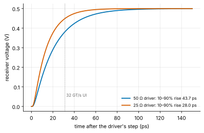
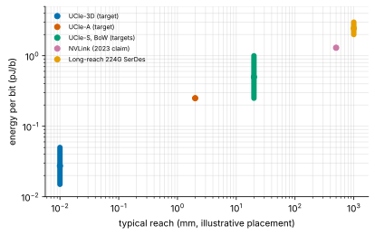

<!-- status: reviewed -->
# 24-06 · Die-to-Die Links, Memory PHYs and Scale-Up Fabrics

| | |
|---|---|
| **Course** | [24 · High-Speed I/O, Signal Integrity and Photonics](../README.md) |
| **University equivalent** | The short-reach and package-level interconnect lectures of a graduate high-speed links or advanced-packaging course: parallel source-synchronous links, energy of unterminated wires, bump pitch and bandwidth density, chiplet interface standards, memory PHYs and accelerator scale-up fabrics (Dally & Poulton, *Digital Systems Engineering*, chapters on signalling energy; Lau, *Chiplet Design and Heterogeneous Integration Packaging*, chapters on die-to-die interfaces) |
| **Prerequisites** | [24-05](24-05-pcie-cxl-ethernet.md) (standards, scale-up context), [24-03](24-03-serdes-architecture.md) (energy per bit, SerDes power), [23-05](../../23-memory-and-storage-technology/chapters/23-05-hbm-in-depth.md) (HBM and its wire energy), [19-02](../../19-digital-vlsi-design/chapters/19-02-cmos-inverter-dynamic.md) ($CV^2$ switching energy, RC delay) |
| **Estimated study hours** | 6 |
| **Last verified** | 2026-11-26 |

**Learning objectives.** After this chapter you can:

1. Explain why short-reach links run wide and slow, and derive the energy of unterminated and terminated wires.
2. Compute areal and shoreline bandwidth density from bump pitch and rate, and check a standard's targets against them.
3. Describe UCIe and BoW, their packaging classes and key metrics, and size a die-to-die link.
4. Compare memory PHYs with SerDes in pins, rate and energy.
5. Compute NVLink and UALink bandwidths and explain how scale-up fabrics differ from scale-out networks.
6. Place every link type on an energy-per-bit ladder and use it to judge architecture claims.

## 1. Big picture

As single dies hit the reticle limit and leading-edge wafers grow more expensive, large chips are built from several dies in one package: compute chiplets, I/O dies, HBM stacks. The links between them never leave the package, so they can be millimetres long instead of the tens of centimetres of 24-01, and thousands of wires wide instead of a few lanes. That changes the engineering completely: no equalization, often no termination, energies of tenths of a picojoule per bit, and bandwidth measured per millimetre of die edge. One level up, AI accelerators are tied together in racks by **scale-up fabrics** that want the same memory-like latency over metres of copper.

- **Die-to-die links:** UCIe and BoW standardize chiplet interfaces; vendors run proprietary ones, such as the 10 TB/s link between the two dies of NVIDIA's Blackwell GPU [R-149].
- **Memory PHYs:** HBM moves 2 TB/s per stack over a 2048-bit interface at 8 Gb/s per wire (23-05, [R-520]).
- **Scale-up fabrics:** NVLink 5 gives each Blackwell GPU 1.8 TB/s (both directions) to 71 others in an NVL72 rack; UALink is the open alternative [R-521], [R-523].
- **Why it matters commercially:** chiplet standards decide whether dies from different vendors can be mixed, and scale-up bandwidth is a central differentiator of AI systems.

## 2. Intuition first

A long channel loses high frequencies, so long links use a few lanes run as fast as the SerDes can go, at the cost of equalization and clock recovery. A short channel has almost no loss, so it is cheaper to use many wires run slowly: each wire needs only a simple driver and a flip-flop, and a forwarded clock replaces clock recovery. The limit becomes how many wires fit: the **bump pitch**, the spacing of the tiny solder or copper connections between die and package.

**Analogy and its limits.** A long-reach SerDes is an express train: one track, very fast, with expensive signalling and stations. A die-to-die link is a wide pedestrian bridge between two buildings: thousands of people walking slowly, cheaply and in parallel. Where it breaks down: people find their own way across, but a parallel link's wires must stay aligned in time, so skew between wires, not the speed of any one, limits how fast the bridge can run.

## 3. Theory

### 3.1 The energy of a short wire

**Unterminated.** A short on-package wire is a lumped capacitance $C$: the driver's pad, the bump, the trace and the receiver's input and protection. Charging it to $V$ draws $CV^2$ from the supply (half is stored, half burned in the driver's resistance, 19-02). With random data a wire rises from 0 to 1 on a quarter of bits, so the energy per bit is

$$
E_{bit} = \frac{CV^2}{4} .
$$

It does not depend on the data rate. A 2 mm interposer wire with 300 fF in all, swinging 0.5 V, uses 75 fJ per rising edge and about 0.019 pJ per bit (Example 24-06.1). 23-05 found 0.052 pJ/bit for an HBM wire of 1.3 pF (assumed) at 0.4 V.

**Terminated.** A longer package trace that reflects at these speeds is terminated, and then current flows continuously. With driver and receiver resistances $R$ in series from a supply $V$, the wire draws $V/2R$ whenever it is high, half the time, so the average power is $V^2/4R$ and the energy per bit at rate $f_b$ is

$$
E_{bit} = \frac{V^2}{4Rf_b} .
$$

From a 0.4 V supply through 50 Ω at each end, at 32 Gb/s, that is 0.025 pJ/b; the receiver sees half the supply, a 0.2 V swing.

**What dominates.** These wire energies are small against the 0.25 to 0.5 pJ/b that UCIe targets for the whole link [R-524]. The rest goes to the circuits around the wire: clock generation and forwarding, per-lane deskew, serializers to the core's clock, receivers and test logic. That is why the best short-reach designs *lower* the per-wire rate as the pitch shrinks: slower circuits are simpler, and with more wires per millimetre the bandwidth is still there. A peer-reviewed analysis of 3D hybrid-bonded links puts the total at 0.03 pJ/b at 9 µm pitch and 4 GT/s, and 0.015 pJ/b at 1 µm [R-524].

**Speed limit.** An unterminated wire's speed is set by its RC delay. A driver of resistance $R_{on}$ into a distributed wire of resistance $R_w$ and capacitance $C_w$, loaded by $C_L$ at the far end, has an Elmore delay of about $R_{on}C_{tot} + R_w(C_w/2 + C_L)$ (19-02). When the rise time approaches the UI, ISI appears, and the remedy is a stronger driver, a lower-capacitance wire, a shorter reach or a lower rate per wire. This is why UCIe's advanced-package class limits reach to under 2 mm [R-524].

### 3.2 Bandwidth density

On a package, area and die edge are the scarce resources, so short-reach links are compared by **bandwidth density**.

**Areal density.** Bumps on a square grid of pitch $p$ number $(1/p)^2$ per unit area. If a fraction $\phi$ carry data (the rest are power, ground, clocks and spares) at $r$ Gb/s each,

$$
D_{area} = \frac{\phi\,r}{8p^2}\ \text{GB/s per unit area} .
$$

At 45 µm pitch, half the bumps carrying data at 32 Gb/s give about 990 GB/s/mm², inside UCIe-A's target range of 188 to 1,350 GB/s/mm² (Example 24-06.2). Halving the pitch quadruples the density.

**Shoreline density.** Die-to-die signals must reach the die's edge, and only a band of a certain depth along the edge is usable for them. Shoreline density is bandwidth per millimetre of edge: the areal density times that depth. It is the number that decides whether a die has enough edge for its memory, I/O and die-to-die links, and it improves with finer pitch, more bump rows and higher rate.

**Hybrid bonding.** Bonding dies face to face with copper pads at 10 µm pitch or less (UCIe-3D) multiplies the bump density by tens (25 times from 45 µm to 9 µm) and removes most of the capacitance: the consortium's target is 4 TB/s/mm² at 9 µm at under 0.05 pJ/b [R-524].

### 3.3 Die-to-die standards: UCIe and BoW

**UCIe** (Universal Chiplet Interconnect Express) defines a protocol layer (PCIe, CXL or raw streaming), a die-to-die adapter (link management, CRC and retry) and a PHY with a forwarded clock and parallel lanes. Its generations [R-524]:

- **1.0** (March 2022) and **1.1** (August 2023): rates up to 32 GT/s;
- **2.0** (August 2024): adds UCIe-3D for hybrid-bonded stacking, and manageability and test;
- **3.0** (5 August 2025): adds 48 and 64 GT/s for the 2D and 2.5D classes, "doubling the bandwidth of UCIe 2.0 (32 GT/s)", fully backward compatible.

Its key metrics are targets, not product results [R-524]:

| Metric | UCIe-S (standard package) | UCIe-A (advanced package) | UCIe-3D |
|---|---|---|---|
| Lanes per module | 16 | 64 | 80 |
| Bump pitch | 100–130 µm | 25–55 µm | under 10 µm (optimized) |
| Reach | under 25 mm | under 2 mm | vertical |
| Shoreline density | 28–224 GB/s/mm | 165–1,317 GB/s/mm | — |
| Energy target | 0.5 pJ/b | 0.25 pJ/b | under 0.05 pJ/b at 9 µm |
| Latency (TX + RX) | under 2 ns | under 2 ns | — |

The latency figure is what makes these links usable as if the two dies were one: two nanoseconds is a few clock cycles of the processor.

**BoW** (Bunch of Wires), from the Open Compute Project, is a simpler open PHY: unidirectional slices of 16 data wires with a forwarded differential clock, at 2 to 32 Gb/s per wire (BoW-32 to BoW-512, named by slice throughput), with targets below 0.5–1 pJ/b terminated and 0.25–0.5 pJ/b unterminated, and 2 to 12+ Tb/s per millimetre of die edge [R-525].

### 3.4 Memory PHYs

Memory interfaces are short, parallel links with a long history. DDR5 runs 64 data bits per channel at 6400 MT/s over a motherboard; HBM runs a 2048-bit interface at up to 8 Gb/s per wire over a silicon interposer, 2 TB/s per stack for HBM4 [R-520] (23-04, 23-05). Matching one HBM4 stack's bandwidth with 224 Gb/s SerDes would take about 74 lanes at several picojoules per bit, about 49 W of I/O (Example 24-06.8); the wide, slow, unequalized HBM interface does it with wires whose switching energy is a few hundredths of a picojoule per bit, at the cost of needing an interposer and the HBM stack beside the processor.

The same contrast explains where each technology appears. LPDDR and DDR suit boards and modest bandwidth; HBM suits accelerators that can afford interposers; CXL memory (24-05) trades latency for capacity beyond the package.

### 3.5 Scale-up fabrics

An AI training job splits a model across many accelerators that exchange data every step. A **scale-up** fabric connects a group of accelerators (a node or a rack) with enough bandwidth and low enough latency that they can share memory and run collective operations as one large device; a **scale-out** network (Ethernet or InfiniBand, 24-05) connects such groups with less bandwidth per device.

**NVLink.** NVIDIA's generations, as presented at Hot Chips 2024 [R-521] (bandwidths count both directions):

| Generation | GPU | Links per GPU | Per link | Lanes per link | Per GPU |
|---|---|---|---|---|---|
| NVLink 3 | Ampere | 12 | 50 GB/s | 4 at 50 Gb/s NRZ | 600 GB/s |
| NVLink 4 | Hopper | 18 | 50 GB/s | 2 at 100 Gb/s PAM4 | 900 GB/s |
| NVLink 5 | Blackwell | 18 | 100 GB/s | 2 at 200 Gb/s PAM4 | 1,800 GB/s |

The lanes are the same 100 and 200 Gb/s-class SerDes as Ethernet's. A GB200 NVL72 rack connects 72 GPUs through NVLink switch chips: 72 × 1.8 TB/s ≈ 130 TB/s of total GPU bandwidth (Example 24-06.5). For NVLink 6 (Vera Rubin), NVIDIA's own pages give two different preliminary figures, 3.6 and 3.0 TB/s per GPU [R-522]. In 2025 NVIDIA also opened NVLink to partners' ASICs and CPUs as **NVLink Fusion** [R-522].

**UALink.** The open alternative. Its 200G 1.0 specification (8 April 2025) runs 200 GT/s per lane, signalled at 212.5 GT/s, in x1, x2 or x4 links of up to 800 Gb/s each way, up to 1,024 accelerators per pod, over cables under 4 m with a round trip under 1 µs, with a physical layer built on Ethernet's 200GBASE-KR1/CR1 with low-latency FEC changes. In 2026 the consortium added a chiplet specification compliant with UCIe 3.0 and split its data-link and physical layers into a separate specification so that new rates can follow [R-523].

**Scale-up versus scale-out.** A Blackwell GPU's 1.8 TB/s of NVLink against an 800 Gb/s scale-out NIC (200 GB/s both directions) is a 9 : 1 ratio (Example 24-06.5). That ratio, and the latency gap, is why model-parallel training keeps its most communication-heavy work inside the scale-up domain, and why the domain's size (8 GPUs, then 72, then more) is a competitive weapon.

### 3.6 The energy ladder

Distance costs energy. Collecting this course's figures:

| Link | Reach | Energy per bit | Source |
|---|---|---|---|
| UCIe-3D (target) | vertical, µm | under 0.05 pJ/b; 0.03 modelled at 9 µm | [R-524] |
| UCIe-A (target) | under 2 mm | 0.25 pJ/b | [R-524] |
| UCIe-S, BoW (targets) | 10–25 mm | 0.25–1 pJ/b | [R-524], [R-525] |
| NVLink (2023 marketing figure; generation, reach and conditions unspecified) | unspecified | about 1.3 pJ/b | [R-522] |
| Long-reach 224 Gb/s SerDes | 40 dB channel | about 2–3 pJ/b analog | [R-509] |

Moving 1 TB/s costs about 2 W over UCIe-A and about 10 W at NVLink's 1.3 pJ/b marketing figure (Example 24-06.7). Optical links, which add lasers, modulators and often a DSP, are the next rungs (24-08, 24-09). The ladder is the quantitative reason the industry packs more into each package and each rack before going optical.

## 4. Worked examples

### Example 24-06.1 · The energy of a short wire (tier B)

**Setup.** A 2 mm interposer wire has 200 fF of trace capacitance and 50 fF of pad and ESD capacitance at each end (assumed), and swings 0.5 V. (a) What energy does one rising edge draw? (b) What is the energy per bit for random data? (c) A hybrid-bonded connection presents 20 fF and swings 0.4 V (assumed); find its energy per bit. (d) A terminated link is driven from a 0.4 V supply through 50 Ω at each end at 32 Gb/s; find its energy per bit and its power.

**Solution.**

- (a) $C$ = 300 fF, so $CV^2$ = **75** fJ.
- (b) $75/4$ = **18.75** fJ = 0.019 pJ/b.
- (c) $20\ \text{fF} \times 0.4^2/4$ = **0.8** fJ per bit.
- (d) $0.4^2/(4 \times 50 \times 32 \times 10^9)$ = **0.025** pJ/b, from **0.80** mW of continuous power.

**Units check.** F × V² = J; V²/Ω = W. ✓

**Sanity check.** Against a 0.25 pJ/b UCIe-A budget the wire itself takes less than a tenth; against a 0.03 pJ/b hybrid-bonded link, its 0.0008 pJ/b wire is negligible. Short-reach energy is mostly circuits, which is why rate per wire, not wire capacitance, is the main knob.

### Example 24-06.2 · Bandwidth density from bump pitch (tier B)

**Setup.** (a) How many bumps per mm² does a 45 µm square grid hold, and what areal bandwidth do they give if half carry data at 32 Gb/s? (b) The same for a 9 µm hybrid-bond grid at 4 Gb/s. (c) What data fraction does UCIe's 4 TB/s/mm² target at 9 µm and 4 GT/s imply? (d) What shoreline density does (a) give with a 0.5 mm deep bump field?

**Solution.**

- (a) $(1000/45)^2$ = **494** bumps/mm²; $247 \times 32/8$ = **988** GB/s/mm².
- (b) $(1000/9)^2$ = **12,346** bonds/mm²; $6{,}173 \times 4/8$ = **3,086** GB/s/mm².
- (c) $4000 \times 8/(4 \times 12{,}346)$ = **0.648**: about two thirds of the bonds carry data.
- (d) $988 \times 0.5$ = **494** GB/s per mm of edge.

**Units check.** (1/mm²) × Gb/s ÷ 8 = GB/s/mm². ✓

**Sanity check.** (a) falls inside UCIe-A's 188–1,350 GB/s/mm² target range and (d) inside its 165–1,317 GB/s/mm shoreline range. Hybrid bonding wins on density despite running each wire eight times slower.

### Example 24-06.3 · Sizing a die-to-die link (tier B)

**Setup.** A UCIe-A module has 64 lanes in each direction. (a) What does one module carry each way at 32 GT/s and at 64 GT/s (raw)? (b) Taking 10 TB/s as the total of both directions of a die-to-die link (an assumption about NVIDIA's Blackwell figure [R-149]), how many 32 GT/s modules would it take? (c) At UCIe-A's 0.25 pJ/b target, what power?

**Solution.**

- (a) $64 \times 32/8$ = **256** GB/s; at 64 GT/s, **512** GB/s.
- (b) Each module carries 512 GB/s in both directions, so $10{,}000/512$ = 19.5, or **20** modules.
- (c) $10\ \text{TB/s} \times 8 \times 0.25$ pJ/b = **20** W.

**Units check.** lanes × Gb/s ÷ 8 = GB/s; b/s × J/b = W. ✓

**Sanity check.** Twenty watts is a few percent of a large accelerator's power, an acceptable price for making two dies behave as one. Over long-reach SerDes at 3 pJ/b the same link would take 240 W, which is why it stays in the package.

### Example 24-06.4 · Bunch of Wires (tier A)

**Setup.** (a) What does one BoW-256 slice carry, and one BoW-512 slice? (b) How many BoW-256 slices make 1 Tb/s?

**Solution.**

- (a) $16 \times 16$ = **256** Gb/s and $16 \times 32$ = **512** Gb/s.
- (b) $1000/256$ = 3.9, so **4** slices.

**Units check.** wires × Gb/s per wire. ✓

**Sanity check.** BoW names each mode by its slice throughput, so the arithmetic is built in: a slice is 16 wires plus a forwarded clock.

### Example 24-06.5 · NVLink 5 and NVL72 (tier B)

**Setup.** An NVLink 5 link has 2 lanes at 200 Gb/s each way; a Blackwell GPU has 18 links [R-521]. Find (a) a link's bandwidth each way and in both directions, (b) a GPU's total, (c) the total for 72 GPUs and (d) the ratio of a GPU's NVLink bandwidth to an 800 Gb/s scale-out NIC's (both directions).

**Solution.**

- (a) $2 \times 200/8$ = **50** GB/s each way, **100** GB/s in both.
- (b) $18 \times 100$ = **1,800** GB/s.
- (c) $72 \times 1.8$ = **129.6** TB/s, NVIDIA's "130 TB/s".
- (d) $1800/(2 \times 100)$ = **9**.

**Units check.** GB/s throughout. ✓

**Sanity check.** Each NVLink 5 lane is a 200 Gb/s PAM4 SerDes of the kind in 24-03 and 24-04: the scale-up fabric's advantage is not faster wires but many more of them per GPU, switched with low latency.

### Example 24-06.6 · Reading a preliminary specification (tier A)

**Setup.** NVIDIA's pages give NVLink 6 as 3.6 TB/s per GPU with 36 links, and elsewhere as 3.0 TB/s, "1.7x" the previous generation [R-522]. (a) What per-link bandwidth does each figure imply? (b) What generational ratios? (c) What NVL72 totals?

**Solution.**

- (a) $3600/36$ = **100** GB/s and $3000/36$ = **83.3** GB/s.
- (b) $3.6/1.8$ = **2.0** and $3.0/1.8$ = **1.67**.
- (c) $72 \times 3.6$ = **259.2** TB/s and $72 \times 3.0$ = **216** TB/s.

**Units check.** TB/s ÷ links = GB/s per link. ✓

**Sanity check.** Both sets are internally consistent, which is why one cannot tell from arithmetic alone which is current. Preliminary specifications move; diligence should date every figure and ask which revision a customer contract uses.

### Example 24-06.7 · The cost of moving a terabyte per second (tier A)

**Setup.** What power does 1 TB/s take at (a) 0.05 pJ/b (UCIe-3D target), (b) 0.25 pJ/b (UCIe-A), (c) 0.5 pJ/b (UCIe-S), (d) 1.3 pJ/b (NVLink claim) and (e) 3 pJ/b (long-reach SerDes)?

**Solution.** $P = 8 \times 10^{12} \times E_{bit}$:

- (a) **0.4** W; (b) **2.0** W; (c) **4.0** W; (d) **10.4** W; (e) **24** W.

**Units check.** b/s × J/b = W. ✓

**Sanity check.** Sixty times from the cheapest to the dearest rung, before optics. A system architect who can keep a terabyte per second inside a package rather than on long-reach SerDes saves about 22 W per terabyte per second.

### Example 24-06.8 · HBM against SerDes (tier B)

**Setup.** (a) What bandwidth does an HBM4 interface of 2048 wires at 8 Gb/s give? (b) How many 224 Gb/s SerDes lanes would carry the same, and (c) what would they dissipate at 3 pJ/b? (d) What do the HBM wires themselves dissipate at 23-05's 0.052 pJ/bit?

**Solution.**

- (a) $2048 \times 8/8$ = **2,048** GB/s.
- (b) $16{,}384/224$ = 73.1, so **74** lanes.
- (c) $16.384 \times 10^{12} \times 3 \times 10^{-12}$ = **49** W.
- (d) **0.85** W.

**Units check.** Gb/s ÷ Gb/s per lane; b/s × J/b = W. ✓

**Sanity check.** The comparison is not complete: an HBM interface also spends power in its PHY circuits and DRAM, the SerDes lanes run one way while HBM's 2 TB/s is a shared bus, and 224 Gb/s is a line rate, not payload. Still, the factor of about 58 between a long-reach SerDes's energy and the HBM wires' switching energy is why memory bandwidth is delivered wide and slow, next to the processor, and why HBM supply is a strategic constraint. Against package-scale extra-short-reach SerDes, reported at 1.11 pJ/b (a 224 Gb/s receiver) to 1.7 pJ/b (a 112 Gb/s transceiver) [R-509], [R-510], the factor is about 21 to 33.

<!-- answer-key -->

| ID | Quantity | Value | Unit |
|---|---|---|---|
| Ex 24-06.1a0 | total capacitance | 300 | fF |
| Ex 24-06.1a | energy per rising edge | 75 | fJ |
| Ex 24-06.1b | energy per bit | 18.75 | fJ |
| Ex 24-06.1b1 | energy per bit in pJ | 0.019 | pJ/b |
| Ex 24-06.1c | hybrid-bond energy per bit | 0.8 | fJ |
| Ex 24-06.1c1 | hybrid-bond energy in pJ | 0.0008 | pJ/b |
| Ex 24-06.1d | terminated energy per bit | 0.025 | pJ/b |
| Ex 24-06.1d1 | terminated power | 0.80 | mW |
| Ex 24-06.2a | bumps per mm2 at 45 um | 494 | |
| Ex 24-06.2a0 | data bumps per mm2 | 247 | |
| Ex 24-06.2a1 | areal density at 45 um | 988 | GB/s/mm² |
| Ex 24-06.2b | bonds per mm2 at 9 um | 12346 | |
| Ex 24-06.2b0 | data bonds per mm2 | 6173 | |
| Ex 24-06.2b1 | areal density at 9 um | 3086 | GB/s/mm² |
| Ex 24-06.2c | implied data fraction | 0.648 | |
| Ex 24-06.2d | shoreline density | 494 | GB/s/mm |
| Ex 24-06.3a | module at 32 GT/s | 256 | GB/s |
| Ex 24-06.3a1 | module at 64 GT/s | 512 | GB/s |
| Ex 24-06.3b0 | modules, exact | 19.5 | |
| Ex 24-06.3b | modules | 20 | |
| Ex 24-06.3c | power at 0.25 pJ/b | 20 | W |
| Ex 24-06.3d | power at 3 pJ/b | 240 | W |
| Ex 24-06.4a | BoW-256 slice | 256 | Gb/s |
| Ex 24-06.4a1 | BoW-512 slice | 512 | Gb/s |
| Ex 24-06.4b0 | slices, exact | 3.9 | |
| Ex 24-06.4b | slices | 4 | |
| Ex 24-06.5a | link each way | 50 | GB/s |
| Ex 24-06.5a1 | link both directions | 100 | GB/s |
| Ex 24-06.5b | per GPU | 1800 | GB/s |
| Ex 24-06.5c | NVL72 total | 129.6 | TB/s |
| Ex 24-06.5d | NVLink to NIC ratio | 9 | |
| Ex 24-06.6a | per link at 3.6 TB/s | 100 | GB/s |
| Ex 24-06.6a1 | per link at 3.0 TB/s | 83.3 | GB/s |
| Ex 24-06.6b | ratio at 3.6 | 2.0 | |
| Ex 24-06.6b1 | ratio at 3.0 | 1.67 | |
| Ex 24-06.6c | NVL72 at 3.6 | 259.2 | TB/s |
| Ex 24-06.6c1 | NVL72 at 3.0 | 216 | TB/s |
| Ex 24-06.7a | 1 TB/s at 0.05 pJ/b | 0.4 | W |
| Ex 24-06.7b | 1 TB/s at 0.25 pJ/b | 2.0 | W |
| Ex 24-06.7c | 1 TB/s at 0.5 pJ/b | 4.0 | W |
| Ex 24-06.7d | 1 TB/s at 1.3 pJ/b | 10.4 | W |
| Ex 24-06.7e | 1 TB/s at 3 pJ/b | 24 | W |
| Ex 24-06.7f | spread of the ladder | 60 | |
| Ex 24-06.7g | saving per TB/s | 22 | W |
| Ex 24-06.8a | HBM4 bandwidth | 2048 | GB/s |
| Ex 24-06.8b0 | SerDes lanes, exact | 73.1 | |
| Ex 24-06.8b | SerDes lanes | 74 | |
| Ex 24-06.8c | SerDes power | 49 | W |
| Ex 24-06.8d | HBM wire power | 0.85 | W |
| Ex 24-06.8e | SerDes energy over HBM wire energy | 58 | |
| Ex 24-06.8e1 | XSR receiver over HBM wire energy | 21 | |
| Ex 24-06.8e2 | XSR transceiver over HBM wire energy | 33 | |
| Txt 24-06.a | 40-section wire rise time, 10-90% | 43.7 | ps |
| Txt 24-06.b | 40-section wire 50% delay | 16.5 | ps |
| Txt 24-06.c | Elmore delay | 22.5 | ps |
| Txt 24-06.d | 32 GT/s UI | 31.25 | ps |
| Txt 24-06.e | HBM wire energy per bit from 23-05 | 0.052 | pJ/b |
| Txt 24-06.f | areal density at 45 um, 2 s.f. | 9.9e2 | GB/s/mm² |
| Txt 24-06.g | NVL72 total, rounded | 130 | TB/s |
| Txt 24-06.h | smallest step on the ladder | 2 | |
| Txt 24-06.i | largest step on the ladder | 5 | |
| Txt 24-06.j | rise time with a 25 ohm driver | 28.0 | ps |

## 5. Simulate it

The lab is [labs/24-06-lab/](../labs/24-06-lab/README.md). `wire.cir` simulates Example 24-06.1's 2 mm wire as a 40-section RC ladder driven through 50 Ω, measuring the supply energy of one edge and the rise time at the receiver; `d2d.py` computes energies, densities and fabric bandwidths; the notebook ties them together.

*Figure 1. Example 24-06.1's wire driven through 50 Ω: its 50% delay is 16.5 ps, under the 22.5 ps Elmore estimate, which is an upper bound for RC trees. The 10–90% rise time of 43.7 ps exceeds the 31.25 ps UI of 32 GT/s, so at that rate this wire would need a stronger driver, lower capacitance or a shorter reach. A 25 Ω driver cuts the rise time to 28.0 ps.*

*Figure 2. The energy ladder of §3.6. Each step outward in reach costs a factor of two to five in energy per bit.*

**Predict, then run:**

1. *Predict* the supply energy of one rising edge of the 2 mm wire, then run `ngspice -b wire.cir`.
2. *Predict* whether the 40-section wire's rise time is shorter or longer than a 32 GT/s UI.
3. *Predict* the areal bandwidth at 25 µm pitch with half the bumps at 32 Gb/s, then compute it.

## 6. Engineering tradeoffs

| Knob | Improves | Costs | Typical decision owner |
|---|---|---|---|
| Finer bump pitch (advanced package, hybrid bonding) | Density, lower capacitance and energy | Packaging cost, yield, known-good-die testing | Packaging architect |
| Higher rate per wire | Bandwidth per mm of edge | Circuit energy, deskew, termination at longer reach | PHY designer |
| More wires at lower rate | Energy per bit, simplicity | Bumps, area, routing | SoC architect |
| Standard (UCIe) instead of proprietary D2D | Multi-vendor chiplets | Some density or energy versus a custom PHY | Product strategy |
| Larger scale-up domain | Collective bandwidth, simpler parallelism | Switch chips, copper reach limits, power | System architect |
| Open (UALink) instead of proprietary scale-up | Supplier choice | Ecosystem maturity, timing | Platform strategy |

## 7. Numbers to know

| Quantity | Value | Source |
|---|---|---|
| Unterminated wire energy | $CV^2/4$ per bit; about 0.02–0.05 pJ/b for package wires | §3.1, 23-05 |
| UCIe energy targets | 0.5 (S), 0.25 (A), under 0.05 (3D at 9 µm) pJ/b | [R-524] |
| UCIe rates | to 32 GT/s (1.x, 2.0); 48 and 64 GT/s (3.0, Aug 2025) | [R-524] |
| UCIe-A shoreline target | 165–1,317 GB/s/mm | [R-524] |
| UCIe latency target | under 2 ns TX + RX | [R-524] |
| HBM4 | 2048 bits × 8 Gb/s = 2 TB/s per stack (JEDEC, Apr 2025) | [R-520] |
| NVLink 5 | 18 links × 100 GB/s = 1.8 TB/s per GPU (both directions) | [R-521] |
| UALink 200G 1.0 | x1–x4 at 200 GT/s per lane; 1,024 accelerators; under 4 m | [R-523] |

## 8. Common mistakes

- **Comparing die-to-die and long-reach links by per-lane rate.** Short-reach links win on density and energy by running many slow wires.
- **Attributing short-reach energy to the wire.** The wire is usually a small fraction; clocking and circuits dominate.
- **Mixing one-direction and both-direction bandwidths.** NVLink and PCI-SIG headlines count both directions; per-link SerDes rates are one way.
- **Treating consortium targets as measured results.** UCIe's table is a set of targets; silicon varies by node and design.
- **Quoting a preliminary specification as final.** NVLink 6's figures have appeared in two versions on the vendor's own pages.

## 9. Practitioner lens

**State of the art (as of Nov 2026).**

- *UCIe* [Established for releases; metrics are targets]. UCIe 3.0 (5 August 2025) added 48 and 64 GT/s; a trade-press view expects it in chips around 2028–2029 (opinion) [R-524]. Peer-reviewed modelling of hybrid-bonded links reaches 0.015–0.03 pJ/b [R-524].
- *HBM4* [Established]. JEDEC JESD270-4 (April 2025): 2048-bit interface, up to 8 Gb/s, 32 channels with 2 pseudo-channels each, stacks to 16-high and 64 GB [R-520]. Vendors' per-GPU HBM4 bandwidths imply parts running above the 8 Gb/s baseline (23-05).
- *NVLink* [Established for NVLink 3–5; Contested for NVLink 6]. NVLink 5 gives 1.8 TB/s per GPU over 18 links of 2 × 200 Gb/s PAM4 lanes. NVLink 6's per-GPU figure appears as both 3.6 and 3.0 TB/s on NVIDIA's own preliminary pages. NVLink Fusion (May 2025) opened NVLink to partner ASICs and CPUs, and in September 2025 NVIDIA and Intel announced Intel x86 CPUs with NVLink and a $5 billion NVIDIA investment in Intel [R-521], [R-522].
- *UALink* [Established for specifications; power claims Contested]. 200G 1.0 in April 2025; in 2026 a common specification 2.0 with in-network compute, a separate 200G data-link and physical-layer specification 2.0, manageability, and a chiplet specification compliant with UCIe 3.0 [R-523].

**Why it matters commercially.** Chiplet interfaces turn packaging into a supply-chain decision: a standard die-to-die PHY lets an I/O die, a compute die and an HBM base die come from different vendors and nodes. Scale-up fabrics are where accelerator vendors compete hardest: a proprietary fabric locks in the whole rack, while an open one invites merchant switches and multi-vendor accelerators. For an investor, the energy ladder is a quick way to test system claims: a design that moves petabytes per second over long-reach SerDes must be burning hundreds of watts on I/O.

**Marketing vs Reality.**

- *"0.25 pJ/b die-to-die."* Target or measured? At what rate, pitch and node, and does it include the adapter and clocking?
- *"X TB/s of NVLink."* One direction or both? Per GPU or per rack? Which revision of the specification?
- *"Open standard, any vendor's chiplet."* Has anyone shipped a multi-vendor UCIe package, and with which protocol layer?
- *"Scale-up to 1,024 accelerators."* At what bandwidth per accelerator, through how many switch tiers, and with what latency?

**Questions for engineering leaders.**

1. **"What is your die-to-die energy per bit, measured, and how does it split between wire, clocking and circuits?"** *Strong:* a measured breakdown at the operating rate. *Evasive:* the standard's target.
2. **"How much die edge does your memory and I/O need, and does it fit?"** *Strong:* shoreline budget per interface. *Evasive:* "we use advanced packaging."
3. **"Why that bump pitch and rate per wire?"** *Strong:* the energy-density trade with packaging cost and yield. *Evasive:* "the fastest available."
4. **"What happens to your scale-up roadmap if the open standard wins?"** *Strong:* PHY compatibility, bridging and timelines. *Evasive:* a single bet.
5. **"What latency does a remote-GPU memory access see through your fabric?"** *Strong:* a measured distribution under load. *Evasive:* raw bandwidth only.

## 10. Concept check

**Q1.** Why does a die-to-die link use many slow wires rather than a few fast lanes?

Answer

On a short, nearly lossless channel, slow wires need only simple drivers and a forwarded clock, with no equalization or clock recovery, so their energy per bit is far lower. Fine bump pitch supplies enough wires to make up the bandwidth.

**Q2.** Why does an unterminated wire's energy per bit not depend on its data rate?

Answer

Each rising edge draws $CV^2$ from the supply however fast it happens, and with random data a quarter of bits have one. The power rises with rate, but the energy per bit does not.

**Q3.** What does halving the bump pitch do to areal bandwidth density?

Answer

It quadruples the number of bumps per unit area, so at the same rate per wire and data fraction it quadruples the density.

**Q4.** Why does UCIe quote a latency target of under 2 ns?

Answer

So that the two dies can behave like one chip: a few processor cycles of latency allows coherent memory and cache traffic across the link, which a SerDes link with FEC (tens to hundreds of nanoseconds) does not.

**Q5.** What separates a scale-up fabric from a scale-out network?

Answer

Bandwidth per device and latency: a scale-up fabric connects a group of accelerators at several times a NIC's bandwidth (9 : 1 for NVLink 5 against an 800 Gb/s NIC) with memory-like latency, so they can share memory and run collectives as one device; scale-out connects such groups at lower bandwidth over a larger network.

**Q6.** Why is HBM wide and slow instead of narrow and fast?

Answer

Delivering 2 TB/s through long-reach SerDes would cost tens of watts of I/O; 2048 short interposer wires at 8 Gb/s, each switching a small capacitance, cost under a watt of wire energy.

Problems: [24-06 problem set](../problems/24-06-problems.md) · Solutions: [24-06 solutions](../solutions/24-06-solutions.md)

## 11. Key terms

[Chiplet](../../../reference/glossary.md#chiplet) · [Die-to-die interface](../../../reference/glossary.md#die-to-die-interface) · [UCIe](../../../reference/glossary.md#ucie) · [Bunch of Wires (BoW)](../../../reference/glossary.md#bunch-of-wires-bow) · [Bump pitch](../../../reference/glossary.md#bump-pitch) · [Hybrid bonding](../../../reference/glossary.md#hybrid-bonding) · [Shoreline bandwidth density](../../../reference/glossary.md#shoreline-bandwidth-density) · [Forwarded clock](../../../reference/glossary.md#forwarded-clock) · [Scale-up fabric](../../../reference/glossary.md#scale-up-fabric) · [NVLink](../../../reference/glossary.md#nvlink) · [UALink](../../../reference/glossary.md#ualink) · [Energy per bit](../../../reference/glossary.md#energy-per-bit)

## 12. Connections

- **Previous:** [24-05](24-05-pcie-cxl-ethernet.md) placed PCIe, CXL and Ethernet; [23-05](../../23-memory-and-storage-technology/chapters/23-05-hbm-in-depth.md) built HBM and its wire energy; [19-02](../../19-digital-vlsi-design/chapters/19-02-cmos-inverter-dynamic.md) the $CV^2$ and RC models.
- **Next:** [24-07](24-07-photonics-fundamentals.md) starts the optical half of the course: when copper runs out of reach, light takes over.
- **Used later:** [24-09](24-09-lpo-and-cpo.md) brings optics into the package, onto the same rungs of the energy ladder.

> **Deeper:** see companion repo *Datacenter Networking* for scale-up and scale-out fabrics, and companion repo *LLM Inference Engineering* for how HBM bandwidth and scale-up links set inference throughput.

## 13. Further study

- W. J. Dally and J. W. Poulton, *Digital Systems Engineering*, chapters on signalling energy and parallel links.
- D. Das Sharma et al., "High-performance, power-efficient three-dimensional system-in-package designs with universal chiplet interconnect express," *Nature Electronics*, 2024 [R-524].
- The OCP ODSA Bunch of Wires PHY specification draft [R-525].
- NVIDIA's Hot Chips 2024 Blackwell presentation [R-521].

## 14. Sources

1. HBM4 (JEDEC JESD270-4): [R-520].
2. NVLink 3–5 and NVL72 (Hot Chips 2024): [R-521].
3. NVLink 6 figures, NVLink Fusion, the Intel collaboration and NVLink energy claims: [R-522].
4. UALink specifications: [R-523] (and [R-518]).
5. UCIe releases, key-metric targets and the hybrid-bonding analysis: [R-524].
6. Bunch of Wires PHY: [R-525].
7. Blackwell's die-to-die link [R-149]; long-reach SerDes energy [R-509].
