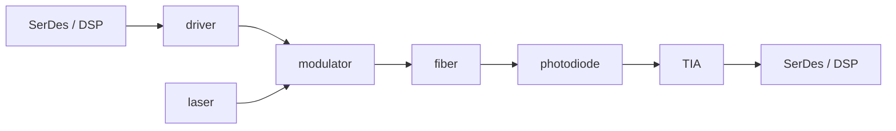
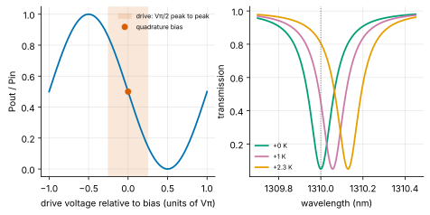
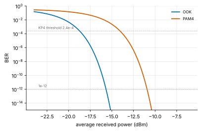

<!-- status: verified -->
# 24-07 · Photonics Fundamentals

| | |
|---|---|
| **Course** | [24 · High-Speed I/O, Signal Integrity and Photonics](../README.md) |
| **University equivalent** | The intensity-modulated direct-detection lectures of an optical-communications course: fiber loss and dispersion, laser and modulator choices, Mach–Zehnder and ring modulators, photodetection and receiver sensitivity, link budgets and wavelength multiplexing (Agrawal, *Fiber-Optic Communication Systems*, chapters on fibers, transmitters, receivers and system design; Saleh & Teich, *Fundamentals of Photonics*, chapters on modulators and detectors) |
| **Prerequisites** | [04-09](../../04-physics-for-ee/chapters/04-09-waves-and-optics.md) (waves, refraction, fiber acceptance), [04-10](../../04-physics-for-ee/chapters/04-10-intro-quantum-mechanics.md) (photons, responsivity), [09-14](../../09-semiconductor-devices/chapters/09-14-optoelectronic-devices.md) (photodiodes and laser diodes), [24-02](24-02-eye-diagrams-jitter-ber.md) (Q and BER), [24-06](24-06-d2d-memory-phys-scale-up.md) (the energy ladder) |
| **Estimated study hours** | 8 |
| **Last verified** | 2026-11-25 |

**Learning objectives.** After this chapter you can:

1. Explain why datacenter optics use 850 nm on multimode fiber and 1310 nm on single-mode fiber, from loss, dispersion and modal bandwidth.
2. Compute fiber loss, latency and dispersion-induced pulse spreading for a link.
3. Derive the Mach–Zehnder transfer function and use $V_\pi L$ to size a modulator; explain ring and electro-absorption modulators and their trade-offs.
4. Derive a direct-detection receiver's sensitivity from its noise, and the penalties for PAM4 and finite extinction ratio.
5. Build an optical link budget, and convert between wavelength and frequency spacing for WDM.
6. Design a shunt-feedback TIA's transimpedance and bandwidth to first order.

## 1. Big picture

Copper runs out of reach. At 200 Gb/s per lane a passive copper cable reaches about a metre (24-05), so anything between racks, and increasingly anything between boxes in a rack, is optical. A datacenter optical link is conceptually simple: a laser, a modulator that imprints the data on the light's intensity, a fiber, and a photodiode whose current a transimpedance amplifier (TIA) turns into a voltage for a SerDes. This is **intensity modulation with direct detection** (IM-DD), and it carries almost all short-reach traffic. Long-haul links use coherent detection of phase and amplitude, but that belongs to the companion material.

- **Volume:** every switch port above a few metres needs an optical transceiver; an AI cluster can have more optical ports than GPUs.
- **Physics:** fiber loss is tiny (tenths of a dB per kilometre), so short links are limited by dispersion, modal bandwidth, component losses and receiver noise, not by the fiber's attenuation.
- **Power:** the electrical-optical conversions add energy per bit, which is why 24-08 and 24-09 are about where to put the optics.

> **Deeper:** see companion repo *Datacenter Networking* for network topologies and optics deployment at scale.

## 2. Intuition first

Light in a fiber is a wave confined by a slightly higher refractive index in its core (04-09). A **single-mode** fiber's 9 µm core supports one mode, so every photon takes the same path; a **multimode** fiber's 50 µm core supports many paths of slightly different length, which smears pulses and limits multimode links to around 100 m. Even in single-mode fiber, different wavelengths travel at slightly different speeds (**chromatic dispersion**), so a modulated signal, which always occupies a band of wavelengths, spreads in time.

At the receiver, a photodiode counts photons: its current is proportional to optical power, not to the optical field. That makes optics behave differently from copper in a way that catches people out: optical power in dB maps to *twice* as many dB of electrical signal power.

**Analogy and its limits.** A fiber link is like a pneumatic-tube system for light pulses: almost frictionless (low loss), but the tube's shape spreads a burst of capsules out (dispersion), and the faster you send them the more they overlap. Where it breaks down: capsules do not interfere, but light does, which is what makes modulators and ring resonators work.

## 3. Theory

### 3.1 Wavelength windows and fiber

**Windows.** Datacenter optics use three windows. At **850 nm**, GaAs VCSELs are cheap and fast, but silica fiber's loss is high (3.0 dB/km cabled for OM3–OM5 multimode [R-526]), so 850 nm is used only on multimode fiber over tens to a hundred metres. At **1310 nm** (the O-band), standard single-mode fiber has nearly zero chromatic dispersion: a G.652.D-compliant fiber's datasheet (Prysmian) keeps dispersion at or below 3.5 ps/(nm·km) from 1285 to 1330 nm, with zero dispersion between 1300 and 1324 nm, and cabled loss at most 0.36 dB/km [R-526]. At **1550 nm** (the C-band) loss is lowest, at most 0.22 dB/km cabled in the same datasheet, but dispersion is about 18 ps/(nm·km), which IM-DD cannot easily undo; long-haul coherent systems live there.

**Latency.** Light in fiber travels at $c/n_g$, with group index $n_g$ ≈ 1.468: 4.9 µs per kilometre, about 5 ns per metre (Example 24-07.2). Hollow-core fibers guide light in air: one 2025 design reached 0.091 dB/km at 1550 nm, below the solid-silica record of about 0.14 dB/km, and cuts latency by about a third [R-527].

**Multimode bandwidth.** Multimode fiber is specified by its **effective modal bandwidth**, a length–bandwidth product: at 850 nm, 2,000 MHz·km for OM3 and 4,700 MHz·km for OM4 and OM5 [R-526]. Dividing by the length gives a rough modal bandwidth: 47 GHz for 100 m of OM4, a simple linear scaling that real links only approximate. That is why multimode reach shrinks as rates rise: IEEE 802.3df's 800 Gb/s multimode PMDs reach at least 50 m (VR8) or 100 m (SR8), against 500 m (DR8) and 2 km (DR8-2) on single-mode fiber, per the task force's 2023 draft text, which does not state the multimode fiber grade in the excerpt logged [R-528].

### 3.2 Chromatic dispersion

The group delay per unit length depends on wavelength; its slope is the dispersion parameter $D$, in ps/(nm·km). A signal of spectral width $\Delta\lambda$ over a length $L$ spreads by

$$
\Delta\tau = D\,L\,\Delta\lambda .
$$

A modulated signal's spectral width is at least its own bandwidth. Converting a frequency width $\Delta f$ to wavelength, $\Delta\lambda = \lambda^2\Delta f/c$ (from $\lambda = c/f$). Taking $\Delta f$ roughly equal to the symbol rate gives a useful rule: IM-DD works while $\Delta\tau$ is a small fraction of the UI. At 53.125 GBd and 1550 nm, 2 km of fiber with $D$ = 18 spreads a pulse by 15 ps, 0.8 UI: unusable. At 1310 nm with $D$ ≤ 3.5 (the worst case over 1285–1330 nm) the spread is at most 2.1 ps, 0.11 UI (Example 24-07.3). At 200 Gb/s per lane (113.4375 GBd) the 1550 nm spread over 2 km grows to 3.7 UI. This is why 100 and 200 Gb/s-per-lane datacenter optics run in the O-band, and why their wavelength grids cluster near 1310 nm: the CWDM4 grid is 1271, 1291, 1311 and 1331 nm [R-529].

There is a second effect peculiar to IM-DD at 1550 nm: the two sidebands of an intensity-modulated signal acquire different phases from dispersion, and at certain frequencies they cancel at the photodiode (power fading). Coherent receivers and dispersion-compensating DSP avoid it; short-reach IM-DD avoids it by staying near zero dispersion.

### 3.3 Light sources

09-14 derived the laser diode's threshold and slope efficiency. For communications three types matter [R-529]:

- **VCSELs** (vertical-cavity surface-emitting lasers) at 850 nm, directly modulated, cheap, low power, for multimode links. 200 Gb/s-per-lane VCSELs were demonstrated in 2025.
- **EMLs** (electro-absorption modulated lasers): a single-frequency distributed-feedback (DFB) laser integrated with an electro-absorption modulator. Lumentum's 200G EML (product page, read Nov 2026) pairs "a wavelength-locked DFB laser with a single-ended electro-absorption modulator" at 115 GBd PAM4 for 200 Gb/s DR and FR links up to 2 km [R-529].
- **Continuous-wave (CW) lasers** feeding external silicon-photonic modulators: one high-power laser can be split among several modulators.

Direct modulation, turning the laser's current up and down, is simplest but also shifts the laser's frequency with its power (**chirp**), which interacts with dispersion. External modulation separates the two jobs: the laser runs steadily and a modulator does the switching.

### 3.4 Modulators

**The Mach–Zehnder modulator (MZM).** Light is split into two arms and recombined. If the arms differ in optical phase by $\Delta\phi$, the fields add as $E_0(1 + e^{j\Delta\phi})/2$, and the output power is

$$
P_{out} = P_{in}\cos^2\!\left(\frac{\Delta\phi}{2}\right) .
$$

An electro-optic phase shifter makes $\Delta\phi$ proportional to voltage: $\Delta\phi = \pi V/V_\pi$, where $V_\pi$ is the voltage for a phase change of π, the swing from full on to full off. The modulator is biased at **quadrature** ($\Delta\phi = \pi/2$, half power), where the transfer curve is steepest and most linear, and driven symmetrically about it.

**$V_\pi L$.** A phase shifter's strength is quoted as the product of its half-wave voltage and its length, $V_\pi L$, so a modulator of length $L$ has $V_\pi = (V_\pi L)/L$. Silicon depletion phase shifters, the workhorse of silicon photonics, have $V_\pi L$ ≈ 2 V·cm with 10 to 30 dB/cm of loss; thin-film lithium niobate (TFLN) reaches about 2 V·cm with under 0.5 dB of loss and around 100 GHz of bandwidth; bulk lithium niobate needs 10 to 20 V·cm [R-530]. A 2 V·cm silicon modulator with a 2 V drive must be 1 cm long, which is why silicon MZMs are millimetres long and travelling-wave: the electrical drive runs along the arm alongside the light.

**Ring modulators.** A ring resonator coupled to a waveguide removes light at its resonant wavelengths, where the ring's circumference is a whole number of wavelengths. Its transmission near resonance is a Lorentzian dip of width $\lambda/Q$, where $Q$ is the quality factor. Shifting the ring's refractive index by $\Delta n_{eff}$ moves the resonance by

$$
\Delta\lambda_{res} = \frac{\lambda\,\Delta n_{eff}}{n_g} ,
$$

so a tiny index change swings the transmission at a fixed laser wavelength from high to low. Rings are tens of micrometres across (the first silicon ring modulator was 12 µm in diameter [R-531]), with energies below 40 fJ/bit against about 200 fJ/bit for silicon MZMs [R-530]. The catch is the same sensitivity: temperature shifts the resonance too, so every ring needs a heater and a control loop (Example 24-07.6).

**Electro-absorption modulators (EAMs).** An electric field shifts a semiconductor's absorption edge (the Franz–Keldysh effect, or the quantum-confined Stark effect in quantum wells), so the same short device switches from transparent to absorbing. EAMs are compact, need low voltage, and integrate with DFB lasers in EMLs, but they absorb some light even when "on" and add a little chirp.

**Energy.** A modulator's driver charges its capacitance like any wire (24-06): $CV^2/4$ per bit for random data. A 20 fF ring driven with 1 V uses 5 fJ/bit; a travelling-wave MZM must instead drive a terminated transmission line, which costs far more.

### 3.5 Photodetection and receiver sensitivity

A photodiode of **responsivity** $\mathcal R$ produces a current $I = \mathcal R P$. With quantum efficiency η, $\mathcal R = \eta q\lambda/hc$ (04-10): at most 0.686 A/W at 850 nm, 1.057 A/W at 1310 nm and 1.250 A/W at 1550 nm (Example 24-07.1) [R-532]. Germanium-on-silicon photodiodes integrate with silicon photonics at 1310 nm.

**The noise.** The photocurrent feeds a TIA (§3.6) whose input-referred noise current has a density $i_n$ in A/√Hz; over a bandwidth $B$ it has rms $\sigma = i_n\sqrt B$. The photocurrent $I$ adds shot noise of variance $2qIB$, so in general $\sigma^2 = i_n^2B + 2qIB$. At Example 24-07.7's 10⁻¹² point the "1" level carries 48.7 µA, whose shot noise over 30 GHz is 0.68 µA rms against 3.46 µA of thermal noise: its variance is 3.9% of the thermal, so for short-reach links the thermal term dominates and this chapter neglects shot noise.

**OOK sensitivity.** For on-off keying with average optical power $P_{avg}$ and infinite extinction ratio, the "1" level is $2P_{avg}$ and the "0" level is zero, so the current eye is $2\mathcal RP_{avg}$. With equal noise on both levels and the threshold in the middle (24-02), the Q factor is

$$
Q = \frac{I_1 - I_0}{2\sigma} = \frac{\mathcal R P_{avg}}{\sigma}
\quad\Longrightarrow\quad
P_{sens} = \frac{Q\,\sigma}{\mathcal R} .
$$

With 20 pA/√Hz over 30 GHz ($\sigma$ = 3.46 µA) and 0.9 A/W, BER = 10⁻¹² ($Q$ = 7.03) needs 27 µW, −15.7 dBm; at the KP4 FEC threshold of 2.4 × 10⁻⁴ ($Q$ = 3.49) it needs only −18.7 dBm (Example 24-07.7).

**Optical dB.** Because current is proportional to optical power, an eye reduced by a factor $k$ in current costs $10\log_{10}k$ dB of optical power, not $20\log_{10}k$. PAM4's eyes are a third of OOK's at the same average power, a 9.54 dB *electrical* penalty (17-04) but only 4.77 dB *optical*.

**Extinction ratio.** A real transmitter's "0" is not dark. With extinction ratio $ER = P_1/P_0$ at fixed average power, the eye is $2P_{avg}(ER - 1)/(ER + 1)$, so the penalty against an ideal transmitter is

$$
\text{penalty} = 10\log_{10}\frac{ER + 1}{ER - 1}\ \text{dB} ,
$$

2.8 dB for a 5 dB extinction ratio. Standards often specify the **optical modulation amplitude** (OMA), $P_1 - P_0$, directly, which sidesteps the issue.

### 3.6 The transimpedance amplifier

A shunt-feedback TIA is an inverting amplifier of gain $A$ with a feedback resistor $R_F$; the photodiode and amplifier input add a capacitance $C_{in}$. Summing currents at the input node, with the output at $-A$ times the input voltage, the transimpedance is

$$
Z_T(s) = \frac{V_{out}}{I_{in}} = -\frac{A}{1 + A}\,\frac{R_F}{1 + sR_FC_{in}/(1 + A)} .
$$

At low frequency $Z_T \approx R_F$, and the bandwidth is $(1 + A)/(2\pi R_FC_{in})$: feedback widens the bandwidth by $1 + A$ over a plain resistor. The feedback resistor's thermal noise current, $\sqrt{4kT/R_F}$, sets a floor on $i_n$: 4.1 pA/√Hz for 1 kΩ at 300 K. Raising $R_F$ lowers that noise and raises the gain but cuts the bandwidth, the central TIA trade (Example 24-07.9 and the lab). Real TIAs have amplifier poles too, which make the response second order and set how much feedback is stable.

### 3.7 Link budgets and WDM

**The budget.** A link closes if the received power exceeds the receiver's sensitivity, including penalties, with margin:

$$
P_{tx} - \sum\text{losses} \ge P_{sens} + \sum\text{penalties} + \text{margin} .
$$

Losses include fiber (dB/km × km), connectors and splices, and multiplexers; penalties include extinction ratio, dispersion, crosstalk and the modulation format. Example 24-07.8 closes a 2 km four-wavelength link with about 6 dB to spare.

**Wavelength-division multiplexing.** Several wavelengths share one fiber, each carrying its own lane. Spacing is quoted in wavelength or frequency; from $f = c/\lambda$,

$$
\Delta f = \frac{c\,\Delta\lambda}{\lambda^2} .
$$

**CWDM** uses 20 nm spacing (about 3.5 THz at 1310 nm), loose enough for uncooled lasers; **DWDM** uses 100 GHz or finer (0.8 nm at 1550 nm) and needs temperature-controlled, wavelength-locked lasers. Datacenter optics also use **parallel fiber**: DR4 and DR8 links run 4 or 8 separate fibers at one wavelength, trading fiber count for simple optics.

## 4. Worked examples

### Example 24-07.1 · Photons and photocurrent (tier A)

**Setup.** (a) Find the ideal responsivity and photon energy at 850, 1310 and 1550 nm. (b) A 1310 nm photodiode with 0.9 A/W (assumed) receives −10 dBm; find the photocurrent and the photon arrival rate.

**Solution.**

- (a) $\mathcal R = q\lambda/hc$: **0.686**, **1.057** and **1.250** A/W; photon energies $hc/\lambda$: **1.459**, **0.946** and **0.800** eV.
- (b) −10 dBm is 100 µW, so $I$ = **90** µA; the photon rate is $10^{-4}/(hc/\lambda)$ = **6.6** × 10¹⁴ per second.

**Units check.** C·m/(J·s·m/s) = A/W. ✓

**Sanity check.** Responsivity grows with wavelength because each photon carries less energy, so a watt delivers more photons: 1550 nm light gives 1.8 times the current of 850 nm light per watt at the same efficiency.

### Example 24-07.2 · Fiber loss and latency (tier A)

**Setup.** With $n_g$ = 1.468, find (a) the group delay per kilometre and per metre, (b) the delay of a 500 m link, (c) the latency cut a hollow-core fiber ($n_g$ ≈ 1) would give, and (d) the loss of 2 km at 1310 nm and 10 km at 1550 nm at the cabled maxima of R-526's G.652.D datasheet.

**Solution.**

- (a) $n_g/c$ = **4.90** µs/km, **4.90** ns/m.
- (b) **2.45** µs.
- (c) $1 - 1/1.468$ = **32**%.
- (d) $2 \times 0.36$ = **0.72** dB and $10 \times 0.22$ = **2.2** dB.

**Units check.** s/m. ✓

**Sanity check.** Half a kilometre of fiber costs 2.45 µs, far more than any SerDes or FEC latency of 24-04: inside a large cluster, distance, not electronics, sets the latency floor.

### Example 24-07.3 · Why the O-band (tier B)

**Setup.** A 53.125 GBd signal has a spectral width of about its symbol rate. Find the spread over 2 km (a) at 1550 nm with $D$ = 18 ps/(nm·km) and (b) at 1310 nm with $D$ = 3.5 ps/(nm·km), each as a fraction of the UI.

**Solution.**

- (a) $\Delta\lambda = (1.55\ \mu\text{m})^2 \times 53.125\ \text{GHz}/c$ = **0.426** nm; $\Delta\tau = 18 \times 2 \times 0.426$ = **15.3** ps, **0.81** UI.
- (b) $\Delta\lambda$ = **0.304** nm; $\Delta\tau$ = **2.13** ps, **0.11** UI.

**Units check.** ps/(nm·km) × km × nm = ps. ✓

**Sanity check.** The O-band figure uses the worst-case dispersion over 1285–1330 nm; near 1310 nm it is smaller still, while the outer CWDM4 lane at 1271 nm lies outside that range and sees more. Doubling the symbol rate doubles the spectral width and halves the UI, so the spread in UI grows as the square of the rate and the dispersion-limited reach falls as its square.

### Example 24-07.4 · Multimode reach (tier A)

**Setup.** Using the length–bandwidth products, find the modal bandwidth of 100 m of (a) OM4 and (b) OM3 at 850 nm. (c) What is the attenuation of 100 m of OM4 at 850 nm?

**Solution.**

- (a) $4{,}700\ \text{MHz·km}/0.1\ \text{km}$ = **47** GHz.
- (b) **20** GHz.
- (c) $0.1 \times 3.0$ = **0.30** dB.

**Units check.** MHz·km ÷ km = MHz. ✓

**Sanity check.** Loss is negligible; modal bandwidth limits the link. Simple linear scaling over-promises at short lengths, but it shows why 850 nm multimode links are confined to about 100 m at 100 Gb/s-per-lane rates.

### Example 24-07.5 · Sizing a Mach–Zehnder modulator (tier B)

**Setup.** (a) How long must a silicon depletion MZM with $V_\pi L$ = 2 V·cm be for $V_\pi$ = 4 V, and for 2 V? (b) Biased at quadrature and driven with a peak-to-peak swing of $V_\pi/2$, what are the high and low output powers (as fractions of $P_{in}$), the extinction ratio and the OMA? (c) Find $V_\pi L$ for the TFLN modulators of 2018 with $V_\pi$ = 1.4 V at 20 mm, 2.3 V at 10 mm and 4.4 V at 5 mm [R-530].

**Solution.**

- (a) $2/4$ = **0.5** cm and **1.0** cm.
- (b) $\Delta\phi = \pi/2 \pm \pi/4$: $\cos^2(\pi/8)$ = **0.854** and $\cos^2(3\pi/8)$ = **0.146**; $ER = 5.83$ = **7.66** dB; OMA = **0.707** $P_{in}$.
- (c) **2.8**, **2.3** and **2.2** V·cm.

**Units check.** V·cm ÷ V = cm. ✓

**Sanity check.** A half-$V_\pi$ swing already gives a usable 7.7 dB extinction ratio at the steepest part of the curve; driving the full $V_\pi$ would reach a theoretically infinite ratio but needs twice the swing, which CMOS drivers struggle to provide.

### Example 24-07.6 · A ring modulator and temperature (tier B)

**Setup.** A silicon ring at 1310 nm has $n_g$ = 4.2 and $Q$ = 10,000; the waveguide's effective index rises by 1.8 × 10⁻⁴ per kelvin (all assumed typical values). Find (a) the resonance shift per kelvin, (b) the resonance linewidth and (c) the temperature change that moves the resonance by one linewidth. (d) What energy per bit does the ring's 20 fF driven with 1 V take?

**Solution.**

- (a) $1310 \times 1.8 \times 10^{-4}/4.2$ = **0.056** nm/K.
- (b) $1310/10{,}000$ = **0.131** nm.
- (c) $0.131/0.0561$ = **2.3** K.
- (d) $20\ \text{fF} \times 1^2/4$ = **5** fJ/bit.

**Units check.** nm × (1/K) = nm/K. ✓

**Sanity check.** A chip's temperature swings by tens of kelvin, so an uncontrolled ring would drift through its resonance many times. Rings save area and energy only if their heaters and control loops cost less than they save.

### Example 24-07.7 · Receiver sensitivity (tier B)

**Setup.** A receiver has 0.9 A/W and an input-referred noise of 20 pA/√Hz over 30 GHz (assumed). Find (a) σ, (b) the OOK sensitivity for BER 10⁻¹² and (c) for the KP4 threshold of 2.4 × 10⁻⁴. (d) What optical penalty does PAM4 add, and (e) a 5 dB extinction ratio?

**Solution.**

- (a) $20 \times 10^{-12}\sqrt{30 \times 10^9}$ = **3.46** µA.
- (b) $7.034 \times 3.46/0.9$ = **27.1** µW = **−15.7** dBm.
- (c) $Q$ = 3.49: **13.4** µW = **−18.7** dBm.
- (d) $10\log_{10}3$ = **4.77** dB.
- (e) $ER$ = 3.16: $10\log_{10}(4.16/2.16)$ = **2.84** dB.

**Units check.** A/√Hz × √Hz = A; A ÷ (A/W) = W. ✓

**Sanity check.** FEC buys 3 dB of optical sensitivity, more than half of PAM4's 4.77 dB optical penalty, which is why 100 and 200 Gb/s-per-lane optics are PAM4 with FEC.

### Example 24-07.8 · A link budget (tier B)

**Setup.** A four-wavelength 2 km link launches 0 dBm per lane; the fiber loses 0.36 dB/km; two connectors lose 0.5 dB each; the multiplexer and demultiplexer lose 1.5 dB each (all assumed). The receiver is Example 24-07.7's at the KP4 threshold, with PAM4 and a 5 dB extinction ratio. Find (a) the received power, (b) the required power and (c) the margin.

**Solution.**

- (a) $0 - 0.72 - 1.0 - 3.0$ = **−4.72** dBm.
- (b) $-18.72 + 4.77 + 2.84$ = **−11.1** dBm.
- (c) **6.4** dB.

**Units check.** dBm − dB = dBm. ✓

**Sanity check.** Fixed component losses (connectors, mux) cost 5.6 times as much as the fiber itself; at datacenter distances a link budget is mostly about components and penalties, and the margin covers ageing, dirty connectors and dispersion not counted here.

### Example 24-07.9 · A TIA (tier B)

**Setup.** A shunt-feedback TIA has $A$ = 10, $R_F$ = 1 kΩ and $C_{in}$ = 100 fF (assumed). Find (a) its low-frequency transimpedance, (b) its bandwidth, and (c) $R_F$'s noise-current density at 300 K. (d) WDM: what frequency spacing is 20 nm at 1310 nm, and what wavelength spacing is 100 GHz at 1550 nm?

**Solution.**

- (a) $R_FA/(1 + A)$ = **909** Ω.
- (b) $(1 + A)/(2\pi R_FC_{in})$ = **17.5** GHz.
- (c) $\sqrt{4kT/R_F}$ = **4.07** pA/√Hz.
- (d) $c\Delta\lambda/\lambda^2$ = **3.49** THz; $\lambda^2\Delta f/c$ = **0.80** nm.

**Units check.** Ω; 1/(Ω·F) = s⁻¹; √(J/Ω) = √(A²·s) = A/√Hz. ✓

**Sanity check.** Without feedback, 1 kΩ and 100 fF would give 1.6 GHz; feedback buys the factor of 11. The resistor's noise is a fifth of Example 24-07.7's assumed total, so the amplifier's own noise dominates there.

<!-- answer-key -->

| ID | Quantity | Value | Unit |
|---|---|---|---|
| Ex 24-07.1a | responsivity at 850 nm | 0.686 | A/W |
| Ex 24-07.1a1 | responsivity at 1310 nm | 1.057 | A/W |
| Ex 24-07.1a2 | responsivity at 1550 nm | 1.250 | A/W |
| Ex 24-07.1a3 | photon energy at 850 nm | 1.459 | eV |
| Ex 24-07.1a4 | photon energy at 1310 nm | 0.946 | eV |
| Ex 24-07.1a5 | photon energy at 1550 nm | 0.800 | eV |
| Ex 24-07.1b | photocurrent | 90 | µA |
| Ex 24-07.1b1 | photon rate | 6.6e14 | 1/s |
| Ex 24-07.1c | current ratio 1550/850 | 1.8 | |
| Ex 24-07.2a | delay per km | 4.90 | µs/km |
| Ex 24-07.2a1 | delay per m | 4.90 | ns/m |
| Ex 24-07.2b | 500 m delay | 2.45 | µs |
| Ex 24-07.2c | hollow-core latency cut | 32 | % |
| Ex 24-07.2d | 2 km at 1310 nm | 0.72 | dB |
| Ex 24-07.2d1 | 10 km at 1550 nm | 2.2 | dB |
| Ex 24-07.3a | spectral width at 1550 nm | 0.426 | nm |
| Ex 24-07.3a1 | spread at 1550 nm | 15.3 | ps |
| Ex 24-07.3a2 | spread at 1550 nm in UI | 0.81 | UI |
| Ex 24-07.3b | spectral width at 1310 nm | 0.304 | nm |
| Ex 24-07.3b1 | spread at 1310 nm | 2.13 | ps |
| Ex 24-07.3b2 | spread at 1310 nm in UI | 0.11 | UI |
| Ex 24-07.4a | OM4 modal bandwidth, 100 m | 47 | GHz |
| Ex 24-07.4b | OM3 modal bandwidth, 100 m | 20 | GHz |
| Ex 24-07.4c | OM4 loss, 100 m | 0.30 | dB |
| Ex 24-07.5a | length for 4 V | 0.5 | cm |
| Ex 24-07.5a1 | length for 2 V | 1.0 | cm |
| Ex 24-07.5b | high level | 0.854 | |
| Ex 24-07.5b1 | low level | 0.146 | |
| Ex 24-07.5b2 | extinction ratio | 7.66 | dB |
| Ex 24-07.5b3 | OMA | 0.707 | |
| Ex 24-07.5c | TFLN VpiL, 20 mm | 2.8 | V·cm |
| Ex 24-07.5c1 | TFLN VpiL, 10 mm | 2.3 | V·cm |
| Ex 24-07.5c2 | TFLN VpiL, 5 mm | 2.2 | V·cm |
| Ex 24-07.6a | shift per kelvin | 0.056 | nm/K |
| Ex 24-07.6b | linewidth | 0.131 | nm |
| Ex 24-07.6c | kelvin per linewidth | 2.3 | K |
| Ex 24-07.6d | ring energy per bit | 5 | fJ |
| Ex 24-07.7a | noise current | 3.46 | µA |
| Ex 24-07.7b | sensitivity at 1e-12 | 27.1 | µW |
| Ex 24-07.7b1 | sensitivity at 1e-12 in dBm | -15.7 | dBm |
| Ex 24-07.7c0 | Q at the KP4 threshold | 3.49 | |
| Ex 24-07.7c | sensitivity at the KP4 threshold | 13.4 | µW |
| Ex 24-07.7c1 | sensitivity at the KP4 threshold in dBm | -18.7 | dBm |
| Ex 24-07.7d | PAM4 optical penalty | 4.77 | dB |
| Ex 24-07.7e | extinction-ratio penalty | 2.84 | dB |
| Ex 24-07.7f | FEC gain in optical dB | 3 | dB |
| Ex 24-07.8a | received power | -4.72 | dBm |
| Ex 24-07.8b | required power | -11.1 | dBm |
| Ex 24-07.8c | margin | 6.4 | dB |
| Ex 24-07.8d | component over fiber loss | 5.6 | |
| Ex 24-07.9a | transimpedance | 909 | Ω |
| Ex 24-07.9b | bandwidth | 17.5 | GHz |
| Ex 24-07.9b1 | bandwidth without feedback | 1.6 | GHz |
| Ex 24-07.9c | RF noise density | 4.07 | pA/√Hz |
| Ex 24-07.9c1 | RF noise over assumed total | 0.2 | |
| Ex 24-07.9d | CWDM spacing in frequency | 3.49 | THz |
| Ex 24-07.9d1 | DWDM spacing in wavelength | 0.80 | nm |
| Txt 24-07.a | PAM4 electrical penalty | 9.54 | dB |
| Txt 24-07.c | ring energy at 20 fF and 1 V | 5 | fJ/bit |
| Txt 24-07.d | spread at 1550 nm, 2 s.f. | 15 | ps |
| Txt 24-07.e | spread at 1550 nm in UI, 1 s.f. | 0.8 | UI |
| Txt 24-07.f | spread at 1310 nm, 2 s.f. | 2.1 | ps |
| Txt 24-07.g | OOK sensitivity at 1e-12, 2 s.f. | 27 | µW |
| Txt 24-07.h | ER penalty, 2 s.f. | 2.8 | dB |
| Txt 24-07.i | RF noise, 2 s.f. | 4.1 | pA/√Hz |
| Txt 24-07.j | CWDM spacing, 2 s.f. | 3.5 | THz |
| Txt 24-07.k | link margin, 1 s.f. | 6 | dB |
| Txt 24-07.l | 1550 nm spread at 113.4375 GBd over 2 km | 3.7 | UI |
| Txt 24-07.m | photocurrent of the 1 level at 1e-12 | 48.7 | µA |
| Txt 24-07.n | its shot noise over 30 GHz | 0.68 | µA |
| Txt 24-07.o | shot over thermal variance | 3.9 | % |

## 5. Simulate it

The lab is [labs/24-07-lab/](../labs/24-07-lab/README.md). `tia.cir` simulates Example 24-07.9's TIA in ngspice; `optics.py` models the MZM and ring transfer functions, dispersion of a pulse through fiber, receiver BER against power, and link budgets; the notebook ties them together.

*Figure 1. Left: an MZM's $\cos^2$ transfer, biased at quadrature and driven over $V_\pi/2$ (Example 24-07.5). Right: a $Q$ = 10,000 ring's notch at 1310 nm moving 0.056 nm per kelvin; 2.3 K moves it by a full linewidth.*

*Figure 2. BER against average received power for Example 24-07.7's receiver. PAM4 sits about 4.77 dB (optical) to the right of OOK; dropping the target from 10⁻¹² to the KP4 threshold moves both about 3 dB to the left.*

**Predict, then run:**

1. *Predict* the TIA's transimpedance and bandwidth, then run `ngspice -b tia.cir`. Then double $R_F$ and predict both again.
2. *Predict* how much a Gaussian pulse 0.5 UI wide spreads over 2 km at 1550 nm and at 1310 nm, then propagate it numerically.
3. *Predict* the received power needed for BER 10⁻¹² with OOK and PAM4, then compute the curves.

## 6. Engineering tradeoffs

| Knob | Improves | Costs | Typical decision owner |
|---|---|---|---|
| 850 nm multimode instead of 1310 nm single-mode | Cost, power (VCSELs) | Reach (about 100 m), bandwidth scaling | Network architect |
| O-band instead of C-band for IM-DD | Dispersion tolerance | Higher fiber loss (irrelevant at short reach) | Standards body |
| Longer MZM (lower $V_\pi$) | Driver swing and power | Optical loss, electrical bandwidth (travelling wave) | Photonics designer |
| Ring instead of MZM | Area, energy per bit | Thermal control, wavelength locking | Photonics architect |
| Higher $R_F$ in the TIA | Sensitivity (less noise), gain | Bandwidth | Analog designer |
| PAM4 instead of NRZ | Bit rate per wavelength | 4.77 dB optical sensitivity, linearity | Standards body |
| Parallel fiber instead of WDM | Simpler optics | Fiber count and connectors | Datacenter operator |

## 7. Numbers to know

| Quantity | Value | Source |
|---|---|---|
| Single-mode cabled loss (a G.652.D fiber's datasheet) | ≤ 0.36 dB/km at 1310 nm; ≤ 0.22 dB/km at 1550 nm | [R-526] |
| Dispersion (G.652.D) | ≤ 3.5 ps/(nm·km) at 1285–1330 nm; ≤ 18 at 1550 nm | [R-526] |
| Fiber latency | 4.9 µs/km (≈ 5 ns/m) | §3.1 |
| Multimode EMB at 850 nm | 2,000 (OM3), 4,700 (OM4/OM5) MHz·km | [R-526] |
| Ideal responsivity | 0.69 / 1.06 / 1.25 A/W at 850 / 1310 / 1550 nm | Example 24-07.1 |
| Silicon depletion modulator | $V_\pi L$ ≈ 2 V·cm; MZM ≈ 200 fJ/bit; ring < 40 fJ/bit | [R-530] |
| TFLN modulator | ≈ 2 V·cm, < 0.5 dB loss, ≈ 100 GHz | [R-530] |
| PAM4 optical penalty | 4.77 dB (optical) | §3.5 |
| CWDM4 grid | 1271, 1291, 1311, 1331 nm | [R-529] |
| 800G PMD reaches (802.3df, 2023 draft text) | VR8 50 m, SR8 100 m, DR8 500 m, DR8-2 2 km | [R-528] |

## 8. Common mistakes

- **Using electrical dB for optical power.** A factor of 3 in optical eye is 4.77 dB optical, 9.54 dB electrical.
- **Blaming fiber loss for short-reach limits.** At datacenter distances loss is negligible; dispersion, modal bandwidth, components and noise set the limit.
- **Ignoring the extinction ratio.** A dim "0" costs several dB of sensitivity at the same average power.
- **Forgetting ring thermal control.** A ring's resonance drifts by about a linewidth for every few kelvin.
- **Treating $V_\pi$ as fixed.** It scales inversely with the modulator's length; $V_\pi L$ is the material figure.
- **Comparing lasers by output power alone.** RIN, linewidth, chirp and wavelength stability matter as much.

## 9. Practitioner lens

**State of the art (as of Nov 2026).**

- *Fiber* [Established]. G.652.D single-mode fiber remains the datacenter standard. A 2025 hollow-core fiber reached 0.091 dB/km at 1550 nm with about 30% lower latency; reported deployment volumes are unconfirmed [R-526], [R-527].
- *Sources* [Established for products; performance is vendor-stated]. 200 Gb/s-per-lane EMLs at 115 GBd PAM4 for DR/FR links to 2 km are on vendors' product pages; at OFC 2026, 1.6 Tb/s modules were shown both with 200G EMLs and with high-power CW lasers feeding silicon-photonic engines; 200 Gb/s VCSELs were demonstrated in a 1.6T-SR8 module in 2025 [R-529].
- *Modulators* [Established, peer-reviewed]. Silicon depletion remains the workhorse (≈ 2 V·cm); TFLN offers ≈ 2 V·cm with very low loss and ≈ 100 GHz bandwidth in devices a few millimetres long [R-530]; the 2018 TFLN demonstration reached 210 Gb/s at CMOS-compatible voltages [R-531].
- *Standards* [Established]. IEEE 802.3df (approved 16 February 2024) defines 800 Gb/s PMDs from 50 m multimode to 2 km single-mode; 802.3dj extends to 200 Gb/s per lane [R-528], [R-519].

**Why it matters commercially.** Optical components are a large, cyclical market tied to AI build-outs (24-08 gives the numbers). The physics in this chapter decides which technologies win which slots: VCSELs for cheap short multimode reaches, EMLs and silicon photonics for single-mode, TFLN where bandwidth and loss justify its cost. TrendForce described EML and CW-laser supply as tight in April 2026 [R-539] [Industry estimate], which makes laser capacity a strategic question rather than a purchasing detail.

**Marketing vs Reality.**

- *"Lowest-loss fiber."* At what wavelength, in what length, and is the advantage relevant at datacenter distances where loss is a fraction of a dB?
- *"100 GHz modulator."* Electro-optic bandwidth, or the whole transmitter with driver and package?
- *"Sensitivity of −X dBm."* At what BER, modulation, extinction ratio and with what FEC?
- *"Ring modulators at 5 fJ/bit."* Including the heater and its control loop?

**Questions for engineering leaders.**

1. **"What limits your reach: loss, dispersion, modal bandwidth or noise?"** *Strong:* a budget naming the binding term. *Evasive:* "fiber loss."
2. **"How do you keep your rings on resonance across temperature, and what does it cost in power?"** *Strong:* heater power per ring and control bandwidth. *Evasive:* "we calibrate at test."
3. **"What is your link budget margin at end of life, and what eats it?"** *Strong:* ageing, connector contamination, temperature. *Evasive:* beginning-of-life margin only.
4. **"Why this modulator technology for this generation, and what changes at 400 G per lane?"** *Strong:* bandwidth, $V_\pi$, loss and cost trade. *Evasive:* "it is our platform."
5. **"Where is your laser supply coming from, and how concentrated is it?"** *Strong:* named sources, second sources, capacity plans. *Evasive:* none.

## 10. Concept check

**Q1.** Why do 200 Gb/s-per-lane single-mode datacenter links run near 1310 nm rather than at 1550 nm, where loss is lower?

Answer

At datacenter distances loss is a fraction of a dB either way, but dispersion matters: near 1310 nm it is nearly zero, while at 1550 nm about 18 ps/(nm·km) would spread a 200 Gb/s-per-lane (113 GBd) pulse by about 3.7 UI over 2 km, which IM-DD cannot undo.

**Q2.** Why does an MZM's transfer function have the form $\cos^2(\Delta\phi/2)$?

Answer

The two arms' fields add with a relative phase $\Delta\phi$: $E_0(1 + e^{j\Delta\phi})/2$, whose squared magnitude is $\cos^2(\Delta\phi/2)$ times $|E_0|^2$.

**Q3.** Why is PAM4's penalty 4.77 dB in an optical link but 9.54 dB in a copper one?

Answer

A photodiode's current is proportional to optical power, so a factor of 3 in eye current is a factor of 3 in optical power, 4.77 dB. In copper the same factor of 3 in voltage is a factor of 9 in electrical power, 9.54 dB.

**Q4.** What sets a shunt-feedback TIA's bandwidth, and how does feedback help?

Answer

The time constant $R_FC_{in}$ divided by $1 + A$: the amplifier holds its input nearly still, so $R_F$ looks $1 + A$ times smaller to the input capacitance, widening the bandwidth by that factor.

**Q5.** Why does a ring modulator need a heater?

Answer

Its resonance shifts with temperature by roughly a linewidth every few kelvin, so without active tuning it would drift off the laser wavelength and stop modulating.

**Q6.** Why is a 100 m multimode link limited by bandwidth rather than loss?

Answer

At 850 nm the loss is about 0.3 dB per 100 m, negligible, while the different path lengths of the fiber's modes spread pulses; the length–bandwidth product falls short as rates rise.

Problems: [24-07 problem set](../problems/24-07-problems.md) · Solutions: [24-07 solutions](../solutions/24-07-solutions.md)

## 11. Key terms

[Optical fiber](../../../reference/glossary.md#optical-fiber) · [Chromatic dispersion](../../../reference/glossary.md#chromatic-dispersion) · [Effective modal bandwidth](../../../reference/glossary.md#effective-modal-bandwidth) · [Intensity modulation with direct detection (IM-DD)](../../../reference/glossary.md#intensity-modulation-with-direct-detection-im-dd) · [Electro-absorption modulated laser (EML)](../../../reference/glossary.md#electro-absorption-modulated-laser-eml) · [Mach–Zehnder modulator](../../../reference/glossary.md#mach-zehnder-modulator) · [Half-wave voltage (Vπ)](../../../reference/glossary.md#half-wave-voltage-v) · [Ring modulator](../../../reference/glossary.md#ring-modulator) · [Responsivity](../../../reference/glossary.md#responsivity) · [Extinction ratio](../../../reference/glossary.md#extinction-ratio) · [Optical modulation amplitude (OMA)](../../../reference/glossary.md#optical-modulation-amplitude-oma) · [Transimpedance amplifier](../../../reference/glossary.md#transimpedance-amplifier) · [Wavelength-division multiplexing (WDM)](../../../reference/glossary.md#wavelength-division-multiplexing-wdm) · [Link budget](../../../reference/glossary.md#link-budget)

## 12. Connections

- **Previous:** [04-09](../../04-physics-for-ee/chapters/04-09-waves-and-optics.md) gave fiber guidance and a first link budget; [04-10](../../04-physics-for-ee/chapters/04-10-intro-quantum-mechanics.md) the photon and responsivity; [09-14](../../09-semiconductor-devices/chapters/09-14-optoelectronic-devices.md) photodiodes and lasers; [24-02](24-02-eye-diagrams-jitter-ber.md) the Q factor.
- **Next:** [24-08](24-08-silicon-photonics.md) integrates these components on silicon and packages them as pluggable transceivers.
- **Used later:** [24-09](24-09-lpo-and-cpo.md) removes the module DSP and moves the optics into the switch package.

## 13. Further study

- G. P. Agrawal, *Fiber-Optic Communication Systems*, chapters on fibers, transmitters, receivers and system design.
- B. E. A. Saleh and M. C. Teich, *Fundamentals of Photonics*, chapters on electro-optics and photodetectors.
- A. Rahim et al., "Taking silicon photonics modulators to a higher performance level," *Advanced Photonics*, 2021 [R-530].
- B. Razavi, *Design of Integrated Circuits for Optical Communications*, chapters on TIAs.

## 14. Sources

1. Single-mode and multimode fiber specifications: [R-526].
2. Hollow-core fiber: [R-527].
3. IEEE 802.3df PMD reaches: [R-528]; 802.3dj status [R-519].
4. Datacenter lasers (EML, CW, VCSEL) and the CWDM4 grid: [R-529].
5. Modulator figures of merit (silicon, lithium niobate): [R-530]; ring and TFLN landmark papers [R-531].
6. Photodetector responsivity bound: [R-532].
