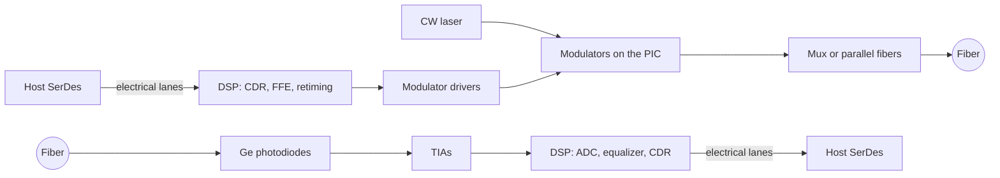
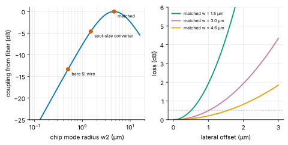
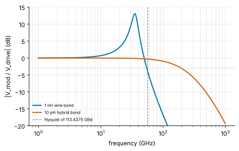

<!-- status: verified -->
# 24-08 · Silicon Photonics and Optical Transceivers

| | |
|---|---|
| **Course** | [24 · High-Speed I/O, Signal Integrity and Photonics](../README.md) |
| **University equivalent** | The integrated-photonics and transceiver lectures of a graduate photonics or optical-communications course: waveguides and their single-mode conditions, fiber-to-chip couplers, photonic integration, transmitter and receiver budgets and transceiver architecture (Chrostowski & Hochberg, *Silicon Photonics Design*, chapters on waveguides, grating and edge couplers, modulators and detectors; Agrawal, *Fiber-Optic Communication Systems*, chapters on transmitters, receivers and system design) |
| **Prerequisites** | [24-07](24-07-photonics-fundamentals.md) (fiber, modulators, receivers, link budgets), [24-06](24-06-d2d-memory-phys-scale-up.md) (hybrid bonding, shoreline density), [24-04](24-04-dsp-serdes-and-fec.md) (DSP SerDes and FEC), [24-02](24-02-eye-diagrams-jitter-ber.md) (Q and BER), [09-14](../../09-semiconductor-devices/chapters/09-14-optoelectronic-devices.md) (band gaps, photodiodes, lasers), [04-09](../../04-physics-for-ee/chapters/04-09-waves-and-optics.md) (Snell's law, total internal reflection) |
| **Estimated study hours** | 6 |
| **Last verified** | 2026-11-25 |

**Learning objectives.** After this chapter you can:

1. Explain from band gaps why silicon carries light at 1310 and 1550 nm, why its detectors are germanium and why its lasers come from III-V materials.
2. Compute a waveguide's critical angle and single-mode thickness, and the coupling loss between two mode sizes with and without misalignment.
3. Derive a grating coupler's period from phase matching and estimate its optical bandwidth.
4. Size a transmitter's laser from a loss budget, and the driver-to-modulator parasitics a given symbol rate allows.
5. Explain what the DSP in a pluggable transceiver does, and show how impairments accumulate differently in retimed and linear links.
6. Estimate module power, energy per bit, yield and the value of wafer-level test, and question vendor and analyst figures.

---

## 1. Big picture

24-07 treated an optical link as a laser, a modulator, a fiber and a photodiode. In a datacenter those parts are not discrete: they are integrated on a chip, packaged with electronics into a **transceiver** and plugged into a switch or network card by the hundreds of thousands. **Silicon photonics** builds the optical parts (waveguides, splitters, modulators, multiplexers and germanium photodiodes) on silicon wafers in CMOS-style fabs, so that optics inherits the yield, scale and lithographic precision of chipmaking. This chapter explains what silicon can and cannot do for light, how light gets on and off a chip, how the photonic chip meets its driver electronics, and what is inside an 800 Gb/s or 1.6 Tb/s pluggable module, including the DSP, which vendors treat as its largest removable power consumer.

- **Every AI cluster's scale-out network** runs on optical transceivers: one at each end of every switch-to-switch and most server-to-switch links.
- **Module power and cost** scale with the number of GPUs, and vendors treat the DSP inside each module as the largest consumer they can remove [Industry estimate; R-535] (24-09 is about removing it).
- **Foundries now sell photonics** as a process: TSMC, GlobalFoundries and Samsung all have platforms aimed at AI optics.
- **Coupling and packaging, not the photonic chip itself,** set much of the loss, yield and cost.
- **The same building blocks** move into the switch package in co-packaged optics (24-09) and into optical I/O chiplets.

## 2. Intuition first

**A circuit board for light.** A photonic integrated circuit (PIC) is to light what a printed circuit board is to current. Waveguides are the wires: strips of silicon a few hundred nanometres across that trap light by total internal reflection. Splitters and combiners are the junctions; modulators and photodiodes are the transducers between the electrical and optical worlds; and couplers are the connectors where the chip meets fiber.

**A bureau de change with fees at every counter.** A transceiver converts electrical bits to light and back. Like a currency exchange, every step charges a fee, paid here in decibels of optical power: the laser-to-chip coupling, the splitter, the modulator's insertion loss and bias point, the chip-to-fiber coupler, the connectors. The fees add, and the laser must be bright enough to pay them all and still leave the receiver its minimum.

*Where the analogy breaks.* A bank can always print more currency, but a silicon chip cannot make more light: silicon has no useful optical gain, so there is no cheap on-chip amplifier to restore a signal after the fees. And unlike money, light also arrives with noise added at the far end, so the budget is about signal-to-noise ratio, not just quantity.

*Figure 0. A retimed pluggable transceiver. The DSP faces both the host's electrical channel and the optical channel, and retimes the data at each boundary.*

## 3. Theory

### 3.1 What silicon can and cannot do for light

A photon is absorbed only if its energy $hc/\lambda$ exceeds the material's band gap $E_g$ (09-14). The longest wavelength a material absorbs, its **cutoff wavelength**, is therefore

$$
\lambda_c = \frac{hc}{E_g} = \frac{1239.84\ \text{nm·eV}}{E_g}.
$$

Silicon's 1.12 eV gap gives $\lambda_c$ = 1107 nm (Example 24-08.1). The datacenter wavelengths of 1310 and 1550 nm lie beyond it, so **silicon is transparent there**: a silicon waveguide carries light with little absorption, which is the whole reason silicon photonics works.

The same fact means **silicon cannot detect** that light. Germanium, which can be grown on silicon, has a direct transition at about 0.80 eV, putting its absorption edge near 1550 nm: Ge photodiodes absorb strongly in the O-band and weaken toward the long end of the C-band. Ge's indirect gap (0.66 eV) extends weak absorption further.

Nor can silicon **lase**. Its gap is indirect: an electron at the conduction-band minimum and a hole at the valence-band maximum differ in crystal momentum, so recombination needs a phonon and is slow, and non-radiative processes win (09-14). Lasers therefore come from direct-gap III-V compounds (InP-based for 1310 nm and 1550 nm) and are attached to the silicon chip in one of three ways:

- **External laser**: a separate continuous-wave (CW) laser coupled in through fiber or micro-optics. Simple and replaceable; costs a coupling loss.
- **Flip-chip or micro-optic attach**: a finished laser die mounted on the PIC. Needs sub-micrometre alignment.
- **Heterogeneous integration**: III-V material bonded to the silicon wafer and processed into lasers there. Lowest coupling loss; the laser's yield and reliability become the PIC's.

Modulation in silicon uses the **free-carrier plasma-dispersion effect**: free electrons and holes lower silicon's refractive index and add absorption, so changing their density in the waveguide changes the light's phase. A reverse-biased pn junction across the waveguide **depletes** carriers, which is fast (limited by the junction's RC) but weak; a forward-biased pin junction **injects** them, which is strong but slow (limited by carrier lifetime). Silicon lacks the linear electro-optic effect that lithium niobate uses, so the index change is small, which is why silicon modulators are long (millimetres for an MZM, 24-07) or resonant (rings).

### 3.2 Waveguides: guiding light by index contrast

A waveguide core of index $n_1$ surrounded by cladding of index $n_2 < n_1$ traps rays that hit the boundary beyond the **critical angle** (measured from the normal):

$$
\theta_c = \arcsin\frac{n_2}{n_1}.
$$

Silicon ($n_1 \approx 3.48$ near 1550 nm) in silicon dioxide ($n_2 \approx 1.44$) gives $\theta_c$ = 24.4°, so almost any ray is trapped. A single-mode fiber's core differs from its cladding by only a fraction of a percent, giving $\theta_c$ near 85° (Example 24-08.2): only rays nearly parallel to the axis stay inside. This **index contrast** is silicon photonics' defining feature. High contrast squeezes the light into a small cross-section and lets waveguides bend tightly without leaking, so thousands of components fit on a chip. It also makes the mode tiny compared with a fiber's, which is the coupling problem of §3.3.

**How thin must a waveguide be to carry one mode?** Take a symmetric slab of thickness $d$. A guided ray bounces between the faces; after one round trip across the slab its transverse phase must repeat, so

$$
2k_xd - 2\phi_r = 2\pi m, \qquad m = 0, 1, 2, \dots
$$

where $k_x$ is the transverse wavenumber in the core and $\phi_r$ the phase shift on each reflection. A mode reaches cutoff when its ray grazes the critical angle; there $\phi_r = 0$ and $k_x = k_0\sqrt{n_1^2 - n_2^2}$ (with $k_0 = 2\pi/\lambda$), because the longitudinal wavenumber has fallen to $k_0n_2$. Mode $m$ therefore first appears when $k_0\sqrt{n_1^2 - n_2^2}\,d = m\pi$. The slab is single-mode while the first higher mode ($m$ = 1) is still cut off:

$$
d < \frac{\lambda}{2\sqrt{n_1^2 - n_2^2}}.
$$

For silicon in oxide at 1550 nm this is 245 nm, which is why silicon photonics uses silicon layers a couple of hundred nanometres thick. For a fiber, $\sqrt{n_1^2 - n_2^2}$ is the numerical aperture of 04-09.

> **Going deeper — the fiber's 2.405.** A round core needs Bessel functions rather than a slab's sines. Its first higher mode appears when $V = (\pi d/\lambda)\,\mathrm{NA}$ reaches 2.405, the first zero of the Bessel function $J_0$. The slab's condition is $V < \pi/2$ in the same notation. The physics is identical: a thicker core or higher contrast admits more modes.

### 3.3 Getting light on and off the chip

A silicon waveguide's mode is well under a micrometre across; a single-mode fiber's is 9.2 µm in mode-field diameter at 1310 nm [R-526]. Butt them together and most of the light misses.

**The overlap integral.** The fraction of power that couples from one mode into another is the normalized overlap of their fields:

$$
\eta = \frac{\left|\iint E_1E_2^*\,dA\right|^2}{\iint |E_1|^2\,dA \iint |E_2|^2\,dA}.
$$

Model each mode as a circular Gaussian, $E_i = \exp(-r^2/w_i^2)$, where $w_i$ is the radius at which the field falls to $1/e$ (half the mode-field diameter). Each integral is a Gaussian integral:

> **Math refresher — the Gaussian integral.** $\int_{-\infty}^{\infty} e^{-ax^2}dx = \sqrt{\pi/a}$, so in two dimensions $\iint e^{-ar^2}dA = \pi/a$.

The numerator's integrand is $\exp[-r^2(1/w_1^2 + 1/w_2^2)]$, which integrates to $\pi w_1^2w_2^2/(w_1^2 + w_2^2)$; each denominator integral is $\pi w_i^2/2$. Dividing,

$$
\eta = \left(\frac{2w_1w_2}{w_1^2 + w_2^2}\right)^2.
$$

It equals 1 only when $w_1 = w_2$. A 0.5 µm silicon mode against a 4.6 µm fiber mode couples 4.6% of the light, a 13.4 dB loss (Example 24-08.3).

**Misalignment.** Offset one Gaussian sideways by $d$. Completing the square in the overlap integral leaves an extra factor $\exp[-d^2/(w_1^2 + w_2^2)]$ in the field overlap, so the power coupling gains a factor

$$
\eta_d = \exp\!\left(-\frac{2d^2}{w_1^2 + w_2^2}\right).
$$

The tolerance scales with the mode size: matched 4.6 µm modes lose 0.5 dB at 1.56 µm offset, matched 1.5 µm modes at 0.51 µm. Large modes are forgiving; small ones need active alignment, where the assembler moves the fiber while monitoring the light.

**Tilt.** If the beams are tilted by a small angle $\alpha$, the phase of one field ramps across the other, $e^{jk_0\alpha x}$. For two equal Gaussians of radius $w$, the field overlap in $x$ is

$$
\frac{\int e^{-2x^2/w^2}e^{jk_0\alpha x}dx}{\int e^{-2x^2/w^2}dx} = e^{-k_0^2\alpha^2w^2/8}
$$

(completing the square, as for the offset), and squaring it for power gives $e^{-(\pi w\alpha/\lambda)^2}$. The coupling is therefore reduced by

$$
\eta_\alpha = \exp\!\left[-\left(\frac{\alpha}{\theta_{div}}\right)^2\right], \qquad \theta_{div} = \frac{\lambda}{\pi w},
$$

where $\theta_{div}$ is the beam's far-field divergence half-angle. This matters for the grating couplers below.

**Two ways to couple.**

- **Edge couplers** bring the waveguide to the chip's polished edge through an inverse taper (a spot-size converter): the silicon narrows until the mode spills into a larger surrounding waveguide whose mode better matches the fiber. Broadband and polarization-tolerant, but only at the chip edge, and only after the wafer is diced, so they cannot be tested on the wafer.
- **Grating couplers** etch a periodic grating into the waveguide that diffracts light up out of the chip surface toward a fiber held at a small angle. They can sit anywhere on the die and allow **wafer-level optical test**, but they are wavelength- and polarization-selective (§3.4).

### 3.4 Grating couplers

Light in the waveguide travels with propagation constant $\beta = n_{eff}k_0$, where $n_{eff}$ is the mode's effective index (between the cladding's and silicon's). A grating of period $\Lambda$ adds or removes momentum in multiples of $2\pi/\Lambda$. To radiate at angle $\theta$ into air, the in-plane momentum of the radiated light, $k_0\sin\theta$, must match the waveguide's minus one grating vector (first order):

$$
n_{eff}k_0 - \frac{2\pi}{\Lambda} = k_0\sin\theta
\quad\Longrightarrow\quad
\Lambda = \frac{\lambda}{n_{eff} - \sin\theta}.
$$

Here $\theta$ is measured from the surface normal, positive when tilted toward the direction of propagation. A typical design uses a small angle (about 10°) rather than vertical: at vertical emission the grating also meets the second-order Bragg condition and reflects guided light straight back into the waveguide.

**Why gratings are narrowband.** Rearranging, $\sin\theta = n_{eff} - \lambda/\Lambda$. Differentiating, and neglecting the change of $n_{eff}$ with wavelength (a first-order model; the Going deeper block below shows that real dispersion makes the steer larger),

$$
\frac{d\theta}{d\lambda} = -\frac{1}{\Lambda\cos\theta}.
$$

The diffracted beam steers by about a tenth of a degree per nanometre, while the fiber stays put. The tilt loss of §3.3 then gives the coupler's bandwidth: the loss reaches 1 dB when $(\Delta\theta/\theta_{div})^2 = 0.1\ln 10$. Example 24-08.4 finds a 1-dB bandwidth of about 43 nm at 1310 nm. That suits a single-wavelength parallel link (DR4, one wavelength on four fibers) but not CWDM4, whose 1271–1331 nm grid [R-529] spans 60 nm, so CWDM designs favour edge couplers or one grating per wavelength.

> **Going deeper — the grating's own dispersion.** $n_{eff}$ falls with wavelength, $dn_{eff}/d\lambda = -(n_g - n_{eff})/\lambda$, where $n_g$ is the group index (24-07). Differentiating $\sin\theta = n_{eff}(\lambda) - \lambda/\Lambda$ with this term, and using $1/\Lambda = (n_{eff} - \sin\theta)/\lambda$, gives exactly
>
> $$
> \frac{d\theta}{d\lambda} = -\frac{n_g - \sin\theta}{\lambda\cos\theta},
> $$
>
> larger than the first-order $-(n_{eff} - \sin\theta)/(\lambda\cos\theta)$ by the ratio $(n_g - \sin\theta)/(n_{eff} - \sin\theta)$. In silicon waveguides $n_g$ well exceeds $n_{eff}$, so real grating couplers are narrower than the first-order model predicts.

### 3.5 Integrating electronics with photonics

A PIC needs drivers for its modulators and TIAs for its photodiodes (24-07). Three integration styles exist:

| Style | How | Strength | Weakness |
|---|---|---|---|
| Monolithic | Transistors and photonics on one die | Shortest interconnect, one chip | Neither the CMOS nor the photonics is best-in-class |
| 3D stacked | Electronic die (EIC) bonded face to face on the PIC | Short, low-capacitance links; each die in its best process | Bonding cost, thermal coupling |
| 2D / wire bonded | EIC beside the PIC, joined by wire bonds or substrate traces | Cheap, flexible | Inductance and capacitance limit speed |

GlobalFoundries' Fotonix is monolithic; TSMC's COUPE stacks a 65 nm EIC on a PIC with SoIC hybrid bonding [R-538], [R-537].

**Why the interconnect matters: an RLC model.** Model the driver as a voltage source with output resistance $R$, the connection as an inductance $L$, and a lumped modulator (a ring or EAM) as a capacitance $C$. The modulator voltage follows

$$
H(s) = \frac{V_C}{V_S} = \frac{1}{LCs^2 + RCs + 1}
= \frac{\omega_0^2}{s^2 + 2\zeta\omega_0s + \omega_0^2},
\qquad \omega_0 = \frac{1}{\sqrt{LC}},\quad \zeta = \frac{R}{2}\sqrt{\frac{C}{L}}.
$$

On the $j\omega$ axis, with $u = \omega/\omega_0$, $|H|^2 = 1/[(1 - u^2)^2 + (2\zeta u)^2]$. Two results follow (Course 15 derives them in general):

- **Peaking.** For $\zeta < 1/\sqrt 2$, $|H|$ peaks at $u^2 = 1 - 2\zeta^2$ with height $1/(2\zeta\sqrt{1 - \zeta^2})$.
- **Bandwidth.** Setting $|H|^2 = 1/2$ gives $u^4 - 2(1 - 2\zeta^2)u^2 - 1 = 0$, so

$$
f_{3dB} = f_0\sqrt{1 - 2\zeta^2 + \sqrt{(1 - 2\zeta^2)^2 + 1}}.
$$

A wire bond of about a millimetre has an inductance of the order of 1 nH; a hybrid bond's is tiny. Against a 20 fF ring and a 50 Ω driver, the wire bond resonates at 35.6 GHz with 13.1 dB of peaking, inside the 56.7 GHz Nyquist band of a 113.4375 GBd lane, which rings and closes the eye. The hybrid bond shows no peaking and is −3 dB only at 196 GHz (Example 24-08.6). Lumped, low-capacitance modulators at 100+ GBd effectively require 3D integration; long MZMs instead use travelling-wave electrodes, terminated transmission lines (24-01), which trade the resonance for drive power.

### 3.6 The transmitter's optical budget

Work backward from the receiver. The laser must supply

$$
P_{laser} = P_{rx,req} + M + \sum_i L_i \quad \text{(all in dBm or dB)},
$$

where $P_{rx,req}$ is the receiver's required average power, $M$ the margin, and $L_i$ every loss in between: laser-to-chip coupling, splitting, modulator insertion loss, modulation loss, chip-to-fiber coupling, connectors and fiber.

Two entries need care:

- **Modulation loss.** An MZM biased at quadrature transmits half its maximum on average ($\cos^2(\pi/4)$, 24-07), a 3.01 dB cost before any insertion loss.
- **Splitting.** One CW laser feeding $N$ modulators loses $10\log_{10}N$ dB to the split, plus excess loss. Splitting saves lasers, which are expensive and fail more often than passive silicon, at the price of a brighter laser.

The laser's electrical power is its optical output divided by its **wall-plug efficiency**, and real laser subsystems add bias, control and (for some types) cooling overheads on top. Example 24-08.5 shows that the optical floor is a small fraction of a module's power: the electronics dominate.

### 3.7 Pluggable transceivers and the DSP inside

A **pluggable transceiver** is a self-contained module, in a standard form factor such as OSFP or QSFP-DD, that plugs into a switch or network card's front panel. Names encode the optics:

- **DR4**: four lanes on four parallel single-mode fibers each way, one wavelength, 500 m.
- **FR4**: four CWDM4 wavelengths multiplexed on one fiber each way, 2 km.
- **SR8**: eight lanes on multimode fiber, about 100 m (24-07's 802.3df reaches [R-528]).
- **2xDR4 twin port**: two DR4 interfaces in one module, as in NVIDIA's 800 Gb/s and 1.6 Tb/s OSFPs [R-533], [R-534].

Inside a **retimed** module the DSP does four jobs:

1. **Host-side SerDes.** It terminates the electrical channel from the switch ASIC, with its own CTLE, FFE, DFE and CDR (24-03, 24-04).
2. **Line-side equalization.** It pre-distorts the drive to the modulator and equalizes the received optical signal through an ADC and FFE, compensating bandwidth-limited lasers, drivers and TIAs and some dispersion.
3. **Retiming.** It recovers the clock and makes fresh decisions at each boundary, so the host channel and the optical channel are budgeted separately.
4. **FEC handling.** Depending on the standard it passes the host's FEC through or adds its own (24-04 discusses the concatenated inner code for 200 Gb/s-per-lane optics).

Module power sits around 20 pJ/bit: 16 W typical for an 800 Gb/s twin-port module and 33.5 W maximum for a 1.6 Tb/s one [R-533], [R-534]. No primary source gives a clean percentage for the DSP's share, but vendor evidence for removing parts of it is consistent: Semtech quotes under 15 W for a 1.6 Tb/s linear-receive module against about 20 W for fully digital ones, and Marvell claims its 3 nm DSP will cut 1.6 Tb/s module power by over 20% against its 5 nm generation [R-535].

### 3.8 Retimed against linear: how impairments accumulate

Consider a link of $n$ segments (host channel, optical channel, far host channel). Each segment alone would deliver an eye with $Q_i$ (24-02), with independent Gaussian noise.

**Retimed.** Each boundary makes a decision, so each segment contributes its own errors and nothing else carries over. For small error rates the BERs add:

$$
\mathrm{BER}_{retimed} \approx \sum_i Q(Q_i),
$$

where $Q(x)$ is the Gaussian tail function of 24-02.

**Linear.** Nothing decides until the final receiver. With unity-gain segments the signal swing is common and the noise variances add, $\sigma^2 = \sum\sigma_i^2$; since $Q_i = a/\sigma_i$ for a common eye half-height $a$,

$$
\frac{1}{Q^2} = \sum_i\frac{1}{Q_i^2}.
$$

Three segments each good for 10⁻¹² ($Q_i$ = 7.03) give 3 × 10⁻¹² retimed but $Q$ = 4.06 and BER 2.4 × 10⁻⁵ linear (Example 24-08.7). To reach 10⁻¹² linearly, each segment needs $\sqrt 3$ times the $Q$, 4.77 dB more electrical SNR. That is the price of removing the DSP, and the engineering problem of 24-09's linear-drive optics: the host SerDes must equalize the whole chain, and every segment's budget shrinks.

> **Going deeper — what this model leaves out.** Real segments are not unity-gain and their impairments are not all Gaussian: ISI from one segment can be equalized by the final receiver only if the overall response is still invertible, and nonlinear distortion (a saturated driver, a ring's nonlinear transfer) does not add like noise. Jitter also accumulates through a linear chain, while each retimer resets it to its own CDR's output. The $1/Q^2$ rule is the right first estimate, not the final word.

### 3.9 Yield and test

A PIC with $n$ lanes, each of which works with probability $y$, works with probability $Y = y^n$ if failures are independent. Compound yield punishes lane count: eight lanes at 99% yield 92.3%. A defective PIC found only after packaging wastes the package, the laser attach and the assembly time as well. If a PIC costs $c_P$ and assembly $c_A$, the cost per good module is

$$
\text{no wafer test:}\ \frac{c_P + c_A}{Y}, \qquad
\text{perfect wafer test:}\ \frac{c_P}{Y} + c_A,
$$

because testing first means only good PICs are assembled: the **known-good die** argument of 24-06. Grating couplers make wafer-level optical test possible, which is one reason they persist even where edge couplers serve the final product.

## 4. Worked examples

### Example 24-08.1 · Which materials absorb (tier A)

**Setup.** Find the cutoff wavelength of silicon (1.12 eV), germanium's direct transition (0.80 eV), germanium's indirect gap (0.66 eV) and In₀.₅₃Ga₀.₄₇As (0.75 eV), all at 300 K (textbook values; Sze). Which can detect 1310 nm and 1550 nm light?

**Solution.**

- $hc/q$ = **1239.84** nm·eV.
- Silicon: $1239.84/1.12$ = **1107** nm: transparent at 1310 and 1550 nm, so it guides but cannot detect.
- Germanium, direct: **1550** nm; indirect: **1879** nm. Strong O-band detection, weakening across the C-band.
- InGaAs: **1653** nm: detects both windows, which is why discrete telecom photodiodes use it.

**Units check.** (J·s)(m/s)/(eV) with 1 eV = q J: m. ✓

**Sanity check.** 24-07 found a 1310 nm photon carries 0.946 eV: below silicon's 1.12 eV, above germanium's 0.80 eV. ✓

### Example 24-08.2 · Guiding light in silicon (tier A)

**Setup.** Near 1550 nm, silicon has $n$ = 3.48 and silicon dioxide 1.44. A single-mode fiber has core and cladding indices of 1.4504 and 1.4447 (assumed). Find (a) each critical angle, (b) the fractional index contrast $\Delta = (n_1 - n_2)/n_1$ of each and their ratio, (c) the largest single-mode thickness of a silicon slab in oxide at 1550 nm, and (d) the fiber's numerical aperture and largest single-mode core diameter ($V$ < 2.405).

**Solution.**

- (a) $\arcsin(1.44/3.48)$ = **24.4**°; $\arcsin(1.4447/1.4504)$ = **84.9**°.
- (b) **0.586** and **0.0039**: silicon's contrast is **149** times the fiber's.
- (c) $\sqrt{3.48^2 - 1.44^2}$ = **3.17**; $d < 1.55/(2 \times 3.17)$ = **0.245** µm.
- (d) NA = **0.128**; $d < 2.405 \times 1.55\ \mu\text{m}/(\pi \times 0.128)$ = **9.2** µm.

**Units check.** µm/(dimensionless) = µm. ✓

**Sanity check.** A silicon waveguide's core is about 38 times thinner than a fiber's, so its mode is far smaller, and coupling the two is a real problem (Example 24-08.3).

### Example 24-08.3 · Coupling a fiber to a chip (tier B)

**Setup.** A single-mode fiber's mode has $w$ = 4.6 µm (MFD 9.2 µm [R-526]). Find the coupling efficiency and loss into a mode of (a) $w$ = 0.5 µm (a bare silicon waveguide, modelled as a Gaussian), (b) $w$ = 1.5 µm (after a spot-size converter) and (c) $w$ = 4.0 µm. (d) What lateral offset costs 0.5 dB between matched modes of 4.6 µm, and of 1.5 µm?

**Solution.**

- (a) $(2 \times 4.6 \times 0.5/(4.6^2 + 0.5^2))^2$ = **0.046**, **−13.4** dB.
- (b) **0.348**, **−4.6** dB.
- (c) **0.981**, **−0.08** dB.
- (d) Matched: $\eta_d = \exp(-d^2/w^2)$; setting it to $10^{-0.05}$ gives $d = w\sqrt{0.05\ln 10}$: **1.56** µm and **0.51** µm.

**Units check.** Ratios of µm² are dimensionless. ✓

**Sanity check.** A mode-size mismatch of 9:1 wastes 95% of the light. Expanding the chip's mode buys both efficiency and alignment tolerance: the 4.6 µm match tolerates three times the offset of the 1.5 µm one.

### Example 24-08.4 · A grating coupler (tier B)

**Setup.** A grating coupler at 1310 nm has $n_{eff}$ = 2.8 (assumed) and radiates at 10° into air toward a fiber with $w$ = 4.6 µm. Find (a) the period, (b) the angular dispersion, (c) the steer across CWDM4's 60 nm, (d) the fiber beam's divergence half-angle, (e) the 1-dB bandwidth, and (f) the loss 30 nm from the design wavelength.

**Solution.**

- (a) $1310/(2.8 - \sin 10°)$ = **499** nm.
- (b) $1/(\Lambda\cos 10°)$ = 2.04 × 10⁻³ rad/nm = **0.117**°/nm.
- (c) $60 \times 0.117$ = **7.0**°.
- (d) $\lambda/(\pi w)$ = **5.19**°.
- (e) 1 dB when $\Delta\theta = 5.19° \times \sqrt{0.1\ln 10}$ = **2.49**°, that is $\pm 21$ nm: about **43** nm in total.
- (f) $\Delta\theta$ = 3.50°: $10\log_{10}e^{-(3.50/5.19)^2}$ = **−2.0** dB.

**Units check.** nm/(nm) dimensionless; rad/nm → °/nm by 180/π. ✓

**Sanity check.** The grating steers its beam across a fiber's whole acceptance over a few tens of nanometres. A single-wavelength DR4 lane is unaffected; a CWDM4 grid spanning 60 nm would lose up to 2 dB at its outer channels, too much for a link budget of a few dB. This first-order model is optimistic: with $n_{eff}$'s dispersion (Going deeper, §3.4) and a group index of 3.6–4.0 (assumed), the steer is 1.30–1.46 times larger and the 1-dB band about 33–29 nm.

### Example 24-08.5 · Laser power for a lane (tier B)

**Setup.** A silicon-photonics DR4 lane must deliver −8.0 dBm average at the far receiver with 2 dB margin (assumed). Fiber is 500 m at 0.36 dB/km [R-526] with two connectors of 0.5 dB; the chip-to-fiber coupler loses 1.5 dB; the depletion MZM is 2 mm long at 20 dB/cm (within R-530's 10–30 dB/cm) and biased at quadrature. One CW laser feeds four lanes through a 1×4 splitter with 0.5 dB excess loss; laser-to-chip coupling loses 1.5 dB (all assumed). Find (a) the power needed at each modulator's input, (b) the laser output, (c) its electrical power at 15% wall-plug efficiency (assumed), and (d) the two lasers' share of a 16 W module [R-533].

**Solution.**

- (a) $-8 + 2 + 0.18 + 1.0 + 1.5 + 4.0 + 3.01$ = **3.69** dBm = **2.34** mW.
- (b) Add $10\log_{10}4 + 0.5$ = 6.52 dB and 1.5 dB: **11.7** dBm = **14.8** mW.
- (c) $14.8/0.15$ = **99** mW.
- (d) Two lasers: **0.20** W, **1.2**% of 16 W.

**Units check.** dBm + dB = dBm; mW ÷ efficiency = mW. ✓

**A caveat on the drive.** A 2 mm modulator at 2 V·cm has $V_\pi$ = 10 V. Driven with 2 V peak to peak at quadrature it reaches an extinction ratio of only 1.89 (2.77 dB), whose penalty of 5.10 dB (24-07 §3.5) the −8.0 dBm requirement is taken to include; a longer modulator would raise the extinction ratio at the cost of more insertion loss.

**Sanity check.** The modulator (4 dB insertion plus 3 dB bias) and the split cost the most. Even if real laser bias, control and cooling overheads multiplied the 0.20 W several times, the light would remain a small part of the module: most of the 16 W is electronics.

### Example 24-08.6 · Wire bond or hybrid bond? (tier B)

**Setup.** A 50 Ω driver drives a 20 fF ring modulator (24-07) through (i) a 1 nH wire bond or (ii) a 10 pH hybrid bond (assumed). Find for each the natural frequency and damping ratio, and (a)–(d) for the wire bond the resonant frequency, peak gain, peaking in dB and bandwidth; (e)–(f) for the hybrid bond its bandwidth; (g) compare with $R$ and $C$ alone, and with the Nyquist frequency of 113.4375 GBd.

**Solution.**

- (a) Wire bond: $f_0 = 1/(2\pi\sqrt{LC})$ = **35.6** GHz; $\zeta = 25\sqrt{20\ \text{fF}/1\ \text{nH}}$ = **0.112**.
- (b) Peak at $f_0\sqrt{1 - 2\zeta^2}$ = **35.1** GHz.
- (c) Height $1/(2\zeta\sqrt{1 - \zeta^2})$ = **4.50**, that is **13.1** dB.
- (d) $f_{3dB}$ = **54.8** GHz.
- (e) Hybrid bond: $f_0$ = **356** GHz, $\zeta$ = **1.12**: no peaking.
- (f) $f_{3dB}$ = **196** GHz.
- (g) $1/(2\pi RC)$ = **159** GHz; Nyquist is **56.7** GHz.

**Units check.** $1/\sqrt{\text{H·F}}$ = 1/s; $\Omega\sqrt{\text{F/H}}$ is dimensionless. ✓

**Sanity check.** The wire bond's −3 dB point (54.8 GHz) sits just below Nyquist, but the real damage is the 13 dB resonance at 35 GHz, which rings for many UIs. The hybrid bond's small inductance even extends the bandwidth past the bare RC value, the inductive-peaking trick of analog design, here with no resonance to pay for it. The lab confirms all four simulated values in ngspice.

### Example 24-08.7 · Retimed or linear? (tier B)

**Setup.** A link has three segments (host channel, optics, far host channel), each of which alone would give BER 10⁻¹². Find (a) each segment's $Q$, (b) the end-to-end BER if every boundary retimes, (c) the end-to-end $Q$ and BER if nothing retimes, and (d) the $Q$ each segment needs, and the extra electrical SNR, for a linear link to reach 10⁻¹².

**Solution.**

- (a) $Q$ = **7.03**.
- (b) $3 \times 10^{-12}$ = **3e-12**.
- (c) $7.03/\sqrt 3$ = **4.06**: BER = **2.4** × 10⁻⁵.
- (d) $7.03\sqrt 3$ = **12.2**, that is $20\log_{10}\sqrt 3$ = **4.77** dB more SNR per segment.

**Units check.** $Q$ and BER are dimensionless. ✓

**Sanity check.** Seven orders of magnitude separate (b) and (c). The KP4 FEC (24-04) tolerates 2.4 × 10⁻⁴, so the linear link of (c) still works with FEC, but with almost no margin left for anything else; this is the budget 24-09's linear optics live in.

### Example 24-08.8 · Module power and energy per bit (tier A)

**Setup.** (a) NVIDIA's 800 Gb/s twin-port DR4 module dissipates 16 W typical [R-533], and its 1.6 Tb/s twin-port module 33.5 W maximum [R-534]. Find each energy per bit and the power ratio. (b) The 1.6 Tb/s module lets a Quantum-X800 QM3400 switch serve 144 ports of 800 Gb/s [R-534]. How many modules is that, what is their maximum total power, and what bandwidth do they carry? (c) Semtech quotes under 15 W for a 1.6 Tb/s linear-receive module against about 20 W for digital ones [R-535]. What fraction and energy per bit is that?

**Solution.**

- (a) $16/800$ Gb/s = **20** pJ/bit; $33.5/1600$ Gb/s = **20.9** pJ/bit; ratio **2.09**.
- (b) $144/2$ = **72** modules; $72 \times 33.5$ = **2.41** kW; $144 \times 800$ Gb/s = **115.2** Tb/s.
- (c) $1 - 15/20$ = **25**%; **12.5** and **9.4** pJ/bit.

**Units check.** W ÷ (bit/s) = J/bit. ✓

**Sanity check.** As published, the two NVIDIA modules show similar energy per bit, but one figure is typical and the other a maximum, so they cannot establish how module power scales with lane rate; a typical-against-typical comparison would likely favour the 1.6 Tb/s module. Note that the figures compare different things: a typical figure, a maximum figure and a vendor's round number for "digital solutions". Before comparing pJ/bit claims, align typical against maximum and the module types.

### Example 24-08.9 · Yield and wafer test (tier B)

**Setup.** An 8-lane PIC's lanes each work with probability 0.99, independently (assumed). Packaging costs twice as much as the PIC (normalized: $c_P$ = 1, $c_A$ = 2, assumed). Find (a) the PIC yield, (b) the cost per good module without wafer test and (c) with perfect wafer test, and (d) the saving.

**Solution.**

- (a) $0.99^8$ = **0.923**.
- (b) $3/0.923$ = **3.25**.
- (c) $1/0.923 + 2$ = **3.08**.
- (d) **5.2**%.

**Units check.** Costs are in units of the PIC's cost. ✓

**Sanity check.** The saving equals the assembly cost wasted on bad PICs, $c_A(1/Y - 1)$, divided by the untested cost. It grows with lane count and with the cost of what is assembled around the PIC (lasers, lenses, a DSP), which is why wafer-level optical test is valuable.

<!-- answer-key -->

| ID | Quantity | Value | Unit |
|---|---|---|---|
| Ex 24-08.1a | hc/q | 1239.84 | nm·eV |
| Ex 24-08.1b | silicon cutoff | 1107 | nm |
| Ex 24-08.1c | germanium direct cutoff | 1550 | nm |
| Ex 24-08.1c1 | germanium indirect cutoff | 1879 | nm |
| Ex 24-08.1d | InGaAs cutoff | 1653 | nm |
| Ex 24-08.2a | critical angle, Si in SiO2 | 24.4 | ° |
| Ex 24-08.2a1 | critical angle, fiber | 84.9 | ° |
| Ex 24-08.2b | contrast, Si in SiO2 | 0.586 | |
| Ex 24-08.2b1 | contrast, fiber | 0.0039 | |
| Ex 24-08.2b2 | contrast ratio | 149 | |
| Ex 24-08.2c0 | sqrt(n1^2 - n2^2), Si in SiO2 | 3.17 | |
| Ex 24-08.2c | single-mode slab thickness | 0.245 | µm |
| Ex 24-08.2d0 | fiber NA | 0.128 | |
| Ex 24-08.2d | single-mode core diameter | 9.2 | µm |
| Ex 24-08.3a | efficiency into 0.5 um | 0.046 | |
| Ex 24-08.3a1 | loss into 0.5 um | -13.4 | dB |
| Ex 24-08.3b | efficiency into 1.5 um | 0.348 | |
| Ex 24-08.3b1 | loss into 1.5 um | -4.6 | dB |
| Ex 24-08.3c | efficiency into 4.0 um | 0.981 | |
| Ex 24-08.3c1 | loss into 4.0 um | -0.08 | dB |
| Ex 24-08.3d | 0.5 dB offset, 4.6 um modes | 1.56 | µm |
| Ex 24-08.3d1 | 0.5 dB offset, 1.5 um modes | 0.51 | µm |
| Ex 24-08.4a | grating period | 499 | nm |
| Ex 24-08.4b0 | angular dispersion | 2.04e-3 | rad/nm |
| Ex 24-08.4b | angular dispersion | 0.117 | °/nm |
| Ex 24-08.4c | steer over 60 nm | 7.0 | ° |
| Ex 24-08.4d | divergence half-angle | 5.19 | ° |
| Ex 24-08.4e0 | 1-dB angle | 2.49 | ° |
| Ex 24-08.4e1 | 1-dB half-bandwidth | 21 | nm |
| Ex 24-08.4e | 1-dB bandwidth | 43 | nm |
| Ex 24-08.4f0 | steer at 30 nm | 3.50 | ° |
| Ex 24-08.4f | loss at 30 nm | -2.0 | dB |
| Ex 24-08.5a | power at modulator input | 3.69 | dBm |
| Ex 24-08.5a1 | power at modulator input | 2.34 | mW |
| Ex 24-08.5b0 | split loss with excess | 6.52 | dB |
| Ex 24-08.5b | laser output | 11.7 | dBm |
| Ex 24-08.5b1 | laser output | 14.8 | mW |
| Ex 24-08.5c | laser electrical power | 99 | mW |
| Ex 24-08.5d | two lasers | 0.20 | W |
| Ex 24-08.5d1 | share of module | 1.2 | % |
| Ex 24-08.6a | wire-bond natural frequency | 35.6 | GHz |
| Ex 24-08.6a1 | wire-bond damping ratio | 0.112 | |
| Ex 24-08.6b | wire-bond peak frequency | 35.1 | GHz |
| Ex 24-08.6c | wire-bond peak gain | 4.50 | |
| Ex 24-08.6c1 | wire-bond peaking | 13.1 | dB |
| Ex 24-08.6d | wire-bond bandwidth | 54.8 | GHz |
| Ex 24-08.6e | hybrid-bond natural frequency | 356 | GHz |
| Ex 24-08.6e1 | hybrid-bond damping ratio | 1.12 | |
| Ex 24-08.6f | hybrid-bond bandwidth | 196 | GHz |
| Ex 24-08.6g | RC bandwidth | 159 | GHz |
| Ex 24-08.6g1 | Nyquist frequency | 56.7 | GHz |
| Ex 24-08.7a | segment Q | 7.03 | |
| Ex 24-08.7b | retimed BER | 3e-12 | |
| Ex 24-08.7c | linear Q | 4.06 | |
| Ex 24-08.7c1 | linear BER | 2.4e-5 | |
| Ex 24-08.7d | Q needed per segment | 12.2 | |
| Ex 24-08.7d1 | extra SNR | 4.77 | dB |
| Ex 24-08.8a | 800G energy per bit | 20 | pJ/bit |
| Ex 24-08.8a1 | 1.6T energy per bit | 20.9 | pJ/bit |
| Ex 24-08.8a2 | power ratio | 2.09 | |
| Ex 24-08.8b | modules | 72 | |
| Ex 24-08.8b1 | total module power | 2.41 | kW |
| Ex 24-08.8b2 | total bandwidth | 115.2 | Tb/s |
| Ex 24-08.8c | LRO saving | 25 | % |
| Ex 24-08.8c1 | digital energy per bit | 12.5 | pJ/bit |
| Ex 24-08.8c2 | LRO energy per bit | 9.4 | pJ/bit |
| Ex 24-08.9a | PIC yield | 0.923 | |
| Ex 24-08.9b | cost without wafer test | 3.25 | |
| Ex 24-08.9c | cost with wafer test | 3.08 | |
| Ex 24-08.9d | saving | 5.2 | % |
| Txt 24-08.a | quadrature modulation loss | 3.01 | dB |
| Txt 24-08.b | silicon core thinner than fiber core | 38 | |
| Txt 24-08.e | fiber critical angle, 2 s.f. | 85 | ° |
| Txt 24-08.f | LightCounting growth per year, 2 s.f. | 20 | % |
| Txt 24-08.g | TrendForce growth, 2 s.f. | 58 | % |
| Txt 24-08.h | dispersive steer ratio, n_g 3.6 | 1.30 | |
| Txt 24-08.i | dispersive steer ratio, n_g 4.0 | 1.46 | |
| Txt 24-08.j | 1-dB band, n_g 3.6 | 33 | nm |
| Txt 24-08.k | 1-dB band, n_g 4.0 | 29 | nm |
| Txt 24-08.l | MZM half-wave voltage, 2 mm | 10 | V |
| Txt 24-08.m | extinction ratio at 2 V pp | 1.89 | |
| Txt 24-08.n | extinction ratio at 2 V pp | 2.77 | dB |
| Txt 24-08.o | its penalty | 5.10 | dB |
| Txt 24-08.c | grating steer per nm, 1 s.f. | 0.1 | °/nm |
| Txt 24-08.d | wire-bond peaking frequency, 2 s.f. | 35 | GHz |

## 5. Simulate it

The lab is [labs/24-08-lab/](../labs/24-08-lab/README.md). `bond.cir` simulates Example 24-08.6 in ngspice; `siph.py` computes mode overlaps (closed form and numerical), grating-coupler spectra, transmitter budgets and the retimed-against-linear comparison; the notebook ties them together.

*Figure 1. Left: power coupled from a fiber mode ($w$ = 4.6 µm) into a chip mode of radius $w_2$. Right: loss against lateral offset for matched modes; larger modes tolerate proportionally larger offsets (Example 24-08.3).*

*Figure 2. A 50 Ω driver into a 20 fF ring through a 1 nH wire bond (13 dB resonance at 35 GHz) and a 10 pH hybrid bond (no peaking, −3 dB at 196 GHz). The dashed line is the 56.7 GHz Nyquist frequency of 113.4375 GBd (Example 24-08.6).*

**Predict, then run:**

1. *Predict* the wire bond's peaking and bandwidth, then run `ngspice -b bond.cir`. Then halve the inductance and predict again (Problem 24-08.6).
2. *Predict* the coupling efficiency between 4.6 µm and 1.5 µm Gaussians, then compute the overlap integral numerically on a grid.
3. *Predict* the grating coupler's 1-dB bandwidth, then plot its spectrum.
4. *Predict* the end-to-end BER of a linear chain of one, two and three segments, then compute it.

## 6. Engineering tradeoffs

| Knob | Improves | Costs | Typical decision owner |
|---|---|---|---|
| Edge coupler instead of grating coupler | Bandwidth, polarization tolerance, loss | No wafer-level test, edge placement only | Photonics architect |
| Larger spot-size converter | Coupling and alignment tolerance | Area, taper length | Photonics designer |
| One laser split to $N$ lanes | Fewer lasers, lower cost and failure rate | $10\log_{10}N$ dB more laser power | Module architect |
| 3D-stacked EIC on PIC | Bandwidth, energy per bit | Bonding cost, thermal coupling | Packaging and product lead |
| Retimed (DSP) module | Separate, robust budgets for each segment | Power (the largest removable consumer, by vendors' accounts), latency, cost | System architect and customer |
| Wafer-level optical test | Fewer bad PICs assembled | Test time, grating couplers on die | Test and operations |
| More lanes per PIC | Bandwidth per module | Compound yield | Product line manager |

## 7. Numbers to know

| Quantity | Value | Source |
|---|---|---|
| Cutoff wavelengths | Si 1107 nm; Ge ≈ 1550 nm (direct); InGaAs ≈ 1650 nm | Example 24-08.1 |
| Indices near 1550 nm | Si ≈ 3.48, SiO₂ ≈ 1.44 | Chrostowski & Hochberg |
| Single-mode silicon thickness | < 0.25 µm at 1550 nm | Example 24-08.2 |
| Single-mode fiber MFD | 9.2 µm at 1310 nm | [R-526] |
| Bare fiber-to-silicon coupling | ≈ −13 dB without mode conversion | Example 24-08.3 |
| Grating coupler steer | ≈ 0.1°/nm | Example 24-08.4 |
| 800G twin-port DR4 module (as of Nov 2026) | 16 W typical, 17 W max | [R-533] |
| 1.6T twin-port DR4 module (as of Nov 2026) | 33.5 W max | [R-534] |
| Pluggable energy per bit | ≈ 20 pJ/bit | Example 24-08.8 |
| Retimed vs linear | $1/Q^2$ adds linearly; BER adds when retimed | §3.8 |

## 8. Common mistakes

- **Assuming silicon can detect telecom light.** It is transparent beyond 1107 nm; detectors are germanium.
- **Adding coupling efficiencies instead of multiplying them** (or adding their dB instead of multiplying linear values). Efficiencies multiply; their dB losses add.
- **Using the mode-field diameter as the Gaussian radius.** $w$ is half the MFD.
- **Forgetting the quadrature-bias loss.** An MZM at quadrature passes half its peak power on average: 3 dB before insertion loss.
- **Comparing a typical module power with a maximum one,** or modules of different types, when quoting pJ/bit.
- **Treating a linear chain as retimed.** Without decisions, segment impairments add in $1/Q^2$, not in BER.
- **Ignoring compound yield.** A lane yield that looks excellent becomes a mediocre module yield across 8 or 16 lanes.

## 9. Practitioner lens

**State of the art (as of Nov 2026).**

- *Pluggables* [Established for datasheets]. 800 Gb/s twin-port DR4 modules run at about 16 W and 1.6 Tb/s twin-port modules at up to 33.5 W, both with 1310 nm single-mode optics [R-533], [R-534]. 200 Gb/s-per-lane optics use 113–115 GBd PAM4 (24-04, [R-529]).
- *DSPs* [Industry estimate, vendor claims]. Marvell's 3 nm 1.6 Tb/s DSP (announced 3 Dec 2024) claims over 20% lower module power than its 5 nm generation; LightCounting expects PAM4 DSP shipments to more than triple from 2024 to 2029, to nearly 127 million a year [R-535].
- *Foundry platforms* [Industry estimate: roadmaps as reported]. TSMC's COUPE stacks a 65 nm EIC on a PIC with SoIC-X; TSMC plans its first 200 Gb/s-per-wavelength micro-ring modulator in production in 2026, with density rising from 0.5 to 4 Tb/s/mm by 2030 [R-537]. GlobalFoundries launched the monolithic Fotonix platform in 2022 and on 17 Nov 2025 announced its acquisition of Singapore's Advanced Micro Foundry, calling itself the largest pure-play silicon-photonics foundry by revenue; Samsung targets 5 pJ/bit for a stacked engine in 2027, from about 10 pJ/bit [R-538].
- *Optical I/O chiplets* [Established: conference disclosure]. Ayar Labs' TeraPHY carries 8.192 Tb/s bidirectional (4.096 Tb/s each way) through 16 UCIe-S modules and 8 optical ports, each with 16 wavelengths at 32 Gb/s NRZ per direction [R-540].
- *Standards* [Established; perishable]. IEEE P802.3dj (200 Gb/s per lane) passed its third Standards Association recirculation on 10 Oct 2026 with 133 approve and 3 disapprove votes and is on the 8 Dec 2026 RevCom agenda; it was not yet approved when checked [R-536], [R-519].
- *Market* [Industry estimate; contested by scope]. LightCounting put AI-cluster Ethernet optics plus CPO at $8 B in 2025, rising to $20 B in 2030 (about 20% a year); TrendForce put AI optical transceivers at $16.5 B in 2025 and $26 B in 2026 (about 58%); in October 2026 LightCounting forecast 120% Ethernet transceiver growth for 2026 [R-539]. The ranges differ mainly in scope (which products, which customers), so ask what is counted before comparing.

**Why it matters commercially.** Transceivers scale with every GPU deployed, and their DSPs, lasers and silicon photonics are separate businesses with different margins and bottlenecks. Foundry entry (TSMC, GF, Samsung) changes who captures photonic value: an optics company that once owned its process may become a design house on a foundry platform. For M&A, the durable assets are usually coupling and packaging know-how, laser supply, DSP IP and qualified customer relationships, not the PIC layout itself.

**Marketing vs Reality.**

- *"20 pJ/bit module."* Typical or maximum? Which form factor and reach? Does it include the host's SerDes?
- *"2× power efficiency and 10× lower latency than pluggables."* A foundry roadmap claim against which pluggable, at which lane rate [R-537]?
- *"Tb/s per mm."* One direction or both, electrical or optical side, and is it the standard's bump map or the chip's?
- *"Largest silicon-photonics foundry."* Note the qualifiers: pure-play, by revenue [R-538].
- *"Market growing 120%."* Which segment, whose forecast, and how does it compare with others' scope [R-539]?

**Questions for engineering leaders.**

1. **"How do you couple light on and off the chip, and is the assembly passive or active?"** *Strong:* coupler type, measured loss and its spread, alignment tolerance and throughput. *Evasive:* "low-loss coupling."
2. **"What do you test at wafer level, and what escapes to assembly?"** *Strong:* optical and electrical wafer test coverage, known-good-die yield, escape rate. *Evasive:* "we test the finished module."
3. **"Where does the module's power go?"** *Strong:* a breakdown across DSP, drivers and TIAs, laser and control, against typical and worst case. *Evasive:* a single typical number.
4. **"Where do your lasers come from, and what happens if that supplier is constrained?"** *Strong:* qualified second sources, split ratios that reduce laser count. *Evasive:* "we have a strategic partner."
5. **"What changes at 400 Gb/s per lane?"** *Strong:* modulator bandwidth, driver integration (3D stacking), DSP node and power. *Evasive:* "the roadmap is on track."

## 10. Concept check

**Q1.** Why does silicon make good waveguides but poor detectors at 1310 nm?

Answer

A 1310 nm photon carries 0.946 eV, less than silicon's 1.12 eV gap, so silicon cannot absorb it: the light passes with little loss (good for waveguides) and makes no photocurrent (useless for detection). Germanium, with its 0.80 eV direct transition, absorbs it.

**Q2.** Why is the high index contrast of silicon both a blessing and a curse?

Answer

It confines light tightly, allowing sub-micrometre waveguides and tight bends, so circuits are dense. But the resulting mode is far smaller than a fiber's, so direct coupling loses most of the light and alignment tolerances are sub-micrometre unless the mode is expanded.

**Q3.** A designer quotes a grating coupler's peak loss of 2 dB. What else do you need to know before using it in a CWDM4 transceiver?

Answer

Its bandwidth (the loss at the outer channels, 30 nm from the centre) and its polarization dependence. A grating's beam steers with wavelength by about 0.1°/nm, so the outer CWDM4 channels can lose a further couple of dB.

**Q4.** Why does a 1 nH wire bond trouble a 20 fF ring modulator more than a 2 mm travelling-wave MZM?

Answer

The ring is a lumped capacitance, so the bond's inductance forms a lightly damped resonance with it (13 dB at 35 GHz), inside the signal band. A travelling-wave MZM presents a terminated transmission line, ideally a resistive load, and the driver connection is designed as part of that line.

**Q5.** Three segments each give BER 10⁻¹² alone. Why is the linear chain so much worse than the retimed one?

Answer

Retiming makes a decision at each boundary, so only each segment's own errors count, and they add: 3 × 10⁻¹². A linear chain passes every segment's noise to the final receiver, where the variances add: $Q$ falls by $\sqrt 3$, from 7.03 to 4.06, and the BER rises to 2.4 × 10⁻⁵.

**Q6.** Why does wafer-level test save more as modules gain lanes and components?

Answer

Yield falls as the product of lane yields, so more lanes means more bad PICs; and every bad PIC assembled wastes the lasers, optics and DSP built around it. Testing first means only good PICs collect that assembly cost.

**Q7.** Two vendors quote 12.5 and 20.9 pJ/bit for 1.6 Tb/s modules. Which is better?

Answer

Neither comparison is valid yet: one is a vendor's round figure for "digital" modules, the other a datasheet maximum for a specific twin-port module. Align typical against typical (or maximum against maximum), the same module type and reach, and whether host-side functions are included.

Now try the [24-08 problem set](../problems/24-08-problems.md).

## 11. Key terms

[Silicon photonics](../../../reference/glossary.md#silicon-photonics) · [Photonic integrated circuit (PIC)](../../../reference/glossary.md#photonic-integrated-circuit-pic) · [Cutoff wavelength](../../../reference/glossary.md#cutoff-wavelength) · [Critical angle](../../../reference/glossary.md#critical-angle) · [Index contrast](../../../reference/glossary.md#index-contrast) · [Mode field diameter](../../../reference/glossary.md#mode-field-diameter) · [Edge coupler](../../../reference/glossary.md#edge-coupler) · [Grating coupler](../../../reference/glossary.md#grating-coupler) · [Pluggable transceiver](../../../reference/glossary.md#pluggable-transceiver) · [Retiming](../../../reference/glossary.md#retiming) · [Known-good die (KGD)](../../../reference/glossary.md#known-good-die-kgd) · [Hybrid bonding](../../../reference/glossary.md#hybrid-bonding) · [Wall-plug efficiency](../../../reference/glossary.md#wall-plug-efficiency)

## 12. Connections

- **Previous:** [24-07 Photonics Fundamentals](24-07-photonics-fundamentals.md): fiber, modulators, receivers and link budgets.
- **Next:** [24-09 Linear-Drive and Co-Packaged Optics](24-09-lpo-and-cpo.md): removing the DSP (LPO, LRO) and moving the optics into the switch package (CPO).
- **Prerequisites used:** [09-14](../../09-semiconductor-devices/chapters/09-14-optoelectronic-devices.md) for band gaps; [24-06](24-06-d2d-memory-phys-scale-up.md) for hybrid bonding and known-good die; [24-02](24-02-eye-diagrams-jitter-ber.md) for Q and BER; [24-04](24-04-dsp-serdes-and-fec.md) for the DSP and FEC.
- **Used later:** Course 25 (packaging and test) and the AI-datacenter capstone.

> **Deeper:** see companion repo *Datacenter Networking* for how transceivers are deployed across fabric tiers, and for optics in scale-up networks.

## 13. Further study

- L. Chrostowski and M. Hochberg, *Silicon Photonics Design* (Cambridge, 2015): chapters on waveguides, grating and edge couplers, modulators and detectors.
- G. P. Agrawal, *Fiber-Optic Communication Systems*: chapters on optical transmitters and receivers.
- S. M. Sze and K. K. Ng, *Physics of Semiconductor Devices*: band-gap data and photodetectors.
- A. Rahim et al., "Taking silicon photonics modulators to a higher performance level," *Advanced Photonics*, 2021 [R-530].
- V. Stojanović, "A UCIe Optical I/O Retimer Chiplet for AI Scale-up," Hot Chips 2025 [R-540].

## 14. Sources

1. Fiber mode-field diameter and loss: [R-526]. CWDM4 grid: [R-529]. Modulator loss: [R-530]. 802.3df reaches: [R-528].
2. NVIDIA 800 Gb/s twin-port module specifications: [R-533].
3. NVIDIA 1.6 Tb/s twin-port module: [R-534].
4. DSP power evidence (Semtech, Marvell, LightCounting via Marvell): [R-535].
5. IEEE P802.3dj ballot status: [R-536], [R-519].
6. TSMC COUPE roadmap: [R-537].
7. GlobalFoundries Fotonix and AMF; Samsung targets: [R-538].
8. Optical transceiver market estimates: [R-539].
9. Ayar Labs TeraPHY: [R-540].
10. Band gaps and refractive indices: Sze & Ng; Chrostowski & Hochberg (textbook values).
