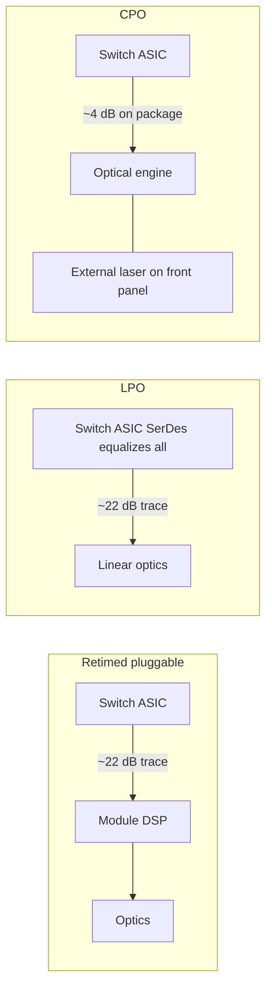
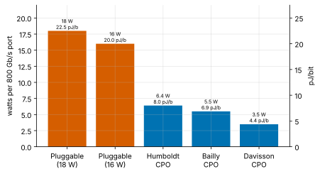
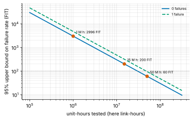

<!-- status: verified -->
# 24-09 · Linear-Drive and Co-Packaged Optics

| | |
|---|---|
| **Course** | [24 · High-Speed I/O, Signal Integrity and Photonics](../README.md) |
| **University equivalent** | A graduate seminar or industry short course on datacenter optical interconnect architecture: linear and retimed optical links, co-packaged optics, external laser sources, and the reliability and serviceability analysis that decides between them (no single textbook; the closest are conference tutorials at OFC and ECOC and the OIF and LPO MSA specifications) |
| **Prerequisites** | [24-08](24-08-silicon-photonics.md) (pluggables, the DSP, retimed against linear links), [24-07](24-07-photonics-fundamentals.md) (link budgets), [24-03](24-03-serdes-architecture.md) (SerDes equalization), [24-01](24-01-signal-integrity-fundamentals.md) (channel loss in dB), [03-05](../../03-probability-statistics-and-random-variables/chapters/03-05-estimation-and-hypothesis-testing.md) (confidence bounds and the rule of three) |
| **Estimated study hours** | 4 |
| **Last verified** | 2026-11-25 |

**Learning objectives.** After this chapter you can:

1. Explain where a pluggable link's energy goes and the two strategies for cutting it: removing the DSP (LPO, LRO) and shortening the electrical path (CPO).
2. Budget a linear link from its segments and explain why linear drive gets harder at 200 Gb/s per lane.
3. Convert vendor claims (dB of loss, watts per port, multipliers) into energy per bit and judge whether they are comparable.
4. Size an external laser source shared across lanes.
5. Bound a failure rate from a zero-failure test and compare the availability cost of pluggable and co-packaged failures.
6. Assess the ecosystem, timing and deal economics of LPO and CPO as of late 2026.

---

## 1. Big picture

24-08 found that a retimed pluggable transceiver costs about 20 pJ/bit and that a cluster of 100,000 GPUs can spend megawatts on optics. There are two ways to cut that. **Linear pluggable optics (LPO)** keep the pluggable form factor but remove its DSP, letting the switch's own SerDes equalize the whole link; **linear receive optics (LRO)** remove only the receive half. **Co-packaged optics (CPO)** go further: they move the optical engines onto the switch package, a few millimetres from the ASIC, so the long electrical trace to the front panel disappears, and they feed the engines from shared, replaceable external lasers. Each step saves power and costs flexibility, serviceability or ecosystem maturity. This chapter quantifies both sides.

- **Every AI fabric switch** is a candidate: 102.4 Tb/s switches have 512 lanes of 200 Gb/s.
- **NVIDIA and Broadcom** announced CPO switches in production or shipping in 2025–2026; LPO has a multi-source agreement with published specifications.
- **The savings are large** (4.6 to 5.1 times less optics power per port by Broadcom's figures, Example 24-09.1), but the evidence on reliability and serviceability is thin.
- **The business model changes**: pluggables are a competitive, multi-vendor market; CPO ties the optics to the switch vendor's package and supply chain.
- **Acquisitions follow**: Marvell's purchase of Celestial AI priced optical interconnect for scale-up at billions of dollars.

## 2. Intuition first

**Three runners, two batons.** A retimed link is a relay with three runners: the host SerDes, the module's DSP and the far host. Each runner takes the baton, cleans it up (makes fresh decisions) and runs a short leg. LPO removes the middle runner: the host must now run the whole course, and every stumble along the way reaches the finish line. CPO shortens the course instead: the electrical legs become a few millimetres, so even one runner has an easy race.

*Where the analogy breaks.* A relay runner adds no time penalty for the handoff, whereas a DSP adds both power and latency. And in a real link the "stumbles" are noise and distortion that add up in a specific way ($1/Q^2$, 24-08), not a simple tally.

*Figure 0. Three ways to connect a switch ASIC to fiber. Loss figures are NVIDIA's for a 200 Gb/s lane [R-543].*

## 3. Theory

### 3.1 Where a pluggable link's energy goes

A front-panel port's electrical path runs from the switch ASIC across the board to the cage, through the connector into the module. At 200 Gb/s per lane NVIDIA quotes up to 22 dB of loss on that path, against about 4 dB on a co-packaged one [R-543]. A link's energy per bit is roughly

$$
E_{bit} \approx E_{SerDes}(\text{channel loss}) + E_{DSP} + E_{driver/TIA} + E_{laser},
$$

where the host SerDes energy grows with the loss it must equalize (24-03, 24-04), the module DSP costs several pJ/bit (24-08), and the optical front end and laser add the rest.

**Reading decibels.** Electrical loss in dB is a power ratio: 22 dB to 4 dB is an 18 dB reduction, a factor of $10^{1.8}$ = 63.1 in power and 7.94 in amplitude. NVIDIA's "63x greater signal integrity" is this ratio [R-543]. Its later Rubin material says "64x" and "optical loss" for the same 22-to-4 dB change [R-550]: 64 would be 18.06 dB, and the loss in question is the electrical channel's. Small inconsistencies like these are normal in marketing copy and worth noticing.

### 3.2 Linear pluggable optics

An **LPO** module keeps linear drivers, modulators, photodiodes and TIAs but has no DSP and no clock recovery. The host SerDes's transmit FFE pre-distorts for the host trace, the module and the optics together, and the far host's receiver (CTLE, FFE, DFE, CDR) equalizes everything in between. Three consequences follow.

1. **The segments' impairments add.** As 24-08 derived, noise-like impairments of a linear chain add as $1/Q^2 = \sum_i 1/Q_i^2$, so each segment's budget shrinks.
2. **The module must be linear.** A retimed module can use limiting (saturating) amplifiers; a linear one must preserve the PAM4 levels' spacing end to end, which costs some of the power saved.
3. **Host and module are co-qualified.** The link works only if this host's SerDes can equalize this module's response. Interoperability therefore needs a specification of the module's linear behaviour, which is what the LPO multi-source agreement (MSA) provides.

The **LPO MSA** formed on 21 March 2024 with 12 founders, including AMD, Arista, Broadcom, Cisco, Intel and NVIDIA. It published 100G-DR-LPO (100 Gb/s per lane, single-mode, up to 800 GbE) in March 2025 and 400G-FR4-LPO (four WDM lanes) in September 2025 [R-541].

**Why 200 Gb/s per lane is harder.** At twice the rate the host channel loses more, the optics' bandwidth is tighter and each segment's $Q$ falls; Example 24-09.3 shows the linear margin shrinking by more than a decibel when only the optical segment degrades. This is the main argument for **LRO** (linear receive optics), which keeps a DSP in the transmit path, so the module retimes what it sends but passes received signals linearly to the host. Juniper describes LRO as offering "roughly half the power and cost savings compared to LPO", and an IEEE overview argues it is the better near-term choice at 200 Gb/s per lane, where initial 1.6 Tb/s LPO needed over 30 W against below 20 W promised for LRO [R-542].

### 3.3 Co-packaged optics

A **CPO** switch places **optical engines** (a PIC stacked with its EIC, 24-08) on the switch package substrate around the ASIC. Fiber leaves the package to the front panel; the lasers sit in front-panel modules and send continuous light to the engines over fiber.

**The external laser source.** OIF's ELSFP implementation agreement defines a field-replaceable front-panel laser module with optical power classes from 11 dBm (LP) to 26 dBm (SHP) per wavelength per fiber core [R-548]. Moving the laser out of the package removes its heat from the hottest place in the box and makes the part easiest to service. One source can feed several lanes through a splitter in the engine; Example 24-09.4 sizes how many. NVIDIA's design uses "one laser per four lanes instead of one per lane" [R-543].

**Energy per port.** Broadcom's three CPO generations illustrate the trend at 800 Gb/s per port [R-545]:

| Generation | Switch | Watts per 800G port |
|---|---|---|
| TH4-Humboldt | 25.6 Tb/s, 4 × 3.2 Tb/s engines | ≈ 6.4 |
| TH5-Bailly | 51.2 Tb/s, 8 × 6.4 Tb/s engines | 5.5 |
| TH6-Davisson | 102.4 Tb/s, 16 × 6.4 Tb/s engines, 200 Gb/s lanes, ELSFP lasers | ≈ 3.5 |

against about 16–18 W for pluggables on the same switch, consistent with 24-08's 16 W module [R-533]. Example 24-09.1 converts these to energy per bit.

### 3.4 Reliability and serviceability

A pluggable that fails is pulled from the front panel and replaced in minutes, and the failure takes out one port. A failed CPO engine may take out every port it serves and, unless the design allows otherwise, require replacing the switch. Two quantities matter:

- **The failure rate** $\lambda$, often quoted in **FIT** (failures per 10⁹ device-hours).
- **The blast radius and repair time**: how many ports one failure removes, and for how long.

With constant failure rates, the expected port-hours lost per port per year is

$$
U = \lambda \times 8766\ \text{h} \times \frac{(\text{ports lost per failure}) \times \text{MTTR}}{\text{ports per failing unit}},
$$

where MTTR is the mean time to repair and 8766 h is an average year. A larger blast radius and longer repair multiply directly; a lower failure rate must compensate.

**What a zero-failure test proves.** If $N$ devices run for a total of $T$ device-hours with no failures, and failures are exponential with rate $\lambda$, the probability of seeing none is $e^{-\lambda T}$. The rate at which that probability is only 5% is the 95% upper confidence bound:

$$
e^{-\lambda_U T} = 0.05 \quad\Longrightarrow\quad \lambda_U = \frac{-\ln 0.05}{T} = \frac{3.00}{T}.
$$

This is the rule of three of 03-05. Broadcom reported one million cumulative device-hours of flap-free CPO operation at Meta in a high-temperature lab [R-546]; Example 24-09.6 shows this bounds the failure rate only to about 3,000 FIT, and that a claim of 100 FIT needs 30 million device-hours without failure. The comparison was also asymmetric: pluggable failure rates came from field data, CPO's from lab stress [R-546].

> **Going deeper — the chi-square form.** With $r$ failures in $T$ device-hours, the two-sided machinery gives $\lambda_U = \chi^2_{0.95,\,2r+2}/(2T)$. For $r$ = 0, $\chi^2_{0.95,2}$ = 5.99, so $\lambda_U = 3.00/T$, the same rule of three. Each observed failure raises the bound, which is why reliability engineers prefer long tests with a few failures to short ones with none.

### 3.5 Ecosystem and economics

**Pluggables** are a mature multi-vendor market: standard form factors, many suppliers, a switch vendor that need not make optics, and an operator that can buy optics separately, mix suppliers and replace failures at the faceplate. **LPO** keeps the form factor but couples host and module qualification. **CPO** changes the industry structure: the optical engines become part of the switch's package and bill of materials, so the switch vendor and its foundry and packaging partners capture the optical value, and the operator gives up mixing suppliers. NVIDIA named a five-vendor chain for its CPO switch in August 2026: TSMC for silicon photonics, SPIL for packaging and test, Lumentum for laser chips, TFC Communication for laser subassemblies and Foxconn for system assembly [R-544]. One analysis calls CPO "an architectural commitment" rather than a component choice [R-549].

**Scale-up is the next battleground.** Copper still carries most scale-up links inside a rack (24-06), but optical scale-up is where several companies place their bets. Marvell's acquisition of Celestial AI (signed 2 December 2025, closed 2 February 2026) paid about $3.25 B upfront for a photonic-fabric chiplet claimed at 16 Tb/s, with up to $2.25 B more contingent on revenue [R-547]. Example 24-09.8 works out the multiples.

## 4. Worked examples

### Example 24-09.1 · The energy-per-bit ladder (tier A)

**Setup.** Convert Broadcom's figures of 6.4, 5.5 and 3.5 W per 800 Gb/s port (Humboldt, Bailly, Davisson) and the 16–18 W of pluggables to pJ/bit [R-545]. What saving does Davisson claim against pluggables, and against Humboldt?

**Solution.**

- $6.4/800$ Gb/s = **8.0** pJ/bit; Bailly **6.9**; Davisson **4.4** pJ/bit.
- Pluggables: **20** to **22.5** pJ/bit.
- Davisson against pluggables: $1 - 3.5/16$ = **78**% to $1 - 3.5/18$ = **81**%, consistent with Broadcom's "~70% reduction".
- Davisson against Humboldt: $1 - 3.5/6.4$ = **45**%.

**Units check.** W ÷ (Gb/s) = nJ/bit; × 1000 = pJ/bit. ✓

**Sanity check.** Each CPO generation improved, but most of the saving came with the first step off the faceplate. Note that a "~70%" claim against a 16–18 W baseline is conservative arithmetic, a rare case of marketing understating.

### Example 24-09.2 · Reading NVIDIA's claims (tier B)

**Setup.** NVIDIA's 2026 product page quotes "25 watts per port with pluggable transceivers versus 5 watts per port with co-packaged optics", without stating the port speed; its 2025 material quoted "3.5x more power efficiency" and power "as low as 9W", and an electrical loss reduction from 22 dB to 4 dB [R-543]. (a) Find the pJ/bit if a port is 1.6 Tb/s, and if it is 800 Gb/s. (b) What baseline does "3.5x" with 9 W imply? (c) Convert the 18 dB loss reduction to power and amplitude ratios.

**Solution.**

- (a) At 1.6 Tb/s: **15.6** and **3.1** pJ/bit. At 800 Gb/s: **31** and **6.25** pJ/bit.
- (b) $9 \times 3.5$ = **31.5** W, a different accounting from 2026's 25 W.
- (c) $10^{1.8}$ = **63.1** in power; $10^{0.9}$ = **7.94** in amplitude.

**Units check.** W ÷ (bit/s) = J/bit. ✓

**Sanity check.** The 1.6 Tb/s reading puts the pluggable at 15.6 pJ/bit, below 24-08's 20.9 pJ/bit datasheet maximum and plausible as a typical figure; the 800 Gb/s reading (31 pJ/bit) would be well above any datasheet in 24-08, so 1.6 Tb/s ports are the likelier meaning. The multiplier rose from 3.5× to 5× between 2025 and 2026 while the baselines changed, so ask for the baseline before quoting either.

### Example 24-09.3 · An LPO budget (tier B)

**Setup.** In an LPO link, the near host channel and the far host channel each alone would give $Q$ = 10 and the optical path (module electronics, optics, fiber) $Q$ = 8 (all assumed). (a) What BER would a retimed module give? (b) Find the linear link's $Q$ and BER. (c) What electrical margin is left above the KP4 threshold (BER 2.4 × 10⁻⁴)? (d) Repeat (b) and (c) if, at 200 Gb/s per lane, the optical path's $Q$ falls to 6.

**Solution.**

- (a) $2Q(10) + Q(8)$ = **6.2** × 10⁻¹⁶.
- (b) $1/\sqrt{0.01 + 1/64 + 0.01}$ = **5.30**: BER = **5.8** × 10⁻⁸.
- (c) KP4 needs $Q$ = **3.49**: margin $20\log_{10}(5.30/3.49)$ = **3.6** dB.
- (d) $1/\sqrt{0.01 + 1/36 + 0.01}$ = **4.57**, BER **2.4** × 10⁻⁶, margin **2.3** dB.

**Units check.** $Q$ and BER are dimensionless; the margin is in electrical dB. ✓

**Sanity check.** A retimed link of the same parts would be essentially error-free; the linear one depends on FEC and keeps only a few dB. Losing 1.3 dB of margin when one segment degrades is why 200 Gb/s-per-lane LPO is harder than 100 Gb/s, and why LRO, which retimes the transmit side, appeals there [R-542].

### Example 24-09.4 · Sharing an external laser (tier B)

**Setup.** An ELSFP in the UHP class delivers 23 dBm per fiber core [R-548]. The path to the engine loses 2.5 dB, and the engine's splitter has 1.0 dB of excess loss (assumed). Each lane needs 3.69 dBm at its modulator input (Example 24-08.5). (a) How many lanes could one source feed, and how many with binary splitting? (b) With one laser per four lanes, as NVIDIA describes [R-543], what does each lane receive and with how much headroom? (c) How many laser channels does a 512-lane switch need with one per lane and with one per four?

**Solution.**

- (a) Available for splitting: $23 - 2.5 - 1.0 - 3.69$ = **15.81** dB, a factor of **38.1**: up to **32** lanes with binary splitting.
- (b) $23 - 2.5 - 1.0 - 10\log_{10}4$ = **13.48** dBm, **9.79** dB above the requirement.
- (c) **512** and **128**.

**Units check.** dBm − dB = dBm; a dB difference is a ratio. ✓

**Sanity check.** On paper one source could feed far more than four lanes. Real designs keep headroom for losses this budget ignores (more connectors, polarization, ring and engine losses, ageing, temperature) and limit how many lanes one laser failure takes down, the blast-radius trade of §3.4.

### Example 24-09.5 · Optics at datacenter scale (tier B)

**Setup.** A scenario relayed by The Next Platform considers 6.4 million optical modules at 30 W, the same with LPO at 10 W, and a CPO equivalent of 42 MW, against 400 MW of accelerator (XPU) power [R-546]. Find (a) the pluggable and LPO totals, (b) each total as a fraction of XPU power, and (c) CPO's equivalent power per module and its saving against pluggables.

**Solution.**

- (a) $6.4 \times 10^6 \times 30$ W = **192** MW; LPO **64** MW.
- (b) **48**%, **16**% and **10.5**%.
- (c) $42\ \text{MW}/6.4 \times 10^6$ = **6.6** W; saving $1 - 42/192$ = **78**%.

**Units check.** W × count = W. ✓

**Sanity check.** At these scales optics is not a rounding error: in the pluggable case it would add half again to the accelerators' power. The 78% saving matches Example 24-09.1's per-port figures, which is reassuring but not independent: both come from vendor-side numbers.

### Example 24-09.6 · What zero failures prove (tier B)

**Setup.** CPO links ran one million device-hours at Meta without a failure [R-546]. Assuming exponential lifetimes, find (a) the 95% upper bound on the failure rate in FIT, (b) the corresponding lower bound on MTBF, (c) the test's length in device-years, and (d) the zero-failure device-hours needed to claim 100 FIT at 95% confidence.

**Solution.**

- (a) $\lambda_U = 3.00/10^6$ h = **3.0e3** FIT.
- (b) MTBF ≥ $10^6/3.00$ = **3.3e5** h.
- (c) $10^6/8766$ = **114** device-years.
- (d) $3.00/(100 \times 10^{-9})$ = **30** million device-hours.

**Units check.** FIT = failures per 10⁹ device-hours. ✓

**Sanity check.** A million hours sounds long, but spread over many devices it is about 114 device-years; with no failures it rules out only failure rates above about 3,000 FIT. Reliability claims need orders of magnitude more exposure, or failures to measure.

### Example 24-09.7 · Blast radius (tier B)

**Setup.** Illustrative values (public field data are scarce): a pluggable fails at 200 FIT, takes out one port and is replaced in 1 h; a CPO engine serving 8 ports of 800 Gb/s fails at 400 FIT and takes 24 h to restore. Find (a) the port-hours lost per port per year in each case and (b) their ratio.

**Solution.**

- (a) Pluggable: $200 \times 10^{-9} \times 8766 \times 1$ = **1.75e-3** port-hours. CPO: $400 \times 10^{-9} \times 8766 \times 8 \times 24/8$ = **0.084** port-hours.
- (b) **48**.

**Units check.** (failures/h) × h/yr × (port-hours per failure)/port = port-hours per port-year. ✓

**Sanity check.** Even at 48 times the pluggable's, the CPO port is unavailable for about 5 minutes a year; the real question is whether the fabric routes around a lost engine and whether the failure is in a replaceable part. ELSFP makes the lasers field-replaceable for exactly this reason [R-548].

### Example 24-09.8 · Pricing an optical-interconnect acquisition (tier A)

**Setup.** Marvell agreed to buy Celestial AI for $1.0 B in cash plus about 27.2 million shares worth $2.25 B upfront, with up to about 27.2 million more shares (up to $2.25 B) contingent on revenue; Marvell targets a $500 M annualized revenue run rate by Q4 of fiscal 2028 and $1 B by Q4 of fiscal 2029 [R-547]. Find (a) the implied share price, (b) the maximum total consideration, (c) upfront value over the fiscal 2028 run-rate target, (d) maximum value over the fiscal 2029 target, and (e) the contingent share of the maximum.

**Solution.**

- (a) $2.25\ \text{B}/27.2\ \text{M}$ = **$82.7** per share.
- (b) $3.25 + 2.25$ = **$5.5 B**.
- (c) $3.25/0.5$ = **6.5**×.
- (d) $5.5/1.0$ = **5.5**×.
- (e) $2.25/5.5$ = **41**%.

**Units check.** $ ÷ $/yr gives a multiple of annual revenue. ✓

**Sanity check.** The earnout shifts 41% of the maximum price onto future revenue, so the seller shares the risk that optical scale-up arrives later than planned, which is exactly the timing risk §3.5 and the practitioner lens describe.

<!-- answer-key -->

| ID | Quantity | Value | Unit |
|---|---|---|---|
| Ex 24-09.1a | Humboldt energy per bit | 8.0 | pJ/bit |
| Ex 24-09.1a1 | Bailly energy per bit | 6.9 | pJ/bit |
| Ex 24-09.1a2 | Davisson energy per bit | 4.4 | pJ/bit |
| Ex 24-09.1b | pluggable at 16 W | 20 | pJ/bit |
| Ex 24-09.1b1 | pluggable at 18 W | 22.5 | pJ/bit |
| Ex 24-09.1c | saving against 16 W | 78 | % |
| Ex 24-09.1c1 | saving against 18 W | 81 | % |
| Ex 24-09.1d | Davisson against Humboldt | 45 | % |
| Ex 24-09.2a | 25 W at 1.6 Tb/s | 15.6 | pJ/bit |
| Ex 24-09.2a1 | 5 W at 1.6 Tb/s | 3.1 | pJ/bit |
| Ex 24-09.2a2 | 25 W at 800 Gb/s | 31 | pJ/bit |
| Ex 24-09.2a3 | 5 W at 800 Gb/s | 6.25 | pJ/bit |
| Ex 24-09.2b | implied 2025 baseline | 31.5 | W |
| Ex 24-09.2c | power ratio of 18 dB | 63.1 | |
| Ex 24-09.2c1 | amplitude ratio of 18 dB | 7.94 | |
| Ex 24-09.3a | retimed BER | 6.2e-16 | |
| Ex 24-09.3b | linear Q | 5.30 | |
| Ex 24-09.3b1 | linear BER | 5.8e-8 | |
| Ex 24-09.3c0 | KP4 Q | 3.49 | |
| Ex 24-09.3c | margin | 3.6 | dB |
| Ex 24-09.3d | linear Q at 200G | 4.57 | |
| Ex 24-09.3d1 | linear BER at 200G | 2.4e-6 | |
| Ex 24-09.3d2 | margin at 200G | 2.3 | dB |
| Ex 24-09.4a | available for splitting | 15.81 | dB |
| Ex 24-09.4a1 | split factor | 38.1 | |
| Ex 24-09.4a2 | binary split lanes | 32 | |
| Ex 24-09.4b | per-lane power, 4-way | 13.48 | dBm |
| Ex 24-09.4b1 | headroom | 9.79 | dB |
| Ex 24-09.4c | lasers, one per lane | 512 | |
| Ex 24-09.4c1 | lasers, one per four | 128 | |
| Ex 24-09.5a | pluggable total | 192 | MW |
| Ex 24-09.5a1 | LPO total | 64 | MW |
| Ex 24-09.5b | pluggable fraction | 48 | % |
| Ex 24-09.5b1 | LPO fraction | 16 | % |
| Ex 24-09.5b2 | CPO fraction | 10.5 | % |
| Ex 24-09.5c | CPO per module | 6.6 | W |
| Ex 24-09.5c1 | CPO saving | 78 | % |
| Ex 24-09.6a0 | -ln(0.05) | 3.00 | |
| Ex 24-09.6a | FIT bound | 3.0e3 | FIT |
| Ex 24-09.6b | MTBF bound | 3.3e5 | h |
| Ex 24-09.6c | device-years | 114 | |
| Ex 24-09.6d | hours for 100 FIT | 30 | million h |
| Ex 24-09.7a | pluggable port-hours lost | 1.75e-3 | port-h/yr |
| Ex 24-09.7a1 | CPO port-hours lost | 0.084 | port-h/yr |
| Ex 24-09.7b | ratio | 48 | |
| Ex 24-09.7c | CPO minutes per year | 5 | min |
| Ex 24-09.8a | implied share price | 82.7 | $ |
| Ex 24-09.8b | maximum consideration | 5.5 | $B |
| Ex 24-09.8c | upfront over FY2028 target | 6.5 | |
| Ex 24-09.8d | maximum over FY2029 target | 5.5 | |
| Ex 24-09.8e | contingent share | 41 | % |
| Txt 24-09.a | 64x in dB | 18.06 | dB |
| Txt 24-09.b | chi-square 95%, 2 dof | 5.99 | |
| Txt 24-09.c | margin lost at 200G | 1.3 | dB |
| Txt 24-09.d | pluggable over Davisson at 16 W | 4.6 | |
| Txt 24-09.e | pluggable over Davisson at 18 W | 5.1 | |

## 5. Simulate it

The lab is [labs/24-09-lab/](../labs/24-09-lab/README.md). `cpo.py` computes link energy, linear and retimed budgets, external-laser sharing, zero-failure confidence bounds and blast-radius availability; the notebook checks the rule of three by simulation and sweeps the trade-offs.

*Figure 1. Power per 800 Gb/s port by vendor figures: retimed pluggables (16–18 W) and Broadcom's Humboldt, Bailly and Davisson CPO (6.4, 5.5 and 3.5 W) [R-545]. The right axis gives energy per bit.*

*Figure 2. What a zero-failure test proves: the 95% upper bound on failure rate falls as 3.00/T. One million device-hours bounds the rate at about 3,000 FIT; 100 FIT needs 30 million.*

**Predict, then run:**

1. *Predict* the linear link's $Q$ for Example 24-09.3, then sweep the optical segment's $Q$ from 5 to 12 and find where the margin above KP4 falls below 2 dB.
2. *Predict* the fraction of simulated zero-failure tests that occur when the true rate equals the rule-of-three bound, then simulate 100,000 tests.
3. *Predict* how many lanes a 26 dBm SHP source can feed (Problem 24-09.5), then compute it.

## 6. Engineering tradeoffs

| Knob | Improves | Costs | Typical decision owner |
|---|---|---|---|
| LPO instead of retimed pluggable | Power, latency, module cost | Link margin, host–module co-qualification, harder at 200G | Network architect with switch and optics vendors |
| LRO instead of LPO | Robustness of the transmit side | About half of LPO's savings | Network architect |
| CPO instead of pluggables | Power (4.6–5.1× per port by vendor figures), signal integrity | Serviceability, blast radius, supplier choice | Switch vendor and hyperscaler |
| More lanes per external laser | Fewer lasers, lower cost | Laser power, larger blast radius of a laser failure | Optical engine architect |
| Field-replaceable ELSFP lasers | Serviceability of the laser | Front-panel space, fiber between laser and engine | Switch system architect |
| Longer qualification before deployment | Confidence in failure rates | Time to market | Reliability engineering and operator |

## 7. Numbers to know

| Quantity | Value | Source |
|---|---|---|
| Pluggable electrical path at 200 Gb/s | up to ≈ 22 dB; CPO ≈ 4 dB | [R-543] |
| Retimed pluggable, 800 Gb/s | 16–18 W per port, 20–22.5 pJ/bit | [R-533], [R-545] |
| Broadcom CPO per 800G port | 6.4 → 5.5 → 3.5 W (Humboldt → Bailly → Davisson) | [R-545] |
| LPO MSA specifications | 100G-DR-LPO (Mar 2025), 400G-FR4-LPO (Sep 2025) | [R-541] |
| ELSFP power classes | 11 to 26 dBm per wavelength per core | [R-548] |
| Spectrum-6 / Davisson switch | 102.4 Tb/s, 512 lanes of 200 Gb/s | [R-550], [R-545] |
| Zero-failure 95% bound | $\lambda_U = 3.00/T$ | §3.4 |
| Next lane rate | 400 Gb/s per lane in development (OFC 2026) | [R-551] |

## 8. Common mistakes

- **Quoting a power multiplier without its baseline.** "5×" against a 25 W port is a different claim from "3.5×" against 31.5 W.
- **Assuming "per port" means the same speed everywhere.** Convert to pJ/bit with an explicit rate.
- **Treating a linear link's segments as independent.** Their impairments add in $1/Q^2$; budgets must be shared.
- **Reading zero failures as zero failure rate.** With $T$ device-hours, the 95% bound is $3/T$, not zero.
- **Comparing lab-stress CPO data with field pluggable data** as if they were like for like.
- **Ignoring the blast radius.** A failure that removes 8 or 16 ports and needs a switch swap costs more than eight pluggable failures.
- **Confusing optical and electrical loss** in vendor material: the 22-to-4 dB reduction is the electrical channel's.

## 9. Practitioner lens

**State of the art (as of Nov 2026).**

- *LPO and LRO* [Established for the MSA; savings contested]. The LPO MSA has published 100G-DR-LPO and 400G-FR4-LPO and had over 50 members by September 2025 [R-541]. For 200 Gb/s lanes, LRO is argued to be the near-term choice; estimates of the savings differ: Semtech claims 50–60% for LPO/LRO against retimed modules, and Juniper puts LRO at about half of LPO's savings [R-535], [R-542].
- *NVIDIA CPO* [Established that production was announced; performance is vendor-stated]. Spectrum-X Ethernet Photonics entered full production in August 2026 with the five-vendor supply chain above; NVIDIA has not disclosed volumes [R-544]. Its claims evolved from "3.5x" power efficiency (March 2025) to "5x" (2026), and from "10x" to "15x" resiliency [R-543]. Spectrum-6 switches 102.4 Tb/s with 200 Gb/s SerDes [R-550].
- *Broadcom CPO* [Industry estimate: vendor figures relayed by press]. TH6-Davisson (102.4 Tb/s, 16 × 6.4 Tb/s engines, ELSFP lasers on TSMC COUPE) was announced as shipping on 8 Oct 2025, though press accounts also describe early-access sampling with general availability to follow; a fourth generation at 400 Gb/s per channel is in development [R-545].
- *Reliability* [Contested]. One million flap-free device-hours at Meta, lab-based and relayed by the vendor and press; later, larger figures are unconfirmed [R-546].
- *Timing views* [Contested]. Cignal AI (March 2025) expected large-scale CPO deployment in 3–5 years; LightCounting (March 2024) expected retimed pluggables to dominate for at least five years, while forecasting LPO and CPO above 30% of 800G and 1.6T ports deployed in 2026–2028 [R-549].
- *Deals and roadmaps* [Established for deal terms]. Marvell closed its Celestial AI acquisition on 2 Feb 2026 [R-547]. At OFC 2026, 400 Gb/s per lane became the next development target, and new MSAs (OCI, Open CPX, XPO) appeared around CPO and scale-up [R-551].

**Why it matters commercially.** LPO keeps value with module vendors but shifts the burden of qualification to host SerDes vendors; CPO moves value to whoever owns the switch package, its foundry and its laser supply. For a corporate-development team, the questions are which layer each target occupies, whether its customers are committed to CPO or hedging with LPO/LRO, and how exposed it is to a slower-than-promised transition.

**Marketing vs Reality.**

- *"5x better power efficiency."* Against what pluggable, at what port speed, including the host SerDes or not [R-543]?
- *"63x (or 64x) better signal integrity."* That is 18 dB of electrical loss; it says nothing about BER margin after equalization.
- *"One million hours without a failure."* About 114 device-years, bounding the failure rate only to about 3,000 FIT, in a lab [R-546].
- *"Now shipping."* To whom, in what volume, and is it general availability or early access [R-545]?
- *"~70% lower optics power."* Against 16–18 W pluggables the arithmetic gives 78–81%: check the baseline before celebrating or doubting.

**Questions for engineering leaders.**

1. **"What happens operationally when an optical engine fails?"** *Strong:* ports affected, whether traffic reroutes, what is field-replaceable, and the measured repair time. *Evasive:* "CPO is more reliable than pluggables."
2. **"What field reliability data do you have, in device-hours and failures?"** *Strong:* device-hours, failures observed, confidence bounds, field against lab. *Evasive:* "zero failures in testing."
3. **"How much link margin does your LPO solution leave at 200 Gb/s per lane, with which host SerDes?"** *Strong:* a named host, measured BER before FEC, margin across temperature. *Evasive:* "it is MSA compliant."
4. **"Who supplies your lasers and engines, and can a second source drop in?"** *Strong:* named suppliers, ELSFP interoperability, qualified alternates. *Evasive:* "we have strategic partners."
5. **"What is your power per port, at what speed, against which pluggable baseline?"** *Strong:* watts, rate, and whether host SerDes power is included. *Evasive:* a multiplier.

## 10. Concept check

**Q1.** What does an LPO module remove, and what must the host do instead?

Answer

It removes the DSP and clock recovery, keeping linear drivers, optics and TIAs. The host's transmit FFE and the far host's receive equalizer and CDR must compensate the whole chain, host traces, module and optics together.

**Q2.** Why is LRO attractive at 200 Gb/s per lane?

Answer

At 200 Gb/s each segment's margin is smaller, so a fully linear chain may leave too little. LRO retimes the transmit side, so the transmitted optical signal is clean, while still removing the receive DSP's power, roughly half of LPO's saving.

**Q3.** A vendor quotes "25 W per port pluggable against 5 W co-packaged". What do you need to know?

Answer

The port speed (800 Gb/s or 1.6 Tb/s changes the pJ/bit by a factor of 2), whether host SerDes power is included on both sides, and whether the figures are typical or maximum.

**Q4.** Why does moving the laser to the front panel help CPO?

Answer

The laser is removed from the hot switch package, and it becomes field-replaceable without replacing the switch. One source can also feed several lanes, so fewer lasers are needed.

**Q5.** One million device-hours passed without failure. What failure rate can you claim at 95% confidence?

Answer

At most $3.00/10^6$ h, about 3,000 FIT. Claiming 100 FIT would need about 30 million failure-free device-hours.

**Q6.** Why can a CPO port's availability be worse than a pluggable's even if the engine is as reliable per port?

Answer

A failed engine takes out all the ports it serves (its blast radius), and repair may take a switch replacement rather than a minute at the faceplate. Unavailability scales with ports lost per failure times repair time.

Now try the [24-09 problem set](../problems/24-09-problems.md).

## 11. Key terms

[Linear pluggable optics (LPO)](../../../reference/glossary.md#linear-pluggable-optics-lpo) · [Linear receive optics (LRO)](../../../reference/glossary.md#linear-receive-optics-lro) · [Co-packaged optics](../../../reference/glossary.md#co-packaged-optics) · [Optical engine](../../../reference/glossary.md#optical-engine) · [External laser source (ELSFP)](../../../reference/glossary.md#external-laser-source-elsfp) · [Blast radius](../../../reference/glossary.md#blast-radius) · [FIT (failures in time)](../../../reference/glossary.md#fit-failures-in-time) · [Rule of three](../../../reference/glossary.md#rule-of-three) · [Retiming](../../../reference/glossary.md#retiming)

## 12. Connections

- **Previous:** [24-08 Silicon Photonics and Optical Transceivers](24-08-silicon-photonics.md): pluggables, the DSP and retimed against linear links.
- **Next:** Course 25 (fabrication, packaging, test and reliability), where advanced packaging and reliability physics deepen §3.3–3.4.
- **Prerequisites used:** [24-01](24-01-signal-integrity-fundamentals.md) for loss in dB; [24-03](24-03-serdes-architecture.md) for host equalization; [03-05](../../03-probability-statistics-and-random-variables/chapters/03-05-estimation-and-hypothesis-testing.md) for the rule of three.
- **Used later:** the AI-datacenter capstone, which budgets a cluster's network power.

> **Deeper:** see companion repo *Datacenter Networking* for fabric topologies, scale-up and scale-out networks, and how operators deploy and service optics.

## 13. Further study

- OIF, *External Laser Small Form Factor Pluggable (ELSFP) Implementation Agreement*, OIF-ELSFP-02.0, 2025 [R-548].
- LPO MSA specifications page [R-541].
- S. Ramachandra and F. Rezaie, "Linear Pluggable Optics – An Overview," IEEE EPS, 2026 [R-535].
- Y. Yi and D. Wilkerson, "3D optoelectronics and co-packaged optics: when solving the wrong problems stalls deployment," arXiv:2603.21313 [R-549].
- 03-05 of this curriculum for confidence bounds; any reliability-engineering text for the chi-square method.

## 14. Sources

1. LPO MSA formation and specifications: [R-541].
2. LRO and the 200 Gb/s argument: [R-542]; Semtech and IEEE EPS figures: [R-535].
3. NVIDIA CPO claims, 2025–2026: [R-543].
4. NVIDIA CPO production and supply chain: [R-544].
5. Broadcom CPO generations: [R-545]; pluggable baseline: [R-533].
6. CPO reliability at Meta and the datacenter-scale scenario: [R-546].
7. Marvell–Celestial AI: [R-547].
8. OIF ELSFP: [R-548].
9. Skeptical and analyst views on timing, including LightCounting's LPO/CPO share forecast: [R-549].
10. Spectrum-6 and the Rubin platform: [R-550].
11. OFC 2026 read-out: [R-551].
