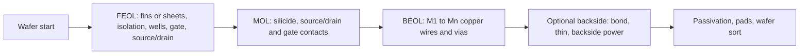
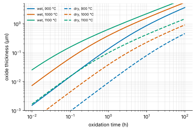
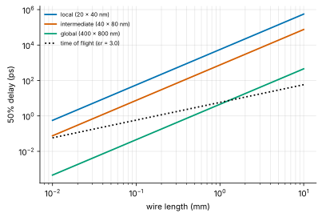

<!-- status: reviewed -->
# 25-01 · Process Flow Overview: FEOL, MOL and BEOL

| | |
|---|---|
| **Course** | [25 · Semiconductor Fabrication, Packaging, Test and Reliability](../README.md) |
| **University equivalent** | Microfabrication / IC process technology, process-integration overview and thermal oxidation (Plummer, Deal & Griffin, *Silicon VLSI Technology*, chapters on the CMOS process flow and on thermal oxidation; Berkeley EE143 and MIT 6.152J process-flow lectures) |
| **Prerequisites** | [09-12](../../09-semiconductor-devices/chapters/09-12-finfet-gaa-cfet-backside-power.md) (FinFETs, nanosheets, backside power), [09-08](../../09-semiconductor-devices/chapters/09-08-mos-capacitor.md) (the MOS gate stack), [04-04](../../04-physics-for-ee/chapters/04-04-potential-capacitance-and-dielectrics.md) (equivalent oxide thickness), [04-05](../../04-physics-for-ee/chapters/04-05-current-resistance-and-conduction.md) (wire resistance and the size effect), [19-05](../../19-digital-vlsi-design/chapters/19-05-interconnect.md) (distributed RC delay), [00-05](../../00-orientation/chapters/00-05-how-chip-companies-are-organized.md) (fab cycle time) |
| **Estimated study hours** | 7 |
| **Last verified** | 2026-11-26 |

**Learning objectives.** After this chapter you can:

1. Trace a wafer through the front end (FEOL), middle of line (MOL) and back end (BEOL), naming what each module builds and why the order is fixed.
2. Derive the Deal–Grove model of thermal oxidation and use it to size oxidation times, temperatures and silicon consumption.
3. Compute the geometric budget of a replacement metal gate and the circuit cost of contact resistance.
4. Explain why the metal stack is tiered, and estimate wire resistance and delay on each tier against the time-of-flight floor.
5. Relate step count, step yield, cycle time and work in process (Little's law) to fab economics.
6. Read node names, density claims and backside-power roadmaps critically, as of late 2026.

---

## 1. Big picture

A leading-edge chip is built on a 300 mm silicon wafer by 400 to 1,400 process steps over roughly 12 to 20 weeks [R-020]. Those steps fall into three blocks. The **front end of line (FEOL)** builds the transistors in and on the silicon. The **middle of line (MOL)** makes the tiny contacts that connect each transistor's source, drain and gate to the wiring. The **back end of line (BEOL)** builds a stack of copper wiring layers above them. Every block is made from the same few unit processes (deposit, pattern, etch, implant, heat, polish, clean, measure), repeated in a fixed order because each step must survive everything that follows. This chapter walks the flow end to end and derives the quantitative models that matter: how fast oxide grows, how much room a gate trench leaves, what contacts and wires cost in resistance, and how step count and cycle time turn into yield and inventory. Chapters 25-02 and 25-03 then open up the unit processes one by one.

- **Every chip you will diligence** passes through this flow; "node", "GAA", "backside power" and "cycle time" are all statements about it.
- **The transistor is a minority of the work.** At advanced nodes the MOL and BEOL hold most of the parasitic resistance and capacitance, and many of the masks.
- **Order is physics.** High-temperature steps come first; copper and low-k dielectrics come late, because they cannot take the heat.
- **Cycle time is money.** A fab with 12 weeks of work in process holds months of inventory and gets only a handful of full learning cycles a year.
- **Roadmaps are flow changes.** Nanosheet transistors (FEOL), new contact schemes (MOL) and backside power (a second BEOL under the wafer) are the 2025–2029 transitions.

## 2. Intuition first

**The physical picture.** Think of the wafer as a building site where everything is done to the whole site at once. A blanket film is laid over the entire wafer; a photographic stencil (the mask, printed in photoresist by lithography) protects some areas; an etch or implant acts on the unprotected areas; the resist is stripped; the wafer is cleaned and measured. That **pattern-transfer loop** is repeated for every mask layer, about 80–85 times at 7 nm by a 2017 count [R-020], with depositions, anneals and polishing steps in between.

**An analogy and its limits.** A chip is like a building constructed floor by floor. The foundations and machinery come first (the transistors); then service risers connect machinery to the floors (the contacts); then come floors of corridors, narrow and dense near the bottom, wide and sparse at the top like highways (the wires). The analogy holds in three ways: you cannot go back and redo the foundation, the lower floors constrain the upper ones, and capacity grows with height.

It breaks down in three ways:

- **Heat travels down.** Every later step heats the whole wafer, so later steps can ruin earlier ones. A builder never cooks the foundation while laying the roof, but a fab must budget the cumulative heat (the **thermal budget**).
- **Everything is built at once.** Billions of identical structures are made in parallel. There is no crew working on one room; a defect is a statistical event, not a mistake by a worker.
- **Nothing is assembled; everything is subtracted or grown.** Wires are not laid; trenches are etched and filled, and the excess is polished away.

## 3. Theory

### 3.1 The wafer and the unit processes

A 300 mm wafer has an area of $\pi(150\ \text{mm})^2$, about 707 cm² (Example 25-01.1). It starts as a slice of a single-crystal silicon ingot pulled from a melt (the Czochralski process), polished to a mirror finish, typically with a (100) surface orientation for CMOS. Its whole surface is processed at once, so cost per wafer, not per chip, is what the fab controls; chapter 25-04 converts it to cost per die.

The unit processes, each covered in 25-02 and 25-03:

| Unit process | What it does | Examples |
|---|---|---|
| Lithography | Prints a pattern in photoresist | 193 nm immersion, EUV |
| Etch | Removes material where the resist is open | Plasma (reactive-ion) etch, wet etch |
| Deposition | Adds a film | CVD, ALD, PVD, electroplating, epitaxy |
| Thermal oxidation | Grows SiO₂ by consuming silicon | Dry O₂, wet (steam) oxidation |
| Ion implantation and anneal | Places dopants, then repairs damage and activates them | Wells, extensions, source/drain |
| Chemical-mechanical polishing (CMP) | Planarizes, removes overburden | Oxide, tungsten, copper CMP |
| Clean | Removes particles, metals, organics | Wet chemical cleans |
| Metrology and inspection | Measures films and patterns, finds defects | Ellipsometry, CD-SEM, optical inspection |

**The ordering principle.** Each step must tolerate everything after it. Steps above about 1,000 °C (oxidation, dopant activation) therefore precede the metal gate and the contacts, and the copper and low-k BEOL is processed at temperatures of about 400 °C or below, because copper diffuses into silicon and dielectrics, and low-k films degrade, when hotter. The whole flow is a negotiation over the thermal budget: dopants placed early keep diffusing during every later hot step (25-03).

### 3.2 Thermal oxidation and the Deal–Grove model

Silicon's native oxide, SiO₂, is the reason silicon won: it is a superb insulator that grows on silicon with a clean interface. Thermal oxidation is still used for isolation liners, pad oxides and many analog and power devices, and its model is the template for every diffusion-plus-reaction process in the fab.

**Setup.** A wafer sits in an oxidizing gas (dry O₂ or steam) at temperature $T$. An oxide of thickness $x$ already covers it. Oxidant molecules must (1) cross the gas boundary layer to the oxide surface, (2) diffuse through the oxide, and (3) react with silicon at the Si/SiO₂ interface. New oxide forms at the bottom, consuming silicon. Define:

- $C^*$: the equilibrium oxidant concentration in the oxide surface for the gas's partial pressure (molecules/cm³);
- $C_0$, $C_i$: the actual concentrations at the oxide's outer surface and at the interface (molecules/cm³);
- $h$: the gas-phase mass-transfer coefficient (cm/s);
- $D$: the oxidant's diffusivity in SiO₂ (cm²/s);
- $k_s$: the interface reaction-rate constant (cm/s);
- $N_1$: oxidant molecules incorporated per cm³ of oxide grown: 2.2 × 10²² cm⁻³ for O₂ (one O₂ per SiO₂ unit) and twice that for H₂O.

**Three fluxes in series.** The three steps carry fluxes (molecules per cm² per second):

$$
F_1 = h\,(C^* - C_0), \qquad F_2 = D\,\frac{C_0 - C_i}{x}, \qquad F_3 = k_s\,C_i .
$$

The oxide grows slowly compared with how fast these fluxes settle, so they are equal at every moment ($F_1 = F_2 = F_3 = F$), like currents through three resistors in series. Writing each as a "conductance" times a concentration drop, the resistances are $1/h$, $x/D$ and $1/k_s$, so

$$
F = \frac{C^*}{1/h + x/D + 1/k_s} = \frac{k_s C^*}{1 + k_s/h + k_s x/D} .
$$

**Growth law.** Each oxidant molecule that reacts adds $1/N_1$ cm³ of oxide, so

$$
\frac{dx}{dt} = \frac{F}{N_1} = \frac{k_s C^*/N_1}{1 + k_s/h + k_s x/D} .
$$

Separate variables and integrate from $x_i$ at $t = 0$:

$$
\left(1 + \frac{k_s}{h}\right)(x - x_i) + \frac{k_s}{2D}(x^2 - x_i^2) = \frac{k_s C^*}{N_1}\,t .
$$

Multiply through by $2D/k_s$ and collect:

$$
x^2 + A x = B\,(t + \tau), \qquad A = 2D\left(\frac{1}{k_s} + \frac{1}{h}\right), \quad B = \frac{2DC^*}{N_1}, \quad \tau = \frac{x_i^2 + A x_i}{B} .
$$

This is the **Deal–Grove** or linear-parabolic model (Deal and Grove, 1965). Units: $A$ in µm, $B$ in µm²/h, and the ratio $B/A$ in µm/h. Solving the quadratic,

$$
x = \frac{A}{2}\left[\sqrt{1 + \frac{t + \tau}{A^2/4B}} - 1\right] .
$$

> **Math refresher — separating variables.** An equation $dx/dt = g(x)$ can be rearranged as $dx/g(x) = dt$ and both sides integrated. Here $1/g(x) = (1 + k_s/h + k_s x/D)\,N_1/(k_sC^*)$ is linear in $x$, so the left side integrates to a quadratic in $x$. The lab checks the closed form against a numerical ODE solution.

**Two limits.** When $t + \tau \ll A^2/4B$ (thin oxide), $\sqrt{1 + u} \approx 1 + u/2$ gives

$$
x \approx \frac{B}{A}(t + \tau),
$$

the **linear regime**: the oxide is so thin that diffusion is easy and the interface reaction sets the rate. Since usually $h \gg k_s$, $B/A \approx k_sC^*/N_1$. When $t \gg A^2/4B$ and $t \gg \tau$ (thick oxide), $x^2 \approx Bt$: the **parabolic regime**, where diffusion through the growing oxide sets the rate and growth slows as $\sqrt t$. From bare silicon ($x_i = \tau = 0$), the time to reach $x$ is exactly

$$
t = \frac{x^2}{B} + \frac{x}{B/A},
$$

the sum of the parabolic-only and linear-only times.

**Temperature, ambient and orientation.** Both constants follow Arrhenius laws, $B = C_1 e^{-E_1/kT}$ and $B/A = C_2 e^{-E_2/kT}$, where $k$ is Boltzmann's constant (8.61733 × 10⁻⁵ eV/K) and $T$ is in kelvin. The classic coefficients for (111) silicon, from Deal and Grove's data as tabulated by Plummer, Deal and Griffin:

| Ambient | $C_1$ (µm²/h) | $E_1$ (eV) | $C_2$ (µm/h) | $E_2$ (eV) |
|---|---|---|---|---|
| Dry O₂ | 7.72 × 10² | 1.23 | 6.23 × 10⁶ | 2.0 |
| Wet (H₂O) | 3.86 × 10² | 0.78 | 1.63 × 10⁸ | 2.05 |

For (100) silicon, divide $C_2$ by 1.68. Only $B/A$ depends on orientation, because only the interface reaction ($k_s$) depends on how many silicon bonds the surface presents; diffusion through amorphous oxide does not care. Wet oxidation is much faster because water is far more soluble in SiO₂ than oxygen is, which raises $C^*$ and with it both $B$ and $B/A$; this is why thick isolation and field oxides are grown in steam (Examples 25-01.2 and 25-01.3). Because $C^*$ is proportional to the gas's partial pressure (Henry's law), $B$ scales with pressure. So does $B/A$ for steam, but for dry oxygen $B/A$ rises more slowly than pressure, roughly as $P^{0.7\text{–}0.8}$ (Plummer, Deal and Griffin), a sign that the interface reaction is not a simple first-order step. The wet coefficients above are for pyrogenic steam near atmospheric pressure.

**Where the model fails.** Dry oxidation grows faster than the model predicts for the first 20–30 nm. The usual patch is an effective initial thickness $x_i$ of about 25 nm, absorbed into $\tau$. Modern gate dielectrics are therefore not grown this way at all: a sub-nanometre interfacial SiO₂ layer is formed chemically and a high-k film is deposited on it by atomic-layer deposition (25-03; the equivalent oxide thickness is 04-04's).

**Silicon consumption.** Each SiO₂ unit contains one silicon atom. Growing a thickness $x$ of oxide containing $N_{ox}$ SiO₂ units per cm³ consumes a thickness $d_{Si}$ of silicon with $N_{Si}$ atoms per cm³, where $N_{Si}\,d_{Si} = N_{ox}\,x$:

$$
\frac{d_{Si}}{x} = \frac{N_{ox}}{N_{Si}} .
$$

Silicon's diamond lattice has 8 atoms per cubic cell of side $a$ = 0.5431 nm, so $N_{Si} = 8/a^3 = 5.0 \times 10^{22}$ cm⁻³; amorphous SiO₂ of density 2.20 g/cm³ and molar mass 60.08 g/mol has $N_{ox} = 2.2 \times 10^{22}$ cm⁻³. The ratio is **0.44**: 44% of the oxide's thickness lies below the original silicon surface and 56% above it. This is why an oxidized region "sinks" into the silicon, and why oxide grown in a recess changes the surface topography (Example 25-01.1).

### 3.3 The front end: building the transistors

A modern logic FEOL, simplified, in order (09-12 covers the device physics of each structure):

1. **Channels.** For nanosheets, first grow a blanket epitaxial stack of alternating Si and SiGe layers (the SiGe is sacrificial); a FinFET flow starts from the silicon itself. Pattern the fins, usually by spacer-based multipatterning (25-02), and etch them.
2. **Isolation.** Shallow trench isolation (STI) between the fins: grow a thin liner oxide, fill with deposited oxide, polish flat by CMP, then recess the oxide to reveal the upper part of each fin. Thermal oxidation appears here as the liner. (In a planar flow, STI comes first and defines the active areas.)
3. **Wells.** Implant n- and p-type dopants to set each transistor's body doping, and anneal; some flows implant the wells before the epitaxy instead.
4. **Dummy gate and spacers.** Pattern a temporary polysilicon gate across the channels and wrap it in dielectric spacers that will separate gate from source and drain.
5. **Source and drain.** Recess the channel ends and regrow them epitaxially: boron-doped SiGe for PMOS (which also compresses the channel, raising hole mobility) and phosphorus-doped Si for NMOS. Activate the dopants with a short, hot anneal.
6. **Replacement gate.** Cover with dielectric, polish to expose the dummy gate, and remove it. For nanosheets, selectively etch the SiGe layers away, releasing the silicon sheets so the gate can wrap all around them (with "inner spacers" protecting the source and drain ends). Then deposit the real gate stack into the trench: an interfacial oxide, a high-k dielectric (HfO₂-based, by ALD), one or more work-function metals that set the threshold voltage, and a low-resistance fill metal. Polish flat.

**Why gate-last.** A metal gate on high-k cannot survive the source/drain activation anneal: the metals react, the threshold voltage shifts and the interfacial oxide regrows. So a sacrificial polysilicon gate takes the heat and is replaced afterwards. This is the **replacement metal gate (RMG)** flow, and it is a textbook case of the ordering principle.

**The trench-fill budget.** The gate stack is deposited conformally, so each film lines both sidewalls of the gate trench. For a trench of width $L_t$ (close to the gate length), a high-k film $t_{hk}$ and work-function stack $t_{wf}$ leave a fill width

$$
w_{fill} = L_t - 2\,(t_{hk} + t_{wf}) .
$$

Different threshold-voltage flavours use different work-function stacks, often of different thickness, and the thickest one must still leave room for fill metal (Example 25-01.4). As gate lengths shrink below about 15 nm, this budget is one reason the industry moved to thinner work-function films and to dipole-based threshold tuning. The gate's equivalent oxide thickness is the series combination of interfacial and high-k layers, $\text{EOT} = t_{IL} + t_{hk}\,(3.9/k)$ (04-04).

### 3.4 The middle of line: contacts

The MOL connects each transistor to the first wiring level. A **silicide** (a metal–silicon compound such as TiSi or NiSi) is formed on the source and drain to lower the barrier to the metal; trench contacts land on the source and drain; gate contacts land on the gate; and a local wiring level (often called M0) links neighbouring devices. Contacts are tiny, so their resistance is set by the **specific contact resistivity** $\rho_c$ (Ω·cm², 09-06) of the metal–semiconductor interface and its area $A_c$:

$$
R_c = \frac{\rho_c}{A_c} .
$$

Halving both contact dimensions quadruples $R_c$ at fixed $\rho_c$, so every node has had to lower $\rho_c$ (heavier doping at the interface, better silicides) just to stand still.

**What source resistance costs.** A resistance $R_S$ in the source subtracts $I_DR_S$ from the effective gate drive (10-06). To first order, with transconductance $g_m$ treated as constant over the small shift,

$$
I_D' = I_D - g_m R_S I_D' \quad\Longrightarrow\quad I_D' = \frac{I_D}{1 + g_m R_S} ,
$$

which is source degeneration: the device behaves as if its transconductance were $g_m/(1 + g_mR_S)$. With $g_m$ = 1 mS, a 100 Ω contact costs 9.1% of the drive current (Example 25-01.5). Drain resistance costs less in saturation, but it adds to the switching time constant.

### 3.5 The back end: wires, damascene and tiers

**Dual damascene.** Copper cannot be patterned by plasma etching, because it forms no volatile compounds at practical temperatures. So copper wires are made by the damascene process, named after inlaid metalwork: deposit the dielectric, etch the trenches (and, in the dual-damascene variant, the vias below them) into it, line them with a thin barrier and liner (for example TaN/Ta) and a copper seed, electroplate copper to overfill, and polish the excess away by CMP. A dielectric cap seals the top. The barrier is essential because copper diffusing into silicon or into the dielectric degrades devices and insulation; its cost is that it occupies part of a narrow trench without conducting well (the "barrier tax" of 04-05).

**Why the stack is tiered.** Consider a wire of width $W$, thickness $H$ and length $L$, with neighbours at spacing $S$. Its resistance per length is $\rho/(WH)$. Its capacitance per length depends only on the ratios $W/S$, $H/S$ and the distances to the layers above and below, so if every dimension scales by a factor $s$, the capacitance per length is unchanged (04-04). The distributed RC delay of 19-05 is

$$
t_{50} = 0.3787\,\frac{\rho}{WH}\,\frac{C}{L}\,L^2 \;\propto\; \frac{L^2}{s^2} .
$$

Scaling a layer's cross-section up by $s$ cuts its delay by $s^2$ at the cost of $s$ times fewer wiring tracks per micrometre. So the stack is built in tiers: tight-pitch local layers (M0–M2) for short connections inside cells, intermediate layers for blocks, and thick global layers at the top for long routes, clocks and power, with the thickest carrying the most current. Two floors bound the benefit. The size effect raises the resistivity of narrow wires well above bulk copper's 1.68 µΩ·cm (04-05), which hurts the local tiers most. And no wire is faster than light in its dielectric: the **time of flight** $L\sqrt{\varepsilon_r}/c$. When the RC delay of a fat global wire falls below that, the wire behaves as a transmission line and its delay is set by the driver and the time of flight (24-01), not by $RC$ (Example 25-01.6). Equating $0.3787\,R'C'L^2$ with $L\sqrt{L'C'}$ shows the condition is a total wire resistance below about $2.6\,Z_0$, with $Z_0 = \sqrt{L'/C'}$; it also needs a driver whose rise time is about the time of flight or shorter.

**Backside power delivery.** In a conventional flow, power and signals share the front-side stack, and current to the transistors descends through every via level, losing voltage on the way (IR drop) and occupying routing tracks. Backside power delivery builds a second, coarse wiring network under the transistors. The front side is finished, bonded face-down to a carrier wafer, and the original substrate is thinned to expose the device layer from below; nano-scale through-silicon vias or direct contacts then connect the backside power rails to the transistors. The front stack is freed for signals. Intel's PowerVia test chip reported standard-cell utilization above 90% and a frequency benefit above 5% from reduced IR drop [R-555]; 09-12 derives the IR-drop physics.

### 3.6 Step yield, cycle time and work in process

**Step yield compounds.** If a wafer passes $N$ steps and step $i$ leaves it undamaged with probability $y_i$, the fraction surviving is

$$
Y = \prod_{i=1}^{N} y_i \approx \exp\!\Big(-\sum_i (1 - y_i)\Big),
$$

using $\ln y \approx -(1 - y)$ for $y$ near 1. A thousand steps at 99.99% each leave only about 90% (Example 25-01.7). This is why fabs measure and control every step, and why a single bad step can scrap months of work.

**Cycle time.** A useful rule of thumb measures cycle time per lithography layer, **days per mask layer (DPML)**; fabs average roughly 1 to 1.5 days [R-020]. The cycle time is then about $N_{mask} \times$ DPML.

**Little's law.** In any stable system, the average number of items inside equals the average arrival rate times the average time each spends inside:

$$
\text{WIP} = \lambda\,T .
$$

For a fab, WIP is the work in process (wafers in the line), $\lambda$ the wafer start rate and $T$ the cycle time. A simple argument: plot cumulative arrivals and cumulative departures against time; the vertical gap is the WIP at each moment and the horizontal gap is each wafer's time inside. The area between the curves, computed by vertical slices, is the time-integral of WIP; computed by horizontal slices, it is the sum of all wafers' times inside. Dividing both by the elapsed time gives average WIP equals throughput times average time inside. The law needs no assumptions about the distribution of arrivals or service times (14-08 uses it to size a processor's reorder buffer).

> **Analogy — inventory days.** To a finance reader, WIP is inventory and cycle time is days of inventory outstanding: cutting cycle time releases working capital in proportion (Example 25-01.7). The analogy breaks in one important way: a fab's cycle time also sets how many process experiments it can complete per year, so it limits the rate of yield learning, which inventory accounting does not capture.

### 3.7 Node names and density metrics

"N2", "18A" and "SF2" are product names, not dimensions: no feature on an N2 wafer is 2 nm wide in any defining sense. What moves from node to node are pitches (gate, metal, cell height), the transistor architecture and the density of standard cells and SRAM. Vendors quote density three ways: for a specific cell library (high-density cells give the biggest numbers), for an SRAM bitcell, or as a "mixed" chip density for a stated blend of logic, SRAM and analog. If a reference chip's area is split into fractions $f_i$ that shrink by factors $g_i$, the new area is $\sum_i f_i/g_i$ of the old, so the chip density gain is

$$
G = \frac{1}{\sum_i f_i/g_i},
$$

an area-weighted harmonic mean. Because SRAM and analog circuits have shrunk much more slowly than logic in recent nodes, a modest mixed gain can hide a large logic gain, or a large logic gain can deliver a modest chip gain (Example 25-01.8).

> **Going deeper — the thin-oxide regime.** Massoud and co-workers extended Deal–Grove with an extra, exponentially decaying term in the growth rate that captures the fast initial dry oxidation; process simulators use such models, together with stress-dependent coefficients for oxidation in corners and trenches, where the oxide's volume expansion is constrained. These matter for STI corner rounding and for any oxidation of nanoscale silicon features.

## 4. Worked examples

All examples use $k$ = 8.61733 × 10⁻⁵ eV/K, $c$ = 2.998 × 10⁸ m/s, the coefficient table of §3.2 with $C_2$ divided by 1.68 for (100) silicon, and the distributed delay $t_{50} = 0.3787\,RC$ of 19-05 (usually rounded to 0.38). "Assumed" values are illustrative.

### Example 25-01.1 · The wafer and the oxide it grows (tier A)

**Setup.** (a) Find the area of a 300 mm wafer in cm², and how much more area it has than a 200 mm wafer. (b) Derive the silicon consumed per unit oxide thickness from silicon's lattice constant (0.5431 nm) and the oxide's density (2.20 g/cm³, molar mass 60.08 g/mol). (c) A 100 nm oxide is grown on bare silicon. How much silicon is consumed, and how far above the original surface does the oxide's top sit?

**Solution.**

- (a) $\pi \times (15\ \text{cm})^2$ = **707** cm². The ratio of areas is $(150/100)^2$ = **2.25**.
- (b) $N_{Si} = 8/(0.5431 \times 10^{-7}\ \text{cm})^3$ = **4.99e22** cm⁻³; $N_{ox} = 2.20 \times 6.022 \times 10^{23}/60.08$ = **2.21e22** cm⁻³; the ratio is **0.44**.
- (c) $0.44 \times 100$ = **44** nm of silicon consumed; the top sits **56** nm above the original surface.

**Units check.** (g/cm³)(1/mol)/(g/mol) = cm⁻³; a ratio of densities is dimensionless. ✓

**Sanity check.** The oxide occupies $1/0.44 \approx 2.3$ times the volume of the silicon it replaced, which is why oxidation in a confined trench builds up stress.

### Example 25-01.2 · A wet field oxide by Deal–Grove (tier B)

**Setup.** Grow 500 nm of oxide on bare (100) silicon in steam at 1000 °C. (a) Find $B$, $B/A$ and $A$. (b) Find the time. (c) Compare with the linear-only and parabolic-only estimates.

**Solution.**

- (a) $kT = 8.61733 \times 10^{-5} \times 1273.15$ = **0.109712** eV. $B = 386\,e^{-0.78/0.109712}$ = **0.315** µm²/h; $B/A = (1.63 \times 10^8/1.68)\,e^{-2.05/0.109712}$ = **0.745** µm/h; $A$ = **0.424** µm.
- (b) $t = x^2/B + x/(B/A) = 0.25/0.315 + 0.5/0.745$ = **1.46** h.
- (c) Linear only: **0.67** h; parabolic only: **0.79** h. Neither alone is close; at 500 nm, about $A$, the two terms are comparable.

**Units check.** µm²/(µm²/h) = h and µm/(µm/h) = h. ✓

**Sanity check.** An hour and a half in a furnace for half a micrometre is typical of field and isolation oxides; furnaces process 100 or more wafers per batch, so the long time is affordable.

### Example 25-01.3 · Why thick oxides are grown wet (tier B)

**Setup.** Repeat Example 25-01.2 in dry O₂ at 1000 °C from bare silicon (ignore the thin-oxide correction). Find (a) $B$, $B/A$ and $A$, (b) the time and (c) its ratio to the wet time.

**Solution.**

- (a) $B = 772\,e^{-1.23/0.109712}$ = **0.0104** µm²/h; $B/A = (6.23 \times 10^6/1.68)\,e^{-2.0/0.109712}$ = **0.0449** µm/h; $A$ = **0.233** µm.
- (b) $0.25/0.0104 + 0.5/0.0449$ = **35.1** h.
- (c) **24** times longer.

**Units check.** As in Example 25-01.2. ✓

**Sanity check.** Wet's $B$ is 30 times dry's at this temperature, because water is far more soluble in the oxide. Dry oxidation is kept for thin, high-quality layers, where its slower, more controllable rate is an advantage.

### Example 25-01.4 · Filling a replacement-gate trench (tier B)

**Setup.** A gate trench is 16 nm wide (assumed). The stack is 1.8 nm of HfO₂ and either 3.0 nm or 4.5 nm of work-function metal, depending on the threshold-voltage flavour (assumed); the interfacial oxide forms only on the channel, not on the sidewalls. (a) What fill width does each flavour leave? (b) If the fill metal dominates the gate's conduction, by what factor does the thicker flavour raise gate resistance? (c) At what trench width would the thicker flavour leave no fill at all?

**Solution.**

- (a) $16 - 2(1.8 + 3.0)$ = **6.4** nm; $16 - 2(1.8 + 4.5)$ = **3.4** nm.
- (b) $6.4/3.4$ = **1.9** times (fill cross-section scales with its width at fixed height).
- (c) $2(1.8 + 4.5)$ = **12.6** nm.

**Units check.** All lengths in nm. ✓

**Sanity check.** A 3.4 nm slot is hard to fill without voids, and work-function metals are far more resistive than fill metals, so the thick flavour costs gate resistance twice. That is the pressure behind thinner work-function stacks and dipole-based threshold tuning.

### Example 25-01.5 · What a contact costs (tier B)

**Setup.** A trench contact lands on 18 nm × 40 nm of silicided source (assumed). The transistor's transconductance is 1 mS (assumed). Find (a) the contact area, (b) $R_c$ for $\rho_c$ = 10⁻⁹ and 10⁻⁸ Ω·cm², and (c) the fractional loss of drive current in each case if $R_c$ sits in the source.

**Solution.**

- (a) $18 \times 10^{-7}\ \text{cm} \times 40 \times 10^{-7}\ \text{cm}$ = **7.2e-12** cm².
- (b) $10^{-9}/7.2 \times 10^{-12}$ = **139** Ω; $10^{-8}/7.2 \times 10^{-12}$ = **1.39** kΩ.
- (c) $1 - 1/(1 + g_mR_c)$: **12**% and **58**%.

**Units check.** (Ω·cm²)/cm² = Ω; $g_mR_c$ is (A/V)(V/A), dimensionless. ✓

**Sanity check.** At 10⁻⁸ Ω·cm², a value that served older nodes with large contacts, today's contact would more than halve the drive. Contact engineering is not a detail; it decides whether a shrink helps at all.

### Example 25-01.6 · Why the stack is tiered (tier B)

**Setup.** A 1 mm route can run on three tiers (all assumed): local (20 nm wide, 40 nm thick, 2 nm barrier on sides and bottom, effective copper resistivity 4.5 µΩ·cm), intermediate (40 × 80 nm, 2 nm barrier, 2.8 µΩ·cm) or global (400 × 800 nm, 2 nm barrier, 1.9 µΩ·cm). Each has about 0.2 fF/µm of capacitance, because its spacing and layer heights scale with it. Find (a) the conducting area and resistance per µm on each tier, (b) the 1 mm delay $0.3787\,RC$ on each, (c) the time of flight for $\varepsilon_r$ = 3.0, and (d) how many local tracks fit in the width of one global track at pitch twice the width.

**Solution.**

- (a) Local: $(20 - 4)(40 - 2)$ = **608** nm², $4.5 \times 10^{-8}\ \Omega\text{m}/608 \times 10^{-18}\ \text{m}^2$ = **74.0** Ω/µm. Intermediate: **2808** nm², **9.97** Ω/µm. Global: **3.16e5** nm², **0.0601** Ω/µm.
- (b) With $C$ = 200 fF: local $0.3787 \times 74.0\ \text{kΩ} \times 200\ \text{fF}$ = **5.61** ns; intermediate **0.755** ns; global **4.55** ps.
- (c) $10^{-3} \times \sqrt{3.0}/(2.998 \times 10^8)$ = **5.78** ps.
- (d) $800/40$ = **20** local tracks.

**Units check.** (Ω·m)/m² = Ω/m; Ω × F = s. ✓

**Sanity check.** The local wire is 5.61 ns/4.55 ps = **1.23e3** times slower than the global one over 1 mm, so no long signal belongs there. On the global tier the RC delay has fallen below the time of flight: that wire is a transmission line, and its delay is set by its driver and by light in the dielectric. The price of the global tier is 20 times fewer tracks, which is why only a few layers are fat.

### Example 25-01.7 · Steps, cycle time and inventory (tier B)

**Setup.** (a) What fraction of wafers survives 1,000 steps at 99.99% each, and at 99.9%? (b) A process has 70 mask layers (assumed) and the fab runs at 1.5 days per mask layer: what is the cycle time? (c) A fab starts 100,000 wafers per month with a 12-week cycle time. How many wafers are in process, and what is that inventory worth at an average $5,000 per partly processed wafer (assumed)? (d) At the same 12-week cycle time, how many wafers would be in process across a foundry with 17 million wafers a year of capacity [R-559], if fully loaded?

**Solution.**

- (a) $0.9999^{1000}$ = **0.905**; $0.999^{1000}$ = **0.368**.
- (b) $70 \times 1.5$ = **105** days, **15** weeks.
- (c) 12 weeks is **2.76** average months, so WIP = $100{,}000 \times 2.76$ = **2.76e5** wafers, worth **1.38** \$B.
- (d) 12 weeks is **0.230** years, so WIP = $17 \times 10^6 \times 0.230$ = **3.91e6** wafers.

**Units check.** (wafers/month) × months = wafers. ✓

**Sanity check.** The 0.368 is $e^{-1}$: a thousand steps at one-in-a-thousand loss each lose a full e-fold. Step yields must be within a few parts in 10⁵ of perfect. And a large fab holds a billion dollars or more of work in process; shortening the cycle by two weeks would release about a sixth of it.

### Example 25-01.8 · Reading a node's density claim (tier A)

**Setup.** TSMC quoted N2's "chip density" against N3E as 1.15×, for a mix of 50% logic, 30% SRAM and 20% analog [R-552]. (a) If SRAM and analog did not shrink at all, what logic density gain would deliver 1.15×? (b) TechInsights' high-density cell figures, relayed by trade press, put N2 at 313 and Intel 18A at 238 million transistors per mm² [R-554]. What ratio is that, and why might it overstate N2's practical lead?

**Solution.**

- (a) $1.15 = 1/(0.5/g + 0.5)$, so $0.5/g = 1/1.15 - 0.5$ and $g$ = **1.35**.
- (b) $313/238$ = **1.32**. It compares the densest library cells only, not the cells used in fast designs, and 18A's backside power frees front-side routing area that a cell-density figure does not credit.

**Units check.** Density ratios are dimensionless. ✓

**Sanity check.** The what-if in (a) is ours: TSMC does not say SRAM and analog stood still. It shows how a mixed figure compresses the logic story, so always ask which density was measured.

<!-- answer-key -->

| ID | Quantity | Value | Unit |
|---|---|---|---|
| Ex 25-01.1a | 300 mm wafer area | 707 | cm² |
| Ex 25-01.1a1 | area ratio 300/200 | 2.25 | |
| Ex 25-01.1b | silicon atom density | 4.99e22 | cm⁻³ |
| Ex 25-01.1b1 | SiO2 unit density | 2.21e22 | cm⁻³ |
| Ex 25-01.1b2 | silicon consumed per oxide thickness | 0.44 | |
| Ex 25-01.1c | silicon consumed by 100 nm | 44 | nm |
| Ex 25-01.1c1 | oxide above original surface | 56 | nm |
| Ex 25-01.2a0 | kT at 1000 C | 0.109712 | eV |
| Ex 25-01.2a | B, wet 1000 C | 0.315 | µm²/h |
| Ex 25-01.2a1 | B/A, wet 1000 C (100) | 0.745 | µm/h |
| Ex 25-01.2a2 | A, wet 1000 C | 0.424 | µm |
| Ex 25-01.2b | time for 500 nm wet | 1.46 | h |
| Ex 25-01.2c | linear-only time | 0.67 | h |
| Ex 25-01.2c1 | parabolic-only time | 0.79 | h |
| Ex 25-01.3a | B, dry 1000 C | 0.0104 | µm²/h |
| Ex 25-01.3a1 | B/A, dry 1000 C (100) | 0.0449 | µm/h |
| Ex 25-01.3a2 | A, dry 1000 C | 0.233 | µm |
| Ex 25-01.3b | time for 500 nm dry | 35.1 | h |
| Ex 25-01.3c | dry over wet time | 24 | |
| Ex 25-01.3c1 | wet over dry B | 30 | |
| Ex 25-01.4a | fill width, 3.0 nm WF | 6.4 | nm |
| Ex 25-01.4a1 | fill width, 4.5 nm WF | 3.4 | nm |
| Ex 25-01.4b | gate resistance factor | 1.9 | |
| Ex 25-01.4c | trench width with no fill | 12.6 | nm |
| Ex 25-01.5a | contact area | 7.2e-12 | cm² |
| Ex 25-01.5b | contact resistance at 1e-9 | 139 | Ω |
| Ex 25-01.5b1 | contact resistance at 1e-8 | 1.39 | kΩ |
| Ex 25-01.5c | drive loss at 1e-9 | 12 | % |
| Ex 25-01.5c1 | drive loss at 1e-8 | 58 | % |
| Ex 25-01.6a | local conducting area | 608 | nm² |
| Ex 25-01.6a1 | local resistance | 74.0 | Ω/µm |
| Ex 25-01.6a2 | intermediate conducting area | 2808 | nm² |
| Ex 25-01.6a3 | intermediate resistance | 9.97 | Ω/µm |
| Ex 25-01.6a4 | global conducting area | 3.16e5 | nm² |
| Ex 25-01.6a5 | global resistance | 0.0601 | Ω/µm |
| Ex 25-01.6b | local 1 mm delay | 5.61 | ns |
| Ex 25-01.6b1 | intermediate 1 mm delay | 0.755 | ns |
| Ex 25-01.6b2 | global 1 mm delay | 4.55 | ps |
| Ex 25-01.6c | time of flight, 1 mm | 5.78 | ps |
| Ex 25-01.6e | local over global delay | 1.23e3 | |
| Ex 25-01.6d | local tracks per global track | 20 | |
| Ex 25-01.7a | survival, 1,000 steps at 99.99% | 0.905 | |
| Ex 25-01.7a1 | survival, 1,000 steps at 99.9% | 0.368 | |
| Ex 25-01.7b | cycle time | 105 | days |
| Ex 25-01.7b1 | cycle time in weeks | 15 | weeks |
| Ex 25-01.7c0 | 12 weeks in months | 2.76 | months |
| Ex 25-01.7c | work in process | 2.76e5 | wafers |
| Ex 25-01.7c1 | inventory value | 1.38 | $B |
| Ex 25-01.7d0 | 12 weeks in years | 0.230 | years |
| Ex 25-01.7d | foundry-scale WIP | 3.91e6 | wafers |
| Ex 25-01.8a | logic gain for 1.15x chip | 1.35 | |
| Ex 25-01.8b | N2 over 18A HD density | 1.32 | |
| Txt 25-01.a | oxide surface above silicon, fraction | 0.56 | |
| Txt 25-01.b | volume expansion | 2.3 | |
| Txt 25-01.c | drive loss for 100 ohm at 1 mS | 9.1 | % |
| Txt 25-01.d | WIP reduction | 14 | % |

## 5. Simulate it

The lab is [labs/25-01-lab/](../labs/25-01-lab/README.md). `process.py` implements the Deal–Grove model, silicon consumption, the gate-trench budget, contact degeneration, wire tiers and fab-flow arithmetic; `rc_tiers.cir` confirms Example 25-01.6's delays in ngspice with 200-section RC ladders; the notebook checks the closed-form oxidation law against a numerical ODE solution and simulates Little's law.

*Figure 1. The three blocks of the flow (schematic, not to scale): FEOL transistors, MOL contacts, and a BEOL stack tiered from tight local layers to thick global layers.*

*Figure 2. Deal–Grove growth: linear (slope 1 on log axes) while the oxide is thin, parabolic (slope 1/2) once diffusion limits. Wet oxidation is an order of magnitude or more faster.*

*Figure 3. RC delay grows as length squared on every tier; fatter tiers are faster, and the global tier reaches the time-of-flight floor near 1 mm.*

**Predict, then run:**

1. *Predict* the wet oxide thickness after 1 h at 1000 °C from bare (100) silicon (more or less than half of Example 25-01.2's 500 nm?), then compute it with the model and with the ODE.
2. *Predict* the narrowest gate trench that still leaves 3 nm of fill with the 4.5 nm work-function flavour, then sweep the trench width.
3. *Predict* the length at which the global tier's RC delay equals its time of flight, then compute it and run `rc_tiers.cir`.
4. *Predict* the average WIP of a simulated fab with random cycle times averaging 12 weeks, then simulate it and compare with $\lambda T$.

## 6. Engineering tradeoffs

| Knob | Improves | Costs | Typical decision owner |
|---|---|---|---|
| Wet instead of dry oxidation | Growth rate (an order of magnitude) | Oxide quality, control of thin layers | Process integration |
| Higher oxidation temperature | Throughput | Thermal budget: dopants already placed diffuse further | Process integration |
| Gate-last (replacement metal gate) | Survivable high-k/metal gate, threshold control | More steps and masks, trench-fill limits | Technology development |
| More threshold-voltage flavours | Power–performance range for designers | Masks, trench-fill budget, variability | Technology definition with design |
| Lower contact resistivity (silicide, interface doping) | Drive current at small contact area | New materials, defectivity, integration risk | Process integration |
| More fat global layers | Long-wire delay, power-grid IR drop | Masks, cost, fewer tracks per layer | Technology definition with physical design |
| Backside power delivery | IR drop, front-side routing, cell utilization | Wafer bonding and thinning, cost, thermal path, debug access | Technology development and product architecture |
| Faster cycle time (hot lots, which are priority wafers that jump the queues; fewer steps) | Learning rate, inventory | Fab utilization, cost per wafer | Fab operations |

## 7. Numbers to know

Perishable rows are as of Nov 2026; the date column gives the source's own date.

| Quantity | Value | Dated | Source |
|---|---|---|---|
| Process steps per wafer | 400–1,400 | 2021 | [R-020] |
| Wafer cycle time | ≈ 12 weeks average; 14–20 weeks advanced | 2021 | [R-020] |
| Days per mask layer | ≈ 1–1.5 | 2017 | [R-020] |
| EUV layers | N5 "over 10", N3 "over 20" | Oct 2020 | [R-558] |
| TSMC capacity and shipments | > 17 M and ≈ 15 M 12-inch-equivalent wafers in 2025 | Apr 2026 | [R-559] |
| Silicon consumed by oxidation | 0.44 × oxide thickness | timeless | §3.2 |
| Bulk copper resistivity | 1.68 µΩ·cm | timeless | 04-05 |
| BEOL processing temperature | about 400 °C or below | timeless | §3.1 |
| Wafer area, 300 mm | 707 cm² | timeless | Example 25-01.1 |

## 8. Common mistakes

- **Using the linear or parabolic limit outside its range.** Near $x \approx A$ both terms matter; Example 25-01.2's limits miss by half.
- **Forgetting orientation.** The 1.68 factor applies to $B/A$ only, not to $B$.
- **Applying Deal–Grove to gate oxides.** Sub-nanometre interfacial layers and deposited high-k films are outside its range.
- **Treating oxide thickness as added height.** 44% of a grown oxide lies below the original silicon surface.
- **Scaling contacts at fixed resistivity.** Contact resistance rises as the inverse of area; a shrink without a better $\rho_c$ can lose drive current.
- **Ignoring the barrier.** In narrow trenches the barrier and liner take a large share of the cross-section (04-05).
- **Applying RC delay to fat global wires.** Below the time of flight, the wire is a transmission line.
- **Reading a node name as a dimension.** "2 nm" is a label; compare pitches and densities, and ask which density.

## 9. Practitioner lens

**State of the art (as of Nov 2026).**

- *Gate-all-around in volume* [Established for the production starts]. Samsung began 3 nm GAA (MBCFET) production on 30 Jun 2022, the first GAA node in production anywhere [R-557]. TSMC's N2, its first nanosheet node, entered volume production in 4Q25 [R-552]. Intel 18A, combining RibbonFET GAA with PowerVia backside power, was in production by October 2025, and Intel said on 22 January 2026 that it had "ramped to high-volume manufacturing in Arizona and Oregon" [R-554], [R-173]. Samsung describes the Exynos 2600 as built on "the industry's first 2nm GAA process" [R-557], a phrase that is **[Contested]** since all three companies ramped 2 nm-class GAA within months of each other.
- *Backside power* [Industry estimate: company guidance; Contested for A16 timing]. Intel 18A has it now [R-554]. TSMC's first, A16 with Super Power Rail, was "ready for production in 2026" with volume expected in 2027, a slip from earlier 2H26 framing [R-553]. Samsung slates SF2Z with backside power for 2027 [R-557]. Intel's 14A adds PowerDirect, second-generation RibbonFET and High-NA EUV, with risk production planned for 2H27 and volume in 2028 [R-556].
- *Roadmaps* [Industry estimate]. TSMC's April 2026 roadmap runs A14 (2028), then A13 and A12 (2029), with no plan to use High-NA EUV for any of these nodes [R-553]. N2 had more than 20 customer tape-outs with over 70 in the pipeline, by TSMC's count [R-553].
- *Flow complexity* [Industry estimate, dated]. ASML's then-CEO put EUV at "over 10" layers at N5 and "over 20" at N3 in 2020 [R-558]; no credible public total mask count exists for N3 or N2 [R-020].
- *Scale* [Established]. TSMC's 2025 capacity exceeded 17 million 12-inch-equivalent wafers, and it shipped about 15 million [R-559].

**Why it matters commercially.** Each flow transition reshuffles who captures value. Nanosheets and backside power add deposition, etch and bonding steps, which favour equipment suppliers (see 25-03) and raise cost per wafer; tiered BEOL with new metals creates markets for materials and CMP; and long cycle times lock customers into a foundry for years, because a port to another flow restarts the learning curve. In diligence, the useful questions are which steps a technology adds or removes, what it does to cycle time and wafer cost, and who sells into those steps.

**Marketing vs Reality.**

- *"2 nm."* A name, not a dimension; compare gate pitch, metal pitch, cell height and measured densities.
- *"1.15× chip density."* A mixed figure; logic alone may have improved far more, SRAM far less (Example 25-01.8).
- *"First to production."* Risk production, production-ready, first wafers out and volume ramp are different milestones; A16's "ready in 2026, volume in 2027" shows the gap [R-553].
- *"313 versus 238 MTr/mm²."* High-density cells only, from a teardown firm via trade press, and blind to backside power's routing benefit [R-554].
- *"More than 5% frequency from backside power."* A test-chip result on a specific core [R-555]; the gain on your design depends on how much IR drop it had.

**Questions for engineering leaders.**

1. **"Which density are you quoting: library cells, SRAM bitcell or mixed chip, and for which cell height?"** *Strong:* names the cell library, the bitcell and the mix, with measured silicon. *Evasive:* "node-equivalent density."
2. **"What is the cycle time of your critical lots and how many full-flow learning cycles do you get before production?"** *Strong:* weeks, days per mask layer, hot-lot policy and a count. *Evasive:* "industry-leading cycle time."
3. **"Where does your parasitic resistance go: contacts, local wires, vias?"** *Strong:* a breakdown by MOL and BEOL level, with the plan to cut the biggest term. *Evasive:* "our new transistor solves it."
4. **"How much of the claimed speed gain comes from backside power and how much from the transistor?"** *Strong:* separated contributions, on a named design. *Evasive:* a single combined figure.
5. **"When does the node reach volume, in wafer starts per month by quarter?"** *Strong:* a ramp curve. *Evasive:* "production-ready this year."

## 10. Concept check

**Q1.** Why is the order of FEOL, MOL and BEOL fixed?

Answer

Each step must survive everything after it. The hottest steps (oxidation, dopant activation) come first; the metal gate is inserted after the source/drain anneal (gate-last); copper and low-k dielectrics come last because they cannot tolerate much above 400 °C.

**Q2.** In the Deal–Grove model, what physical process limits growth in each regime?

Answer

Thin oxide: the interface reaction (linear regime, rate $B/A$). Thick oxide: diffusion of oxidant through the oxide (parabolic regime, $x^2 = Bt$). Gas-phase transport rarely limits.

**Q3.** Why does crystal orientation change $B/A$ but not $B$?

Answer

$B/A$ is set by the interface reaction, which depends on the density of silicon bonds at the surface, and that depends on orientation. $B$ is set by diffusion through the amorphous oxide, which has no orientation.

**Q4.** Why does a metal gate get inserted only after the source and drain are made?

Answer

The source/drain activation anneal is too hot for a high-k/metal gate stack: the metals react, the threshold shifts and the interfacial oxide regrows. A sacrificial polysilicon gate takes the heat and is replaced.

**Q5.** If every wire dimension doubles, what happens to resistance per length, capacitance per length and the delay of a fixed-length wire?

Answer

Resistance per length falls 4×, capacitance per length is unchanged, so the RC delay falls 4×, until it reaches the time-of-flight floor. The price is half as many tracks per micrometre.

**Q6.** A fab cuts its cycle time from 14 to 12 weeks at constant starts. What happens to work in process and why?

Answer

By Little's law WIP = $\lambda T$, so WIP falls by 2/14 = **14**%, releasing that inventory; the fab also completes more learning cycles per year.

Now try the [25-01 problem set](../problems/25-01-problems.md).

## 11. Key terms

[Front end of line (FEOL)](../../../reference/glossary.md#front-end-of-line-feol) · [Middle of line (MOL)](../../../reference/glossary.md#middle-of-line-mol) · [Back end of line (BEOL)](../../../reference/glossary.md#back-end-of-line-beol) · [Deal–Grove model](../../../reference/glossary.md#deal-grove-model) · [Shallow trench isolation (STI)](../../../reference/glossary.md#shallow-trench-isolation-sti) · [Replacement metal gate (RMG)](../../../reference/glossary.md#replacement-metal-gate-rmg) · [Dual damascene](../../../reference/glossary.md#dual-damascene) · [Thermal budget](../../../reference/glossary.md#thermal-budget) · [Days per mask layer (DPML)](../../../reference/glossary.md#days-per-mask-layer-dpml) · [Work in process (WIP)](../../../reference/glossary.md#work-in-process-wip) · [Specific contact resistivity](../../../reference/glossary.md#specific-contact-resistivity) · [Backside power delivery](../../../reference/glossary.md#backside-power-delivery) · [Little's law](../../../reference/glossary.md#littles-law) · [Wafer cycle time](../../../reference/glossary.md#wafer-cycle-time)

## 12. Connections

- **Previous:** [24-09 Linear-Drive and Co-Packaged Optics](../../24-high-speed-io-signal-integrity-and-photonics/chapters/24-09-lpo-and-cpo.md) closed Course 24; this chapter opens the manufacturing course.
- **Next:** [25-02 Lithography](25-02-lithography.md), the unit process that defines every pattern in this flow.
- **Prerequisites used:** [09-12](../../09-semiconductor-devices/chapters/09-12-finfet-gaa-cfet-backside-power.md) for the transistor structures; [04-04](../../04-physics-for-ee/chapters/04-04-potential-capacitance-and-dielectrics.md) and [04-05](../../04-physics-for-ee/chapters/04-05-current-resistance-and-conduction.md) for EOT and wire resistance; [19-05](../../19-digital-vlsi-design/chapters/19-05-interconnect.md) for distributed delay; [10-06](../../10-electronics-1/chapters/10-06-mos-single-stage-amplifiers.md) for source degeneration; [14-08](../../14-computer-organization-and-architecture/chapters/14-08-out-of-order-and-superscalar.md) for Little's law.
- **Used later:** [25-03](25-03-deposition-etch-cmp-implant-metrology.md) (the unit processes in depth), [25-04](25-04-yield-and-die-cost.md) (yield and die cost), [25-07](25-07-advanced-packaging-and-chiplets.md) (wafer bonding and through-silicon vias, which backside power shares) and [25-09](25-09-reliability-physics.md) (electromigration in the wires built here).

> **Deeper:** see companion repo *Semiconductor Capital Equipment* for the tools that run each step, their suppliers and how process changes move equipment spending.

## 13. Further study

- J. D. Plummer, M. D. Deal and P. B. Griffin, *Silicon VLSI Technology: Fundamentals, Practice and Modeling*: the CMOS process-flow chapter and the thermal-oxidation chapter (Deal–Grove derivation and coefficient tables).
- B. E. Deal and A. S. Grove, "General Relationship for the Thermal Oxidation of Silicon," *Journal of Applied Physics* 36, 3770 (1965).
- MIT OpenCourseWare 6.152J, *Micro/Nano Processing Technology*: oxidation and process-integration lectures.
- Berkeley EE143 public materials: the process-flow and oxidation units.
- G. S. May and C. J. Spanos, *Fundamentals of Semiconductor Manufacturing and Process Control*: yield, cycle time and fab operations.

## 14. Sources

1. Process steps, cycle time, days per mask layer and mask counts: [R-020].
2. TSMC N2 volume production and PPA claims: [R-552].
3. TSMC's April 2026 roadmap (A16, A14, A13, A12; High-NA): [R-553].
4. Intel 18A and densities: [R-554].
5. PowerVia test-chip results: [R-555].
6. Intel 14A timeline: [R-556].
7. Samsung GAA history and backside-power plans: [R-557].
8. EUV layer counts: [R-558].
9. TSMC capacity and shipments: [R-559].
10. Deal–Grove model and coefficients: Deal and Grove (1965); Plummer, Deal and Griffin (textbook, see §13).
