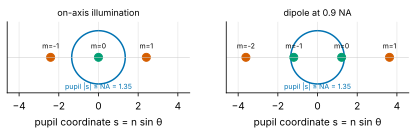
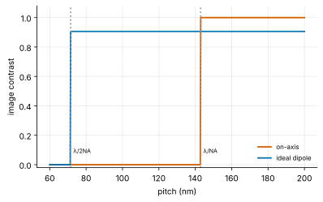
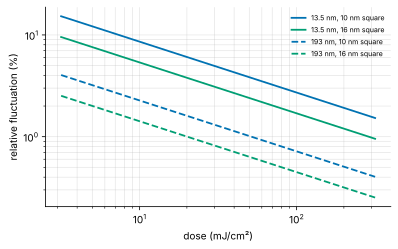

<!-- status: verified -->
# 25-02 · Lithography: DUV, Multipatterning, EUV and High-NA

| | |
|---|---|
| **Course** | [25 · Semiconductor Fabrication, Packaging, Test and Reliability](../README.md) |
| **University equivalent** | Microfabrication / IC process technology, optical lithography unit (Plummer, Deal & Griffin, *Silicon VLSI Technology*, lithography chapter; Mack, *Fundamental Principles of Optical Lithography*; MIT 6.152J and Berkeley EE143 lithography lectures) |
| **Prerequisites** | [04-09](../../04-physics-for-ee/chapters/04-09-waves-and-optics.md) (diffraction, the Rayleigh formula and $k_1$), [24-08](../../24-high-speed-io-signal-integrity-and-photonics/chapters/24-08-silicon-photonics.md) (the grating equation), [25-01](25-01-process-flow-overview.md) (the pattern-transfer loop and cycle time), [03-02](../../03-probability-statistics-and-random-variables/chapters/03-02-random-variables-and-distributions.md) (the Poisson distribution) |
| **Estimated study hours** | 8 |
| **Last verified** | 2026-11-26 |

**Learning objectives.** After this chapter you can:

1. Derive the $k_1$ = 0.25 resolution limit from diffraction orders and the pupil, and decide whether a given pitch prints with on-axis or off-axis illumination.
2. Estimate depth of focus from the defocus phase of diffraction orders, and explain why immersion helps and High-NA hurts it.
3. Plan multipatterning (LELE, SADP, SAQP) for a target pitch and budget its overlay and pitch-walk errors.
4. Compute photon shot noise for a given dose and feature, and explain why EUV is dose-limited.
5. Estimate scanner cost per exposure and the throughput penalties of dose, source power and High-NA field stitching.
6. Assess the state of EUV and High-NA adoption as of late 2026 and test vendor claims against physics.

---

## 1. Big picture

Lithography decides what can be drawn on a chip, and it is the fab's most expensive and most watched step. A scanner projects the image of a mask (a photomask, also called a reticle) onto a light-sensitive resist with light of wavelength $\lambda$ through a lens of numerical aperture NA; diffraction limits the finest printable pitch to about $\lambda/(2\,\text{NA})$. For two decades the industry fought that limit with 193 nm light, water immersion and multiple exposures per layer. Since 2019 it has used extreme ultraviolet (EUV) light at 13.5 nm, and since 2025 High-NA EUV. Every layer printed adds a mask, a scanner pass and the etch and deposition steps around it, so lithography choices set mask count, cycle time and much of the wafer cost. This chapter derives the physics of resolution, focus and photon noise, then turns it into the economics that decide which technique each layer gets.

- **Resolution is diffraction.** A pattern prints only if at least two of its diffraction orders pass through the lens; this one idea gives the Rayleigh formula, the $k_1$ = 0.25 limit and the value of off-axis illumination.
- **Depth of focus shrinks faster than resolution improves,** as $1/\text{NA}^2$, which squeezes resist thickness and wafer flatness.
- **Multipatterning trades masks and overlay for pitch.** Two or four exposures (or spacer tricks) halve or quarter the pitch, at the price of more steps and tighter alignment.
- **EUV is photon-starved.** Each 13.5 nm photon carries 14 times the energy of a 193 nm one, so a given dose delivers 14 times fewer photons, and random photon counts roughen small features.
- **One supplier.** ASML is the only maker of EUV scanners [R-562]; a Low-NA tool costs about €150–200 M and a High-NA tool €350 M or more [R-564].

## 2. Intuition first

**The physical picture.** Shine light through a fine grating and it splits into a fan of beams: the straight-through beam (the zeroth order) and pairs of beams bent to either side (the first, second and higher orders). The finer the grating, the more steeply the orders bend. A lens collects only the beams inside its cone of acceptance; the sine of that cone's half-angle, times the refractive index of the medium, is the NA. The lens rebuilds an image by recombining the beams it caught. If it catches only the zeroth order, the wafer sees uniform light: the pattern has vanished. If it catches the zeroth and one first order, the two interfere and draw stripes at exactly the grating's pitch. Resolution is therefore a question of whether the lens catches two orders.

**An analogy and its limits.** A slide projector shrinking a stencil onto a screen is the right mental picture: the mask is the slide, the lens shrinks it four times, and the resist is a photographic film. The analogy holds for magnification, focus and the role of the lens's size. It breaks in three ways:

- **The image is not a shrunken copy.** Near the diffraction limit, a sharp-cornered square on the mask prints as a rounded blob and a thin line shortens; masks are deliberately distorted (optical proximity correction) so the printed result comes out right.
- **Light is grainy.** At EUV doses each square nanometre of resist receives only tens of photons, so two "identical" features receive measurably different exposures.
- **The film is chemistry.** Resist turns light into a solubility change through a chemical reaction that blurs over a few nanometres; the printed edge is where that chemistry crosses a threshold.

## 3. Theory

### 3.1 The projection scanner

A modern scanner has a light source, an illuminator that shapes the light's angles, the mask, projection optics that demagnify the mask image four times, and a wafer stage. It exposes a slit-shaped strip while the mask and wafer scan in opposite directions (step-and-scan), covering a field of 26 mm × 33 mm on the wafer, then steps to the next field. The mask image of a full field is 4 × 26 = 104 mm by 4 × 33 = 132 mm, which fits on a standard 6-inch (152 mm) mask plate. Deep-ultraviolet (DUV) scanners use 248 nm (KrF) or 193 nm (ArF) excimer lasers and refractive lenses; EUV scanners use 13.5 nm light and mirrors only (§3.6).

### 3.2 Resolution from diffraction orders

**The grating equation.** Consider lines and spaces of pitch $p$ on the mask (scaled to wafer dimensions, so we can ignore the 4× demagnification). Light arriving at the mask with direction such that $n\sin\theta_{in} = s_0$ leaves in discrete diffraction orders $m = 0, \pm1, \pm2, \dots$ with

$$
n\sin\theta_m = s_0 + m\,\frac{\lambda}{p},
$$

where $\lambda$ is the vacuum wavelength and $n$ the index of the medium at the wafer: the same phase-matching condition as 24-08's grating coupler. It is convenient to work in "pupil coordinates" $s = n\sin\theta$. The lens accepts a beam only if $|s| \le \text{NA}$, where $\text{NA} = n\sin\theta_{max}$.

**Two orders make an image.** Suppose the lens passes the zeroth order with amplitude $a_0$ and one first order with amplitude $a_1$, at pupil positions differing by $\lambda/p$. At the wafer they are plane waves whose phases differ by $2\pi x/p$ along the wafer, so the intensity is

$$
I(x) = \left|a_0 + a_1 e^{j2\pi x/p}\right|^2 = a_0^2 + a_1^2 + 2a_0a_1\cos\!\left(\frac{2\pi x}{p}\right),
$$

a sinusoid at exactly the grating's pitch. One order alone gives a constant: no image. (Problem 25-02.5 computes the contrast of two-beam images; the lab adds the three-beam case.)

**On-axis illumination.** With light arriving straight down ($s_0 = 0$), the orders sit at $0$ and $\pm\lambda/p$. The first orders fit inside the pupil only if $\lambda/p \le \text{NA}$:

$$
p_{min} = \frac{\lambda}{\text{NA}} \qquad\text{(on-axis)} .
$$

**Off-axis illumination.** Tilt the illumination so that $s_0 = \lambda/(2p)$. The zeroth order now sits at $+\lambda/2p$ and the $-1$ order at $-\lambda/2p$, symmetric about the pupil centre. Both fit if $\lambda/(2p) \le \text{NA}$:

$$
p_{min} = \frac{\lambda}{2\,\text{NA}}, \qquad \text{half-pitch}_{min} = \frac{1}{4}\,\frac{\lambda}{\text{NA}} \qquad\text{(off-axis)} .
$$

This is the origin of the Rayleigh resolution formula $CD = k_1\lambda/\text{NA}$ of 04-09 and of its hard floor $k_1$ = 0.25 for dense lines and spaces: below it, no illumination can put two orders through the lens. Off-axis illumination doubles the resolution available from a lens, which is why every advanced scanner shapes its illumination (dipoles for one-direction lines, quadrupoles and freeform "source-mask optimized" shapes for mixed layouts). Production processes run above the floor: published single-exposure specifications imply $k_1$ of about 0.27 for 193 nm immersion and 0.32–0.33 for EUV (04-09; [R-560], [R-561], [R-562]).

> **Math refresher — pupil coordinates.** Writing directions as $s = n\sin\theta$ turns refraction and diffraction into addition: Snell's law says $s$ is conserved across a flat interface, and a grating adds $m\lambda/p$. The lens is then a circle of radius NA in the $s$ plane, and imaging questions become geometry: which points lie inside the circle?

### 3.3 Depth of focus

Move the wafer a distance $z$ out of focus. A plane wave travelling at angle $\theta$ in a medium of index $n$ accumulates an extra phase $2\pi n z\cos\theta/\lambda$ over that distance, so two orders at different angles drift out of phase by

$$
\Delta\phi = \frac{2\pi n z}{\lambda}\,(\cos\theta_a - \cos\theta_b) .
$$

The worst case for on-axis imaging is the zeroth order on axis ($\cos\theta = 1$) and a first order at the pupil's edge ($\sin\theta = \text{NA}/n$). A common tolerance is a quarter-wave error, $\Delta\phi \le \pi/2$, which gives

$$
z \le \frac{\lambda}{4n\left(1 - \sqrt{1 - (\text{NA}/n)^2}\right)} \;\approx\; \frac{n\lambda}{2\,\text{NA}^2} \quad (\text{NA} \ll n),
$$

and a depth of focus (DOF) of twice that. Two consequences follow. First, DOF falls as $1/\text{NA}^2$ while resolution improves only as $1/\text{NA}$: raising NA from 0.33 to 0.55 cuts EUV's DOF to about a third (Example 25-02.2). Resist films, wafer flatness and stage control must all tighten. Second, at a given NA a higher index $n$ increases DOF, because the beams travel at shallower angles inside the denser medium: immersion helps focus as well as resolution (Problem 25-02.4). Symmetric two-beam imaging (off-axis, orders at $\pm\theta$) is insensitive to defocus to first order, since both orders accumulate the same phase; real layouts contain many pitches and directions, so the worst case still governs.

### 3.4 Immersion

Filling the gap between the last lens and the wafer with water ($n \approx 1.44$ at 193 nm) lets beams travel at angles that would be totally internally reflected at a lens–air interface, so NA can exceed 1. With $\sin\theta$ in the water up to about 0.94, NA reaches about 1.35, a factor of 1.44 over a dry lens with the same angles. By Snell's law $n\sin\theta$ is the same in the glass and in the fluid, so NA can never exceed the smaller of the two indices: a ray steeper than that is totally reflected at the glass–fluid interface. Equivalently, light in water has a wavelength of 193/1.44 = 134 nm (Example 25-02.3). Immersion arrived in production in the mid-2000s and remains the workhorse for all but the finest layers: ASML's current ArF immersion scanner specifies 1.35 NA, ≤ 38 nm resolution and ≥ 310 wafers per hour [R-562].

### 3.5 Multipatterning

When the target pitch is below what one exposure can print, the layout is split or the pitch is multiplied by process tricks.

- **LELE (litho-etch-litho-etch).** Split the pattern into two interleaved sets at twice the target pitch; print and etch the first, then the second. Each set is printable; together they halve the pitch. The cost is a second mask and pass, and the two sets must be aligned to each other: an **overlay** error $\delta$ shifts every second line by $\delta$, so alternate spaces become $s \pm \delta$ (Example 25-02.5). LE³ (three exposures) and LE⁴ extend the idea at rising cost and overlay risk.
- **SADP (self-aligned double patterning).** Print a sacrificial "mandrel" at twice the target pitch, coat it conformally with a spacer film, etch the film back so it remains only on the mandrel's sidewalls, and remove the mandrel. Each mandrel leaves two spacers, so the spacer pitch is half the mandrel pitch, without a second critical exposure and hence without overlay error between the two sets. The spacer lines are then used as a hard mask. Its characteristic error is **pitch walk**: the spaces alternate between the mandrel width and the gap between neighbouring mandrels less two spacer widths, so a mandrel width error $\delta$ makes alternate spaces differ by $2\delta$ (Problem 25-02.14).
- **SAQP (self-aligned quadruple patterning).** Repeat the spacer trick on the spacers, quartering the pitch. With 193 nm immersion at its single-exposure limit of about 76 nm pitch, SAQP reaches about 19 nm.
- **Cut masks.** Spacer processes make endless parallel lines; extra "cut" or "block" exposures remove segments to form the actual wires. These cuts are often the hardest exposures on the layer.

**What EUV replaced.** One EUV exposure at 0.33 NA prints pitches that needed SAQP or LE³ at 193 nm. ASML describes the shift as "from complex multi-patterning to simpler single patterning using EUV lithography", which "reduces the number of masks and process steps" [R-562]. Fewer steps mean shorter cycle time (25-01) and fewer chances for defects; that, rather than the cost of the exposure itself, is the main economic argument for EUV (Example 25-02.7).

### 3.6 EUV: mirrors, plasma and photons

**Why mirrors.** At 13.5 nm every material absorbs strongly, so EUV optics cannot use lenses, and the whole beam path runs in vacuum. Mirrors are multilayer stacks of alternating molybdenum and silicon, about 40 to 60 pairs, each pair a half-wavelength thick so the small reflections from every interface add in phase (a Bragg reflector, the same constructive-interference idea as 24-08's grating). Even so, each mirror reflects only about 70%. The mask is itself such a mirror with a patterned absorber on top, illuminated at a small angle. With about ten reflections from source to wafer (illustrative), only $0.7^{10}$ ≈ 2.8% of the collected light reaches the resist.

**The source.** A CO₂ laser fires at tin droplets, tens of thousands per second, turning each into a plasma that emits at 13.5 nm. ASML quotes source power "at intermediate focus", where the collector mirror focuses the light into the scanner, not at the wafer. Its production High-NA sources deliver about 600 W; it demonstrated 1,000 W in 2025 by raising the droplet rate from 60 to 100 kHz and pre-shaping the droplets [R-567].

**Photon shot noise.** A photon of wavelength $\lambda$ carries energy $E = hc/\lambda$: 91.8 eV at 13.5 nm against 6.42 eV at 193 nm, a ratio of 14.3. A dose $D$ (energy per area) therefore delivers

$$
N = \frac{D\,A}{hc/\lambda}
$$

photons to an area $A$. Photons arrive independently, so $N$ is Poisson-distributed with standard deviation $\sqrt N$ and relative fluctuation $1/\sqrt N$ (03-02). At 30 mJ/cm², EUV delivers about 20 photons per nm², so a 10 nm × 10 nm contact receives about 2,000 photons, and fewer are absorbed (Example 25-02.6). The resulting random variation of dose from feature to feature roughens line edges and, at the extreme, leaves a contact unopened or two lines bridged: **stochastic defects**. Halving the relative noise needs four times the dose, and dose costs throughput (§3.8). This dose–resolution–roughness tradeoff, not optics, is what limits EUV at its smallest features.

### 3.7 High-NA EUV

ASML's EXE platform raises NA from 0.33 to 0.55 and specifies 8 nm resolution against 13 nm for the 0.33-NA NXE:3800E [R-560], [R-561]. Steeper beams at the mask would cause shadowing and loss of multilayer reflectivity, so the optics demagnify more strongly in one direction (anamorphic optics). The price is the exposure field: "The anamorphic mirrors require an exposure field half the size of that in NXE systems" [R-561], 26 mm × 16.5 mm: the optics demagnify 4× across the slit but 8× along the scan, so the mask's 132 mm becomes 132/8 = 16.5 mm on the wafer. A die larger than half a field must be printed in two halves and stitched, which press reports put at a throughput loss from 175 to about 125 wafers per hour [R-566]. Larger 6×12-inch masks would restore the full field; TSMC plans a pilot line for them in 2031 [R-566]. DOF also falls to about a third (Example 25-02.2), so resists must be thinner, which in turn makes stochastic noise worse.

### 3.8 Throughput and the cost of an exposure

**Throughput.** A scanner's wafer time is overhead (wafer exchange, alignment, stepping between fields) plus exposure time, and exposure time scales as dose divided by power at the wafer:

$$
\text{wph} = \frac{3600\ \text{s}}{t_{oh} + t_{exp}}, \qquad t_{exp} \propto \frac{D}{P} .
$$

So scanner throughput is always quoted "at dose": ≥ 220 wph at 30 mJ/cm² for the NXE:3800E [R-560] and ≥ 175 wph at 50 mJ/cm² for the EXE:5200B [R-561]. Raising source power shortens only $t_{exp}$, which is why a 67% power gain buys less than 67% more wafers (Problem 25-02.13).

**Cost per exposure.** A scanner's depreciation per wafer pass is its price divided by the wafers it exposes over its depreciation life:

$$
c_{pass} = \frac{\text{price}}{\text{years} \times 8766\ \text{h} \times \text{availability} \times \text{wph}} .
$$

Operating costs (power, service, masks, resist) add to this, and the rest of the layer's steps (etch, deposition, clean, metrology) add more. The economic contest between multipatterning and EUV, and between Low-NA double patterning and High-NA single exposure, is a contest between these sums (Example 25-02.7).

### 3.9 Masks and computational lithography

Masks are made by electron-beam writing at 4× scale. Near the resolution limit, the printed image departs from the mask shape: corners round, line ends pull back, isolated and dense lines print at different widths. **Optical proximity correction (OPC)** pre-distorts the mask (serifs on corners, hammerheads on line ends, sub-resolution assist features beside isolated lines) so the printed pattern matches the design. Its most aggressive form, inverse lithography, computes the mask that best produces the target image, at large computing cost. Together with **source-mask optimization**, which co-designs the illumination shape, this computational lithography is now as much a part of resolution as the optics. Masks also carry defects that print on every die; EUV masks are covered, where possible, by thin membranes (pellicles) that keep particles out of focus.

> **Going deeper — partial coherence and the Hopkins model.** Real illumination comes from an extended source, so the image is an incoherent sum of coherent images, one per source point. Hopkins' formulation expresses it through a transmission cross-coefficient that couples pairs of mask frequencies through the overlapping pupils; the two-beam picture of §3.2 is its simplest case. Lithography simulators decompose that operator into a few coherent kernels for speed, which is what makes full-chip OPC computable.

## 4. Worked examples

All examples use the vacuum wavelengths 193 nm (ArF) and 13.5 nm (EUV), water index 1.44 at 193 nm, $hc$ = 1239.84 eV·nm and 1 eV = 1.6022 × 10⁻¹⁹ J. "Assumed" values are illustrative.

### Example 25-02.1 · Will this grating print? (tier B)

**Setup.** An ArF immersion scanner has NA = 1.35. (a) Find the smallest pitch it can print with on-axis illumination, and (b) with ideal off-axis illumination; give the half-pitch for (b). (c) An 80 nm pitch is printed with dipole illumination at $s_0$ = 0.9 NA. Which orders pass the pupil? (d) What $k_1$ does that pitch's half-pitch represent?

**Solution.**

- (a) $p_{min} = \lambda/\text{NA} = 193/1.35$ = **143** nm.
- (b) $\lambda/(2\,\text{NA})$ = **71.5** nm pitch, half-pitch **35.7** nm.
- (c) $s_0$ = **1.215**; $\lambda/p$ = 2.4125, so the $-1$ order lands at $1.215 - 2.4125$ = **−1.20** and the $+1$ at **3.63**. The zeroth and $-1$ orders lie inside $|s| \le 1.35$; the $+1$ does not. Two orders pass: the pattern prints.
- (d) $k_1 = 40 \times 1.35/193$ = **0.280**.

**Units check.** $\lambda/p$ is dimensionless, as are $s$ and NA. ✓

**Sanity check.** The answer to (d) sits above both the 0.25 floor and the 0.27 implied by ASML's published 38 nm resolution [R-562]: the 80 nm pitch is slightly more relaxed than the scanner's specification, so it prints with a little margin.

### Example 25-02.2 · Depth of focus across three generations (tier B)

**Setup.** Using the quarter-wave criterion of §3.3, find the depth of focus (twice the allowed defocus) for (a) ArF immersion (NA 1.35, $n$ = 1.44), (b) EUV at NA 0.33 and (c) High-NA EUV at NA 0.55 (both in vacuum, $n$ = 1). (d) What fraction of Low-NA EUV's DOF does High-NA keep?

**Solution.**

- (a) $\sqrt{1 - (1.35/1.44)^2}$ = 0.348, so $z = 193/(4 \times 1.44 \times 0.652)$ and DOF = **103** nm.
- (b) $\sqrt{1 - 0.33^2}$ = 0.944: DOF = **120** nm.
- (c) $\sqrt{1 - 0.55^2}$ = 0.835: DOF = **41** nm.
- (d) **0.34**.

**Units check.** nm divided by dimensionless factors is nm. ✓

**Sanity check.** The small-angle estimate $n\lambda/\text{NA}^2$ gives 124 and 45 nm for (b) and (c), close to the exact forms, but 152 nm for (a), where the angles are far from small. High-NA's 41 nm is thinner than the resist stacks of a decade ago, which is why High-NA resists are thinner.

### Example 25-02.3 · What water buys (tier A)

**Setup.** (a) If the steepest ray in the water has $\sin\theta$ = 0.94, what NA does water ($n$ = 1.44) allow? (b) What is the wavelength of 193 nm light in water? (c) By what factor does immersion improve resolution at the same angles?

**Solution.**

- (a) $1.44 \times 0.94$ = **1.35**.
- (b) $193/1.44$ = **134** nm.
- (c) **1.44**.

**Units check.** NA is dimensionless; nm/1 = nm. ✓

**Sanity check.** The same angles in air would give NA 0.94; immersion is equivalent to shortening the wavelength from 193 to 134 nm without a new light source, which is why it extended 193 nm lithography by a decade.

### Example 25-02.4 · Choosing a patterning scheme for a 28 nm pitch (tier B)

**Setup.** A metal layer needs a 28 nm pitch (assumed). (a) ArF immersion prints a 76 nm pitch in one exposure (twice its 38 nm resolution [R-562]). By what factor must the pitch be divided, and which spacer scheme does that? (b) Is a single 0.33-NA EUV exposure plausible at this pitch? (c) With LE-type pitch splitting instead, how many exposures are needed?

**Solution.**

- (a) $76/28$ = **2.71**: more than SADP's factor of 2, so SAQP (factor 4, reaching **19** nm if needed).
- (b) $k_1 = 14 \times 0.33/13.5$ = **0.342**, above EUV's practical 0.32: yes.
- (c) Three exposures (LE³), since two can reach only a 38 nm pitch.

**Units check.** Pitches in nm; $k_1$ dimensionless. ✓

**Sanity check.** One EUV exposure replaces either a spacer flow with its depositions, etches and cut masks, or three aligned immersion exposures: the step and cycle-time saving that ASML cites [R-562].

### Example 25-02.5 · Overlay in LELE (tier B)

**Setup.** LELE prints a 64 nm final pitch with 32 nm lines and 32 nm spaces (assumed). The second exposure is misplaced by 4 nm. (a) What are the two alternating spaces? (b) What is the fractional space error? (c) What overlay keeps the spaces within ±10%?

**Solution.**

- (a) **28** and **36** nm.
- (b) $4/32$ = **12.5**%.
- (c) $0.10 \times 32$ = **3.2** nm.

**Units check.** nm throughout. ✓

**Sanity check.** At a 32 nm space, a ±10% budget leaves only 3.2 nm of overlay for everything (scanner, mask placement, wafer distortion). Tight overlay specifications are the price of LELE; spacer schemes avoid it but trade it for pitch walk.

### Example 25-02.6 · Counting EUV photons (tier C)

**Setup.** (a) Find the photon energies at 13.5 nm and 193 nm and their ratio. (b) At 30 mJ/cm², how many photons per nm² does each deliver? (c) How many EUV photons reach a 10 nm × 10 nm contact, and what is the relative fluctuation? (d) If the resist absorbs 20% of them (assumed), how many are absorbed and what is the fluctuation? (e) What dose would bring the absorbed-photon fluctuation down to 2%?

**Solution.**

- (a) $1239.84/13.5$ = **91.8** eV and $1239.84/193$ = **6.42** eV: ratio **14.3**.
- (b) The EUV photon carries $91.8 \times 1.6022 \times 10^{-19}$ = **1.47e-17** J, so $D/E$ = $30 \times 10^{-3}\ \text{J/cm}^2/1.47 \times 10^{-17}\ \text{J} \times 10^{-14}\ \text{cm}^2/\text{nm}^2$ = **20.4** per nm² for EUV, and likewise **291** per nm² for ArF.
- (c) $20.4 \times 100$ = **2.04e3** photons; $1/\sqrt{2.04 \times 10^3}$ = **2.2**%.
- (d) **408** absorbed; $1/\sqrt{408}$ = **5.0**%.
- (e) 2% needs $1/0.02^2$ = **2500** absorbed photons, so 125 incident per nm², a dose of **184** mJ/cm².

**Units check.** (J/cm²)/J = photons/cm²; × 10⁻¹⁴ cm²/nm² = photons/nm². ✓

**Sanity check.** A 5% dose fluctuation from feature to feature is enough to move a printed edge by a nanometre or more on a steep image slope. Running at the 184 mJ/cm² of (e) to tame it would cut throughput severalfold (Problem 25-02.10): the core tension of EUV.

### Example 25-02.7 · What an exposure costs (tier B)

**Setup.** Take reported prices of €170 M for a Low-NA EUV scanner and €350 M for High-NA [R-564], five-year straight-line depreciation and 80% availability (assumed). (a) Find the depreciation per wafer pass for Low-NA at 220 wph [R-560], and for High-NA at its 175 wph specification [R-561] and at the 125 wph reported with field stitching [R-566]. (b) Compare two Low-NA passes (double patterning) with one High-NA pass.

**Solution.**

- (a) Wafer-hours available: $5 \times 8766 \times 0.8$ = 35,064 h. Low-NA: $170 \times 10^6/(35{,}064 \times 220)$ = **€22.0**. High-NA: **€57.0** at 175 wph, **€79.9** at 125 wph.
- (b) Two Low-NA passes: **€44.1**, less than one High-NA pass even at specification.

**Units check.** €/(h × wafers/h) = € per wafer. ✓

**Sanity check.** On scanner depreciation alone, High-NA loses to Low-NA double patterning. Its case rests on what (b) leaves out: the second mask, the extra etch and deposition steps, the overlay error between passes, the cycle time and the yield risk of every added step. That TSMC plans no High-NA use before 2030 while Intel adopted it early [R-553], [R-565], [R-566] reflects different weightings of exactly these terms.

### Example 25-02.8 · Fields, masks and stitching (tier A)

**Setup.** (a) Find the area of a full 26 × 33 mm field and of High-NA's half field (26 × 16.5 mm). (b) What size is a full field's image on the mask at 4× demagnification, and does it fit a 6-inch (152 mm) plate? (c) A GPU die is 750 mm² (assumed). Can it be exposed in one field on Low-NA and on High-NA EUV? (d) By what fraction does stitching cut the EXE:5200B's reported throughput [R-566]?

**Solution.**

- (a) **858** mm² and **429** mm².
- (b) **104** mm × **132** mm: it fits.
- (c) Low-NA: yes (750 < 858). High-NA: no (750 > 429); it must be stitched from two exposures.
- (d) $1 - 125/175$ = **29**%.

**Units check.** mm × mm = mm². ✓

**Sanity check.** The largest AI accelerators are designed near the full reticle limit, so High-NA's half field matters most exactly where the money is; 6×12-inch masks [R-566] would restore the full field.

<!-- answer-key -->

| ID | Quantity | Value | Unit |
|---|---|---|---|
| Ex 25-02.1a | minimum pitch, on-axis | 143 | nm |
| Ex 25-02.1b | minimum pitch, off-axis | 71.5 | nm |
| Ex 25-02.1b1 | minimum half-pitch | 35.7 | nm |
| Ex 25-02.1c | dipole position | 1.215 | |
| Ex 25-02.1c0 | lambda over pitch | 2.4125 | |
| Ex 25-02.1c1 | minus-one order position | -1.20 | |
| Ex 25-02.1c2 | plus-one order position | 3.63 | |
| Ex 25-02.1d | k1 of 80 nm pitch | 0.280 | |
| Ex 25-02.2a0 | cosine at NA 1.35 in water | 0.348 | |
| Ex 25-02.2a1 | one minus cosine | 0.652 | |
| Ex 25-02.2a | DOF, ArF immersion | 103 | nm |
| Ex 25-02.2b0 | cosine at NA 0.33 | 0.944 | |
| Ex 25-02.2b | DOF, EUV 0.33 | 120 | nm |
| Ex 25-02.2c0 | cosine at NA 0.55 | 0.835 | |
| Ex 25-02.2c | DOF, EUV 0.55 | 41 | nm |
| Ex 25-02.2d | High-NA over Low-NA DOF | 0.34 | |
| Ex 25-02.2e | small-angle DOF, NA 0.33 | 124 | nm |
| Ex 25-02.2e1 | small-angle DOF, NA 0.55 | 45 | nm |
| Ex 25-02.2e2 | small-angle DOF, ArF immersion | 152 | nm |
| Ex 25-02.3a | NA with water | 1.35 | |
| Ex 25-02.3b | wavelength in water | 134 | nm |
| Ex 25-02.3c | resolution gain | 1.44 | |
| Ex 25-02.3d | NA in air, same angles | 0.94 | |
| Ex 25-02.4a | pitch division factor | 2.71 | |
| Ex 25-02.4a1 | SAQP pitch | 19 | nm |
| Ex 25-02.4b | k1, EUV at 28 nm pitch | 0.342 | |
| Ex 25-02.4c | LE exposures needed | 3 | |
| Ex 25-02.4c1 | LELE reachable pitch | 38 | nm |
| Ex 25-02.5a | narrow space | 28 | nm |
| Ex 25-02.5a1 | wide space | 36 | nm |
| Ex 25-02.5b | space error | 12.5 | % |
| Ex 25-02.5c | overlay budget | 3.2 | nm |
| Ex 25-02.6a | EUV photon energy | 91.8 | eV |
| Ex 25-02.6a1 | ArF photon energy | 6.42 | eV |
| Ex 25-02.6a2 | energy ratio | 14.3 | |
| Ex 25-02.6b0 | EUV photon energy | 1.47e-17 | J |
| Ex 25-02.6b | EUV photons per nm² | 20.4 | nm⁻² |
| Ex 25-02.6b1 | ArF photons per nm² | 291 | nm⁻² |
| Ex 25-02.6c | photons in contact | 2.04e3 | |
| Ex 25-02.6c1 | relative fluctuation | 2.2 | % |
| Ex 25-02.6d | absorbed photons | 408 | |
| Ex 25-02.6d1 | absorbed fluctuation | 5.0 | % |
| Ex 25-02.6e | absorbed photons for 2% | 2500 | |
| Ex 25-02.6e0 | incident photons per nm² | 125 | nm⁻² |
| Ex 25-02.6e1 | dose for 2% | 184 | mJ/cm² |
| Ex 25-02.7a0 | wafer-hours available | 35064 | h |
| Ex 25-02.7a | Low-NA cost per pass | 22.0 | € |
| Ex 25-02.7a1 | High-NA cost per pass, 175 wph | 57.0 | € |
| Ex 25-02.7a2 | High-NA cost per pass, 125 wph | 79.9 | € |
| Ex 25-02.7b | two Low-NA passes | 44.1 | € |
| Ex 25-02.8a | full field area | 858 | mm² |
| Ex 25-02.8a1 | half field area | 429 | mm² |
| Ex 25-02.8b | mask image width | 104 | mm |
| Ex 25-02.8b1 | mask image length | 132 | mm |
| Ex 25-02.8d | stitching throughput loss | 29 | % |
| Txt 25-02.a | mirror-train transmission | 2.8 | % |
| Txt 25-02.b | shot-noise ratio, EUV over ArF | 3.8 | |
| Txt 25-02.c | k1 implied for ArF immersion | 0.27 | |
| Txt 25-02.d | k1 implied for NXE | 0.32 | |
| Txt 25-02.e | k1 implied for EXE | 0.33 | |
| Txt 25-02.f | source power gain | 67 | % |

## 5. Simulate it

The lab is [labs/25-02-lab/](../labs/25-02-lab/README.md). `litho.py` builds aerial images of line-space gratings by summing the diffraction orders that pass the pupil, for on-axis and dipole illumination and with defocus, counts photons by Monte Carlo and computes throughput and cost per pass; the notebook runs the predict-then-run exercises below.

*Figure 1. Why off-axis illumination doubles resolution: tilting the illumination slides the orders so that two of them fit inside the pupil (Example 25-02.1).*

*Figure 2. Image contrast collapses when fewer than two orders pass: at 143 nm pitch for on-axis illumination and 71.5 nm for an ideal dipole.*

*Figure 3. Shot noise falls only as one over the square root of dose; EUV needs about fourteen times the dose of 193 nm for the same photon count.*

**Predict, then run:**

1. *Predict* the pitch at which a dipole-illuminated 0.33-NA EUV system's image contrast drops to zero, then sweep it.
2. *Predict* how the image contrast of a 160 nm pitch changes as the wafer moves 50 nm out of focus with on-axis and with dipole illumination, then compute both.
3. *Predict* the spread of absorbed-photon counts in Example 25-02.6's contact, then simulate 100,000 contacts and compare with $\sqrt N$.
4. *Predict* the throughput of a 220-wph-at-30 mJ/cm² scanner at 60 mJ/cm² with 6 s of overhead, then compute it.

## 6. Engineering tradeoffs

| Knob | Improves | Costs | Typical decision owner |
|---|---|---|---|
| Off-axis illumination | Resolution of dense pitches (up to 2×) | Other pitches and orientations print worse; needs source–mask optimization | Lithography and OPC engineering |
| Higher NA | Resolution ∝ 1/NA | DOF ∝ 1/NA², smaller field (High-NA), new tools and masks | Technology definition with the scanner supplier |
| Immersion | Resolution and DOF at the same angles | Water handling, defects, slower stages | Technology development |
| Multipatterning (LELE, SAQP) | Pitch below the single-exposure limit | Masks, steps, cycle time, overlay or pitch walk | Process integration |
| EUV single exposure | Fewer masks and steps, better pattern fidelity | Scanner cost, stochastic defects, dose | Technology definition |
| Higher dose | Lower shot noise and roughness | Throughput and cost per wafer | Lithography engineering with fab finance |
| High-NA instead of Low-NA double patterning | Fewer steps and no overlay between passes | Higher cost per pass, half field and stitching, thinner resists | Foundry technology leadership |

## 7. Numbers to know

Perishable rows are as of Nov 2026; the date column gives the source's own date.

| Quantity | Value | Dated | Source |
|---|---|---|---|
| Resolution floor, dense lines | $k_1$ = 0.25 | timeless | §3.2 |
| ArF immersion scanner | 1.35 NA, ≤ 38 nm, ≥ 310 wph | Nov 2026 page | [R-562] |
| Low-NA EUV (NXE:3800E) | 0.33 NA, 13 nm, ≥ 220 wph at 30 mJ/cm² | Nov 2026 page | [R-560] |
| High-NA EUV (EXE:5200B) | 0.55 NA, 8 nm, ≥ 175 wph at 50 mJ/cm² | Nov 2026 page | [R-561] |
| EUV scanner prices | ≈ €150–200 M Low-NA; €350 M–$400 M High-NA | 2021–2026 reports | [R-564] |
| EUV source power | ≈ 600 W production; 1,000 W demonstrated | Feb 2026 | [R-567] |
| ASML EUV systems recognized | 48 in 2025 (4 High-NA) | 2025 annual report | [R-563] |
| Photon energy | 91.8 eV (13.5 nm), 6.42 eV (193 nm) | timeless | §3.6 |
| Field size | 26 × 33 mm; High-NA 26 × 16.5 mm | Nov 2026 | [R-561] |

## 8. Common mistakes

- **Using on-axis resolution for an off-axis system** (or the reverse): the minimum pitch differs by a factor of 2.
- **Treating $k_1$ as a property of the scanner.** It is a property of the whole process: illumination, mask, resist and layout.
- **Forgetting the index in NA.** Immersion NA is $n\sin\theta$; a dry lens cannot exceed 1.
- **Quoting throughput without dose.** "220 wph" means nothing without "at 30 mJ/cm²".
- **Confusing source power with power at the wafer.** EUV source power is measured at intermediate focus; only a few percent reaches the resist.
- **Assuming resolution and DOF scale together.** DOF falls as $1/\text{NA}^2$.
- **Counting only scanner cost when comparing EUV with multipatterning.** The saved masks, etches, depositions and cycle time are the argument.

## 9. Practitioner lens

**State of the art (as of Nov 2026).**

- *EUV in volume* [Established]. ASML recognized 48 EUV systems in 2025 (44 Low-NA, 4 High-NA), against 44 in 2024; DUV units fell from 374 to 279 [R-563]. It is the only EUV supplier [R-562], reported record quarterly sales of €11.7 B in Q3 2026 and guided €44–45 B for the year, warning that planned supply for 2027–2028 "will not fully meet the demand of our customers" [R-563].
- *High-NA adoption* [Industry estimate for counts; Established for ASML's and Intel's own figures]. By September 2026, ten High-NA systems were reportedly running at four customers, with three more shipping; EXE tools had exposed over 1.35 million wafers; and a qualified EXE:5200B reportedly reached 135 wph in acceptance testing against its 175 wph specification [R-565]. Intel had processed over a million High-NA wafers (including installation, R&D and production wafers) [R-565]; its 14A is planned around High-NA [R-556]. ASML expects the EXE platform "to start supporting high-volume manufacturing in 2027" [R-566].
- *The holdout* [Established for TSMC's statements]. TSMC plans no High-NA use through 2029 and High-NA volume production from 2030 with standard masks, moving to 6×12-inch masks around 2031–2033 [R-553], [R-566].
- *Sources and throughput* [Industry estimate: vendor roadmap]. 1,000 W was demonstrated in 2025, with a projected scanner of up to 330 wph around 2030 or later [R-567].

**Why it matters commercially.** ASML's monopoly in EUV makes lithography the single largest equipment line item at leading-edge fabs and a geopolitical control point. Every patterning decision ripples outward: multipatterning favours deposition and etch suppliers (25-03); EUV favours ASML, its optics and source suppliers, mask blank and pellicle makers, and EUV resist chemistry; High-NA adds mask-size and stitching ecosystem changes. For a diligence team, the questions are how many critical layers a node uses, which technique each gets, and how sensitive the target is to the High-NA timing split between Intel and TSMC.

**Marketing vs Reality.**

- *"8 nm resolution."* A single-exposure half-pitch specification; real layouts with line ends, tip-to-tip spaces and mixed pitches print at larger dimensions and need OPC.
- *"≥ 175 wafers per hour."* At 50 mJ/cm², full field; reported acceptance at 135 wph, and about 125 wph when stitching [R-565], [R-566].
- *"1,000 W source."* Measured at intermediate focus, a proof of concept, not a shipping product [R-567].
- *"Over one million High-NA wafers."* Includes installation, R&D and qualification wafers, not a million finished product wafers [R-565].
- *"EUV reduces cost."* Per layer it can, by removing steps; per exposure it is far more expensive (Example 25-02.7).

**Questions for engineering leaders.**

1. **"How many layers use EUV, and which still use multipatterning?"** *Strong:* a layer-by-layer plan with mask counts and the reason for each choice. *Evasive:* "we use EUV where it makes sense."
2. **"What dose do your critical EUV layers run at, and what stochastic defect rate do you see?"** *Strong:* dose, measured defect density per layer, and the throughput they accept for it. *Evasive:* "the tool runs at spec."
3. **"What overlay budget does your LELE or cut-mask layer have, and how much of it is consumed?"** *Strong:* a breakdown (scanner, mask, wafer) against a measured total. *Evasive:* "overlay is within spec."
4. **"When does High-NA pay for you, on which layers, and against what Low-NA double-patterning cost?"** *Strong:* a per-layer cost model including steps and yield. *Evasive:* "High-NA is the future."
5. **"How do you handle the half field for large dies?"** *Strong:* stitching plan, its throughput and yield cost, and mask roadmap. *Evasive:* "our dies are fine."

## 10. Concept check

**Q1.** Why does a lens that catches only the zeroth order print nothing?

Answer

A single plane wave has uniform intensity. An image needs at least two orders to interfere; their interference fringes are the printed pattern.

**Q2.** How does off-axis illumination double resolution?

Answer

By tilting the illumination so the zeroth and one first order sit symmetrically at $\pm\lambda/2p$ in the pupil; both fit as long as $\lambda/2p \le \text{NA}$, against $\lambda/p \le \text{NA}$ on axis.

**Q3.** Why does DOF fall faster than resolution improves as NA rises?

Answer

Resolution scales as $1/\text{NA}$, but the defocus phase between orders grows with $1 - \cos\theta \approx \sin^2\theta/2$, so the allowed defocus scales as $1/\text{NA}^2$.

**Q4.** What error does LELE suffer that SADP does not, and vice versa?

Answer

LELE suffers overlay error between its two exposures, which makes alternate spaces unequal. SADP's two line sets come from one exposure, so there is no overlay between them, but a mandrel width error makes alternate spaces differ by twice the error (pitch walk).

**Q5.** Why is EUV more affected by shot noise than 193 nm lithography at the same dose?

Answer

Each EUV photon carries 14.3 times the energy, so the same dose delivers 14.3 times fewer photons, and the relative Poisson fluctuation $1/\sqrt N$ is 3.8 times larger.

**Q6.** Why does a 67% increase in source power give less than 67% more throughput?

Answer

Only the exposure time shrinks with power; overhead (wafer exchange, alignment, stepping) does not.

Now try the [25-02 problem set](../problems/25-02-problems.md).

## 11. Key terms

[Numerical aperture](../../../reference/glossary.md#numerical-aperture) · [Reticle limit](../../../reference/glossary.md#reticle-limit) · [k1 factor](../../../reference/glossary.md#k1-factor) · [Off-axis illumination](../../../reference/glossary.md#off-axis-illumination) · [Depth of focus (DOF)](../../../reference/glossary.md#depth-of-focus-dof) · [Immersion lithography](../../../reference/glossary.md#immersion-lithography) · [LELE (litho-etch-litho-etch)](../../../reference/glossary.md#lele-litho-etch-litho-etch) · [Self-aligned double and quadruple patterning (SADP, SAQP)](../../../reference/glossary.md#self-aligned-double-and-quadruple-patterning-sadp-saqp) · [Overlay](../../../reference/glossary.md#overlay) · [Pitch walk](../../../reference/glossary.md#pitch-walk) · [Stochastic defects](../../../reference/glossary.md#stochastic-defects) · [Optical proximity correction (OPC)](../../../reference/glossary.md#optical-proximity-correction-opc) · [High-NA EUV](../../../reference/glossary.md#high-na-euv) · [Field stitching](../../../reference/glossary.md#field-stitching)

## 12. Connections

- **Previous:** [25-01 Process Flow Overview](25-01-process-flow-overview.md): every layer of that flow passes through the pattern-transfer loop this chapter optimizes.
- **Next:** [25-03 Deposition, Etch, CMP, Implant and Metrology](25-03-deposition-etch-cmp-implant-metrology.md): the steps that turn a resist pattern into a structure, including the spacer flows of §3.5.
- **Prerequisites used:** [04-09](../../04-physics-for-ee/chapters/04-09-waves-and-optics.md) for diffraction and the Rayleigh formula; [24-08](../../24-high-speed-io-signal-integrity-and-photonics/chapters/24-08-silicon-photonics.md) for the grating equation; [03-02](../../03-probability-statistics-and-random-variables/chapters/03-02-random-variables-and-distributions.md) for the Poisson distribution.
- **Used later:** [25-04](25-04-yield-and-die-cost.md) (defects and cost per die), [25-05](25-05-foundries-pdks-specialty-processes.md) (design rules that encode lithography limits) and [25-07](25-07-advanced-packaging-and-chiplets.md) (reticle-size limits that push designs into chiplets).

> **Deeper:** see companion repo *Semiconductor Capital Equipment* for the scanner, source, mask and resist supply chains and how lithography spending is forecast.

## 13. Further study

- C. A. Mack, *Fundamental Principles of Optical Lithography: The Science of Microfabrication*: imaging theory, depth of focus, resists and stochastics.
- J. D. Plummer, M. D. Deal and P. B. Griffin, *Silicon VLSI Technology*: the lithography chapter.
- H. J. Levinson, *Principles of Lithography*: industrial practice, overlay and multipatterning.
- MIT OpenCourseWare 6.152J and Berkeley EE143: lithography lectures.
- ASML's product pages for current scanner specifications [R-560] to [R-562].

## 14. Sources

1. NXE:3800E specifications: [R-560].
2. EXE:5000 and EXE:5200B specifications and the half field: [R-561].
3. NXT:2150i specifications; EUV replacing multipatterning; ASML as sole EUV maker: [R-562].
4. ASML shipments and financial results: [R-563].
5. Scanner prices: [R-564].
6. High-NA deployment status: [R-565].
7. High-NA insertion plans and stitching throughput: [R-566].
8. EUV source power: [R-567].
9. TSMC's 2026 roadmap: [R-553]; Intel 14A: [R-556].
