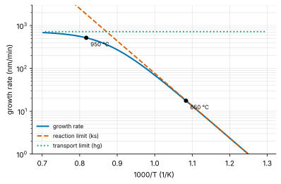
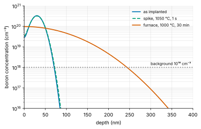

<!-- status: reviewed -->
# 25-03 · Deposition, Etch, CMP, Implant and Metrology

| | |
|---|---|
| **Course** | [25 · Semiconductor Fabrication, Packaging, Test and Reliability](../README.md) |
| **University equivalent** | Microfabrication / IC process technology, unit-process chapters on deposition, etching, CMP, ion implantation, dopant diffusion and process control (Plummer, Deal & Griffin, *Silicon VLSI Technology*; May & Spanos, *Fundamentals of Semiconductor Manufacturing and Process Control*; MIT 6.152J, Berkeley EE143) |
| **Prerequisites** | [25-01](25-01-process-flow-overview.md) (the flow, Deal–Grove, damascene), [25-02](25-02-lithography.md) (pattern transfer, spacer patterning), [09-03](../../09-semiconductor-devices/chapters/09-03-drift-and-diffusion.md) (diffusion and $\sqrt{Dt}$), [03-05](../../03-probability-statistics-and-random-variables/chapters/03-05-estimation-and-hypothesis-testing.md) (process capability), [04-06](../../04-physics-for-ee/chapters/04-06-magnetic-fields-and-forces.md) (the implanter's analyzer magnet) |
| **Estimated study hours** | 8 |
| **Last verified** | 2026-11-26 |

**Learning objectives.** After this chapter you can:

1. Derive the reaction-limited and transport-limited regimes of chemical vapour deposition and explain why ALD is conformal and slow.
2. Size electroplating, etch and overetch steps, including selectivity and wafer non-uniformity.
3. Apply Preston's law to CMP and explain dishing and erosion from pattern density.
4. Compute implant dose, time, profile and junction depth, and the dopant spreading caused by an anneal (the thermal budget).
5. Separate process variation from measurement variation and judge whether a gauge is good enough.
6. Describe the equipment market by segment and supplier, and read its numbers critically.

---

## 1. Big picture

Lithography (25-02) draws a pattern in resist; everything else in the fab makes that pattern into matter. Films are added by deposition, removed selectively by etching, flattened by chemical-mechanical polishing (CMP), doped by ion implantation, healed and activated by annealing, and checked by metrology and inspection. Each is a physical or chemical process with a rate law, a uniformity problem and a measurement problem, and each is sold by a different set of equipment companies. This chapter derives the rate laws a process engineer uses daily, shows how temperature, geometry and pattern density control them, and ends with how the fab knows the result is right. Wafer fab equipment was a $117 B market in 2025 [R-568], larger than lithography alone by a wide margin.

- **Deposition and etch are mirror images,** each limited either by surface chemistry or by transport of reactants, and the regime decides how sensitive the process is to temperature and geometry.
- **Atomic-layer processes trade speed for control:** ALD and atomic-layer etch proceed one self-limiting monolayer per cycle.
- **CMP is mechanical arithmetic:** removal rate scales with local pressure, so pattern density becomes thickness variation.
- **Every hot step spreads every dopant already placed:** the thermal budget is a $\sqrt{Dt}$ ledger.
- **You cannot control what you cannot measure,** and a gauge's own noise adds to the process's.

## 2. Intuition first

**The physical picture.** Picture a wafer surface with trenches and lines. A gas of precursor molecules flows above it. Molecules must diffuse through a stagnant boundary layer to reach the surface, then react there. If the reaction is slow, every part of the surface gets plenty of molecules and the film grows evenly, at a rate set by temperature. If the reaction is fast, the surface consumes molecules faster than they arrive, and growth follows the supply: thicker where gas flows best, thinner deep in trenches. Etching is the same story run backwards, with reactive ions and radicals removing material instead of adding it.

**An analogy and its limits.** Think of a warehouse that receives deliveries (transport) and processes them (reaction). If processing is the bottleneck, the warehouse's output depends on how many workers are on shift (temperature) and not on the trucks; every warehouse in the chain produces the same. If delivery is the bottleneck, output depends on road access: warehouses at the end of narrow lanes (deep trenches) starve. The analogy holds for the two regimes and for why the slow-reaction regime is more uniform. It breaks in two ways:

- **Geometry changes as you work.** Deposition narrows the trench that later molecules must enter, and etching deepens it; the "roads" change during the job.
- **Ions are not trucks.** In plasma etching, ions accelerated by an electric field arrive vertically, which makes etching directional (anisotropic) in a way no diffusion-limited delivery could.

## 3. Theory

### 3.1 Chemical vapour deposition: two resistances in series

In CVD, precursor gases react at the heated wafer surface to form a film (silicon nitride from silane and ammonia, tungsten from WF₆, oxides from TEOS, tetraethyl orthosilicate, a liquid silicon source). Let $C_g$ be the precursor concentration in the bulk gas (molecules/cm³), $C_s$ the concentration at the surface, $h_g$ a gas-phase mass-transfer coefficient (cm/s) and $k_s$ the surface reaction-rate constant (cm/s). The supply and consumption fluxes are

$$
F_1 = h_g\,(C_g - C_s), \qquad F_2 = k_s\,C_s .
$$

At steady state $F_1 = F_2 = F$, so $C_s = h_gC_g/(h_g + k_s)$ and

$$
F = \frac{k_s h_g}{k_s + h_g}\,C_g, \qquad v = \frac{F}{N} = \frac{k_s h_g}{k_s + h_g}\,\frac{C_g}{N},
$$

where $v$ is the growth velocity and $N$ the atoms (or molecules) per cm³ of film. This is the Deal–Grove argument of 25-01 with the diffusion term removed: two conductances in series, and the smaller one wins.

- **Reaction-limited ($k_s \ll h_g$):** $v \approx k_sC_g/N$. Since $k_s = k_0e^{-E_a/kT}$, the rate is strongly temperature dependent but insensitive to gas flow and geometry, so it is uniform across a batch of wafers and down into trenches. Low-pressure CVD (LPCVD) furnaces run here, stacking a hundred or more wafers close together.
- **Transport-limited ($k_s \gg h_g$):** $v \approx h_gC_g/N$. The rate barely changes with temperature but depends on flow and geometry, so uniformity needs careful reactor design.

Thermal oxidation in 25-01 was the same competition: its linear (reaction-limited) and parabolic (diffusion-limited) regimes, compared in Example 25-01.2(c) and §3.2 of that chapter, are the oxidation versions of these two limits. Example 25-03.1 puts numbers on the CVD case.

**Conformality and step coverage.** A film is conformal if it has the same thickness on the top, sidewalls and bottom of a feature. Reaction-limited processes approach that; transport-limited and line-of-sight processes do not. Step coverage, the ratio of sidewall or bottom thickness to top thickness, worsens with the feature's aspect ratio (depth over width).

### 3.2 Atomic-layer deposition

ALD splits the reaction into two half-reactions separated by purges. Precursor A (for HfO₂, a hafnium compound) is pulsed in and chemisorbs on every available surface site until the sites are used up; the excess is purged; reactant B (water or ozone) is pulsed in and converts the adsorbed layer, regenerating sites; purge again. Because each half-reaction stops by itself when the surface is saturated, each cycle adds a fixed growth per cycle (GPC), typically a fraction of a nanometre, regardless of local gas supply, as long as each pulse lasts long enough to saturate the deepest feature. The film thickness is

$$
t_{film} = n_{cycles} \times \text{GPC},
$$

so ALD is digitally controllable and conformal even in very high-aspect-ratio structures, which is why it deposits high-k gate dielectrics, work-function metals and the spacer films of SADP and SAQP (25-02). Its cost is speed: a few seconds per cycle and about a tenth of a nanometre per cycle make it practical only for films of a few nanometres to a few tens (Example 25-03.2).

### 3.3 Physical vapour deposition, epitaxy and electroplating

**PVD (sputtering).** Argon ions from a plasma knock atoms off a metal target, and the atoms fly in straight lines to the wafer. Line-of-sight arrival makes PVD fast and clean but poorly conformal: overhangs form at trench mouths and shadow the bottoms. A magnetic field behind the target confines electrons and densifies the plasma (a magnetron; 04-06). PVD deposits the thin barriers, liners and copper seed layers of damascene (25-01).

**Epitaxy.** Epitaxial growth continues the substrate's crystal lattice. Selective epitaxy grows only on exposed silicon, which is how the source and drain of a FinFET or nanosheet are regrown (25-01). Alloying silicon with germanium changes the lattice constant roughly linearly with composition (Vegard's law), $a(x) \approx a_{Si} + x\,(a_{Ge} - a_{Si})$, with $a_{Si}$ = 0.5431 nm and $a_{Ge}$ = 0.5658 nm. A SiGe layer grown on silicon is forced to silicon's in-plane lattice spacing and so is compressively strained; in the source and drain, that strain is transferred to the channel and raises hole mobility (Problem 25-03.14). Above a critical thickness the strain relaxes by forming dislocations, which caps how much germanium and thickness can be used.

**Electroplating.** Copper is plated from a copper sulphate bath onto the PVD seed by passing a current. Faraday's law of electrolysis fixes the deposition rate: each Cu²⁺ ion needs $n$ = 2 electrons, so a current density $j$ deposits $j/(nF)$ moles per unit area per second, where $F$ = 96,485 C/mol is Faraday's constant. Multiplying by the molar mass $M$ and dividing by the density $\rho$ gives the thickness rate

$$
\frac{dt_{Cu}}{dt} = \frac{j\,M}{n F \rho} .
$$

Additives in the bath slow deposition at the trench mouth and accelerate it at the bottom, so trenches fill from the bottom up without voids ("superfill").

### 3.4 Etching

**Wet etching** dissolves material in liquid chemistry (hydrofluoric acid for oxide, for example). It is selective and cheap but isotropic: it eats sideways as fast as downwards, undercutting the mask by about the film thickness, which rules it out for fine patterns. **Plasma (dry) etching** creates reactive radicals and ions in a low-pressure discharge. The wafer sits on an electrode that develops a negative self-bias, so positive ions accelerate across the thin boundary sheath and strike the surface nearly vertically. Ion bombardment drives the chemistry on surfaces it hits (the trench bottom) much faster than on surfaces it grazes (the sidewalls), and sidewall passivation films further protect the walls: the result is anisotropic etching. Three figures of merit govern every etch:

- **Etch rate** (nm/min) and its **uniformity** across the wafer.
- **Selectivity,** the ratio of the etch rate of the target film to that of the layer beneath (the stop layer) or of the mask.
- **Anisotropy and profile:** vertical sidewalls, no bowing, no aspect-ratio-dependent slowdown (deep, narrow features etch more slowly because fewer ions and radicals reach the bottom).

**Overetch.** Film thickness and etch rate vary across the wafer, so the etch must run longer than the nominal time to clear the slowest region. Where the film clears early, the stop layer is exposed and consumed at the target's etch rate divided by the selectivity. Example 25-03.4 sizes the loss.

**Atomic-layer etching (ALE)** is ALD in reverse: a self-limiting surface modification step (for example, chlorinating the top monolayer) followed by a removal step that takes off only the modified layer (a low-energy ion pulse). It removes a fixed amount per cycle with excellent uniformity and selectivity, at low throughput, and is used where a few nanometres must be removed precisely.

### 3.5 Chemical-mechanical polishing

CMP presses the wafer face-down onto a rotating pad flooded with an abrasive, chemically active slurry. Its empirical rate law, Preston's equation, states that the removal rate is proportional to the local pressure $P$ and the relative velocity $v$:

$$
RR = K_p\,P\,v,
$$

where $K_p$ (Pa⁻¹) bundles the slurry chemistry, pad and film. Pressure is the lever that makes CMP planarize: raised features carry the load, so they see more than the average pressure and are removed faster, while recessed areas see little until the surface is flat. If raised features cover a fraction $\rho$ of an area, they carry the applied pressure on that fraction, $P/\rho$, and polish at $RR/\rho$ (Example 25-03.5).

The same physics creates CMP's characteristic defects. **Dishing** is the recess of a wide soft-metal line below the surrounding dielectric, because the pad bends into it after the excess has cleared. **Erosion** is the thinning of dielectric in dense arrays of lines, where the hard dielectric is a small fraction of the area and carries high pressure. Both depend on pattern density, which is why design rules impose minimum and maximum metal densities and why tools insert dummy "fill" shapes into empty areas.

### 3.6 Ion implantation and the dopant profile

An implanter ionizes a dopant (boron, phosphorus, arsenic), selects the right mass with an analyzer magnet (04-06), accelerates the ions to a chosen energy and scans the beam over the wafer. The **dose** $Q$ (ions/cm²) is the beam charge per area divided by the ion charge; for a singly charged beam of current $I$ over a wafer area $A$, the time is

$$
t = \frac{Q\,q\,A}{I} .
$$

Ions slow down by nuclear and electronic collisions and stop at a statistical range. To first order the as-implanted profile is Gaussian, with projected range $R_p$ and straggle $\Delta R_p$:

$$
N(x) = \frac{Q}{\sqrt{2\pi}\,\Delta R_p}\exp\!\left[-\frac{(x - R_p)^2}{2\Delta R_p^2}\right], \qquad N_p = \frac{Q}{\sqrt{2\pi}\,\Delta R_p} .
$$

The junction depth $x_j$ is where the implanted concentration equals the background doping $N_B$ of opposite type:

$$
x_j = R_p + \Delta R_p\sqrt{2\ln(N_p/N_B)} .
$$

Higher energy gives a deeper $R_p$; heavier ions (arsenic) stop shallower than light ones (boron) at the same energy. Ions travelling along open crystal channels go deeper than the Gaussian predicts (channelling), which is why wafers are tilted or pre-amorphized.

### 3.7 Annealing and the thermal budget

Implantation displaces silicon atoms and leaves most dopants on interstitial sites where they are electrically inactive. An anneal repairs the lattice and moves dopants onto substitutional sites (activation). But dopants also diffuse during every hot step, with diffusivity $D = D_0e^{-E_a/kT}$. For intrinsic boron, a classic fit tabulated by Plummer, Deal and Griffin gives $D_0$ = 0.76 cm²/s and $E_a$ = 3.46 eV.

A Gaussian profile diffusing with constant $D$ for time $t$ stays Gaussian (the convolution of two Gaussians is Gaussian), with its variance increased by $2Dt$:

$$
\Delta R_p'^2 = \Delta R_p^2 + 2Dt, \qquad N_p' = N_p\,\frac{\Delta R_p}{\Delta R_p'} ,
$$

ignoring the surface, which in reality reflects dopant back and raises the profile near it (the lab includes it). The product $Dt$, summed over all hot steps after the implant, is the **thermal budget**. Because $D$ rises steeply with temperature, the industry replaced long furnace anneals with rapid thermal processing: spike anneals that reach about 1,000–1,100 °C for about a second, then flash and laser anneals of milliseconds or less, which activate dopants while barely moving them (Example 25-03.7).

> **Going deeper — why real boron diffuses faster than this.** Implant damage releases excess silicon interstitials that pair with boron and speed its diffusion by orders of magnitude for a short time after the implant (transient enhanced diffusion), and concentrations above the intrinsic carrier density raise diffusivity further. Process simulators model the point-defect populations explicitly; the constant-$D$ Gaussian here is the first-order picture.

### 3.8 Metrology and inspection

**What is measured.** Film thickness and composition (ellipsometry, X-ray methods), critical dimensions (CD-SEM and optical scatterometry, which fits a model of the structure to its reflected spectrum), overlay between layers (25-02), sheet resistance (four-point probe), and defects (optical and electron-beam inspection, then review). Measurements are placed after critical steps because, as 25-01 noted, an early defect wastes all the later work.

**Measurement noise adds.** If the process produces a true spread $\sigma_p$ and the gauge adds independent noise $\sigma_m$, the observed spread is

$$
\sigma_{obs} = \sqrt{\sigma_p^2 + \sigma_m^2} .
$$

A noisy gauge therefore makes a capable process look incapable (lower apparent $C_{pk}$, 03-05) and hides small process shifts. A common acceptance test is the precision-to-tolerance ratio, $P/T = 6\sigma_m/(\text{USL} - \text{LSL})$, where USL and LSL are the upper and lower specification limits; a gauge with $P/T$ at or below about 0.1 is considered good and one above about 0.3 inadequate (Example 25-03.8). At advanced nodes, where tolerances are a nanometre or less, gauge capability is a frontier of its own.

> **Analogy — audit sampling.** A metrology plan is an audit: it samples wafers, sites and lots, accepting some risk of missing a problem in exchange for cost and time. As in auditing, the right sample depends on the materiality of what can go wrong, and an auditor with noisy instruments (a noisy gauge) needs larger samples. The analogy breaks because the fab's "transactions" are physical and correlated across a wafer; a sampling plan must follow spatial patterns, not just random draws.

## 4. Worked examples

"Assumed" values are illustrative. $k$ = 8.61733 × 10⁻⁵ eV/K.

### Example 25-03.1 · Which CVD regime? (tier B)

**Setup.** A CVD process has $h_g$ = 2.0 cm/s, a surface reaction with $E_a$ = 1.5 eV and $k_s$ = 0.050 cm/s at 650 °C, a precursor concentration of 3 × 10¹⁶ cm⁻³ and a film density of 5 × 10²² cm⁻³ (all assumed). (a) Find the effective rate constant and growth rate at 650 °C. (b) By what percentage does a 10 °C rise change the rate? (c) Repeat (a) and (b) at 950 °C.

**Solution.**

- (a) $k_sh_g/(k_s + h_g) = 0.050 \times 2.0/2.05$ = **0.0488** cm/s; $v$ = $0.0488 \times 3 \times 10^{16}/5 \times 10^{22}$ cm/s = **17.6** nm/min.
- (b) At 660 °C, $k_s$ = **0.0612** cm/s and the effective constant 0.0594 cm/s: **+21.7**%.
- (c) At 950 °C, $k_s$ = **5.10** cm/s and the effective constant **1.44** cm/s, $v$ = **517** nm/min; a 10 °C rise gives only **+3.2**%.

**Units check.** (cm/s)(cm⁻³)/(cm⁻³) = cm/s; × 10⁷ nm/cm × 60 s/min = nm/min. ✓

**Sanity check.** At 650 °C the film is reaction-limited: a 1 °C drift changes the rate about 2%, so temperature uniformity rules, but flow and geometry barely matter. At 950 °C it is transport-limited: the rate is high and temperature-insensitive, but the gas flow now decides uniformity.

### Example 25-03.2 · How long ALD takes (tier A)

**Setup.** An ALD HfO₂ process grows 0.10 nm per cycle with a 4.0 s cycle (assumed). (a) How many cycles and how long for a 2.0 nm gate dielectric? (b) For a 20 nm liner?

**Solution.**

- (a) $2.0/0.10$ = **20** cycles, **80** s.
- (b) **200** cycles, **13.3** min.

**Units check.** nm ÷ (nm/cycle) = cycles; cycles × s/cycle = s. ✓

**Sanity check.** Eighty seconds for a gate dielectric is affordable; thirteen minutes per wafer for a liner is not, unless the tool processes many wafers at once. ALD earns its place where nanometre control and conformality matter more than speed.

### Example 25-03.3 · Plating copper by Faraday's law (tier B)

**Setup.** Copper ($M$ = 63.55 g/mol, $\rho$ = 8.96 g/cm³, $n$ = 2) is plated at 10 mA/cm² (assumed). Find (a) the deposition rate and (b) the time to deposit 1.0 µm.

**Solution.**

- (a) $0.010 \times 63.55/(2 \times 96{,}485 \times 8.96)$ = **3.68e-7** cm/s = **3.68** nm/s = **0.221** µm/min.
- (b) $1.0 \times 10^{-4}/3.68 \times 10^{-7}$ = **272** s.

**Units check.** (A/cm²)(g/mol)/[(C/mol)(g/cm³)] = (C/s/cm²)(cm³/C) = cm/s. ✓

**Sanity check.** A few minutes per wafer for a micrometre of copper, roughly the overburden needed to fill a metal level, is why plating is a high-throughput step; most of the copper plated is later polished away.

### Example 25-03.4 · Overetch and stop-layer loss (tier B)

**Setup.** A 100 nm film etches at 50 nm/min with ±5% rate non-uniformity across the wafer; the recipe runs 20% beyond the nominal clearing time; selectivity to the stop layer is 20:1 (all assumed). Find (a) the nominal, slowest and fastest clearing times and the total etch time, (b) how long the fastest region's stop layer is exposed, and (c) how much of it is consumed there.

**Solution.**

- (a) Nominal $100/50$ = **2.0** min; slowest $100/47.5$ = **2.11** min; fastest $100/52.5$ = **1.90** min; total $1.2 \times 2.0$ = **2.4** min, which clears the slowest region.
- (b) $2.4 - 1.905$ = **0.495** min.
- (c) $0.495 \times 52.5/20$ = **1.3** nm.

**Units check.** min × (nm/min) = nm. ✓

**Sanity check.** A 1.3 nm loss is harmless on a 20 nm stop layer but fatal on a 2 nm one. Thinner stop layers demand higher selectivity or better uniformity, which is why etch suppliers compete on both.

### Example 25-03.5 · Preston's law and pattern density (tier B)

**Setup.** A CMP process has $K_p$ = 2.4 × 10⁻¹³ Pa⁻¹, a down-force of 2.0 psi (6,895 Pa per psi) and a pad velocity of 1.0 m/s (assumed). (a) Find the blanket removal rate. (b) How long does it take to remove 500 nm of blanket overburden? (c) In a region where raised features cover 25% of the area, at what rate are they removed at first?

**Solution.**

- (a) $2.4 \times 10^{-13} \times 13{,}790 \times 1.0$ m/s = **3.31e-9** m/s = **199** nm/min.
- (b) $500/199$ = **2.5** min.
- (c) Pressure on the raised features is $P/0.25$, so **794** nm/min.

**Units check.** Pa⁻¹ × Pa × m/s = m/s. ✓

**Sanity check.** Four times faster on 25%-density features is how CMP flattens topography; it is also why a sparse region and a dense region finish at different times, which drives dishing and erosion and the density rules that limit them.

### Example 25-03.6 · An implant: time, peak and junction (tier B)

**Setup.** Boron is implanted at a dose of 10¹⁵ cm⁻² into a 300 mm wafer (707 cm²) with a 10 mA beam. Its projected range is 30 nm and its straggle 12 nm (assumed). The background is 10¹⁸ cm⁻³ of n-type doping. Find (a) the implant time, (b) the peak concentration and (c) the junction depth.

**Solution.**

- (a) $10^{15} \times 1.602 \times 10^{-19} \times 707/0.010$ = **11.3** s.
- (b) $10^{15}/(\sqrt{2\pi} \times 12 \times 10^{-7})$ = **3.32e20** cm⁻³.
- (c) $\sqrt{2\ln(3.32 \times 10^{20}/10^{18})}$ = **3.41**, so $x_j = 30 + 12 \times 3.41$ = **70.9** nm.

**Units check.** (cm⁻²)(C)(cm²)/A = C/(C/s) = s; cm⁻²/cm = cm⁻³. ✓

**Sanity check.** A peak above 10²⁰ cm⁻³ is a heavily doped source/drain region; the junction lies about 3.4 straggles beyond the peak because the background is 332 times lower.

### Example 25-03.7 · What an anneal costs in diffusion (tier C)

**Setup.** Using intrinsic boron diffusivity ($D_0$ = 0.76 cm²/s, $E_a$ = 3.46 eV), compare (a) a 30 min furnace anneal at 1000 °C with (b) a spike anneal approximated as 1.0 s at 1050 °C. For each find $D$, the added spread $\sqrt{2Dt}$, the new straggle of Example 25-03.6's profile and the factor by which its peak falls (ignoring the surface).

**Solution.**

- (a) $kT = 8.61733 \times 10^{-5} \times 1273.15$ = **0.109712** eV; $D = 0.76\,e^{-3.46/0.109712}$ = **1.53e-14** cm²/s; $\sqrt{2Dt}$ = **74** nm; $\Delta R_p' = \sqrt{12^2 + 74.2^2}$ = **75** nm; the peak falls to **0.16** of its value.
- (b) $D$ = **5.03e-14** cm²/s; $\sqrt{2Dt}$ = **3.2** nm; $\Delta R_p'$ = **12.4** nm; the peak keeps **0.97** of its value.

**Units check.** cm²/s × s = cm²; √cm² = cm. ✓

**Sanity check.** The furnace anneal would smear a 12 nm profile over 75 nm and destroy a shallow junction; the spike anneal, at a higher temperature but for 1/1800 of the time, barely moves it. That is the thermal-budget argument for rapid thermal processing (and transient enhanced diffusion makes real boron move more, not less).

### Example 25-03.8 · Is the gauge good enough? (tier B)

**Setup.** A CD specification is 20.0 ± 1.5 nm. The process mean is 20.3 nm with true standard deviation 0.40 nm, and the CD-SEM adds 0.15 nm of measurement noise (assumed). Find (a) the true $C_{pk}$ and the fraction out of specification, (b) the observed spread and apparent $C_{pk}$, and (c) the gauge's $P/T$ ratio.

**Solution.**

- (a) $C_{pk} = \min(21.5 - 20.3,\ 20.3 - 18.5)/(3 \times 0.40)$ = **1.00**; out of specification: $[1 - \Phi(3.0)] + [1 - \Phi(4.5)]$ = **1.35e-3**, where $\Phi$ is the standard normal CDF (03-02).
- (b) $\sqrt{0.40^2 + 0.15^2}$ = **0.427** nm; apparent $C_{pk}$ = **0.94**.
- (c) $6 \times 0.15/3.0$ = **0.30**.

**Units check.** $C_{pk}$ and $P/T$ are ratios of lengths. ✓

**Sanity check.** The gauge sits at the edge of inadequacy: it makes the process look worse than it is, and a 0.15 nm shift would be hard to detect. A tenfold-better gauge ($P/T$ = 0.03) would cost little in apparent capability.

### Example 25-03.9 · Reading the equipment market (tier A)

**Setup.** SEMI reported wafer fab equipment (WFE) of $116.9 B in 2025 and forecast $143.9 B for 2026, of which foundry and logic $78.0 B, DRAM $38.8 B and NAND $13.9 B; it forecast total equipment of $165.9 B for 2026, up 23.2% [R-568]. TechInsights put the 2025 IC equipment market at $136.2 B [R-569]. (a) Check SEMI's WFE growth. (b) Find each application's 2026 share of WFE. (c) Find SEMI's implied 2025 total and compare it with TechInsights'.

**Solution.**

- (a) $143.9/116.9 - 1$ = **23.1**%.
- (b) Foundry and logic **54.2**%, DRAM **27.0**%, NAND **9.7**%.
- (c) $165.9/1.232$ = **134.7** $B; TechInsights is **1.1**% higher.

**Units check.** $B ÷ $B is dimensionless. ✓

**Sanity check.** Two independent trackers agree within about 1% on the total, which builds some confidence in the market size, though not proof: SEMI's total includes test and assembly equipment, and the TechInsights excerpt read here does not spell out whether its "IC manufacturing equipment" does the same, so part of the agreement may be coincidence of scope [R-568], [R-569]. Company-level figures disagree far more, because of scope (equipment against total revenue including service) and fiscal-year differences [R-569], [R-570].

<!-- answer-key -->

| ID | Quantity | Value | Unit |
|---|---|---|---|
| Ex 25-03.1a | effective rate constant, 650 C | 0.0488 | cm/s |
| Ex 25-03.1a1 | growth rate, 650 C | 17.6 | nm/min |
| Ex 25-03.1b0 | ks at 660 C | 0.0612 | cm/s |
| Ex 25-03.1b1 | effective constant at 660 C | 0.0594 | cm/s |
| Ex 25-03.1b | rate change for +10 C at 650 C | 21.7 | % |
| Ex 25-03.1c0 | ks at 950 C | 5.10 | cm/s |
| Ex 25-03.1c1 | effective constant at 950 C | 1.44 | cm/s |
| Ex 25-03.1c2 | growth rate, 950 C | 517 | nm/min |
| Ex 25-03.1c | rate change for +10 C at 950 C | 3.2 | % |
| Ex 25-03.2a | cycles for 2 nm | 20 | |
| Ex 25-03.2a1 | time for 2 nm | 80 | s |
| Ex 25-03.2b | cycles for 20 nm | 200 | |
| Ex 25-03.2b1 | time for 20 nm | 13.3 | min |
| Ex 25-03.3a | plating rate | 3.68e-7 | cm/s |
| Ex 25-03.3a1 | plating rate | 3.68 | nm/s |
| Ex 25-03.3a2 | plating rate | 0.221 | µm/min |
| Ex 25-03.3b | time for 1 µm | 272 | s |
| Ex 25-03.4a | nominal clearing time | 2.0 | min |
| Ex 25-03.4a1 | slowest clearing time | 2.11 | min |
| Ex 25-03.4a2 | fastest clearing time | 1.90 | min |
| Ex 25-03.4a3 | total etch time | 2.4 | min |
| Ex 25-03.4b0 | fastest clearing time, 4 s.f. | 1.905 | min |
| Ex 25-03.4b | stop-layer exposure | 0.495 | min |
| Ex 25-03.4c | stop-layer consumed | 1.3 | nm |
| Ex 25-03.5a | removal rate | 3.31e-9 | m/s |
| Ex 25-03.5a0 | down-force | 13790 | Pa |
| Ex 25-03.5a1 | removal rate | 199 | nm/min |
| Ex 25-03.5b | time for 500 nm | 2.5 | min |
| Ex 25-03.5c | rate on 25% features | 794 | nm/min |
| Ex 25-03.6a | implant time | 11.3 | s |
| Ex 25-03.6b | peak concentration | 3.32e20 | cm⁻³ |
| Ex 25-03.6c0 | square-root factor | 3.41 | |
| Ex 25-03.6c | junction depth | 70.9 | nm |
| Ex 25-03.7a0 | kT at 1000 C | 0.109712 | eV |
| Ex 25-03.7a | D at 1000 C | 1.53e-14 | cm²/s |
| Ex 25-03.7a1 | added spread, furnace | 74 | nm |
| Ex 25-03.7a2 | added spread, 3 s.f. | 74.2 | nm |
| Ex 25-03.7a3 | new straggle, furnace | 75 | nm |
| Ex 25-03.7a4 | peak factor, furnace | 0.16 | |
| Ex 25-03.7b | D at 1050 C | 5.03e-14 | cm²/s |
| Ex 25-03.7b1 | added spread, spike | 3.2 | nm |
| Ex 25-03.7b2 | new straggle, spike | 12.4 | nm |
| Ex 25-03.7b3 | peak factor, spike | 0.97 | |
| Ex 25-03.8a | true Cpk | 1.00 | |
| Ex 25-03.8a1 | fraction out of specification | 1.35e-3 | |
| Ex 25-03.8b | observed sigma | 0.427 | nm |
| Ex 25-03.8b1 | apparent Cpk | 0.94 | |
| Ex 25-03.8c | P/T ratio | 0.30 | |
| Ex 25-03.9a | WFE growth | 23.1 | % |
| Ex 25-03.9b | foundry and logic share | 54.2 | % |
| Ex 25-03.9b1 | DRAM share | 27.0 | % |
| Ex 25-03.9b2 | NAND share | 9.7 | % |
| Ex 25-03.9c | implied 2025 total | 134.7 | $B |
| Ex 25-03.9c1 | TechInsights over SEMI | 1.1 | % |
| Txt 25-03.a | rate change per degree at 650 C | 2 | % |
| Txt 25-03.b | spike over furnace diffusivity | 3 | |
| Txt 25-03.c | furnace over spike time | 1800 | |
| Txt 25-03.d | peak over background | 332 | |
| Txt 25-03.e | WFE 2025, rounded | 117 | $B |

## 5. Simulate it

The lab is [labs/25-03-lab/](../labs/25-03-lab/README.md). `units.py` implements the CVD regimes, ALD and plating arithmetic, an etch with a wafer map of non-uniformity, a Preston-law step-height model, implant profiles with a finite-difference diffusion solver (including the reflecting surface), and a gauge-noise simulation; the notebook runs the parts below.

*Figure 1. CVD's two regimes: reaction-limited at low temperature (steep, uniform), transport-limited at high temperature (flat, geometry-sensitive). Example 25-03.1's 650 °C and 950 °C points are marked.*

*Figure 2. The thermal budget at work: a spike anneal leaves Example 25-03.6's profile almost untouched; a furnace anneal spreads it several times deeper (computed with a reflecting surface).*

**Predict, then run:**

1. *Predict* the temperature at which Example 25-03.1's reaction and transport terms are equal ($k_s = h_g$), then find it from the Arrhenius plot.
2. *Predict* the junction depth after the furnace anneal of Example 25-03.7, including the surface, then compute it with the finite-difference solver.
3. *Predict* how long CMP takes to flatten a 300 nm step in a region where raised features cover 25% of the area, then run the step-height model.
4. *Predict* the apparent $C_{pk}$ of Example 25-03.8's process measured with a gauge of $\sigma_m$ = 0.05 nm, then simulate 10,000 measurements.

## 6. Engineering tradeoffs

| Knob | Improves | Costs | Typical decision owner |
|---|---|---|---|
| Reaction-limited CVD (lower temperature) | Uniformity, conformality, batch size | Rate, film quality at low temperature | Process engineering |
| ALD instead of CVD | Thickness control, conformality | Throughput, precursor cost | Process integration |
| Higher plasma ion energy | Anisotropy, etch rate | Selectivity, damage, mask erosion | Etch engineering |
| More overetch | Clearing the slowest region | Stop-layer loss, profile damage | Etch engineering |
| Higher CMP pressure or speed | Removal rate | Dishing, erosion, defects, uniformity | CMP engineering with design rules |
| Spike, flash or laser anneal | Activation with minimal diffusion | Incomplete damage repair, equipment cost | Process integration |
| Better gauges and more sampling | Detection of shifts, true capability | Metrology cost and cycle time | Fab yield and metrology |

## 7. Numbers to know

Perishable rows are as of Nov 2026; the date column gives the source's own date.

| Quantity | Value | Dated | Source |
|---|---|---|---|
| Wafer fab equipment market | $116.9 B (2025); $143.9 B forecast (2026) | Jul 2026 | [R-568] |
| WFE 2026 by application | foundry/logic $78.0 B, DRAM $38.8 B, NAND $13.9 B | Jul 2026 | [R-568] |
| IC equipment market (TechInsights) | $136.2 B (2025), +13% | Jul 2026 | [R-569] |
| Top five equipment suppliers | ASML, Applied Materials, Lam Research, Tokyo Electron, KLA | 2025 | [R-569] |
| Boron intrinsic diffusivity | $D_0$ = 0.76 cm²/s, $E_a$ = 3.46 eV | textbook | §3.7 |
| Faraday's constant | 96,485 C/mol | timeless | §3.3 |
| Si and Ge lattice constants | 0.5431 nm and 0.5658 nm | timeless | §3.3 |
| Gauge acceptance | $P/T \lesssim 0.1$ good, $\gtrsim 0.3$ inadequate | rule of thumb | §3.8 |

## 8. Common mistakes

- **Raising temperature to fix a transport-limited process.** It barely helps; flow and geometry do.
- **Assuming CVD is conformal.** Only reaction-limited CVD and ALD approach it; PVD is line-of-sight.
- **Sizing overetch on the nominal rate alone.** Non-uniformity decides where the stop layer is exposed longest.
- **Reading Preston's law with average pressure.** Local pressure depends on pattern density.
- **Adding diffusion lengths instead of variances.** Spreads add in quadrature: $\Delta R_p'^2 = \Delta R_p^2 + 2Dt$.
- **Forgetting earlier hot steps.** Every anneal after an implant moves it; the thermal budget is cumulative.
- **Blaming the process for gauge noise.** Subtract the measurement variance before judging capability.

## 9. Practitioner lens

**State of the art (as of Nov 2026).**

- *Market size* [Established for 2025; forecasts Industry estimate]. SEMI reported record WFE of $116.9 B in 2025 and forecast $143.9 B in 2026 (+23.1%), total equipment of $165.9 B in 2026 and $229.5 B in 2028; test equipment $15.3 B and assembly and packaging equipment $6.7 B in 2026 [R-568]. TechInsights put the 2025 IC equipment market at $136.2 B, +13% [R-569].
- *Suppliers* **[Industry estimate]** for the ranking, **[Established]** for the filed revenues, **[Contested]** for dollar shares. TechInsights ranked the top five of 2025 as ASML (about $27.5 B of equipment revenue), Applied Materials, Lam Research, Tokyo Electron and KLA [R-569]. Latest fiscal-year revenues from filings: Applied Materials $34.45 B (to Oct 2026), Lam Research $23.2 B (to Jun 2026), Tokyo Electron ¥2,443.5 B (to Mar 2026) and KLA $13.58 B (to Jun 2026) [R-570]; ASML's 2025 unit shipments are in [R-563]. Fiscal years differ by up to ten months, and some figures include service and display revenue, so they should not be added or ranked naively.
- *Competitive map* [Established: company filings]. Lam names Applied Materials as its main deposition rival, ASM International and Wonik IPS in ALD and PECVD (plasma-enhanced CVD, which uses a plasma to run the reaction at lower temperature), Applied, Hitachi and Tokyo Electron in etch, and Screen, Semes and Tokyo Electron in wet clean [R-571]. KLA says its process-control share is about seven times its nearest competitor's and expects advanced-packaging process-control revenue to grow from about $635 M in 2025 to about $1 B in 2026 [R-571]; third-party share estimates vary with definition **[Contested]**.

**Why it matters commercially.** Every flow change in 25-01 and 25-02 moves money between these segments. Nanosheets add selective etches, epitaxy and ALD steps; backside power adds bonding, thinning and CMP; EUV single patterning removes deposition and etch steps that SAQP needed; advanced packaging (25-07) pulls process control and CMP into back-end fabs. Lam's 10-K, for example, attributes its systems growth to "foundry equipment customer spending" [R-570]. For a diligence team, the question is how a target's tools ride these step-count shifts, and how exposed its revenue is to one region: Lam reported 34% of fiscal 2026 revenue from China [R-570].

**Marketing vs Reality.**

- *"Record WFE."* Partly price and mix: more steps per wafer at advanced nodes, not only more wafers. Ask how much is capacity and how much is intensity.
- *"Market leader with N% share."* Shares depend on scope (equipment only or including service), segment definitions and fiscal year; trackers disagree by tens of percent [R-569].
- *"7× the nearest competitor."* Self-reported and based on unnamed research [R-571].
- *"Atomic-level control."* ALD and ALE are atomic-scale per cycle; the wafer-level result still depends on uniformity, nucleation and metrology.

**Questions for engineering leaders.**

1. **"Which process steps does the next node add or remove, and in which tool categories?"** *Strong:* a step-count delta by category (deposition, etch, CMP, metrology) with the reason for each. *Evasive:* "the node is more complex."
2. **"Is your critical deposition reaction- or transport-limited, and what does that do to uniformity?"** *Strong:* the regime, its sensitivity and the control strategy. *Evasive:* "the chamber is tuned."
3. **"What is your thermal budget after the source/drain implant, and how much diffusion does it allow?"** *Strong:* a $Dt$ ledger by step. *Evasive:* "we use advanced anneals."
4. **"What is your gauge's precision-to-tolerance ratio on the critical CD?"** *Strong:* a number, how it was measured and how sampling compensates. *Evasive:* "the tool meets spec."
5. **"How much of your revenue growth is capacity and how much is process intensity?"** *Strong:* a decomposition by customer segment and region. *Evasive:* "AI demand."

## 10. Concept check

**Q1.** Why is reaction-limited CVD more uniform than transport-limited CVD?

Answer

When the surface reaction is the bottleneck, the surface concentration nearly equals the gas concentration everywhere, so the rate depends only on temperature, which can be made uniform; supply differences from flow and geometry do not matter.

**Q2.** What makes ALD self-limiting?

Answer

Each half-reaction stops when every surface site has reacted; excess precursor cannot adsorb, so each cycle adds a fixed thickness regardless of local supply, provided each pulse saturates the surface.

**Q3.** Why does plasma etching produce vertical sidewalls while wet etching does not?

Answer

Ions accelerated across the sheath strike the wafer nearly vertically and drive the etch on horizontal surfaces much faster than on sidewalls, which also gather passivation films. Wet chemistry attacks all exposed surfaces equally.

**Q4.** Why does CMP remove raised features faster than recessed ones?

Answer

By Preston's law the rate scales with local pressure; raised features carry the load over a fraction of the area, so their pressure (and rate) is higher until the surface is flat.

**Q5.** A spike anneal at a higher temperature than a furnace anneal diffuses dopants less. Why?

Answer

Diffusion spreads as $\sqrt{Dt}$. The spike's higher $D$ (about 3× here) is outweighed by a time 1,800 times shorter.

**Q6.** A process looks barely capable on the measurement data. What should you check first?

Answer

The gauge: measurement variance adds to process variance, so a noisy gauge lowers the apparent $C_{pk}$. Check its precision-to-tolerance ratio.

Now try the [25-03 problem set](../problems/25-03-problems.md).

## 11. Key terms

[Chemical vapour deposition (CVD)](../../../reference/glossary.md#chemical-vapour-deposition-cvd) · [Atomic-layer deposition (ALD)](../../../reference/glossary.md#atomic-layer-deposition-ald) · [Physical vapour deposition (PVD)](../../../reference/glossary.md#physical-vapour-deposition-pvd) · [Epitaxy](../../../reference/glossary.md#epitaxy) · [Step coverage](../../../reference/glossary.md#step-coverage) · [Etch selectivity](../../../reference/glossary.md#etch-selectivity) · [Anisotropic etch](../../../reference/glossary.md#anisotropic-etch) · [Atomic-layer etching (ALE)](../../../reference/glossary.md#atomic-layer-etching-ale) · [Preston's equation](../../../reference/glossary.md#prestons-equation) · [Dishing and erosion](../../../reference/glossary.md#dishing-and-erosion) · [Projected range](../../../reference/glossary.md#projected-range) · [Thermal budget](../../../reference/glossary.md#thermal-budget) · [Precision-to-tolerance ratio](../../../reference/glossary.md#precision-to-tolerance-ratio) · [Wafer fab equipment (WFE)](../../../reference/glossary.md#wafer-fab-equipment-wfe)

## 12. Connections

- **Previous:** [25-02 Lithography](25-02-lithography.md): the pattern these steps transfer into the wafer.
- **Next:** [25-04 Yield Models and Die Cost](25-04-yield-and-die-cost.md): how the defects these steps create become yield, and yield becomes cost.
- **Prerequisites used:** [25-01](25-01-process-flow-overview.md) for the flow and Deal–Grove; [09-03](../../09-semiconductor-devices/chapters/09-03-drift-and-diffusion.md) for diffusion; [03-05](../../03-probability-statistics-and-random-variables/chapters/03-05-estimation-and-hypothesis-testing.md) for $C_{pk}$; [04-06](../../04-physics-for-ee/chapters/04-06-magnetic-fields-and-forces.md) for the implanter magnet.
- **Used later:** [25-07](25-07-advanced-packaging-and-chiplets.md) (CMP and bonding for hybrid bonding), [25-09](25-09-reliability-physics.md) (film quality and reliability), [25-11](25-11-test-ate-sort-burn-in.md) (yield learning with inspection data).

> **Deeper:** see companion repo *Semiconductor Capital Equipment* for tool architectures, supplier economics and how process changes move spending between segments.

## 13. Further study

- J. D. Plummer, M. D. Deal and P. B. Griffin, *Silicon VLSI Technology*: chapters on dopant diffusion, ion implantation, thin-film deposition and etching (diffusivity tables, range tables, CVD regimes).
- G. S. May and C. J. Spanos, *Fundamentals of Semiconductor Manufacturing and Process Control*: metrology, statistical process control and gauge studies.
- M. A. Lieberman and A. J. Lichtenberg, *Principles of Plasma Discharges and Materials Processing*: plasma sheaths and etching.
- MIT OpenCourseWare 6.152J and Berkeley EE143: deposition, etch and implantation lectures.

## 14. Sources

1. SEMI equipment forecast, July 2026: [R-568].
2. TechInsights 2025 equipment ranking: [R-569].
3. Equipment suppliers' fiscal-year revenues and Lam's regional mix: [R-570]; ASML: [R-563].
4. Competitive map from Lam's 10-K and KLA's claims: [R-571].
5. Diffusivity, CVD and implantation models: Plummer, Deal and Griffin (textbook, see §13).
