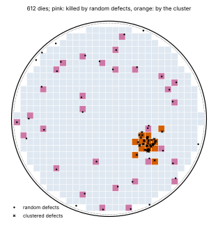
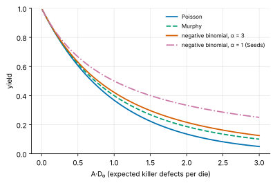

<!-- status: verified -->
# 25-04 · Yield Models and Die Cost

| | |
|---|---|
| **Course** | [25 · Semiconductor Fabrication, Packaging, Test and Reliability](../README.md) |
| **University equivalent** | Semiconductor manufacturing yield and cost modelling (May & Spanos, *Fundamentals of Semiconductor Manufacturing and Process Control*, yield chapter; Hennessy & Patterson's cost-of-an-integrated-circuit section; Berkeley EE143 and MIT 6.152J manufacturing lectures) |
| **Prerequisites** | [03-02](../../03-probability-statistics-and-random-variables/chapters/03-02-random-variables-and-distributions.md) (Poisson yield), [03-03](../../03-probability-statistics-and-random-variables/chapters/03-03-expectation-and-functions-of-rvs.md) (expectation over a distribution), [01-10](../../01-calculus-for-engineers/chapters/01-10-multivariable-calculus-2.md) (the dies-per-wafer estimate), [25-01](25-01-process-flow-overview.md) (step yield, cycle time), [25-03](25-03-deposition-etch-cmp-implant-metrology.md) (where defects come from) |
| **Estimated study hours** | 7 |
| **Last verified** | 2026-11-26 |

**Learning objectives.** After this chapter you can:

1. Count dies per wafer from wafer size, die size, scribe lines and edge exclusion, and explain why the common formula undercounts.
2. Derive the Poisson, Murphy and negative-binomial yield models from assumptions about defect statistics, and choose among them.
3. Compute cost per good die, explain why it grows faster than die area, and quantify the value of redundancy and core harvesting.
4. Model yield learning over time and translate a defect-density target into a schedule.
5. Build a wafer cost from fab capital and estimate cost per transistor across nodes.
6. Read published yield and price claims critically, as of late 2026.

---

## 1. Big picture

A wafer costs the same whether it carries one large die or a thousand small ones, and whether those dies work or not. The fab's economics therefore come down to two numbers: how many dies fit on a wafer, and what fraction of them work. Yield, the working fraction, depends on the density of killer defects and on the die's area in a way that punishes large dies exponentially, and defects cluster, which softens that punishment. This chapter derives the standard yield models from probability (03-02, 03-03), turns them into cost per good die and cost per transistor, and shows how designers fight back with redundancy and by selling partly working dies. These are the calculations behind chiplets (25-07), behind a foundry's pricing, and behind every "our yield is great" claim a diligence team will hear.

- **Cost per good die = wafer cost ÷ (dies per wafer × yield),** before test and packaging.
- **Large dies are disproportionately expensive:** fewer fit, more are lost at the edge, and each is more likely to catch a defect.
- **Defect clustering matters:** concentrated defects kill fewer dies than spread-out ones, so the right yield model depends on how defects are distributed.
- **Yield improves with learning:** defect density falls over a node's ramp, so a product's cost depends on when it enters production.
- **Yield claims without die size are meaningless:** the same fab gives very different yields for a 100 mm² phone die and an 800 mm² accelerator.

## 2. Intuition first

**The physical picture.** Sprinkle dust onto a tiled floor. Each speck that lands on a tile ruins it. If the floor is tiled with small tiles, most tiles escape; with large tiles, almost every tile catches a speck. If the dust falls in clumps instead of evenly, several specks land on the same unlucky tiles while others stay clean, so more tiles survive than with even dust. Tiles along a round room's walls are cut and wasted, and big tiles waste more at the wall.

**An analogy and its limits.** For a finance reader, yield is a default rate and a die is a loan: a portfolio of many small loans loses a predictable fraction, a few large loans are lumpier, and correlated defaults (clustering) change the loss distribution but not the expected default count per unit of exposure. The analogy holds for the expected loss from independent risks. It breaks in three ways:

- **A die's "loss given default" is total.** One killer defect destroys the whole die, unless the design includes spare capacity (redundancy), which is like a loan with partial recovery.
- **Exposure is area, not dollars.** A die twice as large is not two independent dies; it is one die that fails if either half fails, which is why yield falls exponentially, not linearly, with area.
- **Clustering raises the expected yield.** For loans, correlation leaves the expected loss unchanged and only widens its distribution. For dies, clustering at the same mean defect density raises the expected fraction of good dies, because extra defects pile onto dies that were already lost (§3.3).

## 3. Theory

### 3.1 Dies per wafer

A wafer of diameter $d$ has area $\pi d^2/4$. Dies are laid out on a rectangular grid with a scribe line (saw street) between them, so the grid pitch exceeds the die size; the fab also excludes a ring near the wafer edge. With an effective die area $A$ (including the scribe) and a usable diameter $d$, the area ratio $\pi d^2/(4A)$ overcounts, because dies that cross the edge are lost. They lie in a band around the circumference: a die is at risk if its centre lies within about half its diagonal, $\sqrt{2A}/2$, of the edge. That band has area about $\pi d \cdot \sqrt{2A}/2$ and holds about $\pi d\sqrt{2A}/(2A) = \pi d/\sqrt{2A}$ dies, giving the estimate of 01-10:

$$
\text{DPW} \approx \frac{\pi d^2}{4A} - \frac{\pi d}{\sqrt{2A}} .
$$

It is a good first estimate, but it is not a count. The true number depends on where the grid sits relative to the wafer centre, and an optimized grid beats the formula by about 2% for a 100 mm² die and by nearly 9% for a 750 mm² one (Example 25-04.1, Problem 25-04.4). Production planning counts dies exactly, and it also subtracts sites used for test structures and alignment marks.

**Why the formula undercounts.** The edge term treats every die whose centre lies within half a diagonal of the edge as lost. But a die reaches toward the edge only as far as its extent along the radius, and that equals the half-diagonal only where the radius runs through a corner. For a square die of side $a$ aligned with the grid, the half-extent along a radius at angle $\theta$ is $(a/2)(\lvert\cos\theta\rvert + \lvert\sin\theta\rvert)$. Averaged around the wafer it is $2a/\pi \approx 0.64a$, not $a/\sqrt2 \approx 0.71a$, because the average of $\lvert\cos\theta\rvert$ is $2/\pi$. A band of that width holds about $\pi d(2a/\pi)/a^2 = 2d/a$ dies, so a better estimate is

$$
\text{DPW} \approx \frac{\pi d^2}{4A} - \frac{2d}{\sqrt A} .
$$

Even this ignores the partial rows that an offset grid can recover, so the exact count is a little higher still. Because the edge term is a larger share of the total for big dies, the common formula's pessimism grows with die size. That matters when the formula is used to compare a large monolithic die with smaller chiplets (Problem 25-04.6).

### 3.2 Poisson yield

Assume killer defects land independently and uniformly at an average density $D_0$ per unit area. The number landing on a die of area $A$ is then Poisson with mean $\lambda = AD_0$, and the die works only if none lands on it (03-02):

$$
Y_{Poisson} = e^{-AD_0} .
$$

Two refinements matter in practice. Not every defect kills: a particle on empty dielectric is harmless, while the same particle bridging two wires is fatal. The relevant area is the **critical area**, the part of the die where a defect of a given size causes a failure, and $D_0$ is understood as the density of killer defects over that area.

**Critical area of a wire gap.** Take two parallel wires of length $L$ separated by spacing $s$, and a circular conducting particle of diameter $x$. It shorts them if it touches both, which needs $x > s$ and its centre within a band of width $x - s$ along the gap, so the critical area is $A_c(x) = L(x - s)$. Defect sizes are spread out; a common model (Stapper's) takes the size density $f(x) = 2x_0^2/x^3$ for $x \ge x_0$, so large particles are rare. If $x_0 \le s$, the average critical area is

$$
\bar A_c = \int_s^\infty L(x - s)\,\frac{2x_0^2}{x^3}\,dx = 2Lx_0^2\left[\frac1s - \frac{s}{2s^2}\right] = \frac{Lx_0^2}{s} .
$$

The result ignores particles large enough to bridge more than one gap, which are rare under the $1/x^3$ density. Its message is what layout rules encode: critical area, and so random-defect loss, scales as the inverse of spacing, which is why dense layers (and the densest layouts) dominate yield, and why yield-aware layout spreads wires where it can (Problem 25-04.15). $D_0$ in the yield formulas is then the density of defects of all sizes above $x_0$, and the yield is $e^{-\bar A_cD_0}$ summed over layers and defect types.

Second, some losses are not random at all: a design-process mismatch (a layout pattern the process prints poorly), a parametric shift or an edge effect. These are folded into a **systematic yield** $Y_s$ that multiplies the random part: $Y = Y_s\,Y_{random}$.

### 3.3 Clustering: averaging the Poisson model

Real defects cluster: some wafers, some regions and some lots are dirtier than others. Model this by letting the defect density $D$ itself vary from die to die with a probability density $f(D)$ whose mean is $D_0$. Given $D$, the die survives with probability $e^{-AD}$; averaging over $D$ (the law of total probability, 03-03):

$$
Y = \int_0^\infty e^{-AD}\,f(D)\,dD .
$$

Since $e^{-AD}$ is convex in $D$, Jensen's inequality guarantees $Y \ge e^{-AD_0}$: for the same average defect density, clustering always helps. Different choices of $f$ give the classic models.

**Murphy's model.** Take $f$ triangular on $[0, 2D_0]$, a symmetric spread around $D_0$. A triangle on $[0, 2]$ is the density of $U_1 + U_2$ for two independent uniform variables on $[0, 1]$ (03-04), so write $D = D_0(U_1 + U_2)$. Then $e^{-AD} = e^{-AD_0U_1}e^{-AD_0U_2}$, and because the two factors are independent the expectation splits into $\left(\mathbb E[e^{-AD_0U}]\right)^2$, with $\mathbb E[e^{-xU}] = \int_0^1e^{-xu}\,du = (1 - e^{-x})/x$. This gives

$$
Y_{Murphy} = \left(\frac{1 - e^{-AD_0}}{AD_0}\right)^2 .
$$

**The negative-binomial model.** Taking $f$ as a gamma distribution with shape $\alpha$ and mean $D_0$, $f(D) = D^{\alpha - 1}e^{-D/\beta}/(\Gamma(\alpha)\beta^\alpha)$ with $\beta = D_0/\alpha$:

$$
Y = \frac{1}{\Gamma(\alpha)\beta^\alpha}\int_0^\infty D^{\alpha - 1}e^{-D(A + 1/\beta)}\,dD = \frac{1}{\Gamma(\alpha)\beta^\alpha}\cdot\frac{\Gamma(\alpha)}{(A + 1/\beta)^\alpha} = \left(1 + \frac{AD_0}{\alpha}\right)^{-\alpha} .
$$

The integral used $\int_0^\infty D^{\alpha - 1}e^{-cD}dD = \Gamma(\alpha)/c^\alpha$. The defect count per die is then negative-binomial (a gamma-mixed Poisson). The parameter $\alpha$ measures clustering: small $\alpha$ means strong clustering; $\alpha \to \infty$ recovers the Poisson model; $\alpha = 1$ gives $Y = 1/(1 + AD_0)$ (Seeds' model). Industry practice fits $\alpha$ and $D_0$ to measured yields across die sizes; the values used in this chapter's examples are assumptions.

> **Math refresher — the gamma function.** $\Gamma(\alpha) = \int_0^\infty t^{\alpha - 1}e^{-t}dt$ extends the factorial: $\Gamma(n) = (n - 1)!$ for positive integers. Substituting $t = cD$ gives $\int_0^\infty D^{\alpha - 1}e^{-cD}dD = \Gamma(\alpha)/c^\alpha$, the step used above.

For small dies ($AD_0 \ll 1$) all models agree, because $e^{-x} \approx 1 - x$ and $(1 + x/\alpha)^{-\alpha} \approx 1 - x$. They diverge for large dies, which is exactly where the choice matters commercially (Example 25-04.2).

### 3.4 Cost per good die

Let $C_w$ be the processed wafer cost. The cost of silicon per good die is

$$
C_{die} = \frac{C_w}{\text{DPW} \times Y} ,
$$

to which test (25-11), packaging (25-06) and the losses at those stages add. Doubling die area roughly halves DPW (more than halves, with edge loss) and lowers $Y$, so $C_{die}$ grows faster than linearly in area (Example 25-04.3). This superlinear growth is the core economic argument for splitting large designs into chiplets (25-07), which can each be tested before assembly.

**Redundancy.** Memories carry spare rows and columns; after test, fuses or anti-fuses swap out the failing lines. A die that would have failed with one defect in its array now survives up to the number of spares, so array yield becomes the probability of at most $k$ defects rather than of none.

**Harvesting and binning.** Multicore processors and GPUs are designed so that a die with one defective core can be sold with that core disabled, often as a cheaper product. If a die has $n$ identical cores, each defect-free with probability $y_c$, and uncore logic with yield $y_u$, the probability of at least $n - 1$ good cores is

$$
Y_{\ge n-1} = y_u\left[y_c^n + n\,y_c^{n-1}(1 - y_c)\right],
$$

a binomial calculation (Example 25-04.5). Speed binning sorts working dies by their maximum frequency (25-11).

### 3.5 Yield learning

When a node enters production its defect density is high; the fab finds and removes defect sources, and $D_0$ falls toward a mature floor. A common empirical form is an exponential approach,

$$
D_0(t) = D_\infty + (D_{start} - D_\infty)\,e^{-t/\tau},
$$

with a learning time constant $\tau$ of months. The rate of learning depends on how many wafers and how many distinct designs run through the fab (25-01's cycle time sets how many experiments per year are possible), which is why foundries value early high-volume customers. Example 25-04.4 converts a yield target into a date.

### 3.6 Wafer cost and cost per transistor

A wafer's price covers depreciation of the fab and tools, materials, labour, utilities and margin. Depreciation dominates at the leading edge: a fab's capital is written off over a few years, so a wafer started in a new fab carries a large share of that capital, and the same wafer in a fully depreciated fab carries almost none. That is why mature nodes are cheap and new nodes expensive, the logic of the CSET cost model [R-576] (Example 25-04.6).

The cost per transistor is

$$
C_{transistor} = \frac{C_w}{\text{DPW} \times Y \times N_{transistors/die}} \;\propto\; \frac{C_w}{\text{density} \times Y} ,
$$

so a new node lowers cost per transistor only if its density gain beats its wafer-price increase at comparable yield. Historically density won comfortably; whether it still does is **[Contested]** [R-577] (Example 25-04.7).

## 4. Worked examples

"Assumed" values are illustrative; $\alpha$ is the negative-binomial clustering parameter.

### Example 25-04.1 · Counting dies (tier B)

**Setup.** A 300 mm wafer has a 3 mm edge exclusion. Dies are 10.0 mm × 10.0 mm with 0.1 mm scribe lines (assumed). (a) Find the effective die area and usable diameter. (b) Estimate DPW with the formula of §3.1, showing both terms. (c) Compare with an exact count on an optimized grid (computed in the lab). (d) Repeat (b) with the corrected edge term of §3.1.

**Solution.**

- (a) Pitch 10.1 mm, so $A$ = **102.01** mm²; usable diameter **294** mm.
- (b) $\pi \times 294^2/(4 \times 102.01)$ = **665.5** minus $\pi \times 294/\sqrt{204.02}$ = **64.7**, giving **601** dies.
- (c) The exact count is **612**, **1.9**% more than the formula's unrounded value.
- (d) The corrected edge term $2d/\sqrt A = 2 \times 294/10.1$ = **58.2** gives **607**, within 1% of the exact count.

**Units check.** mm²/mm² and mm/mm are dimensionless. ✓

**Sanity check.** The formula's edge term is a heuristic that errs pessimistic, more so for large dies (Problem 25-04.4). A 2% difference is small for planning but real money at volume, which is why product teams optimize the grid offset.

### Example 25-04.2 · Three yield models (tier B)

**Setup.** Compare Poisson, Murphy and negative-binomial ($\alpha$ = 3 and $\alpha$ = 1) yields at (a) $AD_0$ = 0.1 (a 1 cm² die at 0.1 cm⁻²) and (b) $AD_0$ = 1.0.

**Solution.**

- (a) Poisson $e^{-0.1}$ = **0.905**; Murphy $(0.0952/0.1)^2$ = **0.906**; negative binomial $1.0333^{-3}$ = **0.906** ($\alpha$ = 3) and $1/1.1$ = **0.909** ($\alpha$ = 1).
- (b) Poisson **0.368**; Murphy **0.400**; negative binomial **0.422** ($\alpha$ = 3) and **0.500** ($\alpha$ = 1).

**Units check.** $AD_0$ is (cm²)(cm⁻²), dimensionless. ✓

**Sanity check.** At small $AD_0$ the models agree within half a percentage point; at $AD_0$ = 1 they span 0.37 to 0.50. Choosing a model is choosing a belief about clustering, and for large dies it changes the business case.

### Example 25-04.3 · Cost per good die against area (tier B)

**Setup.** A $20,000 wafer (assumed) carries either 100 mm² or 600 mm² dies, with $D_0$ = 0.1 cm⁻² and $\alpha$ = 3 (assumed), no edge exclusion. For each, find (a) DPW, (b) yield, (c) good dies and (d) cost per good die. (e) By what factor does cost rise for six times the area?

**Solution.**

- (a) **640** and **90.6** dies.
- (b) **0.906** and $(1 + 0.6/3)^{-3}$ = **0.579**.
- (c) **580** and **52.4**.
- (d) $20{,}000/580$ = **$34.5** and **$381**.
- (e) **11.1** times.

**Units check.** $/die. ✓

**Sanity check.** Six times the area costs eleven times as much: edge loss and yield each take a share. That gap, multiplied across an AI accelerator's volume, is what chiplets (25-07) attack.

### Example 25-04.4 · When does yield arrive? (tier B)

**Setup.** A node's defect density falls as $D_0(t) = 0.08 + 0.42\,e^{-t/6}$ cm⁻² with $t$ in months (assumed). For a 1 cm² die with $\alpha$ = 3, find (a) the starting and mature yields and (b) the defect density and month at which yield reaches 80%.

**Solution.**

- (a) $(1 + 0.5/3)^{-3}$ = **0.630** at the start; $(1 + 0.08/3)^{-3}$ = **0.924** when mature.
- (b) Solving $(1 + D/3)^{-3} = 0.80$ gives $D = 3(0.80^{-1/3} - 1)$ = **0.232** cm⁻². That is reached when $0.42\,e^{-t/6} = 0.232 - 0.08$ = **0.152** cm⁻², so $t = 6\ln(0.42/0.152)$ = **6.1** months.

**Units check.** $t/\tau$ is dimensionless. ✓

**Sanity check.** A product that needs 80% yield to be profitable cannot launch before month six of this ramp, whatever its design schedule says; that is why customers line up for early wafer allocation and why foundries publish $D_0$ trends (in relative terms) at symposia [R-572].

### Example 25-04.5 · Harvesting a core (tier B)

**Setup.** A die has 8 identical cores, each defect-free with probability 0.95, and uncore logic with yield 0.97 (assumed). Find (a) the probability that all 8 cores work and (b) that at least 7 work. (c) What fraction of dies does harvesting add?

**Solution.**

- (a) $0.97 \times 0.95^8$ = **0.644**.
- (b) $0.97 \times (0.95^8 + 8 \times 0.95^7 \times 0.05)$ = $0.97 \times (0.663 + 0.279)$ = **0.914**.
- (c) **0.271** of all dies, a **42**% increase in sellable dies.

**Units check.** Probabilities are dimensionless. ✓

**Sanity check.** Selling a 7-core product rescues most dies with one defect, because defects most often hit the cores, which take most of the area. Nearly every large GPU and server CPU line uses this trick.

### Example 25-04.6 · Where a wafer price comes from (tier B)

**Setup.** IBS estimates that a 2 nm fab with about 50,000 wafer starts per month costs about $28 B, and that an N2 wafer sells for about $30,000 [R-575]. Assume five-year straight-line depreciation and full loading. Find (a) the annual wafer starts, (b) the depreciation per wafer and (c) its share of the price. (d) What would the depreciation per wafer be in year six?

**Solution.**

- (a) $50{,}000 \times 12$ = **6.0e5** wafers a year.
- (b) $28 \times 10^9/(5 \times 6.0 \times 10^5)$ = **$9,333**.
- (c) $9{,}333/30{,}000$ = **31**%.
- (d) **$0**: the capital is fully written off.

**Units check.** $/(yr × wafers/yr) = $/wafer. ✓

**Sanity check.** Depreciation alone is about a third of a leading-edge wafer's price, and it vanishes after a few years; this is why old nodes are cheap and why the CSET model ranks wafer prices by how depreciated each node's capital is [R-576].

### Example 25-04.7 · Does a shrink still save money? (tier B)

**Setup.** Reported prices are about $30,000 for an N2 wafer and $18,500–20,000 for N3 [R-575]; TSMC quotes 1.15× chip density for N2 over N3E [R-552]. At equal yield, find the ratio of cost per transistor, N2 to N3, for both N3 prices.

**Solution.** $(30{,}000/20{,}000)/1.15$ = **1.30** and $(30{,}000/18{,}500)/1.15$ = **1.41**.

**Units check.** A ratio of ratios is dimensionless. ✓

**Sanity check.** On these reported numbers, cost per transistor rises 30–41% at N2, consistent with the claim that transistor cost scaling has stalled [R-577]. But the comparison is crude: TSMC's 1.15× is quoted against N3E while the prices are for N3, logic alone may shrink more than 1.15× (Example 25-01.8), customers pay negotiated prices, and the performance and power gains have value of their own. Treat it as a reason to ask questions, not a verdict.

### Example 25-04.8 · Reading a yield claim (tier A)

**Setup.** A CEO reportedly said a node's yield reached 70%, without naming a product or die size [R-573]. Assume the figure refers to a die of about 105 mm², the size of the node's first compute tile. (a) What Poisson defect density does 70% imply for a 105 mm² die? (b) At that density, what would a 600 mm² die yield (Poisson, and negative binomial with $\alpha$ = 3)?

**Solution.**

- (a) $D_0 = -\ln 0.70/1.05\ \text{cm}^2$ = **0.34** cm⁻².
- (b) Poisson $e^{-0.34 \times 6}$ = **0.13**; negative binomial $(1 + 2.04/3)^{-3}$ = **0.21**.

**Units check.** cm⁻² × cm² is dimensionless. ✓

**Sanity check.** The same "70%" means a mediocre defect density for a large accelerator die. Without the die size, test criteria and whether binned dies count, a yield percentage cannot be compared with anything.

<!-- answer-key -->

| ID | Quantity | Value | Unit |
|---|---|---|---|
| Ex 25-04.1a | effective die area | 102.01 | mm² |
| Ex 25-04.1a1 | usable diameter | 294 | mm |
| Ex 25-04.1b0 | area term | 665.5 | |
| Ex 25-04.1b1 | edge term | 64.7 | |
| Ex 25-04.1b | DPW by formula | 601 | |
| Ex 25-04.1c | exact count | 612 | |
| Ex 25-04.1c1 | exact over formula | 1.9 | % |
| Ex 25-04.1d | corrected edge term | 58.2 | |
| Ex 25-04.1d1 | corrected estimate | 607 | |
| Ex 25-04.2a | Poisson, 0.1 | 0.905 | |
| Ex 25-04.2a0 | 1 - exp(-0.1) | 0.0952 | |
| Ex 25-04.2a1 | Murphy, 0.1 | 0.906 | |
| Ex 25-04.2a2 | negative binomial a=3, 0.1 | 0.906 | |
| Ex 25-04.2a3 | negative binomial a=1, 0.1 | 0.909 | |
| Ex 25-04.2a4 | 1 + 0.1/3 | 1.0333 | |
| Ex 25-04.2b | Poisson, 1.0 | 0.368 | |
| Ex 25-04.2b1 | Murphy, 1.0 | 0.400 | |
| Ex 25-04.2b2 | negative binomial a=3, 1.0 | 0.422 | |
| Ex 25-04.2b3 | negative binomial a=1, 1.0 | 0.500 | |
| Ex 25-04.3a | DPW, 100 mm² | 640 | |
| Ex 25-04.3a1 | DPW, 600 mm² | 90.6 | |
| Ex 25-04.3b | yield, 100 mm² | 0.906 | |
| Ex 25-04.3b1 | yield, 600 mm² | 0.579 | |
| Ex 25-04.3c | good dies, 100 mm² | 580 | |
| Ex 25-04.3c1 | good dies, 600 mm² | 52.4 | |
| Ex 25-04.3d | cost per good die, 100 mm² | 34.5 | $ |
| Ex 25-04.3d1 | cost per good die, 600 mm² | 381 | $ |
| Ex 25-04.3e | cost ratio | 11.1 | |
| Ex 25-04.4a | starting yield | 0.630 | |
| Ex 25-04.4a1 | mature yield | 0.924 | |
| Ex 25-04.4b | defect density for 80% | 0.232 | cm⁻² |
| Ex 25-04.4b0 | excess density needed | 0.152 | cm⁻² |
| Ex 25-04.4b1 | month | 6.1 | months |
| Ex 25-04.5a | all 8 cores good | 0.644 | |
| Ex 25-04.5b0 | core term, all good | 0.663 | |
| Ex 25-04.5b1 | core term, one bad | 0.279 | |
| Ex 25-04.5b | at least 7 good | 0.914 | |
| Ex 25-04.5c | added fraction | 0.271 | |
| Ex 25-04.5c1 | increase in sellable dies | 42 | % |
| Ex 25-04.6a | annual wafer starts | 6.0e5 | |
| Ex 25-04.6b | depreciation per wafer | 9333 | $ |
| Ex 25-04.6c | share of price | 31 | % |
| Ex 25-04.6d | year-six depreciation | 0 | $ |
| Ex 25-04.7a | cost per transistor ratio, vs $20,000 | 1.30 | |
| Ex 25-04.7a1 | cost per transistor ratio, vs $18,500 | 1.41 | |
| Ex 25-04.8a | implied defect density | 0.34 | cm⁻² |
| Ex 25-04.8b | Poisson yield, 600 mm² | 0.13 | |
| Ex 25-04.8b1 | negative binomial yield, 600 mm² | 0.21 | |
| Ex 25-04.8b0 | AD0 at 600 mm² | 2.04 | |

## 5. Simulate it

The lab is [labs/25-04-lab/](../labs/25-04-lab/README.md). `yieldcost.py` counts dies exactly on an optimized grid, implements the yield models, simulates wafers with random and clustered defects, and computes cost per good die, harvesting and learning curves; the notebook runs the parts below.

*Figure 1. A simulated wafer: random defects kill scattered dies; a cluster kills several neighbours but wastes many of its defects on dies that were already dead.*

*Figure 2. The models agree for small dies and diverge for large ones; clustering (smaller α) always raises yield at the same average defect density.*

**Predict, then run:**

1. *Predict* whether an optimized grid fits more or fewer 10.1 mm dies than the formula's 601, then count them.
2. *Predict* the yield of 1 cm² dies when defects are clustered with $\alpha$ = 3 at $D_0$ = 1 cm⁻², then simulate 2,000 wafers and compare with the formula.
3. *Predict* the die area at which cost per good mm² doubles relative to a 50 mm² die, then sweep the area.
4. *Predict* how the 80%-yield month of Example 25-04.4 moves if the learning time constant halves, then compute it.

## 6. Engineering tradeoffs

| Knob | Improves | Costs | Typical decision owner |
|---|---|---|---|
| Smaller dies (or chiplets) | Yield, dies per wafer, cost per good die | Interconnect, packaging, design partitioning (25-07) | Product architecture |
| Memory redundancy | Array yield | Area for spares, repair test time | Memory and DFT design |
| Core harvesting and binning | Sellable dies per wafer | Product-line complexity, lower average price | Product marketing with test engineering |
| Waiting for yield learning | Cost per good die | Time to market | Business unit leadership |
| Early adoption of a new node | Performance, power, time to market | Higher wafer price, lower early yield | Executive leadership with the foundry |
| Larger edge-exclusion margins or test structures | Process monitoring | Dies per wafer | Fab and product engineering |

## 7. Numbers to know

Perishable rows are as of Nov 2026; the date column gives the source's own date.

| Quantity | Value | Dated | Source |
|---|---|---|---|
| Leading-edge wafer prices (reported) | N3 ≈ $18.5–20 k; N2 ≈ $25–30 k+; Samsung 2 nm reportedly ≈ $20 k | 2023–2025 reports | [R-575], [R-574] |
| 2 nm fab capital (estimate) | ≈ $28 B for ≈ 50,000 wafer starts/month | Dec 2023 | [R-575] |
| Modelled 5 nm and 7 nm wafer prices (2020) | $16,988 and $9,346 | Apr 2020 | [R-576] |
| Absolute leading-edge $D_0$ | not published; TSMC shows only relative trends | 2025–2026 | [R-572] |
| Poisson yield at $AD_0$ = 1 | 0.368 | timeless | §3.2 |
| 300 mm dies per wafer, 100 mm² | ≈ 640 by formula | timeless | Example 25-04.3 |

## 8. Common mistakes

- **Quoting yield without die size.** Yield is a function of area; compare defect densities instead.
- **Using Poisson for large dies without checking clustering.** It underestimates yield; the error grows with $AD_0$.
- **Treating the dies-per-wafer formula as a count.** It is an estimate; exact layouts differ by a few percent.
- **Forgetting systematic yield.** Random-defect models cannot explain a whole wafer region failing.
- **Comparing wafer prices across nodes without density and yield.** Cost per transistor needs all three.
- **Counting harvested dies as full yield.** Binned dies sell for less; report them separately.

## 9. Practitioner lens

**State of the art (as of Nov 2026).**

- *Defect density disclosures* [Established, qualitative]. TSMC has shown N2's defect density below its predecessors' at the same stage of development, two quarters before mass production, and in 2026 said N2 is ramping better than N3, but it publishes no absolute $D_0$ [R-572]. Forum numbers for N2 $D_0$ are unverified and not used here.
- *Yield claims* [Contested]. Intel showed an 18A defect-density curve with no y-axis scale, and its CEO reportedly cited 18A yields of about 70% in November 2026, with no die size or test definition; the Panther Lake compute tile is about 100–110 mm² [R-573]. Samsung's SF2 yield was reported at about 50% on an application-processor benchmark, "with real yields varying by die size" [R-574].
- *Prices* [Industry estimate]. N2 wafers were reported above $30,000, against about $18,500 for N3; IBS estimated about $30,000 for N2 and a $28 B cost for a 2 nm fab of 50,000 wafer starts per month [R-575]. Samsung reportedly cut its 2 nm price to about $20,000 [R-574]. Foundries publish no price lists, and prices vary by customer and volume.
- *Cost per transistor* [Contested]. Google's analysis presented at IEDM 2023 found transistor cost scaling "stalled at 28 nm and remains flat gen-over-gen"; others disagree, and the answer depends on the metric and on including design costs [R-577].

**Why it matters commercially.** Yield and die size set gross margin. A product whose die is 30% too large, or whose node ramps a quarter late, can lose its margin entirely; a fab whose $D_0$ learning is faster wins customers. For a diligence team, the right questions are about defect density, die-size trends and binning strategy, not headline yield percentages, and about whether a cost-per-transistor argument for a node migration survives the reported wafer prices.

**Marketing vs Reality.**

- *"70% yield."* For what die size, what test, counting which bins? The same fab can give 90% on a phone chip and 20% on an accelerator (Example 25-04.8).
- *"Lowest defect density ever at this stage."* Relative to what, on what axis? Unlabelled charts are a signal, not data [R-572], [R-573].
- *"Moore's law is alive: density doubles."* Density per area is not cost per transistor; check wafer price and yield (Example 25-04.7).
- *"Chiplets cut cost."* They cut silicon cost through yield; packaging, testing and interconnect add costs that the comparison must include (25-07).

**Questions for engineering leaders.**

1. **"What defect density are you assuming, for what die size, and how does it fall over the ramp?"** *Strong:* a $D_0$ curve with its source, a yield model with fitted clustering, and the sensitivity of margin to it. *Evasive:* "the foundry says yields are good."
2. **"How much of your gross margin depends on harvesting partly working dies?"** *Strong:* bin mix, price per bin, and how the mix changes with yield learning. *Evasive:* "we sell everything we make."
3. **"Why this die size, and what would splitting it cost?"** *Strong:* a cost-per-good-die model for monolithic and chiplet options, including packaging and test. *Evasive:* "monolithic is faster."
4. **"What is your cost per transistor on this node against the last, at your actual yield and price?"** *Strong:* a number with its inputs. *Evasive:* "the node is denser."
5. **"Which yield losses are systematic, and how fast are you closing them?"** *Strong:* a loss pareto separating random defects, systematic patterns and parametric fails. *Evasive:* "yield is improving every week."

## 10. Concept check

**Q1.** Why does yield fall exponentially with die area under the Poisson model?

Answer

A die survives only if no killer defect lands on it. With independent defects at density $D_0$, the probability of none in area $A$ is $e^{-AD_0}$: each additional unit of area multiplies survival by the same factor.

**Q2.** Why does clustering raise yield at the same average defect density?

Answer

Clustered defects pile onto a few dies, which die only once, so fewer dies are hit in total. Mathematically, $e^{-AD}$ is convex in $D$, so averaging it over a spread of $D$ gives more than $e^{-AD_0}$ (Jensen's inequality).

**Q3.** What does the negative-binomial parameter $\alpha$ represent, and what are its limits?

Answer

The clustering of defect density (the gamma shape parameter). As $\alpha \to \infty$ the model becomes Poisson (no clustering); $\alpha$ = 1 gives Seeds' model $1/(1 + AD_0)$; smaller $\alpha$ means stronger clustering.

**Q4.** Why does cost per good die grow faster than die area?

Answer

Dies per wafer falls slightly faster than $1/A$ because of edge loss, and yield falls with $A$; both multiply the cost.

**Q5.** How does core harvesting raise sellable yield?

Answer

Dies with one defective core are sold with that core disabled, so the yield becomes the probability of at most one bad core rather than none, which for typical core yields adds a large fraction of dies.

**Q6.** A new node has 50% higher wafer price and 1.15× density. Does cost per transistor fall?

Answer

Not at equal yield: it rises by $1.5/1.15 = 1.30$, 30%. It falls only if logic density gains are larger, wafer prices lower, or yields better than assumed.

Now try the [25-04 problem set](../problems/25-04-problems.md).

## 11. Key terms

[Defect density (D0)](../../../reference/glossary.md#defect-density-d0) · [Poisson yield model](../../../reference/glossary.md#poisson-yield-model) · [Negative-binomial yield model](../../../reference/glossary.md#negative-binomial-yield-model) · [Murphy's yield model](../../../reference/glossary.md#murphys-yield-model) · [Critical area](../../../reference/glossary.md#critical-area) · [Systematic yield](../../../reference/glossary.md#systematic-yield) · [Dies per wafer](../../../reference/glossary.md#dies-per-wafer) · [Edge exclusion](../../../reference/glossary.md#edge-exclusion) · [Core harvesting](../../../reference/glossary.md#core-harvesting) · [Yield learning](../../../reference/glossary.md#yield-learning) · [Cost per transistor](../../../reference/glossary.md#cost-per-transistor)

## 12. Connections

- **Previous:** [25-03 Deposition, Etch, CMP, Implant and Metrology](25-03-deposition-etch-cmp-implant-metrology.md): where the defects come from.
- **Next:** [25-05 Foundries, PDKs and Specialty Processes](25-05-foundries-pdks-specialty-processes.md): who sells the wafers whose cost this chapter models.
- **Prerequisites used:** [03-02](../../03-probability-statistics-and-random-variables/chapters/03-02-random-variables-and-distributions.md) and [03-03](../../03-probability-statistics-and-random-variables/chapters/03-03-expectation-and-functions-of-rvs.md) for the Poisson model and averaging over a distribution; [01-10](../../01-calculus-for-engineers/chapters/01-10-multivariable-calculus-2.md) for the dies-per-wafer estimate.
- **Used later:** [25-07](25-07-advanced-packaging-and-chiplets.md) (chiplet economics and known-good die), [25-11](25-11-test-ate-sort-burn-in.md) (test yield and binning), and the practitioner chapters on technical diligence.

> **Deeper:** see companion repo *Semiconductor Capital Equipment* for how fab capital, utilization and depreciation feed foundry pricing.

## 13. Further study

- G. S. May and C. J. Spanos, *Fundamentals of Semiconductor Manufacturing and Process Control*: the yield chapter (Poisson, Murphy, Seeds and negative-binomial models, critical area).
- J. L. Hennessy and D. A. Patterson, *Computer Architecture: A Quantitative Approach*: the section on the cost of an integrated circuit.
- C. H. Stapper's papers on defect clustering and the negative-binomial yield model (IBM Journal of Research and Development).
- S. M. Khan and A. Mann, "AI Chips: What They Are and Why They Matter," CSET (2020): a transparent wafer-cost model [R-576].

## 14. Sources

1. TSMC N2 defect-density disclosures: [R-572].
2. Intel 18A yield claims: [R-573].
3. Samsung SF2 yield and price reports: [R-574].
4. Leading-edge wafer prices and fab cost: [R-575].
5. CSET wafer-price model: [R-576].
6. Cost-per-transistor debate: [R-577].
7. TSMC N2 mixed density: [R-552].
