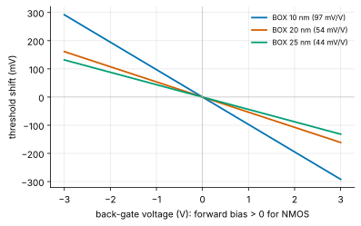
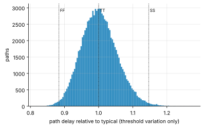

<!-- status: reviewed -->
# 25-05 · Foundries, PDKs and Specialty Processes

| | |
|---|---|
| **Course** | [25 · Semiconductor Fabrication, Packaging, Test and Reliability](../README.md) |
| **University equivalent** | The industry-structure and design-enablement lectures of a microfabrication or VLSI course (foundry model, process design kits, corners, shuttles) plus specialty-technology material from device courses (FD-SOI back biasing, BCD, embedded memory); no single textbook, closest are Weste & Harris on PDKs and corners and foundry technology briefs |
| **Prerequisites** | [25-01](25-01-process-flow-overview.md) (the flow), [25-04](25-04-yield-and-die-cost.md) (wafer and die cost), [19-10](../../19-digital-vlsi-design/chapters/19-10-synthesis-and-sta.md) (timing signoff), [20-11](../../20-analog-and-mixed-signal-ic-design/chapters/20-11-layout-matching-pvt.md) (PVT and mismatch), [09-12](../../09-semiconductor-devices/chapters/09-12-finfet-gaa-cfet-backside-power.md) (thin-body transistors) |
| **Estimated study hours** | 6 |
| **Last verified** | 2026-11-26 |

**Learning objectives.** After this chapter you can:

1. Explain the foundry, fabless and IDM models and read foundry market data correctly.
2. List what a process design kit contains, how it matures, and what each part is for.
3. Compute the delay spread across process corners and the margin it forces at signoff.
4. Compare multi-project wafer shuttles with a dedicated mask set and find the break-even.
5. Derive the back-gate coupling of an FD-SOI transistor and use it to size body bias.
6. Choose among specialty processes (FD-SOI, BCD, RF-SOI, embedded NVM) for a product and test vendor claims about them.

---

## 1. Big picture

Most chips are designed by companies that own no fab and built by foundries that design no chips. That division of labour, pioneered by TSMC in 1987, works because of a contract: the **process design kit (PDK)**, which tells the designer exactly what the process can build and how it will behave. This chapter explains the foundry model and its economics, opens the PDK, shows how process variation becomes corner models and timing margin, and prices the cheapest way into silicon, the multi-project wafer shuttle. It then surveys the specialty processes that most chips (the microcontrollers, power, RF and sensor chips in every product) actually use, which are not leading-edge logic nodes, and derives the one piece of physics that makes FD-SOI distinctive: tuning the transistor through its back gate.

- **One foundry dominates:** TSMC took 72.5% of foundry revenue in 2Q26 [R-578].
- **The PDK is the interface** between design and manufacturing; its maturity sets design risk.
- **Corners are the price of variation:** a design must work at the slow corner, so the typical chip carries unused margin.
- **Shuttles make prototypes cheap:** a few square millimetres on a shared mask set cost tens of thousands of euros instead of millions [R-581].
- **Specialty nodes are a separate business:** FD-SOI, BCD, RF-SOI and embedded memory processes compete on features, not on the smallest transistor [R-580].

## 2. Intuition first

**The physical picture.** A foundry runs one set of tools and recipes, a "process", for many customers at once. Each customer draws shapes on layers; the foundry turns them into structures. For that to work, the customer must know in advance which shapes print reliably (design rules), how the resulting transistors and wires will behave electrically (device and parasitic models), and how much they will vary (corners and statistics). The PDK packages all of that.

**An analogy and its limits.** A foundry is like a contract manufacturer with a published building code. The code (the design rules) says what you may draw; the engineering tables (the models) say how it will perform; the tolerances (the corners) say how far real parts may stray. Customers who follow the code get predictable results without ever entering the factory. The analogy holds for the separation of design from manufacturing and for why the code must be conservative. It breaks in two ways:

- **The code changes during construction.** A new node's PDK is released in versions (0.1, 0.5, 0.9, 1.0) as the process matures, and a design started on an early version may need rework.
- **Tolerances are statistical, not absolute.** A corner is a probability statement about global process variation, and local mismatch between neighbouring transistors adds a separate, random component (20-11).

## 3. Theory

### 3.1 Business models

- **IDM (integrated device manufacturer):** designs and manufactures its own chips (Intel historically, Texas Instruments, Infineon, memory makers).
- **Fabless:** designs chips and buys wafers from foundries (NVIDIA, AMD, Qualcomm, Broadcom, Apple's silicon group).
- **Foundry:** manufactures other companies' designs (TSMC, Samsung Foundry, GlobalFoundries, UMC, SMIC, and specialty foundries such as Tower).
- **Hybrids:** IDMs that also sell foundry services (Intel Foundry, Samsung), and IDMs that outsource some products ("fab-lite").

The foundry model's economics rest on scale and learning. A leading-edge fab costs tens of billions of dollars (25-04), and its learning rate grows with the volume and variety of designs it runs; TSMC deployed 305 process technologies for 534 customers in 2025 [R-579]. Market data come from analysts (TrendForce's foundry ranking) and company filings (node mix); both need care (Examples 25-05.1 and 25-05.2).

### 3.2 What a PDK contains

A PDK typically includes:

- **Design rules** and the **DRC deck** that checks them: minimum widths, spacings, enclosures, densities (25-03's CMP density limits), and the multipatterning colouring rules of 25-02.
- **LVS rules** that check the layout's connectivity against the schematic.
- **Device models**, usually BSIM-family (Berkeley short-channel IGFET model) compact models for SPICE, with **corner** and **statistical** (Monte Carlo) variants, covering transistors, resistors, capacitors, inductors, varactors and diodes.
- **Parasitic extraction** rules (RC decks) that turn wire geometry into resistances and capacitances (25-01, 19-05).
- **Parameterized cells** (pcells) for devices, and technology files for the layout tools.
- **Reliability rules:** electromigration current limits, gate-oxide voltage limits, and aging models (25-09).

Standard-cell libraries, SRAM compilers, I/O libraries and interface IP (SerDes, memory PHYs; Course 24) usually come separately from the foundry or third parties; their availability often decides which node a company can use.

**PDK maturity.** Early versions (often labelled 0.1 or 0.5) carry preliminary models fitted to test structures; 0.9 is close to final; 1.0 is production-qualified. Intel's plan for 14A, for example, was a 0.9 PDK in October 2026 ahead of risk production in 2H 2027 [R-556]. Starting a design early buys time to market at the cost of rework if models move (Problem 25-05.13).

### 3.3 Corners and signoff margin

Global variation shifts every transistor on a die together: thicker or thinner gate stack, longer or shorter gates, higher or lower threshold. The PDK summarizes it as corners: TT (typical), SS (slow NMOS, slow PMOS), FF (fast, fast) and the skewed FS and SF. A design is signed off at the corners that limit it (19-10), combined with supply voltage and temperature extremes (PVT).

To see what a corner costs, use the alpha-power delay model of 19-02, $t_d \propto V_{DD}/(V_{DD} - V_{TH})^{\alpha}$. Suppose the global threshold spread is $\pm 3\sigma$ and the supply is regulated to ±10%. The slow corner combines the high threshold with the low supply; the fast corner the opposite. Example 25-05.4 finds that the slow corner is about 35% slower than typical: a chip that must meet its clock at the slow corner leaves that much performance unused on a typical die. Adaptive techniques recover some of it: speed binning (25-11), adaptive voltage scaling, and, in FD-SOI, back biasing (§3.5).

### 3.4 Multi-project wafers

A full mask set at an advanced node costs millions, too much for a prototype, a university project or a low-volume product. A **multi-project wafer (MPW)** run, or shuttle, shares one mask set among many designs: each customer buys a few square millimetres and receives a few dozen unpackaged dies. TSMC's multi-project wafer service covers processes from 2 nm to 0.35 µm [R-581]; brokers such as Europractice resell slots on several foundries' processes, priced per square millimetre with a minimum area [R-581]. The cost of a slot is

$$
C_{MPW} = \max(A, A_{min}) \times p_{mm^2} ,
$$

and a dedicated run is the mask set plus engineering wafers. The break-even area, above which a dedicated mask set is cheaper than a shuttle slot, is the mask cost divided by the price per mm² (Example 25-05.3). Shuttles schedule a few runs a year per process, so they trade cost for calendar time. The open-source ecosystem built around SkyWater's SKY130 PDK depended on one shuttle operator, efabless, which shut down in 2025 for lack of funding, pausing Tiny Tapeout's SKY130 shuttles [R-581]; ChipFoundry later acquired efabless's assets and offers tapeouts again [R-160], [R-319].

### 3.5 FD-SOI and the back gate

A fully depleted silicon-on-insulator (FD-SOI) transistor has an undoped silicon body a few nanometres thick on a buried oxide (BOX) a few tens of nanometres thick, above a doped substrate region that acts as a second, **back** gate (the thin-body electrostatics of 09-12). Applying a voltage $V_{BG}$ to that region shifts the front-gate threshold.

**Derivation.** Model the stack as capacitors per unit area in series: the front gate oxide $C_{ox} = \varepsilon_{ox}/t_{ox}$, the depleted silicon body $C_{Si} = \varepsilon_{Si}/t_{Si}$ and the buried oxide $C_{BOX} = \varepsilon_{ox}/t_{BOX}$. At threshold the front surface is held at the inversion potential, so a change $\Delta V_{BG}$ must be balanced by charge on the front gate. The back gate drives the front surface through $C_{BOX}$ and $C_{Si}$ in series, $C_{back} = C_{Si}C_{BOX}/(C_{Si} + C_{BOX})$; to keep the front-surface potential fixed, the front gate must supply the opposite charge through $C_{ox}$:

$$
C_{ox}\,\Delta V_{TH} = -C_{back}\,\Delta V_{BG} \quad\Longrightarrow\quad \frac{\Delta V_{TH}}{\Delta V_{BG}} = -\frac{C_{Si}C_{BOX}}{C_{ox}(C_{Si} + C_{BOX})} .
$$

This is the Lim–Fossum coupling result in its simplest form.

**Conditions.** The derivation treats the silicon body as depleted from front to back, so that a back-gate change reaches the front surface through the body's depletion capacitance. That holds only over a range of back bias. If the back surface is driven into accumulation or inversion, its potential is pinned, further back-gate voltage no longer reaches the front, and the coupling collapses: these are the other two regimes of Lim and Fossum's analysis. A depletion layer in the substrate under the BOX adds a further series capacitance and weakens the coupling, which is why FD-SOI processes implant a heavily doped ground plane under the BOX. These limits, together with the leakage and breakdown of the junctions that isolate the substrate wells, set the usable back-bias range of a few volts. Thin BOX and thin body strengthen the coupling; a thick gate oxide also does, at the cost of drive. Forward back bias lowers the threshold (faster, leakier); reverse back bias raises it (slower, far less leaky). Because subthreshold leakage changes tenfold for every subthreshold-swing worth of threshold (about 60–80 mV), a coupling of tens of millivolts per volt gives leakage control of several times per volt (Example 25-05.5). That is the basis of the "adaptive body bias" that FD-SOI vendors sell [R-580]: the same die can be tuned after manufacture toward speed or toward leakage, and corner spread can be partly compensated.

### 3.6 A map of specialty processes

Most of the industry's wafers are not leading-edge logic. Specialty processes add devices that logic nodes lack:

| Process | What it adds | Typical products | Where it is derived |
|---|---|---|---|
| FD-SOI | Back-gate tuning, low leakage, good RF devices, often embedded MRAM or RRAM | IoT, automotive MCUs, RF transceivers | §3.5; 09-12 |
| BCD (bipolar-CMOS-DMOS) | High-voltage LDMOS (laterally diffused MOS) transistors next to CMOS logic and analog | PMICs, motor drivers, battery management | 09-13 (Baliga limit) |
| RF-SOI | Low-loss, high-isolation switches and LNAs on insulating substrates | Phone front-end modules | 21-09 |
| SiGe BiCMOS | Fast heterojunction bipolar transistors | mmWave, optical drivers | 21-04, 21-07 |
| Embedded NVM (flash, MRAM, RRAM, PCM) | Non-volatile memory on the logic die | MCUs, secure elements | 23-08 |

Foundries publish such offerings with qualification claims: for example, TSMC reports that its 16 nm MRAM and 22ULL RRAM passed Automotive Grade-1 requirements in 2025, and ST and Samsung Foundry's 18 nm FD-SOI with embedded phase-change memory claims 2.5 times the non-volatile memory density of ST's 40 nm process [R-580]. Choosing among them is a die-cost calculation in which analog and I/O, which shrink little, often decide the answer (Example 25-05.6).

## 4. Worked examples

"Assumed" values are illustrative.

### Example 25-05.1 · Reading a foundry ranking (tier A)

**Setup.** TrendForce reported 2Q26 top-10 foundry revenue of $53.49 B, with TSMC at $40.2 B and a 72.5% market share, and Samsung at $3.26 B [R-578]. (a) What total-market base does TSMC's share imply? (b) What fraction of that market did the top 10 hold? (c) What is TSMC's share of the top 10 alone? (d) Check Samsung's 5.9%.

**Solution.**

- (a) $40.2/0.725$ = **$55.4 B**.
- (b) $53.49/55.4$ = **96.5**%.
- (c) $40.2/53.49$ = **75.2**%.
- (d) $3.26/55.4$ = **5.9**%. ✓

**Units check.** $B ÷ $B is dimensionless. ✓

**Sanity check.** A share depends on its denominator; quoting 75% instead of 72.5% is a small but real error. Note also that Intel Foundry is absent from this ranking [R-578], so "foundry share" excludes in-house manufacturing.

### Example 25-05.2 · Reading a node mix (tier A)

**Setup.** TSMC reported wafer-revenue shares of 2 nm 3%, 3 nm 30%, 5 nm 33% and 7 nm 11% in 2Q26, and 8%, 33%, 28% and 10% in 3Q26 [R-579]. (a) Find the 7 nm-and-below share each quarter. (b) By what factor did 2 nm's share grow? (c) Can you multiply 3Q26's 8% by total revenue to get 2 nm revenue?

**Solution.**

- (a) **77**% and **79**%.
- (b) $8/3$ = **2.7** times.
- (c) No: the shares are of wafer revenue, while total revenue also includes packaging and other items [R-579].

**Units check.** Percentages of the same base. ✓

**Sanity check.** A share rising from 3% to 8% in one quarter, while 5 nm's share falls, is what a "steep ramp-up" looks like in a node mix; share growth also reflects the other nodes' totals, so share growth equals revenue growth if total wafer revenue is flat, understates it if the total grows (as it did into 3Q26), and overstates it if the total shrinks.

### Example 25-05.3 · Shuttle or dedicated run? (tier B)

**Setup.** Europractice prices GF 22 nm FD-SOI MPW slots at €17,820/mm² (standard) with a 4 mm² minimum [R-581]. (a) What does the minimum slot cost? (b) What does a 10 mm² design cost? (c) If a dedicated mask set and engineering lot would cost €1.5 M (assumed), above what area is a dedicated run cheaper?

**Solution.**

- (a) $4 \times 17{,}820$ = **€71,280**.
- (b) **€178,200**.
- (c) $1.5 \times 10^6/17{,}820$ = **84** mm².

**Units check.** mm² × €/mm² = €. ✓

**Sanity check.** Almost every prototype is far below 84 mm², so shuttles dominate prototyping; production designs need their own masks anyway. A shuttle's real cost is calendar time: a few runs a year per process.

### Example 25-05.4 · What the slow corner costs (tier B)

**Setup.** With the alpha-power delay model $t_d \propto V/(V - V_{TH})^{1.3}$, a nominal supply of 0.75 V ±10% and a threshold of 0.30 V ± 45 mV (±3σ global, assumed), find the delay at (a) the slow corner (0.675 V, 0.345 V) and (b) the fast corner (0.825 V, 0.255 V), relative to typical. (c) What is the slow-to-fast spread? (d) A path meets 1.00 GHz at typical; what does it guarantee at the slow corner?

**Solution.**

- (a) $[0.675/0.330^{1.3}]/[0.75/0.45^{1.3}]$ = **1.35**.
- (b) **0.809**.
- (c) **1.67** times.
- (d) $1.00/1.35$ = **0.742** GHz.

**Units check.** Delay ratios are dimensionless. ✓

**Sanity check.** Signing off at the slow corner gives away about a quarter of typical silicon's speed. That gap is why binning, adaptive voltage and back biasing exist: each recovers part of it for dies that are faster than the worst case.

### Example 25-05.5 · Back-gate coupling in FD-SOI (tier B)

**Setup.** An FD-SOI transistor has a 1.2 nm EOT gate, a 7 nm silicon body and a 20 nm BOX (assumed); $\varepsilon_{ox}$ = 3.9 and $\varepsilon_{Si}$ = 11.7 (relative). (a) Find the coupling coefficient. (b) Repeat with a 10 nm BOX. (c) With a subthreshold swing of 70 mV/decade, by what factor does 1 V of reverse back bias cut leakage in each case?

**Solution.**

- (a) In units of $\varepsilon_0$/nm: $C_{ox}$ = 3.25, $C_{Si}$ = **1.67**, $C_{BOX}$ = **0.195**; $C_{Si}C_{BOX}/[C_{ox}(C_{Si} + C_{BOX})]$ = **0.0537**, so **54** mV per volt.
- (b) $C_{BOX}$ = 0.39: **97** mV per volt.
- (c) $10^{53.7/70}$ = **5.9** times and $10^{97.3/70}$ = **25** times.

**Units check.** Capacitance ratios are dimensionless; mV/(mV/decade) = decades. ✓

**Sanity check.** Thinning the BOX nearly doubles the coupling because $C_{BOX}$ is the smallest capacitor in the series pair and so controls it. A few volts of back bias then spans a few hundred millivolts of threshold, enough to move a die across most of its corner spread.

### Example 25-05.6 · Should an MCU move to 18 nm FD-SOI? (tier B)

**Setup.** A 40 nm microcontroller die is 10 mm²: 4 mm² digital, 2 mm² embedded NVM and 4 mm² analog and I/O. ST claims that its 18 nm FD-SOI process gives 3× digital density and 2.5× NVM density against its 40 nm process [R-580]; assume analog and I/O shrink only 1.2× and the new wafer costs 1.8 times as much (both assumed). Ignoring yield and edge effects, find (a) the new die area and (b) the ratio of die costs.

**Solution.**

- (a) $4/3 + 2/2.5 + 4/1.2$ = **5.47** mm².
- (b) $1.8 \times 5.47/10$ = **0.98**.

**Units check.** mm² and a dimensionless ratio. ✓

**Sanity check.** The die barely gets cheaper, because analog and I/O dominate the shrunk area. The migration case rests on what the vendor emphasises instead: performance per watt, NVM capacity and features [R-580]. For mixed-signal products, ask about the analog fraction before believing a cost-down story.

<!-- answer-key -->

| ID | Quantity | Value | Unit |
|---|---|---|---|
| Ex 25-05.1a | implied market base | 55.4 | $B |
| Ex 25-05.1b | top-10 share of market | 96.5 | % |
| Ex 25-05.1c | TSMC share of top 10 | 75.2 | % |
| Ex 25-05.1d | Samsung share check | 5.9 | % |
| Ex 25-05.2a | 7 nm and below, 2Q26 | 77 | % |
| Ex 25-05.2a1 | 7 nm and below, 3Q26 | 79 | % |
| Ex 25-05.2b | 2 nm share growth | 2.7 | |
| Ex 25-05.3a | minimum slot | 71280 | € |
| Ex 25-05.3b | 10 mm² design | 178200 | € |
| Ex 25-05.3c | break-even area | 84 | mm² |
| Ex 25-05.4a | slow corner delay ratio | 1.35 | |
| Ex 25-05.4b | fast corner delay ratio | 0.809 | |
| Ex 25-05.4c | slow-to-fast spread | 1.67 | |
| Ex 25-05.4d | guaranteed frequency | 0.742 | GHz |
| Ex 25-05.5a0 | C_ox | 3.25 | |
| Ex 25-05.5a1 | C_Si | 1.67 | |
| Ex 25-05.5a2 | C_BOX | 0.195 | |
| Ex 25-05.5a | coupling, 20 nm BOX | 0.0537 | |
| Ex 25-05.5a3 | coupling in mV/V, 20 nm BOX | 54 | mV/V |
| Ex 25-05.5b0 | C_BOX, 10 nm | 0.39 | |
| Ex 25-05.5b | coupling in mV/V, 10 nm BOX | 97 | mV/V |
| Ex 25-05.5c0 | coupling in mV/V, 3 s.f. | 53.7 | mV/V |
| Ex 25-05.5c1 | coupling in mV/V, 10 nm, 3 s.f. | 97.3 | mV/V |
| Ex 25-05.5c | leakage factor, 20 nm BOX | 5.9 | |
| Ex 25-05.5c2 | leakage factor, 10 nm BOX | 25 | |
| Ex 25-05.6a | new die area | 5.47 | mm² |
| Ex 25-05.6b | die cost ratio | 0.98 | |
| Txt 25-05.a | slow-corner penalty | 35 | % |

## 5. Simulate it

The lab is [labs/25-05-lab/](../labs/25-05-lab/README.md). `foundry.py` implements the corner delay model with Monte Carlo global and local variation, the FD-SOI coupling and a numerical 1-D Laplace solve of the same dielectric stack (a check of the formula's algebra, not of its depletion assumption), MPW-versus-dedicated cost and die-area migration; the notebook runs the parts below.

*Figure 1. Back-gate tuning: the coupling grows as the buried oxide thins, because the BOX capacitance limits the series pair.*

*Figure 2. Corners bracket the global distribution of delay; signing off at the slow corner leaves most dies with unused margin.*

**Predict, then run:**

1. *Predict* the fraction of simulated paths slower than the slow corner when the corner is set at +3σ of global variation and each path adds local variation, then simulate 100,000 paths.
2. *Predict* how the coupling of Example 25-05.5 changes when the silicon body thins from 7 nm to 5 nm, then compute it with the formula and with the numerical electrostatics model.
3. *Predict* the break-even area for a €3 M mask set on the 22 nm shuttle, then compute it.
4. *Predict* the die-cost ratio of Example 25-05.6 if analog and I/O are 60% of the 40 nm die, then sweep the analog fraction.

## 6. Engineering tradeoffs

| Knob | Improves | Costs | Typical decision owner |
|---|---|---|---|
| Starting on an early PDK | Time to market | Rework risk if models or rules change | VP of engineering with the foundry |
| Signing off at harsher corners | Robustness, yield | Performance and area left on typical dies | Design methodology |
| MPW shuttle instead of a dedicated run | Prototype cost | Calendar time, few dies, no packaging or test | Project lead |
| FD-SOI with back bias | Leakage and speed tuning after manufacture | Bias generators, wafer cost, a smaller ecosystem | Product architecture |
| Specialty node instead of leading edge | Analog, high-voltage, RF or NVM features | Digital density and speed | Product line management |
| Second-sourcing a process | Supply security, negotiating leverage | Two PDKs, two qualifications, duplicated effort | Supply chain with engineering |

## 7. Numbers to know

Perishable rows are as of Nov 2026; the date column gives the source's own date.

| Quantity | Value | Dated | Source |
|---|---|---|---|
| Top-10 foundry revenue, 2Q26 | $53.49 B; TSMC 72.5%, Samsung 5.9%, SMIC 5.4% | Sep 2026 | [R-578] |
| TSMC node mix, 3Q26 | 2 nm 8%, 3 nm 33%, 5 nm 28%, 7 nm 10% of wafer revenue | Oct 2026 | [R-579] |
| TSMC process technologies and customers, 2025 | 305 technologies, 534 customers | Apr 2026 | [R-579] |
| MPW price, GF 22 nm FD-SOI via Europractice | €17,820/mm² standard, 4 mm² minimum | 2026 schedule | [R-581] |
| FD-SOI back-gate coupling | tens of mV per volt; rises as BOX thins | timeless | §3.5 |

## 8. Common mistakes

- **Mixing share denominators.** Share of the top 10 is not share of the market.
- **Multiplying wafer-revenue shares by total revenue.** Total revenue includes non-wafer items.
- **Treating corners as worst-case bounds.** They are statistical; local mismatch and aging add to them.
- **Assuming a shrink cuts cost for mixed-signal chips.** Analog and I/O barely shrink.
- **Ignoring PDK maturity.** A 0.5 PDK's models can move; budget for rework.
- **Treating FD-SOI back bias as free.** It needs bias generation, wells and charge pumps, and its range is limited by junctions and reliability.

## 9. Practitioner lens

**State of the art (as of Nov 2026).**

- *Market structure* [Industry estimate]. TrendForce put 2Q26 top-10 foundry revenue at a record $53.49 B, with TSMC at $40.2 B and a 72.5% share, Samsung at 5.9% and SMIC at 5.4%, narrowing the gap; Intel Foundry does not appear in the ranking [R-578].
- *TSMC's mix* [Established]. 3Q26 revenue was $46.72 B at a 66.4% gross margin; 7 nm and below made up 79% of wafer revenue, with 2 nm at 8% after 3% in 2Q26; TSMC guided 4Q26 to $52.3–54.3 B citing a "steep ramp-up" of 2 nm [R-579].
- *Specialty offerings* [Established for existence; performance claims are vendor claims]. TSMC's 16 nm MRAM and 22ULL RRAM passed Automotive Grade-1 in 2025; GlobalFoundries' FDX FD-SOI has been "in volume production since 2019" with eMRAM and RRAM options; ST and Samsung Foundry co-developed an 18 nm FD-SOI process with embedded PCM [R-580].
- *Shuttles* [Established]. TSMC's MPW service spans 2 nm to 0.35 µm; Europractice's 2026 schedule offers TSMC, GlobalFoundries, IHP and ams OSRAM runs; efabless shut down in 2025 and Tiny Tapeout continued independently [R-581].

**Why it matters commercially.** The foundry an acquisition target uses, and the PDK maturity it designed on, shape its cost, schedule risk and supply security. Concentration at one leading-edge supplier is a strategic risk that customers hedge with second sources and with specialty-node designs that several foundries can build. For a target on a specialty node, the questions are whether its process is single-sourced, whether the foundry is investing in it, and whether its die cost is dominated by analog area that will not shrink.

**Marketing vs Reality.**

- *"Our node is 3× denser."* For digital logic; analog, I/O and memory shrink less (Example 25-05.6).
- *"Automotive-qualified memory."* Qualified at what grade, temperature and endurance, and on which node [R-580]?
- *"Adaptive body bias gives the best of both worlds."* Within a bias range of a few volts, at the cost of bias circuitry, and with useful strength only on FD-SOI: bulk planar CMOS supports body bias more weakly and with junction-leakage limits, and FinFETs and nanosheets have almost none.
- *"72.5% share."* Of the foundry market as TrendForce defines it, excluding IDMs' internal fabs [R-578].

**Questions for engineering leaders.**

1. **"Which PDK version did you tape out on, and what changed in the final version?"** *Strong:* the version, the deltas, and the silicon correlation. *Evasive:* "we work closely with the foundry."
2. **"What corners do you sign off at, and what do your fast dies do with the margin?"** *Strong:* corners, binning or adaptive voltage, and measured distributions. *Evasive:* "we meet spec at all corners."
3. **"Is your process single-sourced, and what would a port cost?"** *Strong:* a named alternate, a port estimate and IP availability. *Evasive:* "our foundry is very reliable."
4. **"How much of your die is analog and I/O, and how does that change your cost on the next node?"** *Strong:* an area breakdown and a die-cost model. *Evasive:* "the next node is cheaper per transistor."
5. **"How many shuttles before production, and how long between them?"** *Strong:* a test-chip plan with dates. *Evasive:* "first silicon will be production."

## 10. Concept check

**Q1.** What does a PDK contain, and which part tells a designer what may be drawn?

Answer

Design rules with DRC and LVS decks, device models with corners and statistics, parasitic-extraction rules, pcells and technology files, and reliability rules. The design rules (checked by DRC) say what may be drawn.

**Q2.** Why does a chip signed off at the slow corner leave performance unused on most dies?

Answer

Most dies sit near typical, which is faster than the slow corner (about 35% here); the clock is set by the slow case, so typical dies have unused margin unless binning or adaptive techniques recover it.

**Q3.** When is a dedicated mask set cheaper than an MPW slot?

Answer

When the design area exceeds the mask-set cost divided by the shuttle's price per mm², and in practice whenever volume production is needed.

**Q4.** Why does thinning the BOX strengthen FD-SOI back-gate coupling?

Answer

The back gate acts through the BOX and silicon capacitances in series, and the BOX capacitance is the smaller one; thinning the BOX raises it and with it the series coupling to the front surface.

**Q5.** Why might moving a microcontroller to a denser node barely cut its die cost?

Answer

Analog and I/O occupy much of the die and shrink little, while the wafer price rises; the shrunk die can cost about the same.

Now try the [25-05 problem set](../problems/25-05-problems.md).

## 11. Key terms

[Foundry](../../../reference/glossary.md#foundry) · [Process design kit (PDK)](../../../reference/glossary.md#process-design-kit-pdk) · [PVT corner](../../../reference/glossary.md#pvt-corner) · [Multi-project wafer (MPW)](../../../reference/glossary.md#multi-project-wafer-mpw) · [FD-SOI](../../../reference/glossary.md#fd-soi) · [Back-gate biasing](../../../reference/glossary.md#back-gate-biasing) · [BCD process](../../../reference/glossary.md#bcd-process) · [Embedded nonvolatile memory (eNVM)](../../../reference/glossary.md#embedded-nonvolatile-memory-envm)

## 12. Connections

- **Previous:** [25-04 Yield Models and Die Cost](25-04-yield-and-die-cost.md): the wafer and die costs foundries charge for.
- **Next:** [25-06 Packaging I](25-06-packaging-fundamentals.md): what happens to the dies after the foundry ships the wafer.
- **Prerequisites used:** [19-10](../../19-digital-vlsi-design/chapters/19-10-synthesis-and-sta.md) and [20-11](../../20-analog-and-mixed-signal-ic-design/chapters/20-11-layout-matching-pvt.md) for signoff and variation; [09-12](../../09-semiconductor-devices/chapters/09-12-finfet-gaa-cfet-backside-power.md) for thin-body devices; [21-09](../../21-rf-and-microwave-engineering/chapters/21-09-rf-front-end.md), [22-06](../../22-power-electronics-and-energy-conversion/chapters/22-06-converter-losses-and-wide-bandgap.md) and [23-08](../../23-memory-and-storage-technology/chapters/23-08-emerging-memories.md) for RF-SOI, power devices and embedded memory.
- **Used later:** [25-10](25-10-qualification-and-functional-safety.md) (automotive grades), [25-12](25-12-post-silicon-validation.md) (first silicon and respins).

> **Deeper:** see companion repo *Semiconductor Capital Equipment* for foundry capacity, capital spending and how specialty fabs are equipped.

## 13. Further study

- N. H. E. Weste and D. M. Harris, *CMOS VLSI Design*: the chapters on design rules, process variation and corners.
- J.-P. Colinge, *Silicon-on-Insulator Technology: Materials to VLSI*: FD-SOI devices and back-gate coupling (the Lim–Fossum model).
- Europractice's published MPW schedules and SkyWater's open SKY130 PDK documentation: what a PDK and a shuttle look like in practice [R-581].
- TSMC's annual Form 20-F: process portfolio and node mix [R-579].

## 14. Sources

1. Foundry ranking, 2Q26: [R-578].
2. TSMC node mix, results and process portfolio: [R-579].
3. Specialty processes (TSMC, GlobalFoundries, ST and Samsung): [R-580].
4. MPW shuttles and efabless: [R-581].
5. Intel 14A PDK timing: [R-556].
