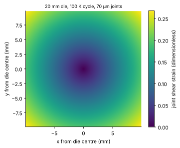
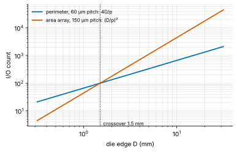

<!-- status: reviewed -->
# 25-06 · Packaging I: Wire Bond, Flip-Chip, Substrates, SiP and PoP

| | |
|---|---|
| **Course** | [25 · Semiconductor Fabrication, Packaging, Test and Reliability](../README.md) |
| **University equivalent** | Microelectronic packaging (Tummala, *Fundamentals of Microsystems Packaging*: package functions, first-level interconnect, substrates, thermomechanical reliability; senior electives in electronic packaging) |
| **Prerequisites** | [13-03](../../13-electromagnetics/chapters/13-03-magnetostatics-and-inductance.md) (bond-wire inductance and ground bounce), [24-01](../../24-high-speed-io-signal-integrity-and-photonics/chapters/24-01-signal-integrity-fundamentals.md) (signal integrity), [22-10](../../22-power-electronics-and-energy-conversion/chapters/22-10-datacenter-power-delivery.md) (delivering kilowatts at low voltage), [25-04](25-04-yield-and-die-cost.md) (cost per good die) |
| **Estimated study hours** | 6 |
| **Last verified** | 2026-11-26 |

**Learning objectives.** After this chapter you can:

1. State what a package must do and how wire bond, flip-chip, fan-out, SiP and PoP each meet those needs.
2. Compute I/O capacity for peripheral and area-array interconnect and find where area arrays win.
3. Size substrate escape routing and the number of power bumps a high-current die needs.
4. Derive solder-joint shear strain from thermal-expansion mismatch and estimate fatigue life, including the weakest-link effect.
5. Estimate substrate panel utilization and ABF consumption, and read packaging market data, as of late 2026.

---

## 1. Big picture

A bare die is useless: it is fragile, too small to solder to a board, and cannot shed its own heat. The package connects the die's microscopic pads to a board's millimetre-scale world, delivers power and carries signals with acceptable parasitics, conducts heat away and protects the silicon. For decades this was a cheap afterthought done by outsourced assembly and test companies (OSATs). Today packaging decides how many signals and amperes reach an AI accelerator, how thin a phone can be, and, with chiplets (25-07), how large a system can be built at all. This chapter covers the established technologies (wire bond, flip-chip, organic substrates, fan-out, system-in-package and package-on-package) and derives the calculations that size them: I/O counts, escape routing, power bumps and solder-joint fatigue.

- **Wire bond still dominates conventional packages; flip-chip and fan-out dominate growth**, and area-array connections were forecast to overtake perimeter ones in 2024 [R-585].
- **Area arrays beat perimeter rows** for any die larger than a millimetre or two: I/O count grows with area, not perimeter.
- **Power dominates the bump budget** of a high-power die: a kilowatt at under a volt is more than a thousand amperes.
- **Thermal expansion mismatch is the main mechanical failure driver:** silicon expands about a sixth as much as an organic substrate, and solder joints take the difference.
- **Substrates have become a bottleneck:** AI packages use far more build-up film per unit, and one supplier dominates the film [R-583].

## 2. Intuition first

**The physical picture.** A die's pads sit at a pitch of tens of micrometres; a circuit board's solder balls sit about a millimetre apart. The package is a pitch translator plus a power plant plus a heat sink mount. In a wire-bonded package, fine gold or copper wires loop from pads around the die's edge to a lead frame or substrate. In a flip-chip package, the die is turned face-down and connected through an array of solder bumps or copper pillars spread over its whole area to a laminated substrate, whose layers of fine wiring fan the signals out to the board's ball grid array.

**An analogy and its limits.** Think of a city's water supply. Wire bonding is like serving a city only from pipes at its boundary: fine for a village, hopeless for a metropolis, because the boundary grows only as the square root of the area served. Flip-chip is like putting a hydrant on every block: capacity grows with area. The analogy holds for the scaling argument. It breaks in two ways:

- **The pipes stretch.** A flip-chip joint must flex every time the die and substrate heat and cool, because they expand by different amounts; a water main does not.
- **The pipes interfere.** Signal wires couple to each other and their inductance resists fast current changes (13-03); package design is electromagnetic design.

## 3. Theory

### 3.1 What a package does

1. **Electrical:** route signals with controlled impedance and low crosstalk (24-01), and deliver power with low resistance and inductance (22-10).
2. **Thermal:** carry heat from the junction to a heat sink or board (25-08).
3. **Mechanical and environmental:** protect the die from moisture, contamination and stress, and survive temperature cycling for the product's life (25-09, 25-10).
4. **Pitch translation and testability:** fan out from die pitch to board pitch, and allow testing before and after assembly (25-11).

### 3.2 First-level interconnect: wire bond against area array

**Wire bonding.** A capillary tool welds a fine wire (gold, or increasingly copper for cost) to a die pad and to a lead or substrate finger. It is cheap, flexible and mature, which is why it still dominates conventional packages [R-585]. Its limits are the pads' restriction to the die perimeter and each wire's inductance of roughly a nanohenry per millimetre (13-03).

**I/O count.** With one row of pads at pitch $p_w$ around a square die of side $D$, the perimeter holds about

$$
N_{peri} \approx \frac{4D}{p_w} ,
$$

while an area array of bumps at pitch $p_a$ covering the die holds

$$
N_{area} \approx \left(\frac{D}{p_a}\right)^2 .
$$

The area array wins once $D^2/p_a^2 > 4D/p_w$, that is for

$$
D > \frac{4p_a^2}{p_w} ,
$$

typically above a millimetre or two (Example 25-06.1). Area arrays also shorten the power path: every point of the die is close to a power bump, so IR drop and inductance fall.

**Flip-chip.** Solder bumps (historically "C4", controlled-collapse chip connection) or copper pillars with solder caps at pitches of roughly 100–200 µm connect the die face-down to a substrate. After reflow, an **underfill** epoxy is wicked into the gap between die and substrate and cured. Underfill bonds die and substrate mechanically, so the thermal-expansion mismatch is carried by the whole layer instead of by each joint, which multiplies joint fatigue life (§3.5).

### 3.3 Substrates and escape routing

The flip-chip substrate is a laminate: a core (glass-reinforced resin) with build-up layers on each side, made of an insulating film (Ajinomoto Build-up Film, ABF, dominates [R-583]) and copper traces with laser-drilled microvias. Its job is to route every bump to a board ball.

**Escape routing.** Signals from the inner rows of a bump array must escape between the pads of the outer rows. With bump pitch $p$, pad diameter $d$, and trace width $w$ and space $s$, the number of traces that fit between two adjacent pads satisfies $nw + (n + 1)s \le p - d$, so

$$
n = \left\lfloor\frac{p - d - s}{w + s}\right\rfloor .
$$

On one routing layer, the outermost row escapes directly, and $n$ traces pass between each pair of its pads, so each layer escapes $n + 1$ rows. An array that must route $R$ rows to one side needs

$$
L = \left\lceil\frac{R}{n + 1}\right\rceil
$$

signal layers (Example 25-06.2). Finer lines and spaces, larger bump pitch or smaller pads cut the layer count; this is why large AI packages need many build-up layers and so much more ABF than consumer packages [R-583].

**Power bumps.** A bump's current is limited by electromigration and heating (25-09) to a fraction of an ampere. A die drawing current $I$ needs about $I/I_{bump}$ power bumps and as many ground bumps; at kilowatt power and sub-volt supply, they can take nearly half the area of a reticle-sized die (Example 25-06.3), which is one reason for finer-pitch copper pillars, backside power (25-01) and integrated voltage regulation (22-10).

### 3.4 Fan-out, SiP and PoP

**Fan-out wafer-level packaging (FOWLP).** Dies are placed face-down on a carrier, embedded in mould compound to form a reconstituted wafer, and wired with redistribution layers (RDL) patterned by lithography directly on the die and mould. There is no substrate, so the package is thinner and the interconnect finer. TSMC's InFO brought fan-out to a flagship smartphone application processor, Apple's A10, in 2016, as an InFO package-on-package about 30% thinner than the conventional package-on-package it replaced, according to the teardown firm System Plus [R-584] **[Established]**.

**System-in-package (SiP).** Several dies and passives in one package: an application processor, power management, RF front-end and memory in a wearable or a phone module. It shortens interconnect, shrinks the board and lets each die use its best process, the precursor of chiplets (25-07).

**Package-on-package (PoP).** A memory package stacked on top of a processor package, connected through vias at the processor package's periphery, is the standard phone configuration: board area is saved and memory sits millimetres from the processor.

### 3.5 Thermomechanical reliability: solder-joint strain and fatigue

Silicon's coefficient of thermal expansion (CTE) is about 2.6 ppm/K; an organic substrate's in-plane CTE is several times larger. When the assembly heats by $\Delta T$, a point on the substrate at distance $L$ from the package's neutral point (its centre, which does not move relative to the die) moves $\Delta\alpha\,\Delta T\,L$ farther than the corresponding point on the die. A solder joint of height $h$ at that location must accommodate the displacement in shear, so its shear strain is

$$
\gamma \approx \frac{\Delta\alpha\,\Delta T\,L_{DNP}}{h} ,
$$

where $L_{DNP}$ is the joint's distance from the neutral point. The corner joints of large dies see the largest strain (Example 25-06.4 and Problem 25-06.6).

**Fatigue.** Each temperature cycle plastically deforms the solder a little; cracks grow, and the joint eventually opens. The Coffin–Manson relation captures the trend: cycles to failure fall as a power of the cyclic strain,

$$
N_f \propto \gamma^{-n},
$$

with $n$ around 2 for solders (an empirical exponent; refined models such as Engelmaier's include temperature and dwell time). Halving the strain roughly quadruples life. Underfill, taller joints, smaller dies (shorter $L_{DNP}$), lower-CTE substrates and smaller temperature swings all help.

**The weakest link.** A package fails when its first joint fails. If each joint's life follows a Weibull distribution with shape $\beta$ and scale $\eta_i$, the survival probability of the package is the product of the joints' survivals:

$$
R_{pkg}(N) = \prod_i \exp\!\left[-\left(\frac{N}{\eta_i}\right)^\beta\right] = \exp\!\left[-N^\beta\sum_i \eta_i^{-\beta}\right] ,
$$

which is itself Weibull with $\eta_{pkg} = \left(\sum_i \eta_i^{-\beta}\right)^{-1/\beta}$. Many joints with similar lives shorten the package's life by a factor $M^{-1/\beta}$ for $M$ equal joints; with strain rising toward the corners, the few corner joints dominate the sum (lab).

> **Going deeper — warpage.** A die bonded to a substrate is a bimetal strip: as it cools from the solder's melting point, the mismatch bends the assembly (Timoshenko's bimetal theory gives the curvature). Large AI packages can warp by tens to hundreds of micrometres, enough to open corner joints during assembly. Stiffeners, lids, low-CTE cores and, on the roadmap, glass cores address it; organic substrates are reported to lose usable flatness beyond about 120 mm per side [R-583].

### 3.6 The supply chain

Packaging is done by OSATs (ASE, Amkor, JCET and others), by foundries (TSMC's InFO and CoWoS) and by IDMs. Substrates come from a short list of makers, Unimicron, Ibiden and Shinko holding roughly three-quarters of the market, and their build-up film overwhelmingly from Ajinomoto [R-583]. AI packages consume far more substrate area and layers than consumer ones, which turned substrates and film into a 2026 bottleneck: Ajinomoto was at full capacity in 2Q26 and announced a price rise of about 30% [R-583].

## 4. Worked examples

"Assumed" values are illustrative.

### Example 25-06.1 · Perimeter against area I/O (tier A)

**Setup.** A 10 mm × 10 mm die can be wire-bonded with one row of pads at 60 µm pitch, or flip-chipped with a full bump array at 150 µm pitch (assumed). (a) Find each I/O count. (b) Above what die size does the area array win at these pitches?

**Solution.**

- (a) $4 \times 10/0.060$ = **667** pads; $(10/0.150)^2$ = **4.44e3** bumps, **6.7** times more.
- (b) $D > 4 \times 0.150^2/0.060$ = **1.5** mm.

**Units check.** mm/mm is dimensionless; mm²/mm = mm. ✓

**Sanity check.** Only very small dies (sensors, simple analog parts) stay below the crossover, which is why wire bond survives there and in cost-driven products, while every large logic die is flip-chipped.

### Example 25-06.2 · How many routing layers? (tier B)

**Setup.** A bump array has 150 µm pitch and 90 µm pads; 15 rows must escape to each side (assumed). Find the traces between pads and the signal layers needed for (a) 15 µm/15 µm and (b) 10 µm/10 µm lines and spaces.

**Solution.**

- (a) $n = \lfloor(150 - 90 - 15)/30\rfloor$ = **1** trace, so 2 rows per layer and $\lceil 15/2\rceil$ = **8** layers.
- (b) $n = \lfloor(150 - 90 - 10)/20\rfloor$ = **2** traces, 3 rows per layer, **5** layers.

**Units check.** µm/µm is dimensionless. ✓

**Sanity check.** Lines a third finer save three signal layers (8 against 5), which means fewer laminations, less ABF and better yield. Substrate line and space are therefore a competitive lever, and the jump to silicon interposers with sub-micrometre lines (25-07) is a jump in routing density of an order of magnitude or more.

### Example 25-06.3 · Bumps for a kilowatt (tier B)

**Setup.** An accelerator draws 1,000 W at 0.75 V. Each bump may carry 0.15 A (assumed, electromigration-limited). (a) Find the current, (b) the power bumps and (c) the total power and ground bumps. (d) What area do they occupy at 150 µm pitch?

**Solution.**

- (a) $1000/0.75$ = **1.33e3** A.
- (b) $1.33 \times 10^3/0.15$ = **8.89e3** bumps.
- (c) **1.78e4** bumps.
- (d) $1.78 \times 10^4 \times (0.150\ \text{mm})^2$ = **400** mm².

**Units check.** W/V = A; mm² per bump × bumps = mm². ✓

**Sanity check.** Four hundred square millimetres is nearly half of a reticle-sized die (400 of 858 mm²) just for power and ground; signals must share what is left. The pressure toward finer bump pitch, higher current per bump and power delivered from below or by integrated regulators is direct.

### Example 25-06.4 · Shear strain in an edge joint (tier B)

**Setup.** A 20 mm × 20 mm die (silicon, 2.6 ppm/K) sits on an organic substrate (16 ppm/K, assumed). Take the joint at the midpoint of an edge, 10 mm from the neutral point, 70 µm tall (assumed); the true corner joint, farther out on the diagonal, is Problem 25-06.6. Find (a) the CTE mismatch, (b) the shear strain for a 100 K cycle, and (c) the factor by which fatigue life rises if underfill cuts the effective strain tenfold, with a Coffin–Manson exponent of 2.

**Solution.**

- (a) $16 - 2.6$ = **13.4** ppm/K.
- (b) $13.4 \times 10^{-6} \times 100 \times 10/0.070$ = **0.19**.
- (c) $10^2$ = **100** times.

**Units check.** (1/K)(K)(mm/mm) is dimensionless. ✓

**Sanity check.** A 19% cyclic shear strain at the edge midpoint, and more at the corners, would crack an unprotected joint within a modest number of cycles; underfill is what makes large flip-chip dies possible on organic substrates. The strain grows with die size and with package temperature swing, which is why large AI packages and automotive parts are the hardest cases.

### Example 25-06.5 · Panels and film (tier A)

**Setup.** Substrates are made on panels; take a 510 mm × 515 mm panel (assumed) and ignore edge margins and spacing. (a) How many 90 mm and 110 mm substrates fit? (b) What is the area ratio of the two sizes? (c) An AI-substrate example in industry reporting has 3.5 times the area and 18 build-up layers against 6 [R-583]. What multiple of build-up film does that imply?

**Solution.**

- (a) $5 \times 5$ = **25** and $4 \times 4$ = **16**.
- (b) $110^2/90^2$ = **1.49**.
- (c) $3.5 \times 18/6$ = **10.5**, consistent with "roughly ten times".

**Units check.** mm/mm is dimensionless. ✓

**Sanity check.** A 49% larger substrate costs 36% of the panel's units (25 to 16) because of edge quantization, and each unit uses ten times the film of a conventional design: hence the 2026 substrate and film shortages.

### Example 25-06.6 · Reading an OSAT ranking (tier A)

**Setup.** TrendForce put the top-10 OSATs' 2024 revenue at $41.56 B, with ASE at $18.54 B, Amkor at $6.32 B and JCET at $5 B as reported (taken as $5.00 B) [R-582]. Find (a) each one's share of the top 10, (b) the top three's combined share and (c) ASE's revenue relative to Amkor's.

**Solution.**

- (a) **44.6**%, **15.2**% and **12.0**%.
- (b) **71.8**%.
- (c) **2.93** times.

**Units check.** $B ÷ $B is dimensionless. ✓

**Sanity check.** ASE's "nearly 45%" is a share of the top ten, not of the whole OSAT market, and its revenue includes electronics manufacturing services (USI) [R-582]. Always check the denominator and the scope.

<!-- answer-key -->

| ID | Quantity | Value | Unit |
|---|---|---|---|
| Ex 25-06.1a | peripheral pads | 667 | |
| Ex 25-06.1a1 | area bumps | 4.44e3 | |
| Ex 25-06.1a2 | area over peripheral | 6.7 | |
| Ex 25-06.1b | crossover die size | 1.5 | mm |
| Ex 25-06.2a | traces between pads, 15/15 | 1 | |
| Ex 25-06.2a1 | layers, 15/15 | 8 | |
| Ex 25-06.2b | traces between pads, 10/10 | 2 | |
| Ex 25-06.2b1 | layers, 10/10 | 5 | |
| Ex 25-06.3a | current | 1.33e3 | A |
| Ex 25-06.3b | power bumps | 8.89e3 | |
| Ex 25-06.3c | power and ground bumps | 1.78e4 | |
| Ex 25-06.3d | area of power and ground bumps | 400 | mm² |
| Ex 25-06.4a | CTE mismatch | 13.4 | ppm/K |
| Ex 25-06.4b | corner shear strain | 0.19 | |
| Ex 25-06.4c | fatigue life gain | 100 | |
| Ex 25-06.5a | 90 mm substrates per panel | 25 | |
| Ex 25-06.5a1 | 110 mm substrates per panel | 16 | |
| Ex 25-06.5b | area ratio | 1.49 | |
| Ex 25-06.5c | build-up film multiple | 10.5 | |
| Ex 25-06.5d | units lost | 36 | % |
| Ex 25-06.6a | ASE share of top 10 | 44.6 | % |
| Ex 25-06.6a1 | Amkor share of top 10 | 15.2 | % |
| Ex 25-06.6a2 | JCET share of top 10 | 12.0 | % |
| Ex 25-06.6b | top-three share | 71.8 | % |
| Ex 25-06.6c | ASE over Amkor | 2.93 | |

## 5. Simulate it

The lab is [labs/25-06-lab/](../labs/25-06-lab/README.md). `package.py` computes I/O counts and the crossover die size, escape-routing layers, power-bump budgets, solder-joint strain over a bump array, and the package's weakest-link fatigue life by formula and by Monte Carlo; the notebook runs the parts below.

*Figure 1. Thermal-mismatch strain grows with distance from the neutral point; the corner joints set the package's fatigue life.*

*Figure 2. Perimeter I/O grows linearly with die size, area-array I/O quadratically; above about 1.5 mm the area array wins.*

**Predict, then run:**

1. *Predict* how many signal layers a 150 µm array with 80 µm pads needs at 12/12 µm lines and spaces to escape 15 rows, then compute it.
2. *Predict* the fraction of a 25 mm × 25 mm array's joints whose strain is within 10% of the corner's, then map the strain.
3. *Predict* how much shorter a package of many joints lives than its corner joint alone (Weibull shape 4), then compute the weakest-link life by formula and by Monte Carlo.
4. *Predict* the power bumps for a 1,500 W die at 0.70 V and 0.2 A per bump, then compute them.

## 6. Engineering tradeoffs

| Knob | Improves | Costs | Typical decision owner |
|---|---|---|---|
| Flip-chip instead of wire bond | I/O count, power delivery, inductance | Substrate cost, bumping, underfill | Package architecture |
| Finer bump pitch | I/O and power density | Assembly yield, electromigration per bump, substrate cost | Package and silicon co-design |
| Finer substrate lines and spaces | Fewer build-up layers, escape density | Substrate yield and price | Substrate supplier with package design |
| Underfill | Joint fatigue life | Process time, reworkability, moisture sensitivity | Package engineering |
| Fan-out instead of substrate | Thickness, finer wiring | Die-shift control, mould warpage, limited size | Package architecture with the OSAT or foundry |
| Larger package | More dies and memory per package | Warpage, substrate cost, fewer units per panel | Product architecture |

## 7. Numbers to know

Perishable rows are as of Nov 2026; the date column gives the source's own date.

| Quantity | Value | Dated | Source |
|---|---|---|---|
| Top-10 OSAT revenue | $41.56 B (2024); ASE $18.54 B, Amkor $6.32 B, JCET $5 B | May 2025 | [R-582] |
| Build-up film supply | Ajinomoto, a reported ≥ 95% | Sep 2026 | [R-583] |
| Substrate makers | Unimicron, Ibiden, Shinko ≈ three-quarters | Sep 2026 | [R-583] |
| ABF price rise | ≈ 30% from 3Q26 | Sep 2026 | [R-583] |
| AI substrate size roadmap | 90 × 90 mm (2026) → 110 × 110 mm (2028) | Sep 2026 | [R-583] |
| InFO thickness reduction (A10) | ≈ 30% against PoP | Oct 2016 | [R-584] |
| Silicon CTE | ≈ 2.6 ppm/K | timeless | §3.5 |
| Bond-wire inductance | ≈ 1 nH per mm | timeless | 13-03 |

## 8. Common mistakes

- **Counting I/O on the perimeter of an area-array die.** Area arrays scale with $D^2$.
- **Forgetting power and ground in the bump budget.** At high power they can take most of the bumps.
- **Using die size instead of distance from the neutral point.** Strain depends on each joint's DNP; corners dominate.
- **Treating the package life as one joint's life.** The weakest of thousands of joints fails first.
- **Comparing OSAT shares with different denominators or scopes.** Top-10 share, market share and EMS-inclusive revenue differ.
- **Assuming substrates scale like silicon.** Panel quantization and layer count drive cost.

## 9. Practitioner lens

**State of the art (as of Nov 2026).**

- *OSATs* [Industry estimate]. The top 10 earned $41.56 B in 2024 (+3%); ASE $18.54 B, nearly 45% of the top ten, then Amkor ($6.32 B, −2.8%) and JCET ($5 B, +19.3%); no 2025 ranking from the same source was found [R-582].
- *Substrates and film* [Industry estimate]. Ajinomoto supplies a reported 95% or more of build-up film and was at full capacity in 2Q26; it announced a roughly 30% price rise from 3Q26. Unimicron, Ibiden and Shinko hold about three-quarters of the substrate market. Ibiden's roadmap moves from 90 × 90 mm substrates in 2026 to 110 × 110 mm in 2028 [R-583].
- *Fan-out* [Established]. InFO entered high volume with Apple's A10 in 2016 and remains in TSMC's portfolio for smartphone customers [R-584].
- *Technology mix* [Industry estimate, qualitative]. TechInsights describes wire bonding as still dominant in traditional packages, with flip-chip and fan-out growing fastest, and forecast area-array bonding to overtake peripheral bonding in 2024; no credible free unit-share figure exists [R-585].

**Why it matters commercially.** Packaging has moved from a cost centre to a performance lever and a supply constraint. For AI accelerators, package size, substrate layers and bump budgets cap what can be built; for phones, fan-out and PoP set thickness and memory bandwidth; for automotive, thermomechanical reliability sets qualification. A diligence team should ask where a target sits in this chain (OSAT, substrate, materials, equipment, or a product that depends on scarce capacity), and how exposed it is to substrate and film supply.

**Marketing vs Reality.**

- *"Nearly 45% share."* Of the top ten, not the market; and including EMS revenue [R-582].
- *"30% thinner."* Against a specific PoP baseline in one 2016 teardown [R-584].
- *"Supply is secure."* With one dominant film supplier and three dominant substrate makers, ask for qualified second sources [R-583].
- *"Our package handles 1,000 W."* Ask how many bumps carry the current, at what current per bump, and what the corner-joint strain and cycling results are.

**Questions for engineering leaders.**

1. **"How many of your bumps are power and ground, and what current per bump do you allow?"** *Strong:* a budget with electromigration limits and margin. *Evasive:* "the package vendor handles that."
2. **"What is your worst-case joint strain and your temperature-cycling result?"** *Strong:* modelled corner strain, cycles to first failure, Weibull fit, with and without underfill. *Evasive:* "it passed qualification."
3. **"How many build-up layers does your substrate need, and who else could make it?"** *Strong:* layer count, line and space, and a qualified second source. *Evasive:* "our supplier is strategic."
4. **"What is your package warpage at reflow, and how do you control it?"** *Strong:* measured warpage against the assembly limit, and the stiffener or core strategy. *Evasive:* "it is within spec."
5. **"Why this package technology rather than fan-out or a silicon interposer?"** *Strong:* a cost, I/O and thermal comparison. *Evasive:* "it is industry standard."

## 10. Concept check

**Q1.** Why does flip-chip scale better than wire bonding for large dies?

Answer

Wire bonds use the perimeter, which grows as $D$; flip-chip bumps use the area, which grows as $D^2$. Above a crossover of order a millimetre or two, area arrays offer more I/O and much shorter, lower-inductance power paths.

**Q2.** What limits how many rows of bumps a substrate layer can escape?

Answer

The number of traces that fit between adjacent pads, set by the bump pitch minus the pad size and the trace width and spacing. Each layer escapes that number plus one rows.

**Q3.** Why do corner solder joints fail first in temperature cycling?

Answer

Shear strain is proportional to the distance from the neutral point; corner joints are farthest away, so they see the largest strain and the shortest fatigue life.

**Q4.** How does underfill extend joint life?

Answer

It bonds die and substrate across the whole area, so the expansion mismatch is shared by the underfill layer instead of concentrated in each joint; the effective joint strain falls, and life rises roughly as the inverse square of strain.

**Q5.** Why does a package with thousands of joints live shorter than its average joint?

Answer

It fails at its first joint failure; the minimum of many random lives is much shorter than a typical one (for Weibull lives, by $M^{-1/\beta}$ for $M$ equal joints).

**Q6.** Why did substrates become a bottleneck for AI hardware?

Answer

AI packages are much larger and need many more build-up layers, so each consumes many times the film and panel area of a consumer package, and the film and substrate supply is concentrated in a few companies.

Now try the [25-06 problem set](../problems/25-06-problems.md).

## 11. Key terms

[Wire bonding](../../../reference/glossary.md#wire-bonding) · [Flip-chip](../../../reference/glossary.md#flip-chip) · [Underfill](../../../reference/glossary.md#underfill) · [Build-up substrate (ABF)](../../../reference/glossary.md#build-up-substrate-abf) · [Escape routing](../../../reference/glossary.md#escape-routing) · [Fan-out wafer-level packaging (FOWLP)](../../../reference/glossary.md#fan-out-wafer-level-packaging-fowlp) · [System-in-package (SiP)](../../../reference/glossary.md#system-in-package-sip) · [Package-on-package (PoP)](../../../reference/glossary.md#package-on-package-pop) · [Distance from neutral point (DNP)](../../../reference/glossary.md#distance-from-neutral-point-dnp) · [Coffin–Manson relation](../../../reference/glossary.md#coffin-manson-relation) · [OSAT](../../../reference/glossary.md#osat)

## 12. Connections

- **Previous:** [25-05 Foundries, PDKs and Specialty Processes](25-05-foundries-pdks-specialty-processes.md): the wafers that arrive at the packaging house.
- **Next:** [25-07 Packaging II: 2.5D, 3D, Hybrid Bonding and Chiplets](25-07-advanced-packaging-and-chiplets.md): silicon interposers, bridges, through-silicon vias and hybrid bonding.
- **Prerequisites used:** [13-03](../../13-electromagnetics/chapters/13-03-magnetostatics-and-inductance.md) for bond-wire inductance; [22-10](../../22-power-electronics-and-energy-conversion/chapters/22-10-datacenter-power-delivery.md) for power delivery at kilowatts.
- **Used later:** [25-08](25-08-thermal-engineering.md) (package thermal paths), [25-09](25-09-reliability-physics.md) (electromigration in bumps, fatigue), [25-10](25-10-qualification-and-functional-safety.md) (temperature-cycling qualification).

> **Deeper:** see companion repo *Semiconductor Capital Equipment* for packaging equipment (bonders, flip-chip and mould tools) and the substrate supply chain.

## 13. Further study

- R. R. Tummala, *Fundamentals of Microsystems Packaging*: package functions, substrates and thermomechanical reliability.
- J. H. Lau, *Flip Chip Technologies* and later books on fan-out and chiplet packaging.
- W. Engelmaier's solder-joint fatigue papers: the strain and Coffin–Manson models used in industry.
- IEEE Electronic Components and Technology Conference (ECTC) proceedings: the main venue for packaging results.

## 14. Sources

1. OSAT ranking, 2024: [R-582].
2. ABF film and substrate supply, 2026: [R-583].
3. InFO and Apple's A10: [R-584].
4. Wire bond against flip-chip trends: [R-585].
