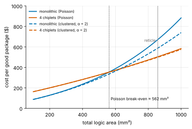
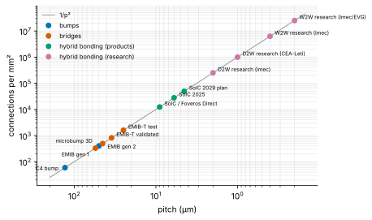

<!-- status: verified -->
# 25-07 · Packaging II: 2.5D, 3D, Hybrid Bonding and Chiplets

| | |
|---|---|
| **Course** | [25 · Semiconductor Fabrication, Packaging, Test and Reliability](../README.md) |
| **University equivalent** | Advanced packaging and heterogeneous integration (graduate electronic-packaging electives; Tummala, *Fundamentals of Device and Systems Packaging*, chapters on 2.5D and 3D integration; Lau, *Chiplet Design and Heterogeneous Integration Packaging*) |
| **Prerequisites** | [25-06](25-06-packaging-fundamentals.md) (flip-chip, substrates, joint strain), [25-04](25-04-yield-and-die-cost.md) (dies per wafer, yield, cost per good die), [23-05](../../23-memory-and-storage-technology/chapters/23-05-hbm-in-depth.md) (TSVs, HBM stacks, height and thermal budgets), [24-06](../../24-high-speed-io-signal-integrity-and-photonics/chapters/24-06-d2d-memory-phys-scale-up.md) (die-to-die links, bump density, UCIe), [03-02](../../03-probability-statistics-and-random-variables/chapters/03-02-random-variables-and-distributions.md) (package yield as a product of die yields) |
| **Estimated study hours** | 7 |
| **Last verified** | 2026-11-26 |

**Learning objectives.** After this chapter you can:

1. Explain why the reticle limit, yield and I/O density push large systems onto several dies, and convert interposer sizes between reticle multiples and square millimetres.
2. Compare silicon interposers, RDL interposers, silicon bridges and embedded bridges by wiring capacity per millimetre of die edge, silicon consumed and packages per wafer.
3. Describe TSV-based and hybrid-bonded 3D stacking, and compute bond density, the overlay budget, die-level bond yield and the anneal that closes a copper recess.
4. Derive the fraction of tested dies that are still bad (test escapes), the resulting package yield, and the scrap cost it causes.
5. Build a monolithic-against-chiplet cost model and find its break-even defect density and die area.
6. Read packaging-capacity and roadmap claims (CoWoS, SoIC, Foveros, EMIB, glass cores) with their denominators and dates, as of late 2026.

---

## 1. Big picture

A single die cannot be larger than the scanner's exposure field, about 858 mm² (25-02), and well before that limit its yield and cost become punishing (25-04). Meanwhile an AI accelerator wants more compute than one reticle holds and more memory bandwidth than a package edge can carry. Advanced packaging answers by splitting the system into several dies and joining them with wiring much denser than a package substrate: side by side on a silicon or redistribution-layer interposer (2.5D), or stacked directly on each other (3D). The split dies, called **chiplets**, can come from different process nodes and even different companies. The price is a new set of problems: interposers are large and capacity-limited, stacked dies must align to a micrometre or better, every die must be tested before it is committed, and one bad part can scrap thousands of dollars of good ones.

- **Where it shows up:** every high-end AI accelerator (compute dies plus HBM on CoWoS-class interposers), server CPUs built from tiles, cache dies stacked on processors, HBM itself (23-05), and increasingly phones and PCs.
- **Two families:** 2.5D places dies side by side on fine wiring; 3D stacks them with through-silicon vias (TSVs), microbumps or direct copper-to-copper hybrid bonds.
- **The economics:** chiplets cut silicon cost through yield but add interconnect area, packaging and test cost; whether they win depends on die area and defect density (§3.7).
- **The bottleneck:** advanced-packaging capacity, counted in interposer wafers per month, has limited AI-accelerator output since 2023 [R-588].
- **The frontier:** hybrid-bond pitch, falling from about 9 µm in products towards a few micrometres, with sub-micrometre pitches in research [R-589], [R-593].

## 2. Intuition first

**Physical picture.** Think of a 25-06 flip-chip package as a city whose buildings are connected only by the motorway network of the package substrate: lines and spaces of about 10 µm, a few hundred wires per millimetre of die edge. A silicon interposer is a dense street grid laid under a cluster of buildings: wiring a hundred times finer, so a processor and its memory stacks can exchange thousands of signals over a few millimetres. A silicon bridge is a single footbridge between two neighbouring buildings: the same fine wiring, but only where the two meet. A 3D stack is a skyscraper: floors joined by lift shafts (TSVs) and by the floor-to-floor bonds themselves, the shortest connection there is.

```text
   2.5D: side by side on an interposer               3D: stacked
   ┌───────┐ ┌──────────────┐ ┌───────┐           ┌──────────────┐ cache or logic die
   │  HBM  │ │ compute die  │ │  HBM  │           ├──────────────┤ ← hybrid bond (Cu–Cu + oxide)
   └─┬─┬─┬─┘ └─┬─┬─┬─┬─┬─┬─┬┘ └─┬─┬─┬─┘           │ compute die  │   pitch ≈ 9 µm or less
 ════╧═╧═╧═════╧═╧═╧═╧═╧═╧═╧═════╧═╧═╧════  ← microbumps ≈ 35–55 µm
 ║ interposer (Si or RDL) with fine wires ║     │   TSVs carry power and I/O down
 ════╤═══╤═══╤═══╤═══╤═══╤═══╤═══╤═══╤════  ← C4 bumps ≈ 130 µm
 ███ organic build-up substrate (25-06) ███    ███ substrate ███
 ○ ○ ○ ○ ○ ○ ○ ○ ○ ○ ○ ○ ○ ○ ○ ○ ○ ○ ○ ○   ← board balls
```

**Analogy and its limits.** Chiplets are modular construction: rooms built and inspected in a factory, then craned into place. The analogy captures the main economic idea, that small modules are easier to make right than a whole building at once, and that each module should be inspected before it is installed. It breaks in two places. A defective module can be swapped out of a building, but a bonded die cannot be removed: once assembled, one bad die scraps the whole package, including every good die and memory stack in it (§3.6). And buildings cool from every face, while a die stack must push all its heat through its own layers (23-05, 25-08).

## 3. Theory

### 3.1 Why one die is not enough

Three limits push a large system onto several dies.

1. **The reticle.** A scanner exposes a field of at most 26 mm × 33 mm = 858 mm² (25-02), so no die can be larger; High-NA EUV halves the field. Interposers are measured in multiples of this field. Some quotes use 858 mm², others TSMC's usable 830 mm², so a "3.3× reticle" interposer is quoted as anywhere from about 2,700 to 2,830 mm² [R-586] (Example 25-07.1).
2. **Yield and cost.** With defect density $D_0$ and area $A$, the Poisson yield $Y = e^{-AD_0}$ falls exponentially, so cost per good die grows faster than area (25-04). Splitting the area divides the exponent.
3. **I/O and memory.** HBM bandwidth needs thousands of short wires between processor and memory (23-05), which a build-up substrate cannot route (§3.2).

There are also reasons beyond these limits. Different functions favour different processes: logic shrinks with each node, but analog and I/O barely do (20-12), so putting I/O on an older, cheaper node saves money. A product family can reuse the same chiplets in different counts. The costs are the die-to-die interface (area, power and latency, 24-06), assembly yield, test and packaging.

### 3.2 2.5D: interposers and bridges

A **2.5D** package places dies side by side on a layer of fine wiring that sits between them and the organic substrate. The options differ in what that layer is made of and how much of the package it covers.

- **Silicon interposer.** A passive silicon die, patterned with a back-end-of-line metal stack, with TSVs to reach the substrate below. TSMC's CoWoS-S and Samsung's I-Cube and Cube-S are examples [R-586], [R-592]. It gives the finest wiring, but it is a large piece of silicon that must itself be stitched across reticle fields and yielded.
- **RDL interposer.** An organic redistribution layer built up on a carrier with lithographically defined copper lines a few micrometres wide (CoWoS-R, Samsung Cube-R). Samsung reports developing 2 µm/2 µm lines and spaces for it [R-592]. Coarser than silicon, but cheaper and not limited by silicon wafer area.
- **RDL interposer with local silicon bridges.** Small silicon bridge dies are embedded only where two dies meet (TSMC's CoWoS-L with local silicon interconnect bridges, Samsung's Cube-E) [R-586], [R-592]. NVIDIA's Blackwell B200 joins its two near-reticle compute dies this way [R-586].
- **Bridges embedded in the substrate.** Intel's EMIB embeds silicon bridges in the organic substrate itself, with no interposer at all [R-591].

**Wiring capacity per millimetre of edge.** What matters between two dies is how many wires can cross each millimetre of their facing edges, the **shoreline**. With $L$ routing layers of wires at line width $w$ and space $s$, each layer carries one wire per pitch $w + s$, so the wires per millimetre of edge are

$$
N_{edge} = \frac{L}{w + s}\quad\text{(with } w + s \text{ in mm)}.
$$

Four layers at 1 µm/1 µm give 2,000 wires per millimetre; the same four layers at the 10 µm/10 µm of a good organic substrate (25-06) give 200. An HBM interface has 2,048 data wires (23-05), so on an organic substrate its data wires alone would need about 10 mm of processor edge, roughly the whole width of a memory stack, before counting command, clock, power and the bumps that must land them (Example 25-07.2). That factor of ten is why HBM sits on an interposer or bridge. The bump field that feeds those wires sets a second limit, the bandwidth per square millimetre, derived in 24-06.

**Silicon used.** A full silicon interposer consumes silicon wafer area roughly equal to the whole multi-die footprint, while bridges consume only small strips. A wafer that yields 17 interposers of 52 mm × 52 mm yields 1,208 bridges of 3 mm × 18 mm (Example 25-07.3). That difference is why interposers beyond about 3.3 reticles move to RDL with bridges, and why bridge technologies scale to the largest packages [R-586], [R-591].

### 3.3 Capacity is counted in wafers

Interposers are made on 300 mm wafers, so 2.5D capacity is quoted in wafers per month. Converting wafers to accelerators requires the interposers per wafer, which depend on interposer size with edge loss exactly as dies per wafer do (25-04), and the packaging yield:

$$
\text{packages per month} = W \times n_{wafer} \times Y_{pkg},
$$

with $W$ the wafers per month, $n_{wafer}$ the interposers per wafer and $Y_{pkg}$ the fraction of assembled packages that work. Because $n_{wafer}$ falls faster than area rises (a 3,250 mm² interposer fits 14 times on a wafer but a 7,875 mm² one only 4 times, Example 25-07.4), the same wafer capacity yields very different unit numbers as packages grow. Capacity estimates for TSMC's CoWoS also differ in scope (TSMC alone or the whole industry), in basis (end-of-year run rate or annual total divided by twelve) and in vintage; §9 lists them.

### 3.4 3D stacking: TSVs, microbumps and hybrid bonds

A **3D** stack bonds dies on top of each other. Signals and power pass through the lower dies on **through-silicon vias**, copper pillars through thinned silicon, whose capacitance, resistance and keep-out area 23-05 derives. Two orientations are common:

- **Face-to-back:** the top die's active face bonds to the back of the die below, and every signal from the bottom die passes through TSVs. HBM stacks are built this way (23-05).
- **Face-to-face:** the two active faces bond directly, so signals cross between the dies' top metal layers without TSVs; only the die that faces the substrate needs TSVs for power and I/O.

The bond itself is either a **microbump** (a small solder cap on a copper pillar, joined by thermocompression or mass reflow, with an underfill or film in the gap) or a **hybrid bond** (copper pads and the dielectric around them joined directly, with no solder and no gap). On a square grid of pitch $p$ the connection density is

$$
n_{bond} = \frac{1}{p^2}.
$$

Halving the pitch quadruples the density. TSMC reported at its 2026 symposium about 14,000 signals per square millimetre for face-to-face hybrid bonding against roughly 1,500 for face-to-back TSV stacking [R-589]. As reported from AMD's Hot Chips 2021 talk, standard C4 bumps sit at about 130 µm pitch, microbump 3D at 50 µm and AMD's hybrid-bonded cache at 9 µm [R-589]; Example 25-07.5 computes the densities along TSMC's 9 → 6 → 4.5 µm roadmap. Thermocompression bonding bottoms out at a pitch of around 25 µm [R-592]; below that, solder bridges and gap control fail, and hybrid bonding takes over.

### 3.5 Hybrid bonding: process, overlay and anneal

**Process.** Each die or wafer gets a top surface of copper pads inlaid in a dielectric (silicon oxide or SiCN), polished flat by chemical-mechanical polishing (25-03). The polish deliberately leaves the copper slightly recessed, by a few nanometres, below the dielectric. The surfaces are cleaned and plasma-activated, then pressed together at room temperature. The dielectrics bond immediately by surface forces, holding the parts in place. An anneal then expands the copper more than the dielectric, closing the recess so the pads touch and bond, and copper diffusion across the interface completes the joint. Any particle between the surfaces leaves an unbonded void much larger than itself, so hybrid bonding needs front-end cleanliness in a packaging line.

**The anneal needed to close the recess.** A copper pad of thickness $t$ (m), recessed by $\delta$ (m), sits in a dielectric. Heating by $\Delta T$ (K) expands the pad's thickness by $\alpha_{Cu}t\Delta T$ and the surrounding dielectric by $\alpha_d t\Delta T$, where the $\alpha$ are thermal-expansion coefficients (K⁻¹). Treating the pad as free to expand vertically, its top surface rises relative to the dielectric's by $(\alpha_{Cu} - \alpha_d)t\Delta T$. The gap closes when this equals the recess:

$$
\Delta T_{close} = \frac{\delta}{(\alpha_{Cu} - \alpha_d)\,t}.
$$

Units: m/(K⁻¹ · m) = K. ✓ With copper at about 17 ppm/K and oxide at about 0.5 ppm/K, a 5 nm recess on a 1 µm pad closes about 300 K above room temperature (Example 25-07.7). The model is first order: a pad constrained sideways by its dielectric expands more vertically than a free one, and copper creep and diffusion at temperature also help, so real anneals can be somewhat cooler. The design lesson holds: the recess must be controlled to nanometres, thicker pads lower the anneal temperature, and the anneal must stay within the thermal budget of both dies' back-end stacks.

**Overlay.** The two sets of pads must land on each other. Take square pads of width $p/2$ on pitch $p$ (assumed), and require at least half of each pad's width to overlap its partner along each axis. A misalignment $e$ along one axis reduces the overlap from $p/2$ to $p/2 - |e|$, so the requirement is

$$
|e| \le \frac{p}{4}\quad\text{on each axis}.
$$

At that limit the gap between a pad and its neighbour's partner is still $p/2 - p/4 = p/4$, so the same budget also protects against shorts. This reproduces the industry rule of thumb that overlay must be about a quarter of the pitch [R-593]. In die-to-wafer (D2W) bonding, each die is placed by a pick-and-place tool with its own random placement error. If the error on each axis is Gaussian with standard deviation $\sigma$ and the axes are independent, the probability that a die bonds within budget is

$$
Y_{bond} = \left[\operatorname{erf}\!\left(\frac{p/4}{\sigma\sqrt{2}}\right)\right]^2,
$$

because $P(|e| \le a) = \operatorname{erf}(a/(\sigma\sqrt{2}))$ for a zero-mean Gaussian. With $\sigma = p/12$ (so the budget is 3σ) one die in about 185 fails (Example 25-07.6). Rotation adds a displacement $\theta r$ at distance $r$ from the die centre, largest at the corners (Problem 25-07.6). Wafer-to-wafer (W2W) bonding aligns whole wafers at once and reaches much finer overlay, but cannot select known-good dies: every bad die on either wafer is bonded to something.

> **Math refresher — the error function.** For a Gaussian variable of mean 0 and standard deviation $\sigma$, $P(|X| \le a) = \operatorname{erf}\big(a/(\sigma\sqrt{2})\big)$, where $\operatorname{erf}(x) = \frac{2}{\sqrt{\pi}}\int_0^x e^{-u^2}du$. At $a = \sigma, 2\sigma, 3\sigma$ it gives about 0.683, 0.954 and 0.997 (03-02). To find the $\sigma$ that meets a target probability $P$, invert: $a/\sigma = \sqrt{2}\,\operatorname{erf}^{-1}(P)$.

### 3.6 Known-good die, test escapes and package yield

A package works only if every die in it works and every attach succeeds. 03-02 showed that untested dies make package yield fall as $Y^n$; testing each die first moves the loss to the cheap single die. But test is imperfect. Let a die be good with probability $Y$ and let the test catch a fraction $c$ of bad dies (its **coverage** of real defects; assume it never rejects a good die). Then the dies that pass are the good ones, with probability $Y$, plus the bad ones that escaped, with probability $(1 - Y)(1 - c)$. By Bayes' rule the fraction of passing dies that are bad, the **test escape** rate, is

$$
e = \frac{(1 - Y)(1 - c)}{Y + (1 - Y)(1 - c)} \approx \frac{(1 - Y)(1 - c)}{Y}\quad\text{when } c \to 1.
$$

The escape rate grows as die yield falls: poor yield plus imperfect test feeds bad dies into packages. A package of $n$ components with escape rates $e_i$, assembled with attach yield $y_a$ per component, works with probability

$$
Y_{pkg} = y_a^{\,n}\prod_{i=1}^{n}(1 - e_i).
$$

Because a failed package scraps all of its contents, the cost of a good package is the cost of the kit divided by $Y_{pkg}$, and the scrap overhead is $C_{kit}(1/Y_{pkg} - 1)$. When the kit holds two compute dies and eight HBM stacks worth thousands of dollars, a few tenths of a percent of escape per die is worth real money, which is why vendors invest in test coverage at wafer sort, in stack-level tests for HBM, and in repair (Example 25-07.8). Hybrid-bond pads are too small and too fragile to probe directly, so dies are tested through separate probe pads or built-in self-test (19-12), and the test strategy must be designed with the stack. Test economics continue in 25-11.

### 3.7 Chiplet economics: when does splitting pay?

Let the silicon cost $c$ per square millimetre of wafer (wafer cost divided by usable area; edge loss is ignored here and handled in the lab), a test cost $t$ per die tested, a package cost $P$, and an attach yield $y_a$ per die. A die of area $A_i$ with yield $Y_i$ costs $(cA_i + t)/Y_i$ per good, tested die: every die is paid for and tested, but only $Y_i$ of them are good. The cost of a good package of $n$ dies is

$$
C = \frac{\sum_{i=1}^{n}(cA_i + t)/Y_i + P}{y_a^{\,n}}.
$$

For a monolithic die of area $A$, $n = 1$. Splitting into $n$ chiplets of area $(A/n)(1 + \phi)$, where $\phi$ is the fractional area added for die-to-die interfaces, improves each die's yield from $e^{-AD_0}$ to $e^{-(A/n)(1+\phi)D_0}$, but adds a factor $(1 + \phi)$ to the silicon, $n$ test costs, a more expensive package and $n$ attach losses. At low $D_0$ or small $A$, yields are already high and the overheads win; at high $D_0$ or large $A$, the yield gain wins. Setting the two costs equal gives a **break-even defect density** (or, at fixed $D_0$, a break-even area), found numerically (Example 25-07.9 and the lab).

The model leaves out effects that often decide real projects: the die-to-die links' power and latency (24-06); mixing nodes, so that I/O and analog chiplets stay on cheap processes (20-12); reusing one chiplet across a product family; and the design, mask and validation cost of several dies instead of one (26-04).

> **Going deeper — clustering narrows the advantage.** Defects cluster (25-04), so a large die's real yield is higher than Poisson predicts: with the negative-binomial model $Y = (1 + AD_0/\alpha)^{-\alpha}$ and $\alpha$ = 2, the monolithic yield in Example 25-07.9 rises and the chiplet saving shrinks (Problem 25-07.11). Chiplet business cases that use Poisson yields overstate the benefit; ask which model was used.

### 3.8 Heat, stress and the substrate underneath

Stacking dies concentrates power: a cache die on a processor, or a 16-high HBM stack, must conduct all its heat through bond layers whose thermal resistance can exceed the silicon's (23-05 §3.5; thermal paths in 25-08). Large interposers and their substrates warp as they cool from bonding temperatures, the bimetal problem of 25-06; organic cores lose flatness at the largest sizes. **Glass-core substrates** are the main proposed answer: glass is flat and stiff, its expansion can be tuned closer to silicon's, and it supports fine through-glass vias, but it cracks during drilling and dicing ("SeWaRe" micro-cracks), and it is not yet in volume production [R-595].

## 4. Worked examples

### Example 25-07.1 · Interposer sizes in reticles (tier A)

**Setup.** Using a reticle of 26 mm × 33 mm and TSMC's usable 830 mm² [R-586], find (a) a 3.3× interposer's area on each basis, (b) a 5.5× interposer on the 858 mm² basis, and (c) the substrate area for TSMC's 2027 target of a 9.5× interposer on a 120 mm × 150 mm substrate [R-587] and the fraction of that substrate the interposer covers.

**Solution.**

- (a) $3.3 \times 858$ = **2.83e3** mm²; $3.3 \times 830$ = **2.74e3** mm².
- (b) $5.5 \times 858$ = **4.72e3** mm².
- (c) $120 \times 150$ = **1.80e4** mm². The interposer is $9.5 \times 830$ = 7,885 mm², so it covers $7{,}885/18{,}000$ = **0.438** of the substrate.

**Units check.** Multiples are dimensionless, so areas stay in mm².

**Sanity check.** The two bases differ by 3.4%, which is the whole spread between quoted CoWoS-S sizes of about 2,700 and 2,830 mm² [R-586]. When a roadmap quotes "×reticle", ask which reticle.

### Example 25-07.2 · Wires per millimetre of shoreline (tier A)

**Setup.** Four routing layers carry die-to-die wires on (a) a silicon interposer at 1 µm/1 µm (assumed), (b) an RDL interposer at 2 µm/2 µm, the pitch Samsung reports developing [R-592], and (c) a build-up substrate at 10 µm/10 µm (25-06). Find the wires per millimetre of die edge for each, and the edge length needed by HBM's 2,048 data wires (23-05).

**Solution.** $N_{edge} = L/(w + s)$ with $w + s$ in mm:

- (a) $4/0.002$ = **2000** per mm; $2048/2000$ = **1.02** mm.
- (b) $4/0.004$ = **1000** per mm; $2048/1000$ = **2.05** mm.
- (c) $4/0.020$ = **200** per mm; $2048/200$ = **10.2** mm.

**Units check.** Layers per mm of pitch give wires per mm; wires divided by wires per mm give mm. ✓

**Sanity check.** An HBM stack is about 11 mm wide (23-05), so on a substrate its data wires alone would need almost the whole facing edge, with nothing left for command, clock, power or the bumps; silicon or fine RDL needs a millimetre or two.

### Example 25-07.3 · Interposer or bridges: silicon consumed (tier B)

**Setup.** A silicon interposer measures 52 mm × 52 mm (assumed, about 3.2 reticles). The alternative is an RDL interposer with four silicon bridges of 3 mm × 18 mm, the bridge size in Intel's EMIB-T test vehicle [R-591]. Using an exact count of whole rectangles on a 300 mm wafer (no edge exclusion or saw street, as in the lab), find (a) the interposers and (b) the bridges per wafer, (c) the packages per wafer that the bridges serve, and (d) the ratio of silicon area per package.

**Solution.**

- (a) **17** interposers per wafer (exact count). The 25-04 formula $\pi d^2/4A - \pi d/\sqrt{2A}$ gives **13.3**: its edge-loss term, fitted for dies much smaller than the wafer, overstates the loss for rectangles this large.
- (b) **1208** bridges per wafer.
- (c) $1208/4$ = **302** packages per wafer, against 17.
- (d) Silicon per package: $52^2$ = 2,704 mm² against $4 \times 54$ = 216 mm², a ratio of **12.5**.

**Units check.** Counts are dimensionless; the ratio is mm²/mm².

**Sanity check.** The bridge option also needs an RDL interposer, which has its own yield and cost, so the saving is less than 12.5 times. But silicon interposer wafers are what run short; a bridge design spends a scarce resource on only the small part of the package that needs it.

### Example 25-07.4 · From interposer wafers to accelerators (tier B)

**Setup.** A packaging line runs 100,000 interposer wafers a month (assumed, about the scale of 2026 estimates [R-588]) with a package yield of 0.95 (assumed). Find the packages per month for (a, b) a 50 mm × 65 mm interposer (3,250 mm², about 3.8 reticles) and (c, d) a 75 mm × 105 mm interposer (7,875 mm², about 9.5 reticles on the 830 mm² basis).

**Solution.** From an exact count on a 300 mm wafer:

- (a) **14** interposers per wafer; (b) $10^5 \times 14 \times 0.95$ = **1.33e6** packages per month.
- (c) **4** interposers per wafer; (d) $10^5 \times 4 \times 0.95$ = **3.8e5** packages per month.

**Units check.** Wafers/month × interposers/wafer × (dimensionless) = packages/month. ✓

**Sanity check.** The area grows 2.42 times but the count per wafer falls 3.5 times, because large rectangles waste more of a round wafer. Each larger package holds more compute and memory, so units fall faster than delivered capability. "Wafers per month" without the interposer size says little about accelerators.

### Example 25-07.5 · Hybrid-bond density and overlay along the roadmap (tier A)

**Setup.** TSMC's SoIC roadmap moves from 9 µm (2023) to 6 µm (2025) to 4.5 µm (2029) [R-589]. Find (a) the bond density at each pitch, (b) the density gain of each step, (c) the overlay budget $p/4$ at each pitch, and (d) the budget for imec and EVG's 200 nm wafer-to-wafer demonstration [R-593].

**Solution.**

- (a) $(1000/9)^2$ = **1.23e4**, $(1000/6)^2$ = **2.78e4** and $(1000/4.5)^2$ = **4.94e4** per mm².
- (b) $(9/6)^2$ = **2.25** and $(6/4.5)^2$ = **1.78**.
- (c) $9/4$ = **2.25** µm, $6/4$ = **1.5** µm, $4.5/4$ = **1.125** µm.
- (d) $200/4$ = **50** nm.

**Units check.** $(\text{µm}/\text{mm})^{-2}$: $1000/p$ is pads per mm along one axis, squared gives per mm². ✓

**Sanity check.** imec and EVG reported a post-bond overlay below 40 nm for every die on the wafer at 200 nm pitch [R-593], inside the 50 nm budget. The roadmap step from 6 to 4.5 µm takes four years for a 1.78-fold gain, slower than the earlier step; bonding pitch is not scaling like transistor pitch.

### Example 25-07.6 · Die-to-wafer bond yield and placement accuracy (tier B)

**Setup.** Pads of width $p/2$ need $|e| \le p/4$ on each axis (§3.5). (a) Find the die bond yield when $\sigma = p/12$. (b) At 6 µm pitch, what $\sigma$ (and 3σ) gives 99.9% die yield? (c) A bonder places dies with 0.5 µm (3σ) per axis, the next-generation capability CEA-Leti cites [R-593]. What is the smallest pitch it supports at 99.9%, and (d) what die yield does it give at 1 µm pitch?

**Solution.**

- (a) $\operatorname{erf}(3/\sqrt{2})^2 = 0.99730^2$ = **99.46**%.
- (b) Need $\operatorname{erf}(z/\sqrt{2}) = \sqrt{0.999} = 0.9995$, so $z = 3.48$ and $\sigma = 1.5/3.48$ = **0.431** µm; 3σ = **1.29** µm.
- (c) $\sigma = 0.5/3$ = 0.167 µm, so $p = 4z\sigma = 4 \times 3.48 \times 0.167$ = **2.32** µm.
- (d) $p/4 = 0.25$ µm $= 1.5\sigma$; $\operatorname{erf}(1.5/\sqrt{2})^2 = 0.8664^2$ = **75.1**%.

**Units check.** $z$ is dimensionless; $\sigma$ carries the pitch's µm. ✓

**Sanity check.** CEA-Leti reported that its 1 µm die-to-wafer yield "is limited by the alignment accuracy of existing bonding tools" and expects improvement from 0.5 µm (3σ) tools [R-593]. This model says even those tools give only about three dies in four at 1 µm with pads half the pitch: sub-2 µm die-to-wafer pitches need either better placement or a more forgiving pad design.

### Example 25-07.7 · The anneal that closes a copper recess (tier B)

**Setup.** Take copper at 17 ppm/K and oxide at 0.5 ppm/K. Find the temperature rise to close (a) a 5 nm recess on a 1.0 µm pad, and the anneal temperature from 25 °C; (b) a 2 nm recess on the same pad; (c) a 5 nm recess on a 2.0 µm pad (all assumed).

**Solution.** $\Delta T = \delta/[(\alpha_{Cu} - \alpha_d)t]$ with $\alpha_{Cu} - \alpha_d$ = 16.5 × 10⁻⁶ K⁻¹:

- (a) $5 \times 10^{-9}/(16.5 \times 10^{-6} \times 1.0 \times 10^{-6})$ = **303** K, an anneal at about $25 + 303$ = **328** °C.
- (b) $2 \times 10^{-9}/(16.5 \times 10^{-12})$ = **121** K.
- (c) $5 \times 10^{-9}/(16.5 \times 10^{-6} \times 2.0 \times 10^{-6})$ = **152** K.

**Units check.** m/(K⁻¹·m) = K. ✓

**Sanity check.** Polishing a recess to 2 nm instead of 5 nm cuts the required rise by 60%, and doubling the pad thickness halves it. Both matter when one of the dies is a memory or a finished logic die whose back-end stack or transistors cannot take a long, hot anneal.

### Example 25-07.8 · Test escapes and the cost of a bad package (tier B)

**Setup.** Compute dies have a yield of 0.80 at wafer sort and a test that catches 99% of bad dies (assumed). A package holds 2 compute dies and 8 HBM stacks, each stack with a 0.5% escape rate, and every component is attached with 99.8% yield (assumed). The kit (2 compute dies at $400, 8 stacks at $300, interposer, substrate and assembly at $1,000, all assumed) costs $4,200. Find (a) the compute-die escape rate, (b) the package yield, the cost per good package and the scrap overhead per good package, and (c) the same if test coverage rises to 99.9%.

**Solution.**

- (a) $e = 0.2 \times 0.01/(0.8 + 0.002)$ = **0.249**%.
- (b) $Y_{pkg} = 0.998^{10}(1 - 0.00249)^2(0.995)^8$ = **0.937**. Cost per good package $4200/0.937$ = **$4.48e3**, of which the scrap overhead is $4200(1/0.937 - 1)$ = **$283**.
- (c) $e = 0.2 \times 0.001/(0.8 + 0.0002)$ = **0.0250**%; $Y_{pkg}$ = **0.941**; the cost per good package falls by **$20.1**.

**Units check.** Yields and escape rates are probabilities; dollars divided by a probability give dollars per good package. ✓

**Sanity check.** The HBM escapes (eight stacks at 0.5%) cost more yield than the compute dies do, so improving compute-die coverage tenfold saves only about $20; the stack tests and attach yield are the bigger levers. Spread over hundreds of thousands of packages, $20 is still millions of dollars.

### Example 25-07.9 · Monolithic against four chiplets (tier C)

**Setup.** A design needs 800 mm² of logic. Silicon costs $0.30 per mm² (assumed), $D_0$ = 0.1 cm⁻² (Poisson), each die costs $3 to test, and each attach yields 99% (all assumed). Option M is one 800 mm² die in a $50 package. Option C is four chiplets, each 200 mm² plus 10% for die-to-die interfaces, in a $110 package (the extra $60 for the interposer or bridges). Find (a) each die yield, (b) the cost per good monolithic package, (c) the cost per good chiplet package, (d) their ratio, and (e) the break-even $D_0$.

**Solution.**

- (a) $Y_M = e^{-0.8}$ = **0.449**; $Y_C = e^{-0.22}$ = **0.803**.
- (b) $C_M = [(0.30 \times 800 + 3)/0.449 + 50]/0.99$ = **$597**.
- (c) $C_C = [4(0.30 \times 220 + 3)/0.803 + 110]/0.99^4$ = **$473**.
- (d) $473/597$ = **0.792**, a saving of about a fifth.
- (e) Solving $C_M(D_0) = C_C(D_0)$ numerically gives $D_0$ = **0.058** cm⁻²; below it the monolithic die is cheaper.

**Units check.** $/mm² × mm² + $ gives $; dividing by yields gives $ per good unit. ✓

**Sanity check.** At $D_0$ = 0.1 cm⁻² the chiplet design wins only above about 562 mm² of logic (lab Part 4). A mature node with $D_0$ well below 0.058 cm⁻² would favour the monolithic die even at 800 mm², which is why chiplet decisions depend on the node's defect density at launch, not on a slogan.

<!-- answer-key -->

| ID | Quantity | Value | Unit |
|---|---|---|---|
| Ex 25-07.1a | 3.3× interposer, 858 mm² basis | 2.83e3 | mm² |
| Ex 25-07.1a1 | 3.3× interposer, 830 mm² basis | 2.74e3 | mm² |
| Ex 25-07.1b | 5.5× interposer | 4.72e3 | mm² |
| Ex 25-07.1c | 120 × 150 mm substrate area | 1.80e4 | mm² |
| Ex 25-07.1c1 | interposer fraction of substrate | 0.438 | |
| Ex 25-07.2a | wires per mm, silicon | 2000 | /mm |
| Ex 25-07.2a1 | HBM edge, silicon | 1.02 | mm |
| Ex 25-07.2b | wires per mm, RDL | 1000 | /mm |
| Ex 25-07.2b1 | HBM edge, RDL | 2.05 | mm |
| Ex 25-07.2c | wires per mm, substrate | 200 | /mm |
| Ex 25-07.2c1 | HBM edge, substrate | 10.2 | mm |
| Ex 25-07.3a | interposers per wafer | 17 | |
| Ex 25-07.3a1 | formula estimate | 13.3 | |
| Ex 25-07.3b | bridges per wafer | 1208 | |
| Ex 25-07.3c | packages per wafer, bridges | 302 | |
| Ex 25-07.3d | silicon area ratio | 12.5 | |
| Ex 25-07.4a | 3,250 mm² interposers per wafer | 14 | |
| Ex 25-07.4b | packages per month | 1.33e6 | |
| Ex 25-07.4c | 7,875 mm² interposers per wafer | 4 | |
| Ex 25-07.4d | packages per month | 3.8e5 | |
| Ex 25-07.4e | area ratio | 2.42 | |
| Ex 25-07.4f | count ratio | 3.5 | |
| Ex 25-07.5a | density at 9 µm | 1.23e4 | /mm² |
| Ex 25-07.5a1 | density at 6 µm | 2.78e4 | /mm² |
| Ex 25-07.5a2 | density at 4.5 µm | 4.94e4 | /mm² |
| Ex 25-07.5b | gain 9 → 6 µm | 2.25 | |
| Ex 25-07.5b1 | gain 6 → 4.5 µm | 1.78 | |
| Ex 25-07.5c | overlay budget at 9 µm | 2.25 | µm |
| Ex 25-07.5c1 | overlay budget at 6 µm | 1.5 | µm |
| Ex 25-07.5c2 | overlay budget at 4.5 µm | 1.125 | µm |
| Ex 25-07.5d | overlay budget at 200 nm | 50 | nm |
| Ex 25-07.6a | die bond yield at sigma = p/12 | 99.46 | % |
| Ex 25-07.6a0 | erf(3/sqrt 2) | 0.99730 | |
| Ex 25-07.6b | sigma for 99.9% at 6 µm | 0.431 | µm |
| Ex 25-07.6b0 | z for 99.9% | 3.48 | |
| Ex 25-07.6b1 | 3 sigma | 1.29 | µm |
| Ex 25-07.6c | smallest pitch, 0.5 µm tool | 2.32 | µm |
| Ex 25-07.6c0 | tool sigma | 0.167 | µm |
| Ex 25-07.6d | die yield at 1 µm | 75.1 | % |
| Ex 25-07.6d0 | erf(1.5/sqrt 2) | 0.8664 | |
| Ex 25-07.7a | rise, 5 nm on 1 µm | 303 | K |
| Ex 25-07.7a1 | anneal temperature | 328 | °C |
| Ex 25-07.7b | rise, 2 nm on 1 µm | 121 | K |
| Ex 25-07.7c | rise, 5 nm on 2 µm | 152 | K |
| Ex 25-07.8a | compute escape, 99% coverage | 0.249 | % |
| Ex 25-07.8b | package yield | 0.937 | |
| Ex 25-07.8b1 | cost per good package | 4.48e3 | $ |
| Ex 25-07.8b2 | scrap overhead | 283 | $ |
| Ex 25-07.8c | compute escape, 99.9% coverage | 0.0250 | % |
| Ex 25-07.8c1 | package yield | 0.941 | |
| Ex 25-07.8c2 | saving per good package | 20.1 | $ |
| Ex 25-07.9a | monolithic yield | 0.449 | |
| Ex 25-07.9a1 | chiplet yield | 0.803 | |
| Ex 25-07.9b | monolithic cost | 597 | $ |
| Ex 25-07.9c | chiplet cost | 473 | $ |
| Ex 25-07.9d | cost ratio | 0.792 | |
| Ex 25-07.9e | break-even defect density | 0.058 | cm⁻² |
| Txt 25-07.a | break-even logic area at 0.1 cm⁻² | 562 | mm² |
| Txt 25-07.d | rise saved by a 2 nm recess | 60 | % |
| Txt 25-07.b | one die in N fails at sigma = p/12 | 185 | |
| Txt 25-07.c | CoWoS-S basis spread | 3.4 | % |

## 5. Simulate it

The lab is [labs/25-07-lab/](../labs/25-07-lab/README.md). `chiplets.py` counts interposers and bridges per wafer, computes shoreline wiring, hybrid-bond density, the anneal rise, die bond yield by formula and by Monte Carlo, test escapes and package yield, and the monolithic-against-chiplet cost model with its break-even; the notebook runs the parts below.



*Figure 1. Chiplets lose at small areas, where yields are already high and their overheads dominate, and win at large areas; clustered defects move the crossover to larger dies.*



*Figure 2. From C4 bumps to research hybrid bonds, density follows $1/p^2$ across almost six orders of magnitude.*

**Predict, then run:**

1. *Predict* how many 50 mm × 65 mm interposers fit on a 300 mm wafer, then count them exactly and compare with the 25-04 formula.
2. *Predict* the die bond yield at 6 µm pitch with a placement σ of 0.5 µm, then compute it by formula and by Monte Carlo.
3. *Predict* the break-even defect density for Example 25-07.9 with clustered defects (α = 2), then solve for it.
4. *Predict* the logic area at which four chiplets break even at $D_0$ = 0.1 cm⁻², then find it and plot both costs.

## 6. Engineering tradeoffs

| Knob | Improves | Costs | Typical decision owner |
|---|---|---|---|
| Split one die into chiplets | Yield, reticle limit, node mixing, reuse | Die-to-die area and power, packaging, test, assembly yield | Product and SoC architecture |
| Silicon interposer instead of RDL | Wire density, signal quality | Interposer silicon and capacity, size limit | Package architecture with the foundry |
| Bridges instead of a full interposer | Silicon consumed, package size | Bridge placement, RDL yield, design complexity | Package architecture |
| Hybrid bonding instead of microbumps | Density, energy per bit, thermal resistance | Cleanliness, overlay, no rework, probing | Technology and packaging engineering |
| Die-to-wafer instead of wafer-to-wafer | Known-good-die selection, different die sizes | Coarser overlay, throughput | Process integration |
| Finer bond pitch | Bandwidth density | Overlay and placement tools, yield | Technology roadmap |
| More test coverage before assembly | Package yield, scrap cost | Test time, probe cost, design for test | Test engineering |
| Larger interposer | More compute and HBM per package | Fewer per wafer, warpage, substrate size | Product architecture |

## 7. Numbers to know

Perishable rows are as of Nov 2026; the date column gives the source's own date.

| Quantity | Value | Dated | Source |
|---|---|---|---|
| Scanner field | 26 × 33 mm = 858 mm² (TSMC quotes 830 mm² usable) | timeless / Apr 2025 | 25-02, [R-586] |
| CoWoS-S interposer | ≈ 3.3× reticle, ≈ 2,700–2,830 mm² | 2025 | [R-586] |
| CoWoS in volume | 5.5× reticle, up to 12 HBM stacks, yield > 98% (TSMC) | Apr 2026 | [R-587] |
| CoWoS roadmap | 9.5× (2027), 14× (2028), > 14× with 24 HBM5E (2029) | Apr 2026 | [R-587] |
| CoWoS capacity estimates | ≈ 0.9–1.4 × 10⁵ wafers/month for 2026 (TSMC only) | 2025–2026 | [R-588] |
| SoIC hybrid-bond pitch | 9 µm (2023) → 6 µm (2025) → 4.5 µm (2029) | Apr 2026 | [R-589] |
| Foveros Direct | 9 µm shipping (1H26); 3 µm described | Sep 2026 | [R-590] |
| EMIB bump pitch | 55 → 45 µm; 35 µm validated, 25 µm in test | Jul 2026 | [R-591] |
| Thermocompression bonding floor | ≈ 25 µm pitch | Nov 2026 | [R-592] |
| Research hybrid bonding | W2W 200 nm (overlay < 40 nm); D2W 1 µm | May 2026 | [R-593] |
| HBM stack height limit | 720 → 775 µm; ≈ 900 µm under discussion | 2026 | [R-594] |
| Copper and oxide expansion | ≈ 17 and ≈ 0.5 ppm/K | timeless | §3.5 |
| Overlay rule of thumb | ≈ pitch/4 | May 2026 | [R-593] |

## 8. Common mistakes

- **Quoting reticle multiples without the basis.** 858 mm² and 830 mm² differ by 3.4%; roadmaps mix them.
- **Converting capacity to units with one interposer size.** Interposers per wafer fall faster than area rises; package yield and scope (TSMC or industry) matter too.
- **Treating hybrid-bond pitch and TSV pitch as the same thing.** Face-to-face bonds need no TSV at each connection; quoted "pitches" can refer to either.
- **Forgetting that tested dies can still be bad.** Escapes scale with $(1 - Y)(1 - c)/Y$; low yield plus imperfect coverage feeds bad dies into packages.
- **Pricing chiplets with silicon cost alone.** Interfaces, test, packaging and assembly yield can erase the yield gain at small areas or low defect density.
- **Using Poisson yields for the monolithic baseline.** Clustering raises large-die yield and narrows the chiplet advantage.
- **Ignoring rework.** A bonded package cannot be repaired; scrap includes every good die and memory stack in it.

## 9. Practitioner lens

**State of the art (as of Nov 2026).**

- *2.5D variants* [Established]. CoWoS-S uses a monolithic silicon interposer of up to about 3.3 reticles; CoWoS-R uses an RDL interposer; CoWoS-L combines an RDL interposer with local silicon interconnect bridges. A TechInsights teardown found NVIDIA's B200 to use CoWoS-L with two near-reticle compute dies and eight SK hynix HBM3E stacks, NVIDIA's first bridge-based 2.5D package; the two dies are joined at 10 TB/s. TSMC's own variant pages could not be opened, and the CoWoS-S area is quoted as about 2,700 mm² (TSMC Chinese page, unverified) or 2,831 mm² (trade press) [Contested] [R-586].
- *CoWoS roadmap* [Established for announced points]. At its April 2026 symposium TSMC said 5.5-reticle CoWoS is in mass production with up to 12 HBM3E or HBM4 stacks and yields above 98%, "according to the company"; an executive later spoke of yields "as high as 99% in some cases" [Industry estimate]. The roadmap shows 9.5 reticles with 12 HBM5 stacks on a 120 × 150 mm substrate in 2027, 14 reticles in 2028 (reports differ on whether that means about 20 compute chiplets or about 10 large dies [Contested]) and more than 14 reticles with up to 24 HBM5E stacks in 2029. The 2027 target itself grew from 8 reticles (2024) to 9 and then 9.5 (2025) [R-587].
- *CoWoS capacity* [Industry estimate; Contested]. No figure is a TSMC disclosure. For 2026, TSMC-only estimates range from 88,000 wafers per month (a mid-2025 forecast) to 120,000–140,000; Goldman Sachs projects 1.275 million wafers for the year (about 106,000 a month on average), 2.73 million in 2027 and 3.48 million in 2028. UBS puts industry capacity, including OSATs, at 160,000 a month at end-2026 and 250,000 at end-2027. TSMC itself said capacity would double in each of 2024 and 2025, that it has "nearly doubled" each year for three years, and, per Reuters, forecast a capacity CAGR above 80% for 2022–2027; advanced packaging is "approaching close to 10%" of its revenue (Oct 2025) [R-588].
- *Hybrid bonding in products* [Established]. TSMC's SoIC roadmap runs from 9 µm (2023) to 6 µm (2025) to 4.5 µm (2029), with A14-on-A14 SoIC for production in 2029 at 1.8 times the die-to-die I/O density of N2-on-N2. AMD's stacked cache uses a 9 µm pitch (whether bond or TSV pitch is [Contested] in press reports), and Broadcom's Fujitsu Monaka uses 9 µm face-to-face bonding, sampling with volume targeted for 2027 [R-589]. Intel began shipping Foveros Direct at 9 µm in Clearwater Forest in 1H 2026, on an 18A-PT variant that adds TSVs and bonding support; a 3 µm generation has no date [R-590]. Samsung aims to finish its hybrid-bonded 3D Cube-H (about 6 µm) by early 2027 [Industry estimate] [R-592].
- *Bridges* [Established for 55 → 45 µm; Industry estimate for the rest]. EMIB moved from 55 to 45 µm bump pitch; Intel's ECTC 2026 work validated EMIB-T at 36/35 µm on a 2-reticle package, with 4.5-reticle certification targeted for end-2026 and a 25 µm test vehicle using a 3 mm × 18 mm bridge [R-591].
- *Research frontier* [Established as demonstrations, not production]. imec reported 400 nm wafer-to-wafer pitch at IEDM 2023, and imec with EVG 200 nm at ECTC 2026 with post-bond overlay below 40 nm on every die; imec showed 2 µm die-to-wafer pitch in 2024 and CEA-Leti 1 µm in 2026, with yield at 1 µm limited by bonder alignment [R-593].
- *HBM and hybrid bonding* [Established; Contested for the next step]. JEDEC raised the HBM height limit from 720 to 775 µm, letting 16-high HBM4 stay on microbumps and postponing hybrid bonding to HBM4E or HBM5; a further rise to about 900 µm from HBM4E was reported under discussion [R-594] (height budgets: 23-05).
- *Glass cores* [Industry estimate; Contested on Intel's commitment]. Intel showed a 78 × 77 mm thick-core glass substrate with two embedded EMIB bridges in January 2026, but trade press places its commercialization around 2030 and describes Intel as shifting to licensing; SKC's Absolics targets mass production by end-2026 from a Georgia plant of 12,000 m² a year, after an original 2024 plan [R-595].

**Why it matters commercially.** Advanced packaging decides how much compute and memory one accelerator can hold, how many accelerators the industry can ship, and which suppliers capture margin: TSMC's packaging revenue approaches a tenth of its total [R-588], and capacity allocation has shaped the AI-chip market. For a corporate-development view, the questions are who controls interposer and bonding capacity, which designs depend on a single supplier's package technology, and whether a chiplet strategy is a cost decision or a necessity forced by the reticle.

**Marketing vs Reality.**

- *"Yield above 98%."* Undefined: package assembly yield, interposer yield or final yield? On which products? It is TSMC's own statement [R-587].
- *"Capacity of X wafers per month."* TSMC only or industry, run rate or average, which vintage, and which interposer size [R-588] (Example 25-07.4)?
- *"14× reticle by 2028."* Roadmaps have moved both ways: the 2027 target grew three times, while SoIC's pitch roadmap slowed [R-587], [R-589].
- *"Chiplets cut cost by X%."* At what defect density and die area, with Poisson or clustered yields, and including test, interface area and assembly losses (Example 25-07.9)?
- *"Hybrid bonding at 1 µm."* A research demonstration with yield limited by alignment, not a production pitch [R-593].

**Questions for engineering leaders.**

1. **"What is your package yield, and how much of the loss is test escapes against assembly?"** *Strong:* escape rates by component, attach yield, and scrap cost per good package. *Evasive:* "our partner's yields are excellent."
2. **"At what defect density does your chiplet split break even against a monolithic die?"** *Strong:* a cost model with clustered yields, interface overhead and packaging. *Evasive:* "chiplets are the industry direction."
3. **"How much interposer or bonding capacity is committed to you, and what is your second source?"** *Strong:* contracted wafers per quarter, alternatives (bridges, OSAT capacity) and their qualification status. *Evasive:* "we are a strategic customer."
4. **"What bond pitch do you use and why not finer?"** *Strong:* the bandwidth density needed, placement accuracy and yield data, and the thermal budget of the anneal. *Evasive:* "we use the latest technology."
5. **"How do you test dies you cannot probe at the bond pads?"** *Strong:* probe pads, built-in self-test, stack-level test, coverage numbers and repair. *Evasive:* "the die is tested at sort."

## 10. Concept check

**Q1.** Why does an AI accelerator put its HBM on an interposer or bridge rather than directly on the organic substrate?

<details><summary>Answer</summary>

The HBM interface needs thousands of short, parallel wires. A substrate at about 10 µm lines and spaces routes about 200 wires per millimetre on four layers, so the data wires alone would need most of the memory stack's edge; a silicon interposer or fine RDL routes ten times more per millimetre.

</details>

**Q2.** What does a silicon bridge save compared with a full silicon interposer?

<details><summary>Answer</summary>

Silicon area and interposer capacity. Fine wiring is needed only where dies meet, so small bridges embedded in an RDL interposer or substrate provide it there, while the rest of the package uses cheaper wiring; one wafer yields hundreds of bridge sets for every full interposer.

</details>

**Q3.** Why must hybrid-bond pads be recessed, and what closes the gap?

<details><summary>Answer</summary>

A slight copper recess lets the dielectric surfaces touch and bond first at room temperature; the anneal then expands the copper more than the dielectric (about 17 against 0.5 ppm/K), closing the recess so the pads bond. The recess must be a few nanometres so the anneal stays within the thermal budget.

</details>

**Q4.** Why is overlay of about a quarter of the pitch a natural budget?

<details><summary>Answer</summary>

With pads half the pitch wide, a misalignment of a quarter pitch still leaves half of each pad overlapping its partner, and still leaves a quarter pitch of clearance to the neighbouring pad, so both contact area and isolation are preserved.

</details>

**Q5.** A die test catches 99% of bad dies. Why can the fraction of bad dies among those that pass still matter?

<details><summary>Answer</summary>

The escape rate is about $(1 - Y)(1 - c)/Y$; with die yield 0.8 it is 0.25%, and a package of ten components multiplies such losses, scrapping every good die and memory stack in each failed package.

</details>

**Q6.** Why might a chiplet design be more expensive than a monolithic die?

<details><summary>Answer</summary>

When the die is small or the defect density low, yields are already high, so the gain from splitting is small, while the chiplet design adds die-to-die interface area, extra test, a more expensive package and more attach steps that can fail.

</details>

**Q7.** What two things must you know to turn "wafers per month" of CoWoS capacity into accelerators?

<details><summary>Answer</summary>

The interposers per wafer, set by the interposer size and edge loss, and the package yield; also whether the figure is TSMC's alone or the industry's, and a run rate or an average.

</details>

Now try the [25-07 problem set](../problems/25-07-problems.md).

## 11. Key terms

[Chiplet](../../../reference/glossary.md#chiplet) · [2.5D integration](../../../reference/glossary.md#2-5d-integration) · [3D integration](../../../reference/glossary.md#3d-integration) · [Silicon interposer](../../../reference/glossary.md#silicon-interposer) · [RDL interposer](../../../reference/glossary.md#rdl-interposer) · [Silicon bridge (EMIB, LSI)](../../../reference/glossary.md#silicon-bridge-emib-lsi) · [CoWoS](../../../reference/glossary.md#cowos) · [Through-silicon via (TSV)](../../../reference/glossary.md#through-silicon-via-tsv) · [Microbump](../../../reference/glossary.md#microbump) · [Hybrid bonding](../../../reference/glossary.md#hybrid-bonding) · [Face-to-face bonding](../../../reference/glossary.md#face-to-face-bonding) · [Die-to-wafer bonding](../../../reference/glossary.md#die-to-wafer-bonding) · [Wafer-to-wafer bonding](../../../reference/glossary.md#wafer-to-wafer-bonding) · [Known-good die (KGD)](../../../reference/glossary.md#known-good-die-kgd) · [Test escape](../../../reference/glossary.md#test-escape) · [Glass-core substrate](../../../reference/glossary.md#glass-core-substrate) · [Reticle limit](../../../reference/glossary.md#reticle-limit)

## 12. Connections

- **Previous:** [25-06 Packaging I](25-06-packaging-fundamentals.md): flip-chip, substrates and joint strain, the layers beneath every interposer.
- **Next:** [25-08 Thermal Engineering](25-08-thermal-engineering.md): getting kilowatts out of these packages.
- **Prerequisites used:** [25-04](25-04-yield-and-die-cost.md) for dies per wafer and yield models; [23-05](../../23-memory-and-storage-technology/chapters/23-05-hbm-in-depth.md) for TSVs, HBM stacks, height and thermal budgets; [24-06](../../24-high-speed-io-signal-integrity-and-photonics/chapters/24-06-d2d-memory-phys-scale-up.md) for die-to-die links, bandwidth density and UCIe; [03-02](../../03-probability-statistics-and-random-variables/chapters/03-02-random-variables-and-distributions.md) for package yield as a product; [20-12](../../20-analog-and-mixed-signal-ic-design/chapters/20-12-why-analog-does-not-scale.md) for why I/O and analog chiplets stay on older nodes.
- **Used later:** [25-09](25-09-reliability-physics.md) (electromigration and stress in bumps and TSVs), [25-11](25-11-test-ate-sort-burn-in.md) (test cost and coverage), [26-04](../../26-engineering-design-and-professional-practice/chapters/26-04-engineering-economics-2.md) (monolithic against chiplet decisions), [27-07](../../27-system-architectures/chapters/27-07-ai-datacenter-server-and-rack.md) (accelerator packages in AI systems).

> **Deeper:** see companion repo *Semiconductor Capital Equipment* for hybrid bonders, die placement tools, and the interposer and substrate supply chain.

## 13. Further study

- J. H. Lau, *Chiplet Design and Heterogeneous Integration Packaging* (Springer, 2023): chapters on 2.5D, bridges and hybrid bonding.
- R. Tummala (ed.), *Fundamentals of Device and Systems Packaging*, 2nd ed. (McGraw-Hill, 2019): the chapters on 3D and heterogeneous integration.
- Q.-Y. Tong and U. Gösele, *Semiconductor Wafer Bonding: Science and Technology* (Wiley, 1999): the surface science of direct bonding and why particles create voids.
- The IEEE Electronic Components and Technology Conference (ECTC) proceedings, for current hybrid-bonding and bridge results.

## 14. Sources

1. CoWoS variants and the B200 package: [R-586].
2. CoWoS roadmap, interposer sizes and yield statements: [R-587].
3. CoWoS capacity estimates and TSMC's statements: [R-588].
4. TSMC SoIC pitch roadmap, AMD and Broadcom hybrid bonding, bonding density figures: [R-589].
5. Intel Foveros Direct: [R-590].
6. Intel EMIB and EMIB-T pitches: [R-591].
7. Samsung I-Cube, Cube family and Cube-H: [R-592].
8. Hybrid-bonding research pitches and overlay: [R-593].
9. HBM height limits and hybrid-bonding timing: [R-594].
10. Glass-core substrates: [R-595].
