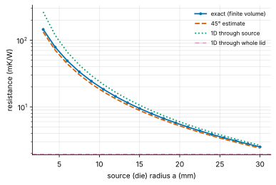
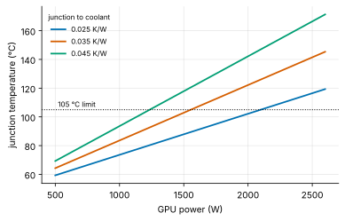

<!-- status: reviewed -->
# 25-08 · Thermal Engineering

| | |
|---|---|
| **Course** | [25 · Semiconductor Fabrication, Packaging, Test and Reliability](../README.md) |
| **University equivalent** | Heat transfer for electronics (Incropera, DeWitt et al., *Fundamentals of Heat and Mass Transfer*: conduction, spreading, extended surfaces, internal-flow convection; electronic-cooling electives) |
| **Prerequisites** | [15-01](../../15-control-systems/chapters/15-01-modeling-dynamic-systems.md) (thermal resistance, capacitance and lumped networks), [02-03](../../02-complex-numbers-des-and-linear-algebra/chapters/02-03-second-order-linear-odes.md) (constant-coefficient ODEs, for the fin), [25-06](25-06-packaging-fundamentals.md) and [25-07](25-07-advanced-packaging-and-chiplets.md) (packages and stacks), [22-10](../../22-power-electronics-and-energy-conversion/chapters/22-10-datacenter-power-delivery.md) (rack power and PUE) |
| **Estimated study hours** | 6 |
| **Last verified** | 2026-11-26 |

**Learning objectives.** After this chapter you can:

1. Build a junction-to-coolant thermal budget from conduction, interface, spreading and convection resistances, and find which term dominates.
2. Derive the temperature rise of a hotspot on a large die and estimate spreading through a lid, and judge when the 45° rule is good enough.
3. Derive fin efficiency and size an air heat sink, and show why air cooling runs out near a kilowatt per chip.
4. Compute coolant flow and temperature rise, and close a cold-plate budget for a given inlet temperature.
5. Weight a junction-temperature mission profile by Arrhenius damage and explain why the hottest hours dominate.
6. Read accelerator power, rack power and cooling-adoption claims with their definitions, as of late 2026.

---

## 1. Big picture

Every watt a chip draws ends up as heat, and the heat must cross the silicon, the package and the cooling system before it leaves. The temperature rise along that path sets the junction temperature, and the junction temperature caps the chip's power (and therefore its clock and throughput), sets its leakage and sets its lifetime. 15-01 built the lumped thermal network and 15-12 the throttling loop around it. This chapter is about the physics that sets the resistances in that network, and about why AI accelerators, now drawing one to two kilowatts each, have pushed the industry from air to liquid cooling.

- **Where it shows up:** every product's sustained performance, from a phone that throttles in a pocket to a GPU rack that needs a facility water loop.
- **The path:** junction → silicon → thermal interface material → lid or spreader → interface → heat sink or cold plate → air or liquid → facility.
- **The big levers:** spreading (making a small hot area look large), interfaces (thin, conductive and reliable), convection (more area, or a better fluid), and coolant temperature.
- **The business:** accelerator power has passed a kilowatt, racks draw 120–140 kW, and liquid cooling is becoming standard for AI chips [R-596], [R-600], [R-602].

## 2. Intuition first

**Physical picture.** Heat flows like water draining through a series of pipes from a high tank (the junction) to the sea (the ambient). Each pipe is a resistance: a thin, narrow pipe (a thin interface over a small area) can hold back as much as a long wide one. The worst constriction is often where the flow must turn sideways and spread: heat made in a few square millimetres of a die must fan out into a lid many times larger before it reaches the cooler. And the last pipe, to the fluid, depends on how much fluid passes and how well it touches the surface.

```text
  T_J  junction (hottest point of the die)
   │  R_die       conduction across ~0.8 mm of silicon
   │  R_spread    hotspots spreading sideways in the die and lid
   │  R_TIM1      interface die → lid (tens of µm)
   │  R_lid       conduction and spreading through the lid
   │  R_TIM2      interface lid → cold plate or heat sink
   │  R_conv      convection into air (fins) or liquid (channels)
   ▼
  T_fluid  coolant (rises along the flow by P/(ṁ c_p))
```

**Analogy and its limits.** The finance analogy is a chain of fees: each layer takes a cut of the temperature budget, and the total must fit between the coolant's temperature and the junction limit. A fee schedule is linear, and so, to first order, is conduction: double the power and every rise doubles. Where it breaks down: conductivities fall as silicon heats, so the fees rise with the bill; leakage power rises with temperature, so the bill rises with the fees, which can run away (02-02); and spreading is not a single pipe but a three-dimensional flow whose resistance depends on the size of the hot area.

## 3. Theory

### 3.1 Conduction and the budget

Fourier's law says heat flux $\mathbf{q}$ (W/m²) flows down the temperature gradient: $\mathbf{q} = -k\nabla T$, with thermal conductivity $k$ (W/(m·K)). Through a slab of thickness $t$ and area $A$ carrying heat $P$ uniformly, $q = P/A = k\,\Delta T/t$, so

$$
R_{th} = \frac{\Delta T}{P} = \frac{t}{kA},
$$

the resistance 15-01 used. Units: m/(W/(m·K) · m²) = K/W. ✓ Typical conductivities are about 150 W/(m·K) for silicon at room temperature (falling as it heats), about 400 for copper and about 200 for aluminium alloys [S1], but only a few for typical polymer thermal interface materials (TIMs). That last number is why a 25 µm TIM layer can resist as much as 0.8 mm of silicon (Example 25-08.1).

The junction temperature is the coolant temperature plus the sum of the rises:

$$
T_J = T_{fluid} + P\sum_i R_i,
$$

and the design question is always which $R_i$ dominates and what it costs to cut it.

### 3.2 Spreading: hotspots and lids

Power on a die is not uniform. A matrix unit or a SerDes can run at several times the die's average power density, and its heat must spread sideways before it can flow down. Spreading adds a resistance that depends on the size of the hot area, not only on the thickness.

**A point source on a half-space.** Put heat $Q$ into one point on the flat surface of a very large block of conductivity $k$, with no heat leaving the top surface. In steady state the heat flows radially outward through hemispheres. Through a hemisphere of radius $r$ (area $2\pi r^2$) Fourier's law gives $Q = -k\,(dT/dr)\,2\pi r^2$, so

$$
T(r) - T_\infty = \frac{Q}{2\pi k r}.
$$

**A hotspot.** Now spread the heat uniformly over a disk of radius $a$, flux $q = Q/(\pi a^2)$. By superposition, each ring of the disk at radius $r'$, width $dr'$, contributes $q\,2\pi r'\,dr'/(2\pi k r')$ to the temperature at the centre, so

$$
\Delta T_{centre} = \int_0^a \frac{q\,dr'}{k} = \frac{qa}{k}.
$$

The centre is the hottest point. The average over the disk is lower; carrying out the superposition over every point of the disk (Going deeper) gives $\Delta T_{avg} = \frac{8}{3\pi}\frac{qa}{k}$, or a spreading resistance

$$
R_{sp} = \frac{\Delta T_{avg}}{Q} = \frac{8}{3\pi^2 k a} \approx \frac{0.270}{ka}.
$$

Two lessons follow. At a fixed flux, a hotspot's rise grows with its radius ($qa/k$), so large hot regions are worse than small ones at the same power density. At a fixed power, the rise falls as $1/a$: spreading the same watts over twice the radius halves the rise. A block that dissipates 2 W more than the background over a disk 1 mm across runs about 8 K above its surroundings (Example 25-08.2), on top of the die's average rise. By superposition only the excess flux matters: the background flux raises the hotspot and its surroundings together. The half-space model assumes the silicon is thick compared with the source radius; on a die under a millimetre thick it is an estimate, and the heat sink below makes the real rise somewhat smaller.

> **Going deeper — the average over the disk.** In cylindrical coordinates the half-space solution for flux $q$ over $r < a$ is $T(r, 0) = (qa/k)\int_0^\infty J_0(\lambda r)J_1(\lambda a)\,d\lambda/\lambda$, built from Bessel functions $J_0$ and $J_1$ (the radial modes of the Laplace equation). Averaging over the disk, $\frac{2}{a^2}\int_0^a T\,r\,dr$, and using $\int_0^a J_0(\lambda r)\,r\,dr = aJ_1(\lambda a)/\lambda$ gives $\Delta T_{avg} = (2qa/k)\int_0^\infty J_1^2(x)/x^2\,dx = (2qa/k)\cdot 4/(3\pi)$. The verify script evaluates the integral numerically.

**Spreading through a lid.** A die of radius $a$ on a copper lid of thickness $t$ and radius $b$, cooled on its far side, sees a resistance between two easy limits: one-dimensional conduction straight down through the die's footprint, $t/(k\pi a^2)$ (too pessimistic: it ignores spreading), and through the whole lid, $t/(k\pi b^2)$ (too optimistic: the heat never reaches the edges). A common engineering estimate assumes the heat spreads at 45°, so at depth $z$ it crosses a disk of radius $a + z$:

$$
R_{45} = \int_0^t \frac{dz}{k\pi(a + z)^2} = \frac{1}{k\pi}\left[\frac{1}{a} - \frac{1}{a + t}\right] = \frac{t}{k\pi a(a + t)},
$$

valid while $a + t \le b$. For a 16 mm radius die on a 3 mm copper lid with a perfect cold plate underneath, the 45° rule gives 7.85 mK/W against 8.38 mK/W from an exact series solution and a finite-difference solve, an error of 6%; the two simple limits miss by +11% and −77% (Example 25-08.3). Spreading through a thick, conductive lid is a large share of what a lid is for. Where the cooling underneath is poor (low $h$), the heat spreads further and the 45° rule underestimates the benefit; where the lid is thin, it barely spreads at all.

> **Going deeper — the exact spreader.** For a uniform-flux disk on a cylinder with an isothermal base and adiabatic sides, separation of variables gives the temperature as a Fourier–Bessel series in $J_0(\lambda_n r)$, with $\lambda_n b$ the zeros of $J_1$ and depth dependence $\sinh\lambda_n(t - z)/\cosh\lambda_n t$. The series converges quickly and is what the verify script evaluates; the lab solves the same problem by finite differences.

**Vapor chambers and heat pipes.** When a solid spreader is not enough, a sealed copper chamber with a wick and a small charge of water spreads heat by evaporation at the hot spot and condensation everywhere else. Its effective in-plane conductivity can exceed copper's many times over, because latent heat moves energy with tiny temperature differences. Phones use thin vapor chambers; server air-cooled heat sinks use heat pipes or vapor-chamber bases.

### 3.3 Convection and fins

At the end of the conduction path, heat passes into a moving fluid. Newton's law of cooling summarizes the complicated boundary-layer physics in one coefficient $h$ (W/(m²·K)):

$$
P = hA\,(T_s - T_{fluid}),\qquad R_{conv} = \frac{1}{hA}.
$$

Textbook ranges for $h$ are about 25–250 W/(m²·K) for forced air and roughly 10² to 2 × 10⁴ for forced liquids, rising to 10⁵ with boiling [S1]. With air's small $h$, the only way to a low resistance is a large area, which is what fins provide.

**Fin efficiency.** A thin straight fin of thickness $t_f$, height $L$ and conductivity $k$ stands on a base at temperature excess $\theta_b = T_b - T_{fluid}$. Heat conducts out along the fin and leaves both faces by convection. A slice of length $dx$ and unit depth conducts $-kt_f\,d\theta/dx$ along the fin and loses $2h\theta\,dx$ from its two faces, so in steady state

$$
\frac{d^2\theta}{dx^2} = m^2\theta,\qquad m = \sqrt{\frac{2h}{kt_f}},
$$

a constant-coefficient ODE (02-03). With $\theta(0) = \theta_b$ at the base and an insulated tip, $d\theta/dx = 0$ at $x = L$, the solution is $\theta = \theta_b\cosh m(L - x)/\cosh mL$. The heat the fin removes is the conduction at its base, $kt_f\theta_b m\tanh mL$ per unit depth. A fin made of a perfect conductor would sit at $\theta_b$ everywhere and remove $2hL\theta_b$. The ratio is the **fin efficiency**:

$$
\eta_f = \frac{\tanh mL}{mL}.
$$

Units: $m$ is $\sqrt{(\text{W/(m}^2\text{K)})/(\text{W/(m K)}\cdot\text{m})}$ = m⁻¹, so $mL$ is dimensionless. ✓ Long, thin or poorly conducting fins have large $mL$ and low efficiency: their tips are nearly at air temperature and add little. A heat sink of $N$ fins of depth $D$ then has $R_{sink} \approx 1/(h\eta_f\,2NLD)$, ignoring the exposed base.

**Why air runs out near a kilowatt.** A good forced-air heat sink reaches a few hundredths of a kelvin per watt. With 35 °C inlet air, a 95 °C junction limit and about 19 K lost in the die, TIM and lid, a 1 kW chip needs a sink below 0.041 K/W, and the fin stack of Example 25-08.4 (0.063 K/W) is far off. More fins and more airflow help, but fan power and noise grow steeply with airflow, and the air itself must carry the heat: at a 15 K rise a kilowatt needs about 117 cubic feet per minute (CFM) per chip (Example 25-08.5).

### 3.4 Liquid cooling: coolant flow and the cold plate

A fluid stream of mass flow $\dot{m}$ (kg/s) and specific heat $c_p$ (J/(kg·K)) absorbing heat $P$ warms by

$$
\Delta T_{fluid} = \frac{P}{\dot{m}c_p} = \frac{P}{\rho\dot{V}c_p},
$$

with density $\rho$ and volume flow $\dot{V}$. Water's volumetric heat capacity $\rho c_p$, about 4.18 × 10⁶ J/(m³·K), is about 3,470 times air's, so a trickle of water does the work of a gale of air (Example 25-08.5).

**Convection inside a channel.** In a cold plate the coolant flows through channels, and $h$ follows from the flow. The channel's size enters through its **hydraulic diameter** $D_h = 4A_c/P_w$ (four times the cross-section area over the wetted perimeter; for a round tube, its diameter), and the flow regime through the Reynolds number $Re = \rho vD_h/\mu$, with velocity $v$ and viscosity $\mu$. Below about 2,300 the flow is laminar. For fully developed laminar flow in a tube heated at constant flux, the Nusselt number $Nu = hD_h/k_f$ is the constant 4.36, with $k_f$ the fluid's conductivity; rectangular channels give values of the same order that depend on their aspect ratio. In laminar flow, then,

$$
h = \frac{Nu\,k_f}{D_h},
$$

which grows as the channels shrink; this is why cold plates use fine channels. (In turbulent flow, above about 10⁴, the Dittus–Boelter correlation $Nu = 0.023Re^{0.8}Pr^{0.4}$ applies, with $Pr$ the fluid's Prandtl number.) The price is pressure. The laminar friction factor is $f = 64/Re$, and the pressure drop along a channel of length $L$ is

$$
\Delta p = f\,\frac{L}{D_h}\,\frac{\rho v^2}{2},
$$

so at a fixed velocity it grows as $1/D_h^2$; the pump power is $\Delta p\,\dot V$. Two corrections matter: near the inlet the flow is still developing and $h$ is higher, and the walls between channels act as fins (§3.3). The result is a first design number (Example 25-08.9).

A **cold plate** is a copper block with fine internal channels, clamped to the package lid through a TIM, with coolant pumped through it (direct-to-chip liquid cooling). Small channels give a large wetted area and a high $h$, so the convective resistance falls to around 0.01–0.02 K/W for a large accelerator (Example 25-08.9 estimates it; Example 25-08.6 assumes 0.015 K/W). The junction temperature is

$$
T_J \approx T_{in} + \frac{\Delta T_{fluid}}{2} + P\,(R_{JC} + R_{TIM2} + R_{cp}),
$$

using the mean coolant temperature along the plate. Two observations shape modern designs. First, every kelvin of inlet temperature is a kelvin of junction temperature, so warmer coolant needs lower resistances: at 45 °C inlet, a 2,300 W GPU needs a total junction-to-coolant resistance of about 0.0225 K/W to stay at 105 °C (Example 25-08.6). Second, warm coolant is valuable to the facility: at 45 °C the heat can be rejected to outside air by dry coolers in favourable climates without chillers, which cuts the cooling share of the facility's power (PUE, 22-10) [R-601].

**Immersion cooling** submerges whole servers in a dielectric liquid. Single-phase immersion circulates an oil or synthetic fluid; two-phase immersion boils a low-boiling-point fluid on the hot surfaces and condenses it above, using latent heat. Two-phase systems historically used fluorinated fluids, and 3M, a major supplier, completed its exit from PFAS manufacturing at the end of 2025 [R-603]. Direct-to-chip cold plates are the dominant path for AI accelerators [R-600], [R-601].

### 3.5 Temperature limits, leakage and lifetime

Datasheets give a maximum operating junction temperature, often 95, 105 or 125 °C depending on grade, and an absolute maximum, often 150 °C [R-604]. Three things make the limit matter:

- **Leakage.** Subthreshold leakage rises steeply with temperature, so hot chips waste power and can run away if the cooling cannot keep up (02-02, 15-01).
- **Performance.** Throttling (15-12) holds the junction at its limit by cutting frequency; a better thermal path buys sustained clock rate.
- **Lifetime.** Most wear-out mechanisms accelerate with temperature roughly as an Arrhenius factor $e^{-E_a/k_BT}$ (25-09), with $k_B$ Boltzmann's constant (here $k$ is reserved for thermal conductivity). Vendors therefore trade lifetime against temperature with a **mission profile**: Texas Instruments rates an AM625 processor for 100,000 power-on hours at commercial and industrial junction temperatures but 20,000 hours for its automotive range, defined as 5% of the time at −40 °C, 65% at 70 °C, 20% at 110 °C and 10% at 125 °C [R-604].

Because the damage rate is exponential in $1/T$, the hot part of a profile dominates. The **Arrhenius-equivalent temperature** $T_{eq}$ is the constant temperature that does the same damage:

$$
e^{-E_a/k_BT_{eq}} = \sum_i w_i\,e^{-E_a/k_BT_i}\quad\Rightarrow\quad T_{eq} = \frac{-E_a}{k_B\ln\sum_i w_i e^{-E_a/k_BT_i}},
$$

with time fractions $w_i$ and absolute temperatures $T_i$. For the AM625 automotive profile with an activation energy of 0.7 eV (assumed), the time-weighted mean is 78 °C but the damage-equivalent temperature is 97 °C, and the 30% of the time spent at 110 °C and above causes 88% of the damage (Example 25-08.8).

### 3.6 From chip to rack and facility

At rack scale, heat removal becomes a facility problem. NVIDIA describes a GB200 NVL72 rack at about 120 kW, with compute trays cooled by liquid that runs through manifolds and cold plates [R-600]. Lenovo rates a GB300 NVL72 rack at 135 kW, up to 155 kW peak, with about 90% of the heat to liquid and 10% to air [R-600]; the remaining air-cooled share is still more than ten kilowatts per rack for power supplies, drives and networking (Example 25-08.7). The coolant flow for a rack follows from §3.4, and its temperature sets whether the facility needs chillers (Example 25-08.7).

## 4. Worked examples

### Example 25-08.1 · Where the kelvins go (tier A)

**Setup.** An 800 mm² die (assumed) dissipates 1,000 W uniformly. Heat crosses 0.775 mm of silicon ($k$ = 150 W/(m·K)), a 25 µm TIM ($k$ = 5 W/(m·K)) and a 2 mm copper lid ($k$ = 400 W/(m·K)), all over the die's area (all assumed; spreading ignored). Find (a) each resistance, (b) the total and (c) the temperature rise at 1,000 W.

**Solution.** With $A = 8.0 \times 10^{-4}$ m² and $R = t/(kA)$:

- (a) Silicon: $0.775 \times 10^{-3}/(150 \times 8.0 \times 10^{-4})$ = **0.00646** K/W. TIM: $25 \times 10^{-6}/(5 \times 8.0 \times 10^{-4})$ = **0.00625** K/W. Lid: $2 \times 10^{-3}/(400 \times 8.0 \times 10^{-4})$ = **0.00625** K/W.
- (b) Total **0.0190** K/W.
- (c) $1000 \times 0.0190$ = **19.0** K.

**Units check.** m/(W/(m·K) · m²) = K/W; W × K/W = K. ✓

**Sanity check.** The TIM is 31 times thinner than the silicon but has a conductivity 30 times lower, so it costs as much. This is why server packages pay for metal or high-conductivity TIMs and why TIM voids and pump-out are reliability issues.

### Example 25-08.2 · A hotspot in silicon (tier B)

**Setup.** A block on a large die ($k$ = 150 W/(m·K)) occupies a disk 1 mm in diameter and dissipates 2 W more than the die's average power density, 1,000 W over 800 mm² (assumed), would put there. Find (a) its excess flux, its total power density and the ratio to the average, (b) its centre temperature rise above its surroundings, (c) the spreading resistance seen by the excess power and (d) the average rise over the block.

**Solution.**

- (a) Excess $q = 2/(\pi \times 0.5^2)$ = **2.55** W/mm² on top of the **1.25** W/mm² average, so the block runs at **3.80** W/mm², a ratio of **3.04**.
- (b) Only the excess flux raises the block above its surroundings: $\Delta T_{centre} = qa/k = 2.546 \times 10^6 \times 5 \times 10^{-4}/150$ = **8.49** K.
- (c) $R_{sp} = 8/(3\pi^2 \times 150 \times 5 \times 10^{-4})$ = **3.60** K/W.
- (d) $\Delta T_{avg} = 2 \times 3.60$ = **7.2** K.

**Units check.** (W/m²)(m)/(W/(m·K)) = K. ✓

**Sanity check.** A hotspot three times the average density adds 8 K at its centre. Thermal sensors placed away from such blocks read low, which is why throttling controllers either sit sensors at known hotspots or add a modelled offset.

### Example 25-08.3 · Spreading through a lid (tier B)

**Setup.** A die modelled as a 16 mm radius disk (about 804 mm²) sits on a copper lid ($k$ = 400 W/(m·K)) 3 mm thick and 35 mm in radius, cooled perfectly on its far side (all assumed). Find (a) the one-dimensional resistance through the die's footprint, (b) through the whole lid, (c) the 45° estimate and (d) the exact value from the series and finite-difference solutions; (e) the 45° error.

**Solution.**

- (a) $3 \times 10^{-3}/(400 \times \pi \times 0.016^2)$ = **9.33** mK/W.
- (b) $3 \times 10^{-3}/(400 \times \pi \times 0.035^2)$ = **1.95** mK/W.
- (c) $3 \times 10^{-3}/(400 \pi \times 0.016 \times 0.019)$ = **7.85** mK/W.
- (d) **8.38** mK/W (series and finite differences agree).
- (e) $(7.85 - 8.38)/8.38$ = **−6.3**%.

**Units check.** As Example 25-08.1; mK/W is 10⁻³ K/W.

**Sanity check.** At 1,000 W the lid costs about 8.4 K. The footprint estimate overstates it by 11% and the full-lid estimate understates it by a factor of four; the 45° rule lands close because the lid is thin compared with the die.

### Example 25-08.4 · An air heat sink (tier B)

**Setup.** Aluminium fins ($k$ = 200 W/(m·K)) are 1 mm thick and 40 mm tall, in forced air with $h$ = 50 W/(m²·K). A sink has 50 fins, each 100 mm deep (all assumed). Find (a) $m$, (b) $mL$, (c) the fin efficiency, (d) the sink resistance, and (e) the junction temperature for Example 25-08.1's 1,000 W die and stack with 35 °C air; (f) what sink resistance a 95 °C junction would need.

**Solution.**

- (a) $m = \sqrt{2 \times 50/(200 \times 0.001)}$ = **22.4** m⁻¹.
- (b) $mL = 22.4 \times 0.040$ = **0.894**.
- (c) $\eta_f = \tanh 0.894/0.894$ = **0.798**.
- (d) Area $50 \times 2 \times 0.040 \times 0.100$ = 0.40 m²; $R = 1/(50 \times 0.798 \times 0.40)$ = **0.0627** K/W.
- (e) $T_J = 35 + 19.0 + 62.7$ = **117** °C.
- (f) $(95 - 35 - 19.0)/1000$ = **0.0410** K/W.

**Units check.** $hA$ in W/K; its inverse in K/W. ✓

**Sanity check.** The sink needs about a third less resistance, so more than 50% more area or $h$ at the same efficiency. That is a large, loud heat sink for one chip. Air-cooled 1 kW parts exist (AMD positions its 1,000 W MI350X for air [R-598]), but they sit at the edge of what air can do.

### Example 25-08.5 · Air against water (tier A)

**Setup.** Take air at $\rho$ = 1.2 kg/m³, $c_p$ = 1,005 J/(kg·K) and water at 1,000 kg/m³, 4,180 J/(kg·K). Find (a) the ratio of volumetric heat capacities, (b) the airflow to carry 1 kW with a 15 K rise, in m³/s and CFM (1 CFM = 4.719 × 10⁻⁴ m³/s), (c) the water flow to carry 1 kW with a 10 K rise, in L/min, and (d) the airflow for a 120 kW rack cooled entirely by air at a 15 K rise.

**Solution.**

- (a) $4.18 \times 10^6/1206$ = **3.47e3**.
- (b) $\dot{V} = 1000/(1206 \times 15)$ = **0.0553** m³/s = **117** CFM.
- (c) $1000/(4.18 \times 10^6 \times 10)$ = 2.39 × 10⁻⁵ m³/s = **1.44** L/min.
- (d) $120{,}000/(1206 \times 15)$ = 6.63 m³/s = **1.41e4** CFM.

**Units check.** W/((J/(m³·K)) · K) = m³/s. ✓

**Sanity check.** Fourteen thousand CFM through one rack is several times what a typical air-cooled rack is designed to move, and the fans would draw a meaningful share of the rack's power. Under a litre and a half of water a minute per kilowatt is a garden-hose trickle.

### Example 25-08.6 · A cold-plate budget at 45 °C inlet (tier C)

**Setup.** A GPU on a cold plate has $R_{JC}$ = 0.012 K/W, $R_{TIM2}$ = 0.008 K/W and plate-to-coolant $R_{cp}$ = 0.015 K/W (total 0.035 K/W), with 2.0 L/min of water at 45 °C inlet (resistances and flow assumed; the inlet is NVIDIA's stated Vera Rubin design point [R-601]). Find (a) the coolant rise and (b) the junction temperature at 1,400 W; (c) the coolant rise and (d) junction at 2,300 W, the reported Rubin maximum profile [R-597]; (e) the total resistance needed to hold 105 °C at 2,300 W with the same flow.

**Solution.** $\dot{V} = 2.0/60{,}000 = 3.33 \times 10^{-5}$ m³/s; $\rho c_p\dot{V}$ = 139.3 W/K.

- (a) $1400/139.3$ = **10.0** K; (b) $T_J = 45 + 5.0 + 1400 \times 0.035$ = **99.0** °C.
- (c) $2300/139.3$ = **16.5** K; (d) $T_J = 45 + 8.25 + 2300 \times 0.035$ = **134** °C.
- (e) $R = (105 - 45 - 8.25)/2300$ = **0.0225** K/W.

**Units check.** K + W × K/W = K. ✓

**Sanity check.** Going from 1.4 to 2.3 kW at the same inlet needs the junction-to-coolant resistance cut by more than a third, or more flow, or a colder inlet that gives back the facility savings. This is why accelerator vendors and cooling suppliers co-design lids, TIMs and cold plates, and why "power profiles" that cap GPU power matter to facility design.

### Example 25-08.7 · A rack's heat (tier B)

**Setup.** Lenovo rates a GB300 NVL72 rack at 135 kW, with about 90% of the heat going to liquid and 10% to air [R-600]. Find (a) the liquid and (b) the air heat loads, (c) the water flow for a 10 K rise in L/min, and (d) the airflow for the air load at a 15 K rise, in CFM.

**Solution.**

- (a) $0.9 \times 135$ = **121.5** kW; (b) **13.5** kW.
- (c) $121{,}500/(4.18 \times 10^6 \times 10) \times 60{,}000$ = **174** L/min.
- (d) $13{,}500/(1206 \times 15)$ = 0.746 m³/s = **1.58e3** CFM.

**Units check.** As Example 25-08.5.

**Sanity check.** Even a "liquid-cooled" rack still needs the airflow of a traditional air-cooled rack for its remaining 10%. NVIDIA describes its next generation as fully liquid-cooled with no fans [R-601], which removes that residual load.

### Example 25-08.8 · Lifetime and the hottest hours (tier C)

**Setup.** The AM625 automotive profile is 5% of the time at −40 °C, 65% at 70 °C, 20% at 110 °C and 10% at 125 °C [R-604]. With an activation energy of 0.7 eV (assumed) and $k_B$ = 8.617 × 10⁻⁵ eV/K, find (a) the time-weighted mean temperature, (b) the Arrhenius-equivalent temperature, (c) the share of damage done at 125 °C and (d) at 110 °C and above; (e) the ratio of the commercial to automotive power-on-hour ratings.

**Solution.**

- (a) $0.05(-40) + 0.65(70) + 0.20(110) + 0.10(125)$ = **78.0** °C.
- (b) Summing $w_ie^{-E_a/k_BT_i}$ with $T_i$ in kelvin and inverting gives $T_{eq}$ = **97.1** °C.
- (c) $0.10e^{-E_a/k_B(398.15)}/\sum$ = **46.6**%.
- (d) Adding the 110 °C term, **88.5**%.
- (e) $100{,}000/20{,}000$ = **5**.

**Units check.** $E_a/k_BT$ is (eV)/(eV/K · K), dimensionless. ✓

**Sanity check.** A tenth of the time at 125 °C does nearly half the damage. The equivalent temperature is 19 K above the mean, so designing reliability margins from average temperature would badly overstate life. The shorter automotive rating reflects the hotter profile; the exact ratio depends on the mechanisms TI models, which 25-09 introduces.

### Example 25-08.9 · Microchannels in a cold plate (tier C)

**Setup.** A cold plate has 100 parallel channels, each 0.3 mm wide, 2 mm deep and 40 mm long, separated by 0.3 mm copper walls ($k$ = 400 W/(m·K)) and sharing 2.0 L/min of water ($\rho$ = 1,000 kg/m³, $\mu$ = 0.65 mPa·s, $k_f$ = 0.63 W/(m·K), $c_p$ = 4,180 J/(kg·K) near 40 °C; geometry and properties assumed). Using the tube values $Nu$ = 4.36 and $f = 64/Re$ as estimates, find (a) $D_h$, (b) the velocity and $Re$, (c) $h$, (d) the wetted area and the convective resistance if every wetted surface were at the base temperature, (e) the pressure drop and pump power, (f) the fin efficiency of the side walls and the corrected resistance, and (g) the thermal entrance length $0.05\,Re\,Pr\,D_h$.

**Solution.**

- (a) $A_c = 0.3 \times 2$ = 0.6 mm², $P_w = 2(0.3 + 2)$ = 4.6 mm, so $D_h = 4 \times 0.6/4.6$ = **0.522** mm.
- (b) Each channel carries $3.33 \times 10^{-5}/100$ m³/s through 0.6 mm², so $v$ = **0.556** m/s and $Re = 1000 \times 0.556 \times 5.22 \times 10^{-4}/6.5 \times 10^{-4}$ = **446**: laminar.
- (c) $h = 4.36 \times 0.63/5.22 \times 10^{-4}$ = **5.26e3** W/(m²·K).
- (d) $A = 100 \times 4.6\ \text{mm} \times 40\ \text{mm}$ = **0.0184** m², so $R = 1/(hA)$ = **0.0103** K/W.
- (e) $f = 64/446$ and $\Delta p = f(L/D_h)(\rho v^2/2)$ = **1.70** kPa; the pump power is $\Delta p\,\dot V$ = **0.0566** W.
- (f) Each 2 mm side wall is a fin wetted on both faces with $m = \sqrt{2h/(kt_f)}$ with (c)'s $h$, $k$ = 400 W/(m·K) and $t_f$ = 0.3 mm, giving $mL$ = **0.59** and $\eta_f$ = **0.90**. Counting the side walls at $\eta_f$ and the top and bottom at full effect, $R$ = **0.0113** K/W.
- (g) $Pr = \mu c_p/k_f$ = **4.31**, so the entrance length is $0.05 \times 446 \times 4.31 \times 0.522$ mm = **5.0** cm, longer than the channel.

**Units check.** $\rho vD_h/\mu$: (kg/m³)(m/s)(m)/(Pa·s) is dimensionless; $Nu\,k_f/D_h$: (W/(m·K))/m = W/(m²·K); $\Delta p\,\dot V$: Pa · m³/s = W. ✓

**Sanity check.** The estimate lands near the 0.01–0.015 K/W assumed in Example 25-08.6, at a channel pressure drop under 2 kPa; real plates lose more in manifolds and fittings. The flow never fully develops in 4 cm, so the real $h$ is higher and the estimate is conservative. Finer channels raise $h$ as $1/D_h$ but the pressure drop as $1/D_h^2$ (Problem 25-08.14), which is the cold-plate designer's central trade.
<!-- answer-key -->

| ID | Quantity | Value | Unit |
|---|---|---|---|
| Ex 25-08.1a | silicon resistance | 0.00646 | K/W |
| Ex 25-08.1a1 | TIM resistance | 0.00625 | K/W |
| Ex 25-08.1a2 | lid resistance | 0.00625 | K/W |
| Ex 25-08.1b | total | 0.0190 | K/W |
| Ex 25-08.1c | rise at 1,000 W | 19.0 | K |
| Ex 25-08.1d | silicon-to-TIM thickness ratio | 31 | |
| Ex 25-08.1d1 | silicon-to-TIM conductivity ratio | 30 | |
| Ex 25-08.2a | hotspot power density | 2.55 | W/mm² |
| Ex 25-08.2a0 | average power density | 1.25 | W/mm² |
| Ex 25-08.2a2 | block power density | 3.80 | W/mm² |
| Ex 25-08.2a1 | ratio to average | 3.04 | |
| Ex 25-08.2b | centre rise | 8.49 | K |
| Ex 25-08.2c | spreading resistance | 3.60 | K/W |
| Ex 25-08.2d | average rise | 7.2 | K |
| Ex 25-08.3a | 1D through footprint | 9.33 | mK/W |
| Ex 25-08.3b | 1D through whole lid | 1.95 | mK/W |
| Ex 25-08.3c | 45° estimate | 7.85 | mK/W |
| Ex 25-08.3d | exact | 8.38 | mK/W |
| Ex 25-08.3e | 45° error | -6.3 | % |
| Ex 25-08.3f | footprint overestimate | 11 | % |
| Ex 25-08.3g | full-lid underestimate | -77 | % |
| Ex 25-08.3h | rise at 1,000 W | 8.4 | K |
| Ex 25-08.4a | fin parameter m | 22.4 | 1/m |
| Ex 25-08.4b | mL | 0.894 | |
| Ex 25-08.4c | fin efficiency | 0.798 | |
| Ex 25-08.4d | sink resistance | 0.0627 | K/W |
| Ex 25-08.4d0 | fin area | 0.40 | m² |
| Ex 25-08.4e | junction temperature | 117 | °C |
| Ex 25-08.4f | sink resistance needed | 0.0410 | K/W |
| Ex 25-08.5a | water to air heat capacity | 3.47e3 | |
| Ex 25-08.5b | airflow per kW | 0.0553 | m³/s |
| Ex 25-08.5b1 | airflow per kW | 117 | CFM |
| Ex 25-08.5c | water per kW | 1.44 | L/min |
| Ex 25-08.5c0 | water per kW | 2.39e-5 | m³/s |
| Ex 25-08.5d | airflow, 120 kW rack | 1.41e4 | CFM |
| Ex 25-08.5d0 | airflow, 120 kW rack | 6.63 | m³/s |
| Ex 25-08.6a | coolant rise, 1,400 W | 10.0 | K |
| Ex 25-08.6a0 | flow heat capacity | 139.3 | W/K |
| Ex 25-08.6b | junction, 1,400 W | 99.0 | °C |
| Ex 25-08.6c | coolant rise, 2,300 W | 16.5 | K |
| Ex 25-08.6d | junction, 2,300 W | 134 | °C |
| Ex 25-08.6e | resistance for 105 °C | 0.0225 | K/W |
| Ex 25-08.7a | liquid load | 121.5 | kW |
| Ex 25-08.7b | air load | 13.5 | kW |
| Ex 25-08.7c | water flow | 174 | L/min |
| Ex 25-08.7d | airflow | 1.58e3 | CFM |
| Ex 25-08.7d0 | airflow | 0.746 | m³/s |
| Ex 25-08.8a | time-weighted mean | 78.0 | °C |
| Ex 25-08.8b | Arrhenius-equivalent temperature | 97.1 | °C |
| Ex 25-08.8c | damage share at 125 °C | 46.6 | % |
| Ex 25-08.8d | damage share at 110 °C and above | 88.5 | % |
| Ex 25-08.8e | POH ratio | 5 | |
| Ex 25-08.8f | equivalent minus mean | 19 | K |
| Txt 25-08.b | pod power per chip | 1.09 | kW |
| Ex 25-08.6c0 | half the coolant rise, 2,300 W | 8.25 | K |
| Ex 25-08.9a | hydraulic diameter | 0.522 | mm |
| Ex 25-08.9b | velocity | 0.556 | m/s |
| Ex 25-08.9b1 | Reynolds number | 446 | |
| Ex 25-08.9c | heat transfer coefficient | 5.26e3 | W/(m²·K) |
| Ex 25-08.9d | wetted area | 0.0184 | m² |
| Ex 25-08.9d1 | resistance, ideal walls | 0.0103 | K/W |
| Ex 25-08.9e | pressure drop | 1.70 | kPa |
| Ex 25-08.9e1 | pump power | 0.0566 | W |
| Ex 25-08.9f | fin parameter mL | 0.59 | |
| Ex 25-08.9f1 | wall fin efficiency | 0.90 | |
| Ex 25-08.9f2 | resistance with fin walls | 0.0113 | K/W |
| Ex 25-08.9g | Prandtl number | 4.31 | |
| Ex 25-08.9g1 | thermal entrance length | 5.0 | cm |

## 5. Simulate it

The lab is [labs/25-08-lab/](../labs/25-08-lab/README.md). `thermal.py` computes slab and hotspot resistances, solves spreading through a lid by axisymmetric finite volumes, solves the fin equation numerically and by formula, sizes coolant flow, closes a cold-plate budget and computes Arrhenius-equivalent temperatures; the notebook runs the parts below.



*Figure 1. The 45° estimate tracks the exact spreading resistance within several percent for a thin lid; the one-dimensional limits bracket it widely.*



*Figure 2. At a fixed inlet temperature, each extra kilowatt needs a lower junction-to-coolant resistance or more flow.*

**Predict, then run:**

1. *Predict* whether the 45° estimate becomes better or worse as the lid gets thicker, then compare it with the finite-difference solution for lids from 1 to 10 mm.
2. *Predict* the fin efficiency of Example 25-08.4's fin made of copper instead of aluminium, then compute it by formula and by solving the fin ODE.
3. *Predict* the maximum power a cold plate with 0.035 K/W can handle at 45 °C inlet, 2 L/min and a 105 °C limit, then solve for it.
4. *Predict* the Arrhenius-equivalent temperature of the AM625 profile with an activation energy of 1.0 eV instead of 0.7 eV, then compute it.

## 6. Engineering tradeoffs

| Knob | Improves | Costs | Typical decision owner |
|---|---|---|---|
| Thinner or better TIM (metal, liquid metal) | Junction-to-case resistance | Cost, voids, pump-out, reliability, rework | Package engineering |
| Thicker or vapor-chamber lid | Spreading, hotspot temperature | Height, weight, cost | Package and thermal engineering |
| Bigger or denser air heat sink | Air-cooled power | Fan power, noise, volume | System thermal design |
| Direct-to-chip liquid cooling | Power per chip and per rack | Plumbing, leaks, facility water loop | Platform and facility owners |
| Warmer coolant inlet | Facility efficiency (fewer chillers) | Junction margin, tighter resistances | Facility with platform design |
| Higher coolant flow | Lower coolant rise | Pump power, pressure drop | Facility and platform |
| Power capping or profiles | Rack and facility provisioning | Peak performance | Operator and platform software |
| Hotspot-aware floorplan | Peak junction temperature | Wire length, timing closure | SoC physical design |

## 7. Numbers to know

Perishable rows are as of Nov 2026; the date column gives the source's own date.

| Quantity | Value | Dated | Source |
|---|---|---|---|
| Thermal conductivity | Si ≈ 150, Cu ≈ 400, Al alloys ≈ 150–235 W/(m·K); polymer TIMs a few W/(m·K) | timeless | [S1] (metals, silicon); TIMs typical |
| Convection coefficient | forced air ≈ 25–250; forced liquid ≈ 10²–2 × 10⁴ W/(m²·K) | timeless | [S1] |
| Water against air, per volume | ≈ 3,470× the heat capacity | timeless | §3.4 |
| NVIDIA B200 (HGX) | configurable up to 1,000 W per GPU | undated datasheet | [R-596] |
| NVIDIA B300 | up to 1,100 W (HGX, cloud listing); ≈ 1,400 W (report) | 2024–2025 | [R-596] |
| NVIDIA Rubin GPU | 1.8 kW and 2.3 kW power profiles (reported) | Feb 2026 | [R-597] |
| AMD MI350X / MI355X / MI455X | 1,000 W air / 1,400 W liquid / up to 2,500 W liquid (TBP) | 2025–2026 | [R-598] |
| AI racks (NVL72 class) | ≈ 120–142 kW; Rubin up to ≈ 230 kW reported | 2024–2026 | [R-600], [R-601] |
| Liquid-cooling penetration, AI chips | ≈ 33% (2025) → 53% (2026e) → ≈ 60% (2027e) | Aug 2026 | [R-602] |
| Junction limits | 95 / 105 / 125 °C by grade; 150 °C typical absolute maximum | 2025 | [R-604] |

## 8. Common mistakes

- **Using the average power density for the hottest point.** Hotspots add their own spreading rise.
- **Treating the lid as one-dimensional.** Spreading changes its resistance by a large factor either way.
- **Forgetting the coolant's own rise.** The fluid warms along the plate and the rack; budget from the mean or outlet, not the inlet.
- **Comparing TDP, TBP and system power as if they were the same.** NVIDIA's TDP per GPU, AMD's typical board power and a rack's provisioned power have different boundaries.
- **Designing reliability from average temperature.** Arrhenius damage is dominated by the hottest hours.
- **Ignoring the air left in a liquid-cooled rack.** Power supplies, networking and storage may still need airflow.
- **Mixing penetration denominators.** "Share of AI data centers" and "share of AI chips" are different series.

## 9. Practitioner lens

**State of the art (as of Nov 2026).**

- *Accelerator power* [Established for B200 and AMD; Industry estimate for the rest]. NVIDIA's HGX B200 datasheet gives each GPU a maximum TDP "configurable up to 1000 W". A cloud provider lists HGX B300 at up to 1,100 W, while a December 2024 report put B300 at 1,400 W, 200 W above GB200; NVIDIA has not published per-GPU B300 figures [R-596]. Rubin was first guided at about 1.8 kW and later reported at 2.3 kW; SemiAnalysis describes 2,300 W and 1,800 W as software power profiles, not separate parts, and says the higher profile raises rack power 20% for a smaller performance gain [R-597]. AMD lists 1,000 W typical board power for the air-cooled MI350X, 1,400 W for the liquid-cooled MI355X, and a maximum of 2,500 W for the liquid-cooled MI455X, 72 to a rack [R-598]. Google's Ironwood TPU pod of 9,216 liquid-cooled chips spans "nearly 10 MW", about **1.09** kW per chip including all overheads; Google does not state a chip TDP [R-599].
- *Racks* [Established for vendor figures; Contested for Rubin]. NVIDIA puts a GB200 NVL72 rack at about 120 kW; Lenovo rates GB300 NVL72 at 135 kW (155 kW peak) and Vertiv at up to 142 kW [R-600]. NVIDIA says the Rubin generation is fully liquid-cooled with no fans and designed for 45 °C inlet coolant; its power-provisioning software cuts provisioned rack power from 136 to 101 kW for Vera Rubin NVL72, while third-party figures run to about 230 kW at the maximum profile [R-601].
- *Adoption* [Industry estimate]. TrendForce projects liquid-cooling penetration among AI chips rising from about 33% in 2025 to 53% in 2026 and nearly 60% in 2027, with Google using liquid cooling in more than 80% of its AI servers; an earlier TrendForce series measured penetration of AI data centers instead, so the two should not be joined [R-602].
- *Immersion* [Established for 3M; qualitative otherwise]. 3M completed its exit from PFAS manufacturing at the end of 2025, affecting fluorinated two-phase fluids; immersion remains a niche next to cold plates [R-603].
- *Junction limits* [Established as practice]. TI's AM625 shows the lifetime trade: 100,000 power-on hours at 0–95 °C or −40–105 °C, 20,000 for the automotive −40–125 °C mission profile [R-604].

**Why it matters commercially.** Cooling now gates where and how fast AI capacity can be deployed. Liquid-ready facilities, cold-plate and manifold suppliers, coolant distribution units and TIM and lid technologies all became strategic as chips passed a kilowatt. For a wearables or MCU portfolio the same physics sets the sustained performance of a sealed, fanless device; for automotive it sets mission-profile lifetime. A diligence team should ask which thermal assumptions a roadmap depends on, and who controls them.

**Marketing vs Reality.**

- *"1,000 W chip."* TDP, typical board power or system share? Configured or maximum? NVIDIA's "configurable up to" and AMD's "typical" are different boundaries [R-596], [R-598].
- *"Liquid cooling is now the majority."* Of what: chips, servers, racks or data centers, and is it a forecast [R-602]?
- *"Our rack is 100 kW."* Provisioned, nominal or peak? Lenovo's 135 kW nominal has a 155 kW peak, and NVIDIA's provisioning software exists because nominal and peak differ [R-600], [R-601].
- *"45 °C water, no chillers."* "In favorable climates", per NVIDIA [R-601]; and only if the chip-side resistances are low enough (Example 25-08.6).
- *"2× performance per watt."* Google measures its own Ironwood claim per watt of thermal design power per chip package, without stating the TDP [R-599].

**Questions for engineering leaders.**

1. **"What is your junction-to-coolant resistance budget, term by term?"** *Strong:* $R_{JC}$, TIM, plate and coolant rise with measured values and margins. *Evasive:* "the cold plate vendor guarantees it."
2. **"What inlet temperature and flow does your platform assume, and what happens at the hottest site?"** *Strong:* a curve of throttling against inlet temperature and flow. *Evasive:* "we follow the reference design."
3. **"How hot are your hotspots relative to your sensors?"** *Strong:* mapped hotspot temperatures, sensor placement and offsets. *Evasive:* "the die average is well below the limit."
4. **"What mission profile is your lifetime rating based on?"** *Strong:* time-at-temperature, activation energies by mechanism and test data. *Evasive:* "it meets the industry standard."
5. **"Which of your racks' heat still goes to air?"** *Strong:* the residual air load per rack and the facility air handling it needs. *Evasive:* "the rack is liquid-cooled."

## 10. Concept check

**Q1.** Why can a 25 µm TIM resist heat as much as 0.8 mm of silicon?

<details><summary>Answer</summary>

Resistance is $t/(kA)$: the TIM is about 30 times thinner, but its conductivity is about 30 times lower (a few W/(m·K) against about 150), so the two cancel.

</details>

**Q2.** At a fixed power, does a hotspot get hotter or cooler if it is spread over a larger area?

<details><summary>Answer</summary>

Cooler. The spreading resistance falls as $1/a$, so at fixed power the rise falls as the radius grows; at fixed power density, however, the rise $qa/k$ grows with radius.

</details>

**Q3.** What does the 45° rule assume, and when does it fail?

<details><summary>Answer</summary>

That heat spreads at 45° through the lid, so the conducting area grows as $(a + z)^2$. It works for lids thin compared with the source and with good cooling below; it underestimates spreading when cooling below is weak and cannot apply once the cone reaches the lid's edge. Over an isothermal sink it errs the other way as the lid thickens: it assumes more spreading than occurs, so it underestimates the resistance (Problem 25-08.3).

</details>

**Q4.** Why do long, thin fins add little?

<details><summary>Answer</summary>

Their tips approach the air temperature: $mL$ is large, so the efficiency $\tanh(mL)/mL$ falls, and extra length adds area that hardly convects.

</details>

**Q5.** Why does a warmer coolant inlet make the chip-side thermal design harder?

<details><summary>Answer</summary>

The junction is the inlet plus the coolant rise plus $P\sum R$; with the junction limit fixed, every kelvin of inlet comes out of the budget for the resistances.

</details>

**Q6.** Why is the Arrhenius-equivalent temperature of a mission profile above its mean?

<details><summary>Answer</summary>

Damage grows exponentially with temperature, so hot intervals contribute disproportionately; the average of an exponential exceeds the exponential of the average (Jensen's inequality).

</details>

**Q7.** Why does a liquid-cooled rack still need some airflow?

<details><summary>Answer</summary>

Not every component sits on a cold plate: power supplies, networking, storage and smaller parts may still reject heat to air, about 10% of a GB300 NVL72 rack's heat by Lenovo's figure.

</details>

Now try the [25-08 problem set](../problems/25-08-problems.md).

## 11. Key terms

[Thermal resistance](../../../reference/glossary.md#thermal-resistance) · [Junction temperature](../../../reference/glossary.md#junction-temperature) · [Thermal interface material (TIM)](../../../reference/glossary.md#thermal-interface-material-tim) · [Spreading resistance](../../../reference/glossary.md#spreading-resistance) · [Hotspot](../../../reference/glossary.md#hotspot) · [Heat transfer coefficient](../../../reference/glossary.md#heat-transfer-coefficient) · [Fin efficiency](../../../reference/glossary.md#fin-efficiency) · [Vapor chamber](../../../reference/glossary.md#vapor-chamber) · [Cold plate](../../../reference/glossary.md#cold-plate) · [Immersion cooling](../../../reference/glossary.md#immersion-cooling) · [Thermal design power (TDP)](../../../reference/glossary.md#thermal-design-power-tdp) · [Mission profile](../../../reference/glossary.md#mission-profile) · [Thermal throttling](../../../reference/glossary.md#thermal-throttling) · [Power usage effectiveness (PUE)](../../../reference/glossary.md#power-usage-effectiveness-pue)

## 12. Connections

- **Previous:** [25-07 Packaging II](25-07-advanced-packaging-and-chiplets.md): the packages and stacks whose heat this chapter removes.
- **Next:** [25-09 Reliability Physics](25-09-reliability-physics.md): how temperature, voltage and current wear chips out.
- **Prerequisites used:** [15-01](../../15-control-systems/chapters/15-01-modeling-dynamic-systems.md) for thermal networks; [02-03](../../02-complex-numbers-des-and-linear-algebra/chapters/02-03-second-order-linear-odes.md) for the fin equation; [23-05](../../23-memory-and-storage-technology/chapters/23-05-hbm-in-depth.md) for heat through a die stack; [22-10](../../22-power-electronics-and-energy-conversion/chapters/22-10-datacenter-power-delivery.md) for rack power and PUE; [02-02](../../02-complex-numbers-des-and-linear-algebra/chapters/02-02-first-order-linear-odes.md) and [15-12](../../15-control-systems/chapters/15-12-control-applications-pll-regulators-thermal.md) for thermal runaway and throttling.
- **Used later:** [25-09](25-09-reliability-physics.md) (temperature acceleration), [25-10](25-10-qualification-and-functional-safety.md) (temperature grades and mission profiles), [27-07](../../27-system-architectures/chapters/27-07-ai-datacenter-server-and-rack.md) (rack and facility design).

> **Deeper:** see companion repo *Datacenter Networking* for facility-scale power and cooling of AI clusters.

## 13. Further study

- T. L. Bergman, A. S. Lavine, F. P. Incropera and D. P. DeWitt, *Fundamentals of Heat and Mass Transfer*, 8th ed. (Wiley, 2017): chapter 3 (conduction and extended surfaces), chapter 4 (two-dimensional conduction and shape factors) and chapter 8 (internal flow).
- M. M. Yovanovich and E. E. Marotta, "Thermal spreading and contact resistances," in *Heat Transfer Handbook* (Wiley, 2003): spreading-resistance solutions for disks and rectangles.
- Y. Cengel and A. Ghajar, *Heat and Mass Transfer: Fundamentals and Applications* (McGraw-Hill): a gentler second text with electronics-cooling examples.

## 14. Sources

[S1] T. L. Bergman, A. S. Lavine, F. P. Incropera and D. P. DeWitt, *Fundamentals of Heat and Mass Transfer*, 8th ed., Wiley, 2017: thermal conductivities (appendix A) and typical convection coefficients (table 1.1).

1. NVIDIA Blackwell per-GPU power: [R-596].
2. NVIDIA Rubin power profiles: [R-597].
3. AMD Instinct board power: [R-598].
4. Google Ironwood pod power: [R-599].
5. NVL72 rack power and air/liquid split: [R-600].
6. Rubin-generation liquid cooling, 45 °C inlet and power provisioning: [R-601].
7. Liquid-cooling penetration: [R-602].
8. 3M's PFAS exit: [R-603].
9. Junction-temperature limits and the AM625 mission profile: [R-604].
