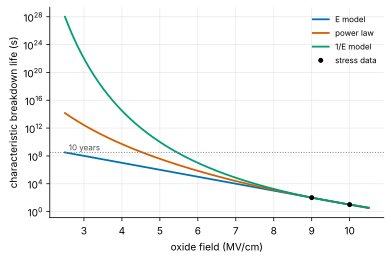
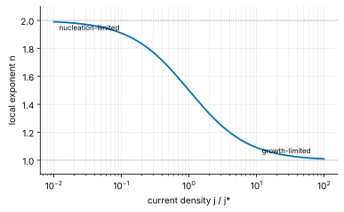

<!-- status: reviewed -->
# 25-09 · Reliability Physics

| | |
|---|---|
| **Course** | [25 · Semiconductor Fabrication, Packaging, Test and Reliability](../README.md) |
| **University equivalent** | Semiconductor device reliability (graduate reliability-physics electives; McPherson, *Reliability Physics and Engineering*; JEDEC JEP122 failure mechanisms and models) |
| **Prerequisites** | [03-05](../../03-probability-statistics-and-random-variables/chapters/03-05-estimation-and-hypothesis-testing.md) (Weibull, Arrhenius acceleration, failure-rate bounds), [04-05](../../04-physics-for-ee/chapters/04-05-current-resistance-and-conduction.md) (electromigration basics), [09-08](../../09-semiconductor-devices/chapters/09-08-mos-capacitor.md) (gate oxides and breakdown), [04-02](../../04-physics-for-ee/chapters/04-02-charge-coulomb-and-electric-fields.md) (ESD and the human-body model), [25-08](25-08-thermal-engineering.md) (junction temperature and mission profiles) |
| **Estimated study hours** | 8 |
| **Last verified** | 2026-11-26 |

**Learning objectives.** After this chapter you can:

1. Apply Black's equation and the Blech condition to interconnect electromigration, and derive how the current exponent changes between nucleation- and growth-limited failure.
2. Fit the E, 1/E and power-law dielectric-breakdown models to the same stress data and show how far their extrapolations diverge.
3. Scale a breakdown lifetime from test structures to a chip and from the median to a ppm-level failure fraction with Weibull statistics.
4. Extrapolate bias-temperature-instability shifts with a power law and estimate their effect on circuit delay.
5. Size an ESD clamp's on-resistance for a human-body-model zap, and explain latch-up's loop-gain condition.
6. Compute a FIT bound from a zero-failure HTOL test and combine mechanisms with different activation energies.

---

## 1. Big picture

A chip that passes every test on the day it ships can still fail in the field. Its wires thin as atoms drift with the current, its gate oxides accumulate defects until they break, its transistors' thresholds shift under bias and heat, and a single static spark can destroy an input. **Reliability physics** studies these wear-out and overstress mechanisms, builds models of how fast each one proceeds with temperature, voltage and current, and uses those models to turn a few weeks of accelerated testing into a promise about ten or fifteen years of use. Every model is an extrapolation, often by many orders of magnitude, which is why the choice of model is itself a design decision and a frequent source of disagreement.

- **Where it shows up:** electromigration limits on every power grid (19-11); voltage and temperature limits in every datasheet; qualification before shipment (25-10); automotive and datacenter lifetime targets.
- **The mechanisms:** electromigration (EM), time-dependent dielectric breakdown (TDDB), bias-temperature instability (BTI), hot-carrier injection (HCI), electrostatic discharge (ESD) and latch-up.
- **The method:** stress harder than use, measure time to failure, fit an acceleration model, extrapolate, and bound the failure rate statistically (03-05).
- **The industry reference:** JEDEC's JEP122, "Failure Mechanisms and Models for Semiconductor Devices", current revision H of September 2016 [R-609].

## 2. Intuition first

**Physical picture.** Most wear-out is slow chemistry or slow transport that heat speeds up exponentially. Atoms in a copper wire hop between sites when thermal vibration gives them enough energy, and the electron "wind" biases the hops in one direction. Bonds in a gate oxide break when a combination of field and heat pushes them over an energy barrier. Hydrogen at the silicon–oxide interface is released or trapped. Each process has an **activation energy** $E_a$: the barrier height that sets how strongly temperature accelerates it, through the Arrhenius factor $e^{-E_a/kT}$.

**Analogy and its limits.** Accelerated testing is like stress-testing a bank: you model losses under a severe scenario and extrapolate to normal conditions. The extrapolation is only as good as the model linking the two, and two plausible models fitted to the same stress data can disagree by orders of magnitude about normal conditions (Example 25-09.4). The analogy breaks in one useful way: physical mechanisms can be studied directly (cross-sections, electron microscopy of voids and breakdown spots), so the model can be checked against physics rather than only against history.

```text
   stress (high T, V, J)  ──►  time to failure at stress  ──►  acceleration model  ──►  life at use
     weeks of HTOL,                  e.g. 100 h median             Arrhenius × voltage         years, as
     EM and TDDB tests               Weibull or lognormal fit      or current factor           ppm or FIT
```

## 3. Theory

### 3.1 Acceleration and the activation energy

If a mechanism proceeds at a rate proportional to $e^{-E_a/kT}$ (Boltzmann's constant $k$ = 8.617 × 10⁻⁵ eV/K, temperatures in kelvin), the ratio of lifetimes at use and stress temperatures, the **acceleration factor**, is

$$
AF_T = \exp\!\left[\frac{E_a}{k}\left(\frac{1}{T_{use}} - \frac{1}{T_{stress}}\right)\right],
$$

as 03-05 derived. Two consequences dominate practice. First, $AF_T$ is exponential in $E_a$, so a 0.1 eV error in the activation energy changes the extrapolated life by a large factor. Second, different mechanisms have different activation energies, so a single "chip activation energy" is a convenient fiction (§3.7). Voltage, current and field add their own acceleration factors, multiplying the thermal one.

### 3.2 Electromigration

**The mechanism.** 04-05 introduced the electron wind: conduction electrons scattering off metal ions transfer momentum and push atoms toward the anode. In copper interconnects the atoms move mostly along grain boundaries and the interface between the copper and its dielectric cap, which are faster paths than the crystal itself [R-605]. Where the atomic flux diverges, at a via or a grain-boundary junction, a void opens at one end (raising resistance or opening the line) and material piles up at the other (which can short to a neighbour).

**Black's equation.** Empirically the median time to failure of a test line obeys

$$
MTTF = A\,j^{-n}\exp\!\left(\frac{E_a}{kT}\right),
$$

with current density $j$, a current exponent $n$ and a constant $A$ that depends on geometry and materials. Black's original work implied $n = 2$; later studies found $n$ between about 1 and 3, and both $n$ and $E_a$ are fits valid only for the configuration tested [R-605]. For electromigration along the copper/SiCN cap interface, 0.90 eV is the commonly reported activation energy; a test of more than 1.1 million structures found an early-failure mode at 0.83 eV that "may control the chip lifetime at operating conditions" [R-606].

**Where $n$ comes from.** Failure takes two phases: a void must nucleate, which requires the electromigration-driven stress to build to a critical value, and then grow until it opens the line. A simple analysis gives a nucleation time proportional to $j^{-2}$: the back-stress builds by diffusion, so near a blocking boundary it grows as $\sigma \propto j\sqrt t$ (Korhonen's model), and reaching a critical stress $\sigma_c$ takes $t_{nuc} \propto (\sigma_c/j)^2$ and a growth time proportional to $j^{-1}$ (a void grows at the drift velocity, proportional to $j$). With constants $B$ and $C$ at fixed temperature [R-605],

$$
MTTF = Bj^{-2} + Cj^{-1}.
$$

The **local exponent** that a test at current density $j$ would measure is $n = -d\ln MTTF/d\ln j$:

$$
n(j) = \frac{2Bj^{-2} + Cj^{-1}}{Bj^{-2} + Cj^{-1}} = \frac{2 + x}{1 + x},\qquad x = \frac{j}{j^*},\quad j^* = \frac{B}{C}.
$$

At low current density ($x \ll 1$) nucleation dominates and $n \to 2$; at high current density growth dominates and $n \to 1$. Accelerated tests run at high $j$, where $n$ looks close to 1, but use conditions are at low $j$, where life scales more steeply. Extrapolating with the test's exponent therefore *underestimates* the use life, a conservative error (Example 25-09.2). A measured $n$ near 2 points to nucleation-dominated failure with lognormal lifetimes, near 1 to growth-dominated failure [R-605].

**The Blech effect.** As atoms pile up at the anode end, a mechanical stress gradient builds that pushes them back. The atomic flux is proportional to the electron-wind force minus the back-stress gradient,

$$
J_a \propto Z^*e\rho j - \Omega\frac{\partial\sigma}{\partial x},
$$

with effective charge number $Z^*$, resistivity $\rho$, atomic volume $\Omega$ and stress $\sigma$. The flux stops when the gradient balances the wind. Over a line of length $L$ the stress difference needed is then $\Delta\sigma = Z^*e\rho jL/\Omega$, and if this stays below the stress the line can sustain without voiding, $\Delta\sigma_c$, the line never fails. The condition is

$$
jL < (jL)_c = \frac{\Omega\,\Delta\sigma_c}{Z^*e\rho}.
$$

Short lines are immune to electromigration at current densities that would kill long ones. Design rules exploit this: short stubs between vias get higher current limits (Example 25-09.3).

### 3.3 Time-dependent dielectric breakdown

A gate oxide (or a low-k dielectric between wires) under a steady field slowly accumulates defects until a percolation path of defects connects the two electrodes and the dielectric breaks down (09-08). Lifetime falls steeply with field, and three models compete [R-607]:

- **E model** (thermochemical): defects form by field-assisted bond breaking, $t_{BD} = A\,e^{-\gamma E}e^{E_a/kT}$, with field acceleration $\gamma$.
- **1/E model** (anode hole injection): electrons tunnelling through the oxide release holes at the anode that create defects, $t_{BD} = \tau_0\,e^{G/E}$.
- **Power law in voltage** (anode hydrogen release): for ultrathin oxides, $t_{BD} \propto V^{-m}$.

All three can fit accelerated data taken over a narrow range of high fields, yet they diverge at use fields. Fitted through the same two stress points, they can disagree by many orders of magnitude at a use field a third of the stress field (Example 25-09.4). The E model is the most conservative; Padovani and co-authors note that industry typically disregards it "in favor of the power-law model (and, less often, of the 1/E model, that is overly relaxed)" because it gives larger design margins [R-607]. Which model is right is **[Contested]**, and the choice directly sets the maximum operating voltage a technology can promise.

**From a test capacitor to a chip.** Breakdown is a weakest-link process (25-06): a chip fails when the first of its many oxide regions breaks. If breakdown times follow a Weibull distribution of shape $\beta$ and scale $\eta$ for a test capacitor of area $A_{test}$, a chip with total oxide area $A_{chip}$ has scale $\eta\,(A_{chip}/A_{test})^{-1/\beta}$ (the weakest-link result of 25-06 with $M = A_{chip}/A_{test}$). And the time to reach a small failure fraction $F$ is $\eta(-\ln(1 - F))^{1/\beta}$, far below the median. Together,

$$
t_F^{chip} = \eta_{test}\left(\frac{A_{chip}}{A_{test}}\right)^{-1/\beta}\left[-\ln(1 - F)\right]^{1/\beta}.
$$

For thin oxides $\beta$ is small, so both factors are strong reductions (in Example 25-09.5, 3.2 × 10⁻² for the area and 1.0 × 10⁻² for the 100 ppm target), and a test capacitor's characteristic life must exceed the product target by orders of magnitude.

### 3.4 Bias-temperature instability and hot carriers

**BTI.** Holding a transistor's gate at bias (negative for PMOS, NBTI; positive for NMOS, PBTI) at elevated temperature slowly raises the threshold-voltage magnitude, as interface states form and charge is trapped in the gate dielectric. The shift grows roughly as a power law in stress time,

$$
\Delta V_{TH} = A\,t^{\,n_t},
$$

and partly recovers when the stress is removed. The exponent is the crux. Reaction–diffusion theory predicts $n_t$ = 1/2, 1/4 or 1/6 depending on whether protons, hydrogen atoms or hydrogen molecules diffuse away from the interface; measured exponents depend strongly on how long the measurement takes after the stress ends (recovery begins at once), and delayed measurements give values around 0.2–0.3, rising with temperature [R-608]. Whether BTI is better described by hydrogen diffusion or by charge trapping in pre-existing defects is **[Contested]**. Because ten years is about 3 × 10⁵ times a 1,000 s test, the exponent's uncertainty compounds into a factor of about three in the predicted end-of-life shift (Example 25-09.6), which feeds directly into the timing margin through the alpha-power delay law (25-05).

> **Going deeper — where the reaction–diffusion exponents come from.** Interface traps form as Si–H bonds break, releasing hydrogen that diffuses into the oxide, while hydrogen left at the interface can re-passivate traps. After a short transient the two rates balance, so $N_{IT}N_H(0) \approx$ constant, with $N_{IT}$ the trap density and $N_H(0)$ the hydrogen density at the interface. Every trap released one hydrogen, which now sits in a diffusion profile about $\sqrt{Dt}$ deep, so $N_{IT} \approx \tfrac12N_H(0)\sqrt{Dt}$. Eliminating $N_H(0)$ gives $N_{IT}^2 \propto \sqrt t$, so $N_{IT} \propto t^{1/4}$ for neutral atoms. If pairs of atoms form H₂, the balance involves the square root of the molecular density, and the same steps give $N_{IT}^{3/2} \propto \sqrt t$, so $t^{1/6}$. If the species is a proton that drifts in the oxide field, the profile depth grows as $t$ rather than $\sqrt t$, giving $t^{1/2}$. The exponent therefore encodes the transport mechanism, which is why measured values are argued over.

**HCI.** Carriers accelerated by the high lateral field near the drain gain enough energy to create interface states or be injected into the oxide, degrading drive current over time. For long-channel NMOS the worst case is at the bias of maximum substrate current, usually with the gate at about 0.4–0.5 of the drain voltage; for long-channel PMOS it is at maximum gate current [R-608]. In short-channel devices the worst case moves toward high gate voltage as energy-driven mechanisms take over, and in digital logic HCI acts only during switching transitions, so its impact scales with activity.

### 3.5 Electrical overstress: ESD and latch-up

**ESD.** 04-02 modelled a human-body-model (HBM) zap as 100 pF discharged through 1.5 kΩ. On chip, every pad has a clamp that turns on and diverts the current to a supply rail before the voltage at the pad can rupture a thin gate oxide. Modelling the clamp as a holding voltage $V_h$ in series with an on-resistance $R_{on}$, the peak current and peak pad voltage are

$$
I_{pk} = \frac{V_0 - V_h}{R_{HBM} + R_{on}},\qquad V_{pad} = V_h + I_{pk}R_{on},
$$

and the current decays with time constant $(R_{HBM} + R_{on})C_{HBM}$. The design requirement is $V_{pad}$ below the short-pulse breakdown voltage of whatever the pad connects to; solving for $R_{on}$ gives the clamp's size (Example 25-09.7, confirmed in ngspice). The charged-device model (CDM) is faster and sharper, a nanosecond-scale discharge of the package's own charge through one pin, and drives clamp placement close to the protected circuit.

**Latch-up.** Every CMOS inverter contains a parasitic pnp and npn transistor connected as a thyristor ([20-11](../../20-analog-and-mixed-signal-ic-design/chapters/20-11-layout-matching-pvt.md)) between supply and ground. If a transient injects enough current to turn one on, each feeds the other's base; when the product of their current gains, reduced by the shunting well and substrate resistances, exceeds one, the loop latches and conducts a destructive supply-to-ground current until power is removed. Well and substrate taps close to devices and guard rings around I/O (19-09, 20-11) lower the shunt resistances so the loop gain stays below one.

### 3.6 From test to FIT: HTOL

A high-temperature operating-life (HTOL) test runs many units at elevated temperature and voltage for a fixed time and counts failures. For a constant failure rate, the upper confidence bound with $f$ failures in $N$ units for $t$ hours at acceleration $AF$ is

$$
\lambda_U = \frac{\chi^2_{CL,\,2f+2}}{2NtAF},
$$

in failures per hour (multiply by 10⁹ for FIT), from the Poisson–chi-square argument of 03-05. Industrial calculations commonly use 60% confidence [R-610]. A Texas Instruments application note's worked example ran 7,859 units for 1,000 h at 125 °C with no failures and, with $E_a$ = 0.7 eV, reported about 1.5 FIT at 55 °C (Example 25-09.8) [R-610]. Two cautions apply. The result is only as good as the single activation energy assumed for every mechanism the test could reveal. And "60% confidence" means that a product whose true rate equals the bound would pass such a test 40% of the time.

### 3.7 Many mechanisms at once

A chip fails when its first mechanism does. If the mechanisms act independently with constant rates, the chip's failure rate is their sum, $\lambda = \sum_i\lambda_i$, the series-system rule. But each scales with temperature by its own activation energy, so the sum must be formed at the temperature of interest: scaling a total measured at one temperature with a single "average" $E_a$ misstates it (Example 25-09.9). Wear-out mechanisms are also not constant-rate: EM and TDDB lifetimes are lognormal or Weibull with increasing hazard, which is why the bathtub curve (03-02) rises at the end and why lifetime is specified as a time to a small cumulative failure fraction, not as a FIT rate alone.

## 4. Worked examples

### Example 25-09.1 · Electromigration acceleration (tier B)

**Setup.** An EM test at 300 °C and 5 MA/cm² gives a median life of 100 h. Use conditions are 105 °C and 1 MA/cm². With $E_a$ = 0.90 eV [R-606], find (a) the thermal acceleration factor, (b) the use median life for $n$ = 2 and (c) for $n$ = 1, in hours and years, and (d) the thermal acceleration factor with the 0.83 eV early-failure mode and its ratio to (a).

**Solution.**

- (a) $AF_T = \exp[(0.90/8.617 \times 10^{-5})(1/378.15 - 1/573.15)]$ = **1.20e4**.
- (b) With the unrounded $AF_T$ = **1.2048e4**, $100 \times 1.2048 \times 10^4 \times 5^2$ = **3.01e7** h = **3.44e3** years.
- (c) $100 \times 1.2048 \times 10^4 \times 5$ = **6.02e6** h = **687** years.
- (d) **5.80e3**; ratio **2.08**.

**Units check.** Exponent: eV/(eV/K) × 1/K, dimensionless. ✓

**Sanity check.** Thousands of years sounds absurd, but this is the *median* of one test line. A chip has millions of lines, and its life is set by the earliest failures of a lognormal distribution (as §3.3 does for Weibull), so medians must exceed the product life by orders of magnitude. A 0.07 eV lower activation energy halves the margin.

### Example 25-09.2 · Which current exponent? (tier C)

**Setup.** Take $MTTF = Bj^{-2} + Cj^{-1}$ with $j^* = B/C$ = 1 MA/cm² (assumed). (a) Find the local exponent at 0.2, 1 and 5 MA/cm². (b) A test at 5 MA/cm² fits a constant $n$ equal to its local exponent and extrapolates to 0.2 MA/cm². Compare the extrapolated life ratio with the true one.

**Solution.**

- (a) $n = (2 + x)/(1 + x)$: **1.83**, **1.5** and **1.17**.
- (b) True ratio: $MTTF(0.2)/MTTF(5) = (1/0.04 + 1/0.2)/(1/25 + 1/5) = 30/0.24$ = **125**. Extrapolated: $25^{1.167}$ = **42.7**. The extrapolation underestimates the use life by a factor of **2.92**.

**Units check.** With $x$ dimensionless, ratios of $MTTF$ are dimensionless.

**Sanity check.** The error is conservative: the product lives longer than predicted. The opposite assumption (using $n = 2$ when growth dominates at use) would be optimistic, which is why foundries characterize $n$ near use conditions where they can.

### Example 25-09.3 · Blech-immune lines (tier A)

**Setup.** Take $(jL)_c$ = 3,000 A/cm (assumed). (a) Up to what current density is a 20 µm line immune? (b) At 2 MA/cm², what is the longest immune line?

**Solution.**

- (a) $3000/(20 \times 10^{-4})$ A/cm² = **1.5** MA/cm².
- (b) $3000/(2 \times 10^6)$ cm = **15** µm.

**Units check.** (A/cm)/(cm) = A/cm²; (A/cm)/(A/cm²) = cm. ✓

**Sanity check.** Short via-to-via segments can carry currents that would destroy long wires, which is why EM rules depend on length as well as width (19-11).

### Example 25-09.4 · Three breakdown models, one data set (tier C)

**Setup.** Test capacitors break down with characteristic lives of 10 s at 10 MV/cm and 100 s at 9 MV/cm (assumed). Fit (a) the E model, (b) the 1/E model and (c) a power law in field through both points, then (d) extrapolate each to 3 MV/cm.

**Solution.**

- (a) $\gamma = \ln 10/(10 - 9)$ = **2.30** (MV/cm)⁻¹.
- (b) $G = \ln 10/(1/9 - 1/10)$ = **207** MV/cm.
- (c) $m = \ln 10/\ln(10/9)$ = **21.9**.
- (d) E: $10\,e^{2.303 \times 7}$ = **1.0e8** s. Power law: $10 \times (10/3)^{21.85}$ = **2.67e12** s. 1/E: $10\,e^{207.2(1/3 - 1/10)}$ = **1.0e22** s.

**Units check.** $\gamma E$ and $G/E$ are dimensionless; the power law's ratio of fields is too.

**Sanity check.** Fourteen orders of magnitude separate the models at a third of the lower stress field. All three describe the stress data perfectly. Only data closer to use conditions, or physical understanding of the mechanism, can choose between them [R-607].

### Example 25-09.5 · From test capacitor to chip (tier B)

**Setup.** A chip has 1,000 times the oxide area of the test capacitor, breakdown is Weibull with $\beta$ = 2, and the target is at most 100 ppm failing in 10 years (all assumed). Find (a) the factor relating the chip's 100 ppm life to the capacitor's characteristic life, (b) the characteristic life the capacitor needs, and (c) which of Example 25-09.4's extrapolations pass, with the power law's margin.

**Solution.**

- (a) $1000^{-1/2} \times (-\ln(1 - 10^{-4}))^{1/2} = 0.0316 \times 0.0100$ = **3.16e-4**.
- (b) With the unrounded factor **3.162e-4**, $10 \times 3.156 \times 10^7/3.162 \times 10^{-4}$ = **9.98e11** s.
- (c) The E model (1.0 × 10⁸ s) fails; the power law passes with margin $2.67 \times 10^{12}/9.98 \times 10^{11}$ = **2.68**; the 1/E model passes by an enormous margin.

**Units check.** The factor is dimensionless; seconds divided by it remain seconds.

**Sanity check.** The same oxide is qualified or rejected by the choice of model, which is why that choice is a business decision about operating voltage as much as a scientific one.

### Example 25-09.6 · BTI extrapolation and delay (tier B)

**Setup.** A PMOS shows $\Delta V_{TH}$ = 3 mV after 1,000 s at use bias and temperature (assumed). Find (a) the time ratio to 10 years, the 10-year shift for (b) $n_t$ = 1/6 and (c) 1/4, and the resulting delay increase with the alpha-power law (25-05) at $V_{DD}$ = 0.75 V, $V_{TH}$ = 0.30 V and α = 1.3 for (d) and (e).

**Solution.**

- (a) $10 \times 3.156 \times 10^7/10^3$ = **3.16e5**.
- (b) $3 \times (3.16 \times 10^5)^{1/6}$ = **24.8** mV. (c) $3 \times (3.16 \times 10^5)^{1/4}$ = **71.1** mV.
- (d) Delay $\propto V_{DD}/(V_{DD} - V_{TH})^{\alpha}$: $(0.45/0.4252)^{1.3}$, an increase of **7.6**%. (e) $(0.45/0.3789)^{1.3}$, an increase of **25.1**%.

**Units check.** Exponents act on dimensionless ratios; mV and V are consistent.

**Sanity check.** A one-twelfth change in the exponent triples the predicted end-of-life shift and the guard band it needs. Real products add voltage acceleration, recovery during idle time and duty cycle; the point is that the end-of-life margin rests on an exponent measured over a few decades of time.

### Example 25-09.7 · Sizing an ESD clamp (tier B)

**Setup.** A 2 kV HBM zap (100 pF, 1.5 kΩ; 04-02) hits a pad whose clamp holds at 5 V with 1 Ω on-resistance (assumed). Find (a) the peak current, (b) the time constant, (c) the peak pad voltage and (d) the current at one time constant. (e) If the protected oxide tolerates 8 V for this short pulse (assumed), what is the largest on-resistance allowed?

**Solution.**

- (a) $(2000 - 5)/(1500 + 1)$ = **1.329** A.
- (b) $1501 \times 100 \times 10^{-12}$ = **150.1** ns.
- (c) $5 + 1.329 \times 1$ = **6.33** V.
- (d) $1.329/e$ = **0.489** A.
- (e) $5 + R_{on}(1995)/(1500 + R_{on}) \le 8$ gives $R_{on} \le 4500/1992$ = **2.26** Ω.

**Units check.** V/Ω = A; Ω × F = s. ✓

**Sanity check.** The ngspice netlist `hbm_esd.cir` reproduces (a), (c) and (d). The clamp barely changes the current (the 1.5 kΩ dominates), so the HBM is effectively a current source and the clamp's job is to keep $I_{pk}R_{on}$ small. The clamp must also survive the heat: the energy in the zap, 0.2 mJ (04-02), lands mostly in the HBM resistor, but the 1 Ω clamp still absorbs $V_hI_{pk}\tau + R_{on}I_{pk}^2\tau/2$ = **1.13** µJ over about 150 ns in a small volume of silicon.

### Example 25-09.8 · A FIT from a zero-failure HTOL (tier B)

**Setup.** TI's example: 7,859 units, 1,000 h at 125 °C, no failures, use at 55 °C, $E_a$ = 0.7 eV, 60% confidence [R-610]. Find (a) the acceleration factor with TI's constants ($k$ = 8.6 × 10⁻⁵ eV/K, $T$ = °C + 273), (b) the chi-square value, (c) the FIT, (d) the acceleration factor and FIT with exact constants, (e) the corresponding MTBF, and (f) a 16.7 FIT rate at 55 °C scaled to 75 °C with 0.7 eV.

**Solution.**

- (a) $\exp[(0.7/8.6 \times 10^{-5})(1/328 - 1/398)]$ = **78.6**.
- (b) $\chi^2_{0.60,\,2}$ = **1.833**.
- (c) $1.833 \times 10^9/(2 \times 1000 \times 7859 \times 78.6)$ = **1.48** FIT, which TI reports as 1.5.
- (d) **77.6** and **1.50** FIT.
- (e) $10^9/1.483$ = **6.74e8** h, using the unrounded **1.483** FIT. Because it is the reciprocal of an upper bound on the rate, this is a lower bound on the MTBF at 60% confidence.
- (f) $16.7 \times \exp[(0.7/k)(1/328.15 - 1/348.15)]$ = **69.2** FIT, matching TI's calculator.

**Units check.** Unit-hours × AF in the denominator; the result × 10⁹ is failures per 10⁹ hours. ✓

**Sanity check.** Rounded constants move the answer by about 1%, far less than the uncertainty in $E_a$: at 0.6 eV the same test would give **2.77** FIT, **1.87** times higher. 75 °C instead of 55 °C multiplies the rate by **4.15**; datasheet FIT figures are meaningless without their temperature.

### Example 25-09.9 · Summing mechanisms (tier B)

**Setup.** At 55 °C a chip's failure rate is 2 FIT from EM ($E_a$ = 0.9 eV), 3 FIT from TDDB (0.7 eV) and 1 FIT from other causes (0.5 eV) (all assumed). Find (a) each mechanism's acceleration from 55 to 85 °C, (b) the total at 85 °C, (c) the total if all 6 FIT were scaled with a single 0.7 eV, and (d) the underestimate.

**Solution.**

- (a) **14.4**, **7.95** and **4.40**.
- (b) $2 \times 14.4 + 3 \times 7.95 + 1 \times 4.40$ = **57.0** FIT.
- (c) $6 \times 7.95$ = **47.7** FIT.
- (d) $1 - 47.7/57.0$ = **16**%.

**Units check.** FIT × dimensionless factors = FIT.

**Sanity check.** The high-$E_a$ mechanism, a third of the rate at 55 °C, becomes half of it at 85 °C. A single "effective" activation energy is only valid near the temperature where it was fitted.

<!-- answer-key -->

| ID | Quantity | Value | Unit |
|---|---|---|---|
| Ex 25-09.1a0 | thermal AF, unrounded | 1.2048e4 | |
| Ex 25-09.1a | thermal AF, 0.90 eV | 1.20e4 | |
| Ex 25-09.1b | use median life, n = 2 | 3.01e7 | h |
| Ex 25-09.1b1 | in years | 3.44e3 | years |
| Ex 25-09.1c | use median life, n = 1 | 6.02e6 | h |
| Ex 25-09.1c1 | in years | 687 | years |
| Ex 25-09.1d | thermal AF, 0.83 eV | 5.80e3 | |
| Ex 25-09.1d1 | ratio | 2.08 | |
| Ex 25-09.2a | local exponent at 0.2 | 1.83 | |
| Ex 25-09.2a1 | local exponent at 1 | 1.5 | |
| Ex 25-09.2a2 | local exponent at 5 | 1.17 | |
| Ex 25-09.2b | true life ratio | 125 | |
| Ex 25-09.2b1 | extrapolated ratio | 42.7 | |
| Ex 25-09.2b2 | underestimate factor | 2.92 | |
| Ex 25-09.3a | immune current density, 20 µm | 1.5 | MA/cm² |
| Ex 25-09.3b | longest immune line at 2 MA/cm² | 15 | µm |
| Ex 25-09.4a | field acceleration gamma | 2.30 | cm/MV |
| Ex 25-09.4b | 1/E constant G | 207 | MV/cm |
| Ex 25-09.4c | power-law exponent | 21.9 | |
| Ex 25-09.4d | E-model life at 3 MV/cm | 1.0e8 | s |
| Ex 25-09.4d1 | power-law life | 2.67e12 | s |
| Ex 25-09.4d2 | 1/E life | 1.0e22 | s |
| Ex 25-09.5a | scale factor | 3.16e-4 | |
| Ex 25-09.5a2 | area-and-percentile factor, unrounded | 3.162e-4 | |
| Ex 25-09.5a0 | area factor | 0.0316 | |
| Ex 25-09.5a1 | percentile factor | 0.0100 | |
| Ex 25-09.5b | required characteristic life | 9.98e11 | s |
| Ex 25-09.5c | power-law margin | 2.68 | |
| Ex 25-09.6a | time ratio | 3.16e5 | |
| Ex 25-09.6b | 10-year shift, 1/6 | 24.8 | mV |
| Ex 25-09.6c | 10-year shift, 1/4 | 71.1 | mV |
| Ex 25-09.6d | delay increase, 1/6 | 7.6 | % |
| Ex 25-09.6e | delay increase, 1/4 | 25.1 | % |
| Ex 25-09.6f | overdrive after 1/6 shift | 0.4252 | V |
| Ex 25-09.6g | overdrive after 1/4 shift | 0.3789 | V |
| Ex 25-09.7a | peak current | 1.329 | A |
| Ex 25-09.7b | time constant | 150.1 | ns |
| Ex 25-09.7c | peak pad voltage | 6.33 | V |
| Ex 25-09.7d | current at one time constant | 0.489 | A |
| Ex 25-09.7e | largest on-resistance | 2.26 | Ω |
| Ex 25-09.8a | AF, TI constants | 78.6 | |
| Ex 25-09.8b | chi-square, 60%, 2 dof | 1.833 | |
| Ex 25-09.8c0 | FIT, unrounded | 1.483 | FIT |
| Ex 25-09.8c | FIT | 1.48 | FIT |
| Ex 25-09.8d | AF, exact constants | 77.6 | |
| Ex 25-09.8d1 | FIT, exact constants | 1.50 | FIT |
| Ex 25-09.8e | MTBF | 6.74e8 | h |
| Ex 25-09.8f | FIT at 75 °C | 69.2 | FIT |
| Ex 25-09.8g | FIT at 0.6 eV | 2.77 | FIT |
| Ex 25-09.8g1 | ratio to 0.7 eV | 1.87 | |
| Ex 25-09.8h | FIT ratio 75 against 55 °C | 4.15 | |
| Ex 25-09.9a | AF 55 → 85 °C, 0.9 eV | 14.4 | |
| Ex 25-09.9a1 | AF, 0.7 eV | 7.95 | |
| Ex 25-09.9a2 | AF, 0.5 eV | 4.40 | |
| Ex 25-09.9b | total at 85 °C | 57.0 | FIT |
| Ex 25-09.9c | single-Ea estimate | 47.7 | FIT |
| Ex 25-09.9d | underestimate | 16 | % |
| Txt 25-09.a | AF change for 0.1 eV, 55 to 125 °C | 1.86 | |
| Ex 25-09.7f | energy in the clamp | 1.13 | µJ |

## 5. Simulate it

The lab is [labs/25-09-lab/](../labs/25-09-lab/README.md). `reliability.py` computes Arrhenius and Black acceleration, the two-phase EM exponent, the Blech product, the three TDDB fits and their Weibull scaling, BTI extrapolation, the HBM discharge into a clamp, HTOL FIT bounds (with a Monte Carlo check of what the confidence level means) and sums of mechanisms; `hbm_esd.cir` simulates the ESD discharge in ngspice; the notebook runs the parts below.



*Figure 1. Three models, one data set: the extrapolations agree at the stress points and differ by orders of magnitude at use fields.*



*Figure 2. The exponent a test measures depends on where it is measured: nucleation dominates at low current density, void growth at high.*

**Predict, then run:**

1. *Predict* the use field at which the E and power-law extrapolations of Example 25-09.4 differ by a factor of 1,000, then find it.
2. *Predict* how the chip's 100 ppm life changes if the Weibull shape is 1.2 instead of 2, then compute it.
3. *Predict* what fraction of zero-failure HTOL runs a product would pass if its true rate equalled the 60% bound, then simulate it.
4. *Predict* the peak pad voltage with a 2 Ω clamp, then run the ngspice netlist with that value and compare.

## 6. Engineering tradeoffs

| Knob | Improves | Costs | Typical decision owner |
|---|---|---|---|
| Wider power and signal wires | EM lifetime | Routing area, capacitance | Physical design with power integrity |
| Lower operating voltage | TDDB, BTI and HCI lifetime | Performance per chip | Product and technology |
| Lower junction temperature | Every thermally activated mechanism | Cooling cost, throttling (25-08) | System thermal design |
| Choosing a less conservative TDDB model | Higher allowed voltage | Field-failure risk if the model is wrong | Technology reliability team |
| Guard-banding for BTI aging | Timing over life | Frequency or voltage at time zero | Timing signoff |
| Larger ESD clamps | ESD robustness | Pad capacitance, area, high-speed I/O bandwidth | I/O design |
| Longer or larger HTOL | Tighter FIT bounds | Test time, units, cost | Quality and reliability |

## 7. Numbers to know

Perishable rows are as of Nov 2026; the date column gives the source's own date.

| Quantity | Value | Dated | Source |
|---|---|---|---|
| Boltzmann constant | 8.617 × 10⁻⁵ eV/K | timeless | §3.1 |
| Cu EM activation energy (Cu/SiCN interface) | ≈ 0.90 eV; early-failure mode 0.83 eV | 2009 | [R-606] |
| Black's current exponent | 1 (growth) to 2 (nucleation); observed ≈ 1–3 | thesis review | [R-605] |
| NBTI time exponent | R-D theory 1/6–1/2; delayed measurements ≈ 0.2–0.3 | 2008 | [R-608] |
| HBM model | 100 pF, 1.5 kΩ | standard | 04-02 |
| HTOL confidence level in industrial FIT | 60% typical | Jun 2023 | [R-610] |
| JEDEC failure-mechanism reference | JEP122H, Sep 2016 | Sep 2016 | [R-609] |
| FIT | 1 failure per 10⁹ device-hours | definition | [R-610] |

## 8. Common mistakes

- **Using one activation energy for the whole chip.** Each mechanism has its own; sum the rates at the temperature of interest.
- **Extrapolating EM with the test's current exponent without asking which regime it is in.** The exponent changes between nucleation and growth.
- **Quoting a median life as a product life.** Product life is a ppm-level percentile, far below the median.
- **Ignoring area scaling for TDDB.** A chip has orders of magnitude more oxide than a test capacitor.
- **Reporting a FIT without its temperature, activation energy and confidence level.**
- **Measuring BTI slowly.** Recovery begins the moment stress stops; slow measurements understate the shift and distort the exponent.
- **Treating a zero-failure test as proof of zero failure rate.** It only bounds the rate, at a stated confidence.

## 9. Practitioner lens

**State of the art (as of Nov 2026).**

- *Standards* [Established]. JEDEC's JEP122H (September 2016, 114 pages) remains the current list of failure mechanisms with their activation energies and acceleration factors for estimating field failure rates from accelerated tests [R-609]. JESD47, the stress-test qualification standard, is covered in 25-10.
- *Electromigration* [Established]. Copper EM at use conditions runs mainly along grain boundaries and the cap interface; 0.90 eV is the usual activation energy for the Cu/SiCN interface, but a 1.1-million-sample study found a 0.83 eV early-failure mode that "may control the chip lifetime at operating conditions" [R-605], [R-606].
- *Dielectric breakdown* [Contested]. The E, 1/E and power-law models remain in use; industry typically uses the power law, regarding the E model as too conservative and the 1/E model as overly relaxed [R-607].
- *BTI and HCI* [Established for the forms; Contested for mechanism and exponent]. BTI exponent values depend on measurement delay; HCI worst-case bias conditions are well characterized for long channels [R-608].
- *FIT practice* [Industry estimate: one vendor's description]. A TI application note computes FIT from a zero-failure HTOL at 60% confidence with a single 0.7 eV activation energy, calls 60% "typical for industrial calculations", and notes that most JEDEC JESD85 methods "only apply to constant failure rates" [R-610].

**Why it matters commercially.** Reliability margins set how hard a chip can be pushed: its maximum voltage, temperature and current density, and therefore its performance. A technology whose TDDB model allows a higher supply sells faster products; a datacenter operator running accelerators at higher power for longer must know whether the warranty's reliability model covers it. For automotive and industrial products, reliability is the product. A diligence team should ask how lifetime claims were derived, under which models, and with what field data to confirm them.

**Marketing vs Reality.**

- *"Less than 1 FIT."* At what temperature, activation energy and confidence level, and from how many unit-hours [R-610]?
- *"Ten-year lifetime."* For which failure fraction (median or 100 ppm), which mission profile (25-08) and which mechanisms?
- *"Qualified to JEDEC."* Passing qualification shows the product survived a standard stress set; it does not by itself establish field life at a customer's conditions (25-10).
- *"Our oxide supports 0.9 V."* Under which breakdown model, area and failure fraction? Different models fitted to the same data allow very different voltages (Example 25-09.4).

**Questions for engineering leaders.**

1. **"Which mechanism limits your product's life, and at what conditions?"** *Strong:* a named mechanism, its model, the stress data and the margin at the mission profile. *Evasive:* "everything passed qualification."
2. **"What TDDB model and Weibull slope set your maximum voltage?"** *Strong:* the model with its justification, area scaling and the ppm target. *Evasive:* "the foundry's rules."
3. **"How much aging guard band do you carry, and how was it derived?"** *Strong:* BTI and HCI shifts at end of life, measurement method, and timing impact. *Evasive:* "standard margins."
4. **"What field-return data confirm your FIT predictions?"** *Strong:* returns by failure mode with root-cause analysis compared with predictions. *Evasive:* "returns are very low."
5. **"How do you handle running above nominal power or temperature?"** *Strong:* lifetime models at the higher conditions and warranty terms aligned to them. *Evasive:* "the chip throttles."

## 10. Concept check

**Q1.** Why does a small error in activation energy matter so much?

<details><summary>Answer</summary>

The acceleration factor is exponential in $E_a$: between 55 and 125 °C, a change of 0.1 eV changes $AF$ by a factor of **1.86**, and the extrapolated life by the same factor.

</details>

**Q2.** Why might an electromigration test show $n \approx 1$ when use conditions follow $n \approx 2$?

<details><summary>Answer</summary>

At high test current density void growth dominates the failure time ($\propto j^{-1}$); at low use current density nucleation dominates ($\propto j^{-2}$). The local exponent moves from 1 toward 2 as $j$ falls.

</details>

**Q3.** What makes short wires immune to electromigration?

<details><summary>Answer</summary>

The back-stress gradient that builds as atoms pile up opposes the electron wind; in a short line the stress needed to stop the flux stays below the voiding threshold, so the flux stops before damage ($jL < (jL)_c$).

</details>

**Q4.** Why do the E, 1/E and power-law TDDB models disagree so badly?

<details><summary>Answer</summary>

They have different functional forms in field, so curves fitted through the same high-field points diverge as the field falls; the extrapolation spans many orders of magnitude in time.

</details>

**Q5.** Why must a test capacitor's characteristic breakdown life far exceed the product's target life?

<details><summary>Answer</summary>

A chip has far more oxide area (the weakest link scales life by $(A_{chip}/A_{test})^{-1/\beta}$), and the target is a small failure fraction, which lies far below the characteristic life, by $(-\ln(1 - F))^{1/\beta}$.

</details>

**Q6.** How does an ESD clamp protect an input, and what sets its size?

<details><summary>Answer</summary>

It turns on during the zap and diverts the current to a rail, holding the pad near its holding voltage; its on-resistance must keep $V_h + I_{pk}R_{on}$ below what the protected circuit tolerates, which sets its width and area.

</details>

**Q7.** Why is a sum of FIT rates valid only at one temperature?

<details><summary>Answer</summary>

Each mechanism's rate scales with its own activation energy; the sum at one temperature does not scale as a single Arrhenius term, so it must be recomputed mechanism by mechanism at each temperature.

</details>

Now try the [25-09 problem set](../problems/25-09-problems.md).

## 11. Key terms

[Electromigration](../../../reference/glossary.md#electromigration) · [Black's equation](../../../reference/glossary.md#blacks-equation) · [Blech effect](../../../reference/glossary.md#blech-effect) · [Time-dependent dielectric breakdown](../../../reference/glossary.md#time-dependent-dielectric-breakdown) · [Bias-temperature instability (BTI)](../../../reference/glossary.md#bias-temperature-instability-bti) · [Hot-carrier injection (HCI)](../../../reference/glossary.md#hot-carrier-injection-hci) · [Activation energy](../../../reference/glossary.md#activation-energy) · [Acceleration factor](../../../reference/glossary.md#acceleration-factor) · [Arrhenius model](../../../reference/glossary.md#arrhenius-model) · [Weibull distribution](../../../reference/glossary.md#weibull-distribution) · [HTOL](../../../reference/glossary.md#htol) · [FIT (failures in time)](../../../reference/glossary.md#fit-failures-in-time) · [Electrostatic discharge (ESD)](../../../reference/glossary.md#electrostatic-discharge-esd) · [ESD clamp](../../../reference/glossary.md#esd-clamp) · [Latch-up](../../../reference/glossary.md#latch-up) · [Bathtub curve](../../../reference/glossary.md#bathtub-curve)

## 12. Connections

- **Previous:** [25-08 Thermal Engineering](25-08-thermal-engineering.md): the junction temperatures and mission profiles that drive these mechanisms.
- **Next:** [25-10 Qualification and Functional Safety](25-10-qualification-and-functional-safety.md): the standard stress tests and safety processes that turn this physics into shippable products.
- **Prerequisites used:** [03-05](../../03-probability-statistics-and-random-variables/chapters/03-05-estimation-and-hypothesis-testing.md) for Weibull fits, Arrhenius and chi-square bounds; [04-05](../../04-physics-for-ee/chapters/04-05-current-resistance-and-conduction.md) for the electron wind; [09-08](../../09-semiconductor-devices/chapters/09-08-mos-capacitor.md) for gate oxides; [04-02](../../04-physics-for-ee/chapters/04-02-charge-coulomb-and-electric-fields.md) for the HBM; [25-06](25-06-packaging-fundamentals.md) for weakest-link Weibull scaling; [25-05](25-05-foundries-pdks-specialty-processes.md) for the alpha-power delay law.
- **Used later:** [25-10](25-10-qualification-and-functional-safety.md) (qualification stresses), [25-11](25-11-test-ate-sort-burn-in.md) (burn-in against infant mortality), and the practitioner chapters on technical diligence.

> **Deeper:** see companion repo *Semiconductor Capital Equipment* for reliability-test and failure-analysis equipment.

## 13. Further study

- J. W. McPherson, *Reliability Physics and Engineering: Time-to-Failure Modeling*, 3rd ed. (Springer, 2019): acceleration models for every mechanism in this chapter.
- J. R. Black, "Electromigration — a brief survey and some recent results," *IEEE Trans. Electron Devices* 16(4), 1969; I. A. Blech, "Electromigration in thin aluminum films on titanium nitride," *J. Appl. Phys.* 47, 1976.
- E. Y. Wu and J. H. Stathis' review chapters on gate-dielectric breakdown, and T. Grasser (ed.), *Bias Temperature Instability for Devices and Circuits* (Springer, 2014).
- A. Amerasekera and C. Duvvury, *ESD in Silicon Integrated Circuits*, 2nd ed. (Wiley, 2002).

## 14. Sources

1. Black's equation, current exponents and transport paths in copper: [R-605].
2. Copper EM activation energies and the early-failure mode: [R-606].
3. TDDB models and industry practice: [R-607].
4. BTI exponents and HCI worst-case conditions: [R-608].
5. JEDEC JEP122H: [R-609].
6. FIT definition and TI's HTOL example: [R-610].
