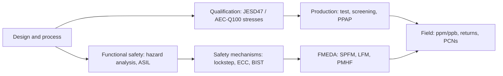
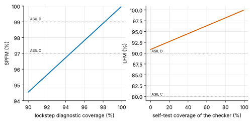
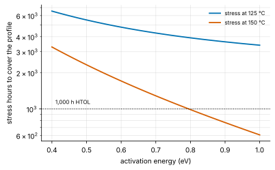

<!-- status: verified -->
# 25-10 · Qualification and Functional Safety

| | |
|---|---|
| **Course** | [25 · Semiconductor Fabrication, Packaging, Test and Reliability](../README.md) |
| **University equivalent** | Product qualification and functional safety (graduate reliability and automotive-electronics electives; JEDEC JESD47, AEC-Q100 and ISO 26262 as taught in industry courses) |
| **Prerequisites** | [25-09](25-09-reliability-physics.md) (acceleration models and FIT), [25-06](25-06-packaging-fundamentals.md) (Coffin–Manson and temperature cycling), [25-08](25-08-thermal-engineering.md) (mission profiles), [03-05](../../03-probability-statistics-and-random-variables/chapters/03-05-estimation-and-hypothesis-testing.md) (zero-failure sample sizes), [19-12](../../19-digital-vlsi-design/chapters/19-12-design-for-test.md) (test coverage, BIST and defect level) |
| **Estimated study hours** | 5 |
| **Last verified** | 2026-11-26 |

**Learning objectives.** After this chapter you can:

1. Describe what stress-test-driven qualification (JEDEC JESD47, AEC-Q100) contains and what passing it does and does not prove.
2. Convert temperature-cycling and HTOL stress into equivalent field use with Coffin–Manson and Arrhenius, and check a qualification plan against a mission profile.
3. Explain how ISO 26262 assigns integrity levels and what the hardware metrics SPFM, LFM and PMHF measure.
4. Compute SPFM, LFM and a first-order PMHF from an FMEDA, including the effect of latent faults and periodic self-test.
5. Translate component ppm into vehicle-level defect rates and read "zero defect" claims, as of late 2026.

---

## 1. Big picture

Reliability physics (25-09) explains how chips wear out. **Qualification** is the industry's agreed procedure for showing that a new product, or a product built in a changed process, survives a standard set of accelerated stresses before it ships. **Functional safety** asks a different question: when a chip *does* fail in the field, randomly or through a systematic flaw, will the system stay safe? For a car, a phone that freezes is an annoyance; a brake controller that silently computes a wrong answer is a hazard. ISO 26262 answers by requiring safety mechanisms that detect faults in time, and by setting quantitative targets for how many faults they must catch. Both are contractual as much as technical: automotive customers buy only parts qualified to AEC-Q100 and developed under ISO 26262, and a chip company's entry into automotive is measured in years of process change.

- **Where it shows up:** every datasheet's "qualified to" line; automotive MCUs, sensors, power devices and ADAS SoCs; increasingly industrial, medical and datacenter parts.
- **Qualification standards:** JEDEC JESD47 for general products, currently revision N of August 2026 [R-611]; AEC-Q100 for automotive ICs, currently revision J of August 2023 [R-612].
- **Functional safety:** ISO 26262, second edition (December 2018), with a third edition at draft-ballot stage in late 2026 [R-613].
- **The quality bar:** automotive defect targets have moved from parts per million toward parts per billion [R-615].

## 2. Intuition first

**Physical picture.** Qualification is a driving test, functional safety is the car's airbags and warning lights. A driving test checks a sample of skills under harder-than-normal conditions on one day; passing does not guarantee a lifetime without accidents, but failing reveals a real weakness. Airbags and warning lights assume accidents will happen and limit the harm: the system must notice a fault and reach a safe state before it causes injury.

**Analogy and its limits.** A financial audit is a closer analogy for qualification: a sample of transactions (units) is tested against standard procedures (stresses) and a clean opinion means no material problem was found in what was examined. Functional safety is like internal controls: the auditor checks that controls exist and how many errors they would catch. Both analogies break in the same place. An auditor's sample is drawn from a stable population, but a chip's field population includes lots made later, possibly after small process changes, and field conditions that differ from the stress set. That is why qualification must be repeated after significant changes, and why it is matched against a mission profile.

## 3. Theory

### 3.1 Stress-test-driven qualification

JEDEC's JESD47, *Stress-Test-Driven Qualification of Integrated Circuits*, "describes a baseline set of acceptance tests for use in qualifying electronic devices as new products, a product family, or as products in a process which is being changed" [R-611]. The tests target the mechanisms of 25-09:

- **High-temperature operating life (HTOL):** biased operation at elevated temperature and voltage, for wear-out of transistors and interconnect.
- **Temperature cycling (TC):** cycling between cold and hot extremes, for package and solder-joint fatigue (25-06).
- **Temperature-humidity bias or highly accelerated stress (THB, HAST):** for moisture-driven corrosion and leakage.
- **High-temperature storage:** unbiased bake, for bond and intermetallic degradation.
- **ESD and latch-up:** electrical overstress robustness (25-09).
- **Early-life failure rate:** a short burn-in-like stress on a larger sample, for infant mortality (25-11).

Each test runs a sample, classically three lots of 77 units, with zero failures allowed; 03-01 and 03-05 showed what that demonstrates statistically (below about 1% defective at 90% confidence) and why it cannot demonstrate ppm-level quality. Qualification therefore shows the *absence of a gross weakness*, not a field failure rate.

**AEC-Q100** adapts this for automotive ICs. It defines temperature **grades** as *ambient* operating ranges: Grade 0, −40 to +150 °C; Grade 1, −40 to +125 °C; Grade 2, −40 to +105 °C; Grade 3, −40 to +85 °C [R-612]. Its stress conditions scale with grade: temperature cycling for Grade 0 is now −55 to +150 °C for 1,500 cycles (reduced from 2,000 in revision J), and for Grade 1, −55 to +150 °C for 1,000 cycles [R-612]. Revision J (11 August 2023) also added a drift-analysis requirement to HTOL, a bump shear test and wafer-bumping change items for flip-chip parts, a requirement for supporting data on copper-wire devices, and a section on mission profiles [R-612].

### 3.2 Is the stress enough? Equivalent field use

A stress test is meaningful only through an acceleration model that maps it onto the product's real use (25-09).

**Temperature cycling.** With the Coffin–Manson relation of 25-06, cycles to failure scale as $N_f \propto (\Delta T)^{-n}$ for the joint or interface that fails, with $n \approx 2$ for solder fatigue and larger exponents for brittle failures. One stress cycle of range $\Delta T_s$ then equals

$$
AF_{TC} = \left(\frac{\Delta T_s}{\Delta T_{field}}\right)^{n}
$$

field cycles of range $\Delta T_{field}$. With $n = 2$, 1,000 cycles over 205 K stand for about **1.17e4** field cycles of 60 K, about 32 years at one cycle a day (Example 25-10.1). The answer depends strongly on $n$: the exponent, not the cycle count, carries the uncertainty. (Fuller models such as Norris–Landzberg add dwell time, frequency and peak temperature.)

**HTOL against a mission profile.** 25-08 introduced mission profiles, the fraction of life spent at each junction temperature. The stress hours that reproduce the profile's damage for an Arrhenius mechanism are

$$
t_{stress} = \sum_i \frac{w_i\,t_{life}}{AF(T_i \to T_{stress})},
$$

with $AF$ the Arrhenius factor from each profile temperature $T_i$ to the stress temperature. For a demanding automotive profile, 1,000 h at 125 °C can cover only a fraction of the damage, and the hottest segments dominate the requirement (Example 25-10.2). This is why AEC-Q100 now addresses mission profiles explicitly and why automotive suppliers often extend HTOL time or temperature beyond the baseline.

### 3.3 Functional safety: hazards and integrity levels

**ISO 26262**, "an adaptation of the functional safety standard IEC 61508 for automotive electric/electronic systems", covers the whole life cycle of safety-related electrical and electronic systems in road vehicles; its second edition (December 2018) extended scope from passenger cars to all road vehicles except mopeds [R-613]. Its central idea is to grade the rigour of development by the risk of each hazard.

A **hazard analysis and risk assessment** rates each hazardous event by **severity** (from no injuries to fatal), **exposure** (how often the driving situation occurs) and **controllability** (whether a typical driver can avoid harm). The standard's Part 3 maps each combination to an **Automotive Safety Integrity Level**: QM (quality management only, no ASIL), then ASIL A, the least demanding, to ASIL D, the most demanding, for severe, frequent and hard-to-control hazards. The ASIL attaches to a **safety goal** (for example, "avoid unintended braking"), and flows down to the hardware and software that implement it. ISO 26262 gives no normative mapping between ASILs and IEC 61508's SILs [R-613].

Faults come in two kinds. **Systematic faults** (design bugs, specification errors) are addressed by process: requirements traceability, verification (19-13), reviews and tool qualification, with rigour rising with ASIL. **Random hardware faults** (a transistor wearing out, a particle strike) are addressed quantitatively, by safety mechanisms and the metrics of §3.4.

### 3.4 Hardware metrics: SPFM, LFM and PMHF

**Fault classes.** In a failure modes, effects and diagnostic analysis (**FMEDA**), every failure mode of every safety-related hardware element, with failure rate $\lambda$ (FIT), is classified:

- **Safe faults** ($\lambda_S$): cannot violate the safety goal, even with a second fault.
- **Single-point faults** ($\lambda_{SPF}$): violate the goal directly and no safety mechanism covers them.
- **Residual faults** ($\lambda_{RF}$): violate the goal directly; a safety mechanism covers the element but misses this fraction. If a mechanism has **diagnostic coverage** $DC$ of the dangerous faults $\lambda_{D}$, then $\lambda_{RF} = (1 - DC)\lambda_D$.
- **Multiple-point faults** ($\lambda_{MPF}$): violate the goal only together with another independent fault. They are **detected** (by a safety mechanism or the driver), or **latent**, $\lambda_{MPF,L}$, if nothing reveals them. A fault in a safety mechanism itself is the typical latent fault: the checker is broken, but nothing happens until the fault it was meant to catch arrives.

**The metrics.** With sums over all safety-related hardware of the item,

$$
SPFM = 1 - \frac{\sum(\lambda_{SPF} + \lambda_{RF})}{\sum\lambda},\qquad
LFM = 1 - \frac{\sum\lambda_{MPF,L}}{\sum(\lambda - \lambda_{SPF} - \lambda_{RF})}.
$$

The **single-point fault metric** is the fraction of failures that cannot directly violate the goal; the **latent-fault metric** is the fraction of the remaining failures that are not latent. The **probabilistic metric for random hardware failures (PMHF)** is the average rate at which random hardware faults violate the safety goal, in failures per hour. Targets from ISO 26262-5:2018, as reproduced by TI and others, are [R-614]:

| ASIL | SPFM | LFM | PMHF |
|---|---|---|---|
| B | ≥ 90% | ≥ 60% | < 10⁻⁷/h (100 FIT) |
| C | ≥ 97% | ≥ 80% | < 10⁻⁷/h (100 FIT) |
| D | ≥ 99% | ≥ 90% | < 10⁻⁸/h (10 FIT) |

These apply to the safety goal of the whole item, so a chip vendor supplies its FMEDA and the system integrator allocates budgets across parts. 19-12 noted that these are in-field diagnostic coverages, not manufacturing test coverage.

**PMHF to first order.** Single-point and residual faults violate the goal at their own rate. A dual-point violation needs two faults: a latent fault first (rate $\lambda_L$), which then stays undetected for an exposure time $\tau$, during which a second, dangerous fault (rate $\lambda_D$) arrives with probability about $\lambda_D\tau$. The dual-point violation rate is therefore about $\lambda_L\lambda_D\tau$, and

$$
PMHF \approx \sum(\lambda_{SPF} + \lambda_{RF}) + \lambda_L\lambda_D\tau.
$$

If a latent fault is never tested, $\tau$ is about half the operating life; a self-test at every start-up cuts it to about half a drive. Periodic tests therefore improve both the LFM (they reveal latent faults, moving them from latent to detected) and the dual-point term (Examples 25-10.4 and 25-10.5).

> **Going deeper — exposure time.** For a latent fault arriving uniformly in an interval of length $T$ between tests, its mean remaining undetected time is $T/2$. The dual-point probability over a vehicle life $T_L$ is $\int_0^{T_L}\lambda_L\lambda_D(t\bmod T)\,dt \approx \lambda_L\lambda_D T_L T/2$ for small rates, which divided by $T_L$ gives the rate $\lambda_L\lambda_D T/2$. ISO 26262-10 discusses more complete formulas.

### 3.5 Safety mechanisms in silicon

The diagnostic coverage in the FMEDA comes from mechanisms built into the chip:

- **Lockstep cores:** two identical CPUs run the same instructions, often with a time offset and physical separation, and a comparator flags any difference.
- **Error-correcting codes:** SEC-DED codes on memories and buses (08-01) correct single-bit errors and detect double-bit ones.
- **Built-in self-test:** logic and memory BIST at start-up or periodically (19-12) reveal latent faults, including in the safety mechanisms themselves.
- **Monitors:** voltage, clock and temperature monitors, watchdogs and end-to-end data protection catch faults outside the cores.

Each costs area, power and sometimes performance: a lockstep pair spends a second core on checking rather than computing. ASIL decomposition lets a demanding requirement be met by redundant, independent elements each developed to a lower ASIL, which is how many SoCs combine a high-performance application domain with a smaller safety island.

### 3.6 Zero defects and the arithmetic of a car

A modern car contains thousands of semiconductor components, so component quality compounds. With $M$ independent components each defective with probability $p$, the probability that a vehicle carries at least one defect is $1 - (1 - p)^M \approx Mp$ for small $Mp$. Amkor's illustration of about 40 electronic systems with about 250 semiconductor components each gives 10,000 components, and a 1 ppm component defect rate then affects about 1% of cars [R-615] (Example 25-10.6). Hence the drive from ppm to ppb, and screening methods such as part average testing (outlier rejection at test, 03-05) and the AEC's zero-defects framework, AEC-Q004 [R-615].

## 4. Worked examples

### Example 25-10.1 · Temperature cycling as field years (tier B)

**Setup.** AEC-Q100 Grade 1 temperature cycling is 1,000 cycles from −55 to +150 °C [R-612]. Assume the field sees one 60 K cycle a day. Find (a) the stress range, (b) the acceleration factor and equivalent field years with Coffin–Manson $n = 2$, (c) the same with $n = 4$ (assumed for a brittle failure), and (d) Grade 0's 1,500 cycles in field years with $n = 2$.

**Solution.**

- (a) $150 - (-55)$ = **205** K.
- (b) $(205/60)^2$ = **11.7**; $1000 \times 11.7/365.25$ = **32.0** years.
- (c) $(205/60)^4$ = **136**; **373** years.
- (d) $1500 \times 11.7/365.25$ = **47.9** years.

**Units check.** A ratio of temperature differences is dimensionless; cycles divided by cycles per year give years.

**Sanity check.** The answer swings by an order of magnitude with the exponent, and depends on the assumed field cycle. Qualification cycles are a standard yardstick, not a lifetime measurement; field-life claims need the failure mechanism's own exponent.

### Example 25-10.2 · Does HTOL cover the mission profile? (tier C)

**Setup.** Take 25-08's automotive profile: 20,000 power-on hours, 5% at −40 °C, 65% at 70 °C, 20% at 110 °C and 10% at 125 °C junction temperature [R-604]. With $E_a$ = 0.7 eV, find the stress hours that reproduce its damage (a) at 125 °C and (b) at 150 °C, (c) the share of (b) contributed by the 125 °C segment, and (d) the fraction of the profile a 1,000 h, 125 °C HTOL covers.

**Solution.** $t_{stress} = \sum_i w_i \times 20{,}000/AF(T_i \to T_{stress})$:

- (a) **4.29e3** h.
- (b) **1.29e3** h.
- (c) $599/1286$ = **46.6**%.
- (d) $1000/4294$ = **23**%.

**Units check.** Hours divided by a dimensionless factor are hours.

**Sanity check.** A baseline 1,000 h HTOL at 125 °C covers about a quarter of this profile's thermally activated damage; testing at 150 °C, or for longer, closes the gap. The profile's hottest tenth of time again dominates (25-08), and an activation energy below 0.7 eV would make the shortfall worse.

### Example 25-10.3 · Reading the hardware-metric targets (tier A)

**Setup.** (a) Express ASIL D's PMHF target and ASIL B's in FIT. (b) Over a 15,000 h vehicle operating life (assumed), what probability of violating the safety goal does the ASIL D target allow per vehicle, and (c) how many violations per million vehicles?

**Solution.**

- (a) $10^{-8}$/h = **10** FIT; $10^{-7}$/h = **100** FIT.
- (b) $10^{-8} \times 15{,}000$ = **1.5e-4**.
- (c) **150** per million vehicles.

**Units check.** Rate × time = expected count (probability for small values).

**Sanity check.** "10 FIT" sounds negligible, but across millions of vehicles it allows violations in the hundreds, which is why the target applies to the whole item and is shared out among its components, each with a much smaller budget.

### Example 25-10.4 · An FMEDA (tier C)

**Setup.** A processing element has λ = 200 FIT, of which 80 FIT are safe faults; a lockstep comparator covers the remaining dangerous faults with 99% diagnostic coverage. The comparator itself has λ = 20 FIT; its faults are multiple-point faults (they matter only if a core fault follows), and a start-up self-test reveals 90% of them (all assumed). Find (a) the dangerous rate, the residual rate and the total, (b) SPFM, (c) the latent rate and LFM, (d) LFM without the self-test, and (e) which ASIL D targets are met in each case.

**Solution.**

- (a) $\lambda_D = 200 - 80$ = **120** FIT; $\lambda_{RF} = 0.01 \times 120$ = **1.2** FIT; $\sum\lambda = 200 + 20$ = **220** FIT.
- (b) $SPFM = 1 - 1.2/220$ = **99.45**%.
- (c) $\lambda_{MPF,L} = 0.10 \times 20$ = **2.0** FIT; $LFM = 1 - 2.0/(220 - 1.2)$ = **99.09**%.
- (d) Without self-test all 20 FIT are latent: $1 - 20/218.8$ = **90.86**%.
- (e) SPFM ≥ 99% and LFM ≥ 90% are met in both cases, but without self-test the LFM margin is under one percentage point.

**Units check.** FIT ratios are dimensionless.

**Sanity check.** The SPFM depends on the lockstep's coverage, the LFM on whether anyone checks the checker. A small change in either assumption (98% coverage, a larger comparator) can fail ASIL D, which is why FMEDA assumptions are scrutinized line by line.

### Example 25-10.5 · The value of a self-test (tier B)

**Setup.** For Example 25-10.4, with covered dangerous faults at $\lambda_D$ = 118.8 FIT, estimate the dual-point violation rate when the comparator's faults (a) are never tested over a 15,000 h life ($\tau$ = 7,500 h), and (b) with self-test leave 2.0 FIT latent. (c) What is the first-order PMHF in case (b), and does it meet ASIL D?

**Solution.**

- (a) $20 \times 10^{-9} \times 118.8 \times 10^{-9} \times 7500$ /h = **0.0178** FIT.
- (b) Only the untested 2.0 FIT stay latent for the whole life: **0.00178** FIT (the tested 18 FIT are exposed for only about half a drive, negligible).
- (c) $PMHF \approx 1.2 + 0.00178$ = **1.20** FIT, below 10 FIT.

**Units check.** (1/h)(1/h)(h) = 1/h; × 10⁹ gives FIT.

**Sanity check.** At these rates the dual-point term is tiny and PMHF is set by residual faults; the self-test matters for the LFM target more than for PMHF. With larger latent rates or longer exposure (a safety mechanism never tested in a 15-year car) the dual-point term grows quadratically in the failure rates and can dominate.

### Example 25-10.6 · From component ppm to vehicles (tier A)

**Setup.** A car contains 10,000 semiconductor components [R-615]. Find the fraction of cars with at least one defective component at (a) 1 ppm and (b) 1 ppb per component. (c) What component rate keeps vehicles below 10 ppm? (d) Infineon describes its quality as "Zero Defect for all but the last 3 seconds of a year" [R-615]. What ppm is that?

**Solution.**

- (a) $1 - (1 - 10^{-6})^{10{,}000}$ = **0.995**%.
- (b) $1 - (1 - 10^{-9})^{10{,}000}$ = **1.0e-5**, that is 10 ppm.
- (c) $10^{-5}/10^4$ = **1e-9**, 1 ppb.
- (d) $3/31{,}557{,}600 \times 10^6$ = **0.095** ppm.

**Units check.** Probabilities and fractions are dimensionless.

**Sanity check.** Amkor's rounded "1%" for (a) is the linear approximation $Mp$ [R-615]. Infineon's poetic "3 seconds a year" is about 95 ppb, a vendor claim about shipped quality, not a guarantee about any one product line.

<!-- answer-key -->

| ID | Quantity | Value | Unit |
|---|---|---|---|
| Ex 25-10.1a | stress range | 205 | K |
| Ex 25-10.1b | AF, n = 2 | 11.7 | |
| Ex 25-10.1b1 | field years, n = 2 | 32.0 | years |
| Ex 25-10.1c | AF, n = 4 | 136 | |
| Ex 25-10.1c1 | field years, n = 4 | 373 | years |
| Ex 25-10.1d | Grade 0 field years | 47.9 | years |
| Ex 25-10.2a | stress hours at 125 °C | 4.29e3 | h |
| Ex 25-10.2b | stress hours at 150 °C | 1.29e3 | h |
| Ex 25-10.2c | 125 °C segment share | 46.6 | % |
| Ex 25-10.2c0 | 125 °C segment hours at 150 °C | 599 | h |
| Ex 25-10.2d | coverage of 1,000 h at 125 °C | 23 | % |
| Ex 25-10.3a | ASIL D PMHF | 10 | FIT |
| Ex 25-10.3a1 | ASIL B PMHF | 100 | FIT |
| Ex 25-10.3b | probability per vehicle | 1.5e-4 | |
| Ex 25-10.3c | per million vehicles | 150 | |
| Ex 25-10.4a | dangerous rate | 120 | FIT |
| Ex 25-10.4a1 | residual rate | 1.2 | FIT |
| Ex 25-10.4a2 | total rate | 220 | FIT |
| Ex 25-10.4b | SPFM | 99.45 | % |
| Ex 25-10.4c | latent rate | 2.0 | FIT |
| Ex 25-10.4c1 | LFM | 99.09 | % |
| Ex 25-10.4d | LFM without self-test | 90.86 | % |
| Ex 25-10.5a | dual-point rate, untested | 0.0178 | FIT |
| Ex 25-10.5b | dual-point rate, tested | 0.00178 | FIT |
| Ex 25-10.5c | PMHF | 1.20 | FIT |
| Ex 25-10.6a | cars affected at 1 ppm | 0.995 | % |
| Ex 25-10.6b | cars affected at 1 ppb | 1.0e-5 | |
| Ex 25-10.6c | component rate for 10 ppm cars | 1e-9 | |
| Ex 25-10.6d | 3 seconds a year | 0.095 | ppm |
| Txt 25-10.a | zero-failure bound, 231 units, 90% | 1.0 | % |
| Txt 25-10.b | field cycles for 1,000 Grade 1 cycles, n = 2 | 1.17e4 | |

## 5. Simulate it

The lab is [labs/25-10-lab/](../labs/25-10-lab/README.md). `qual.py` converts temperature cycling and HTOL into field equivalents, computes FMEDA metrics, estimates PMHF with the dual-point term, simulates latent faults and periodic self-test by Monte Carlo, and computes vehicle-level defect rates; the notebook runs the parts below.

*Figure 1. SPFM rises with the safety mechanism's coverage; LFM with how well the mechanism itself is checked.*

*Figure 2. The lower the activation energy, the less a high-temperature test accelerates, and the more stress hours a mission profile demands.*

**Predict, then run:**

1. *Predict* the lockstep coverage below which Example 25-10.4 fails ASIL D's SPFM, then find it.
2. *Predict* how the stress hours of Example 25-10.2 change with an activation energy of 0.5 eV, then compute them.
3. *Predict* the dual-point violation rate when the comparator is tested every 1,000 h instead of never, then simulate latent faults and periodic tests by Monte Carlo and compare with $\lambda_L\lambda_D T/2$.
4. *Predict* the vehicle defect fraction for 20,000 components at 0.1 ppm, then compute it.

## 6. Engineering tradeoffs

| Knob | Improves | Costs | Typical decision owner |
|---|---|---|---|
| Higher AEC grade (0 instead of 1) | Market reach (under-hood, powertrain) | Process, package and test cost; longer qualification | Product line with quality |
| Longer or hotter HTOL | Coverage of the mission profile | Test time, risk of non-representative failures | Reliability engineering |
| Lockstep cores | SPFM (high diagnostic coverage) | Area, power, a core not computing | SoC architecture |
| ECC on memories and buses | SPFM, soft-error tolerance | Area, latency | Memory and SoC design |
| Start-up and periodic BIST | LFM and dual-point PMHF | Boot time, test area, test interruptions | Safety architect with system team |
| Safety island plus decomposition | Meets high ASIL for a subset of functions | Partitioning effort, inter-domain interfaces | System architecture |
| Part average testing and outlier screens | Shipped ppm/ppb | Yield loss of good-but-unusual parts | Test and quality |

## 7. Numbers to know

Perishable rows are as of Nov 2026; the date column gives the source's own date.

| Quantity | Value | Dated | Source |
|---|---|---|---|
| JEDEC qualification standard | JESD47N, current since Aug 2026 | Aug 2026 | [R-611] |
| AEC-Q100 revision | Rev J, 11 Aug 2023 | Aug 2023 | [R-612] |
| AEC-Q100 grades (ambient) | 0: −40/150; 1: −40/125; 2: −40/105; 3: −40/85 °C | Aug 2023 | [R-612] |
| TC, Grades 0 and 1 | −55/150 °C, 1,500 and 1,000 cycles | Aug 2023 | [R-612] |
| ISO 26262 | 2nd ed. Dec 2018; 3rd ed. at DIS ballot from Oct 2026, publication expected about 2027 | Oct 2026 | [R-613] |
| Hardware metrics ASIL B/C/D | SPFM ≥ 90/97/99%; LFM ≥ 60/80/90%; PMHF < 100/100/10 FIT | 2018 edition | [R-614] |
| Classical qualification sample | 3 lots × 77 units, zero failures | — | 03-01, 03-05 |
| Components per car (illustrative) | ~10,000 semiconductor components | Jun 2022 | [R-615] |

## 8. Common mistakes

- **Treating qualification as a lifetime or failure-rate demonstration.** It shows no gross weakness in a small sample under standard stresses.
- **Quoting cycles or hours without the acceleration model.** Equivalent field life depends on the exponent and activation energy.
- **Confusing AEC grade with junction temperature.** Grades are ambient ranges; the junction runs hotter.
- **Calling a chip "ASIL D".** ASILs attach to safety goals of an item; a chip is developed to support them (often as a "safety element out of context") with an FMEDA and safety manual.
- **Confusing diagnostic coverage with test coverage.** One is detection in the field by safety mechanisms; the other is manufacturing fault detection.
- **Forgetting the safety mechanism's own faults.** They are the classic latent faults.
- **Mixing standard revisions.** Suppliers' change notices still cite older AEC-Q100 revisions [R-612]; check which one applies.

## 9. Practitioner lens

**State of the art (as of Nov 2026).**

- *JEDEC* [Established]. JESD47N, *Stress-Test-Driven Qualification of Integrated Circuits*, published 1 August 2026 (42 pages), is current and supersedes JESD47M:2025; the abstract is unchanged [R-611].
- *AEC-Q100* [Established]. Revision J (11 August 2023) replaced revision H (September 2014): Grade 0 temperature cycling cut from 2,000 to 1,500 cycles at −55 to +150 °C, an HTOL drift-analysis requirement, a new bump shear test and wafer-bumping change items, copper-wire data per AEC-Q006, an FC-BGA definition, mission profiles and acceptance criteria for advanced CMOS nodes. A revision J1 was reported but could not be verified [R-612].
- *ISO 26262* [Established for the 2018 edition; Industry estimate for the third]. Parts 1 and 6 of the third edition entered a 12-week draft-international-standard ballot on 14 October 2026; forecasts point to publication in 2027, with machine-learning alignment (ISO/TS 5083, ISO/PAS 8800) among the expected changes [R-613].
- *Hardware metrics* [Established]. The ASIL B/C/D SPFM, LFM and PMHF targets above, as reproduced from ISO 26262-5:2018 by independent sources [R-614].
- *Zero defects* [Industry estimate; vendor claims]. Automotive expectations have moved from ppm to ppb; AEC-Q004 provides a zero-defects framework; vendors advertise sub-ppm shipped quality [R-615].

**Why it matters commercially.** Automotive is the semiconductor market where qualification and safety processes form the moat: the time and evidence needed to win a socket (often years of qualification, safety documentation and customer audits) protect incumbents and make acquisitions of automotive-qualified product lines valuable. For an acquirer, the questions are whether the target's flows (FMEDA, safety manual, AEC qualification reports, change-notification discipline) are mature, and whether its products' safety concepts match what car makers now require for ADAS and software-defined vehicles.

**Marketing vs Reality.**

- *"AEC-Q100 qualified."* To which grade and which revision, and with what mission profile? A Grade 3 part is not an under-hood part [R-612].
- *"ASIL D chip."* Ask for the safety goal, the assumptions of use, the FMEDA and who computed the PMHF; ASILs belong to items, not chips [R-613], [R-614].
- *"Zero defect."* A shipped-ppm or ppb figure over what volume and period, and does it include field returns traced to the supplier [R-615]?
- *"Qualified in 1,000 hours."* Covering which mission profile, at what activation energy (Example 25-10.2)?

**Questions for engineering leaders.**

1. **"Which safety goals do your parts support, and what are your FMEDA assumptions?"** *Strong:* named goals, coverage assumptions per mechanism, SPFM/LFM/PMHF with margins. *Evasive:* "the part is ASIL D compliant."
2. **"How do you detect latent faults in your safety mechanisms?"** *Strong:* start-up and periodic BIST with coverage and intervals. *Evasive:* "the lockstep covers it."
3. **"What mission profile was your qualification built on?"** *Strong:* the customer profile, the acceleration models and the resulting test conditions. *Evasive:* "we follow AEC-Q100."
4. **"What is your shipped ppm by product line, and how is it measured?"** *Strong:* trend data, screening methods (PAT, burn-in) and field-return analysis. *Evasive:* "we are zero defect."
5. **"How do you handle process changes after qualification?"** *Strong:* a change-classification process, requalification matrices and customer notification timelines. *Evasive:* "changes are minor."

## 10. Concept check

**Q1.** Why can't a zero-failure qualification on 231 units demonstrate ppm-level quality?

Answer

With zero failures in n units, the upper confidence bound on the defective fraction is about 2.3/n at 90% confidence, about **1.0**% for 231 units; ppm needs millions of units, or field data and screening (03-05).

**Q2.** Why does the equivalent field life of a temperature-cycling test depend so strongly on the Coffin–Manson exponent?

Answer

The acceleration factor is the ratio of temperature ranges raised to the exponent; doubling the exponent squares the factor, changing the equivalent field cycles by an order of magnitude for typical ranges.

**Q3.** What decides an ASIL?

Answer

The hazard analysis: the severity, exposure and controllability of the hazardous event that a safety goal prevents. The ASIL attaches to the safety goal and flows down to the hardware and software implementing it.

**Q4.** What does the LFM measure, and why does a self-test improve it?

Answer

The fraction of multiple-point faults that are not latent. Faults in safety mechanisms stay hidden until a second fault arrives; a self-test reveals them, moving them from latent to detected.

**Q5.** Why is the dual-point term of PMHF proportional to the exposure time?

Answer

A latent fault waits undetected for time τ; the chance that a second, dangerous fault arrives meanwhile is about λ_D τ, so the violation rate is about λ_L λ_D τ. Shorter test intervals shrink τ.

**Q6.** Why do automotive suppliers talk about ppb rather than ppm?

Answer

A car has on the order of ten thousand semiconductor components; 1 ppm each would leave about 1% of cars with a defective part. Vehicle-level ppm targets need component rates in the ppb range.

Now try the [25-10 problem set](../problems/25-10-problems.md).

## 11. Key terms

[AEC-Q100](../../../reference/glossary.md#aec-q100) · [Qualification](../../../reference/glossary.md#qualification) · [HTOL](../../../reference/glossary.md#htol) · [Mission profile](../../../reference/glossary.md#mission-profile) · [ISO 26262](../../../reference/glossary.md#iso-26262) · [ASIL](../../../reference/glossary.md#asil) · [Safety goal](../../../reference/glossary.md#safety-goal) · [FMEDA](../../../reference/glossary.md#fmeda) · [Diagnostic coverage](../../../reference/glossary.md#diagnostic-coverage) · [Latent fault](../../../reference/glossary.md#latent-fault) · [Single-point fault metric (SPFM)](../../../reference/glossary.md#single-point-fault-metric-spfm) · [Latent-fault metric (LFM)](../../../reference/glossary.md#latent-fault-metric-lfm) · [PMHF](../../../reference/glossary.md#pmhf) · [Lockstep](../../../reference/glossary.md#lockstep) · [Defect level (DPPM)](../../../reference/glossary.md#defect-level-dppm)

## 12. Connections

- **Previous:** [25-09 Reliability Physics](25-09-reliability-physics.md): the mechanisms and acceleration models qualification relies on.
- **Next:** [25-11 Test: ATE, Wafer Sort, Burn-In and Binning](25-11-test-ate-sort-burn-in.md): the production screens that deliver shipped quality.
- **Prerequisites used:** [25-06](25-06-packaging-fundamentals.md) for Coffin–Manson; [25-08](25-08-thermal-engineering.md) for mission profiles; [03-05](../../03-probability-statistics-and-random-variables/chapters/03-05-estimation-and-hypothesis-testing.md) for zero-failure samples and part average testing; [19-12](../../19-digital-vlsi-design/chapters/19-12-design-for-test.md) for BIST and coverage; [08-01](../../08-digital-logic-design/chapters/08-01-number-systems-and-codes.md) for SEC-DED codes; [19-13](../../19-digital-vlsi-design/chapters/19-13-verification-methods.md) for verification against systematic faults.
- **Used later:** [27-06](../../27-system-architectures/chapters/27-06-automotive-ee-architecture.md) (automotive E/E architecture), [25-11](25-11-test-ate-sort-burn-in.md) (screening and burn-in), and the practitioner chapters on technical diligence.

## 13. Further study

- AEC, *AEC-Q100 Rev J: Failure Mechanism Based Stress Test Qualification for Integrated Circuits in Automotive Applications* (2023): the stress tables and grade definitions.
- ISO 26262-5:2018 (hardware) and ISO 26262-10:2018 (guidelines): metric definitions and worked examples.
- D. D. Ward and colleagues' overviews of functional safety for semiconductors, and vendor safety manuals (for example, those of automotive MCU families) for real FMEDA structures.
- J. W. McPherson, *Reliability Physics and Engineering* (Springer): the acceleration models behind qualification.

## 14. Sources

1. JEDEC JESD47N: [R-611].
2. AEC-Q100 Rev J grades, stresses and changes: [R-612].
3. ISO 26262 editions, scope and relation to IEC 61508: [R-613].
4. ISO 26262-5 hardware-metric targets: [R-614].
5. Zero-defect expectations and arithmetic: [R-615].
6. Automotive mission profile: [R-604].
