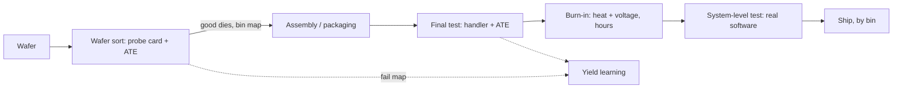
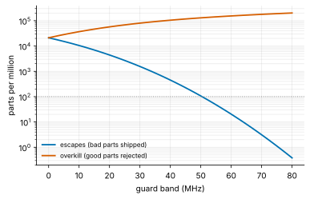
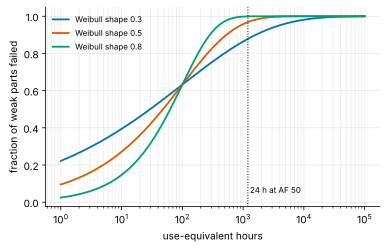

<!-- status: reviewed -->
# 25-11 · Test: ATE, Wafer Sort, Burn-In and Binning

| | |
|---|---|
| **Course** | [25 · Semiconductor Fabrication, Packaging, Test and Reliability](../README.md) |
| **University equivalent** | Production test and test economics (VLSI test courses: Bushnell and Agrawal, *Essentials of Electronic Testing*, chapters on test economics and ATE; burn-in from reliability courses) |
| **Prerequisites** | [19-12](../../19-digital-vlsi-design/chapters/19-12-design-for-test.md) (scan, BIST, coverage and defect level), [03-01](../../03-probability-statistics-and-random-variables/chapters/03-01-probability-in-ee-language.md) (escapes and overkill), [03-04](../../03-probability-statistics-and-random-variables/chapters/03-04-joint-distributions-and-clt.md) (speed prediction at sort), [03-05](../../03-probability-statistics-and-random-variables/chapters/03-05-estimation-and-hypothesis-testing.md) (Weibull and infant mortality), [25-04](25-04-yield-and-die-cost.md) (yield and cost per good die), [25-07](25-07-advanced-packaging-and-chiplets.md) (known-good die) |
| **Estimated study hours** | 6 |
| **Last verified** | 2026-11-26 |

**Learning objectives.** After this chapter you can:

1. Lay out a production test flow (wafer sort, final test, burn-in, system-level test) and explain what each step catches and costs.
2. Compute test cost per good die from tester rate, test time, index time and multisite efficiency.
3. Model infant mortality as a weak subpopulation with a decreasing-hazard Weibull and size a burn-in for a field-failure target.
4. Compute speed-bin fractions and revenue, and price the effect of tester accuracy and guard bands on escapes, overkill and revenue.
5. Read test-equipment market data and claims about the rising cost of test, as of late 2026.

---

## 1. Big picture

Every chip is tested before it ships, usually several times: at wafer level, after packaging, sometimes under heat and voltage for hours, and increasingly in a system board running real software. Test has three jobs. It **screens** out bad parts, so customers receive good ones (shipped quality, 19-12). It **sorts** good parts into grades (speed bins, voltage bins, harvested core counts). And it **learns**: test data, mapped across wafers and lots, is how fabs find and fix yield problems (25-04). Test is paid for per second of expensive equipment, so test time is engineered as carefully as the chip. For AI accelerators, with large dies, chiplets, HBM and kilowatt power, test has become a visible part of product cost and a growing market of its own [R-618].

- **Where it shows up:** every product's cost of goods; the speed and price grades of every CPU and GPU; automotive ppb quality (25-10); the known-good-die economics of chiplets (25-07).
- **The equipment:** automatic test equipment (ATE), dominated by Advantest and Teradyne; probe cards (FormFactor, Technoprobe, MJC); handlers and probers; burn-in and system-level-test systems [R-616]–[R-620].
- **The economics:** historically about 2% of manufacturing cost, now reported at several percent of the selling price for the most complex AI parts [R-618]; the two bases differ (selling price includes margin), so the figures are not a like-for-like trend.

## 2. Intuition first

**Physical picture.** A tester is a very fast, very precise instrument with hundreds to thousands of channels. Each channel can drive a pin, compare its response against an expected value at a precise time, or measure a voltage or current. At wafer sort, a **probe card** of tiny needles or springs touches the die's pads while a **prober** steps the wafer under it; at final test, a **handler** places packaged parts into sockets. A test program applies scan patterns (19-12), functional vectors, parametric measurements (leakage, supply current, I/O levels) and at-speed tests, decides pass or fail, and for good parts decides which bin they belong in.

**Analogy and its limits.** Production test is quality control on an assembly line with a toll booth: every unit passes through, and every second in the booth costs money, so the inspection must be quick and good enough. Unlike most inspection, though, test cannot look inside: it infers health from what the pins do, so it catches only faults its patterns excite (coverage, 19-12), and it measures with instruments that have their own error, so some good parts fail (overkill) and some bad parts pass (escapes). A second break: some defects are not yet failures at time zero. Weak parts that will fail in weeks look perfect; finding them needs stress over time (burn-in), not a quick look.

## 3. Theory

### 3.1 The test flow

- **Wafer sort (probe test).** Every die is tested on the wafer. Bad dies are inked or recorded in a wafer map so they are not packaged, which saves packaging cost and, for chiplets, the far larger cost of an assembled module (25-07). Sort is limited by probe-card contact (fine-pitch pads, current capacity), and by what can be tested before packaging (full-speed I/O and full power are hard).
- **Final test.** Packaged parts are tested again, at temperature, often at speed, to catch assembly damage and test what sort could not. Speed and voltage binning happen here or at sort.
- **Burn-in.** Parts run at elevated temperature and voltage for hours to precipitate early-life failures (§3.4). Wafer-level burn-in does this before packaging.
- **System-level test (SLT).** Parts boot and run real software in an application-like board. SLT catches defects that structural tests miss, such as timing-marginal paths exercised only by real workloads, and has grown with complex SoCs and AI accelerators.

### 3.2 Test cost and multisite

A tester's all-in cost rate $r$ (\$/h: depreciation, floor space, maintenance, handler or prober, labour) multiplies the time a part occupies it. With test time $t$ per part, an index time $t_i$ to move parts in and out, and $N$ sites tested in parallel taking $T_N$ in total,

$$
c_{test} = r\,\frac{T_N + t_i}{N}\quad\text{per die tested},\qquad c_{good} = \frac{c_{test}}{Y}
$$

per good die at yield $Y$, because bad dies consume test time too. Perfect parallelism would give $T_N = T_1$; a fully serial tester would give $T_N = NT_1$. The **multisite efficiency** interpolates:

$$
\eta = 1 - \frac{T_N - T_1}{(N - 1)T_1},\qquad T_N = T_1[1 + (N - 1)(1 - \eta)].
$$

Shared resources (a single analog instrument, serialized data transfer, the slowest site) lower $\eta$. Throughput rises by $NT_1/T_N$, less than $N$. Multisite is the main lever on test cost: four sites at 90% efficiency cut test cost per die by about two-thirds (Example 25-11.1). Its costs are tester channels, probe-card complexity and power delivery to several dies at once.

### 3.3 Screening: escapes and overkill

19-12 showed that structural coverage sets the defect level of shipped parts (the Williams–Brown model), and 03-01 framed escapes and overkill with Bayes' rule. Here the issue is **parametric** screening: a measured quantity (maximum frequency, leakage, a voltage) is compared against a limit, but the measurement has error. Let the true value $F$ have spread $\sigma_F$ across parts and the tester add independent error of standard deviation $\sigma_m$. A part is shipped if the *measured* value clears the limit $L$ plus a **guard band** $g$. Then

$$
P(\text{escape}) = P(F < L,\ F + e \ge L + g),\qquad P(\text{overkill}) = P(F \ge L,\ F + e < L + g),
$$

both computed by integrating the measurement-error distribution over the population. With $f_F$ the density of $F$, $\Phi$ the standard normal CDF and $Q = 1 - \Phi$ its tail,

$$
P(\text{escape}) = \int_{-\infty}^{L} f_F(x)\,Q\!\left(\frac{L + g - x}{\sigma_m}\right)dx,\qquad P(\text{overkill}) = \int_{L}^{\infty} f_F(x)\,\Phi\!\left(\frac{L + g - x}{\sigma_m}\right)dx:
$$

a bad part ($x < L$) escapes if its measurement error lifts it past $L + g$, and a good one is killed if the error leaves it below. With the limit at the population mean and no guard band, a rotation of coordinates gives the closed form $\arctan(\sigma_m/\sigma_F)/(2\pi)$ for each (Problem 25-11.13). Raising $g$ trades escapes for overkill; tester accuracy $\sigma_m$ sets how expensive that trade is (Example 25-11.6). Automotive parts run wide guard bands and accept the overkill; consumer parts run narrow ones.

### 3.4 Infant mortality and burn-in

Failure rate over life follows the bathtub curve (03-02): a falling early-life rate, a flat middle and a rising wear-out end (25-09). The early part is well modelled as a **weak subpopulation**: a small fraction $p_w$ of parts carry latent defects (a thin spot in an oxide, a marginal via, a contamination site) and fail early with a Weibull distribution of shape $\beta < 1$, whose hazard falls with time (03-05). Their cumulative failure fraction is

$$
F_w(t) = 1 - \exp\!\left[-\left(\frac{t}{\eta_w}\right)^{\beta}\right].
$$

**Burn-in** stresses all parts for a time $t_b$ at an acceleration factor $AF$ (temperature and voltage, 25-09), aging them by $AF\,t_b$ equivalent use hours. Weak parts that fail are removed; the fraction of the weak population that survives into the field is $1 - F_w(AF\,t_b)$, so the shipped weak fraction falls from $p_w$ to $p_w[1 - F_w(AF\,t_b)]$. The burn-in needed to reach a target shipped weak fraction $q$ follows by inverting:

$$
AF\,t_b = \eta_w\left[\ln\frac{p_w}{q}\right]^{1/\beta}.
$$

Two consequences: a shallower $\beta$ (more spread-out weak lives) needs much longer burn-in, and every hour of burn-in is tester-like capacity, power and handling for every part. Burn-in also consumes a sliver of the strong population's life, which is negligible for wear-out mechanisms with steep Weibull slopes. Wafer-level burn-in moves the stress before packaging, so weak dies are removed before they waste a package or a multi-die module [R-620].

### 3.5 Binning

Process variation spreads maximum frequency, leakage and power across dies (25-05). Rather than ship only the best, vendors **bin**: each tested part is assigned to the fastest grade it passes, or the lowest voltage at which it meets a frequency, or the number of working cores (harvesting, 25-04). With a Gaussian $F_{max}$ of mean $\mu$ and standard deviation $\sigma$, the fraction in a bin between thresholds $a$ and $b$ is $\Phi((b - \mu)/\sigma) - \Phi((a - \mu)/\sigma)$, and expected revenue per die is the bin fractions weighted by bin prices. Tester inaccuracy forces guard bands at every threshold, pushing parts down a bin; a few tens of megahertz of guard band can cost a tenth of revenue (Example 25-11.5). 03-04 showed how measurements at sort predict a die's bin before packaging.

### 3.6 Test data and yield learning

Every test generates data: pass/fail by test, parametric values, bins, all tagged by wafer, die position and lot. Mapped onto wafers, failures show signatures (edge rings, scratches, reticle-repeating patterns, centre spots) that point to specific process steps. Statistical outlier screens such as part average testing (03-05) reject parts that pass every limit but sit far from their neighbours, a strong predictor of early failure for automotive parts. Increasingly, test data feeds forward (a die's sort data choosing its final-test program) and back (fabs adjusting process from test results), and is a product in itself for yield-analytics vendors.

## 4. Worked examples

### Example 25-11.1 · Test cost per die and multisite (tier B)

**Setup.** A tester costs \$250 per hour all-in (assumed). A die takes $T_1$ = 2.0 s to test alone, with 0.3 s of index time per insertion; yield is 0.90 (assumed). Find (a) the single-site cost per die, (b) $T_4$ for four sites at 90% multisite efficiency, (c) the four-site cost per die and per good die, and (d) the throughput gain over single-site testing (test time only).

**Solution.** $r$ = 250/3600 = \$0.0694 per second.

- (a) $0.0694 \times (2.0 + 0.3)$ = **\$0.160** per die.
- (b) $T_4 = 2.0[1 + 3(0.1)]$ = **2.6** s.
- (c) $0.0694 \times (2.6 + 0.3)/4$ = **\$0.0503** per die; $0.0503/0.90$ = **\$0.0559** per good die.
- (d) $4 \times 2.0/2.6$ = **3.08**.

**Units check.** $/s × s = $. ✓

**Sanity check.** Four sites cut cost per die by a factor of about three. Cents per die are typical for small digital parts; large SoCs, analog-heavy parts and AI accelerators take far longer and cost far more per unit.

### Example 25-11.2 · What "5–7% of ASP" means (tier A)

**Setup.** Wing VC reports that test cost on leading AI parts has risen from below 2% of the selling price toward 5–7% [R-618]. For an accelerator selling at $30,000 and a combined test-cell rate of $500 per hour (both assumed), find (a) the test cost at 2%, 5% and 7%, and (b) the test-cell hours each implies.

**Solution.**

- (a) **$600**, **$1,500** and **\$2,100**.
- (b) $600/500$ = **1.2** h, **3.0** h and **4.2** h.

**Units check.** $/($/h) = h.

**Sanity check.** Hours of test per part only make sense once burn-in and system-level test are included, which is the point: the growth in AI test cost comes from long, power-hungry stresses and SLT, not from longer ATE pattern sets alone.

### Example 25-11.3 · Burn-in against a weak subpopulation (tier C)

**Setup.** One percent of parts are weak, failing with a Weibull of shape 0.5 and scale 100 h at use conditions (all assumed). Burn-in runs 24 h at an acceleration factor of 50. Find (a) the use-equivalent burn-in hours, (b) the fraction of weak parts removed, (c) the weak parts shipped in ppm, (d) first-year (8,766 h) field failures from weak parts without burn-in and (e) with it.

**Solution.**

- (a) $24 \times 50$ = **1200** h.
- (b) $F_w = 1 - e^{-\sqrt{1200/100}} = 1 - e^{-3.464}$ = **0.969**.
- (c) $10^6 \times 0.01 \times (1 - 0.969)$ = **313** ppm.
- (d) $0.01 \times F_w(8766) \times 10^6$ = **1.0e4** ppm.
- (e) The survivors fail in their first field year with probability $1 - \exp[-(\sqrt{9966/100} - \sqrt{1200/100})]$ = 0.9985, so **3.1e2** ppm.

**Units check.** Weibull arguments are hours over hours; ppm is a fraction × 10⁶.

**Sanity check.** A day of burn-in cuts first-year early failures by a factor of about **32**, from 1.0e4 to 3.1e2 ppm. The burn-in also scraps about 1% of production (the weak parts it catches), which is the screen working, not a loss.

### Example 25-11.4 · How long to burn in? (tier B)

**Setup.** For Example 25-11.3's population, find the use-equivalent burn-in and the hours at AF = 50 that leave 100 ppm of weak parts.

**Solution.** $AF\,t_b = 100[\ln(0.01/10^{-4})]^{2} = 100 \times 4.605^2$ = **2.12e3** h; $t_b = 2121/50$ = **42.4** h.

**Units check.** Hours. ✓

**Sanity check.** Going from 313 ppm to 100 ppm needs 77% more burn-in time, because with $\beta < 1$ the weak population's hazard keeps falling: each further decade of screening costs more. This is why suppliers prefer to remove the defect source in the fab rather than burn it out.

### Example 25-11.5 · Speed bins and the price of tester accuracy (tier B)

**Setup.** $F_{max}$ is Gaussian with mean 3.0 GHz and standard deviation 0.15 GHz (assumed). Bins: at least 3.2 GHz sells for \$500, 3.0–3.2 GHz for \$400, 2.8–3.0 GHz for \$300, and slower parts are scrapped (assumed). Find (a) the bin fractions, (b) the revenue per die, (c) the revenue with a 50 MHz guard band on every threshold, and (d) the loss.

**Solution.**

- (a) $Q(1.333)$ = **0.0912**; $0.5 - 0.0912$ = **0.409**; **0.409**; **0.0912** scrapped.
- (b) $0.0912 \times 500 + 0.409 \times 400 + 0.409 \times 300$ = **\$332**.
- (c) Thresholds at 3.25, 3.05 and 2.85 GHz: fractions 0.0478, 0.322 and 0.472; revenue **$294**.
- (d) **$37.6** per die, **11.3**%.

**Units check.** Fractions × $ = $.

**Sanity check.** A guard band one-third of σ costs a tenth of revenue, so tester timing accuracy and test-to-system correlation are worth real money; vendors spend heavily on correlating tester results with system behaviour to shrink guard bands.

### Example 25-11.6 · Guard band, escapes and overkill (tier C)

**Setup.** Parts are shipped as 3.0 GHz parts if their measured $F_{max}$ is at least 3.0 GHz plus a guard band. True $F_{max}$ is N(3.0, 0.15) GHz and the tester adds Gaussian error with σ = 20 MHz (assumed). Find escapes and overkill (as fractions of all parts) for guard bands of (a) 0, (b) 40 MHz and (c) 60 MHz.

**Solution.** Integrating over the population (lab and verify):

- (a) escapes **2.11e4** ppm, overkill **2.11e4** ppm (equal because the limit sits at the population mean and there is no guard band);
- (b) escapes **451** ppm, overkill **1.05e5** ppm;
- (c) escapes **20** ppm, overkill **1.54e5** ppm.

**Units check.** Probabilities expressed in ppm.

**Sanity check.** Escapes fall ever faster as the guard band grows (from 2.11e4 to 451 ppm over the first 40 MHz, then to 20 ppm with the next 20 MHz), while overkill climbs by several percentage points for every 20 MHz. With the limit at the population's mean, many parts sit near it; real limits usually sit in a tail, where both numbers are far smaller.

<!-- answer-key -->

| ID | Quantity | Value | Unit |
|---|---|---|---|
| Ex 25-11.1a | single-site cost per die | 0.160 | $ |
| Ex 25-11.1a0 | tester rate per second | 0.0694 | $/s |
| Ex 25-11.1b | four-site test time | 2.6 | s |
| Ex 25-11.1c | four-site cost per die | 0.0503 | $ |
| Ex 25-11.1c1 | per good die | 0.0559 | $ |
| Ex 25-11.1d | throughput gain | 3.08 | |
| Ex 25-11.2a | test cost at 2% | 600 | $ |
| Ex 25-11.2a1 | at 5% | 1500 | $ |
| Ex 25-11.2a2 | at 7% | 2100 | $ |
| Ex 25-11.2b | hours at 2% | 1.2 | h |
| Ex 25-11.2b1 | hours at 5% | 3.0 | h |
| Ex 25-11.2b2 | hours at 7% | 4.2 | h |
| Ex 25-11.3a | equivalent hours | 1200 | h |
| Ex 25-11.3b | weak fraction removed | 0.969 | |
| Ex 25-11.3c | weak shipped | 313 | ppm |
| Ex 25-11.3d | first-year failures without burn-in | 1.0e4 | ppm |
| Ex 25-11.3e | first-year failures with burn-in | 3.1e2 | ppm |
| Ex 25-11.3e0 | survivors failing in first year | 0.9985 | |
| Ex 25-11.3f | reduction in first-year failures | 32 | |
| Ex 25-11.4a | equivalent hours for 100 ppm | 2.12e3 | h |
| Ex 25-11.4b | burn-in hours at AF 50 | 42.4 | h |
| Ex 25-11.4c | extra time over 24 h | 77 | % |
| Ex 25-11.5a | top-bin fraction | 0.0912 | |
| Ex 25-11.5a1 | 3.0–3.2 GHz fraction | 0.409 | |
| Ex 25-11.5b | revenue per die | 332 | $ |
| Ex 25-11.5c | revenue with guard band | 294 | $ |
| Ex 25-11.5c0 | guard-banded fractions, top | 0.0478 | |
| Ex 25-11.5c1 | guard-banded fractions, second | 0.322 | |
| Ex 25-11.5c2 | guard-banded fractions, third | 0.472 | |
| Ex 25-11.5d | loss per die | 37.6 | $ |
| Ex 25-11.5d1 | loss | 11.3 | % |
| Ex 25-11.6a | escapes, no guard band | 2.11e4 | ppm |
| Ex 25-11.6a1 | overkill, no guard band | 2.11e4 | ppm |
| Ex 25-11.6b | escapes, 40 MHz | 451 | ppm |
| Ex 25-11.6b1 | overkill, 40 MHz | 1.05e5 | ppm |
| Ex 25-11.6c | escapes, 60 MHz | 20 | ppm |
| Ex 25-11.6c1 | overkill, 60 MHz | 1.54e5 | ppm |

## 5. Simulate it

The lab is [labs/25-11-lab/](../labs/25-11-lab/README.md). `testcost.py` computes multisite test cost, the weak-subpopulation burn-in model (closed form and Monte Carlo), bin fractions and revenue, and escapes and overkill by integration and by Monte Carlo; the notebook runs the parts below.

*Figure 1. Guard band trades escapes for overkill; the tester's accuracy sets the exchange rate.*

*Figure 2. The shallower the Weibull shape, the longer a burn-in must run to remove the same share of weak parts.*

**Predict, then run:**

1. *Predict* the multisite efficiency at which eight sites cost the same per die as four sites at 90%, then solve for it.
2. *Predict* the fraction of weak parts a 24 h, AF = 50 burn-in removes if β = 0.3, then compute it and confirm by Monte Carlo.
3. *Predict* the guard band that limits escapes to 100 ppm in Example 25-11.6, then solve for it and read off the overkill.
4. *Predict* how bin revenue changes if process control tightens σ from 0.15 to 0.10 GHz, then compute it.

## 6. Engineering tradeoffs

| Knob | Improves | Costs | Typical decision owner |
|---|---|---|---|
| More sites per insertion | Cost per die, throughput | Tester channels, probe-card complexity, power delivery | Test engineering |
| More test content (patterns, SLT) | Shipped quality | Test time, tester capacity | Product and test engineering |
| Wider guard bands | Fewer escapes | Overkill, lower bins, revenue | Quality with product line |
| Longer or hotter burn-in | Early-life failures | Capacity, power, handling, slight wear | Reliability with operations |
| Wafer-level instead of package burn-in | Bad dies removed before packaging | WLBI equipment, probe contact at power | Test and packaging |
| Finer binning | Revenue from variation | SKU complexity, inventory | Product marketing |
| Better tester accuracy and correlation | Narrower guard bands | Equipment and correlation work | Test engineering |

## 7. Numbers to know

Perishable rows are as of Nov 2026; the date column gives the source's own date.

| Quantity | Value | Dated | Source |
|---|---|---|---|
| Historical cost of test | ≈ 2% of manufacturing cost | 2020–2021 | [R-618] |
| Cost of test on leading AI parts | toward 5–7% of ASP (one VC estimate) | May 2026 | [R-618] |
| ATE market CY2025 | ≈ $9.0 B, +50% (one VC estimate); two vendors ≈ 90%+ | May 2026 | [R-618] |
| Advantest tester share | 58% (CY2024) → 65% (CY2025), company estimate | 2026 | [R-616] |
| Advantest FY2025 | ¥1,128.6 B sales, 44.2% operating margin | Apr 2026 | [R-616] |
| Teradyne 2025 | $3.19 B revenue; ≈ 50% of "VIP compute" test (company belief) | Feb 2026 | [R-617] |
| FormFactor FY2025 | $785.0 M revenue (probe cards) | Feb 2026 | [R-619] |
| Multisite efficiency | defined $1 - (T_N - T_1)/((N - 1)T_1)$ | timeless | §3.2 |

## 8. Common mistakes

- **Costing test per good die without the bad ones.** Failing dies use tester time too; divide by yield.
- **Assuming N sites give N times the throughput.** Multisite efficiency below 100% is the norm.
- **Ignoring measurement error at limits.** Every limit needs a guard band sized to the tester's accuracy.
- **Treating burn-in as free.** Its hours, power and handling scale with every part; and with β < 1 each further decade of screening costs more.
- **Confusing coverage with quality.** High fault coverage does not catch parametric marginality or weak parts; that needs at-speed tests, SLT and stress.
- **Reading a vendor's market share as the market's.** ATE shares are mostly company estimates.

## 9. Practitioner lens

**State of the art (as of Nov 2026).**

- *ATE vendors* [Established for financials; Industry estimate for shares]. Advantest reported record FY2025 (to March 2026) sales of ¥1,128.6 billion and operating income of ¥499.1 billion (a 44.2% margin), estimated its tester share at 65% in CY2025 (58% in CY2024), with about 66% of SoC testers and 60% of memory testers, and in October 2026 raised its FY2026 forecast to ¥1,863.0 billion of sales [R-616]. Teradyne reported 2025 revenue of $3.19 billion (+13%), with semiconductor test nearly 80% of revenue; management believes it held about 50% of the "VIP compute" market, and compute became the largest part of its SoC business, "eclipsing" mobile. Its Q3 2026 revenue was $1,306 million, against $769 million a year earlier [R-617].
- *Market and cost of test* [Established for the 2% rule; Industry estimate for the rest]. Test was long held to about 2% of manufacturing cost; a May 2026 venture-capital analysis puts the CY2025 ATE market at $9.0 billion (+50%), the two leading vendors at about 90% combined, and test cost on the most complex AI packages at 5–7% of selling price [R-618].
- *Probe cards* [Established for FormFactor; Industry estimate for the ranking]. FormFactor's FY2025 revenue was $785.0 million (+2.8%); TrendForce sees Technoprobe "poised to overtake" it as the largest supplier, with MJC the third major player [R-619].
- *Burn-in for AI* [Industry estimate]. Aehr Test Systems reports its lead AI customer "shifting their burn-in from system-level to all wafer-level" for AI accelerators; Aehr's FY2026 revenue was $50.0 million and it guided $130–150 million for FY2027 [R-620].

**Why it matters commercially.** Test sits where AI hardware, quality and capital equipment meet: AI accelerators need more tester time, more power per site, more SLT and burn-in, and their packages carry so much value that every escape and every scrapped module matters. The ATE duopoly has been among the clearest beneficiaries of the AI build-out [R-616], [R-617]. For a chip company, test is both a cost line and a source of competitive data; for an acquirer, test capability (programs, correlation, data infrastructure) is often what makes a newly acquired product line shippable at scale.

**Marketing vs Reality.**

- *"65% market share."* A company estimate of a market whose size is itself an estimate [R-616], [R-618].
- *"Test cost tripled."* On which parts, and which stages (ATE, burn-in, SLT)? One VC source for the most complex AI packages [R-618].
- *"Wafer-level burn-in replaces system-level burn-in."* For one customer's accelerators, per the equipment vendor [R-620]; ask what failure modes each catches.
- *"Our coverage is 99%."* Stuck-at coverage, or defect coverage under realistic fault models, and what do field returns say (19-12)?

**Questions for engineering leaders.**

1. **"What is your test cost per good unit, by stage, and how is it trending?"** *Strong:* sort, final, burn-in and SLT costs with times, sites and efficiencies. *Evasive:* "test is a small part of cost."
2. **"What guard bands do you run, and how were they set?"** *Strong:* tester accuracy, correlation studies, escape and overkill estimates per limit. *Evasive:* "we use standard limits."
3. **"What does your burn-in remove, and how do you know it's enough?"** *Strong:* the weak-population model, early-failure data versus burn-in time, field returns. *Evasive:* "we burn in for 24 hours."
4. **"How much revenue does binning recover, and what limits it?"** *Strong:* bin distributions, guard bands and their cost. *Evasive:* "we sell everything that works."
5. **"What does your test data tell your fab, and how fast?"** *Strong:* wafer-map signatures, feed-back loops and examples of yield fixes. *Evasive:* "the foundry handles yield."

## 10. Concept check

**Q1.** Why test at wafer sort if every part will be tested again after packaging?

Answer

To avoid packaging bad dies: packaging, and for chiplets the whole multi-die module, costs far more than a sort test. Sort data also feeds yield learning and can pre-sort dies into bins.

**Q2.** Why does four-site testing not give four times the throughput?

Answer

Shared instruments, serialized data transfers and the slowest site lengthen the multisite test time; with efficiency η, four sites take $T_1[1 + 3(1 - \eta)]$, not $T_1$.

**Q3.** What is a guard band, and what does it trade?

Answer

A margin added to a test limit to allow for measurement error. A wider guard band reduces escapes (bad parts passing) but increases overkill (good parts failing) and pushes parts into lower bins.

**Q4.** Why does burn-in work, and when does it work poorly?

Answer

It ages all parts quickly so that weak ones, with a decreasing early hazard, fail before shipment. It works poorly when the weak population's Weibull shape is very shallow (failures spread over a long time) or when the stress does not accelerate the relevant defect mechanism.

**Q5.** How does binning turn variation into revenue?

Answer

Instead of shipping only parts that meet one high specification, each part is sold in the highest grade it passes, so the fast tail commands a premium and slower parts still sell.

**Q6.** Why has the cost of test risen for AI accelerators?

Answer

Large, multi-die packages with HBM need longer and more power-hungry tests, burn-in and system-level test, and their high value makes escapes and scrapped modules costly, justifying more screening.

Now try the [25-11 problem set](../problems/25-11-problems.md).

## 11. Key terms

[Automatic test equipment (ATE)](../../../reference/glossary.md#automatic-test-equipment-ate) · [Wafer sort](../../../reference/glossary.md#wafer-sort) · [Probe card](../../../reference/glossary.md#probe-card) · [Final test](../../../reference/glossary.md#final-test) · [Multisite efficiency](../../../reference/glossary.md#multisite-efficiency) · [Burn-in](../../../reference/glossary.md#burn-in) · [Wafer-level burn-in (WLBI)](../../../reference/glossary.md#wafer-level-burn-in-wlbi) · [System-level test (SLT)](../../../reference/glossary.md#system-level-test-slt) · [Test guard band](../../../reference/glossary.md#test-guard-band) · [Overkill](../../../reference/glossary.md#overkill) · [Speed binning](../../../reference/glossary.md#speed-binning) · [Defect level (DPPM)](../../../reference/glossary.md#defect-level-dppm) · [Known-good die (KGD)](../../../reference/glossary.md#known-good-die-kgd) · [Bathtub curve](../../../reference/glossary.md#bathtub-curve)

## 12. Connections

- **Previous:** [25-10 Qualification and Functional Safety](25-10-qualification-and-functional-safety.md): the quality targets test must deliver.
- **Next:** [25-12 Post-Silicon Validation and Bring-Up](25-12-post-silicon-validation.md): testing first silicon to find design, not manufacturing, problems.
- **Prerequisites used:** [19-12](../../19-digital-vlsi-design/chapters/19-12-design-for-test.md) for scan, BIST and defect level; [03-01](../../03-probability-statistics-and-random-variables/chapters/03-01-probability-in-ee-language.md) for escapes and overkill; [03-04](../../03-probability-statistics-and-random-variables/chapters/03-04-joint-distributions-and-clt.md) for speed prediction; [03-05](../../03-probability-statistics-and-random-variables/chapters/03-05-estimation-and-hypothesis-testing.md) for Weibull and part average testing; [25-04](25-04-yield-and-die-cost.md) for yield and harvesting; [25-09](25-09-reliability-physics.md) for acceleration factors.
- **Used later:** [26-04](../../26-engineering-design-and-professional-practice/chapters/26-04-engineering-economics-2.md) (cost models), [27-07](../../27-system-architectures/chapters/27-07-ai-datacenter-server-and-rack.md) (AI accelerators), and the practitioner chapters on technical diligence.

> **Deeper:** see companion repo *Semiconductor Capital Equipment* for ATE, probers, handlers, probe cards and burn-in systems.

## 13. Further study

- M. L. Bushnell and V. D. Agrawal, *Essentials of Electronic Testing for Digital, Memory and Mixed-Signal VLSI Circuits* (Springer, 2000): test economics, ATE and parametric test.
- W. Kuo and Y. Kuo, "Facing the headaches of early failures: a state-of-the-art review of burn-in decisions," *Proc. IEEE* 71(11), 1983: the classic treatment of burn-in.
- SemiEngineering's test coverage (2020–2026) for the changing economics of test.

## 14. Sources

1. Advantest results and share estimates: [R-616].
2. Teradyne results and share: [R-617].
3. ATE market size and cost-of-test trends: [R-618].
4. Probe cards: [R-619].
5. Wafer-level burn-in for AI accelerators: [R-620].
