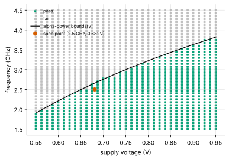
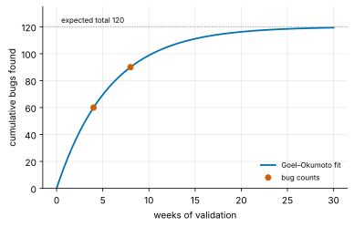

<!-- status: reviewed -->
# 25-12 · Post-Silicon Validation and Bring-Up

| | |
|---|---|
| **Course** | [25 · Semiconductor Fabrication, Packaging, Test and Reliability](../README.md) |
| **University equivalent** | Post-silicon validation and debug (graduate verification and test courses; Mitra, Seshia and Nicolici's DAC 2010 survey; industrial bring-up practice) |
| **Prerequisites** | [19-13](../../19-digital-vlsi-design/chapters/19-13-verification-methods.md) (pre-silicon verification and its limits), [19-12](../../19-digital-vlsi-design/chapters/19-12-design-for-test.md) (scan and JTAG), [25-05](25-05-foundries-pdks-specialty-processes.md) (corners and the alpha-power delay law), [25-11](25-11-test-ate-sort-burn-in.md) (production test), [00-05](../../00-orientation/chapters/00-05-how-chip-companies-are-organized.md) (first-silicon statistics and the cost of a slip), [03-05](../../03-probability-statistics-and-random-variables/chapters/03-05-estimation-and-hypothesis-testing.md) (confidence intervals) |
| **Estimated study hours** | 4 |
| **Last verified** | 2026-11-26 |

**Learning objectives.** After this chapter you can:

1. Describe the bring-up sequence of first silicon and the debug infrastructure (scan dump, trace buffers, triggers) that makes it possible, and size a trace buffer.
2. Characterize silicon across voltage, frequency and temperature with shmoo plots, and estimate minimum operating voltage with an alpha-power model and guard bands.
3. Model bug discovery with a reliability-growth curve and estimate the bugs that remain.
4. Compare fix options (firmware workaround, metal-only ECO, full respin) with an expected-cost decision tree.
5. Read first-silicon-success statistics with their confidence intervals and methodology caveats, as of late 2026.

---

## 1. Big picture

When the first wafers come back from the fab, the design team finally holds the real chip. Pre-silicon verification (19-13) has run billions of simulated cycles, but the chip in the lab runs billions of cycles *per second*, with real software, real analog behaviour, real power delivery and real temperature. **Post-silicon validation** uses that speed to find what verification missed, and **bring-up** is its first phase: getting the chip to power on, clock, reset, talk to a debugger and boot. Then comes **characterization**: mapping where across voltage, frequency and temperature the chip works, which sets the product's specifications and bins. Every bug found must be localized inside a chip whose internal signals are mostly invisible, then fixed in firmware, with a metal-layer change, or with a full respin. The stakes are the schedule: industry surveys report that only a small minority of chips work fully on first silicon [R-621], [R-622].

- **Where it shows up:** every new chip's first months in the lab; the gap between tape-out and production ("A0 to production"); every errata sheet.
- **The tools:** evaluation and validation boards, debuggers, logic analyzers on chip (trace buffers), scan dumps, shmoo plotters, thermal forcers and lab automation.
- **The economics:** a respin costs a new mask set (tens of millions of dollars at leading edge, by unofficial estimates) and months of schedule; a workaround costs performance or features [R-623].

## 2. Intuition first

**Physical picture.** Bring-up is commissioning a new factory. First you check that the power and water connections hold (power rails, no shorts), then that the clocks tick (PLLs lock), that the control room can talk to the floor (JTAG), that the first machine runs a simple job (boot ROM, a memory test), and only then do you run a full production shift (operating system, workloads). When something fails, the problem might be in the building (the board), the machines (the silicon), or the instructions (firmware), and part of the skill is deciding which.

**Analogy and its limits.** Post-silicon debug is forensic accounting on a company whose books are mostly sealed: you see the reported totals (the pins and a few counters), you can request a few detailed ledgers at a time (trace buffers), and you must infer where the fraud (the bug) entered. The analogy breaks in a useful direction: unlike an accountant, the engineer can rerun the business from the same starting point, changing one variable at a time (voltage, frequency, temperature, the test program) until the failure is cornered, and can freeze the books at any instant with a scan dump. The hard part is the bugs that do not reproduce.

## 3. Theory

### 3.1 The bring-up sequence

1. **Power.** Rails are brought up one by one at current limit; currents are checked against expectations to catch shorts and gross leakage. Power sequencing and in-rush are verified.
2. **Clocks and reset.** PLLs must lock (20-10); reset must release cleanly across clock domains.
3. **Debug access.** The JTAG port (19-12) is the lifeline: through it engineers read identification registers, run scan chains, access on-chip debug and load code.
4. **Boot.** The boot ROM executes, memories are initialized and tested, and firmware loads. Each step usually has a fallback path (boot from JTAG, run from internal SRAM) so that one broken block does not stop bring-up.
5. **System and stress.** Operating systems, drivers, I/O links (24-03, 24-05), and stress workloads run across voltage, frequency and temperature.

Teams practise all of this before silicon arrives on emulators and FPGA prototypes running the real firmware (19-13), which is why bring-up of a mature team's chip can be fast; the lab board, its power delivery and its firmware are themselves designs that can be wrong.

### 3.2 Seeing inside: debug infrastructure

The fundamental problem of post-silicon validation is observability: a chip has billions of internal signals and a few hundred pins. Mitra, Seshia and Nicolici note that "bug localization generally dominates post-silicon validation effort and costs" [R-624]. Designs therefore include:

- **Scan dump.** Stopping the clocks and shifting out every scan flip-flop (19-12) gives a complete snapshot of state at one instant, but the chip must stop, and the snapshot is of one moment.
- **Trace buffers.** An on-chip memory records a selected set of $S$ signals every cycle in a circular buffer of depth $D$, triggered by a programmable event. Its capacity is $SD$ bits, and at clock frequency $f$ it holds a window of only $D/f$ seconds:

$$
\text{storage} = S \cdot D\ \text{bits},\qquad \text{window} = \frac{D}{f}.
$$

A 256-signal, 4,096-entry buffer at 2 GHz holds 1 Mbit and two microseconds of history (Example 25-12.1). Triggers, signal selection and compression are therefore as important as the buffer itself, and designers must choose in advance which signals can ever be observed.

- **Performance counters and assertions in silicon.** Event counters, error-logging registers and hardware checkers report symptoms (an ECC error, a parity failure, a timeout) and where they occurred.
- **Patching hooks.** Microcode or firmware patch RAM, "chicken bits" that disable a feature or change a mode, and spare cells for metal-only fixes, all designed in before tape-out.

### 3.3 Characterization: shmoo plots and minimum voltage

A **shmoo plot** sweeps two conditions, usually supply voltage and frequency, and marks each point pass or fail; its boundary is the chip's operating envelope. To first order the boundary follows the alpha-power delay law (25-05): gate delay $\propto V/(V - V_{TH})^{\alpha}$, so the maximum frequency at supply $V$ is

$$
F_{max}(V) = K\,\frac{(V - V_{TH})^{\alpha}}{V},
$$

with $K$ fitted to one measured point. The minimum voltage $V_{min}$ for a target frequency follows by solving $F_{max}(V) = F_{target}$; the product specification then adds guard bands for aging (25-09), temperature, tester accuracy (25-11) and part-to-part spread, measured across many units and skewed "corner lots" processed fast and slow on purpose (Example 25-12.2). Lowering the guaranteed voltage saves power roughly as $V^2$, so characterization quality is worth real product value. Deviations from the smooth boundary are themselves symptoms: a hole in the shmoo, or a boundary that bends at low voltage, points to a marginal path, a memory-cell stability limit or a power-delivery problem.

**How many parts?** A $V_{min}$ distribution's spread is estimated from a sample; to know its standard deviation within ±10% at 95% confidence takes about $1 + z^2/(2\delta^2)$, rounded up to **194** parts, by a large-sample approximation (Example 25-12.5); the exact chi-square interval of 03-05 is lopsided and needs more. Either way characterization uses hundreds of units from several lots.

### 3.4 Bug discovery and when to stop

Bugs are found quickly at first and then more slowly. A common reliability-growth model (Goel–Okumoto) assumes each remaining bug is found at a constant rate $b$, so the expected cumulative bugs found by time $t$ is

$$
m(t) = a\left(1 - e^{-bt}\right),
$$

with $a$ the total expected bugs. Two counts at different times determine both parameters (Example 25-12.3), and the remaining bugs, $a - m(t)$, and the time to find a given fraction, $t_q = \ln[1/(1 - q)]/b$, follow. The model is crude (bug-finding rates change as new tests and workloads start), but it turns "are we done?" into a quantitative question, and its fitted $a$ is a useful sanity check on a team's claims.

### 3.5 Fixing what is found

A bug found in silicon has four kinds of remedy, in rising cost:

1. **Software or firmware workaround:** avoid the triggering condition, add a delay, patch microcode. Cheap and fast; may cost performance or features, and goes into the errata.
2. **Configuration change:** a chicken bit disables or modifies the faulty feature.
3. **Metal-only ECO:** rewire spare cells by changing only metal and via masks, no transistor (FEOL) layers. Only those masks are remade, and wafers parked before the metal steps finish quickly (00-05). The fewer and higher the changed layers, the cheaper and faster the fix; a change that reaches the finely patterned lower metals costs much more.
4. **Full respin:** a new base-layer mask set and a full fab cycle.

The decision weighs direct cost, schedule (the dominant term, 00-05), the probability that a fix works, and the risk of new bugs it introduces. An expected-cost decision tree makes the trade explicit (Example 25-12.4): a cheaper, faster fix with a moderate chance of success can beat a sure but slow full respin. Mask costs themselves are unofficial and widely ranged: estimates for a leading-edge full mask set run from about $10–20 million (3–5 nm) to $20–30 million (3 nm) and toward $40 million beyond it [R-623] **[Contested]**.

### 3.6 Reading first-silicon statistics

The Siemens EDA and Wilson Research Group study is the industry's main public data source. Its 2024 edition reported 14% of IC/ASIC projects achieving first-silicon success, the lowest in twenty years, with 75% behind schedule [R-621]; the 2026 edition reported 5% (604 participants, 320 on IC/ASIC projects) [R-622]. Two statistical cautions apply. First, a 5% estimate from 320 respondents has a 95% confidence interval of roughly 3–8% (Example 25-12.6). Second, the study changed its recruitment method in 2024, so comparisons with 2022 and earlier mix a real trend with a sampling change, and the 2026 sample is heavy in CPU, GPU and AI-accelerator projects [R-621], [R-622]. The study's own author notes that it "does not establish" that any single factor causes the decline [R-622].

## 4. Worked examples

### Example 25-12.1 · Sizing a trace buffer (tier A)

**Setup.** A trace buffer records 256 signals for 4,096 cycles at 2 GHz (assumed). Find (a) its storage in bits and kibibytes, and (b) its time window. (c) If a bug's cause precedes its symptom by 10 µs, by how much must the window grow, or what must the trigger do instead?

**Solution.**

- (a) $256 \times 4096$ = **1.05e6** bits = **128** KiB.
- (b) $4096/(2 \times 10^9)$ s = **2.05** µs.
- (c) $10/2.05$ = **4.9** times deeper, about **5.1** Mbit (10⁶ bits), or a trigger that fires on an earlier event so the 2 µs window lands on the cause.

**Units check.** Signals × entries = bits; entries/(cycles/s) = s. ✓

**Sanity check.** Two microseconds is a few thousand instructions; an operating-system bug may unfold over milliseconds. Trace buffers are therefore paired with triggers, filtering and recording only on selected events.

### Example 25-12.2 · Vmin from a shmoo point (tier B)

**Setup.** First silicon runs at 3.0 GHz at 0.75 V. With the alpha-power model, $V_{TH}$ = 0.30 V and α = 1.3 (assumed), find (a) the fitted constant $K$ and the predicted $F_{max}$ at (b) 0.70 V and (c) 0.80 V. (d) What voltage reaches 2.5 GHz? (e) With 30 mV of guard band for aging and spread, what voltage is specified, and (f) how much dynamic power does it save at 2.5 GHz against running at 0.75 V?

**Solution.**

- (a) $K = 3.0 \times 0.75/0.45^{1.3}$ = **6.35** GHz·V^(1−α).
- (b) **2.76** GHz. (c) **3.23** GHz.
- (d) Solving $F_{max}(V) = 2.5$: **0.651** V.
- (e) $0.651 + 0.030$ = **0.681** V.
- (f) With the unrounded **0.6806** V, $(0.6806/0.75)^2$ = **0.823**: **17.7**% less dynamic power.

**Units check.** $K$ absorbs the units so that $F_{max}$ comes out in GHz.

**Sanity check.** Each 50 mV moves $F_{max}$ by about a quarter of a gigahertz near the operating point, and the 30 mV guard band alone is worth about **0.16** GHz of frequency or **8.6**% of dynamic power at 2.5 GHz: guard bands are product decisions.

### Example 25-12.3 · How many bugs are left? (tier B)

**Setup.** A validation team has logged 60 unique silicon bugs after 4 weeks and 90 after 8 weeks (assumed). Fit the Goel–Okumoto model and find (a) $b$, (b) the expected total $a$, (c) the bugs remaining at 8 weeks and (d) the time to find 95% of them.

**Solution.** $m(8)/m(4) = 1 + e^{-4b} = 1.5$, so $e^{-4b} = 0.5$:

- (a) $b = \ln 2/4$ = **0.173** per week.
- (b) $a = 60/(1 - 0.5)$ = **120** bugs.
- (c) $120 - 90$ = **30**.
- (d) $t = \ln 20/0.173$ = **17.3** weeks.

**Units check.** $bt$ is dimensionless; $1/b$ is in weeks.

**Sanity check.** Going from 75% of the estimated bugs (week 8) to 95% (week 17.3) takes longer, **9.3** weeks, than reaching 75% did, which is why production release criteria combine the discovery curve with the severity of open bugs and the existence of workarounds, rather than waiting for zero.

### Example 25-12.4 · Metal-only ECO or full respin? (tier C)

**Setup.** A bug needs a hardware fix. Option M, a metal-only ECO: masks $2 M, 10 weeks, a 0.8 probability of fully fixing the bug; if it fails, a full respin follows. Option F, a full respin: $25 M, 20 weeks, certain to fix it. Delay costs $5 M of gross profit per week (all assumed). Find (a) the expected cost of M, (b) the cost of F, and (c) the probability of success below which M is no longer worth trying.

**Solution.**

- (a) $2 + 10 \times 5 + 0.2 \times (25 + 20 \times 5)$ = **$77 M**.
- (b) $25 + 20 \times 5$ = **$125 M**.
- (c) $52 + (1 - p) \times 125 = 125$ gives $p$ = **0.416**.

**Units check.** $ M + weeks × $ M/week = $ M.

**Sanity check.** Delay, not mask cost, dominates both options (as 00-05 found for slips). This is why designs carry spare cells and why teams try the metal fix first even with modest confidence; the model ignores the chance that either fix introduces new bugs, which favours smaller changes further.

### Example 25-12.5 · How many parts to characterize? (tier B)

**Setup.** How many parts are needed to know the standard deviation of $V_{min}$ within ±10% at 95% confidence? Use (a) the large-sample approximation and (b) the exact chi-square interval of 03-05, requiring its upper side to stay within +10%.

**Solution.**

- (a) For Gaussian data the sample variance $S^2$ has $\operatorname{Var}(S^2) = 2\sigma^4/(n - 1)$. The sample standard deviation is $S = \sqrt{S^2}$, and by the delta method (03-03) $\operatorname{SD}(S) \approx \frac{1}{2\sigma}\operatorname{SD}(S^2) = \sigma/\sqrt{2(n - 1)}$. A 95% interval of $\pm z\,\sigma/\sqrt{2(n - 1)}$ is within $\pm\delta\sigma$ when $n = 1 + z^2/(2\delta^2) = 1 + 1.96^2/(2 \times 0.01)$ = **193.07**, so **194** parts (a sample size is rounded up).
- (b) The exact interval for $\sigma$ runs from $s\sqrt{(n-1)/\chi^2_{0.975}}$ to $s\sqrt{(n-1)/\chi^2_{0.025}}$ and is lopsided, its upper side the longer. Increasing $n$ until $\sqrt{(n-1)/\chi^2_{0.025,\,n-1}} \le 1.10$ gives **234** parts.

**Units check.** Dimensionless.

**Sanity check.** The approximation is symmetric and slightly optimistic; the exact interval asks for about a fifth more parts. Specifying a voltage several σ from the mean multiplies any error in σ, so characterization uses hundreds of parts across lots and corner splits, not a handful of samples.

### Example 25-12.6 · How precise is "5%"? (tier B)

**Setup.** The 2026 study reports 5% first-silicon success among 320 IC/ASIC respondents [R-622]. Taking 16 successes out of 320, find (a) the point estimate and (b) the 95% Wilson score interval. (c) How many times smaller than 2024's reported 14.4% is the point estimate?

**Solution.**

- (a) $16/320$ = **5.0**%.
- (b) $\hat{p} = 0.05$, $z = 1.96$: $\dfrac{\hat{p} + z^2/2n \pm z\sqrt{\hat{p}(1-\hat{p})/n + z^2/4n^2}}{1 + z^2/n}$ = **3.1**% to **8.0**%. The simpler Wald interval $\hat p \pm z\sqrt{\hat p(1 - \hat p)/n}$ of 03-05 would give **2.6**% to **7.4**%.
- (c) $14.4/5$ = **2.9**.

**Units check.** Proportions.

**Sanity check.** The 2026 interval lies entirely below the 2024 one (Problem 25-12.6), so the decline is not sampling noise alone; but self-selection, the 2024 methodology change and the 2026 mix of complex processor projects all affect what the number means [R-621], [R-622].

> **Math refresher — the Wilson interval.** The Wald interval of 03-05 plugs the estimate $\hat p$ into the standard error. For small $\hat p$ or small $n$ it can reach below zero and covers the truth less often than claimed. Wilson's interval instead collects every $p$ that a $z$-test would not reject: $(\hat p - p)^2 \le z^2p(1 - p)/n$. That is a quadratic inequality in $p$; solving $(1 + z^2/n)p^2 - (2\hat p + z^2/n)p + \hat p^2 = 0$ gives the two endpoints above. It never leaves [0, 1] and is shifted toward ½, which is why it is preferred for rare outcomes such as first-silicon success.

<!-- answer-key -->

| ID | Quantity | Value | Unit |
|---|---|---|---|
| Ex 25-12.1a | trace storage | 1.05e6 | bits |
| Ex 25-12.1a1 | trace storage | 128 | KiB |
| Ex 25-12.1b | time window | 2.05 | µs |
| Ex 25-12.1c | depth factor for 10 µs | 4.9 | |
| Ex 25-12.1c1 | storage for 10 µs | 5.1 | Mbit |
| Ex 25-12.2a | fitted K | 6.35 | |
| Ex 25-12.2b | Fmax at 0.70 V | 2.76 | GHz |
| Ex 25-12.2c | Fmax at 0.80 V | 3.23 | GHz |
| Ex 25-12.2d | voltage for 2.5 GHz | 0.651 | V |
| Ex 25-12.2e | specified voltage | 0.681 | V |
| Ex 25-12.2e0 | specified voltage, unrounded | 0.6806 | V |
| Ex 25-12.2f | power ratio | 0.823 | |
| Ex 25-12.2f1 | power saving | 17.7 | % |
| Ex 25-12.2g | frequency worth of 30 mV | 0.16 | GHz |
| Ex 25-12.2h | power cost of 30 mV | 8.6 | % |
| Ex 25-12.3a | discovery rate b | 0.173 | 1/week |
| Ex 25-12.3b | expected total bugs | 120 | |
| Ex 25-12.3c | bugs remaining | 30 | |
| Ex 25-12.3d | time to 95% | 17.3 | weeks |
| Ex 25-12.3e | weeks from 75% to 95% | 9.3 | weeks |
| Ex 25-12.4a | expected cost, metal ECO | 77 | $M |
| Ex 25-12.4b | cost, full respin | 125 | $M |
| Ex 25-12.4c | break-even success probability | 0.416 | |
| Ex 25-12.5a0 | unrounded sample size | 193.07 | |
| Ex 25-12.5a | parts for ±10% on sigma | 194 | |
| Ex 25-12.5b | parts, exact chi-square | 234 | |
| Txt 25-12.a | parts for ±10% on sigma (text) | 194 | |
| Ex 25-12.6a | point estimate | 5.0 | % |
| Ex 25-12.6b | Wilson lower | 3.1 | % |
| Ex 25-12.6b1 | Wilson upper | 8.0 | % |
| Ex 25-12.6c | ratio to 2024 | 2.9 | |
| Ex 25-12.6d | Wald lower | 2.6 | % |
| Ex 25-12.6d1 | Wald upper | 7.4 | % |

## 5. Simulate it

The lab is [labs/25-12-lab/](../labs/25-12-lab/README.md). `postsi.py` sizes trace buffers, generates an alpha-power shmoo with measurement noise and fits it, fits the Goel–Okumoto model to a bug log by least squares, evaluates fix decision trees and computes Wilson intervals; the notebook runs the parts below.

*Figure 1. A synthetic shmoo: the pass region's boundary follows the alpha-power law, and the specified operating point sits a guard band inside it.*

*Figure 2. Bug discovery slows exponentially; the asymptote estimates the total, and the gap to it the bugs still hidden.*

**Predict, then run:**

1. *Predict* the trace depth needed to cover a 50 µs window at 2 GHz, then compute the storage for 256 signals.
2. *Predict* how far the fitted $V_{min}$ for 2.5 GHz moves if the shmoo's measurement noise doubles, then fit a synthetic shmoo and see.
3. *Predict* the Goel–Okumoto total from a weekly bug log that follows the model with noise, then fit it by least squares.
4. *Predict* the break-even success probability for the metal ECO if delay costs $2 M a week instead of $5 M, then compute it.

## 6. Engineering tradeoffs

| Knob | Improves | Costs | Typical decision owner |
|---|---|---|---|
| More trace-buffer depth and signals | Observability, debug speed | Die area, routing, design effort | Debug architect |
| Patch hooks, chicken bits, spare cells | Cheap fixes after silicon | Area, verification of the hooks themselves | SoC architecture |
| Pre-silicon emulation of bring-up | Fast bring-up, fewer board and firmware surprises | Emulation capacity, schedule | Program management |
| Wider characterization (units, lots, corners) | Accurate specs, tighter guard bands | Lab time, boards, corner lots | Product engineering |
| Tighter Vmin guard bands | Power, performance, bins | Field-failure risk if under-guarded | Product with reliability |
| Metal ECO before full respin | Schedule, mask cost | Risk the fix is incomplete | Program and engineering leadership |
| Ship with workarounds and errata | Time to market | Performance, customer burden, reputation | Business with engineering |

## 7. Numbers to know

Perishable rows are as of Nov 2026; the date column gives the source's own date.

| Quantity | Value | Dated | Source |
|---|---|---|---|
| First-silicon success, IC/ASIC | 14% (2024); 5% (2026; method changed in 2024) | Sep 2026 | [R-621], [R-622] |
| Projects behind schedule | 75% (2024); about three in four (2026) | Oct 2026 | [R-621], [R-622] |
| Leading-edge mask set | ≈ $10–20 M (3–5 nm) to $20–30 M (3 nm), toward $40 M beyond (estimates) | 2022–2026 | [R-623] |
| Design cost, large leading-edge chip | ≈ $650 M (3 nm, IBS); ≈ $725 M (large 2 nm chip, from scratch without IP); contested | 2020–2023 | [R-623] |
| Trace window | depth / clock frequency | timeless | §3.2 |
| Characterization sample for σ to ±10% | 194 parts at 95% (large-sample); 234 (exact) | timeless | §3.3 |

## 8. Common mistakes

- **Debugging the chip when the board is at fault.** Bring-up failures are often power delivery, clocks or firmware on the board.
- **Assuming a trace buffer sees everything.** Its window is microseconds and its signals were chosen before tape-out.
- **Fitting Vmin to one part.** Characterization needs many units, lots and corners, plus aging margin.
- **Waiting for zero bugs.** Discovery slows exponentially; release criteria weigh severity and workarounds.
- **Choosing fixes on mask cost alone.** Schedule usually dominates; include the probability the fix works.
- **Reading survey percentages as precise trends.** Small samples, self-selection and method changes all matter.

## 9. Practitioner lens

**State of the art (as of Nov 2026).**

- *First-silicon success* [Established as reported; statistically fragile]. The 2024 Siemens EDA and Wilson Research Group report found 14% of IC/ASIC projects succeeded on first silicon, "the lowest value recorded in the past twenty years", with 75% behind schedule (historically about 66%) and logic or functional flaws still the leading cause of bugs [R-621]. The 2026 study reports 5% (604 participants: 320 IC/ASIC, 284 FPGA), with about three in four projects missing their original schedules; it uses the recruitment method introduced in 2024, and its author stresses that no single factor is shown to cause the decline [R-622].
- *Costs* [Industry estimate; Contested]. No foundry publishes mask prices; third-party estimates for leading-edge mask sets span roughly $10–40 million, IBS estimated $650 million to design a 3 nm chip, and a 2023 estimate put a fairly large 2 nm chip at $725 million for a company building it from scratch without existing IP [R-623].
- *Effort* [Established qualitatively; Contested quantitatively]. Bug localization dominates post-silicon validation effort, per a 2010 DAC survey; a frequently repeated claim that post-silicon validation exceeds half of all development effort appears in a 2016 paper that gives no primary source [R-624].

**Why it matters commercially.** The time from first silicon to production revenue is where schedules are won or lost: every week is lost revenue (00-05), and the number and severity of errata shape customer trust. For an acquirer, a target's bring-up record (weeks from silicon to boot, respins per product, errata counts) is one of the most honest measures of engineering maturity, because it cannot be produced by slides.

**Marketing vs Reality.**

- *"Booted on first silicon in a day."* Booting is the start of validation, not its end; ask how long to production qualification, and how many steppings shipped.
- *"First-pass silicon success."* Fully functional, or functional with workarounds? Which errata shipped?
- *"Only 5% of chips succeed first time."* A survey of self-selected respondents with a changed method and a complex-processor-heavy sample [R-622].
- *"Mask sets cost $40 million."* An estimate for the most advanced nodes; ranges are wide and no foundry publishes prices [R-623].

**Questions for engineering leaders.**

1. **"How long from first silicon to boot, and to production release, on your last three chips?"** *Strong:* dates, steppings and what drove the gaps. *Evasive:* "bring-up went smoothly."
2. **"What debug infrastructure is on the chip, and what can't you see?"** *Strong:* trace buffers, triggers, scan dump, patch hooks, and their known blind spots. *Evasive:* "we have JTAG."
3. **"How did you set your Vmin and frequency specs?"** *Strong:* characterization sample sizes, corner lots, aging guard bands and test correlation. *Evasive:* "the design targets were met."
4. **"How do you decide when validation is done?"** *Strong:* discovery curves, open-bug severity, workaround coverage, customer validation. *Evasive:* "when the bug count reaches zero."
5. **"What was your last respin, and why?"** *Strong:* root cause, why pre-silicon missed it, and the process change made. *Evasive:* "we don't respin."

## 10. Concept check

**Q1.** Why does post-silicon validation find bugs that pre-silicon verification missed?

Answer

Silicon runs billions of cycles per second with real software, analog behaviour, power delivery and temperature, exploring far more states and conditions than simulation or emulation can in the same time.

**Q2.** Why are trace buffers paired with triggers?

Answer

Their window is only depth/frequency, microseconds at gigahertz rates; a trigger places that short window around the event of interest.

**Q3.** What does a hole or a bend in a shmoo plot suggest?

Answer

A marginal path, a memory-stability limit or a power-delivery or noise problem at particular conditions, rather than the smooth speed limit predicted by the delay law.

**Q4.** What does the Goel–Okumoto model's parameter a estimate, and why is it only a guide?

Answer

The expected total number of bugs. Real discovery rates change when new tests, workloads or customers start, so the curve can restart.

**Q5.** Why might a team try a metal-only ECO it is only 60% confident in?

Answer

Because it is much faster and cheaper; with delay costs dominating, its expected cost can be lower than a certain but slow full respin's, as long as its success probability exceeds the break-even.

**Q6.** Why is the drop from 14% to 5% first-silicon success hard to interpret?

Answer

The sample is self-selected and small (a 5% estimate from 320 respondents spans roughly 3–8%), the 2026 sample is heavy in complex processor projects, and causes are not established.

Now try the [25-12 problem set](../problems/25-12-problems.md).

## 11. Key terms

[Post-silicon validation](../../../reference/glossary.md#post-silicon-validation) · [Bring-up](../../../reference/glossary.md#bring-up) · [Trace buffer](../../../reference/glossary.md#trace-buffer) · [Scan dump](../../../reference/glossary.md#scan-dump) · [Shmoo plot](../../../reference/glossary.md#shmoo-plot) · [Minimum operating voltage (Vmin)](../../../reference/glossary.md#minimum-operating-voltage-vmin) · [Engineering change order (ECO)](../../../reference/glossary.md#engineering-change-order-eco) · [Errata](../../../reference/glossary.md#errata) · [Chicken bit](../../../reference/glossary.md#chicken-bit) · [Reliability-growth model](../../../reference/glossary.md#reliability-growth-model) · [First-silicon success](../../../reference/glossary.md#first-silicon-success)

## 12. Connections

- **Previous:** [25-11 Test](25-11-test-ate-sort-burn-in.md): production test of every part, against the validation of a design here.
- **Next:** Course 25 ends here; the Term 6 checkpoint follows. Course [26](../../26-engineering-design-and-professional-practice/README.md) takes up design practice, economics and schedule risk ([26-05](../../26-engineering-design-and-professional-practice/chapters/26-05-schedule-and-respin-risk.md)).
- **Prerequisites used:** [19-13](../../19-digital-vlsi-design/chapters/19-13-verification-methods.md) for pre-silicon verification; [19-12](../../19-digital-vlsi-design/chapters/19-12-design-for-test.md) for scan and JTAG; [25-05](25-05-foundries-pdks-specialty-processes.md) for the alpha-power law; [00-05](../../00-orientation/chapters/00-05-how-chip-companies-are-organized.md) for first-silicon statistics and slips; [03-05](../../03-probability-statistics-and-random-variables/chapters/03-05-estimation-and-hypothesis-testing.md) for confidence intervals.
- **Used later:** [26-05](../../26-engineering-design-and-professional-practice/chapters/26-05-schedule-and-respin-risk.md) (schedule and respin risk) and the practitioner chapters on technical diligence.

## 13. Further study

- S. Mitra, S. A. Seshia and N. Nicolici, "Post-Silicon Validation Opportunities, Challenges and Recent Advances," DAC 2010.
- P. Mishra and F. Farahmandi (eds.), *Post-Silicon Validation and Debug* (Springer, 2019).
- A. L. Goel and K. Okumoto, "Time-dependent error-detection rate model for software reliability and other performance measures," *IEEE Trans. Reliability* R-28(3), pp. 206–211, 1979: the reliability-growth model used here.
- The Siemens EDA / Wilson Research Group functional verification study series (2024 and 2026 editions).

## 14. Sources

1. Wilson Research Group 2024 study and the methodology change: [R-621].
2. Wilson Research Group 2026 study: [R-622].
3. Mask-set and design-cost estimates: [R-623].
4. Post-silicon validation effort: [R-624].
