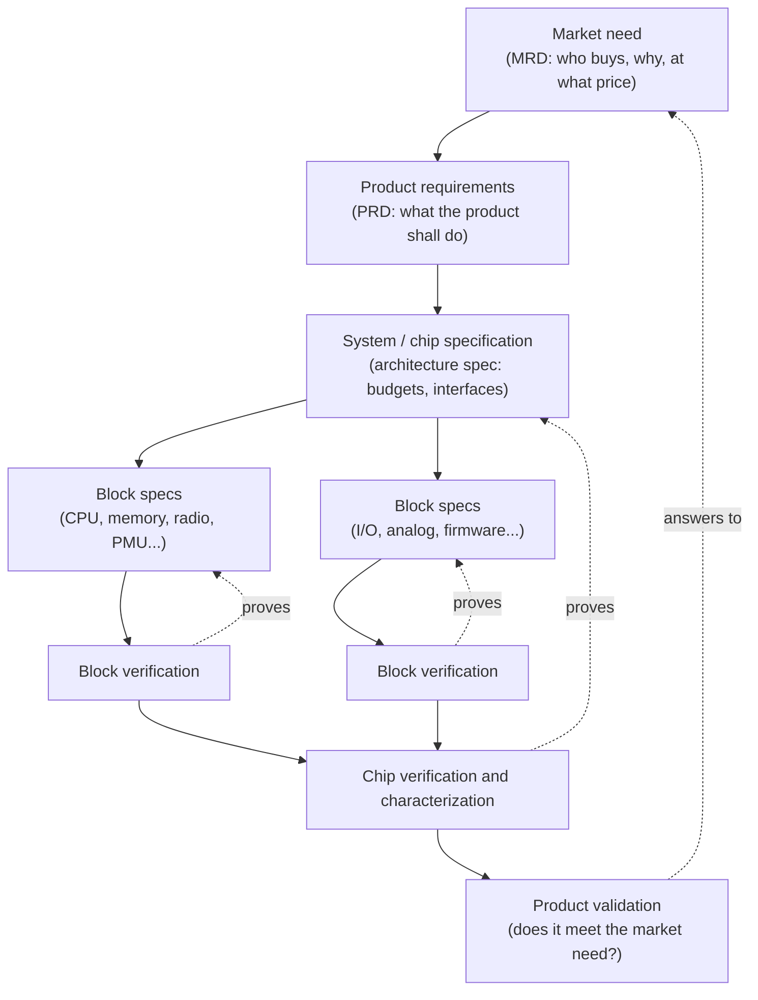
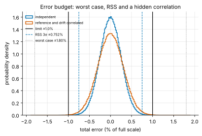
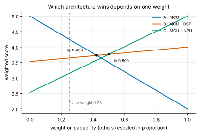

<!-- status: reviewed -->
# 26-01 · Requirements, Specifications and the Design Process

| | |
|---|---|
| **Course** | [26 · Engineering Design and Professional Practice](../README.md) |
| **University equivalent** | Senior design and systems engineering: requirements definition, flow-down and verification planning (Ulrich & Eppinger, *Product Design and Development*, chapters on customer needs and product specifications; NASA Systems Engineering Handbook, requirements and verification chapters) |
| **Prerequisites** | [03-04](../../03-probability-statistics-and-random-variables/chapters/03-04-joint-distributions-and-clt.md) (variance of sums, correlation), [06-07](../../06-circuit-analysis-1-dc/chapters/06-07-linearity-and-superposition.md) (error budgets, worst-case and RSS), [05-09](../../05-programming-for-engineers/chapters/05-09-software-engineering-practices.md) (requirements and traceability in software), [25-12](../../25-fabrication-packaging-test-and-reliability/chapters/25-12-post-silicon-validation.md) (what happens when a chip misses its spec) |
| **Estimated study hours** | 5 |
| **Last verified** | 2026-11-26 |

**Learning objectives.** After this chapter you can:

1. Trace a product from market requirements through product requirements to a chip specification, and rewrite a vague requirement as one with a condition, a criterion and a verification method.
2. Flow a system requirement down to block budgets with duty-cycle averages, worst-case sums and root-sum-square (RSS) stacking, including correlated contributions, and compute the probability that the total meets its limit.
3. Build a traceability matrix, measure its coverage and estimate the expected cost of the gaps.
4. Compare waterfall, V-model, spiral, phase-gate and agile process models, and explain why chip programs combine hard gates with iteration inside them.
5. Quantify why errors found late cost more with a phase-by-phase escalation model, and choose among design alternatives with a weighted decision matrix and its sensitivity to the weights.

---

## 1. Big picture

Every chip begins as a sentence someone else wrote: "a watch that lasts a week," "an accelerator that serves this model at this latency," "a radar front end that meets the automotive safety standard." Engineering turns those sentences into hundreds or thousands of measurable statements, divides them among blocks and teams, designs to them, and proves at the end that the product meets each one. Requirements are the contract between the people who know what the market needs and the people who know what silicon can do. Most expensive failures in this curriculum's case studies trace back to that contract: a requirement that was missing, ambiguous, changed late, or never verified.

- **Where it shows up in chips:** the marketing requirements document (MRD) and product requirements document (PRD) of every product; the architecture and micro-architecture specifications that RTL designers code against; datasheets, which are the customer-facing half of the specification; the verification plan, whose coverage is measured against the specification (19-13).
- **Where it shows up in business:** design wins are won or lost on spec sheets; customer escalations are arguments about what a requirement meant; respins (25-12) and schedule slips are often requirement failures in disguise.
- **Why an M&A or venture reader cares:** a target's requirements process predicts its schedule risk better than its slide deck does. Asking how requirements are written, traced and frozen is one of the fastest ways to tell a disciplined engineering organization from a hopeful one.
- **What this chapter adds to earlier ones:** 06-07 introduced error budgets for one circuit and 05-09 introduced traceability for software. Here both scale up to a whole product, with the probability, economics and process models that tie them together.

## 2. Intuition first

**Physical picture.** Think of a requirement as a load-bearing beam in a building. The client says "a hall for 500 people." The architect turns that into floor area, exits and ventilation; the structural engineer turns floor area into loads on each beam; each beam gets a size with a safety margin. If the client later says "and a swimming pool on the roof," every beam below the pool must be rechecked, and some must be replaced. The later the change arrives, the more of the building already stands on the old assumption. Chips are the same, except that the "building" is billions of transistors whose design took two years, and replacing a beam after tape-out means a new mask set.

**Analogy: a requirements document is a term sheet.** A venture term sheet turns a handshake ("we'll invest if the company does well") into defined terms: amounts, conditions, dates, and what happens if a condition fails. A good requirement does the same: it states a quantity, the conditions under which it must hold, and how compliance will be proven. A vague term sheet produces disputes at closing; a vague requirement produces disputes at tape-out or, worse, at the customer's lab. **Where the analogy breaks:** a term sheet is negotiated once between two parties, while a chip's requirements are refined continuously by dozens of people as the design reveals what is feasible, and the final arbiter is physics, which does not negotiate.

**The shape of the process.** Requirements flow down a hierarchy, and verification climbs back up it:

Going down, each level answers "how will we meet the level above?" and allocates a share of each budget. Going up, each level proves (the dotted links) that its piece meets what was allocated, and the top asks whether the product, as built, solves the original need.

## 3. Theory

### 3.1 From market need to specification

**The documents.** Names vary by company, but the layers are nearly universal:

- **Marketing requirements document (MRD):** the customer, the problem, the competitive alternatives, the target price and volume, and the time window. It is written in the customer's language ("all-day battery," "fits in a ring").
- **Product requirements document (PRD):** what the product shall do, in measurable terms, without saying how. It is still owned by product management but is negotiated with engineering.
- **Architecture specification:** how the system meets the PRD: the block diagram, the interfaces, and the budgets (power, area, latency, error, cost) allocated to each block.
- **Block (micro-architecture) specifications:** what each block's designers build and verify against.
- **Datasheet:** the externally published subset, with guaranteed minimums and maximums, typical values and test conditions.

**Types of requirement.** A useful checklist, adapted from the NASA Systems Engineering Handbook's list of commonly overlooked areas [R-626] (regulatory, cost and schedule are added here):

- *functional* (what it does: "shall decode H.265");
- *performance* (how well: latency, throughput, accuracy, power);
- *interface* (to other systems: pins, protocols, standards compliance);
- *environmental* (temperature, voltage, humidity, shock, radiation);
- *regulatory and safety* (emissions, functional-safety level, export classification);
- *cost and schedule* (unit cost, NRE, launch date), which are requirements too, and often the binding ones.

**Needs versus wants.** NASA's checklist asks of every requirement, "Is each requirement necessary to meet the parent requirement?", and warns, "If it is not necessary, it is not a requirement" [R-626]. Every unnecessary requirement costs design effort and verification effort, and it may block a better design.

### 3.2 Writing requirements that can be verified

**Shall, will, should.** Engineering documents use these words precisely: "shall" marks a requirement, "will" a statement of fact or purpose, and "should" a goal [R-626]. A requirement has one subject and one predicate ("The product shall…"), states what is needed rather than how to build it, and carries its tolerances and conditions.

**The three parts of a verifiable requirement.**

1. A **criterion**: a quantity and a limit, with units ("at least 168 h").
2. **Conditions**: the operating point at which the limit applies (use profile, temperature, supply, configuration, battery age).
3. A **verification method**: how compliance will be shown.

Compare "The watch shall have all-day battery life" with "The watch shall operate for at least 168 h from a full charge under use profile UP-1 (Appendix A) at 25 °C with a battery at 80% of rated capacity; verified by test on ten units." The second can be passed or failed; the first can only be argued about.

**To be determined.** Early specifications are full of unknowns. NASA's guidance is to minimize "To Be Determined" (TBD) values and to prefer a best estimate marked "To Be Resolved" (TBR), with a rationale, an owner and a date to close it [R-626]. A count of open TBDs and TBRs, tracked week by week, is one of the simplest health metrics of a program.

**Verification methods.** The NASA handbook defines four [R-626]:

- **Test:** "The use of an end product to obtain detailed data needed to verify performance…" It is the most resource-intensive method.
- **Analysis:** mathematical modelling and simulation to predict compliance, used when hardware does not yet exist or a condition cannot be reproduced.
- **Inspection:** visual examination of the product or its records (a marking, a drawing, a bill of materials).
- **Demonstration:** showing that the product achieves the requirement in use, without detailed data gathering.

For a chip, most performance requirements are verified by *analysis* before tape-out (simulation, static timing, power estimation) and by *test* after silicon (characterization, 25-11 and 25-12). Choosing the method is itself a decision: some requirements, such as a 15-year lifetime, cannot be tested directly and are verified by accelerated test plus analysis (25-09, 25-10).

**Verification versus validation.** The handbook draws the distinction crisply. Verification is "proof of compliance with specifications" and answers "Did I build the product right?"; validation shows "that the product accomplishes the intended purpose" and answers "Am I building the right product?" [R-626]. A chip can pass every line of its specification and still fail in the market because the specification was wrong. Validation is how a team finds that out before the customer does: early silicon in reference designs, customer sampling, and running the real workload rather than the benchmark.

> **Going deeper — standards for requirements engineering.** ISO/IEC/IEEE 29148:2018 (second edition, November 2018) is the international standard for requirements engineering in systems and software; its clause 5.2.5 sets out the characteristics of individual requirements, and a following clause those of a requirement set [R-629]. Its text is paywalled and is not reproduced here; the NASA checklist quoted in this section is free and covers the same ground in practical form.

### 3.3 Flow-down and budgets

A top-level requirement becomes a set of allocations. Three kinds of arithmetic do most of the work.

**Duty-cycle averages.** Many requirements are averages over a use profile. If the product spends a fraction $d_i$ of its time in mode $i$, drawing current $I_i$, then (with $\sum_i d_i = 1$)

$$
\bar I = \sum_i d_iI_i ,
$$

and a battery of capacity $Q$ (mAh), of which a fraction $u$ is usable after aging and cutoff voltage, lasts

$$
t_{life} = \frac{uQ}{\bar I}\quad\text{(h, with } \bar I \text{ in mA)}.
$$

The battery-life requirement therefore flows down to a ceiling on $\bar I$, which is shared among modes. The mode with the largest product $d_iI_i$, not the largest current, dominates: in Example 26-01.2 the 2.0 mA sensing mode, on for 15% of the time, costs as much (0.30 mA) as the 10 mA radio on for 3%, and the display costs most of all because 25 mA × 4% is the largest product. 22-09 treats the battery side (capacity, aging, cutoff) in depth.

**Worst-case stacking.** Suppose a total error $E$ is the sum of contributions $e_1, \dots, e_n$, each guaranteed to lie within $\pm b_i$. The largest possible total is reached when every contribution sits at its bound with the same sign:

$$
|E| \le \sum_{i=1}^n b_i .
$$

This bound is certain but pessimistic: it requires every contribution to be at its extreme at once.

**Root-sum-square stacking.** If the contributions are independent random variables with zero mean and standard deviations $\sigma_i$, the variance of the sum is the sum of the variances:

$$
\sigma_E^2 = \operatorname{Var}\Bigl(\sum_i e_i\Bigr) = \sum_i\sigma_i^2 \quad\Longrightarrow\quad \sigma_E = \sqrt{\sum_i\sigma_i^2} .
$$

If every bound is stated at the same confidence level, say $b_i = k\sigma_i$ with $k$ = 3, then $k\sigma_E = \sqrt{\sum_i b_i^2}$: the total's $k\sigma$ bound is the root-sum-square of the individual bounds. Because $\sqrt{\sum b_i^2} \le \sum b_i$, RSS always allows a smaller total than worst case, and the saving grows with the number of contributors: for $n$ equal bounds $b$, worst case gives $nb$ and RSS gives $\sqrt n\,b$.

> **Math refresher — the variance of a sum.** For any two random variables, $\operatorname{Var}(X + Y) = \operatorname{Var}X + \operatorname{Var}Y + 2\operatorname{Cov}(X, Y)$, where $\operatorname{Cov}(X, Y) = \rho\sigma_X\sigma_Y$ and the correlation $\rho$ lies between −1 and 1 (03-04). Independence makes the covariance zero, which is the only case in which variances simply add. For $n$ variables, $\operatorname{Var}\sum e_i = \sum_i\sum_j\rho_{ij}\sigma_i\sigma_j$, a double sum over every pair.

**Correlated contributions.** If two contributions share a physical cause (the same reference voltage, the same die temperature, the same process corner), their correlation is positive, and the general variance is

$$
\sigma_E^2 = \sum_i\sigma_i^2 + 2\sum_{i<j}\rho_{ij}\sigma_i\sigma_j .
$$

For $\rho_{ij}$ = 1 the two contributions add linearly ($\sigma_i + \sigma_j$) before entering the RSS. If *every* pair is perfectly correlated, $\sigma_E = \sum\sigma_i$ and RSS collapses to worst case. RSS is therefore not a rule of thumb; it is a statement that the contributions are independent, and it is only as good as that statement.

**The probability of meeting the limit.** If $E$ is Gaussian with mean $\mu$ and standard deviation $\sigma_E$, the fraction of units outside a two-sided limit $\pm L$ is

$$
P_{out} = \Bigl[1 - \Phi\Bigl(\frac{L - \mu}{\sigma_E}\Bigr)\Bigr] + \Phi\Bigl(\frac{-L - \mu}{\sigma_E}\Bigr),
$$

where $\Phi$ is the standard normal CDF (03-02). For $\mu$ = 0 this is $2[1 - \Phi(L/\sigma_E)]$: **0.27**% outside at $L = 3\sigma_E$, **63** ppm at $4\sigma_E$. The sum of several independent contributions tends toward a Gaussian even when the individual ones are not (the central limit theorem of 03-04), but the convergence is slowest in the tails, where the out-of-spec fraction lives; the lab checks this with uniform contributions.

**Margin.** Allocations rarely use the whole budget. A program holds back *margin* (also called reserve or contingency) at each level, because early estimates are optimistic and late discoveries consume budget. Margin is spent deliberately: when a block needs more, the system owner releases some, and the remaining margin is itself a tracked quantity. A NASA checklist question applies directly: "What is the worst thing that could happen if the tolerance was doubled or tripled?" [R-626]. A tolerance that can be doubled at no cost is margin hiding in plain sight.

> **Going deeper — when Gaussian stacking misleads.** Three cases break the simple RSS picture. (1) *Few contributors with flat distributions:* the sum of two uniform errors is triangular, with no tail at all beyond the worst case, so a Gaussian built on the true σ overstates the tail. But reading a uniform half-width as a 3σ bound understates σ by a factor of √3 and the risk badly (lab Part 1). (2) *One dominant contributor:* the total inherits that contributor's distribution, so its shape, not the central limit theorem, sets the tail. (3) *Systematic errors:* a calibration offset or a design bug is not random across units; it shifts the mean $\mu$, and the formula above shows how quickly a shifted mean raises $P_{out}$ on one side. Monte Carlo over the real distributions, as in the lab and in 20-11's mismatch analysis, is the safe check.

### 3.4 Traceability

A requirement that is not linked to a design element and to a test is a requirement nobody can prove was met. **Traceability** is the set of links that makes this visible: from each requirement down to the design elements that implement it and the tests that verify it (forward), and from each design element and test back up to the requirement that justifies it (backward). The NASA handbook calls for "bidirectional traceability" in managing product requirements [R-626]. Functional-safety processes (25-10) depend on it, because a safety case must show that every safety requirement was implemented and verified.

A **traceability matrix** has requirements as rows and tests (or design elements) as columns, with a mark where one verifies the other. Three numbers summarize it:

- **coverage**, the fraction of requirements with at least one verifying test;
- **childless requirements**, which no design element implements (often a sign that a requirement was lost in the hand-off);
- **orphan tests or design elements**, which trace to no requirement (either a missing requirement or wasted work).

Coverage is not quality: a requirement "covered" by a weak test is still unverified, which is why 19-13 measures verification by coverage of the *specification's* behaviours, not merely by the number of tests. Traceability's second use is **impact analysis**: when a requirement changes, the matrix lists every design element and test that must be revisited, which is exactly the cost the next section quantifies.

### 3.5 Design process models

How a team sequences requirements, design, implementation and verification is its **process model**. Five matter here.

**Waterfall.** Phases in strict sequence: requirements, design, implementation, test, operation. It is usually attributed to Winston Royce's 1970 paper, which drew that sequence and then wrote: "I believe in this concept, but the implementation described above is risky and invites failure" [R-627]. His remedies included feedback between phases and "Do it twice": build a quick first version (in miniature) so that the delivered system is effectively the second [R-627]. The pure single-pass waterfall is the model Royce warned against.

**V-model.** The waterfall folded in half, so that each level of specification on the left is paired with the level of verification that proves it on the right (system requirements with system test, architecture with integration test, block design with unit test). The diagram in §2 is a V unfolded: the left arm runs down from need to block specifications, the right arm climbs back up, and each verification step answers to the specification at its own level (the dotted links). It is widely used in automotive and aerospace processes because it makes the verification of every requirement a planned activity from the day the requirement is written.

**Spiral.** Barry Boehm's spiral model (IEEE *Computer*, May 1988) runs the project as repeated cycles, each of which identifies the largest remaining risk, builds just enough (a prototype, a model, a test chip) to resolve it, and plans the next cycle [R-627]. It is risk-driven rather than document-driven, and test chips and FPGA prototypes are its hardware form.

**Phase-gate (stage-gate).** The project passes through formal decision reviews (gates) between phases; at each gate, management decides to continue, change course or stop, based on agreed criteria. Chip companies' gates typically include concept approval, specification freeze, RTL freeze, tape-out and production release; 26-02 treats design reviews in detail.

**Agile.** The 2001 Manifesto for Agile Software Development states four values: "Individuals and interactions over processes and tools," "Working software over comprehensive documentation," "Customer collaboration over contract negotiation" and "Responding to change over following a plan," adding that "while there is value in the items on the right, we value the items on the left more" [R-627]. Short iterations with working increments suit work whose cost of change is low.

**Why chips combine them.** The economics of change decide the model. Software can be changed after release at modest cost, so iteration is cheap and agile works. A tape-out is irreversible: the masks are made, and the next change costs a new mask set and months (25-12). Chip programs therefore run a phase-gate (or V-model) skeleton with hard gates at specification freeze and tape-out, and iterate inside the phases: architecture exploration with models, RTL in agile-style sprints with continuous regression, firmware and drivers fully agile, and test chips or FPGA prototypes as spiral-style risk reducers. The gates are placed where the cost of change jumps.

### 3.6 Why errors found late cost more

**The data.** A NASA study by Stecklein and co-authors (INCOSE symposium, June 2004) used three methods to estimate the relative cost of fixing a requirements error by the phase in which it is found. Taking the cost in the requirements phase as 1 unit, they found 3–8 units in design, 7–16 in manufacturing or build, 21–78 in integration and test, and from 29 to more than 1,500 units in operations [R-625]. The study modelled hardware/software systems like spacecraft, military aircraft and small satellites, so its multipliers are indicative for chips rather than measured on them **[Contested]** for transfer to semiconductors; the *shape*, rising by more than an order of magnitude from design to test, is the robust part.

**A model of where errors are found.** Let a program introduce $N$ requirement errors. Each phase $k$ (requirements review, design, build, integration and test) catches a fraction $p_k$ of the errors still present, and anything left escapes to operations (the field). Fixing an error found in phase $k$ costs $c_k$ relative units. The number found in phase $k$ is

$$
n_k = p_k\,N\prod_{m<k}(1 - p_m),
$$

and the expected total cost is $C = \sum_k n_kc_k$. Separate the first phase from the rest: of the $N$ errors, $p_1N$ are fixed at cost $c_1$, and the other $(1 - p_1)N$ go downstream, where each costs on average

$$
\bar c_{down} = \sum_{k \ge 2} c_k\,p_k\prod_{2 \le m < k}(1 - p_m)
$$

(with $p$ = 1 for the final, operations phase). Then

$$
C = N\bigl[p_1c_1 + (1 - p_1)\bar c_{down}\bigr], \qquad \frac{\partial C}{\partial p_1} = -N(\bar c_{down} - c_1) .
$$

The total cost is linear in the requirements review's catch rate, and each unit of $p_1$ is worth $N(\bar c_{down} - c_1)$. Because $\bar c_{down}$ is typically tens of times $c_1$, a requirements review that catches a few more percent of the errors pays for a great deal of review time (Example 26-01.5). The same argument applies to any early gate: architecture reviews, specification reviews with the customer, and pre-silicon verification (19-13) all move $p$ to the left, where $c$ is small.

### 3.7 Choosing among alternatives

Requirements rarely determine a design uniquely; several architectures meet them with different strengths. A **weighted decision matrix** makes the choice explicit. Score each option $a$ on each criterion $j$ (say 1–5), give each criterion a weight $w_j$ with $\sum_j w_j = 1$, and rank the options by

$$
S_a = \sum_j w_js_{aj} .
$$

**Sensitivity to one weight.** The weights are judgements, so the useful question is how far a weight must move to change the decision. Sweep the weight $w$ of one criterion $c$ and rescale the others in proportion to their original weights, so that the total stays 1. Then option $a$'s score is linear in $w$:

$$
S_a(w) = w\,s_{ac} + (1 - w)R_a, \qquad R_a = \frac{\sum_{j \ne c}w_j^{(0)}s_{aj}}{\sum_{j \ne c}w_j^{(0)}},
$$

where $R_a$ is the option's weighted score on all the other criteria. Two options $a$ and $b$ tie where $S_a(w) = S_b(w)$:

$$
w^* = \frac{R_a - R_b}{(R_a - R_b) - (s_{ac} - s_{bc})} .
$$

If $w^*$ lies far outside the range of weights anyone would defend, the decision is robust; if it lies within it, the argument should be about that weight, not about the scores. A decision matrix does not make a decision objective. It makes the subjective inputs visible and arguable, which is its real value in a design review.

## 4. Worked examples

All examples use assumed, illustrative numbers unless a source is cited.

### Example 26-01.1 · From a marketing phrase to a requirement (tier A)

**Setup.** A fitness-watch MRD says: "All-week battery life, accurate heart rate, and it must be waterproof." Rewrite the first phrase as a verifiable requirement, identify the information still missing from the other two, and name a verification method for each.

**Solution.**

- *Battery:* "The watch shall operate for at least 168 h (seven days) from a full charge under use profile UP-1 at 25 °C, with the battery at 80% of rated capacity; verified by test on ten production units." The criterion is 168 h; the conditions are the profile, temperature and battery age; the method is test.
- *Heart rate:* missing are the accuracy metric (for example, mean absolute error in beats per minute against a chest-strap reference), the activity conditions (rest, running, cycling), the skin-tone and fit population, and the sample size. Verification is by test against a reference on a defined panel of users.
- *Waterproof:* missing are the depth or pressure, the duration, fresh or salt water, and whether the requirement is met when buttons are pressed under water; the usual route is to cite an industry water-resistance standard and verify by test (with inspection of the seal design during development).

**Units check.** 7 days × 24 h = 168 h. ✓

**Sanity check.** Every rewritten requirement can now fail: a unit that lasts 160 h under UP-1 fails, and that is the point. The conditions matter as much as the number; a seven-day life with the display off is a different product from a seven-day life with it on.

### Example 26-01.2 · Flowing a battery-life requirement down (tier B)

**Setup.** The watch has a 300 mAh battery, of which 85% is usable after aging and cutoff (assumed). The use profile UP-1 is: sleep 0.050 mA for 78% of the time, sensing 2.0 mA for 15%, radio 10 mA for 3% and display 25 mA for 4% (all assumed). (a) What average current does the 168 h requirement allow? (b) What does the profile draw, and what life does it give? (c) Which mode dominates? (d) With a 10% margin on the allocation (the allocation plus 10% must fit the ceiling, so the budget is the ceiling divided by 1.10), how long may the display be on each day if the time saved goes to sleep?

**Solution.**

- (a) The usable charge is $0.85 \times 300$ = **255** mAh, so $\bar I_{max} = 255/168$ = **1.52** mA (unrounded **1.518**).
- (b) $\bar I = 0.78 \times 0.050 + 0.15 \times 2.0 + 0.03 \times 10 + 0.04 \times 25$ = **0.039** + **0.30** + **0.30** + **1.00** = **1.639** mA, so $t_{life} = 255/1.639$ = **155.6** h, or **6.48** days: the design misses the requirement.
- (c) The display contributes 1.00 mA, **61**% of the total, although its current is applied only 4% of the time.
- (d) The budget with margin is $1.518/1.10$ = **1.380** mA. With display duty $d$ and sleep duty $0.82 - d$, the average is $0.050(0.82 - d) + 0.30 + 0.30 + 25d$ = **0.641** + **24.95**$d$. Setting it equal to 1.380 mA gives $d$ = **2.96**%, or **42.6** min of display a day instead of **57.6** min.

**Units check.** mAh ÷ h = mA; duty fractions are dimensionless. ✓

**Sanity check.** Cutting display time by **26**% recovers the week and the margin, because the display is the largest $d_iI_i$ term; halving the sleep current would save only **0.0195** mA, **1.2**% of the total. The requirement has become a negotiation between engineering and product management about display-on time, which is the right negotiation to have, and the profile UP-1 is now itself a requirement that must be validated against how people actually wear the watch.

### Example 26-01.3 · Worst case, RSS and a correlated pair (tier B)

**Setup.** A sensor channel must measure within ±1.0% of full scale. Six independent contributions are each specified at a 3σ bound: reference 0.40%, gain mismatch 0.35%, offset 0.30%, integral nonlinearity 0.25%, noise 0.20% and temperature drift 0.30% (assumed, zero-mean Gaussian). (a) Does the channel meet the limit by worst case? (b) By RSS, and what fraction of units falls outside ±1.0%? (c) The drift turns out to come from the reference's own temperature coefficient, so the two are perfectly correlated. Repeat (b). (d) To what must the reference bound be tightened to restore (b)'s total?

**Solution.**

- (a) $0.40 + 0.35 + 0.30 + 0.25 + 0.20 + 0.30$ = **1.80**%: worst case fails by a wide margin.
- (b) $\sqrt{0.40^2 + 0.35^2 + 0.30^2 + 0.25^2 + 0.20^2 + 0.30^2} = \sqrt{\mathbf{0.565}}$ = **0.752**% at 3σ, so $\sigma_E$ = **0.2506**% and the limit sits at $1.0/0.2506$ = **3.99**σ. Then $P_{out} = 2[1 - \Phi(3.99)]$ = **66** ppm.
- (c) The reference and drift add linearly, $0.40 + 0.30$ = **0.70**%, before the RSS: $\sqrt{0.70^2 + 0.35^2 + 0.30^2 + 0.25^2 + 0.20^2} = \sqrt{\mathbf{0.805}}$ = **0.897**% at 3σ; the limit is now **3.34**σ and $P_{out}$ = **827** ppm, about **12.6** times worse.
- (d) The other four contributions use $0.35^2 + 0.30^2 + 0.25^2 + 0.20^2$ = **0.315** of the 0.565 budget, leaving **0.250** for the correlated pair, so the pair may total $\sqrt{0.250}$ = **0.50**%, and the reference must shrink to $0.50 - 0.30$ = **0.20**%, half its original bound.

**Units check.** All bounds in percent of full scale; σ-ratios dimensionless. ✓

**Sanity check.** A Monte Carlo of a million units (lab and verify) gives an out-of-spec fraction within sampling error of both answers. One overlooked correlation raised the reject rate more than tenfold without changing any individual specification, which is why budget reviews ask "what do these contributions share?" before they accept an RSS.

### Example 26-01.4 · What do the traceability gaps cost? (tier B)

**Setup.** A chip's specification has 120 requirements. The traceability matrix shows 108 with at least one verifying test, 6 with no implementing design element and 9 tests that trace to no requirement. Of the 12 untested requirements, 3 are judged high risk (a 30% chance that an error in them escapes to silicon) and 9 low risk (5%), and an escape costs $2.0 M in rework and delay (all assumed). Writing a test costs about $20,000 per requirement (assumed). Find (a) the coverage, (b) the expected cost of the gaps and (c) its ratio to the cost of closing them.

**Solution.**

- (a) $108/120$ = **90.0**%.
- (b) $(3 \times 0.30 + 9 \times 0.05) \times 2.0$ = **1.35** × 2.0 = **\$2.70 M** expected.
- (c) Closing all 12 costs $12 \times 0.020$ = **\$0.24 M**, so the expected loss is **11.25** times the cost of the tests.

**Units check.** Count × probability × $/escape = $. ✓

**Sanity check.** The three high-risk requirements carry **67**% of the expected cost (**0.90** of the 1.35 expected escapes), so they are closed first. The 6 childless requirements and 9 orphan tests are not costed here, but each is a question for the next review: a lost requirement, or work that no requirement asked for.

### Example 26-01.5 · The value of a requirements review (tier C)

**Setup.** A program introduces 100 requirement errors. Design catches 40% of those still present, build 30% and integration and test 60%; the rest escape to the field. Relative fix costs are 1 (requirements), 5 (design), 10 (build), 50 (test) and 100 (field), chosen inside the NASA ranges of §3.6 (assumed). One unit costs $10,000 (assumed). Compare a light requirements review that catches 20% with a formal one that catches 60%: (a) where each finds the errors and the total cost, (b) the saving, and (c) what each extra percentage point of review catch rate is worth.

**Solution.** The downstream average cost per error that passes the review is

$$
\bar c_{down} = 0.4 \times 5 + 0.6 \times 0.3 \times 10 + 0.6 \times 0.7 \times 0.6 \times 50 + 0.6 \times 0.7 \times 0.4 \times 100 = 2 + 1.8 + 12.6 + 16.8 = 33.2 ,
$$

whose four terms (**2.0**, **1.8**, **12.6** and **16.8**) are the design, build, test and field shares; the sum is **33.2**.

- (a) Light review: found **20**, **32**, **14.4**, **20.16** and **13.44** in the five phases; cost $100[0.2 \times 1 + 0.8 \times 33.2]$ = **2676** units. Formal review: **60**, **16**, **7.2**, **10.08** and **6.72**; cost $100[0.6 + 0.4 \times 33.2]$ = **1388** units.
- (b) The formal review saves **1288** units, **$12.9 M**, and cuts field escapes from 13.44 to 6.72.
- (c) $N(\bar c_{down} - c_1) = 100 \times 32.2$ = **3220** units per unit of catch rate, so each percentage point is worth **32.2** units, **\$322,000**.

**Units check.** Errors × relative cost units × $/unit = $. ✓

**Sanity check.** The field and test columns dominate both totals (2352 of 2676 units in the light case), so the saving comes almost entirely from errors that never reach test. The answer is sensitive to the escalation factors: with the low ends of the NASA ranges the saving shrinks, with the high ends it grows, but it stays large across the whole range (the lab samples it), which is why the conclusion is more robust than any single multiplier.

### Example 26-01.6 · Choosing an architecture, and how robust the choice is (tier C)

**Setup.** A wearable SoC team compares three architectures: A, a single low-power MCU; B, an MCU with a DSP; C, an MCU with a neural-network accelerator (NPU). Scores (1–5) on four criteria, with weights power 0.40, capability 0.25, cost 0.20 and schedule risk 0.15 (all assumed):

| Option | Power | Capability | Cost | Schedule |
|---|---|---|---|---|
| A · MCU | 5 | 2 | 5 | 5 |
| B · MCU + DSP | 4 | 4 | 3 | 3 |
| C · MCU + NPU | 3 | 5 | 2 | 2 |

(a) Rank the options. (b) Sweeping the capability weight, with the other three rescaled in proportion, at what weight does each pair tie? (c) What does that say about the decision?

**Solution.**

- (a) $S_A = 0.40 \times 5 + 0.25 \times 2 + 0.20 \times 5 + 0.15 \times 5$ = **4.25**; $S_B$ = **3.65**; $S_C$ = **3.15**. A ranks first.
- (b) The other criteria's weights are 0.40 : 0.20 : 0.15 of a total of **0.75**, so $R_A = (0.40 \times 5 + 0.20 \times 5 + 0.15 \times 5)/0.75$ = **5.00**, $R_B$ = **3.53** and $R_C$ = **2.53**. With $w^* = (R_a - R_b)/[(R_a - R_b) - (s_{ac} - s_{bc})]$: A and B tie at **0.423**, A and C at **0.451**, and B and C at **0.500**. So A leads up to a capability weight of 0.423, B from there to 0.500, and C above it (by the time A and C would tie, B is already ahead of both).
- (c) The base weight on capability is 0.25; it must rise by **69**%, to 0.423, before the choice changes. The decision is robust to modest disagreement about capability, but a product manager who believes that on-device AI features will decide sales (capability weight above one-half) would choose C. The real decision is therefore a market question about capability, not an engineering question about scores.

**Units check.** Weights and scores are dimensionless. ✓

**Sanity check.** Each tie weight lies between 0 and 1 and the ranking at $w$ = 0.25 agrees with (a). The sequence A → B → C as capability gains weight matches intuition: each step trades power, cost and schedule for capability.

<!-- answer-key -->

| ID | Quantity | Value | Unit |
|---|---|---|---|
| Ex 26-01.1a | seven days | 168 | h |
| Ex 26-01.2a0 | usable charge | 255 | mAh |
| Ex 26-01.2a | allowed average current | 1.52 | mA |
| Ex 26-01.2a1 | allowed average current, unrounded | 1.518 | mA |
| Ex 26-01.2b3 | sleep contribution | 0.039 | mA |
| Ex 26-01.2b4 | sensing contribution | 0.30 | mA |
| Ex 26-01.2b5 | radio contribution | 0.30 | mA |
| Ex 26-01.2b6 | display contribution | 1.00 | mA |
| Ex 26-01.2b | profile average current | 1.639 | mA |
| Ex 26-01.2b1 | battery life | 155.6 | h |
| Ex 26-01.2b2 | battery life | 6.48 | days |
| Ex 26-01.2c | display share | 61 | % |
| Ex 26-01.2d | budget with margin | 1.380 | mA |
| Ex 26-01.2d1 | display duty allowed | 2.96 | % |
| Ex 26-01.2d2 | display minutes per day | 42.6 | min |
| Ex 26-01.2d3 | display minutes at 4% | 57.6 | min |
| Ex 26-01.2d4 | constant term | 0.641 | mA |
| Ex 26-01.2d5 | display slope | 24.95 | mA |
| Ex 26-01.2d6 | display-time cut | 26 | % |
| Ex 26-01.2e | saving from halving sleep current | 0.0195 | mA |
| Ex 26-01.2e1 | as share of total | 1.2 | % |
| Ex 26-01.3a | worst-case total | 1.80 | % |
| Ex 26-01.3b0 | sum of squares | 0.565 | %² |
| Ex 26-01.3b | RSS total at 3 sigma | 0.752 | % |
| Ex 26-01.3b1 | sigma of total | 0.2506 | % |
| Ex 26-01.3b2 | limit in sigmas | 3.99 | |
| Ex 26-01.3b3 | out of spec | 66 | ppm |
| Ex 26-01.3c4 | correlated pair | 0.70 | % |
| Ex 26-01.3c0 | sum of squares, correlated | 0.805 | %² |
| Ex 26-01.3c | correlated total at 3 sigma | 0.897 | % |
| Ex 26-01.3c1 | limit in sigmas, correlated | 3.34 | |
| Ex 26-01.3c2 | out of spec, correlated | 827 | ppm |
| Ex 26-01.3c3 | ratio | 12.6 | |
| Ex 26-01.3d0 | other four | 0.315 | %² |
| Ex 26-01.3d1 | left for the pair | 0.250 | %² |
| Ex 26-01.3d2 | pair total allowed | 0.50 | % |
| Ex 26-01.3d | reference bound needed | 0.20 | % |
| Ex 26-01.4a | coverage | 90.0 | % |
| Ex 26-01.4b0 | expected escapes | 1.35 | |
| Ex 26-01.4b | expected gap cost | 2.70 | $M |
| Ex 26-01.4b1 | high-risk expected escapes | 0.90 | |
| Ex 26-01.4b2 | high-risk share | 67 | % |
| Ex 26-01.4c | cost to close | 0.24 | $M |
| Ex 26-01.4c1 | ratio | 11.25 | |
| Ex 26-01.5a | downstream average cost | 33.2 | units |
| Ex 26-01.5a1 | design share | 2.0 | units |
| Ex 26-01.5a2 | build share | 1.8 | units |
| Ex 26-01.5a3 | test share | 12.6 | units |
| Ex 26-01.5a4 | field share | 16.8 | units |
| Ex 26-01.5g1 | light: found in review | 20 | |
| Ex 26-01.5g2 | light: found in design | 32 | |
| Ex 26-01.5g3 | light: found in build | 14.4 | |
| Ex 26-01.5g4 | light: found in test | 20.16 | |
| Ex 26-01.5g5 | light: escapes | 13.44 | |
| Ex 26-01.5h1 | formal: found in review | 60 | |
| Ex 26-01.5h2 | formal: found in design | 16 | |
| Ex 26-01.5h3 | formal: found in build | 7.2 | |
| Ex 26-01.5h4 | formal: found in test | 10.08 | |
| Ex 26-01.5h5 | formal: escapes | 6.72 | |
| Ex 26-01.5b | light-review cost | 2676 | units |
| Ex 26-01.5c | formal-review cost | 1388 | units |
| Ex 26-01.5d | saving | 1288 | units |
| Ex 26-01.5d1 | saving | 12.9 | $M |
| Ex 26-01.5e0 | value per unit of catch rate | 3220 | units |
| Ex 26-01.5e | value per point of catch rate | 32.2 | units |
| Ex 26-01.5e1 | value per point of catch rate | 322000 | $ |
| Ex 26-01.5f | field and test cost, light review | 2352 | units |
| Ex 26-01.6a | score A | 4.25 | |
| Ex 26-01.6a1 | score B | 3.65 | |
| Ex 26-01.6a2 | score C | 3.15 | |
| Ex 26-01.6b3 | other weights' total | 0.75 | |
| Ex 26-01.6b | R_A | 5.00 | |
| Ex 26-01.6b1 | R_B | 3.53 | |
| Ex 26-01.6b2 | R_C | 2.53 | |
| Ex 26-01.6c | A-B tie weight | 0.423 | |
| Ex 26-01.6c1 | A-C tie weight | 0.451 | |
| Ex 26-01.6c2 | B-C tie weight | 0.500 | |
| Ex 26-01.6c3 | rise needed | 69 | % |
| Txt 26-01.a | outside 3 sigma | 0.27 | % |
| Txt 26-01.a1 | outside 3 sigma | 2700 | ppm |
| Txt 26-01.b | outside 4 sigma | 63 | ppm |
| Txt 26-01.c | outside 5 sigma | 0.57 | ppm |

## 5. Simulate it

The lab is [labs/26-01-lab/](../labs/26-01-lab/README.md). `reqs.py` implements the duty-cycle flow-down, worst-case, RSS and correlated stacking with a Monte Carlo of the error budget, the expected cost of traceability gaps, the phase-by-phase escalation model and decision-matrix sweeps; the notebook runs four parts.

**Predict, then run.**

1. *Predict* whether Example 26-01.3's out-of-spec fraction changes if the six contributions are uniform instead of Gaussian (each with the same ±bound as its half-width), then run the Monte Carlo. (The bounds now mean something different: a uniform's half-width is $\sqrt3$ σ, not 3σ.)
2. *Predict* the display duty that gives exactly 168 h with no margin, then sweep it and plot battery life against display time.
3. *Predict* the range of Example 26-01.5's saving when each escalation factor is drawn at random from its NASA range, then sample it and plot the distribution.
4. *Predict* the capability weight at which B overtakes A, then sweep it and plot the three scores (the figure below).

## 6. Engineering tradeoffs

| Knob | Improves | Costs | Typical decision owner |
|---|---|---|---|
| Tighter requirement limits | Product competitiveness; customer confidence | Design effort, yield (25-04), test time; risk of an unmeetable spec | Product management with the architect |
| More margin held at system level | Absorbs late surprises; protects the schedule | Each block gets less budget early; may force a more aggressive block design | Chief architect / system owner |
| RSS instead of worst-case allocation | Larger allocations per block; cheaper design | Risk if contributions are correlated or non-Gaussian; a small reject rate by design | Architect, with test and quality engineering |
| Earlier, heavier requirements reviews | Fewer late, expensive errors (§3.6) | Engineering time before design starts; slower start | Engineering management |
| Earlier specification freeze | Stable target for design and verification | Less room to respond to market or customer changes | Product line management |
| More requirements verified by test rather than analysis | Higher confidence; catches model errors | Test hardware, lab time, later results | Verification and validation leads |
| Full traceability tooling | Coverage and impact analysis on demand | Process overhead; tool cost; discipline | Program management, quality |

## 7. Numbers to know

| Quantity | Value | Note |
|---|---|---|
| Two-sided Gaussian fraction outside ±3σ | **0.27**% (**2,700** ppm) | Timeless; **63** ppm at ±4σ, **0.57** ppm at ±5σ |
| RSS against worst case for $n$ equal contributions | $\sqrt n$ against $n$ | Timeless; independence assumed |
| Relative cost to fix a requirements error, by phase found | 1 (requirements); 3–8 (design); 7–16 (build); 21–78 (integration and test); 29 to more than 1,500 (operations) | NASA study of spacecraft-class systems, 2004 [R-625] **[Contested]** for chips |
| Verification methods | Test, analysis, inspection, demonstration | NASA SE Handbook, Rev 2 (2016) [R-626] |
| IC/ASIC projects behind schedule | About 75% (2024; 66% historically) | Wilson Research Group / Siemens EDA, 2024 [R-621] |
| IC/ASIC first-silicon success | 5% (2026); 14% (2024); about 30% historically | Wilson Research Group; methodology changed in 2024 [R-621], [R-622] |

## 8. Common mistakes

- **Writing a design as a requirement.** "The SoC shall use a 64 KB L2 cache" constrains the solution; the requirement is the latency or hit rate the cache was meant to deliver. Fixing the design in the PRD removes the architect's freedom to find a better one.
- **Dropping the conditions.** "Battery life 7 days" without a profile, temperature and battery age is not a requirement; it is a hope. The same is true of "typical" datasheet values used as if they were guarantees.
- **RSS-ing correlated errors.** Contributions that share a reference, a temperature or a process corner add linearly (Example 26-01.3). Ask what the contributions share before you take the square root.
- **Mixing confidence levels in an RSS.** A 1σ noise figure and a 3σ offset bound cannot be squared and added; convert every bound to the same σ level first (06-07).
- **Treating coverage as quality.** 100% requirement coverage with weak tests is still weak verification; and coverage of requirements says nothing about requirements that were never written (validation's job).
- **Spending margin silently.** Margin that is not tracked is used up by the first block that asks, and the system finds out at integration.
- **Taking escalation multipliers as laws.** The NASA ranges are wide and come from aerospace programs; use them for the shape of the argument, and sample the range rather than quoting one number.
- **Believing a decision matrix is objective.** Its weights are judgements. Always report how far a weight must move to change the answer.

## 9. Practitioner lens

**State of the art, as of November 2026.**

- **How chip companies run requirements** **[Established]**. The MRD-PRD-architecture-spec hierarchy of §3.1 is common across the industry, with a formal specification freeze before RTL is finalized and with datasheets derived from the specification. Interface requirements usually cite external standards (PCIe, JEDEC memory, UCIe, 3GPP), so "compliance" is defined by documents the company does not control (26-02).
- **What the industry's own survey says** **[Established as reported; Industry estimate for trends]**. The 2024 Wilson Research Group study found that 75% of IC/ASIC projects were behind schedule, against about 66% historically, and only 14% achieved first-silicon success [R-621]. On root causes it notes that "issues related to changing, incorrect, or incomplete specifications remain a common concern among verification engineers and project managers" [R-628]. The 2026 edition reported 5% first-silicon success; with the recruitment change introduced in 2024 and only 320 IC/ASIC respondents, the trend is fragile (25-12) [R-622].
- **Cost of late discovery** **[Contested for chips]**. The NASA escalation study [R-625] is the most-cited public dataset; chip-specific public data are scarce, but the mechanism (a mask set and months of delay after tape-out, 25-12) is if anything steeper than in the systems NASA studied.

**Commercial relevance.** Requirements discipline shows up in three places a corporate development team can see. First, in *schedule credibility*: a team that tracks TBDs, margin and traceability can tell you which requirements are still at risk; a team that cannot is guessing. Second, in *design-win dynamics*: customers write their own requirements, and the supplier whose specification matches them, or who helps write them, wins. Third, in *post-acquisition integration*: two companies' requirement and review processes must merge, and the gaps between them are where integrated products slip.

**Marketing vs Reality.**

- *"Up to N days of battery life."* Every battery-life claim hides a use profile. Example 26-01.2 showed that 26% less display time is the difference between 6.48 days and seven with margin; ask for the profile, the temperature and the battery age behind the number.
- *"Typical" specifications.* Datasheets separate guaranteed limits from typical values; a typical value is a measurement of an average part, not a requirement any part must meet. For example, TI's LM358B datasheet lists a *typical* slew rate of 0.5 V/µs [R-025]; a design that needs that slew rate on every unit must find a guaranteed minimum or add margin.
- *"Fully compliant with the standard."* Ask whether that means designed to the specification, verified by internal tests, or passed the standard body's own compliance or interoperability testing; these are different claims with different evidence.
- *"Our verification covers 100% of the spec."* Coverage of the written specification says nothing about missing requirements, and coverage metrics depend on how the specification was decomposed.

**Questions for engineering leaders.**

1. *"How many requirements are still TBD or TBR, and when does each close?"* Strong: a number, a trend over recent weeks, owners and dates, and the two or three that worry them most. Evasive: "the spec is basically done."
2. *"Which budgets (power, area, latency, error) have the least margin left, and who owns the margin?"* Strong: named budgets, the margin remaining at each level, and the rule for releasing it. Evasive: "we're within budget everywhere."
3. *"How many requirements changed after specification freeze on your last program, and what did they cost?"* Strong: a count, examples, and the schedule impact, with what the team changed in its process. Evasive: "our customers' requirements are stable."
4. *"How do you know every requirement is verified?"* Strong: a traceability matrix with coverage, childless and orphan counts, and the method (test, analysis) for each requirement class. Evasive: "our verification team is very thorough."
5. *"What is your process when a customer asks for a change after tape-out?"* Strong: an impact analysis through the traceability links, an expected-cost decision (metal fix, firmware, next stepping, 25-12) and a documented customer agreement. Evasive: "we always say yes to customers."

## 10. Concept check

**Q1.** Rewrite "The ADC shall be fast and accurate" as a verifiable requirement, naming its three parts.

Answer

For example: "The ADC shall sample at at least 1.0 MS/s with an ENOB of at least 11.0 bits for a −1 dBFS sine input at 100 kHz, over −40 to 125 °C and supply 1.71 to 1.89 V; verified by test on characterization units across corners." The criterion is the sample rate and ENOB limits; the conditions are the input, temperature and supply; the method is test (with analysis before silicon).

**Q2.** Why does RSS give a smaller total than worst case, and what assumption does it make?

Answer

Because independent random errors rarely all reach their extremes with the same sign at once, their variances (not their bounds) add, and $\sqrt{\sum b_i^2} \le \sum b_i$. It assumes the contributions are independent (or at least uncorrelated) and that every bound is stated at the same confidence level; correlation pushes the result back toward the worst case.

**Q3.** A program's traceability matrix shows 100% coverage. Name two ways the product can still fail its customer.

Answer

The tests may be weak (a requirement is "covered" by a test that does not exercise its corner cases), and the requirements themselves may be wrong or incomplete, so that the product is verified but not validated: it meets its specification but not the customer's need.

**Q4.** Distinguish verification from validation in one sentence each.

Answer

Verification proves the product meets its specification (NASA: "Did I build the product right?"); validation shows the product accomplishes its intended purpose for its users ("Am I building the right product?") [R-626].

**Q5.** Why do chip programs use hard gates at specification freeze and tape-out, while running agile methods for firmware?

Answer

Because the cost of change jumps at those points: after tape-out a change needs a new mask set and months, while firmware can be updated after release. Gates sit where change becomes expensive; iteration is used where it is cheap.

**Q6.** In the escalation model, why is the total cost linear in the requirements review's catch rate, and what sets the slope?

Answer

Every error the review does not catch flows to the same downstream process, whose average cost per error $\bar c_{down}$ does not depend on the review. So $C = N[p_1c_1 + (1 - p_1)\bar c_{down}]$, linear in $p_1$, with slope $-N(\bar c_{down} - c_1)$.

**Q7.** In a weighted decision matrix, two options tie when the weight on one criterion is 0.6 and the base weight is 0.3. Is the decision robust?

Answer

Fairly: the weight would have to double before the ranking changes, so modest disagreement does not flip it. Whether it is robust enough depends on whether anyone credible argues for a weight near 0.6; the matrix turns the debate into that specific question.

Problem set: [26-01 problems](../problems/26-01-problems.md) · [worked solutions](../solutions/26-01-solutions.md).

## 11. Key terms

[Requirement](../../../reference/glossary.md#requirement) · [Market requirements document (MRD)](../../../reference/glossary.md#market-requirements-document-mrd) · [Product requirements document (PRD)](../../../reference/glossary.md#product-requirements-document-prd) · [Requirement flow-down](../../../reference/glossary.md#requirement-flow-down) · [TBD and TBR](../../../reference/glossary.md#tbd-and-tbr) · [Verification (of a product)](../../../reference/glossary.md#verification-of-a-product) · [Validation (of a product)](../../../reference/glossary.md#validation-of-a-product) · [Verification methods (TAID)](../../../reference/glossary.md#verification-methods-taid) · [Error budget](../../../reference/glossary.md#error-budget) · [Root-sum-square (RSS)](../../../reference/glossary.md#root-sum-square-rss) · [Worst-case analysis](../../../reference/glossary.md#worst-case-analysis) · [Design margin](../../../reference/glossary.md#design-margin) · [Traceability](../../../reference/glossary.md#traceability) · [Traceability matrix](../../../reference/glossary.md#traceability-matrix) · [Waterfall model](../../../reference/glossary.md#waterfall-model) · [V-model](../../../reference/glossary.md#v-model) · [Spiral model](../../../reference/glossary.md#spiral-model) · [Phase-gate process](../../../reference/glossary.md#phase-gate-process) · [Agile development](../../../reference/glossary.md#agile-development) · [Specification freeze](../../../reference/glossary.md#specification-freeze) · [Weighted decision matrix](../../../reference/glossary.md#weighted-decision-matrix)

## 12. Connections

- **Previous:** this is the first chapter of Course 26. It builds on the error budgets of [06-07](../../06-circuit-analysis-1-dc/chapters/06-07-linearity-and-superposition.md), the variance of sums in [03-04](../../03-probability-statistics-and-random-variables/chapters/03-04-joint-distributions-and-clt.md), the software requirements and traceability of [05-09](../../05-programming-for-engineers/chapters/05-09-software-engineering-practices.md) and the verification planning of [19-13](../../19-digital-vlsi-design/chapters/19-13-verification-methods.md).
- **Next:** [26-02](26-02-design-reviews-and-standards.md) covers the reviews that check requirements and designs at each gate, and the standards bodies whose documents become interface requirements.
- **Used later:** [26-03](26-03-engineering-economics-1.md) and [26-04](26-04-engineering-economics-2.md) put cost requirements into business cases; [26-05](26-05-schedule-and-respin-risk.md) quantifies schedule and respin risk, much of which starts as requirement risk; Course 27's system case studies begin from requirements; the capstones each open with a requirements document; [25-10](../../25-fabrication-packaging-test-and-reliability/chapters/25-10-qualification-and-functional-safety.md) shows a regulated domain where traceability is mandatory.

## 13. Further study

- NASA, *Systems Engineering Handbook*, NASA/SP-2016-6105 Rev 2 (free PDF): chapters on technical requirements definition and product verification and validation, and Appendix C, "How to Write a Good Requirement—Checklist."
- Ulrich and Eppinger, *Product Design and Development*: the chapters on identifying customer needs, product specifications and concept selection (decision matrices).
- Royce, "Managing the Development of Large Software Systems" (1970), for what the waterfall's supposed originator actually recommended; Boehm, "A Spiral Model of Software Development and Enhancement" (1988).
- MIT OpenCourseWare, product-development and senior-design course materials (for example 2.009) for worked requirement and selection exercises.

## 14. Sources

1. Stecklein, Dabney, Dick, Haskins et al., "Error Cost Escalation Through the Project Life Cycle," INCOSE 14th Annual International Symposium, Toulouse, June 2004 (NASA NTRS 20100036670): [R-625].
2. NASA Systems Engineering Handbook, NASA/SP-2016-6105 Rev 2: verification methods, verification and validation, the requirements checklist and bidirectional traceability: [R-626].
3. Royce (1970), Boehm (1988) and the Manifesto for Agile Software Development (2001): [R-627].
4. Wilson Research Group / Siemens EDA, 2024 IC/ASIC functional verification trend report, on specifications as a root cause: [R-628]; schedule and first-silicon results: [R-621]; 2026 study: [R-622].
5. ISO/IEC/IEEE 29148:2018, second edition, clause structure: [R-629].
6. TI LM358B typical slew rate: [R-025].
