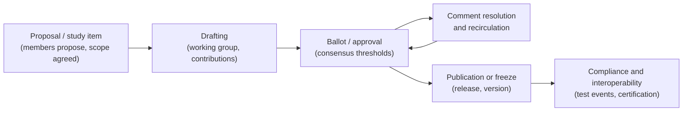
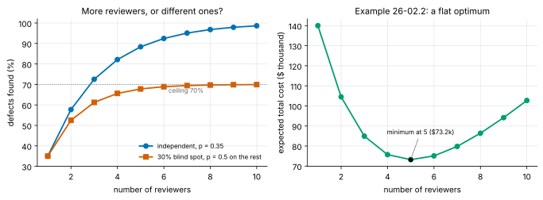

<!-- status: reviewed -->
# 26-02 · Design Reviews, Documentation and Standards Bodies

| | |
|---|---|
| **Course** | [26 · Engineering Design and Professional Practice](../README.md) |
| **University equivalent** | Senior design and engineering professional practice: design reviews, configuration management and standards (NASA Systems Engineering Handbook, technical reviews and configuration management; professional-practice coverage of codes and standards) |
| **Prerequisites** | [26-01](26-01-requirements-and-specifications.md) (requirements, verification and the cost of late errors), [03-02](../../03-probability-statistics-and-random-variables/chapters/03-02-random-variables-and-distributions.md) (binomial and independence), [25-12](../../25-fabrication-packaging-test-and-reliability/chapters/25-12-post-silicon-validation.md) (ECOs and decision trees) |
| **Estimated study hours** | 4 |
| **Last verified** | 2026-11-26 |

**Learning objectives.** After this chapter you can:

1. Describe the review gates of a chip program and their entry and exit criteria, and distinguish peer reviews from milestone reviews.
2. Compute how many defects k independent reviewers find, choose the cost-optimal number of reviewers, and explain why shared blind spots cap what reviews can achieve.
3. Estimate the defects a review missed with a capture–recapture estimate, and state its assumptions.
4. Explain how standards bodies make standards (membership, consensus, balloting, release cycles), and check a ballot against the IEEE SA rules.
5. Explain FRAND and "reasonable rate" commitments for standard-essential patents, and compute royalty stacking and the effect of the royalty base on a chip supplier.

---

## 1. Big picture

No engineer reliably finds their own mistakes. Design reviews put other experienced eyes on the work at the moments when a mistake is still cheap to fix, and documentation makes the work reviewable, repeatable and changeable under control. Standards do the same across companies: they are specifications written by many competitors together, so that a PCIe card from one company works in a server from another. For a chip company, standards are both a constraint (the interface requirements of 26-01 come from them) and a battlefield (whose technology gets written in, and on what licensing terms).

- **Where reviews show up:** architecture and specification reviews, block design reviews, RTL and verification reviews, the tape-out sign-off review, production-release reviews and failure reviews after an escape.
- **Where documentation shows up:** baselined specifications, change requests and engineering change orders (ECOs, 25-12), datasheets, application notes and errata.
- **Where standards show up:** every external interface (DDR and HBM from JEDEC, PCIe from PCI-SIG, Wi-Fi and Ethernet from IEEE 802, cellular from 3GPP, die-to-die links from UCIe), plus safety and quality standards (25-10).
- **Why a corporate development reader cares:** review discipline predicts escapes and slips (26-05); standards participation predicts time to market; and standard-essential patents are assets with real licensing value, and real litigation risk, in any transaction.

## 2. Intuition first

**Physical picture.** A review is a second inspection of a part before it goes into the assembly. Each inspector misses some flaws; two independent inspectors miss fewer; but if both were trained to look at the same features, they both miss the same flaws. The most valuable second inspector is the one who looks differently.

**Analogy: reviews are audits.** A design review resembles a financial audit: independent people sample the work against agreed criteria, issue findings, and sign off before a decision (tape-out, publication) that is expensive to reverse. Auditors also use statistics to estimate what their sample missed, as Example 26-02.3 does for a review. **Where the analogy breaks:** an audit checks compliance with established accounting rules, whereas a design review often has to judge whether the rules themselves (the specification) are right; and an audit opinion carries legal weight, whereas review sign-off only means the reviewers found nothing more, never that nothing more exists.

**How standards are made.** A standard moves through a pipeline that looks like a product program run by a committee:

Companies that write the draft shape the outcome and get a head start; companies that wait for publication implement what others wrote.

## 3. Theory

### 3.1 Kinds of review

**Peer reviews and milestone reviews.** The NASA Systems Engineering Handbook defines a **peer review** as an "independent evaluation by internal or external subject matter experts who do not have a vested interest in the work product under review," conducted to "identify defects and issues prior to that work product moving into a milestone review or approval cycle" [R-630]. **Milestone (life-cycle) reviews** are fewer and more formal: they decide whether the program may proceed. NASA's **Preliminary Design Review (PDR)** "demonstrates that the preliminary design meets all system requirements with acceptable risk and within the cost and schedule constraints and establishes the basis for proceeding with detailed design"; its **Critical Design Review (CDR)** "demonstrates that the maturity of the design is appropriate to support proceeding with full-scale fabrication, assembly, integration, and test"; and a **Key Decision Point** is "the event at which the decision authority determines the readiness of a program/project to progress to the next phase" [R-630].

**Chip-program equivalents.** Names differ by company, but the gates line up with the cost-of-change jumps of 26-01:

| Gate | Question it answers | Typical entry criteria | Typical exit criteria |
|---|---|---|---|
| Concept / architecture review (≈ PDR) | Does this architecture meet the PRD within cost, power and schedule? | PRD baselined; performance and power models; die-size and cost estimate (25-04) | Architecture approved; budgets allocated; top risks owned |
| Specification freeze | Is the target stable enough to design to? | Architecture and block specifications complete; TBD count near zero | Change control in force from here on |
| RTL freeze (≈ CDR for logic) | Is the design complete enough to verify to closure and implement? | All features coded; coverage plan; timing feasible | Only bug fixes enter, through change control |
| Tape-out review | May we spend the mask set? | Verification coverage closed; timing, power, DRC/LVS, reliability sign-off (19-11, 25-09) | Masks ordered; waivers documented and owned |
| Production release | May we ship in volume? | Characterization, qualification (25-10), test program and yield (25-11) | Datasheet released; errata published |

**What makes a review work.** Entry criteria keep reviews from becoming status meetings on unfinished work; exit criteria make the outcome a decision rather than an impression; written findings with owners and closing dates make it auditable. The reviewers' independence matters as much as their expertise, for the reason §3.2 quantifies.

### 3.2 How many defects does a review find?

**Independent reviewers.** Suppose a work product contains $N$ defects and each reviewer, working independently, finds any given defect with probability $p$. A defect escapes all $k$ reviewers only if each misses it, with probability $(1 - p)^k$, so the fraction found and the expected number escaping are

$$
P_{found}(k) = 1 - (1 - p)^k, \qquad E[\text{escapes}] = N(1 - p)^k .
$$

Each added reviewer finds a fraction $p$ of what the others missed, so the returns diminish geometrically.

**How many reviewers?** Let each reviewer cost $C_r$ (their time, including preparation) and each escaped defect cost $C_e$ (its expected downstream cost, 26-01 §3.6). The expected total cost is

$$
C(k) = kC_r + C_eN(1 - p)^k .
$$

The $k$-th reviewer is worth adding if the escapes it removes, $C_eN(1 - p)^{k-1}p$, exceed its cost $C_r$. Solving $(1 - p)^{k-1} \ge C_r/(C_eNp)$ for $k$:

$$
k \le 1 + \frac{\ln[C_r/(C_eNp)]}{\ln(1 - p)} ,
$$

and the optimum is the largest integer that satisfies it (Example 26-02.2). The optimum is flat: one reviewer more or fewer changes the cost little, which is fortunate, because $p$ and $C_e$ are known only roughly.

**Shared blind spots.** The independence assumption is the weak point. Real defects differ in difficulty, and reviewers trained alike miss the same hard ones. Model the defects as classes: a fraction $f_j$ of defects is found by each reviewer with probability $p_j$. Then

$$
P_{found}(k) = \sum_j f_j\bigl[1 - (1 - p_j)^k\bigr] ,
$$

which saturates at the fraction of defects any reviewer can find at all. If 30% of defects are invisible to the review method ($p$ = 0), no number of reviewers finds them. The remedy is diversity, not headcount: a reviewer from another discipline, a different method (simulation, formal verification, a test chip, 19-13), or a customer's eyes.

### 3.3 Estimating what a review missed

**Capture–recapture.** Ecologists estimate a fish population by marking a catch, releasing it and counting marked fish in a second catch. The same logic estimates the defects a review missed. Two reviewers search the same document independently: reviewer 1 finds $n_1$ defects, reviewer 2 finds $n_2$, and $m$ are found by both. If the defects are equally findable and the reviewers independent, then $E[n_1] = Np_1$, $E[n_2] = Np_2$ and $E[m] = Np_1p_2$. Eliminating the unknown probabilities,

$$
\frac{E[n_1]E[n_2]}{E[m]} = \frac{Np_1 \cdot Np_2}{Np_1p_2} = N \quad\Longrightarrow\quad \hat N = \frac{n_1n_2}{m} ,
$$

the **Lincoln–Petersen estimate**. Equivalently, reviewer 2 found a fraction $m/n_1$ of reviewer 1's defects, which estimates $p_2$, so $\hat N = n_2/\hat p_2$. The distinct defects found are $n_1 + n_2 - m$, and $\hat N - (n_1 + n_2 - m)$ estimates those still hidden. Because $\hat N$ divides by a random count $m$, it is biased upward for small samples; Chapman's version,

$$
\hat N_C = \frac{(n_1 + 1)(n_2 + 1)}{m + 1} - 1 ,
$$

reduces the bias and stays finite when $m$ = 0.

**Its assumptions, and how they fail.** Both estimates assume every defect is equally findable. When some defects are harder than others, the reviewers' finds overlap more than independence predicts (both find the easy ones), $m$ is too large, and $\hat N$ is biased *low*: the estimate says the document is cleaner than it is. The lab shows the bias by simulation. With same-trained reviewers, capture–recapture therefore tends to underestimate what remains (reviewers chosen to look at different things overlap less than independence predicts and can push it the other way, and sampling noise moves any single estimate either way). It is still useful: a large estimate is a strong warning, while a small one is not a guarantee.

> **Going deeper — more than two reviewers.** With three or more reviewers, log-linear models of the capture histories (which reviewers found each defect) can estimate and partly correct for heterogeneity and reviewer dependence. They are the standard tools in software-inspection research and in wildlife statistics, and they need more data than a single review usually provides.

### 3.4 Documentation and configuration control

A **baseline** is a document version that has been reviewed and approved and that changes only through a controlled process. From specification freeze onward, every change is a **change request** that states what changes, why, and its impact (found through the traceability links of 26-01), and that a change control board approves or rejects. After tape-out, hardware changes become ECOs (25-12), with the same discipline and higher stakes.

Three documents face the customer:

- the **datasheet**, the guaranteed electrical and functional behaviour (minimum, typical and maximum values with their test conditions);
- **application notes and reference designs**, which show how to use the part but guarantee nothing;
- **errata**, the published list of known deviations from the datasheet or specification, each with its affected steppings and any workaround (25-12).

The internal specification, the datasheet and the errata must agree: a requirement that changed internally but not in the datasheet is a customer escape waiting to happen.

### 3.5 How standards are made

**The landscape.** Formal standards development organizations, such as IEEE SA (Ethernet and Wi-Fi in IEEE 802), ETSI and ISO/IEC, operate under published due-process rules; cellular standards come from 3GPP, a partnership of regional standards bodies that includes ETSI. Industry bodies such as JEDEC (memory), PCI-SIG (PCIe) and the UCIe Consortium (die-to-die links) are membership organizations whose specifications are written by and for their member companies, often faster. UCIe, for example, lists its promoter members as AMD, ASE, Alibaba Cloud, Arm, Google Cloud, Intel, Meta, Microsoft, NVIDIA, Qualcomm, Samsung and TSMC [R-635], a mix of chip designers, foundries, a packaging house and cloud buyers that tells you whose interests the standard will balance.

**Consensus, made measurable.** IEEE SA's rules show what "consensus" means in practice [R-632]. A draft goes to a balloting group of interested parties, and:

- at least **75%** of the balloting group must return a ballot;
- at least **75%** of those voting Approve or Do Not Approve must approve (abstentions are not counted in this ratio);
- if **30% or more** of the returned ballots are abstentions, the ballot is invalid;
- every Do Not Approve vote must come with comments, which the working group must consider, and changes are recirculated to the balloting group.

The thresholds are a supermajority, not unanimity: a determined minority can delay a standard through comments and recirculation but cannot veto it alone (Example 26-02.4).

**Release cycles.** Standards arrive in versions with freeze dates that product plans must track. 3GPP's Release 19 completed its functional freeze (Stage 3) in September 2025 and became stable for protocols on 12 December 2025, while Release 20's dates were projected as March 2027 and June 2027, "subject to change" [R-634]. PCI-SIG released the PCIe 7.0 specification (128.0 GT/s) to members on 11 June 2025 and announced PCIe 8.0 for release by 2028 [R-273]; JEDEC published the HBM4 standard (JESD270-4) on 16 April 2025 [R-474]. A chip that implements a standard must either wait for the freeze or design to a draft and accept the risk of late changes (Example 26-02.6).

### 3.6 Standards and patents

A standard often cannot be implemented without using patented inventions; such a patent is **standard-essential** (an SEP). Because implementers have no choice but to use it, standards bodies ask patent holders to commit to licensing terms in advance (a holder may refuse, and the standard may then have to work around the patent).

**FRAND.** ETSI's IPR policy, clause 6.1, has the Director-General ask the owner of an essential IPR "to give within three months an irrevocable undertaking in writing that it is prepared to grant irrevocable licences on fair, reasonable and non-discriminatory ('FRAND') terms and conditions" [R-633].

**Reasonable rates.** IEEE SA's patent policy defines a "Reasonable Rate" as "appropriate compensation to the patent holder for the practice of an Essential Patent Claim excluding the value, if any, resulting from the inclusion of that Essential Patent Claim's technology in the IEEE Standard" [R-631]. Among its optional considerations is the value the claim contributes to "the smallest saleable Compliant Implementation that practices the Essential Patent Claim or to another appropriate value level of the Compliant Implementation" [R-631]. A holder who has given an assurance "shall neither seek nor seek to enforce a Prohibitive Order" (an injunction or exclusion order) "based on such Essential Patent Claim(s) in a jurisdiction against an implementer who is willing to negotiate in good faith for a license" [R-631].

**Royalty stacking.** If $n$ holders each charge a rate $r_i$ on the same royalty base $B$, the implementer pays

$$
R = B\sum_{i=1}^n r_i ,
$$

which grows with the number of holders regardless of what the standard as a whole is worth. A **top-down** approach starts instead from an aggregate rate $r_{agg}$ for the whole standard and gives each holder a share $s_i$ in proportion to its contribution, $R_i = r_{agg}Bs_i$, so that the total is bounded by construction.

**The royalty base.** Whether the base $B$ is the chip (the smallest saleable compliant implementation, for a modem) or the end product (the phone) changes the money by the ratio of their prices. For a chip supplier this is existential: a percentage of a phone's price, applied to a component that sells for a few percent of it, can exceed the component's entire price (Example 26-02.5). Which base is appropriate is argued in courts and policy debates and differs by jurisdiction and standards body **[Contested]**.

## 4. Worked examples

All examples use assumed, illustrative numbers unless a source is cited.

### Example 26-02.1 · Which review, and what must it decide? (tier A)

**Setup.** For a new AI-accelerator chip, state which gate each event belongs to, and one exit criterion it must meet: (a) the team asks to order masks with three timing paths waived; (b) marketing wants to add a feature two weeks after the block specifications were baselined; (c) the architecture team presents a power model showing 15% headroom against the PRD; (d) qualification has finished and the test program yields 92%, against a plan of 95%.

**Solution.**

- (a) **Tape-out review.** Exit criterion: each waiver is documented, analysed (why the path is safe or what it costs) and owned by a named engineer, and the review records the decision to accept the risk.
- (b) **Change control after specification freeze.** The request needs an impact analysis through the traceability links (26-01) and approval by the change control board, weighing schedule against value; it is not a design review question.
- (c) **Architecture review** (the PDR analogue). Exit criterion: the budgets are allocated with margin held at system level, and the model's assumptions are reviewed by someone who did not build it.
- (d) **Production release.** Exit criterion: either a yield-improvement plan with dates and a cost model (25-04, 25-11), or a recorded decision to ship at 92% with the margin impact understood.

**Units check.** Percentages are dimensionless. ✓

**Sanity check.** Each event maps to exactly one gate, and each exit criterion is a decision with an owner, not a status report. That is the test of a well-run review.

### Example 26-02.2 · How many reviewers? (tier B)

**Setup.** A block specification contains about 20 defects (assumed). Each reviewer independently finds any given defect with probability 0.35. A reviewer costs $10,000 of time, and each escaped defect costs $10,000 downstream on average (both assumed). (a) Tabulate the expected total cost for one to seven reviewers. (b) Find the optimal number from the marginal condition. (c) What fraction of defects does the optimal team find? (d) Now suppose 30% of the defects are invisible to this kind of review and the rest are found with probability 0.50 each (the same 0.35 average). Repeat (c).

**Solution.**

- (a) $C(k) = 10{,}000k + 10{,}000 \times 20 \times 0.65^k$: **$140,000**, **$104,500**, **$84,925**, **$75,701**, **$73,206**, **$75,084** and **$79,804** for $k$ = 1 to 7.
- (b) $k \le 1 + \ln[10{,}000/(10{,}000 \times 20 \times 0.35)]/\ln 0.65 = 1 + \ln(0.1429)/(-0.431)$ = **5.52**, so **5** reviewers, at $73,206.
- (c) $1 - 0.65^5$ = **88.4**%, leaving **2.32** expected escapes.
- (d) $0.70[1 - 0.50^5] + 0.30 \times 0$ = **67.8**%, leaving **6.44** escapes: nearly three times as many, and no number of reviewers recovers the hidden 30%.

**Units check.** Dollars per reviewer × reviewers + dollars per escape × escapes = dollars. ✓

**Sanity check.** Between four and six reviewers the cost is at most **3.4**% above the optimum, so the optimum is flat; the larger lesson is (d): the same average detection rate gives very different results depending on whether the reviewers share blind spots.

### Example 26-02.3 · How many defects did the review miss? (tier B)

**Setup.** Two engineers review an interface specification independently. The first logs 24 issues, the second 18, and 12 appear on both lists. Estimate (a) each reviewer's detection probability, (b) the total number of issues by Lincoln–Petersen and by Chapman, and (c) the number still undiscovered.

**Solution.**

- (a) Reviewer 1 found 12 of reviewer 2's 18, so $\hat p_1 = 12/18$ = **0.667**; reviewer 2 found 12 of reviewer 1's 24, so $\hat p_2 = 12/24$ = **0.500**.
- (b) $\hat N = 24 \times 18/12$ = **36**; Chapman: $25 \times 19/13 - 1$ = **35.5**.
- (c) Together they found $24 + 18 - 12$ = **30** distinct issues, so about **6** remain (5.5 by Chapman).

**Units check.** Counts of issues. ✓

**Sanity check.** If 6 issues remain after two good reviewers, a third review by someone with a different viewpoint is likely worth it. Because hard-to-find issues make the overlap too large, 6 is better read as "at least about 6" than as an exact count (§3.3).

### Example 26-02.4 · Does the ballot pass? (tier B)

**Setup.** An IEEE SA balloting group has 180 members. The ballot returns 108 Approve, 30 Do Not Approve and 12 Abstain. Using the rules of §3.5, (a) check the return rate, (b) the approval rate and (c) the abstention rate. (d) If comment resolution leads some Approve voters to change to Do Not Approve, how many can change before the ballot fails?

**Solution.**

- (a) Returned: 150 of 180 = **83.3**% ≥ 75%. ✓
- (b) Approval: $108/(108 + 30)$ = **78.3**% ≥ 75%. ✓
- (c) Abstentions: $12/150$ = **8.0**% < 30%. ✓ The ballot passes.
- (d) With 138 Approve and Do Not Approve votes, 75% approval needs at least $0.75 \times 138 = 103.5$, so **104** Approve votes; **4** voters can switch.

**Units check.** Votes over votes. ✓

**Sanity check.** A margin of four votes in a group of 180 is thin; a working group in this position resolves the negative comments carefully, because a handful of members can force more recirculation rounds.

### Example 26-02.5 · Royalty stacking and the royalty base (tier B)

**Setup.** A cellular modem chip sells for $20 and goes into a $500 phone (assumed). Thirty holders of essential patents each ask 0.5% of the phone's price (assumed). (a) What is the stacked royalty per phone, and how does it compare with the chip's price? (b) What would the same total rate yield on the chip as the base? (c) Under a top-down approach with an aggregate rate of 5% of the phone's price, what does a holder with 8% of the essential patents receive per phone?

**Solution.**

- (a) $30 \times 0.005 \times 500$ = **$75** per phone, **3.75** times the price of the chip that implements the standard.
- (b) $0.15 \times 20$ = **$3** per chip.
- (c) $0.05 \times 500 \times 0.08$ = **$2** per phone, out of an aggregate of **$25**.

**Units check.** Rate × dollars = dollars. ✓

**Sanity check.** The same patents yield $75 or $3 depending on the base, a factor of 25 (the price ratio). That ratio is why royalty-base disputes are fought so hard: SEP holders generally argue for the end device as the base, while component suppliers that implement the standard argue for the component, the smallest saleable compliant implementation **[Contested]**.

### Example 26-02.6 · Design to the draft, or wait for the freeze? (tier C)

**Setup.** A modem team can start RTL six months before a standard's functional freeze, or wait for it. Starting early gains six months to market, worth $5 M of gross profit a month (assumed). There is a 40% chance that a late change in the standard hits the design (assumed). (a) If the change can be absorbed by a metal-only ECO costing $3 M and two months, what is the expected net value of starting early? (b) If it would instead need a full respin costing $25 M and six months? (c) In case (b), above what probability of a late change should the team wait?

**Solution.**

- (a) Gain $6 \times 5$ = **$30 M**; expected penalty $0.4 \times (3 + 2 \times 5)$ = **$5.2 M**; net **$24.8 M**: start early.
- (b) Expected penalty $0.4 \times (25 + 6 \times 5)$ = **$22 M**; net **$8 M**: still positive, but much thinner.
- (c) Waiting is better when $p(25 + 30) > 30$, that is, $p > 30/55$ = **0.545**.

**Units check.** Months × $M/month and $M add to $M. ✓

**Sanity check.** Designing to a draft pays when a late change can be absorbed cheaply, which is why teams that start early keep the draft-dependent logic programmable or isolated behind firmware. The participation of the team's own engineers in the standard lets them judge $p$ and, more valuably, see which parts of the draft are still moving.

<!-- answer-key -->

| ID | Quantity | Value | Unit |
|---|---|---|---|
| Ex 26-02.2a | cost, 1 reviewer | 140000 | $ |
| Ex 26-02.2a1 | cost, 2 reviewers | 104500 | $ |
| Ex 26-02.2a2 | cost, 3 reviewers | 84925 | $ |
| Ex 26-02.2a3 | cost, 4 reviewers | 75701 | $ |
| Ex 26-02.2a4 | cost, 5 reviewers | 73206 | $ |
| Ex 26-02.2a5 | cost, 6 reviewers | 75084 | $ |
| Ex 26-02.2a6 | cost, 7 reviewers | 79804 | $ |
| Ex 26-02.2b0 | ratio Cr/(Ce N p) | 0.1429 | |
| Ex 26-02.2b1 | ln(1 - p) | -0.431 | |
| Ex 26-02.2b | marginal bound | 5.52 | |
| Ex 26-02.2b2 | optimal reviewers | 5 | |
| Ex 26-02.2c | fraction found | 88.4 | % |
| Ex 26-02.2c1 | expected escapes | 2.32 | |
| Ex 26-02.2d | fraction found, blind spots | 67.8 | % |
| Ex 26-02.2d1 | expected escapes, blind spots | 6.44 | |
| Ex 26-02.2e | worst excess cost, 4 to 6 reviewers | 3.4 | % |
| Ex 26-02.3a | p1 estimate | 0.667 | |
| Ex 26-02.3a1 | p2 estimate | 0.500 | |
| Ex 26-02.3b | Lincoln-Petersen | 36 | |
| Ex 26-02.3b1 | Chapman | 35.5 | |
| Ex 26-02.3c | distinct found | 30 | |
| Ex 26-02.3c1 | remaining | 6 | |
| Ex 26-02.3c2 | remaining, Chapman | 5.5 | |
| Ex 26-02.4a | returned | 150 | |
| Ex 26-02.4a1 | return rate | 83.3 | % |
| Ex 26-02.4b | approval rate | 78.3 | % |
| Ex 26-02.4c | abstention rate | 8.0 | % |
| Ex 26-02.4d0 | approve plus disapprove | 138 | |
| Ex 26-02.4d1 | 75% of that | 103.5 | |
| Ex 26-02.4d | approvals needed | 104 | |
| Ex 26-02.4d2 | voters who can switch | 4 | |
| Ex 26-02.5a | stacked royalty | 75 | $ |
| Ex 26-02.5a1 | multiple of chip price | 3.75 | |
| Ex 26-02.5b | royalty on chip base | 3 | $ |
| Ex 26-02.5b0 | total rate | 0.15 | |
| Ex 26-02.5c | holder's top-down royalty | 2 | $ |
| Ex 26-02.5c1 | aggregate | 25 | $ |
| Ex 26-02.5d | base ratio | 25 | |
| Ex 26-02.6a | schedule gain | 30 | $M |
| Ex 26-02.6a1 | expected penalty, ECO | 5.2 | $M |
| Ex 26-02.6a2 | net, ECO | 24.8 | $M |
| Ex 26-02.6b | expected penalty, respin | 22 | $M |
| Ex 26-02.6b1 | net, respin | 8 | $M |
| Ex 26-02.6c | break-even probability | 0.545 | |

## 5. Simulate it

The lab is [labs/26-02-lab/](../labs/26-02-lab/README.md). `reviews.py` computes detection by independent and blind-spot-sharing reviewers, the cost-optimal team size, capture–recapture estimates with a Monte Carlo of their bias, IEEE SA ballot checks, royalty stacks and the value of designing to a draft standard.

**Predict, then run.**

1. *Predict* how the fraction found by five reviewers changes as the hidden fraction of defects grows from 0 to 50% at a fixed average detection rate, then plot it (the notebook's Part 1; the figure below shows the related curve against the number of reviewers).
2. *Predict* whether Chapman's estimate is biased high or low when 30% of the defects are hard to find, then simulate 20,000 pairs of reviews and compare the average estimate with the truth.
3. *Predict* the largest balloting group in which three determined Do Not Approve voters can, on their own, block a ballot in which everyone else approves (assume full return and no abstentions), then check it.
4. *Predict* the break-even probability in Example 26-02.6(b) when the value of time to market doubles, then compute it.

## 6. Engineering tradeoffs

| Knob | Improves | Costs | Typical decision owner |
|---|---|---|---|
| More reviewers per review | Fewer escapes, with diminishing returns | Senior engineers' time; slower reviews | Engineering manager |
| More diverse reviewers (other disciplines, outside experts) | Finds defects that same-trained reviewers share | Ramp-up time; confidentiality; scheduling | Chief architect |
| Stricter entry criteria for gates | Reviews of finished, reviewable work | Gates slip when entry criteria are not met | Program manager |
| Earlier specification freeze and change control | Stable target; traceable changes | Less flexibility to respond to customers and markets | Product line management |
| Designing to a draft standard | Months of time to market | Risk of late changes (ECO or respin) | Product line and standards lead |
| Heavier standards participation | Influence on the specification; early warning of changes; patents | Engineers' time; travel; disclosure obligations | CTO / standards strategy |
| Licensing SEPs at the chip versus the device level | Lower royalty base and one licence covering every downstream customer (chip level); no royalty on the supplier's own price (device level) | Royalty exposure moves between supplier and customer | Legal and licensing, with business units |

## 7. Numbers to know

| Quantity | Value | Note |
|---|---|---|
| Fraction found by $k$ independent reviewers | $1 - (1 - p)^k$ | Timeless; independence assumed |
| Capture–recapture estimate | $\hat N = n_1n_2/m$ | Timeless; equal findability assumed |
| IEEE SA ballot thresholds | 75% return; 75% approval of Approve + Do Not Approve; invalid at ≥30% abstentions | IEEE SA Standards Board Operations Manual, approved January 2026 [R-632] |
| ETSI FRAND undertaking | Requested immediately once an essential IPR is brought to ETSI's attention; the owner is asked to give the irrevocable FRAND undertaking within three months | ETSI IPR Policy, clause 6.1 [R-633] |
| 3GPP releases | Rel-19 functional freeze September 2025, protocols stable 12 December 2025; Rel-20 projected March and June 2027 | 3GPP release table, as of November 2026 [R-634] |
| PCIe | 7.0 (128.0 GT/s) released to members 11 June 2025; 8.0 planned by 2028 | PCI-SIG, via secondary reprints [R-273] |

## 8. Common mistakes

- **Reviewing unfinished work.** A review without entry criteria becomes a status meeting; findings on work that is still changing are wasted.
- **Counting reviewers instead of viewpoints.** Five reviewers trained alike share blind spots (Example 26-02.2(d)); one reviewer from another discipline can find more than three more of the same.
- **Reading capture–recapture as exact.** When defects differ in difficulty and the reviewers are trained alike, the estimate tends to run low; treat a small estimate as a weak reassurance, not a count.
- **Letting the datasheet drift from the specification.** Changes made under change control must flow to the datasheet and errata, or customers design to the wrong part.
- **Treating "compliant" as "certified."** Designed to a standard, tested internally against it, and passed the standard body's own compliance or interoperability testing are three different claims.
- **Ignoring the royalty base.** A percentage royalty means nothing until the base is fixed; on an end product it can exceed the component's price.
- **Assuming a draft is final.** Freeze dates move ("future dates are proposals, subject to change" [R-634]); designs that start early must isolate what may change.

## 9. Practitioner lens

**State of the art, as of November 2026.**

- **Review practice** **[Established]**. Chip companies run gated programs much like the table in §3.1, with sign-off checklists at tape-out (timing, power, physical verification, reliability) and formal waiver processes. The NASA definitions quoted in §3.1 are a public reference point for what milestone reviews must decide [R-630].
- **Standards governance** **[Established]**. IEEE SA's consensus thresholds [R-632], ETSI's FRAND undertaking [R-633] and IEEE's reasonable-rate and prohibitive-order language [R-631] are the published rules. How courts and regulators interpret FRAND, the royalty base and injunctions differs by jurisdiction and continues to change **[Contested]**.
- **Consortia shape chiplet and interconnect markets** **[Established]**. UCIe's promoters span chip designers, foundries, a packaging house and hyperscalers [R-635]; PCI-SIG and JEDEC continue to set the cadence of server I/O and memory [R-273], [R-474].

**Commercial relevance.** A standards seat is an option on the future: engineers who draft a specification learn early which parts will change and which competitors are pushing what. Essential patents can be a material asset in a transaction, but their value depends on essentiality (often disputed), on the FRAND commitments attached to them, and on the royalty base; diligence should value them on the licensing terms they can actually command, not on patent counts.

**Marketing vs Reality.**

- *"We are compliant with the latest standard."* Ask: which version, designed or tested, and did the part pass the standard body's own compliance or interoperability testing? A draft-compliant design may need changes when the standard freezes.
- *"We contributed a large share of the standard."* Contribution counts measure meeting activity, not essential or valuable inventions; ask for declared essential patents, their independent assessment, and licensing revenue.
- *"Our reviews are rigorous."* Ask for the escape data: defects found after each gate, and by which method. A review process that finds nothing is either perfect or blind.
- *"Royalties are only 0.5%."* Of what base, and stacked with how many other holders (Example 26-02.5)?

**Questions for engineering leaders.**

1. *"What are the entry and exit criteria for your tape-out review, and how many waivers did your last chip carry?"* Strong: a written checklist, a waiver count with owners and the reason each was safe. Evasive: "we review everything thoroughly."
2. *"Which defects escaped your last review cycle, and which method finally found them?"* Strong: categories, counts and a change to the review method. Evasive: "nothing significant escaped."
3. *"Which standards do your engineers help write, and what did that participation change in your roadmap?"* Strong: named working groups, specific features shaped, early design decisions taken because of it. Evasive: "we follow the standards closely."
4. *"What is your royalty exposure for the standards you implement, and at which level of the supply chain is it paid?"* Strong: known licenses, the base, the expected per-unit cost and who bears it. Evasive: "our customers handle licensing."
5. *"How do you keep the datasheet, the internal specification and the errata consistent?"* Strong: a single change-control flow that updates all three, with release notes. Evasive: "the applications team takes care of it."

## 10. Concept check

**Q1.** Why does adding a fifth reviewer who was trained exactly like the other four add less than the formula $1 - (1 - p)^k$ suggests?

Answer

Because the formula assumes each reviewer misses defects independently. Reviewers trained alike miss the same hard defects, so the fifth mostly re-finds what the others found; detection saturates at the fraction of defects the method can find at all (§3.2).

**Q2.** State the Lincoln–Petersen estimate and the assumption that makes it biased low in practice.

Answer

$\hat N = n_1n_2/m$. It assumes every defect is equally findable; when some are harder, both reviewers find the easy ones, the overlap $m$ is too large, and $\hat N$ underestimates the total.

**Q3.** What is the difference between a peer review and a milestone review?

Answer

A peer review is an independent technical evaluation by experts without a vested interest, held to find defects before the work moves into a milestone review; a milestone review is a formal gate where a decision authority decides whether the program may proceed to its next phase [R-630].

**Q4.** Why do IEEE SA ballots exclude abstentions from the approval ratio but invalidate the ballot when abstentions reach 30%?

Answer

Excluding abstentions lets members who lack expertise or interest decline to judge without counting as opposition; invalidating ballots with many abstentions ensures that a standard is approved only when enough of the balloting group actually engaged with it. (This rationale is an interpretation; the rules themselves are in [R-632].)

**Q5.** Why does the royalty base matter more than the rate to a chip supplier?

Answer

Because royalties scale with the base: the same percentage on an end product worth many times the chip can exceed the chip's price, while on the chip itself it is a modest cost. The base can change the payment by the price ratio, 25 in Example 26-02.5.

**Q6.** When is it worth designing to a draft standard?

Answer

When the value of the time gained exceeds the expected cost of late changes, $p \times$ (fix cost + fix delay × value of time); it is most attractive when the likely changes can be absorbed by an ECO or firmware rather than a respin, and when the team participates in the standard and can judge $p$.

Problem set: [26-02 problems](../problems/26-02-problems.md) · [worked solutions](../solutions/26-02-solutions.md).

## 11. Key terms

[Peer review](../../../reference/glossary.md#peer-review) · [Milestone review](../../../reference/glossary.md#milestone-review) · [Entry and exit criteria](../../../reference/glossary.md#entry-and-exit-criteria) · [Waiver](../../../reference/glossary.md#waiver) · [Capture–recapture estimate](../../../reference/glossary.md#capture-recapture-estimate) · [Baseline](../../../reference/glossary.md#baseline) · [Change control board](../../../reference/glossary.md#change-control-board) · [Engineering change order (ECO)](../../../reference/glossary.md#engineering-change-order-eco) · [Errata](../../../reference/glossary.md#errata) · [Standards development organization](../../../reference/glossary.md#standards-development-organization) · [Balloting group](../../../reference/glossary.md#balloting-group) · [Standard-essential patent (SEP)](../../../reference/glossary.md#standard-essential-patent-sep) · [FRAND](../../../reference/glossary.md#frand) · [Royalty stacking](../../../reference/glossary.md#royalty-stacking) · [Smallest saleable compliant implementation](../../../reference/glossary.md#smallest-saleable-compliant-implementation)

## 12. Connections

- **Previous:** [26-01](26-01-requirements-and-specifications.md) set up requirements, verification and the cost of late errors that reviews exist to catch.
- **Next:** [26-03](26-03-engineering-economics-1.md) turns to the economics of a chip: NRE, die cost, ASP and gross margin, where royalties enter the cost stack.
- **Used later:** [26-04](26-04-engineering-economics-2.md) weighs licensing IP against building it; [26-05](26-05-schedule-and-respin-risk.md) connects review escapes to respins; [26-07](26-07-engineering-ethics.md) covers the professional duties of reviewers and the confidentiality and disclosure obligations of standards participants; the interface standards themselves are in [23-04](../../23-memory-and-storage-technology/chapters/23-04-dram-interfaces.md), [24-06](../../24-high-speed-io-signal-integrity-and-photonics/chapters/24-06-d2d-memory-phys-scale-up.md) and [17-12](../../17-communication-systems/chapters/17-12-multiple-access-and-cellular-wifi.md).

## 13. Further study

- NASA, *Systems Engineering Handbook*, NASA/SP-2016-6105 Rev 2 (free PDF): technical reviews, peer reviews and configuration management.
- IEEE SA Standards Board Bylaws (clause 6, patent policy) and Operations Manual (balloting), both free on the IEEE SA website.
- ETSI IPR Policy (Annex 6 of the ETSI Rules of Procedure), free.
- For capture–recapture in inspections, the software-engineering literature on estimating remaining defects from inspection data (search "capture-recapture software inspection").

## 14. Sources

1. NASA Systems Engineering Handbook, Rev 2: peer review, PDR, CDR and KDP definitions: [R-630].
2. IEEE SA Standards Board Bylaws, clause 6 (patent policy): [R-631].
3. IEEE SA Standards Board Operations Manual (January 2026), balloting rules: [R-632].
4. ETSI IPR Policy, clause 6.1: [R-633].
5. 3GPP release timeline: [R-634].
6. UCIe Consortium promoter members: [R-635].
7. PCIe 7.0 and 8.0: [R-273]. JEDEC HBM4: [R-474].
