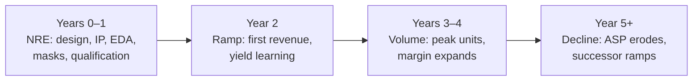
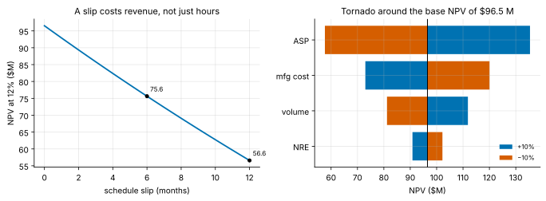

<!-- status: reviewed -->
# 26-03 · Engineering Economics I: NRE, Die Cost, ASP and Gross Margin

| | |
|---|---|
| **Course** | [26 · Engineering Design and Professional Practice](../README.md) |
| **University equivalent** | Engineering economics (Newnan, Eschenbach and Lavelle, *Engineering Economic Analysis*: interest and equivalence, present worth, annual worth, rate of return, depreciation) applied to semiconductor product economics |
| **Prerequisites** | [25-04](../../25-fabrication-packaging-test-and-reliability/chapters/25-04-yield-and-die-cost.md) (dies per wafer, yield and cost per good die), [25-11](../../25-fabrication-packaging-test-and-reliability/chapters/25-11-test-ate-sort-burn-in.md) (test cost), [26-02](26-02-design-reviews-and-standards.md) (royalties), [01-08](../../01-calculus-for-engineers/chapters/01-08-sequences-series-and-taylor.md) (geometric series) |
| **Estimated study hours** | 7 |
| **Last verified** | 2026-11-26 |

**Learning objectives.** After this chapter you can:

1. Build the per-unit cost stack of a chip (die, package, assembly and test yields, royalties) and convert it to gross margin and markup at a given selling price.
2. Amortize NRE over volume, and find the break-even volume and the fully loaded cost.
3. Derive and apply the FE time-value-of-money factors ($F/P$, $P/F$, $P/A$, $A/P$, $A/F$, $F/A$ and the gradient factors $P/G$, $A/G$), effective and continuous rates, capital recovery, capitalized cost and benefit–cost ratios.
4. Evaluate a chip program as an investment with NPV, IRR and payback, and quantify what a schedule slip costs.
5. Compare alternatives by equivalent annual cost, and identify which assumptions drive the answer with a sensitivity (tornado) analysis.

---

## 1. Big picture

A chip is a bet: a team spends tens or hundreds of millions of dollars of non-recurring engineering (NRE) over two or three years, then earns it back, or doesn't, a few dollars at a time on every unit sold. Two numbers decide the bet. The **gross margin** says how much of each sale is left after the cost of making the unit; the **volume and its timing** say how many of those margins arrive, and how much they are worth when they arrive late. This chapter builds both, starting from the die cost of 25-04 and ending with the discounted cash flows a chief financial officer, a venture investor or the FE exam would recognize.

- **Where it shows up:** every product business case, every pricing decision, every "should we do a derivative chip or a new one?" discussion, every make-or-buy decision for test equipment or IP (26-04).
- **Why the FE exam cares:** Engineering Economics is 5–8 of the FE Electrical and Computer exam's 110 questions, covering time value of money (present value, future value, annuities), cost estimation, risk identification and cost-benefit, trade-off and break-even analysis [R-636].
- **Why a corporate development reader cares:** a target's gross margin, NRE intensity and sensitivity to schedule are the bridge between its engineering and its valuation. Gross margins differ by business model: NVIDIA reported a 71.1% GAAP gross margin for fiscal 2026 [R-637], and TSMC 66.4% in the third quarter of 2026 [R-579].
- **What is new here for a finance reader:** the time-value mathematics is familiar; the engineering content is where the cost and the timing come from: yields compound through the manufacturing flow, NRE is set by node and design scope, and a slip of a few months can erase a large fraction of a program's value.

## 2. Intuition first

**Physical picture.** Picture a wafer moving through a factory. Every step adds cost to every die on it, good or bad. At each yield gate (wafer sort, assembly, final test), some units are scrapped, and the cost already sunk into them must be carried by the survivors. The cost of a good unit is therefore larger than the sum of the steps' costs, and the later a unit fails, the more cost it wastes. A die that fails final test has already paid for its package.

**Analogy: NRE is a fixed cost with an option attached.** In accounting terms NRE is a fixed cost: it does not depend on volume, so the more units share it, the less each carries. In finance terms it is closer to buying an option: you pay up front for the right to sell into a market window, and the option's value collapses if the window closes before you arrive. **Where the analogy breaks:** a financial option has a defined strike and expiry, whereas a chip's "window" erodes gradually as competitors ship, and the payoff depends on execution (yield, schedule) that the option holder controls, imperfectly.

**The cash-flow shape.** A chip program's cash flows look like a "J": deep negative during development, then positive as units ship, peaking and fading as the product ages:

Discounting weights the early years most, which is why the left of the "J" (cost and schedule) matters as much as the right (volume and price).

## 3. Theory

### 3.1 The cost stack

**From wafer to good die.** 25-04 derived the cost per good die,

$$
C_{die} = \frac{C_w}{\text{DPW}\times Y_{die}},
$$

where $C_w$ is the wafer price (\$), DPW the dies per wafer and $Y_{die}$ the die yield at wafer sort.

**Cascading yields.** After sort, each good die is packaged (cost $C_{pkg}$), and assembly yields $Y_{asm}$; the survivors are tested (cost $C_{test}$ per unit tested) and final test yields $Y_{test}$. A unit that fails a step carries all the cost spent on it so far, so the survivors must absorb it. After assembly, the cost per good assembled unit is $(C_{die} + C_{pkg})/Y_{asm}$; after final test,

$$
C_{good} = \frac{(C_{die} + C_{pkg})/Y_{asm} + C_{test}}{Y_{test}} .
$$

Per-unit costs that apply only to units sold, such as royalties (26-02), freight and warranty reserves, are then added: $\text{COGS} = C_{good} + C_{royalty} + \dots$, the **cost of goods sold** per unit. A yield loss late in the flow costs more than the same loss early, because more cost has accumulated by then; this is the manufacturing version of 26-01's cost-of-change escalation, and the reason good-die screening before expensive packaging (25-07, 25-11) pays.

**Gross margin and markup.** With average selling price ASP,

$$
\text{GM} = \frac{\text{ASP} - \text{COGS}}{\text{ASP}}, \qquad \text{markup} = \frac{\text{ASP} - \text{COGS}}{\text{COGS}} = \frac{\text{GM}}{1 - \text{GM}} .
$$

A 60% gross margin is a 150% markup. The **contribution** per unit, ASP − COGS, is what each sale contributes toward fixed costs (NRE, sales and administration) and profit. (In managerial accounting, contribution is price minus *variable* cost. For a fabless company COGS is almost all variable, so ASP − COGS approximates it; an integrated device manufacturer's COGS also carries fixed fab depreciation.)

> **Math refresher — margin versus markup.** Both divide the same profit, ASP − COGS, but margin divides by price and markup by cost. Because COGS = ASP(1 − GM), markup = GM/(1 − GM); the two agree only for small margins, and diverge quickly: at GM = 90% the markup is 900%.

### 3.2 NRE, amortization and break-even

**What NRE includes.** Non-recurring engineering is everything spent once to bring a chip to production: the design team's salaries over the program, licensed IP (26-04), EDA tools, prototype masks and wafers, packaging and test development, characterization and qualification (25-10). Mask sets alone are estimated at above $10 M at 7 nm and $10–40 M at 3–5 nm, and total leading-edge NRE at $30 M to over $100 M for a startup chip, with design costs for a large chip "from scratch" estimated in the hundreds of millions **[Industry estimate; Contested]** [R-623].

**Amortization.** Spread over a lifetime volume $V$, NRE adds $\text{NRE}/V$ to each unit's cost, giving the **fully loaded cost** $\text{COGS} + \text{NRE}/V$. The program breaks even (ignoring the time value of money for now) when total contribution covers NRE:

$$
V^* = \frac{\text{NRE}}{\text{ASP} - \text{COGS}} .
$$

Two consequences follow. First, a high-NRE, leading-edge chip needs either high volume or a high contribution per unit; low-volume products belong on mature nodes where NRE is small (25-05). Second, the break-even volume is very sensitive to the contribution: because $V^*$ varies as $1/(\text{ASP} - \text{COGS})$, it rises more than in proportion to a price cut: a \$2 cut on an \$8 contribution, a quarter of it, raises $V^*$ by a third (Problem 26-03.8).

### 3.3 The time value of money

A dollar received later is worth less than a dollar today, because today's dollar could be invested at an interest rate $i$ per period. The FE Reference Handbook expresses the standard conversions as factors written $(X/Y, i, n)$: the value of $X$ given $Y$ at rate $i$ over $n$ periods.

**Single payments.** A present sum $P$ grows for $n$ periods to

$$
F = P(1 + i)^n \quad\Longrightarrow\quad (F/P, i, n) = (1 + i)^n,\qquad (P/F, i, n) = (1 + i)^{-n} .
$$

**Uniform series.** A payment $A$ at the end of each of $n$ periods has present value

$$
P = A\sum_{t=1}^n(1 + i)^{-t} .
$$

Let $x = (1 + i)^{-1}$. The sum is a geometric series, $x + x^2 + \dots + x^n = x(1 - x^n)/(1 - x)$, and $x/(1 - x) = 1/i$, so

$$
(P/A, i, n) = \frac{1 - (1 + i)^{-n}}{i} = \frac{(1 + i)^n - 1}{i(1 + i)^n} .
$$

Its reciprocal, the **capital recovery factor** $(A/P, i, n) = i(1 + i)^n/[(1 + i)^n - 1]$, converts a present cost into the equal annual payments that repay it with interest, which is how a loan payment or the annual cost of owning a machine is computed. Compounding the series forward gives $(F/A, i, n) = [(1 + i)^n - 1]/i$ and its reciprocal, the **sinking fund factor** $(A/F, i, n) = i/[(1 + i)^n - 1]$.

**Capital recovery with salvage.** An asset bought for $P$ and sold for salvage $S$ after $n$ years costs, per year,

$$
\text{CR} = P(A/P, i, n) - S(A/F, i, n) ,
$$

the annual equivalent of the purchase less the annual equivalent of the salvage received at the end.

**Arithmetic gradients.** Costs that grow by a fixed amount each year (maintenance on an aging tester, a support team that grows) form a gradient series: $0, G, 2G, \dots, (n - 1)G$ at the ends of periods 1 to $n$. Stack it as uniform series: one payment $G$ in each of periods 2 to $n$, another in periods 3 to $n$, and so on, down to a single payment in period $n$. Their future values add:

$$
F = G\sum_{k=1}^{n-1}(F/A, i, k) = \frac{G}{i}\sum_{k=1}^{n-1}\bigl[(1 + i)^k - 1\bigr] = \frac{G}{i}\left[\frac{(1 + i)^n - 1}{i} - n\right],
$$

using $\sum_{k=1}^{n-1}(1 + i)^k = [(1 + i)^n - 1]/i - 1$. Multiplying by $(A/F, i, n)$ and by $(1 + i)^{-n}$ gives the FE gradient factors

$$
(A/G, i, n) = \frac{1}{i} - \frac{n}{(1 + i)^n - 1}, \qquad (P/G, i, n) = \frac{(1 + i)^n - 1 - ni}{i^2(1 + i)^n} .
$$

A cost that starts at $A_1$ and grows by $G$ a year is the uniform series $A_1$ plus the gradient (Problem 26-03.16).

**Perpetuities and capitalized cost.** As $n \to \infty$, $(P/A, i, n) \to 1/i$, so a payment $A$ every year forever is worth $P = A/i$ today: the **capitalized cost** of an endowment or of a permanent facility's running cost.

**Benefit–cost ratio.** Public and infrastructure projects are often judged by B/C = PV(benefits)/PV(costs), accepted when B/C > 1, which is the same test as NPV > 0. Between mutually exclusive alternatives, compare the *increment*: the larger project is worth its extra cost only if $\Delta B/\Delta C > 1$ on the difference between them, never by ranking the alternatives' own ratios (Problem 26-03.17). The same rule applies to rates of return.

**Nominal, effective and continuous rates.** A nominal annual rate $r$ compounded $m$ times a year gives the effective annual rate $i_e = (1 + r/m)^m - 1$; as $m \to \infty$, $i_e \to e^r - 1$ (continuous compounding, 01-08's limit definition of $e$), and $F = Pe^{rn}$.

**Net present value, internal rate of return and payback.** For cash flows $CF_t$ at the end of periods $t = 0, 1, \dots, n$ and a minimum attractive rate of return (MARR) $i$,

$$
\text{NPV}(i) = \sum_{t=0}^n\frac{CF_t}{(1 + i)^t} .
$$

A project is worth doing if NPV > 0 at the MARR. The **internal rate of return** is the rate at which NPV = 0, found by iteration or interpolation (02-10's root-finding; 05-01 solved one in Python). IRR is unique only when the cash flows change sign once; with several sign changes (a large mid-life refit, say) NPV(i) can have several roots. For mutually exclusive alternatives, rank by NPV, or by the IRR of the incremental cash flow, never by the alternatives' own IRRs. **Payback** is the time until cumulative cash flow turns positive; it ignores both discounting and everything after payback, so it measures liquidity and risk, not value.

**Comparing alternatives.** Mutually exclusive alternatives with equal lives are compared by NPV or by **equivalent uniform annual cost (EUAC)**: convert every cost to an annual equivalent at the MARR and choose the lowest. The two methods always agree for equal lives, because EUAC = NPV × $(A/P, i, n)$, a positive constant. For alternatives of different lives, annual worth is the natural measure under the usual assumption that each can be repeated.

**Depreciation (straight line).** For tax and accounting, a capital asset's cost is spread over its life. Straight-line depreciation charges $D = (P - S)/n$ a year, leaving a book value $P - tD$ after $t$ years. Depreciation is not a cash flow, but it lowers taxable income, so it affects after-tax cash flows; a fab's capital cost appears in wafer prices substantially through depreciation, which is how CSET's model ranks wafer prices by node (25-04, [R-576]).

> **Going deeper — inflation and real rates.** If prices inflate at $f$ per year, a nominal rate $i$ corresponds to a real rate $i' = (1 + i)/(1 + f) - 1$. Discount nominal cash flows (including inflation) at nominal rates, or real cash flows at real rates, never a mix; mixing them is a common source of overstated NPV.

### 3.4 A chip program as an investment

Combine the pieces. NRE is spent during development (years 0 and 1, say). From the first year of sales, each unit contributes ASP − COGS. The program's NPV is

$$
\text{NPV} = -\sum_{t \in \text{dev}}\frac{\text{NRE}_t}{(1 + i)^t} + \sum_{t \in \text{sales}}\frac{V_t(\text{ASP}_t - \text{COGS}_t)}{(1 + i)^t} .
$$

**What a slip costs.** Suppose a slip of one year delays every sales year by one period and the market window closes at a fixed date, so the last year of sales is lost. Two effects compound: every remaining year is discounted one more period, and the tail is cut off. In Example 26-03.5 a one-year slip removes about 41% of the program's NPV, about seven times the cost of a 10% NRE overrun (Example 26-03.5(d)), which is why delay costs dominate the respin and change decisions of 25-12 and 26-01.

### 3.5 Sensitivity and risk

The FE specification asks for "risk identification" and "break-even" analysis [R-636]. The practical tool is a **sensitivity (tornado) analysis**: vary each input by a plausible amount (say ±10%), one at a time, recompute NPV, and rank the inputs by the size of the swing. The ranking tells you where to spend diligence and engineering effort. For chip programs, ASP and volume usually dominate NRE, because they multiply every unit, while NRE is spent once (Example 26-03.5(d)). Where inputs are uncertain together, scenarios or a Monte Carlo over the inputs (the lab) replace the one-at-a-time view.

## 4. Worked examples

All examples use assumed, illustrative numbers unless a source is cited. Intermediate values are shown rounded but carried at full precision, so recomputing from the displayed figures can differ in the last digit. The cash flows are pre-tax unit contribution only; a full business case subtracts operating expenses, taxes (with the depreciation shield of §3.3) and working capital, and discounts at an after-tax rate.

### Example 26-03.1 · Margin and markup (tier A)

**Setup.** A microcontroller costs $10 to make and sells for $25. (a) Find its gross margin and markup. (b) What price gives a 65% gross margin?

**Solution.**

- (a) GM $= (25 - 10)/25$ = **60.0**%; markup $= 15/10$ = **150**%, which equals $0.60/0.40$.
- (b) ASP $= \text{COGS}/(1 - \text{GM}) = 10/0.35$ = **\$28.57**.

**Units check.** Dollars over dollars. ✓

**Sanity check.** Five more points of margin need a 14% higher price, because the price must rise by the ratio $0.40/0.35$; margin points get more expensive as margins rise.

### Example 26-03.2 · The cost stack of a 5 nm-class die (tier B)

**Setup.** A 100 mm² die is made on 300 mm wafers costing \$17,000 (assumed; CSET's 2020 model put 5 nm at about \$17,000 [R-576]) at $D_0$ = 0.1 cm⁻² (Poisson). The package costs \$4.00, assembly yields 99%, final test costs \$1.20 per unit tested and yields 98%, and a 2% royalty is paid on a \$60 ASP (all assumed). Find (a) the dies per wafer (formula of 25-04, rounded down), the die yield and the cost per good die; (b) the cost after assembly and after test; (c) the COGS; (d) the gross margin and markup.

**Solution.**

- (a) DPW $= \pi \times 300^2/400 - \pi \times 300/\sqrt{200}$ = **640.2**, so **640**; $Y = e^{-0.1}$ = **0.9048**; $C_{die} = 17{,}000/(640 \times 0.9048)$ = **\$29.36**.
- (b) After assembly $(29.36 + 4.00)/0.99$ = **\$33.69**; after test $(33.69 + 1.20)/0.98$ = **\$35.61**.
- (c) Royalty $0.02 \times 60$ = **$1.20**, so COGS = **$36.81**.
- (d) GM $= (60 - 36.81)/60$ = **38.7**%; markup **63.0**%.

**Units check.** $/wafer ÷ (dies/wafer) = $/die; costs divided by yields stay in dollars. ✓

**Sanity check.** The yields add $35.61 - (29.36 + 4.00 + 1.20)$ = **\$1.05** per unit, **2.9**% of COGS, because they are high; at a 90% final-test yield they would add far more. The die is 80% of COGS here, which is typical for a leading-edge die and is why 25-04's yield models and 25-07's chiplet trade-offs matter so much.

### Example 26-03.3 · NRE and break-even (tier B)

**Setup.** Example 26-03.2's chip carries $60 M of NRE (assumed; within the leading-edge range of [R-623]). (a) Find its contribution per unit and break-even volume. (b) If it sells 10 million units over its life, what is the NRE per unit, the fully loaded cost and the fully loaded margin?

**Solution.**

- (a) Contribution $60 - 36.81$ = **\$23.19**; $V^* = 60 \times 10^6/23.19$ = **2.59 million** units.
- (b) $60 \times 10^6/10^7$ = **$6.00** per unit; fully loaded cost **$42.81**; fully loaded margin $(60 - 42.81)/60$ = **28.7**%.

**Units check.** $ ÷ ($/unit) = units. ✓

**Sanity check.** **10.0** points of margin disappear when NRE is loaded at this volume. At 3 million units the NRE would cost $20 a unit and nearly erase the contribution; this is why a leading-edge chip without a multi-million-unit market is hard to justify, and why such products are often built as derivatives that reuse most of an existing chip's NRE.

### Example 26-03.4 · What does a tester cost per year? (tier B)

**Setup.** A test cell costs \$2.0 M, lasts 5 years and is sold for \$0.3 M at the end (assumed). At 8% a year, find (a) $(A/P, 8\%, 5)$ and $(A/F, 8\%, 5)$, (b) the annual capital recovery cost, and (c) the straight-line depreciation and the book value after 3 years. (d) Find $(P/A, 10\%, 5)$.

**Solution.**

- (a) $(A/P) = 0.08 \times 1.08^5/(1.08^5 - 1)$ = **0.25046**; $(A/F) = 0.08/(1.08^5 - 1)$ = **0.17046** (their difference is $i$, as the definitions require).
- (b) CR $= 2.0 \times 0.25046 - 0.3 \times 0.17046$ = 0.50091 − 0.05114 = **\$449,776** a year.
- (c) $D = (2.0 - 0.3)/5$ = **\$340,000** a year; book value after 3 years $2.0 - 3 \times 0.34$ = **\$0.98 M**.
- (d) $(1.10^5 - 1)/(0.10 \times 1.10^5)$ = **3.7908**.

**Units check.** Factors are dimensionless; $ × factor = $/year. ✓

**Sanity check.** Capital recovery ($449,776) exceeds straight-line depreciation ($340,000) because it includes the return the money could have earned elsewhere: the difference is the cost of capital tied up in the machine. Divided by a cell's productive hours, this is the hourly rate of 25-11's test-cost model.

### Example 26-03.5 · Is the chip worth building, and what does a slip cost? (tier C)

**Setup.** Example 26-03.3's chip spends $30 M of NRE at the start of the program (year 0) and $30 M in year 1, then sells 1, 3, 4 and 2 million units in years 2 to 5 at the $23.19 contribution (all assumed; cash flows at year ends, MARR 12%). (a) Find the yearly cash flows, the NPV, the IRR and the simple payback. (b) A one-year slip shifts all sales one year later and the window closes after year 5, so the year-5 units are lost; find the NPV. (c) What fraction of the NPV did the slip destroy? (d) Compare the NPV impact of a 10% lower ASP with that of 10% more NRE.

**Solution.**

- (a) Cash flows ($M): −30, −30, **23.19**, **69.58**, **92.78**, **46.39**. NPV at 12% = **$96.5 M**. The IRR, found by bisection, is **55.3**%. Cumulative cash is −36.81 at the end of year 2 and turns positive during year 3, so payback is $2 + 36.81/69.58$ = **2.53** years.
- (b) Cash flows −30, −30, 0, 23.19, 69.58, 92.78: NPV = **$56.6 M**.
- (c) The slip removes **$39.9 M**, or **41**% of the NPV, without any change in cost.
- (d) A 10% lower ASP lowers the price by \$6.00 a unit, but the 2% royalty (Example 26-03.2) falls with it by $0.12, so the contribution falls by **$5.88** on every unit. The present value of the unit stream is $1/1.12^2 + 3/1.12^3 + 4/1.12^4 + 2/1.12^5$ = **6.61** million discounted units, so NPV falls by **\$38.9 M**. 10% more NRE costs \$3 M in year 0 and $3 M in year 1, or **$5.68 M** in present value. ASP matters about **6.8** times as much.

**Units check.** Units × $/unit = $; each discounted by a dimensionless factor. ✓

**Sanity check.** The program has a high IRR because NRE is small relative to lifetime contribution; that is the profile of a successful high-volume chip. The slip ($39.9 M) and the price cut ($38.9 M) each cost about seven times the NRE overrun (\$5.68 M): schedule and price, not engineering budget, dominate the value of a chip program.

### Example 26-03.6 · Buy a tester or outsource test? (tier B)

**Setup.** A company can buy a test cell for $3.0 M (5-year life, $0.5 M salvage, $0.4 M a year to operate) or outsource the same testing for $1.2 M a year (all assumed). At a MARR of 10%, compare their equivalent uniform annual costs, and find the outsourcing price at which the two are equal.

**Solution.** $(A/P, 10\%, 5)$ = **0.26380** and $(A/F, 10\%, 5)$ = **0.16380**. Buying costs $3.0 \times 0.26380 + 0.4 - 0.5 \times 0.16380$ = **\$1.109 M** a year, against $1.200 M for outsourcing: buying saves **$90,506** a year. Outsourcing breaks even at **\$1.109 M** a year.

**Units check.** $ × factors + $/year = $/year. ✓

**Sanity check.** The margin between the options is only **7.5**% of the outsourcing cost, so the decision turns on what the model leaves out: utilization (an idle owned tester still costs capital recovery), flexibility, and the outsourcer's capacity in a shortage. Thin margins call for sensitivity analysis, not a decision from the base case alone.

<!-- answer-key -->

| ID | Quantity | Value | Unit |
|---|---|---|---|
| Ex 26-03.1a | gross margin | 60.0 | % |
| Ex 26-03.1a1 | markup | 150 | % |
| Ex 26-03.1b | price for 65% margin | 28.57 | $ |
| Ex 26-03.1c | price increase | 14 | % |
| Ex 26-03.2a0 | dies per wafer, formula | 640.2 | |
| Ex 26-03.2a | dies per wafer | 640 | |
| Ex 26-03.2a1 | die yield | 0.9048 | |
| Ex 26-03.2a2 | cost per good die | 29.36 | $ |
| Ex 26-03.2b | after assembly | 33.69 | $ |
| Ex 26-03.2b1 | after test | 35.61 | $ |
| Ex 26-03.2c0 | royalty | 1.20 | $ |
| Ex 26-03.2c | COGS | 36.81 | $ |
| Ex 26-03.2d | gross margin | 38.7 | % |
| Ex 26-03.2d1 | markup | 63.0 | % |
| Ex 26-03.2e | added by yield losses | 1.05 | $ |
| Ex 26-03.2e1 | die share of COGS | 80 | % |
| Ex 26-03.2e2 | yield adder share of COGS | 2.9 | % |
| Ex 26-03.3a | contribution | 23.19 | $ |
| Ex 26-03.3a1 | break-even volume | 2.59 | million |
| Ex 26-03.3b | NRE per unit | 6.00 | $ |
| Ex 26-03.3b1 | fully loaded cost | 42.81 | $ |
| Ex 26-03.3b2 | fully loaded margin | 28.7 | % |
| Ex 26-03.3c | NRE per unit at 3 million | 20 | $ |
| Ex 26-03.3b3 | margin points lost to NRE | 10.0 | |
| Ex 26-03.4a | A/P 8% 5 | 0.25046 | |
| Ex 26-03.4a1 | A/F 8% 5 | 0.17046 | |
| Ex 26-03.4b0 | purchase term | 0.50091 | $M |
| Ex 26-03.4b1 | salvage term | 0.05114 | $M |
| Ex 26-03.4b | capital recovery | 449776 | $ |
| Ex 26-03.4c | straight-line depreciation | 340000 | $ |
| Ex 26-03.4c1 | book value after 3 years | 0.98 | $M |
| Ex 26-03.4d | P/A 10% 5 | 3.7908 | |
| Ex 26-03.5a | year-2 cash flow | 23.19 | $M |
| Ex 26-03.5a1 | year-3 cash flow | 69.58 | $M |
| Ex 26-03.5a2 | year-4 cash flow | 92.78 | $M |
| Ex 26-03.5a3 | year-5 cash flow | 46.39 | $M |
| Ex 26-03.5a4 | NPV | 96.5 | $M |
| Ex 26-03.5a5 | IRR | 55.3 | % |
| Ex 26-03.5a6 | cumulative at end of year 2 | -36.81 | $M |
| Ex 26-03.5a7 | payback | 2.53 | years |
| Ex 26-03.5b | NPV after slip | 56.6 | $M |
| Ex 26-03.5c | NPV lost | 39.9 | $M |
| Ex 26-03.5c1 | fraction lost | 41 | % |
| Ex 26-03.5d0 | discounted units | 6.61 | million |
| Ex 26-03.5d3 | contribution lost per unit | 5.88 | $ |
| Ex 26-03.5d | NPV impact of ASP -10% | 38.9 | $M |
| Ex 26-03.5d1 | NPV impact of NRE +10% | 5.68 | $M |
| Ex 26-03.5d2 | ratio | 6.8 | |
| Ex 26-03.6a | A/P 10% 5 | 0.26380 | |
| Ex 26-03.6a1 | A/F 10% 5 | 0.16380 | |
| Ex 26-03.6b | EUAC, buy | 1.109 | $M |
| Ex 26-03.6b1 | annual saving | 90506 | $ |
| Ex 26-03.6c | break-even outsourcing price | 1.109 | $M |
| Ex 26-03.6d | margin between options | 7.5 | % |
| Txt 26-03.a | markup at 60% margin | 150 | % |
| Txt 26-03.b | markup at 90% margin | 900 | % |
| Txt 26-03.c | margin at 50% markup | 33 | % |
| Txt 26-03.d | Q2 markup | 66.7 | % |
| Txt 26-03.e | Q2 gross margin | 28.6 | % |

## 5. Simulate it

The lab is [labs/26-03-lab/](../labs/26-03-lab/README.md). `econ.py` implements the time-value factors, NPV, IRR and payback, the cascaded cost stack, NRE amortization, the program cash-flow model with slips, equivalent annual cost and a tornado analysis.

**Predict, then run.**

1. *Predict* how much the COGS of Example 26-03.2 rises if final-test yield falls from 98% to 90%, then compute it and draw the cost waterfall.
2. *Predict* the volume at which NRE per unit falls below $2, then plot fully loaded cost against lifetime volume.
3. *Predict* the NPV after a six-month slip, with the final year's sales cut in proportion to the part of that year that falls past the window, then compute the NPV for slips of 0 to 12 months (the figure below).
4. *Predict* the order of the bars in a tornado chart for ±10% changes in ASP, volume, COGS and NRE, then draw it.

## 6. Engineering tradeoffs

| Knob | Improves | Costs | Typical decision owner |
|---|---|---|---|
| Move to a newer node | Die cost per function, power, performance | NRE (masks, IP, design), wafer price, schedule risk | Product line, with the chief architect |
| Larger die (more features) | Capability and ASP | Die yield and cost (25-04); package and test cost | Architect and product management |
| Extra test or screening steps | Fewer escapes; less waste of downstream cost | Test time and capital per unit (25-11) | Test and quality engineering |
| Higher ASP | Margin and contribution | Volume (demand elasticity); competitive exposure | Marketing and pricing |
| Derivative instead of new chip | Lower NRE, faster schedule | Less differentiation; inherits old constraints | Product line management |
| Buy versus outsource capital equipment | Lower annual cost at high utilization | Capital tied up; idle-capacity risk | Operations and finance |
| Schedule acceleration (more engineers, emulation) | Earlier revenue; avoids window erosion | NRE; coordination overhead | Engineering management |

## 7. Numbers to know

| Quantity | Value | Note |
|---|---|---|
| FE Engineering Economics share | 5–8 of 110 questions | NCEES FE E&C specification [R-636] |
| Leading-edge wafer price estimates | About $18,500 (N3) and over $30,000 (N2) per wafer, as reported Dec 2023 to Oct 2024 | Industry estimates; no published price lists [R-575] |
| Leading-edge mask set and NRE | Mask set above $10 M at 7 nm, $10–40 M at 3–5 nm; NRE $30 M to over $100 M | Industry estimates [R-623] **[Contested]** |
| Gross margin, AI accelerator leader | NVIDIA FY2026 GAAP 71.1% (Q4 FY2026 75.0%) | Company results, 25 Feb 2026 [R-637] |
| Gross margin, leading foundry | TSMC 3Q26 66.4% | Company results [R-579] |
| Markup from margin | GM/(1 − GM) | Timeless |
| Capital recovery | $P(A/P, i, n) - S(A/F, i, n)$ | Timeless |

## 8. Common mistakes

- **Adding step costs without dividing by the yields.** Costs spent on units that later fail are carried by the survivors; omit the yields and COGS is understated, more so the later the losses.
- **Confusing margin and markup.** A 50% markup is a 33% margin. Investor materials quote margins; cost-plus pricing quotes markups.
- **Loading NRE into gross margin.** Gross margin is per-unit; NRE is a fixed cost that appears as R&D in operating expenses (or is amortized, depending on accounting). Mixing the two makes margins incomparable across companies.
- **Mixing nominal and real rates**, or annual rates with monthly periods. Match the rate to the period and to the inflation treatment of the cash flows.
- **Using payback as a value measure.** Payback ignores everything after it and the timing within it; use NPV for value and payback for liquidity and risk.
- **Treating a slip as a cost of engineering hours.** The cost of delay is lost and discounted revenue (Example 26-03.5); the engineering hours are usually the small part.
- **One-point estimates.** Business cases built on single values for ASP and volume hide the inputs that matter; always show the sensitivity.

## 9. Practitioner lens

**State of the art, as of November 2026.**

- **Margins by business model** **[Established: company filings]**. NVIDIA reported fiscal-2026 revenue of $215.9 B at a 71.1% GAAP gross margin, and 75.0% in the fourth quarter [R-637]; TSMC reported a 66.4% gross margin on $46.72 B of third-quarter 2026 revenue [R-579]. Fabless companies with differentiated products and foundries with technology leadership both earn high margins, for different reasons: the first sells architecture and software, the second sells scarce manufacturing capacity.
- **Cost inputs** **[Industry estimate]**. Reported leading-edge wafer prices have risen with each node (about $18,500 for N3, over $30,000 expected for N2) [R-575], and mask sets and design costs have risen with them [R-623]. No foundry publishes its price list, so all such figures are estimates with wide error bars.

**Commercial relevance.** Gross margin is where engineering decisions show up in financial statements: die size and yield (25-04), packaging (25-06, 25-07), test strategy (25-11) and royalties (26-02) all land in COGS, while design scope and node choice land in R&D. A target's ability to explain its margin by product, and to show how it will move with yield learning and node transitions, is a strong signal of operational control.

**Marketing vs Reality.**

- *"Our gross margin will reach 70% at scale."* Ask what yield, ASP and volume that assumes, and how each has trended; margins at scale often assume yields the company has not yet demonstrated.
- *"NRE is fully funded."* Ask about the respin budget (25-12) and the cost of the schedule if first silicon needs a fix; the funded NRE rarely includes the slip.
- *"Our chip costs $X to make."* Ask whether that is die cost, COGS, or fully loaded cost, and at what yields; the three can differ by a factor of two.
- *"The program pays back in two years."* Payback says nothing about value after payback or about risk; ask for the NPV and its sensitivity to a six-month slip.

**Questions for engineering leaders.**

1. *"Walk me through your COGS stack for the lead product: die, package, test, royalties, and the yields at each step."* Strong: numbers by step, how each has moved, and which yield loss costs most. Evasive: "our foundry gives us a good price."
2. *"What is the NPV impact of a six-month slip on your next chip?"* Strong: a number, from a model that shows the market window. Evasive: "we're not planning to slip."
3. *"Which input moves your business case most?"* Strong: a tornado or scenario analysis, usually naming ASP or volume, with the evidence behind each. Evasive: "all our assumptions are conservative."
4. *"How do you decide between a derivative and a new chip?"* Strong: NRE, schedule and margin compared explicitly, with the reuse fraction. Evasive: "we always build the best product."
5. *"What is your test cost as a share of COGS, and do you own or outsource test capacity?"* Strong: the share, the utilization of owned capacity, and the annual-cost comparison. Evasive: "test is a small cost."

## 10. Concept check

**Q1.** Why does a yield loss at final test cost more than the same loss at wafer sort?

Answer

By final test a failing unit has already absorbed the package and assembly costs, so the survivors carry more accumulated cost; at wafer sort only the die cost is lost (§3.1).

**Q2.** Convert a 40% gross margin to a markup, and a 40% markup to a gross margin.

Answer

Markup = 0.40/0.60 = 66.7%; gross margin = 0.40/1.40 = 28.6%.

**Q3.** Derive $(P/A, i, n)$ from the geometric series.

Answer

$P = A\sum_{t=1}^n x^t$ with $x = 1/(1 + i)$, and $\sum_{t=1}^n x^t = x(1 - x^n)/(1 - x) = (1 - (1 + i)^{-n})/i$, so $(P/A, i, n) = [1 - (1 + i)^{-n}]/i$.

**Q4.** Why do NPV and EUAC always rank equal-life alternatives the same way?

Answer

Because EUAC = NPV × $(A/P, i, n)$, and for equal lives the factor is the same positive constant for every alternative, so it cannot change the ranking.

**Q5.** A program has a high IRR but loses 40% of its NPV with a one-year slip. Which number should drive a decision to add engineers to protect the schedule?

Answer

The NPV impact of the slip: if adding engineers costs less in present value than the NPV the slip would destroy (times the probability that the extra engineers prevent it), it is worth doing; the IRR says nothing about that trade.

**Q6.** Why does ASP usually dominate NRE in a chip program's sensitivity analysis?

Answer

A change in ASP applies to every unit sold over the product's life, while NRE is spent once; for a high-volume chip the discounted unit stream is large, so a few dollars of ASP outweigh millions of NRE (Example 26-03.5(d)).

Problem set: [26-03 problems](../problems/26-03-problems.md) · [worked solutions](../solutions/26-03-solutions.md).

## 11. Key terms

[Arithmetic gradient](../../../reference/glossary.md#arithmetic-gradient) · [Capitalized cost](../../../reference/glossary.md#capitalized-cost) · [Benefit–cost ratio](../../../reference/glossary.md#benefit-cost-ratio) · [Cost of goods sold (COGS)](../../../reference/glossary.md#cost-of-goods-sold-cogs) · [Gross margin](../../../reference/glossary.md#gross-margin) · [Markup](../../../reference/glossary.md#markup) · [Contribution margin](../../../reference/glossary.md#contribution-margin) · [Non-recurring engineering (NRE)](../../../reference/glossary.md#non-recurring-engineering-nre) · [Fully loaded cost](../../../reference/glossary.md#fully-loaded-cost) · [Break-even volume](../../../reference/glossary.md#break-even-volume) · [Interest factor](../../../reference/glossary.md#interest-factor) · [Capital recovery factor](../../../reference/glossary.md#capital-recovery-factor) · [Effective interest rate](../../../reference/glossary.md#effective-interest-rate) · [Net present value (NPV)](../../../reference/glossary.md#net-present-value-npv) · [Internal rate of return (IRR)](../../../reference/glossary.md#internal-rate-of-return-irr) · [Payback period](../../../reference/glossary.md#payback-period) · [Minimum attractive rate of return (MARR)](../../../reference/glossary.md#minimum-attractive-rate-of-return-marr) · [Equivalent uniform annual cost (EUAC)](../../../reference/glossary.md#equivalent-uniform-annual-cost-euac) · [Straight-line depreciation](../../../reference/glossary.md#straight-line-depreciation) · [Sensitivity (tornado) analysis](../../../reference/glossary.md#sensitivity-tornado-analysis)

## 12. Connections

- **Previous:** [26-02](26-02-design-reviews-and-standards.md) introduced royalties, which enter the cost stack here; [25-04](../../25-fabrication-packaging-test-and-reliability/chapters/25-04-yield-and-die-cost.md) supplied the cost per good die; [25-11](../../25-fabrication-packaging-test-and-reliability/chapters/25-11-test-ate-sort-burn-in.md) the test cost.
- **Next:** [26-04](26-04-engineering-economics-2.md) applies these tools to strategic choices: build, buy or license IP; node selection; monolithic versus chiplets; custom ASIC versus merchant silicon.
- **Used later:** [26-05](26-05-schedule-and-respin-risk.md) prices schedule risk with the slip model of §3.4; Course 28's diligence work builds business cases from these pieces; the FE checkpoint for Term 7 tests the time-value factors.

## 13. Further study

- Newnan, Eschenbach and Lavelle, *Engineering Economic Analysis*: interest and equivalence, present and annual worth, rate of return, depreciation (the FE exam's economics follows this material closely).
- NCEES, *FE Reference Handbook*, engineering economics section: the factor table (including the gradient factors), benefit–cost ratio, capitalized cost and MACRS depreciation tables used on the exam.
- MIT OpenCourseWare, 15.401 *Finance Theory I* (video lectures): present value, capital budgeting and the NPV rule, from a finance perspective.
- 25-04 and its lab for the die-cost model this chapter builds on.

## 14. Sources

1. NCEES FE Electrical and Computer specification, Engineering Economics topics: [R-636].
2. NVIDIA fourth-quarter and fiscal-2026 results: [R-637].
3. TSMC third-quarter 2026 results: [R-579].
4. Leading-edge wafer prices: [R-575]. Mask-set and design-cost estimates: [R-623].
