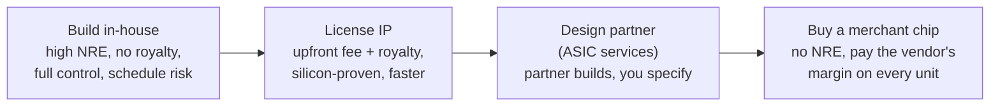
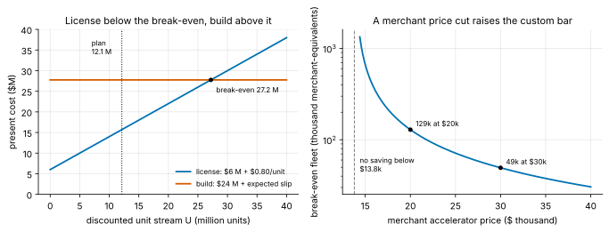

<!-- status: verified -->
# 26-04 · Engineering Economics II: Build, Buy or License; Node; Chiplets; ASIC vs Merchant

| | |
|---|---|
| **Course** | [26 · Engineering Design and Professional Practice](../README.md) |
| **University equivalent** | Engineering economics: incremental analysis, break-even and sensitivity, decisions under risk and decision trees (Newnan, Eschenbach and Lavelle, *Engineering Economic Analysis*), applied to the sourcing and partitioning decisions of a chip program; the design-economics material of a VLSI or SoC design course |
| **Prerequisites** | [26-03](26-03-engineering-economics-1.md) (cost stack, NRE, NPV, slips), [25-04](../../25-fabrication-packaging-test-and-reliability/chapters/25-04-yield-and-die-cost.md) (dies per wafer and yield), [25-07](../../25-fabrication-packaging-test-and-reliability/chapters/25-07-advanced-packaging-and-chiplets.md) (chiplet unit cost, known-good die), [26-02](26-02-design-reviews-and-standards.md) (royalties and their base), [14-01](../../14-computer-organization-and-architecture/chapters/14-01-performance-power-iron-law.md) (Amdahl's law) |
| **Estimated study hours** | 8 |
| **Last verified** | 2026-11-26 |

**Learning objectives.** After this chapter you can:

1. Compare licensing an IP block (upfront fee plus royalty) with building it, by present cost including schedule risk, and find the discounted break-even volume.
2. Convert between royalty forms (per unit, percentage of selling price, chip or device base), and explain who carries price and volume risk under each.
3. Choose a process node by cost per good function, using the mix-weighted density gain, wafer price, yield and NRE.
4. Evaluate monolithic dies against reusable chiplets across a product family, separating the unit-cost effect from the NRE effect.
5. Compare a custom accelerator with merchant silicon by total cost of ownership per unit of throughput, and find the break-even fleet size and the merchant price that cancels the custom program's advantage.
6. Value the flexibility to decide later with a decision tree, and name the strategic factors a present-value comparison leaves out.

---

## 1. Big picture

26-03 asked whether a chip is worth building. This chapter asks how to build it: which blocks to design in-house and which to license, which process node to use, whether to make one large die or several small ones, and, for the largest buyers, whether to buy a merchant chip at all or have a custom one made. Each is a **make-or-buy decision**, and each has the same skeleton: one option has a large fixed cost and a low cost per unit, the other a small fixed cost and a higher cost per unit, and the volume you expect decides between them. The engineering content lies in where the fixed and per-unit costs come from (yield, density, die-to-die interfaces, power) and in the risks that come with each option (schedule, supply, lock-in).

- **Where it shows up:** every SoC's IP plan (CPU, GPU, SerDes, memory interfaces, standard cells), every node migration, every chiplet architecture, and the custom-accelerator programs of the largest cloud operators.
- **Why the FE exam cares:** break-even and trade-off analysis and risk identification are named FE topics [R-636]; incremental analysis and decision trees are the standard tools.
- **Why a corporate development reader cares:** the IP vendors' revenue models (licence fees against royalties), the merchant-against-custom contest in AI accelerators, and the economics of chiplets are among the largest value questions in the industry, and each reduces to the comparisons in this chapter.
- **What is new here:** a density model that explains why new nodes save less than their headline figures, and decision trees for choices that can wait.

## 2. Intuition first

**Physical picture.** Picture the sourcing options for one block of a chip, say a high-speed SerDes PHY (24-03), as a spectrum:

Moving right, fixed cost falls and the cost per unit rises: someone else's engineering and margin are built into every unit you ship. Moving left, you pay for the engineering once and keep the margin, but carry the risk that the design is late or wrong.

**Analogy: buy, lease or rent.** Building is buying a building: a large down payment, low running cost, and you own an asset you can reuse. Licensing is a lease with a revenue share: a smaller deposit, a payment for every unit you sell, and the lessor shares your volume risk. A merchant chip is renting a furnished office: nothing up front, the highest running cost, and you can walk away. In finance terms, licensing converts a fixed cost into a variable one, which lowers **operating leverage**: profit becomes less sensitive to volume, in both directions. **Where the analogy breaks:** a building does not slip its schedule, but an in-house design can; a lease does not usually make you dependent on a competitor, but an IP licence can, if the licensor also sells chips into your market or can change terms at renewal; and building creates a team and know-how, an asset with option value that no balance sheet records.

**The shape of every answer.** Plot each option's present cost against volume. Licensing is a line with a small intercept (the upfront fee) and a slope (the royalty); building is a nearly flat line at the NRE. They cross at the **break-even volume**: below it license, above it build. Figure 1 (§5) shows two such crossings.

## 3. Theory

### 3.1 Incremental analysis and the discounted unit stream

When two alternatives share most of their cash flows, compare only the flows that differ. This is **incremental analysis**: the chip's revenue, its other costs and its schedule (if unchanged) cancel, and the decision rests on the difference. Every comparison in this chapter is a present cost of one option minus the present cost of another.

Per-unit costs are paid as units ship. With $V_t$ units shipped in year $t$ and a rate $i$ (the MARR of 26-03), a per-unit charge $r$ has present value

$$
\text{PV} = \sum_t \frac{rV_t}{(1 + i)^t} = r\,U, \qquad U \equiv \sum_t \frac{V_t}{(1 + i)^t},
$$

where $U$ is the **discounted unit stream** (units): the number of year-0 units equivalent to the shipment plan. It lets every per-unit charge be priced with one multiplication; Problem 26-03.14 used the same quantity.

### 3.2 Licensing against building

Let the licence cost an upfront fee $F$ (dollars, paid at year 0) and a royalty $r$ (dollars per unit), and let building cost NRE $N_B$ (dollars, taken at year 0 for simplicity) plus an expected slip cost. If the in-house design has probability $p_s$ of a slip that costs $C_s$ in lost program value (the slip model of 26-03 §3.4), its expected present cost is $N_B + p_sC_s$. The present costs are

$$
\text{PV}_L = F + rU, \qquad \text{PV}_B = N_B + p_sC_s,
$$

and licensing is cheaper when $\text{PV}_L < \text{PV}_B$, that is when

$$
U < U^* = \frac{N_B + p_sC_s - F}{r}.
$$

$U^*$ is the **discounted break-even volume**. Undiscounted, the same formula with $p_s = 0$ and $U$ replaced by total units is the familiar $(N_B - F)/r$. Units: dollars divided by dollars per unit gives units. ✓

**Who carries the risk.** Let $m$ be the unit contribution before the IP cost (price less all other unit costs). Program profit under each option is

$$
\Pi_B = mU - N_B - p_sC_s, \qquad \Pi_L = (m - r)U - F.
$$

Building has the steeper slope $m$; licensing the shallower $m - r$. If the program fails ($U$ near 0), the licensee loses $F$ and the builder loses $N_B$; if volume is large, the builder earns $r(U - U^*)$ more. For a risk-neutral firm only the expected volume matters, because both costs are linear in $U$: $E[\text{PV}_L] = F + rE[U]$. But a firm that cannot absorb a large loss, or that doubts its volume forecast, values the licence's smaller downside; the royalty paid at high volume is the premium for that insurance.

**What the formula leaves out.** A licensed block that is **silicon-proven** (already working in a shipped chip) usually shortens the schedule and lowers the respin risk, which is why $p_sC_s$ sits on the build side. Against that, licensed blocks must be integrated, verified and supported; the licensor controls the roadmap; and the licence may restrict where the block can be used. Hard IP (a layout for one specific process) cannot move to another foundry without being redone; soft IP (synthesizable RTL) can, but must then be closed for timing on each process.

### 3.3 Royalty structures

Royalties come in a few standard forms:

- **Per unit:** a fixed amount $r$ per chip shipped.
- **Percentage of selling price:** $\rho P_t$ per chip, where $\rho$ is the rate and $P_t$ the average selling price in year $t$.
- **Tiered or capped:** a rate that falls with cumulative volume, or a maximum total. These are volume discounts negotiated in advance.
- **On a different base:** a percentage of the end device's price rather than the chip's. 26-02 §3.6 showed how a device-level rate $r_d$ on a device price $P_d$ is equivalent to a chip-level rate $r_dP_d/P_c$, which can exceed the chip's whole price.

**Price erosion.** If the chip's price falls by a fraction $e$ a year, $P_t = P_1(1 - e)^{t-1}$, a percentage royalty falls with it, while a per-unit royalty does not. The present value of a percentage royalty is

$$
\text{PV} = \rho \sum_t \frac{P_tV_t}{(1 + i)^t},
$$

and the per-unit royalty with the same present value is the price-weighted average $r_{eq} = \rho\sum_t P_tV_t(1 + i)^{-t}/U$. Under a percentage royalty the licensor carries the price risk; under a per-unit royalty the licensee does. Which form each side prefers depends on its price forecast: a licensee expecting steep erosion prefers a percentage, and a licensor expecting the same erosion prefers a fixed amount. When their forecasts differ, there can be a rate both prefer to the alternative (Problem 26-04.5).

**Stacking inside an SoC.** A chip can carry royalties for many blocks at once: CPU cores, a GPU, interconnect, interface PHYs, codecs. The total burden per unit is

$$
R = \sum_k r_k + P\sum_k \rho_k,
$$

and it lowers gross margin by $R/P$ points of price (26-03 §3.1 treats a royalty as part of COGS). A 4% total burden on a 50%-margin chip takes **8**% of the gross profit. 26-02 §3.6 covers stacking across patent holders for a standard; the arithmetic is the same.

### 3.4 Node selection: cost per good function

A new node packs more of each kind of circuit into a square millimetre, but not equally. Logic shrinks most; SRAM bitcells have scaled slowly in recent nodes [R-464]; analog and I/O barely shrink, because their size is set by matching, voltage and pad pitch (20-12). Suppose a die of area $A$ at the old node consists of block types $k$ (logic, SRAM, analog and I/O) occupying fractions $f_k$ of the area, and each type's density improves by a factor $s_k$ at the new node. Block $k$ shrinks from $f_kA$ to $f_kA/s_k$, so the new area and the **effective density gain** are

$$
A' = A\sum_k \frac{f_k}{s_k}, \qquad s_{eff} = \frac{A}{A'} = \frac{1}{\sum_k f_k/s_k}.
$$

> **Math refresher — weighted harmonic mean.** $s_{eff}$ is the harmonic mean of the $s_k$ weighted by $f_k$. A harmonic mean is pulled toward the smallest values: averaging gains of 1.7 and 1.1 with equal weights gives **1.34** harmonically against **1.40** arithmetically. It is the right mean whenever the quantities combine as reciprocals, here because areas, not densities, add.

This is **Amdahl's law for area** (14-01): if logic shrank without limit ($s_L \to \infty$), the gain would still be capped at $1/\sum_{k \ne L} f_k/s_k$, set by the blocks that do not shrink. If half a die is SRAM and analog that do not shrink at all, the die can never shrink by more than a factor of **2**, however dense the new logic.

**Cost per good function.** The cost per good die is $C = W/(\text{DPW}\,Y)$ (25-04), with wafer price $W$, dies per wafer DPW and yield $Y$. For dies much smaller than the wafer, DPW $\approx \pi d^2/(4A)$, so $C \approx 4WA/(\pi d^2 Y)$. Comparing the same design at the two nodes,

$$
\frac{C_{new}}{C_{old}} \approx \frac{W_{new}}{W_{old}} \cdot \frac{1}{s_{eff}} \cdot \frac{Y_{old}}{Y_{new}}.
$$

The new node lowers the cost of a function only if its density gain outruns its wafer-price increase, after yield. With leading-edge wafers rising steeply in price [R-575] and SRAM and analog scaling slowly, the ratio can approach or exceed 1: whether cost per transistor still falls is contested [R-577]. The edge term in DPW slightly favours the smaller die, and a new node's defect density is usually higher at launch, which works the other way (§4, Example 26-04.3).

**Adding NRE.** A newer node costs more to design for: masks (more than $10 M at 7 nm and moving toward $40 M at 3 nm by one analyst's estimate [R-321]), IP that must be bought or ported, and more verification. With an extra NRE $\Delta N$ and a unit saving $C_{old} - C_{new}$, the new node pays back over

$$
V^* = \frac{\Delta N}{C_{old} - C_{new} + \Delta v}
$$

units, where $\Delta v$ is any extra value per unit the new node earns (a higher price for better performance or power). If $C_{new} > C_{old}$, the node pays only if $\Delta v$ exceeds the cost difference: the move must be justified by performance or power, not cost. Discounting replaces $V^*$ with a discounted unit stream, as in §3.2.

### 3.5 Monolithic or chiplets: a portfolio decision

25-07 §3.7 built the unit-cost model for splitting a die into chiplets: smaller dies yield better, but each chiplet carries die-to-die interface area, each must be tested to known-good-die standard, the package costs more and every attach can fail. In its form here, with a test cost $T$ per die tested, the cost of a good package of $n$ dies is

$$
C_{pkg} = \frac{\sum_k (W_k/\text{DPW}_k + T)/Y_k + P}{a^n},
$$

where $P$ is the package cost and $a$ the yield of each attach. Two further effects decide most real chiplet architectures, and both appear only when you look at a product family rather than one chip.

**Mixed nodes.** Blocks that do not shrink (I/O, analog, much of the SRAM) gain little from the newest node but pay its full wafer price. Putting them on a separate die on an older, cheaper node saves about $A_{IO}(c_{new} - c_{old})$ per unit before yield, where $c = W/(\text{DPW}\,A) \approx 4W/(\pi d^2)$ is the cost of a square millimetre of die on each node's wafer. AMD's server processors moved their I/O to a separate die for this reason: I/O and SerDes "see a very small shrink factor to 7nm and very little performance or power gain from advanced nodes" [R-360].

**Reuse.** A family of $J$ products built monolithically needs $J$ designs, each with its own mask set and verification, so its NRE is $\sum_j N_j$. Built from chiplets, it needs one design per distinct chiplet plus a smaller integration cost $n_j$ for each product's package: $\sum_{\text{tiles}} N_t + \sum_j n_j$. A family that uses one compute chiplet in counts of one, two or four, with one I/O die, designs two dies instead of $J$. The total cost of the family over its life is

$$
\text{Total} = \text{NRE} + \sum_j V_jC_j,
$$

with $V_j$ the lifetime volume and $C_j$ the unit cost of product $j$. Chiplets can lose on unit cost for the small products (their package and interfaces are overhead) and still win for the family, through NRE and the large products (Example 26-04.4). AMD reported a chiplet design cost of "approximately 0.59 of the monolithic approach despite consuming approximately 10% more total silicon" [R-360] **[Industry estimate: vendor analysis]**.

**What chiplets cost beyond the bill of materials.** Die-to-die links consume power per bit and add latency (24-06); the design flow, test and package qualification are more complex; and a defect in a shared chiplet affects every product that uses it.

### 3.6 Custom silicon or merchant: total cost of ownership

For a buyer of accelerators (or network switches, or storage controllers), the choice is between a **merchant** part sold to many customers and a **custom ASIC** made for its own workloads, usually with a **design partner** that supplies interface IP, physical design, packaging and supply-chain management (the right half of the spectrum in §2). The buyer cares about cost per unit of useful work over the hardware's life, its **total cost of ownership (TCO)**.

Per accelerator slot, over a service life of $L$ years,

$$
T = P + O + E, \qquad E = P_{el}\cdot \text{PUE} \cdot 8760\,L \cdot c_e,
$$

where $P$ is the accelerator's price, $O$ the per-slot share of everything else that scales with the number of accelerators (host processors, network, racks, facility capital), $P_{el}$ the accelerator's electrical power in kW, PUE the facility's power usage effectiveness (22-10), $8760$ the hours in a year and $c_e$ the electricity price in $/kWh. Units: kW × h × $/kWh = $. ✓

Divide by throughput $\theta$ (useful work per second on the target workload, normalized to the merchant part) to get the cost per unit of work, $\tau = T/\theta$. A fleet of $N_c$ custom chips does the work of $N_{eq} = N_c\theta_c/\theta_m$ merchant parts (**merchant-equivalents**). Custom saves $\tau_m - \tau_c$ per merchant-equivalent and costs NRE $N$ (chip design, software, bring-up), so it breaks even at

$$
N_{eq}^* = \frac{N}{\tau_m - \tau_c}.
$$

**Where the saving comes from.** The merchant's price is its cost plus its margin, $P_m = C_m/(1 - g_m)$ with gross margin $g_m$. A custom chip bought from a design partner costs $P_c = C_c/(1 - g_p)$ with the partner's margin $g_p$. The silicon, HBM and package cost about the same whoever designs them, so the prize is the difference between the two margins, less the NRE spread over the fleet, less any throughput shortfall (a slower chip needs more slots, each with its own overhead $O$ and energy). The throughput term is why the slot overhead matters: a custom chip with 80% of the merchant's throughput needs **25**% more slots for the same work.

**The merchant can respond.** Setting $\tau_m = \tau_c + N/N_{eq}$ and solving for the merchant price gives the price at which the custom program of a given size just breaks even:

$$
P_m^* = \theta_m\left(\tau_c + \frac{N}{N_{eq}}\right) - O - E_m.
$$

A merchant with a high margin can cut its price toward $P_m^*$ and still earn a healthy margin. A credible custom program therefore has value even if it never ships at scale: it caps what the buyer pays.

**What TCO leaves out.** The software ecosystem (compilers, kernels, libraries, the ability to run new models on day one), time to market, supply assurance for advanced packaging and HBM (25-07), and the engineering talent to sustain a roadmap of new generations.

### 3.7 Deciding later: decision trees and the value of flexibility

Many sourcing decisions are made in stages. A team can license a block for its first generation and decide whether to build its own for the second once it knows the volume. A **decision tree** lays out the decisions (squares), the chance events (circles) and the outcomes, and is solved backwards: at each chance node take the expected value; at each decision node take the best branch.

Compare two plans: commit now to one option for both generations, or wait and choose the best option for each outcome. If $X$ and $Y$ are the second-generation costs of the two options, the flexible plan pays $E[\min(X, Y)]$ and the committed plan pays the smaller of $E[X]$ and $E[Y]$. Since $\min(X, Y) \le X$ and $\min(X, Y) \le Y$ in every outcome, $E[\min(X, Y)] \le \min(E[X], E[Y])$: flexibility that costs nothing to keep never has negative value. Its value is the difference, and it is largest when the outcomes are uncertain and the best option differs between them. Flexibility often does cost something to keep: in Example 26-04.6, waiting gives up the cheap port of a first-generation design and means paying the full cost of building later.

> **Going deeper — real options.** Finance values the right, but not the obligation, to take an action later as a *real option*, with the same logic as a financial option: its value rises with uncertainty and with the time before the decision must be made. Binomial trees and, for some cases, the Black–Scholes formula price such options from market data. Engineering decisions rarely have the traded underlying asset those methods assume, so the decision tree with explicit probabilities is the practical tool; Trigeorgis (1996) develops the full theory.

### 3.8 What a present-value comparison leaves out

The models above put a number on cost and risk. Several factors decide real sourcing choices and are hard to put in the cash flows:

- **Differentiation (core or context).** Build what makes customers choose your product; buy what they assume works. A networking company whose switches compete on SerDes reach should build its SerDes; a camera-chip company should license its USB PHY.
- **Control of the roadmap.** A licensed block's next version arrives when the licensor ships it.
- **Supply and lock-in.** A single source of IP, foundry capacity or packaging can set your schedule and, at renewal, your price.
- **Talent.** An in-house team is an asset for the next generation, and hard to rebuild once disbanded.
- **Legal and policy constraints.** Licence terms, export controls and security requirements can rule an option out (26-07).

## 4. Worked examples

All prices, NRE figures and yields below are **assumed** for teaching unless a source is cited; wafer prices are chosen to lie within the range of public estimates [R-575, R-576]. Dies per wafer use 25-04's formula rounded down; yields are Poisson, $Y = e^{-AD_0}$.

### Example 26-04.1 · Two ways to charge a royalty (tier A)

**Setup.** A CPU-core licence is offered either at $0.80 per unit or at 2.0% of the chip's ASP. The chip sells for $40 in year 1, its price falls 12% a year, and it ships 3, 5, 5 and 3 million units in years 1 to 4. Find (a) the per-unit royalty in each year under the percentage form, (b) the total royalties under each form, and (c) who carries the price risk.

**Solution.**

- (a) The ASPs are $40.00, **$35.20**, **$30.98** and **$27.26**, so 2% of them is **$0.800**, **$0.704**, **$0.620** and **$0.545** per unit.
- (b) The per-unit form pays $0.80 \times 16$ M = **$12.80 M**. The percentage form pays $3 \times 0.800 + 5 \times 0.704 + 5 \times 0.620 + 3 \times 0.545$ = **$10.65 M**, **$2.15 M** less (**83.2**% of the per-unit total).
- (c) Under the percentage form the licensor's income falls with the chip's price, so the licensor carries the price risk; under the per-unit form the licensee does. The two are equal in year 1 and diverge as the price erodes.

**Units check.** % × $/unit = $/unit; $/unit × units = $. ✓

**Sanity check.** The percentage royalty falls by the same 12% a year as the price, so after three years of erosion it is $0.88^3$ = **0.681** of its first-year value; the totals differ by less because the largest volumes come early.

### Example 26-04.2 · Build or license a SerDes PHY (tier B)

**Setup.** An SoC needs a 112 Gb/s SerDes PHY. A silicon-proven licence costs $6.0 M up front and $0.80 per unit. Building it costs $24 M of NRE (team, EDA and two test chips), and there is a 25% chance that the in-house PHY slips the chip by six months, which the program team values at a $15 M loss of NPV. The chip ships 3, 5, 5 and 3 million units in years 1 to 4, and the MARR is 12% (all assumed). Find (a) the undiscounted break-even volume, (b) the discounted unit stream and the present cost of each option, and (c) by what factor volume must exceed plan for building to win.

**Solution.**

- (a) Ignoring discounting and the slip risk, $(24 - 6)/0.80$ = **22.5** million units, against a plan of **16** million: license.
- (b) $U = 3/1.12 + 5/1.12^2 + 5/1.12^3 + 3/1.12^4 = 2.679 + 3.986 + 3.559 + 1.907$ = **12.13** million units. Licence: $\text{PV}_L = 6.0 + 0.80 \times 12.13$ = **$15.70 M** (royalties **$9.70 M**). Build: $\text{PV}_B = 24 + 0.25 \times 15$ = **$27.75 M**. Licensing saves **$12.05 M**.
- (c) $U^* = (27.75 - 6.0)/0.80$ = **27.2** million discounted units, **2.24** times the plan. Building wins only if the chip sells more than twice its forecast, or if the PHY is worth more than its cost: for example, if it will be reused in later chips (Example 26-04.6) or is the product's differentiator.

**Units check.** $ M ÷ ($/unit) = million units. ✓

**Sanity check.** Discounting lowers the royalty bill from **$12.8 M** to $9.70 M, so it favours the licence, whose costs come later; the slip risk adds $3.75 M to the build side. Both push the same way here.

### Example 26-04.3 · Should the next chip move from N5 to N3? (tier B)

**Setup.** A 100 mm² die at N5 is 50% logic, 30% SRAM and 20% analog and I/O by area. Take TSMC's "up to" N3-over-N5 density gains as reported, 1.7× for logic, 1.2× for SRAM and 1.1× for analog [R-360]. Wafers cost $17,000 at N5 and $20,000 at N3, and $D_0$ = 0.10 cm⁻² at both (assumed). The N3 design costs $30 M more in NRE (assumed). Find (a) the effective density gain and the N3 die area, (b) the most the die could shrink however dense the logic, (c) the cost per good die at each node, and (d) the lifetime volume at which N3 repays its extra NRE.

**Solution.**

- (a) $s_{eff} = 1/(0.5/1.7 + 0.3/1.2 + 0.2/1.1) = 1/(0.2941 + 0.2500 + 0.1818)$ = **1.378**, so the N3 die is $100/1.378$ = **72.59** mm², not the 58.8 mm² the logic figure alone suggests.
- (b) With $s_L \to \infty$, $1/(0.2500 + 0.1818)$ = **2.32**: SRAM and analog cap the shrink.
- (c) N5: DPW = **640** (formula 640.2), $Y = e^{-0.1}$ = **0.9048**, $C = 17{,}000/(640 \times 0.9048)$ = **$29.36**. N3: DPW = **895** (formula **895.5**), $Y = e^{-0.0726}$ = **0.9300**, $C = 20{,}000/(895 \times 0.9300)$ = **$24.03**. N3 saves **$5.33** per die.
- (d) $V^* = 30/5.33$ = **5.63** million units.

**Units check.** $/wafer ÷ (dies/wafer) = $/die; $ ÷ ($/unit) = units. ✓

**Sanity check.** Before yield, cost per function changes by $(20{,}000/17{,}000)/1.378$ = **0.854**: the area falls **27.4**% but the cost of the same function only **14.6**%, because the wafer-price rise absorbs much of the density gain. If N3's defect density were 0.20 cm⁻² for the product's life, its yield would fall to **0.8649** and its die cost rise to **$25.84**, cutting the saving to **$3.52** and raising the break-even volume to **8.53** million units. A young node's yield, not its density, often decides the case.

### Example 26-04.4 · Monolithic or chiplets for a product family (tier C)

**Setup.** A company plans two products. S has one compute block (150 mm² at N3) and an I/O block (50 mm²); L has two compute blocks and the same I/O. **Monolithic:** S is one 200 mm² N3 die and L one 350 mm² N3 die, each in a $15 package, with NRE of $90 M (S) and $100 M (L). **Chiplets:** one compute chiplet (165 mm² at N3, including 10% for die-to-die interfaces) and one I/O die (55 mm² at N6, which costs $10,000 a wafer with $D_0$ = 0.08 cm⁻²); S uses one compute chiplet and L two, each with the I/O die, in packages costing $25 (S) and $35 (L). The chiplets' NRE is $80 M (compute) and $30 M (I/O), plus $8 M of package integration per product. N3 wafers cost $20,000 with $D_0$ = 0.10 cm⁻²; every die costs $2 to test and every attach yields 99%. Lifetime volumes are 4 million (S) and 1 million (L) (all assumed). Find (a) the cost of each good tested die, (b) the cost of each good package, (c) the family's total cost under each approach, and (d) the best choice if only product S were built.

**Solution.**

- (a) With $C = (W/\text{DPW} + T)/Y$: monolithic S, DPW **306**, $Y$ = **0.8187**, **$82.27**; monolithic L, DPW **166**, $Y$ = **0.7047**, **$173.81**; compute chiplet, DPW **376**, $Y$ = **0.8479**, **$65.09**; I/O die, DPW **1195**, $Y$ = **0.9570**, **$10.83**.
- (b) Monolithic S: $(82.27 + 15)/0.99$ = **$98.26**. Chiplet S: $(65.09 + 10.83 + 25)/0.99^2$ = **$102.98**, **$4.72** more. Monolithic L: $(173.81 + 15)/0.99$ = **$190.72**. Chiplet L: $(2 \times 65.09 + 10.83 + 35)/0.99^3$ = **$181.41**, **$9.31** less.
- (c) Monolithic: $190 + 4 \times 98.26 + 1 \times 190.72$ = **$773.7 M**. Chiplets: NRE $80 + 30 + 2 \times 8$ = **$126 M**, total $126 + 4 \times 102.98 + 1 \times 181.41$ = **$719.3 M**. Chiplets save **$54.4 M**: **$64 M** of NRE, less a net unit-cost penalty of $4 \times 4.72 - 9.31$ = **$9.57 M**.
- (d) For S alone, monolithic costs $90 + 4 \times 98.26$ = **$483.0 M** and chiplets $(80 + 30 + 8) + 4 \times 102.98$ = **$529.9 M**: monolithic wins by **$46.9 M**.

**Units check.** $/die summed with $/package, divided by dimensionless yields, gives $/package; $ M + (million units × $/unit) = $ M. ✓

**Sanity check.** The small product pays for the chiplet package and the attach losses and gains little yield, because a 200 mm² die already yields **82**%; the large product's 350 mm² die yields only **70**%, so splitting it helps. The family case rests on reuse. If S's volume grew past **15.5** million units with L unchanged, its unit-cost penalty would outweigh the NRE saving (lab Part 3).

### Example 26-04.5 · A custom accelerator or a merchant one? (tier C)

**Setup.** A cloud operator compares a merchant accelerator (price $30,000, 1.0 kW, throughput 1.0 on its workload) with a custom one from a design partner (unit price $9,000, 0.7 kW, throughput 0.8). Each slot carries $12,000 of other infrastructure; the service life is 4 years, PUE 1.3 and electricity $0.08/kWh. The custom program's NRE, including software, is $800 M (all assumed). Find (a) the energy cost and TCO per slot for each, (b) the cost per merchant-equivalent and the break-even fleet, (c) the break-even fleet if the merchant cuts its price to $20,000, and (d) the merchant price that makes a 200,000-chip custom fleet exactly break even.

**Solution.**

- (a) Energy: merchant $1.0 \times 1.3 \times 8760 \times 4 \times 0.08$ = **$3,644**; custom $0.7 \times$ that = **$2,551**. TCO per slot: merchant $30{,}000 + 12{,}000 + 3{,}644$ = **$45,644**; custom $9{,}000 + 12{,}000 + 2{,}551$ = **$23,551**.
- (b) Per merchant-equivalent: merchant **$45,644**; custom $23{,}551/0.8$ = **$29,439**; saving **$16,206** (from the unrounded $45,644.16 and $29,438.64). Break-even $N_{eq}^* = 800 \times 10^6/16{,}206$ = **49,400** merchant-equivalents, or **61,700** custom chips.
- (c) At $20,000 the merchant's cost per equivalent is **$35,644**, the saving **$6,206**, and the break-even fleet **129,000** merchant-equivalents (**161,000** custom chips), 2.6 times larger.
- (d) 200,000 custom chips are 160,000 merchant-equivalents, so $P_m^* = 1.0 \times (29{,}438.64 + 800 \times 10^6/160{,}000) - 12{,}000 - 3{,}644.16$ = **$18,794**.

**Units check.** kW × h × $/kWh = $; $ ÷ ($ per equivalent) = equivalents. ✓

**Sanity check.** Suppose the merchant's gross margin on this part were 75% (NVIDIA's company-wide GAAP gross margin was 75.0% in its fourth quarter of fiscal 2026 [R-637]). Its unit cost would then be **$7,500**, and at $18,794 it would still keep a **60.1**% margin. The merchant can defend this customer by cutting its price, and the threat of the custom program is what forces the cut.

### Example 26-04.6 · License now, build later? (tier C)

**Setup.** Extend Example 26-04.2 to a second-generation chip. All figures are present values at year 0, in $ M. If the PHY is built now, porting it to generation 2 costs $3. If it is licensed now, generation 2 can renew the licence ($5 upfront plus $0.80 per unit) or build its own ($22, including risk). Generation 2's discounted volume is 25 million units with probability 0.3 or 6 million with probability 0.7 (all assumed). Find (a) the expected cost of building now, (b) of licensing now and choosing later, (c) of licensing both generations, (d) the value of the flexibility, and (e) the probability of the high-volume outcome above which building now is best.

**Solution.**

- (a) Build now: $27.75 + 3$ = **$30.75 M**, whatever the volume.
- (b) License now ($15.70 M from Example 26-04.2), then in the high case compare renewal $5 + 0.80 \times 25$ = **$25.0 M** with building at $22 M, and build; in the low case compare $5 + 0.80 \times 6$ = **$9.80 M** with $22 M, and renew. Expected: $15.70 + 0.3 \times 22 + 0.7 \times 9.80$ = **$29.16 M**.
- (c) License both: the expected volume is $0.3 \times 25 + 0.7 \times 6$ = **11.7** million, so $15.70 + 5 + 0.80 \times 11.7$ = **$30.06 M**.
- (d) Keeping the choice open is worth $30.06 - 29.16$ = **$0.90 M** against committing to the licence, and the flexible plan beats building now by **$1.59 M**.
- (e) Licensing then choosing costs $15.70 + 9.80 + p(22 - 9.80)$, which equals $30.75$ at $p$ = **0.430**. Above a 43% chance of the high-volume outcome, build now.

**Units check.** All terms are $ M; probabilities are dimensionless. ✓

**Sanity check.** Example 26-04.2's one-generation view favoured the licence by $12.05 M; counting reuse, the margin shrinks to $1.59 M, and a modest change in the probability reverses it. A decision this close should be made on the strategic factors of §3.8 (is the PHY a differentiator? will the team be needed again?), with the numbers showing how much those factors must be worth.

<!-- answer-key -->

| ID | Quantity | Value | Unit |
|---|---|---|---|
| Ex 26-04.1a | ASP year 2 | 35.20 | $ |
| Ex 26-04.1a1 | ASP year 3 | 30.98 | $ |
| Ex 26-04.1a2 | ASP year 4 | 27.26 | $ |
| Ex 26-04.1a3 | royalty year 1 | 0.800 | $ |
| Ex 26-04.1a4 | royalty year 2 | 0.704 | $ |
| Ex 26-04.1a5 | royalty year 3 | 0.620 | $ |
| Ex 26-04.1a6 | royalty year 4 | 0.545 | $ |
| Ex 26-04.1b | per-unit total | 12.80 | $M |
| Ex 26-04.1b1 | percentage total | 10.65 | $M |
| Ex 26-04.1b2 | difference | 2.15 | $M |
| Ex 26-04.1b3 | ratio | 83.2 | % |
| Ex 26-04.1c | year-4 royalty relative to year 1 | 0.681 | |
| Ex 26-04.2a | undiscounted break-even | 22.5 | million |
| Ex 26-04.2a1 | planned units | 16 | million |
| Ex 26-04.2b | discounted unit stream | 12.13 | million |
| Ex 26-04.2b0 | year 1 term | 2.679 | million |
| Ex 26-04.2b01 | year 2 term | 3.986 | million |
| Ex 26-04.2b02 | year 3 term | 3.559 | million |
| Ex 26-04.2b03 | year 4 term | 1.907 | million |
| Ex 26-04.2b1 | PV of licence | 15.70 | $M |
| Ex 26-04.2b2 | PV of royalties | 9.70 | $M |
| Ex 26-04.2b3 | PV of building | 27.75 | $M |
| Ex 26-04.2b4 | saving from licensing | 12.05 | $M |
| Ex 26-04.2c | discounted break-even | 27.2 | million |
| Ex 26-04.2c1 | multiple of plan | 2.24 | |
| Ex 26-04.2c2 | expected slip cost | 3.75 | $M |
| Ex 26-04.3a | effective density gain | 1.378 | |
| Ex 26-04.3a0 | logic term | 0.2941 | |
| Ex 26-04.3a01 | SRAM term | 0.2500 | |
| Ex 26-04.3a02 | analog term | 0.1818 | |
| Ex 26-04.3a1 | N3 area | 72.59 | mm² |
| Ex 26-04.3a2 | logic-only area | 58.8 | mm² |
| Ex 26-04.3b | maximum shrink | 2.32 | |
| Ex 26-04.3c | N5 dies per wafer | 640 | |
| Ex 26-04.3c0 | N5 formula | 640.2 | |
| Ex 26-04.3c1 | N5 yield | 0.9048 | |
| Ex 26-04.3c2 | N5 die cost | 29.36 | $ |
| Ex 26-04.3c3 | N3 dies per wafer | 895 | |
| Ex 26-04.3c4 | N3 formula | 895.5 | |
| Ex 26-04.3c5 | N3 yield | 0.9300 | |
| Ex 26-04.3c6 | N3 die cost | 24.03 | $ |
| Ex 26-04.3c7 | saving per die | 5.33 | $ |
| Ex 26-04.3c8 | N3 D0 times area | 0.0726 | |
| Ex 26-04.3d | break-even volume | 5.63 | million |
| Ex 26-04.3e | cost-per-function ratio before yield | 0.854 | |
| Ex 26-04.3e1 | N3 yield at 0.20 | 0.8649 | |
| Ex 26-04.3e2 | N3 die cost at 0.20 | 25.84 | $ |
| Ex 26-04.3e3 | saving at 0.20 | 3.52 | $ |
| Ex 26-04.3e4 | break-even at 0.20 | 8.53 | million |
| Ex 26-04.4a | monolithic S dies per wafer | 306 | |
| Ex 26-04.4a1 | monolithic S yield | 0.8187 | |
| Ex 26-04.4a2 | monolithic S good die | 82.27 | $ |
| Ex 26-04.4a3 | monolithic L dies per wafer | 166 | |
| Ex 26-04.4a4 | monolithic L yield | 0.7047 | |
| Ex 26-04.4a5 | monolithic L good die | 173.81 | $ |
| Ex 26-04.4a6 | compute chiplet dies per wafer | 376 | |
| Ex 26-04.4a7 | compute chiplet yield | 0.8479 | |
| Ex 26-04.4a8 | compute chiplet good die | 65.09 | $ |
| Ex 26-04.4a9 | I/O die dies per wafer | 1195 | |
| Ex 26-04.4a10 | I/O die yield | 0.9570 | |
| Ex 26-04.4a11 | I/O good die | 10.83 | $ |
| Ex 26-04.4b | monolithic S package | 98.26 | $ |
| Ex 26-04.4b1 | chiplet S package | 102.98 | $ |
| Ex 26-04.4b2 | S difference | 4.72 | $ |
| Ex 26-04.4b3 | monolithic L package | 190.72 | $ |
| Ex 26-04.4b4 | chiplet L package | 181.41 | $ |
| Ex 26-04.4b5 | L difference | 9.31 | $ |
| Ex 26-04.4c | monolithic family total | 773.7 | $M |
| Ex 26-04.4c1 | chiplet NRE | 126 | $M |
| Ex 26-04.4c2 | chiplet family total | 719.3 | $M |
| Ex 26-04.4c3 | family saving | 54.4 | $M |
| Ex 26-04.4c4 | NRE saving | 64 | $M |
| Ex 26-04.4c5 | net unit-cost penalty | 9.57 | $M |
| Ex 26-04.4d | S alone, monolithic | 483.0 | $M |
| Ex 26-04.4d1 | S alone, chiplets | 529.9 | $M |
| Ex 26-04.4d2 | S alone, difference | 46.9 | $M |
| Ex 26-04.4e | S volume that flips the family | 15.5 | million |
| Ex 26-04.5a | merchant energy | 3644 | $ |
| Ex 26-04.5a1 | custom energy | 2551 | $ |
| Ex 26-04.5a2 | merchant TCO per slot | 45644 | $ |
| Ex 26-04.5a3 | custom TCO per slot | 23551 | $ |
| Ex 26-04.5b | custom per equivalent | 29439 | $ |
| Ex 26-04.5b1 | saving per equivalent | 16206 | $ |
| Ex 26-04.5b2 | break-even, equivalents | 4.94e4 | |
| Ex 26-04.5b3 | break-even, custom chips | 6.17e4 | |
| Ex 26-04.5c | merchant per equivalent after cut | 35644 | $ |
| Ex 26-04.5c1 | saving after cut | 6206 | $ |
| Ex 26-04.5c2 | break-even after cut, equivalents | 1.29e5 | |
| Ex 26-04.5c3 | break-even after cut, custom chips | 1.61e5 | |
| Ex 26-04.5c4 | ratio of break-evens | 2.6 | |
| Ex 26-04.5d | merchant price ceiling | 18794 | $ |
| Ex 26-04.5d1 | merchant-equivalents | 160000 | |
| Ex 26-04.5e | merchant unit cost | 7500 | $ |
| Ex 26-04.5e1 | merchant margin at the ceiling | 60.1 | % |
| Ex 26-04.6a | build now | 30.75 | $M |
| Ex 26-04.6b | renewal, high | 25.0 | $M |
| Ex 26-04.6b1 | renewal, low | 9.80 | $M |
| Ex 26-04.6b2 | license then choose | 29.16 | $M |
| Ex 26-04.6c | expected volume | 11.7 | million |
| Ex 26-04.6c1 | license both | 30.06 | $M |
| Ex 26-04.6d | value of flexibility | 0.90 | $M |
| Ex 26-04.6d1 | margin over building now | 1.59 | $M |
| Ex 26-04.6e | threshold probability | 0.430 | |
| Ex 26-04.2d | undiscounted royalties | 12.8 | $M |
| Ex 26-04.3e5 | area reduction | 27.4 | % |
| Ex 26-04.3e6 | cost-per-function reduction | 14.6 | % |
| Ex 26-04.4f | monolithic S yield | 82 | % |
| Ex 26-04.4f1 | monolithic L yield | 70 | % |
| Txt 26-04.1 | equal-weight harmonic mean | 1.34 | |
| Txt 26-04.2 | equal-weight arithmetic mean | 1.40 | |
| Txt 26-04.3 | share of gross profit | 8 | % |
| Txt 26-04.4 | extra slots | 25 | % |
| Txt 26-04.5 | shrink ceiling, half non-shrinking | 2 | |
| Txt 26-04.6 | Arm royalty share FYE26 | 53.0 | % |
| Txt 26-04.7 | Arm royalty share Q2 FYE27 | 46.4 | % |
| Txt 26-04.8 | Synopsys Design IP FY2025 | 1.75 | $B |
| Txt 26-04.9 | Synopsys Design IP FY2024 | 1.91 | $B |
| Txt 26-04.10 | Synopsys Design IP change | 8.1 | % |
| Txt 26-04.11 | concept check 1 break-even | 16 | million |
| Txt 26-04.12 | concept check 1 licence cost | 7 | $M |
| Txt 26-04.13 | concept check 3 density gain | 1.31 | |
| Txt 26-04.14 | concept check 3 area reduction | 23.6 | % |
| Txt 26-04.15 | concept check 4 cost ratio | 1.04 | |
| Txt 26-04.16 | concept check 4 rise | 4 | % |

## 5. Simulate it

The lab is [labs/26-04-lab/](../labs/26-04-lab/README.md). `sourcing.py` implements the discounted unit stream, licence and build costs, the mix-weighted density gain and node break-even, chiplet package and family costs, accelerator TCO and the merchant price ceiling, and the two-generation decision tree; it reuses 26-03's `econ.py` for dies per wafer.

**Predict, then run.**

1. *Predict* the in-house NRE at which building the PHY of Example 26-04.2 would tie with licensing at the planned volume, then plot both present costs against the discounted unit stream (Figure 1, left).
2. *Predict* the logic density gain a 50/30/20 die would need for an overall gain of 1.5×, then plot $s_{eff}$ against $s_L$ and mark the ceiling of Example 26-04.3(b).
3. *Predict* how large product S's volume must grow before the monolithic family of Example 26-04.4 becomes cheaper, then sweep it.
4. *Predict* the merchant price at which the custom accelerator of Example 26-04.5 saves nothing at any fleet size, then plot the break-even fleet against the merchant price (Figure 1, right).

*Figure 1. Left: the licence's present cost rises with volume and crosses the build cost at 27.2 million discounted units, 2.24 times the plan. Right: as the merchant cuts its price, the custom program needs a larger fleet to break even, without limit as the saving per equivalent goes to zero.*

## 6. Engineering tradeoffs

| Knob | Improves | Costs | Typical decision owner |
|---|---|---|---|
| License rather than build a block | Schedule, respin risk, NRE, downside if the program fails | Royalties at high volume, control of the roadmap, dependence on the licensor | VP engineering with the IP-procurement and legal teams |
| Percentage rather than per-unit royalty | Licensee's exposure to price erosion | Licensor's exposure; more paid if prices rise | Licensing negotiators (business development) |
| Move to the newer node | Density, power, performance; cost per function if wafer price allows | NRE (masks, IP, verification), launch yield risk, wafer price | CTO and product line, with the foundry |
| Split into chiplets | Yield of large designs, reuse across a family, mixed nodes | Package cost, die-to-die area, power and latency, test and qualification complexity | Chief architect with packaging and product planning |
| Custom silicon rather than merchant | Cost per unit of work at scale, fit to the workload, bargaining power | NRE, software ecosystem, time to market, supply-chain burden, roadmap commitment | Cloud operator's infrastructure leadership |
| Defer the decision (keep the option) | Value under uncertainty | The cost of keeping the option open (no reuse, two integrations) | Program management and finance |

## 7. Numbers to know

- **Arm's revenue model** (FYE26, year to March 2026): royalties $2.61 B and licensing $2.31 B of $4.92 B revenue, so royalties were **53.0**% [R-638]. In Q2 FYE27 licensing grew 50% to $773 M while royalties were $670 M, **46.4**% of revenue [R-638] **[Established]**.
- **Royalty per chip rises with each architecture** (as of fiscal 2024): "the typical royalty fee for Armv9 was around double the fee for Armv8", and Arm's CEO said in July 2025 that its first Compute Subsystems were "delivering double the royalty of Armv9" [R-639] **[Established, company statements]**.
- **Synopsys Design IP:** **$1.75 B** in fiscal 2025, 24.8% of Synopsys revenue, down **8.1**% from **$1.91 B** [R-640]. Cadence's IP business grew "nearly 25%" in 2025 [R-641] **[Established]**.
- **Custom AI silicon:** Broadcom's AI semiconductor revenue was $16.7 B in its quarter ended Aug 2026, up 221% [R-642]; Marvell's custom revenue was $1.5 B in its fiscal 2026 [R-643] **[Established]**.
- **Wafer prices** (reports, 2023–2024): about $18,500–20,000 for N3 and $25,000–30,000 or more for N2 [R-575] **[Industry estimate]**.
- **Mask sets:** more than $10 M at 7 nm, approaching $40 M at 3 nm, by one analyst's estimate [R-321] **[Industry estimate]**.
- **Density gains, N3 over N5:** "up to" 1.7× logic, 1.2× SRAM, 1.1× analog [R-360]; N3E's SRAM bitcell did not shrink from N5's 0.021 µm² [R-464] **[Industry estimate: vendor claims via press]**.
- **Chiplet cost:** AMD estimated its chiplet design at about 0.59 of the monolithic cost with about 10% more silicon [R-360] **[Industry estimate]**.

## 8. Common mistakes

- **Comparing undiscounted royalties with up-front NRE.** Royalties arrive years later; discount them, or the licence looks more expensive than it is.
- **Leaving schedule risk out of the build case.** An in-house block that slips the chip costs program value, not only engineering hours.
- **Quoting the logic density gain as the chip's gain.** Weight by the area mix (the harmonic mean of §3.4); SRAM and analog dominate the answer.
- **Treating a new node as automatically cheaper.** Divide the wafer-price ratio by the effective density gain and multiply by the yield ratio before claiming a saving.
- **Judging chiplets one product at a time.** The case for chiplets usually rests on reuse across a family and on mixed nodes, not on one product's unit cost.
- **Comparing chip prices instead of cost per unit of work.** A cheaper accelerator with less throughput needs more slots, each with its own overhead and energy.
- **Leaving software out of a custom-silicon NRE.** Compilers, kernels and libraries are often the larger and longer part of the program.
- **Assuming the merchant's price is fixed.** The merchant can cut its price in response; test the case at the price the merchant could still afford.
- **Valuing a decision as if it must be made now.** If it can wait for information, the value of waiting belongs in the comparison.

## 9. Practitioner lens

**State of play (as of Nov 2026).**

- **IP vendors are moving up the stack.** Arm earns more per chip by selling more of the design: Armv9 royalties were about double Armv8's, and Compute Subsystems (pre-integrated, pre-verified CPU clusters) about double Armv9's [R-639]. By February 2026 it had 21 CSS licences across 12 companies [R-638] **[Established]**. In make-or-buy terms, a subsystem licence moves more of the NRE, and the schedule risk, from the licensee to the licensor, and the licensor charges for it through a higher royalty. Licensing revenue (upfront fees) has been growing quickly: up 50% year over year in Q2 FYE27 [R-638].
- **Interface IP is in demand.** Cadence attributed its IP growth to "HBM, UCIe, PCIe, DDR, and SerDes" [R-641]. Synopsys's Design IP revenue fell 8.1% in fiscal 2025 and its segment margin fell from 38.3% to 23.9%, and the company described a "reallocation of resources in our Design IP segment to higher growth opportunities" [R-640] **[Established]**. One vendor's growth and another's decline in the same year show that this market is contested; the reasons (product mix, customer concentration, export restrictions) need a filing-level reading, not a headline.
- **Custom accelerators have reached scale.** Google's TPU 8t superpod "scales to 9,600 chips"; AWS's Trainium3 is "our first 3nm AWS AI chip" at 2.52 FP8 petaflops per chip; Microsoft's Maia 200 has "over 140 billion transistors" on TSMC 3 nm in a 750 W envelope; Meta deploys "hundreds of thousands of MTIA chips" and plans "four new generations of MTIA chips within the next two years" [R-644] **[Established: vendor statements]**. The design partners' revenue reflects this: Broadcom's AI semiconductor revenue was $16.7 B in one quarter [R-642], and Meta has announced it will "co-develop multiple generations" of MTIA with Broadcom under a commitment that "exceeds 1GW" [R-644].
- **Merchants still earn high margins.** NVIDIA's fiscal 2026 revenue was $215.9 B at a 71.1% GAAP gross margin [R-637] **[Established]**. In the terms of §3.6, that margin is the prize a custom program competes for, and the reason the largest buyers can justify NRE in the hundreds of millions of dollars.

**Commercial relevance.** For an M&A or venture reader, each decision in this chapter is also a business model. An IP vendor sells the left side of the spectrum (it absorbs NRE and earns royalties); a design partner sells the middle (it absorbs physical design, packaging and supply risk, at a margin below a merchant's); a merchant sells the right side. Each model's revenue depends on where its customers' break-even volumes fall, and moves when nodes, packaging or volumes shift those break-evens.

**Marketing vs Reality.**

- *"30% better performance per dollar."* Microsoft's claim for Maia 200 is against "the latest generation hardware in our fleet today" [R-644]. Ask which workload, which baseline part, and whether "dollar" includes NRE and software. Example 26-04.5 shows the answer depends on the fleet size and on the merchant's price, which can change.
- *"Up to 1.7× density."* That is logic, the best case. For a typical mix the gain is near 1.38× (Example 26-04.3), and less for SRAM-heavy designs.
- *"Chiplets cut cost."* Only above an area and defect-density threshold for one product (25-07), or through reuse across a family; for a small product they can cost more (Example 26-04.4).
- *"New nodes make transistors cheaper."* Contested [R-577]; compute cost per good function from wafer price, effective density and yield before accepting it.
- *"Royalty per chip doubled."* That is a statement about the licensor's revenue per unit, not about value delivered; check it as a percentage of the chip's price and against the NRE the licensee avoided.

**Questions for engineering leaders.**

1. *"Which blocks did you build and which did you license, and why?"* Strong: names the differentiating blocks, gives break-even volumes and the schedule risk avoided, and says when the decision is revisited. Evasive: "we build everything because we are better", or "we license everything because it's faster", with no volume or risk argument.
2. *"What is your total royalty burden as a percentage of ASP, and how does it move as prices erode?"* Strong: a number per product, split into per-unit and percentage royalties, with the trend. Evasive: "it's in COGS".
3. *"Why this node?"* Strong: cost per good function at launch and mature defect density, the extra NRE, and the performance or power value that justifies any premium. Evasive: "it's the leading edge" or "our competitors are there".
4. *"For your chiplet architecture, what does each product cost against a monolithic alternative, and what NRE does reuse save?"* Strong: separates unit cost per product from family NRE, and names the die-to-die power and latency cost. Evasive: "chiplets are the future".
5. *"How large must your custom fleet be to beat buying merchant parts, and what happens if the merchant cuts its price 30%?"* Strong: a break-even fleet with software NRE included and a merchant-response scenario. Evasive: a performance-per-dollar ratio with no fleet size or baseline.
6. *"Which decisions have you deliberately left open, and what does keeping them open cost?"* Strong: names options (second source, build-later) and their cost. Evasive: no options, or options that were never priced.

## 10. Concept check

**Q1.** A licence costs $2 M up front plus $0.50 per unit; building costs $10 M. What is the undiscounted break-even volume, and which option wins at 10 million units?

Answer

$(10 - 2)/0.50$ = **16** million units. At 10 million, the licence costs $2 + 5$ = **$7 M** against $10 M: license.

**Q2.** Why does discounting favour licensing over building?

Answer

The build NRE is spent up front, while royalties are paid as units ship, years later. Discounting lowers the present value of the later payments, so the licence's cost falls relative to the build's.

**Q3.** A die is 40% logic, 40% SRAM and 20% analog. Logic density doubles, SRAM gains 10% and analog nothing. What is the overall density gain?

Answer

$1/(0.4/2 + 0.4/1.1 + 0.2/1) = 1/(0.2 + 0.3636 + 0.2)$ = **1.31**. Doubling logic density shrinks this die by only **23.6**%.

**Q4.** Wafer prices rise 20% at a new node, the effective density gain is 1.15 and yields are equal. Does cost per function fall?

Answer

No: $1.20/1.15$ = **1.04**, so cost per function rises about **4**%. The move must be justified by performance or power.

**Q5.** Why can a chiplet architecture win for a product family while losing for its smallest product?

Answer

For a small product the chiplet package, die-to-die area and extra attaches cost more than the small yield gain saves. Across the family, the chiplets are designed once and reused, saving NRE, and the large products gain the most yield. The family total can fall even though one product's unit cost rises.

**Q6.** A custom accelerator costs less per chip than a merchant part but has lower throughput. Which costs grow because of the throughput gap?

Answer

Everything that scales with the number of slots: the per-slot infrastructure (hosts, network, racks, facility), the energy (per unit of work, if it is not proportionally lower), and the accelerators themselves, since more are needed for the same work. Comparing cost per unit of work, not per chip, captures all of these.

**Q7.** Why does a credible custom-silicon program have value to a buyer even if it is never deployed at scale?

Answer

It sets a ceiling on the merchant's price: if the merchant charges more than $P_m^*$, the buyer switches. A merchant with a high margin can cut its price below that ceiling and still earn a good margin, so the buyer pays less for the merchant parts it does buy.

**Q8.** Why is the value of free flexibility never negative?

Answer

Choosing after the uncertainty resolves lets you pick the cheaper option in every outcome, so the flexible plan's cost is $E[\min(X, Y)]$. Committing in advance costs $\min(E[X], E[Y])$, which is never smaller, because the minimum of two quantities is at most each of them in every outcome.

Problem set: [26-04 problems](../problems/26-04-problems.md) · Worked solutions: [26-04 solutions](../solutions/26-04-solutions.md)

## 11. Key terms

[Incremental analysis](../../../reference/glossary.md#incremental-analysis) · [Make-or-buy decision](../../../reference/glossary.md#make-or-buy-decision) · [Discounted unit stream](../../../reference/glossary.md#discounted-unit-stream) · [Upfront licence fee](../../../reference/glossary.md#upfront-licence-fee) · [Percentage royalty](../../../reference/glossary.md#percentage-royalty) · [Royalty](../../../reference/glossary.md#royalty) · [Royalty stacking](../../../reference/glossary.md#royalty-stacking) · [Silicon-proven IP](../../../reference/glossary.md#silicon-proven-ip) · [Hard IP](../../../reference/glossary.md#hard-ip) · [Soft IP](../../../reference/glossary.md#soft-ip) · [Operating leverage](../../../reference/glossary.md#operating-leverage) · [Effective density gain](../../../reference/glossary.md#effective-density-gain) · [Cost per good function](../../../reference/glossary.md#cost-per-good-function) · [Amdahl's law](../../../reference/glossary.md#amdahls-law) · [Mixed-node partitioning](../../../reference/glossary.md#mixed-node-partitioning) · [Chiplet](../../../reference/glossary.md#chiplet) · [Merchant silicon](../../../reference/glossary.md#merchant-silicon) · [Custom ASIC](../../../reference/glossary.md#custom-asic) · [Design partner (ASIC services)](../../../reference/glossary.md#design-partner-asic-services) · [Total cost of ownership (TCO)](../../../reference/glossary.md#total-cost-of-ownership-tco) · [Merchant-equivalent](../../../reference/glossary.md#merchant-equivalent) · [Power usage effectiveness (PUE)](../../../reference/glossary.md#power-usage-effectiveness-pue) · [Decision tree](../../../reference/glossary.md#decision-tree) · [Value of flexibility](../../../reference/glossary.md#value-of-flexibility) · [Real option](../../../reference/glossary.md#real-option)

## 12. Connections

- **Previous:** [26-03](26-03-engineering-economics-1.md) built the cost stack, NPV and the slip model used throughout; [25-04](../../25-fabrication-packaging-test-and-reliability/chapters/25-04-yield-and-die-cost.md) the die-cost model; [25-07](../../25-fabrication-packaging-test-and-reliability/chapters/25-07-advanced-packaging-and-chiplets.md) the single-product chiplet comparison that §3.5 extends to a family; [26-02](26-02-design-reviews-and-standards.md) royalties on standards and their base.
- **Background:** [20-12](../../20-analog-and-mixed-signal-ic-design/chapters/20-12-why-analog-does-not-scale.md) and [23-02](../../23-memory-and-storage-technology/chapters/23-02-sram-technology.md) explain why analog and SRAM shrink slowly; [24-03](../../24-high-speed-io-signal-integrity-and-photonics/chapters/24-03-serdes-architecture.md) and [24-06](../../24-high-speed-io-signal-integrity-and-photonics/chapters/24-06-d2d-memory-phys-scale-up.md) describe the SerDes and die-to-die PHYs being bought or built; [22-10](../../22-power-electronics-and-energy-conversion/chapters/22-10-datacenter-power-delivery.md) gives PUE; [14-14](../../14-computer-organization-and-architecture/chapters/14-14-ai-accelerators.md) the accelerators of §3.6.
- **Next:** [26-05](26-05-schedule-and-respin-risk.md) quantifies the schedule and respin risks that sit on the build side here.
- **Used later:** [27-07](../../27-system-architectures/chapters/27-07-ai-datacenter-server-and-rack.md) applies the TCO model to a full AI rack; [28-09](../../28-technical-diligence-and-leadership-fluency/chapters/28-09-business-engineering-translation.md) uses these comparisons to translate engineering choices into business cases.

## 13. Further study

- Newnan, Eschenbach and Lavelle, *Engineering Economic Analysis*: incremental analysis of alternatives, break-even and sensitivity, and probabilistic risk with decision trees.
- L. Trigeorgis, *Real Options: Managerial Flexibility and Strategy in Resource Allocation* (MIT Press, 1996), for the option view of staged decisions.
- S. Naffziger et al., "Pioneering Chiplet Technology and Design for the AMD EPYC and Ryzen Processor Families", ISCA 2021 (DOI 10.1109/ISCA52012.2021.00014), for a vendor's chiplet cost analysis [R-360].
- 25-07 and its lab for the single-product chiplet model; 26-03's lab for the time-value tools reused here.

## 14. Sources

1. NCEES FE Electrical and Computer specification, Engineering Economics topics: [R-636].
2. Leading-edge wafer prices and fab cost: [R-575]; CSET's modelled wafer prices by node: [R-576]; the cost-per-transistor debate: [R-577].
3. Mask-set cost estimates: [R-321].
4. TSMC N3 density claims, AMD's chiplet and I/O statements: [R-360].
5. SRAM bitcell scaling, N5 to A14: [R-464].
6. NVIDIA fiscal 2026 results and margins: [R-637].
7. Arm licence and royalty revenue: [R-638]; Arm royalty-rate statements: [R-639].
8. Synopsys fiscal 2025 Design IP segment: [R-640]; Cadence fiscal 2025 results: [R-641].
9. Broadcom AI semiconductor revenue: [R-642]; Marvell custom-silicon revenue: [R-643].
10. Hyperscaler custom accelerators (Google, AWS, Microsoft, Meta): [R-644].
