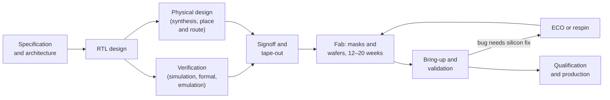
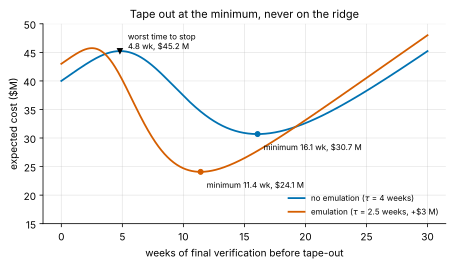

<!-- status: verified -->
# 26-05 · Schedule and Risk: Why Respins Happen

| | |
|---|---|
| **Course** | [26 · Engineering Design and Professional Practice](../README.md) |
| **University equivalent** | Engineering project management and risk (PERT/CPM scheduling, risk registers, expected monetary value) from engineering design and capstone courses, applied to IC tape-out; the verification-planning and silicon-debug material of a VLSI design course |
| **Prerequisites** | [26-03](26-03-engineering-economics-1.md) (the cost of a slip), [26-04](26-04-engineering-economics-2.md) (expected slip cost, decision trees), [19-13](../../19-digital-vlsi-design/chapters/19-13-verification-methods.md) (verification), [25-12](../../25-fabrication-packaging-test-and-reliability/chapters/25-12-post-silicon-validation.md) (bring-up and debug), [03-04](../../03-probability-statistics-and-random-variables/chapters/03-04-joint-distributions-and-clt.md) (central limit theorem) |
| **Estimated study hours** | 6 |
| **Last verified** | 2026-11-26 |

**Learning objectives.** After this chapter you can:

1. Lay out a chip program's schedule from specification to production, find its critical path, and estimate the chance of meeting a tape-out date from three-point estimates, including the merge bias where parallel paths join.
2. Compute the expected number of tape-outs, the expected delay and the expected respin cost from per-spin success probabilities, and read industry first-silicon statistics critically.
3. Classify the causes of respins and choose among the fixes (workaround, metal-only ECO, full respin) by cost and time.
4. Build a risk register with expected monetary value and choose mitigations under a budget.
5. Decide when to tape out by balancing more verification against the chance of a respin, and value a mitigation such as emulation.

---

## 1. Big picture

A chip program has one moment that cannot be undone cheaply: **tape-out**, when the design is released to make masks. Before it, a bug costs an engineer's afternoon; after it, it costs a new mask set, three or four months of fab time and the market window that slips with them (26-03 §3.4). A **respin** is a second (or third) trip through the fab to fix what the first silicon got wrong. Industry surveys report that most chips need at least one, and most projects finish late [R-018]. This chapter treats the schedule and its risks quantitatively: how to estimate a date honestly, how many tape-outs to expect, what the fixes cost, and how to decide when the design is ready.

- **Where it shows up:** every tape-out review (26-02), every program business case (26-03), every "why is the product six months late?" conversation.
- **Why it matters for products:** a respin at the leading edge costs a mask set and a quarter of a year; for a product with a short window, the lost sales cost more than the masks.
- **Why a corporate development reader cares:** a target's history of first-pass silicon, its verification practice and its schedule record are among the best predictors of whether its roadmap will arrive on time. "Taped out" is not "shipping".
- **The engineering content:** probability models for schedules and bugs, and the physical facts that set the cost of each fix (how many mask layers a change touches, how long the fab takes per layer).

## 2. Intuition first

**Physical picture.** A chip's schedule is a set of parallel streams that must all finish before tape-out, followed by a long, mostly fixed wait in the fab:

The loop from bring-up back to the fab is the expensive part. Each pass costs masks and months, so the program's real schedule depends on how many times it goes around the loop.

**Analogy: expected credit loss.** A risk register works like a lender's loss provision: expected loss = probability of default × loss given default. Each risk has a probability and an impact, and their product, the **expected monetary value**, is what you provision for and what a mitigation must reduce by more than it costs. **Where the analogy breaks:** default probabilities come from large historical data sets, while a chip program's risk probabilities are mostly judgement; chip risks are strongly correlated (a late RTL delays verification and physical design together, and a schedule crunch raises the chance of a bug); and impacts are not fixed, because a slip near the end of a market window costs far more than one at the start (26-03).

**Why schedules are optimistic.** Task durations are skewed: a task can finish a little early but can run very late. A plan built by adding up each task's most likely duration ignores the long tail, so it is usually late even when every estimate was honest. Where parallel tasks join, things get worse: the joint task waits for the slowest of them.

## 3. Theory

### 3.1 The shape of a chip schedule

A leading-edge SoC typically takes two to three years from specification to production. The phases overlap, but the critical path usually runs through RTL design, verification closure, physical design and signoff, the fab, and bring-up. Three facts set the scale:

- **Verification dominates design time.** Surveyed IC/ASIC projects report that verification takes on average 49% of project time [R-018].
- **The fab is a long, fixed delay.** Wafers spend about 12 weeks in the fab on average and 14–20 weeks at advanced nodes; a fab averages roughly 1–1.5 days per mask layer, and a 7 nm process uses about 80–85 mask layers [R-020] **[Industry estimate]**.
- **Most projects finish late.** About three out of four IC/ASIC and FPGA projects miss their original schedules [R-018, R-321] **[Industry estimate: sponsored survey]**.

### 3.2 Three-point estimates and the critical path

**The estimate.** For each task, ask for three durations: optimistic $a$, most likely $m$ and pessimistic $b$. The PERT method (Program Evaluation and Review Technique) treats the duration as a beta distribution on $[a, b]$ with mode $m$ and uses

$$
\mu = \frac{a + 4m + b}{6}, \qquad \sigma = \frac{b - a}{6}.
$$

The mean is pulled from the mode toward the long tail: for a task with $a$ = 10, $m$ = 14 and $b$ = 24 weeks, $\mu$ = **15.0** weeks, a week later than the most likely value. The standard deviation is a convention, chosen so that $a$ and $b$ sit about three standard deviations apart from the mean.

**Paths.** A chain of tasks done one after another (a **path**) takes the sum of their durations. For independent tasks, means add and variances add:

$$
\mu_{path} = \sum_k \mu_k, \qquad \sigma_{path}^2 = \sum_k \sigma_k^2.
$$

> **Math refresher — the central limit theorem.** The sum of several independent random variables is approximately normal, whatever their individual shapes, with the summed mean and variance (03-04). So the probability that a path finishes by a date $T$ is approximately $\Phi\big((T - \mu_{path})/\sigma_{path}\big)$, where $\Phi$ is the standard normal cumulative distribution function. With only two or three skewed tasks the approximation is rough; Monte Carlo simulation (lab Part 1) checks it.

The **critical path** is the path with the longest expected duration; shortening any other path does not move the end date.

**Merge bias.** Tape-out needs every parallel path finished: verification closure *and* physical-design signoff. If paths with independent durations $D_1, \dots, D_n$ join, the joint finish is $\max_j D_j$, and

$$
P(\max_j D_j \le T) = \prod_j P(D_j \le T).
$$

Each factor is at most 1, so the joint probability is lower than that of any single path: two paths that each have an 85% chance of finishing by a date have only a 72% chance of both doing so. Schedules that track only the critical path miss this.

> **Going deeper — beta-PERT and Monte Carlo.** The beta distribution behind PERT (shape parameters $1 + 4(m - a)/(b - a)$ and $1 + 4(b - m)/(b - a)$) has the PERT mean, but its variance is $(\mu - a)(b - \mu)/7$, larger than $((b - a)/6)^2$ for skewed tasks. A Monte Carlo schedule samples each task from its distribution, adds along paths, takes the maximum at each join and counts how often the end date is met. It captures skew, merge bias and correlations that the normal approximation misses (Example 26-05.2 and lab Part 1).

### 3.3 Respins: how many tape-outs to expect

**What counts as a respin.** Chips are usually named by **stepping**: A0 is the first silicon; a metal-only change gives A1; a change to the base (transistor) layers gives B0. Some later steppings are planned (to add features or improve yield), others are forced by bugs. Industry surveys define "first-silicon success" as first silicon going to production without a respin. The Wilson Research Group study, sponsored by Siemens EDA, reported 5% first-silicon success among IC/ASIC respondents in 2026, against 14% in 2024 and about 30–33% from 2010 to 2020 [R-018] **[Industry estimate: sponsored survey; the sponsor notes that its recruitment method changed between the 2022 and 2024 studies]**. Logic and functional flaws are the leading cause, with others reported in firmware, safety, security, power, clocking and timing [R-321].

**Expected tape-outs.** Suppose spin $k$ produces production-worthy silicon with probability $q_k$, given that the earlier spins did not. Let $N$ be the number of tape-outs. The program needs a $k$-th tape-out only if the first $k - 1$ all failed, so

$$
P(N \ge k) = \prod_{j=1}^{k-1} (1 - q_j), \qquad E[N] = \sum_{k \ge 1} P(N \ge k) = 1 + (1 - q_1) + (1 - q_1)(1 - q_2) + \cdots,
$$

using the identity $E[N] = \sum_{k \ge 1} P(N \ge k)$ for a positive integer random variable. If every spin succeeds with the same $q$, $N$ is geometric and $E[N] = 1/q$. In practice $q_k$ rises with $k$, because bring-up finds the problems and later spins fix known issues. Each extra tape-out adds a fab cycle plus debug time $t_r$ and a cost $c_r$, so the expected delay is $(E[N] - 1)\,t_r$ and the expected respin cost $(E[N] - 1)\,c_r$.

### 3.4 Fixes, from cheapest to most expensive

When bring-up finds a bug, the team picks the cheapest fix that works:

1. **Software, firmware or microcode workaround.** Disable a feature, change a register default, or patch microcode. AMD's fix for the Zenbleed vulnerability in Zen 2 CPUs was a microcode update, with a configuration-bit workaround in the meantime [R-321]. Cost: engineering time and, sometimes, performance.
2. **Fuses and trims.** Analog and memory blocks often have programmable trim bits and redundant rows set at test (25-11); a marginal block may be fixed without new masks.
3. **Metal-only ECO.** An engineering change order that rewires existing **spare cells** (unused gates scattered through the layout for this purpose) using only the metal and via layers. Transistor masks are the most expensive and metal masks cheaper, so "respin costs can be reduced by reusing transistor masks and only changing the metal layer masks", a **metal fix**, although it "still takes several weeks and is expensive" [R-648]. If the fab holds some partly processed wafers at the contact layer (a **wafer hold**), they "can be finished quickly" [R-648], because only the remaining layers need processing. Cost: the metal masks and a fraction of the fab time.
4. **Full respin.** A change to transistors or the base layers needs a new mask set and a full fab cycle.
5. **Recall or replacement.** If a bug reaches customers and cannot be worked around, the cost can dwarf the program's: Intel took a $475 M pre-tax charge in 1994 to replace Pentium processors with the FDIV division bug [R-321] **[Established]**.

**Fab time is proportional to the layers left.** With $L$ mask layers at $d$ days each, a full pass takes about $Ld$ days; a metal ECO restarted from wafers held at contact takes about $L_md$, where $L_m$ is the number of metal and via layers. Designers buy that option in advance: spare cells cost a little area (a 2008 paper notes that modern CPUs "can have as many as 1% spare cells" [R-648]), and **ECO-friendly** design (programmable registers, configuration bits that disable new features, the "chicken bit" of the Zenbleed workaround [R-321]) costs some verification effort, but each makes the cheaper fixes possible.

### 3.5 Risk registers and expected monetary value

A **risk register** lists each risk with an owner, a probability $p_i$, an impact $C_i$ (cost and delay converted to dollars with the slip model of 26-03), a mitigation and a trigger date. The **expected monetary value** of the register is

$$
\text{EMV} = \sum_i p_iC_i.
$$

A mitigation that costs $M_i$ and lowers the probability from $p_i$ to $p_i'$ is worth doing if

$$
(p_i - p_i')\,C_i > M_i,
$$

that is, if it reduces the expected loss by more than it costs. With a limited budget $B$, choose the set of mitigations that maximizes the total net benefit $\sum_i [(p_i - p_i')C_i - M_i]$ subject to $\sum_i M_i \le B$, a small knapsack problem that can be solved by listing the combinations (Example 26-05.4). The best set is not always the one with the best individual ratios.

**What EMV leaves out.** Correlated risks (a staffing shortfall raises several probabilities at once), the size of the worst case (a company that cannot survive a $30 M loss should not treat it as a $4.5 M expected cost), and risks nobody listed. A register is reviewed at every milestone (26-02): risks are retired, new ones added and probabilities updated as evidence arrives.

### 3.6 When to tape out

The central schedule decision is when to stop verifying and tape out. More verification finds more bugs but delays the product; less risks a respin.

**A bug-discovery model.** Suppose that, at the start of the final verification phase, $N_0$ bugs remain, and each is found independently at a constant rate $1/\tau$ (a mean discovery time $\tau$). After $t$ weeks the expected number still hidden is $N_0e^{-t/\tau}$. Only a fraction $\phi$ of bugs would force a respin (the others can be worked around), so the expected number of respin-class bugs that escape is

$$
\lambda(t) = \phi N_0 e^{-t/\tau}.
$$

If the escapes are independent rare events, their number is Poisson with mean $\lambda$, and the probability of a respin is $P_r(t) = 1 - e^{-\lambda(t)}$.

**The cost to minimize.** Each week of verification costs $c_w$ (the team plus the value lost to a later launch, 26-03), and a respin costs $C_r$ (masks, engineering and its own slip). The expected cost is

$$
f(t) = c_wt + C_r\left(1 - e^{-\lambda(t)}\right).
$$

Since $d\lambda/dt = -\lambda/\tau$,

$$
f'(t) = c_w - \frac{C_r}{\tau}\lambda e^{-\lambda}.
$$

The second term is the expected respin cost saved by one more week: it is what the marginal week buys. Setting $f'(t) = 0$ gives

$$
\lambda e^{-\lambda} = \frac{c_w\tau}{C_r} \equiv k.
$$

For $k < 1/e$ this has two roots, because $\lambda e^{-\lambda}$ rises to a peak of $1/e$ at $\lambda = 1$ and falls again. Along the verification schedule $\lambda$ falls from $\phi N_0$ toward 0. While $\lambda > 1$, a week of verification removes bugs from a design that will almost certainly need a respin anyway, so it saves little; the larger root is a cost **maximum**, the worst moment to stop. The smaller root, $\lambda^* < 1$, is the minimum, and the optimal tape-out time is

$$
t^* = \tau\ln\frac{\phi N_0}{\lambda^*},
$$

with a respin probability $1 - e^{-\lambda^*}$ that is small but not zero. Compare $f(t^*)$ with $f(0)$ to confirm that verifying is worth it at all. Units: $c_w\tau/C_r$ is ($/week × weeks)/$, dimensionless. ✓

**What mitigation changes.** Emulation and FPGA prototyping run software on the design thousands of times faster than RTL simulation (19-13), so they find system-level bugs sooner, which lowers $\tau$. Formal verification can prove some properties outright, which removes whole classes of bugs from $N_0$. Both are worth their cost if they lower $f(t^*)$ by more than they cost (Example 26-05.6).

**What the model leaves out.** Bugs are not equally easy to find (the hard ones dominate the tail, so real discovery curves flatten more than an exponential); $N_0$ is itself an estimate (from the bug-discovery rate, coverage closure and the capture–recapture methods of 26-02); and verification also finds bugs that would only have needed workarounds, which have value of their own.

### 3.7 Margins as mitigation

Another way to buy down respin risk is margin: design for a faster clock than the specification, a lower supply than nominal, a wider temperature range. If a silicon parameter (say maximum clock frequency) is normally distributed around its design target with standard deviation $\sigma$ from model error, designing a margin $\Delta$ above the specification gives a miss probability $\Phi(-\Delta/\sigma)$. Each $\sigma$ of margin costs area, power or performance across every unit shipped, while it lowers the probability of a respin only once. The choice is the risk-register trade of §3.5 in another form.

## 4. Worked examples

All probabilities, durations and costs are **assumed** for teaching unless a source is cited.

### Example 26-05.1 · How many tape-outs? (tier A)

**Setup.** A team estimates that A0 silicon will be production-worthy with probability 0.25, a second spin (after bring-up has found the problems) with 0.70, a third with 0.95, and a fourth certainly. Each respin adds 18 weeks (Example 26-05.3 derives this) and costs $21 M. Find (a) the probability of at least one respin, (b) the distribution of the number of tape-outs, (c) its expected value, (d) the expected delay and respin cost, and (e) the expected number of tape-outs if every spin had only a 0.25 chance.

**Solution.**

- (a) $1 - 0.25$ = **0.75**.
- (b) $P(N = 1) = 0.25$; $P(N = 2) = 0.75 \times 0.70$ = **0.525**; $P(N = 3) = 0.75 \times 0.30 \times 0.95$ = **0.214**; $P(N = 4) = 0.75 \times 0.30 \times 0.05$ = **0.0113**.
- (c) $E[N] = 1 + 0.75 + 0.75 \times 0.30 + 0.75 \times 0.30 \times 0.05 = 1 + 0.75 + 0.225 + 0.0113$ = **1.99**.
- (d) Expected extra tape-outs 0.986, so the expected delay is $0.986 \times 18$ = **17.8** weeks and the expected respin cost $0.986 \times 21$ = **$20.7 M**.
- (e) With $q$ = 0.25 every time, $N$ is geometric: $E[N] = 1/0.25$ = **4**.

**Units check.** Tape-outs are counts; counts × weeks = weeks; counts × $ M = $ M. ✓

**Sanity check.** The probabilities in (b) sum to 1. The program should plan for two tape-outs, not one. Learning between spins saves $4 - 1.99$ = **2.01** expected tape-outs, the difference between (e) and (c).

### Example 26-05.2 · Will the tape-out date hold? (tier B)

**Setup.** From RTL freeze, two parallel paths must finish before tape-out. Path A is verification closure ($a, m, b$ = 10, 14, 24 weeks) then a final regression (1, 2, 4). Path B is synthesis, place and route (8, 11, 18) then timing and power signoff (4, 5, 9). Using PERT and the normal approximation, find (a) each path's mean and standard deviation, (b) the chance each path, and both, finish by week 20, (c) the chance of meeting the 16-week plan made from the most likely durations, and (d) the date with a 90% chance of tape-out.

**Solution.**

- (a) Path A: means 15.0 and **2.17**, sum **17.17** weeks; standard deviations **2.33** and **0.50**, so $\sigma_A = \sqrt{2.33^2 + 0.50^2}$ = **2.39** weeks. Path B: means **11.67** and **5.50**, sum **17.17** weeks; $\sigma_B = \sqrt{1.67^2 + 0.83^2}$ = **1.86** weeks.
- (b) $P(A \le 20) = \Phi(2.83/2.39)$ = **0.882**; $P(B \le 20) = \Phi(2.83/1.86)$ = **0.936**; both: $0.882 \times 0.936$ = **0.826**.
- (c) $P(A \le 16)$ = **0.312**, $P(B \le 16)$ = **0.266**, both **0.083**. The plan built by adding most-likely durations has about one chance in twelve.
- (d) Solving $\Phi((T - 17.17)/2.39)\,\Phi((T - 17.17)/1.86) = 0.90$ gives $T$ = **20.7** weeks, later than the **20.2** weeks path A alone would need for 90%.

**Units check.** $(T - \mu)/\sigma$ is weeks/weeks, dimensionless. ✓

**Sanity check.** Both paths have the same mean, so neither is "the" critical path, and the merge costs the most. The lab's Monte Carlo, sampling each task from its beta-PERT distribution, gives a lower chance of finishing both by week 20, **0.77**, because those distributions are wider than $(b - a)/6$ implies (§3.2, Going deeper).

### Example 26-05.3 · Metal-only ECO or full respin? (tier B)

**Setup.** A 7 nm-class chip has 80 mask layers, of which the last 25 are metal and via layers, and the fab averages 1.2 days per layer (within the range in [R-020]). A full mask set costs $18 M, of which the metal masks are $4 M. A bug found in bring-up can be fixed either with spare cells (metal ECO: $1 M of engineering and 3 weeks of debug and fix before the restart) or by a base-layer change (full respin: $3 M and 4 weeks). Each week of delay costs the program $1.5 M (all assumed except the layer data). Find (a) the fab time of each fix, (b) the total delay and total cost of each, and (c) the saving from the metal ECO. (d) The fab holds 24 wafers at the contact layer, each with $12,000 of processing already spent. How much is at risk if the fix turns out to need base layers?

**Solution.**

- (a) Full: $80 \times 1.2$ = **96** days = **13.7** weeks. Metal ECO: $25 \times 1.2$ = **30** days = **4.29** weeks.
- (b) Full respin: $13.7 + 4$ = **17.7** weeks, costing $18 + 3 + 17.7 \times 1.5$ = **$47.6 M**. Metal ECO: $4.29 + 3$ = **7.29** weeks, costing $4 + 1 + 7.29 \times 1.5$ = **$15.9 M**.
- (c) The ECO saves **$31.6 M** and **10.4** weeks.
- (d) $24 \times 12{,}000$ = **$288,000**, small against the $31.6 M the hold can save: a wafer hold is cheap insurance.

**Units check.** Layers × days/layer = days; weeks × $ M/week = $ M. ✓

**Sanity check.** Delay is **56**% of the full respin's cost ($26.6 M of $47.6 M) and **69**% of the ECO's: at this slip cost, time costs more than masks. The 17.7-week respin is the 18 weeks assumed in Example 26-05.1.

### Example 26-05.4 · A risk register under a budget (tier B)

**Setup.** A program's register has four risks (probability, impact): R1, the SerDes test chip shows insufficient jitter margin (0.25, $20 M); R2, HBM supply allocation falls short (0.15, $30 M); R3, timing does not close at the target frequency (0.30, $8 M); R4, a firmware boot bug delays bring-up (0.20, $5 M). Mitigations (cost, probability after): R1, an extra test-chip shuttle ($2.0 M, 0.08); R2, qualifying a second HBM supplier ($2.5 M, 0.05); R3, 5% extra timing margin ($1.5 M, 0.10); R4, booting firmware on the emulator ($0.8 M, 0.05) (all assumed). Find (a) the register's EMV, (b) each mitigation's net benefit, (c) the best set with a $4 M budget and with a $5 M budget, and (d) the expected cost, mitigation included, with the $4 M set.

**Solution.**

- (a) $0.25 \times 20 + 0.15 \times 30 + 0.30 \times 8 + 0.20 \times 5 = 5.0 + 4.5 + 2.4 + 1.0$ = **$12.9 M**.
- (b) R1: $0.17 \times 20 - 2.0$ = **$1.40 M**; R2: $0.10 \times 30 - 2.5$ = **$0.50 M**; R3: $0.20 \times 8 - 1.5$ = **$0.10 M**; R4: $0.15 \times 5 - 0.8$ = **−$0.05 M** (not worth doing).
- (c) With $4 M: R1 and R3 ($3.5 M spent, net **$1.50 M**); R1 and R2 would cost $4.5 M. With $5 M: R1 and R2 ($4.5 M, net **$1.90 M**), better than R1 and R3 because R2's larger net benefit now fits.
- (d) The residual EMV is $0.08 \times 20 + 4.5 + 0.10 \times 8 + 1.0$ = **$7.9 M**, plus $3.5 M of mitigation: **$11.4 M**, $1.50 M below the unmitigated $12.9 M.

**Units check.** Probability × $ M = $ M. ✓

**Sanity check.** Ranking by net benefit alone (R1, R2, R3) would pick R1 and R2, which does not fit the $4 M budget; the budget, not just the ratios, decides. R4 has a positive gross benefit ($0.75 M) but costs more than it saves.

### Example 26-05.5 · When to tape out (tier C)

**Setup.** At the start of final verification, the team estimates $N_0$ = 40 remaining bugs with a mean discovery time $\tau$ = 4 weeks; a quarter of them ($\phi$ = 0.25) would force a respin. A respin costs $C_r$ = $40 M including its delay, and each week of verification costs $c_w$ = $1.5 M (all assumed). Find (a) the condition for the optimum, (b) the optimal verification time, the respin probability and the expected cost there, (c) the same quantities if the team tapes out after 8 weeks, and (d) the cost of taping out at once and the worst time to stop.

**Solution.**

- (a) $k = c_w\tau/C_r = 1.5 \times 4/40$ = **0.15**, so $\lambda e^{-\lambda} = 0.15$, whose smaller root is $\lambda^*$ = **0.179**.
- (b) $t^* = 4\ln(0.25 \times 40/0.179)$ = **16.1** weeks; $P_r = 1 - e^{-0.179}$ = **0.164**; $f(t^*) = 1.5 \times 16.1 + 40 \times 0.164$ = **$30.7 M**.
- (c) At 8 weeks, $\lambda = 10e^{-2}$ = **1.35**, $P_r$ = **0.742**, $f$ = $12 + 29.7$ = **$41.7 M**, $11.0 M worse.
- (d) At $t$ = 0, $\lambda$ = 10 and a respin is almost certain: $f$ = **$40.0 M**. The larger root of $\lambda e^{-\lambda} = 0.15$, $\lambda$ = **2.99** at $t$ = **4.82** weeks, is the cost maximum, **$45.2 M**: stopping partway through verification costs the weeks without buying down the respin.

**Units check.** $c_w\tau/C_r$ is dimensionless; $\tau\ln(\cdot)$ is in weeks. ✓

**Sanity check.** At $t^*$ the expected number of respin-class escapes is 0.18 and the marginal week saves $(40/4) \times 0.179e^{-0.179} = \$1.5$ M, exactly its cost. The optimum still carries a 16% respin risk: driving it to zero would cost more weeks than the respin costs.

### Example 26-05.6 · Is emulation worth $3 M? (tier C)

**Setup.** In Example 26-05.5, renting emulation capacity for the final phase costs $3 M and lowers the mean discovery time to $\tau$ = 2.5 weeks (assumed). Find (a) the new optimal verification time, (b) the respin probability, (c) the expected cost including the emulation, and (d) whether to buy it.

**Solution.**

- (a) $k = 1.5 \times 2.5/40$ = **0.0938**, $\lambda^*$ = **0.104**, $t^* = 2.5\ln(10/0.104)$ = **11.4** weeks.
- (b) $P_r = 1 - e^{-0.104}$ = **0.0988**.
- (c) $f = 3 + 1.5 \times 11.4 + 40 \times 0.0988$ = **$24.1 M**.
- (d) Yes: it saves $30.7 - 24.1$ = **$6.6 M**, tapes out **4.7** weeks earlier and lowers the respin probability.

**Units check.** As in Example 26-05.5. ✓

**Sanity check.** Faster discovery helps twice: the same confidence arrives sooner, and because weeks are now more productive, the optimum also accepts less residual risk (**9.9**% against **16.4**%). Emulation would stop paying if its cost exceeded $6.6 M + $3 M = **$9.6 M**, the cost difference before its own price.

<!-- answer-key -->

| ID | Quantity | Value | Unit |
|---|---|---|---|
| Txt 26-05.1 | PERT mean, example task | 15.0 | weeks |
| Txt 26-05.2 | two paths at 85% | 72 | % |
| Ex 26-05.1a | P(at least one respin) | 0.75 | |
| Ex 26-05.1b | P(2 tape-outs) | 0.525 | |
| Ex 26-05.1b1 | P(3 tape-outs) | 0.214 | |
| Ex 26-05.1b2 | P(4 tape-outs) | 0.0113 | |
| Ex 26-05.1c | expected tape-outs | 1.99 | |
| Ex 26-05.1c1 | third term | 0.225 | |
| Ex 26-05.1d | expected extra tape-outs | 0.986 | |
| Ex 26-05.1d1 | expected delay | 17.8 | weeks |
| Ex 26-05.1d2 | expected respin cost | 20.7 | $M |
| Ex 26-05.1e | geometric expectation | 4 | |
| Ex 26-05.1f | tape-outs saved by learning | 2.01 | |
| Ex 26-05.2a | regression mean | 2.17 | weeks |
| Ex 26-05.2a1 | path A mean | 17.17 | weeks |
| Ex 26-05.2a2 | verification sd | 2.33 | weeks |
| Ex 26-05.2a3 | regression sd | 0.50 | weeks |
| Ex 26-05.2a4 | path A sd | 2.39 | weeks |
| Ex 26-05.2a5 | place-and-route mean | 11.67 | weeks |
| Ex 26-05.2a6 | signoff mean | 5.50 | weeks |
| Ex 26-05.2a7 | path B mean | 17.17 | weeks |
| Ex 26-05.2a8 | path B sd | 1.86 | weeks |
| Ex 26-05.2a9 | place-and-route sd | 1.67 | weeks |
| Ex 26-05.2a10 | signoff sd | 0.83 | weeks |
| Ex 26-05.2b | P(A by 20) | 0.882 | |
| Ex 26-05.2b1 | P(B by 20) | 0.936 | |
| Ex 26-05.2b2 | P(both by 20) | 0.826 | |
| Ex 26-05.2b3 | slack to week 20 | 2.83 | weeks |
| Ex 26-05.2c | P(A by 16) | 0.312 | |
| Ex 26-05.2c1 | P(B by 16) | 0.266 | |
| Ex 26-05.2c2 | P(both by 16) | 0.083 | |
| Ex 26-05.2d | 90% date | 20.7 | weeks |
| Ex 26-05.2d1 | 90% date, path A alone | 20.2 | weeks |
| Ex 26-05.2e | beta-PERT P(both by 20) | 0.77 | |
| Ex 26-05.3a | full fab days | 96 | days |
| Ex 26-05.3a1 | full fab weeks | 13.7 | weeks |
| Ex 26-05.3a2 | ECO fab days | 30 | days |
| Ex 26-05.3a3 | ECO fab weeks | 4.29 | weeks |
| Ex 26-05.3b | full respin delay | 17.7 | weeks |
| Ex 26-05.3b1 | full respin cost | 47.6 | $M |
| Ex 26-05.3b2 | ECO delay | 7.29 | weeks |
| Ex 26-05.3b3 | ECO cost | 15.9 | $M |
| Ex 26-05.3c | saving | 31.6 | $M |
| Ex 26-05.3c1 | weeks saved | 10.4 | weeks |
| Ex 26-05.3d | wafers at risk | 288000 | $ |
| Ex 26-05.3e | delay share, full | 56 | % |
| Ex 26-05.3e1 | delay cost, full | 26.6 | $M |
| Ex 26-05.3e2 | delay share, ECO | 69 | % |
| Ex 26-05.4a | EMV | 12.9 | $M |
| Ex 26-05.4b | R1 net benefit | 1.40 | $M |
| Ex 26-05.4b1 | R2 net benefit | 0.50 | $M |
| Ex 26-05.4b2 | R3 net benefit | 0.10 | $M |
| Ex 26-05.4b3 | R4 net benefit | -0.05 | $M |
| Ex 26-05.4b4 | R1 probability reduction | 0.17 | |
| Ex 26-05.4c | net benefit, $4 M budget | 1.50 | $M |
| Ex 26-05.4c1 | spend, $4 M budget | 3.5 | $M |
| Ex 26-05.4c2 | net benefit, $5 M budget | 1.90 | $M |
| Ex 26-05.4c3 | spend, $5 M budget | 4.5 | $M |
| Ex 26-05.4d | residual EMV | 7.9 | $M |
| Ex 26-05.4d1 | expected cost with mitigation | 11.4 | $M |
| Ex 26-05.4e | R4 gross benefit | 0.75 | $M |
| Ex 26-05.5a | k | 0.15 | |
| Ex 26-05.5a1 | lambda at optimum | 0.179 | |
| Ex 26-05.5b | optimal time | 16.1 | weeks |
| Ex 26-05.5b1 | respin probability | 0.164 | |
| Ex 26-05.5b2 | expected cost | 30.7 | $M |
| Ex 26-05.5c | lambda at 8 weeks | 1.35 | |
| Ex 26-05.5c1 | respin probability at 8 weeks | 0.742 | |
| Ex 26-05.5c2 | expected cost at 8 weeks | 41.7 | $M |
| Ex 26-05.5c3 | respin term at 8 weeks | 29.7 | $M |
| Ex 26-05.5c4 | penalty for 8 weeks | 11.0 | $M |
| Ex 26-05.5d | cost at t = 0 | 40.0 | $M |
| Ex 26-05.5d1 | larger root | 2.99 | |
| Ex 26-05.5d2 | time of maximum | 4.82 | weeks |
| Ex 26-05.5d3 | maximum cost | 45.2 | $M |
| Ex 26-05.5e | escapes at optimum | 0.18 | |
| Ex 26-05.6a | k | 0.0938 | |
| Ex 26-05.6a1 | lambda at optimum | 0.104 | |
| Ex 26-05.6a2 | optimal time | 11.4 | weeks |
| Ex 26-05.6b | respin probability | 0.0988 | |
| Ex 26-05.6c | expected cost | 24.1 | $M |
| Ex 26-05.6d | saving | 6.6 | $M |
| Ex 26-05.6d1 | weeks earlier | 4.7 | weeks |
| Ex 26-05.6e | break-even emulation cost | 9.6 | $M |
| Ex 26-05.6e1 | respin probability with emulation | 9.9 | % |
| Ex 26-05.6e2 | respin probability without | 16.4 | % |
| Txt 26-05.3 | concept check 1 mean | 7.0 | weeks |
| Txt 26-05.4 | concept check 1 sd | 1.67 | weeks |
| Txt 26-05.5 | concept check 2 | 0.729 | |
| Txt 26-05.6 | concept check 3 | 2 | |
| Txt 26-05.7 | concept check 5 | 0.6 | $M |

## 5. Simulate it

The lab is [labs/26-05-lab/](../labs/26-05-lab/README.md). `risk.py` implements PERT estimates, path statistics and merge bias, a Monte Carlo schedule with beta-PERT tasks, the expected number of tape-outs, ECO costs, a risk register with mitigation chosen under a budget, and the bug-discovery model with the optimal tape-out time.

**Predict, then run.**

1. *Predict* whether a Monte Carlo of Example 26-05.2 with beta-distributed tasks gives a higher or lower chance of tape-out by week 20 than the normal approximation's 0.826, then run 200,000 trials and plot the distribution of the tape-out week.
2. *Predict* how the expected number of tape-outs in Example 26-05.1 changes if A0's success probability rises from 0.25 to 0.50, then plot $E[N]$ against $q_1$.
3. *Predict* the shape of the expected cost $f(t)$ of Example 26-05.5 between 0 and 30 weeks, then plot it and mark the maximum and the minimum (Figure 1).
4. *Predict* the emulation price above which Example 26-05.6's emulation stops paying, then sweep $\tau$ and plot the minimum expected cost against it.

*Figure 1. Expected cost against weeks of final verification: a ridge near five weeks where stopping is worst, and a minimum at 16.1 weeks (11.4 weeks with emulation, whose curve is shifted up by its $3 M price).*

## 6. Engineering tradeoffs

| Knob | Improves | Costs | Typical decision owner |
|---|---|---|---|
| More verification before tape-out | Respin probability | Weeks of schedule (market window), team cost | VP engineering at the tape-out review |
| Emulation and FPGA prototyping | Speed of finding system and software bugs (lower $\tau$) | Hardware rental or purchase, model bring-up effort | Verification lead with program management |
| Spare cells and a wafer hold | Cost and time of fixes (metal ECO instead of full respin) | A little area; wafers held in the fab | Physical-design lead with the foundry |
| Design margin (timing, voltage, temperature) | Probability that silicon meets specification | Area, power or performance on every unit | Architect and circuit leads |
| Test chips and shuttles for new IP | Risk of the full chip's critical blocks | Cost and calendar time before the main tape-out | IP and program leads |
| Schedule buffer at the merge points | Chance of meeting the committed date | A later public commitment | Program management with marketing |

## 7. Numbers to know

- **First-silicon success** (IC/ASIC, Wilson Research Group/Siemens survey): 5% in 2026, 14% in 2024, about 30–33% from 2010 to 2020; the survey's recruitment method changed in 2024 [R-018] **[Industry estimate]**.
- **Respin causes (2024):** logic or functional flaws contributed to about half of IC/ASIC respins and analog issues to about 30%, with clocking, timing, power, IR drop, firmware, safety and security each in the low teens; a respin can have several causes [R-645] **[Industry estimate: read from the survey's chart]**.
- **Schedules:** about three out of four IC/ASIC and FPGA projects miss their original schedule, against about two in three historically [R-018, R-321, R-645] **[Industry estimate]**.
- **Verification share:** about 49% of IC/ASIC project time in 2026 [R-018] **[Industry estimate]**.
- **Fab time:** about 12 weeks on average and 14–20 weeks at advanced nodes; about 1–1.5 days per mask layer; about 80–85 mask layers at 7 nm [R-020] **[Industry estimate]**.
- **Mask sets:** more than $10 M at 7 nm and toward $40 M at 3 nm by one analyst's estimate [R-321] **[Industry estimate]**.
- **The cost of an escape:** Intel's 1994 FDIV replacement charge was $475 M pre-tax [R-321] **[Established]**.

## 8. Common mistakes

- **Adding most-likely durations.** The sum of modes is optimistic for skewed tasks; use means and give a date with a confidence level.
- **Tracking only the critical path.** Where parallel paths merge, the chance of meeting the date is the product of the paths' chances.
- **Planning for one tape-out.** With realistic first-spin success, the expected number of tape-outs is closer to two; budget the masks and the months.
- **Treating "taped out" as "done".** The fab, bring-up and qualification still lie ahead, and a respin restarts the fab.
- **Ignoring the ECO path in the design.** Without spare cells, configuration bits and held wafers, most silicon bugs need a full respin.
- **Mitigating every risk.** A mitigation is worth doing only if it lowers the expected loss by more than it costs; some are not.
- **Stopping verification halfway.** In the bug-discovery model, the worst time to tape out is partway through: the weeks are spent but the respin is still likely.
- **Quoting survey statistics without their definitions.** "First-silicon success" in a survey counts any respin, planned or not, and the survey's sponsor and method matter.

## 9. Practitioner lens

**State of play (as of Nov 2026).**

- **Respins are the norm.** The 2026 Wilson Research Group study (sponsored by Siemens EDA) reported that "only 5% reported first-silicon success in 2026, compared with 14.4% in 2024", with logic and functional errors still "a major contributor to ASIC respins" alongside firmware, safety, security, power, clocking and timing [R-321] **[Industry estimate]**. The sponsor itself cautions that its recruitment method changed and that outcomes "should not be read as independent causal claims" [R-321].
- **Respins are also about yield, not only bugs.** In August 2024 NVIDIA's CFO said the company had made a change to the Blackwell GPU mask "to improve production yields", with provisions for "low-yielding Blackwell material"; its CEO added: "The change to the mask is complete. There were no functional changes necessary." [R-646] **[Established, from a call transcript]**.
- **Validation time is schedule.** Intel delayed its Sapphire Rapids server processor in 2021 to incorporate "additional validation time prior to the production release", and again in 2022 for "more platform and product validation time" [R-647]. Intel's specification update lists the production stepping of the largest die as E-5, which implies several revisions before production, although Intel has not published a count [R-647] **[Established for the statements and stepping; the count is not public]**.
- **Verification is half the work.** Verification takes about 49% of IC/ASIC project time, and verification engineers grew faster than designers over 2007–2022 (a 6.2% against a 2.7% compound annual rate) [R-321] **[Industry estimate]**. Emulators and prototyping systems are marketed for designs of tens of billions of gates [R-321] **[Vendor claim]**.
- **Workarounds are a design feature.** Modern processors ship with microcode update paths and configuration bits precisely so that bugs found in the field can be fixed without new silicon; the Zenbleed fix in 2023 used both [R-321] **[Established]**.

**Commercial relevance.** A respin moves revenue by a quarter or more, and the market reads it that way. For an acquirer or investor, a team's tape-out history (how many steppings each product needed, and whether the extra steppings were planned) is evidence about its verification practice that no roadmap slide provides.

**Marketing vs Reality.**

- *"First-pass silicon success."* Ask what shipped: was A0 the production stepping, or did a metal ECO (A1) quietly follow? Surveys count both as respins; press releases often do not.
- *"We taped out."* Tape-out is the start of a 12–20-week fab cycle [R-020], then bring-up and qualification. A tape-out announcement is several months, at least, from revenue.
- *"Our schedule is aggressive but achievable."* Ask for the confidence level of the date and how it was estimated. A date built from most-likely durations has a low chance of holding (Example 26-05.2).
- *"Emulation found all the bugs."* Emulation finds bugs faster; it does not prove their absence. Ask for the bug-discovery curve and the coverage closure behind the tape-out decision.

**Questions for engineering leaders.**

1. *"How many steppings did your last three products need, and which were planned?"* Strong: a clear history, the cause of each unplanned stepping and what changed afterward. Evasive: "first silicon worked", with no stepping history.
2. *"What was your bug-discovery rate in the last month before tape-out?"* Strong: a falling curve near zero for weeks, with coverage closure and a residual-risk estimate. Evasive: "we closed coverage" without the curve.
3. *"What is the confidence level of your tape-out date?"* Strong: a date with a probability, built from three-point or Monte Carlo estimates, and named buffers at the merge points. Evasive: a single date.
4. *"What is your fix path if A0 has a logic bug?"* Strong: spare cells, wafers held at contact, configuration bits and a firmware path, with the time and cost of each. Evasive: "we don't expect one".
5. *"What are the top five risks in your register, and what did each mitigation cost?"* Strong: probabilities, impacts in dollars and the reasoning for which risks were accepted. Evasive: a list of risks with no numbers.

## 10. Concept check

**Q1.** A task has $a$ = 4, $m$ = 6 and $b$ = 14 weeks. What are its PERT mean and standard deviation, and why is the mean later than the most likely value?

Answer

$\mu = (4 + 24 + 14)/6$ = **7.0** weeks and $\sigma = 10/6$ = **1.67** weeks. The duration is skewed: it can overrun far more than it can underrun, so the mean sits in the long tail beyond the mode.

**Q2.** Three parallel paths each have a 90% chance of finishing by a date. What is the chance all three do, if they are independent?

Answer

$0.9^3$ = **0.729**. Merge bias turns three comfortable estimates into an uncomfortable joint one.

**Q3.** If every spin succeeds with probability 0.5, how many tape-outs should the program expect?

Answer

The number of tape-outs is geometric, so $E[N] = 1/0.5$ = **2**.

**Q4.** Why is a metal-only ECO faster than a full respin?

Answer

It changes only the metal and via layers. Wafers held at the contact layer need only those layers processed, and fab time scales with the number of layers left, so the new silicon arrives in a fraction of a full cycle; only the metal masks are remade.

**Q5.** A mitigation costs $1 M and lowers a risk's probability from 0.2 to 0.1 for a $6 M impact. Is it worth doing?

Answer

No: it lowers the expected loss by $0.1 \times 6$ = **$0.6 M**, less than its $1 M cost.

**Q6.** Why does the bug-discovery model have a cost maximum partway through verification?

Answer

Early on, so many respin-class bugs remain that a respin is nearly certain whatever the team finds this week, so a week of verification costs time and saves little. Only when the expected number of escapes falls below about one does each week sharply cut the respin probability. The cost therefore rises at first, peaks, and then falls to its minimum.

**Q7.** How does emulation change the optimal tape-out time?

Answer

It shortens the mean discovery time $\tau$, so the same residual risk is reached sooner, and the optimum moves earlier with a lower respin probability. It is worth buying if the drop in minimum expected cost exceeds its price.

Problem set: [26-05 problems](../problems/26-05-problems.md) · Worked solutions: [26-05 solutions](../solutions/26-05-solutions.md)

## 11. Key terms

[Tape-out](../../../reference/glossary.md#tape-out) · [Respin](../../../reference/glossary.md#respin) · [Stepping](../../../reference/glossary.md#stepping) · [First-silicon success](../../../reference/glossary.md#first-silicon-success) · [PERT three-point estimate](../../../reference/glossary.md#pert-three-point-estimate) · [Critical path (schedule)](../../../reference/glossary.md#critical-path-schedule) · [Merge bias](../../../reference/glossary.md#merge-bias) · [Engineering change order (ECO)](../../../reference/glossary.md#engineering-change-order-eco) · [Metal-only ECO](../../../reference/glossary.md#metal-only-eco) · [Spare cells](../../../reference/glossary.md#spare-cells) · [Wafer hold](../../../reference/glossary.md#wafer-hold) · [Chicken bit](../../../reference/glossary.md#chicken-bit) · [Risk register](../../../reference/glossary.md#risk-register) · [Expected monetary value (EMV)](../../../reference/glossary.md#expected-monetary-value-emv) · [Bug-discovery curve](../../../reference/glossary.md#bug-discovery-curve) · [Emulation](../../../reference/glossary.md#emulation)

## 12. Connections

- **Previous:** [26-04](26-04-engineering-economics-2.md) put an expected slip cost on the build side of make-or-buy decisions; this chapter explains where that risk comes from. [26-03](26-03-engineering-economics-1.md) priced a slip; [26-02](26-02-design-reviews-and-standards.md) covered the tape-out review and capture–recapture estimates of remaining defects.
- **Background:** [19-13](../../19-digital-vlsi-design/chapters/19-13-verification-methods.md) describes simulation, formal verification, emulation and coverage; [25-12](../../25-fabrication-packaging-test-and-reliability/chapters/25-12-post-silicon-validation.md) bring-up and silicon debug; [25-01](../../25-fabrication-packaging-test-and-reliability/chapters/25-01-process-flow-overview.md) the process flow and mask layers.
- **Next:** [26-06](26-06-team-structures-and-sizing.md) sizes the teams that do this work.
- **Used later:** [28-06](../../28-technical-diligence-and-leadership-fluency/chapters/28-06-red-and-green-flags.md) and [28-07](../../28-technical-diligence-and-leadership-fluency/chapters/28-07-evaluating-engineering-teams.md) use tape-out history and verification practice as diligence signals.

## 13. Further study

- F. S. Hillier and G. J. Lieberman, *Introduction to Operations Research*: the project-management chapter on PERT/CPM, three-point estimates and the probability of meeting a deadline.
- Newnan, Eschenbach and Lavelle, *Engineering Economic Analysis*: probabilistic risk analysis and expected value.
- The Wilson Research Group functional verification studies (Siemens Verification Horizons blog), for the survey data and its caveats [R-018, R-321].
- 19-13 and 25-12 for the verification and bring-up practice behind the models here.

## 14. Sources

1. Wilson Research Group/Siemens functional verification studies: first-silicon success, schedules, verification share: [R-018], [R-321].
2. Fab cycle time and mask-layer counts: [R-020].
3. Mask-set cost estimates, the Pentium FDIV charge and the Zenbleed fix: [R-321].
4. The 2024 Wilson/Siemens report: first-silicon success, respin causes and schedules: [R-645].
5. NVIDIA's Blackwell mask change: [R-646].
6. Intel Sapphire Rapids validation delays and production stepping: [R-647].
7. Metal-only ECO and spare cells: [R-648].
