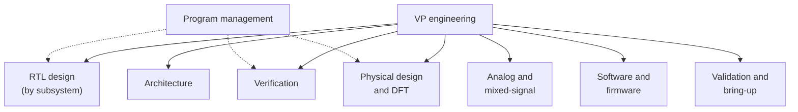
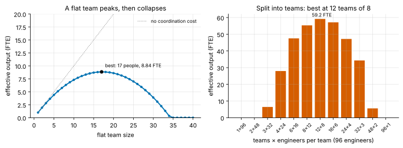

<!-- status: reviewed -->
# 26-06 · Engineering Team Structures and Sizing

| | |
|---|---|
| **Course** | [26 · Engineering Design and Professional Practice](../README.md) |
| **University equivalent** | The project-organization and staffing material of an engineering management or capstone design course (team structures, communication overhead, effort estimation, outsourcing), applied to chip development teams |
| **Prerequisites** | [26-05](26-05-schedule-and-respin-risk.md) (schedules and verification effort), [26-04](26-04-engineering-economics-2.md) (make-or-buy, design partners), [26-03](26-03-engineering-economics-1.md) (NRE), [01-04](../../01-calculus-for-engineers/chapters/01-04-applications-of-derivatives.md) (optimization) |
| **Estimated study hours** | 5 |
| **Last verified** | 2026-11-26 |

**Learning objectives.** After this chapter you can:

1. Name the disciplines that build a chip and describe how each one's staffing rises and falls over a program.
2. Quantify communication overhead, find the most productive size of a flat team, and show why large chip organizations are built as hierarchies of small teams.
3. Predict when adding engineers to a late project shortens it and when it lengthens it (Brooks's law).
4. Compare functional, program and matrix organizations, and work out management layers from the span of control.
5. Decide how much work to staff with employees and how much with contractors or design services, using the newsvendor rule and break-even utilization.

---

## 1. Big picture

A leading-edge chip is built by hundreds of engineers in a dozen disciplines over two to three years. How they are organized decides how fast information moves between them, and therefore how fast the chip is finished and how many bugs slip through the gaps between teams. This chapter turns the vague questions ("is the team big enough?", "should we outsource physical design?") into quantities: communication channels, effective output, break-even utilization and management layers.

- **Where it shows up:** staffing plans in every program business case (26-03), reorganizations, acquisitions that combine two engineering teams, and outsourcing decisions.
- **Why it matters for products:** organization shapes architecture. Interfaces between teams become interfaces in the chip, and the bugs cluster there.
- **Why a corporate development reader cares:** in an acquisition the team is often the asset. Its size relative to its roadmap, its mix of disciplines, how much it depends on contractors and how it is organized are diligence questions (28-07).
- **What this chapter adds:** simple models that make the trade-offs explicit. They are models of organizations, not physical laws: their value is in the direction and size of the effects, not in precise predictions.

## 2. Intuition first

**Physical picture.** A chip team is a network. Each engineer is a node and each working relationship a link that must be maintained with meetings, reviews and documents. Adding a person adds a node and many links. The architecture of the chip is also a network of blocks and interfaces, and the two networks tend to match.

**Analogy: the theory of the firm.** Economists explain why firms exist by transaction costs: coordinating through a market is costly, so activities are brought inside a firm until internal coordination costs rise to match. Engineering teams follow the same logic. A small team coordinates cheaply; as it grows, coordination costs grow faster than headcount, so organizations split into teams that coordinate internally and trade with other teams through defined interfaces (specifications, as in 26-01). **Where the analogy breaks:** the cost of an interface between teams depends on the chip's architecture, not only on headcount; a badly placed interface (two teams sharing a tightly coupled block) costs far more than a clean one, and no market price reveals it.

**Conway's law.** In 1968 Melvin Conway put it this way: "organizations which design systems … are constrained to produce designs which are copies of the communication structures of these organizations" [R-649]. In chips, a block boundary that coincides with a team boundary is usually clean, and a block owned by two teams is where integration bugs gather. Architects therefore draw the block diagram and the org chart together.

## 3. Theory

### 3.1 Who builds a chip, and when

The main disciplines and when their effort peaks:

| Discipline | What it does | Peak effort |
|---|---|---|
| Architecture | Specifications, performance models, partitioning (26-01) | Early |
| RTL design | Writes the logic of each block | Middle |
| Verification | Proves the RTL correct by simulation, formal and emulation (19-13) | Middle to tape-out |
| DFT | Test structures and patterns (19-12) | Late middle |
| Physical design | Synthesis, place and route, timing and power signoff (19-11) | Late, up to tape-out |
| Analog and mixed-signal | PLLs, SerDes, data converters, power (Courses 20–22) | Throughout, often on test chips first |
| Software and firmware | Drivers, boot code, compilers, models | Throughout, peaking at bring-up |
| Validation and bring-up | Silicon debug and characterization (25-12) | After tape-out |
| Program management | Schedule, risk register (26-05), cross-team coordination | Throughout |

Two consequences follow. First, a program's total headcount rises and falls, and different skills are needed at different times, which is the reason for shared pools, contractors and design services (§3.6). Second, the verification effort is about as large as the design effort: the 2022 Wilson Research Group study found "about a one-to-one ratio in terms of mean peak number of verification and design engineers" across most segments, "a 5-to-1 ratio" in some such as processors, and demand for verification engineers growing at 6.2% a year against 2.7% for designers (2007–2022); designers themselves spent 49% of their time on verification [R-651] **[Industry estimate: sponsored survey]**.

### 3.2 Communication cost and team size

**Channels.** Brooks noted that if each part of a task "must be separately coordinated with each other part, the effort increases as n(n-1)/2" [R-650]. A team of $n$ people has

$$
\binom{n}{2} = \frac{n(n - 1)}{2}
$$

possible pairwise channels, because each of the $n$ people can talk to $n - 1$ others and each channel is shared by two. Channels grow as $n^2$ while the people available to do the work grow as $n$.

**A model of output.** Suppose each person loses a fraction $c$ of their time for every colleague they must coordinate with. A person on a flat team of $n$ is then productive a fraction $1 - c(n - 1)$ of the time, and the team's effective output, in full-time equivalents, is

$$
O(n) = n\left[1 - c(n - 1)\right].
$$

Setting $dO/dn = 1 - c(2n - 1) = 0$ gives the most productive flat team,

$$
n^* = \frac{1}{2}\left(1 + \frac{1}{c}\right),
$$

with $d^2O/dn^2 = -2c < 0$, so it is a maximum. Beyond $n^*$, each new person adds less than the coordination they cost; at $n = 1 + 1/c$ the team produces nothing. Units: $c$ is a fraction per colleague, so $c(n - 1)$ is dimensionless. ✓

**Hierarchy.** The way out is to build small teams that coordinate mostly inside themselves, with leads who coordinate between teams. With $k$ teams of $m$ engineers, each member loses $c(m - 1)$ to teammates, and each team loses a fraction $c_x$ of its output for every other team it must interface with:

$$
O = km\left[1 - c(m - 1)\right]\left[1 - c_x(k - 1)\right].
$$

With $c_x$ much smaller than $c$ (because cross-team coordination runs through leads and specifications, not every pair of engineers), the hierarchy delivers far more than any flat team, at the price of the leads' own time. The number of channels also falls: each team of $m + 1$ (members plus lead) has $\binom{m + 1}{2}$ channels inside, and the $k$ leads have $\binom{k}{2}$ among themselves.

> **Math refresher — maximizing a quadratic.** $O(n) = (1 + c)n - cn^2$ is a downward parabola. Its peak is where the slope $(1 + c) - 2cn$ is zero, at $n = (1 + c)/(2c)$, the same as $n^*$ above (01-04).

**What the model leaves out.** Real coordination costs depend on who must talk to whom, which the architecture decides; experienced engineers need less coordination; tools (specifications, automated regressions, shared dashboards) lower $c$. The model's lesson is structural: coordination cost grows faster than headcount unless the organization is designed to contain it.

### 3.3 Brooks's law

In *The Mythical Man-Month* (1975), Fred Brooks stated, "Oversimplifying outrageously", that "Adding manpower to a late software project makes it later" [R-650]. Two mechanisms drive it, training (which "cannot be partitioned") and intercommunication, and both apply to chip teams:

1. **Ramp-up and mentoring.** A new engineer is unproductive for a ramp time $r$ (learning the design, the tools and the methodology), and during that time takes a fraction $\mu$ of an experienced engineer's time.
2. **Coordination.** The larger team pays more coordination overhead for the rest of the project (§3.2).

With $W$ person-months of work left, $n$ people and $a$ added at once, the completion time is

$$
T_{add} = r + \frac{W - (n - \mu a)\,e\,r}{(n + a)\,e}, \qquad e = 1 - c(n + a - 1),
$$

if the work is not finished during the ramp, against $T_0 = W/(n e_0)$ with $e_0 = 1 - c(n - 1)$ without the hires. Adding people helps only if $W$ is large enough to repay the ramp. Early in a program, hiring shortens the schedule; near the end, it lengthens it. Example 26-06.3 shows both cases.

**Practical corollaries.** Staff up early; protect the experienced engineers' time near tape-out; when a late project needs help, add narrowly scoped work (a self-contained block, a regression farm, a test chip) that needs little mentoring and few new channels.

### 3.4 Organization structures

- **Functional organization.** Engineers report by discipline (all verification engineers in one group). Strengths: deep expertise, consistent methodology, people moved between programs as load changes. Weakness: no one below the top owns a whole product, so priorities between programs are fought out above the engineers.
- **Program (product) organization.** Each program has its own dedicated team of every discipline. Strengths: clear ownership and fast decisions. Weaknesses: duplicated methods and tools, idle specialists between peaks, and drift between programs that should share IP.
- **Matrix organization.** Engineers report to a functional manager for skills and to a program manager for priorities. It is the usual compromise in chip companies, with the cost of two bosses and the need for explicit conflict resolution.
- **Platform teams.** Shared IP, methodology and CAD teams serve all programs; they are the organizational form of reuse (26-04 §3.5), and their output is an internal product with internal customers.

### 3.5 Span of control and layers

With $s$ direct reports per manager (the **span of control**), $N$ engineers need about $N/s$ first-line managers, $N/s^2$ second-line managers and so on, so the number of layers is about $\lceil\log_s N\rceil$ and the total number of managers about

$$
\frac{N}{s} + \frac{N}{s^2} + \cdots \approx \frac{N}{s - 1},
$$

the sum of a geometric series. Wider spans mean fewer managers and shorter paths for decisions, but less time per report; narrow spans suit new or junior teams, wide spans experienced ones.

### 3.6 Employees, contractors and design services

**Staffing a varying load.** Suppose the load is $L_t$ engineers in period $t$, an employee costs $C_e$ per period whether or not there is work, and a contractor costs $C_c > C_e$ per period but only when needed. With $B$ employees,

$$
\text{Cost}(B) = \sum_t \left[BC_e + C_c\max(0, L_t - B)\right].
$$

Adding one more employee costs $C_e$ in every period and saves $C_c$ in each period in which the load exceeds $B$. So add employees while

$$
P(L > B)\,C_c > C_e, \qquad \text{that is,}\qquad P(L > B) > \frac{C_e}{C_c}.
$$

This is the **newsvendor rule** of operations research: staff the base to the load level exceeded in a fraction $C_e/C_c$ of periods, and buy the peaks. The more expensive contractors are relative to employees, the higher the base.

**Break-even utilization.** For a single team, in-house costs $C_e$ per month whether busy or not, and outsourcing costs $C_c$ per month of actual work. With utilization $u$ (the fraction of months with work), in-house is cheaper when $u > C_e/C_c$.

**Design services.** An ASIC design-services company takes a customer's specification or RTL and delivers chips (26-04 §3.6). It amortizes physical-design teams, interface IP, foundry relationships and packaging expertise across many customers, which is why outsourcing that work can be cheaper and faster than building the capability. The costs are dependence on the partner, less control over schedule and quality, knowledge that does not stay in-house, and the partner's margin.

**What to keep.** Keep in-house what differentiates the product and what the company will need again (architecture, the key blocks, system validation); outsource what is standard and peaky (layout of standard blocks, some verification, DFT pattern generation, characterization). This is the core-and-context rule of 26-04 §3.8 applied to labor.

### 3.7 From a design-cost estimate to a team

Design-cost estimates are often quoted in dollars; to check them, convert to people. If a fraction $\ell$ of a design cost $D$ is labor at a loaded cost $w$ per engineer-year (salary, benefits, tools, facilities), the effort is

$$
E = \frac{\ell D}{w}\ \text{engineer-years},
$$

and over a program of $T$ years the average headcount is $E/T$. The peak is higher, because staffing rises and falls (§3.1). Published design-cost estimates for leading-edge chips are contested: Arm's 2023 prospectus, citing IBS (July 2022), put a 7 nm design at about $249 M and a 2 nm design at about $725 M, while critics argue that IBS figures run 50–66% above typical costs [R-019] **[Contested]**. Converting both to engineers (Example 26-06.6) shows what each claim implies about team size, which is easier to sanity-check against a company's disclosed R&D headcount (§7).

## 4. Worked examples

The coordination costs, ramp times, wages and loads below are **assumed** for teaching.

### Example 26-06.1 · Channels (tier A)

**Setup.** Find the number of pairwise channels for flat teams of 5, 10, 50 and 100 people, and for 100 people organized as 10 teams of 9 engineers and a lead, with the 10 leads coordinating among themselves.

**Solution.**

- Flat: $\binom{5}{2}$ = **10**, $\binom{10}{2}$ = **45**, $\binom{50}{2}$ = **1225**, $\binom{100}{2}$ = **4950**.
- Hierarchy: each team of 10 has 45 channels, so $10 \times 45 + \binom{10}{2} = 450 + 45$ = **495**, **10**% of the flat team's.

**Units check.** Channels are counts of pairs. ✓

**Sanity check.** Doubling a flat team from 50 to 100 multiplies its channels by about four, the $n^2$ law. The hierarchy keeps channels roughly proportional to headcount.

### Example 26-06.2 · How big should the team be? (tier B)

**Setup.** A block needs 600 person-months of effective work. Each engineer loses 3% of their time per colleague they coordinate with ($c$ = 0.03). Find (a) the most productive flat team and its output, and the time it would take, and (b) the output and time of 10 teams of 8 engineers plus a lead each (90 people), if each team loses 2% of its output per other team ($c_x$ = 0.02).

**Solution.**

- (a) $n^* = (1 + 1/0.03)/2$ = **17.2**, so 17 people; $O(17) = 17(1 - 0.03 \times 16)$ = **8.84** full-time equivalents. The work takes $600/8.84$ = **67.9** months, far too long for a chip.
- (b) Each member is productive $1 - 0.03 \times 7$ = **0.79** of the time, so a team delivers $8 \times 0.79$ = **6.32**; the cross-team factor is $1 - 0.02 \times 9$ = **0.82**. Total $10 \times 6.32 \times 0.82$ = **51.8** full-time equivalents, and the work takes $600/51.8$ = **11.6** months.

**Units check.** Person-months divided by full-time equivalents gives months. ✓

**Sanity check.** The hierarchy gets **0.576** of a full-time equivalent per head, against 0.52 for the best flat team (8.84/17), and it scales: the flat team cannot grow without losing output. Large chip organizations are not optional.

### Example 26-06.3 · Should we add five engineers? (tier B)

**Setup.** A team of 10 has $c$ = 0.02. New engineers are unproductive for 3 months and each takes half of an experienced engineer's time meanwhile. Compare the finishing time with and without adding 5 engineers now if (a) 120 person-months of work remain, or (b) 30 remain.

**Solution.**

- Without hires: $e_0 = 1 - 0.02 \times 9$ = 0.82, output 8.2 FTE.
- With hires: $e = 1 - 0.02 \times 14$ = **0.72**; during the ramp, $10 - 2.5 = 7.5$ engineers work at 0.72, **5.4** FTE; afterward 15 at 0.72, **10.8** FTE.
- (a) Without: $120/8.2$ = **14.6** months. With: $3 + (120 - 16.2)/10.8$ = **12.6** months. Adding helps, by 2.0 months.
- (b) Without: $30/8.2$ = **3.66** months. With: $3 + (30 - 16.2)/10.8$ = **4.28** months. Adding hurts: Brooks's law.

**Units check.** Person-months ÷ FTE = months. ✓

**Sanity check.** The ramp costs 3 months of reduced output (5.4 instead of 8.2 FTE, a loss of **8.4** person-months) and is repaid only by the extra 2.6 FTE afterward; with little work left, there is no "afterward" to repay it.

### Example 26-06.4 · Layers for a 600-engineer organization (tier A)

**Setup.** Find the managers at each level and in total for 600 engineers with a span of control of 8 and of 12.

**Solution.**

- Span 8: $\lceil 600/8\rceil$ = **75**, then **10**, **2** and **1**: four layers, **88** managers.
- Span 12: **50**, **5** and **1**: three layers, **56** managers.

**Units check.** Counts of people. ✓

**Sanity check.** $N/(s - 1)$ gives **85.7** and **54.5**, close to the counts (rounding up at each level adds a few). A wider span removes a layer and a third of the managers, but each first-line manager now has 12 reports to develop and review.

### Example 26-06.5 · Employees or contractors for verification? (tier B)

**Setup.** Verification needs 10, 15, 25, 40, 40, 25, 10 and 10 engineers in eight successive quarters. An employee costs $75,000 a quarter, a contractor $112,500 (assumed). Find (a) the cost of staffing the peak with employees, (b) of using only contractors, (c) the newsvendor base and its cost.

**Solution.**

- (a) $40 \times 8 \times 75{,}000$ = **$24.0 M**.
- (b) The load totals **175** engineer-quarters: $175 \times 112{,}500$ = **$19.7 M**.
- (c) $C_e/C_c$ = **0.667**. A base of 10 is exceeded in 5 of 8 quarters (0.625), below the ratio, so stop at **10**. Cost: $10 \times 8 \times 75{,}000 + 95 \times 112{,}500 = 6.0 + 10.7$ = **$16.7 M**, where **95** engineer-quarters are contracted.

**Units check.** Engineers × quarters × $/quarter = $. ✓

**Sanity check.** A base of 15 costs **$16.9 M**, slightly more, confirming the rule. The cheapest plan uses contractors for more than half the work, which is why verification and physical design are commonly supplemented by contractors and services firms, and why diligence should ask how much of a team's output depends on them.

### Example 26-06.6 · What does a design-cost estimate imply? (tier C)

**Setup.** IBS, as cited in Arm's 2023 prospectus (July 2022 estimate), put the cost of designing a 7 nm chip at about $249 M; critics argue IBS figures run 50–66% above typical costs [R-019]. Assume 80% of the cost is engineering labor at a loaded $300,000 per engineer-year, over 2.5 years. Find (a) the engineer-years and average headcount implied by the IBS figure, and (b) the range implied by the critique.

**Solution.**

- (a) $0.8 \times 249 \times 10^6/300{,}000$ = **664** engineer-years; average headcount $664/2.5$ = **266**.
- (b) Reading the critique as "IBS is 1.5 to 1.66 times typical cost", typical cost is $249/1.66$ = **$150 M** to $249/1.5$ = **$166 M**, implying an average of **160** to **177** engineers. (Read instead as "IBS is 50–66% too high", typical cost would be 34–50% of IBS; state which reading a claim uses.)

**Units check.** $ ÷ ($/engineer-year) = engineer-years; ÷ years = engineers. ✓

**Sanity check.** Either way, a new leading-edge SoC is a team of one to three hundred engineers on average for two to three years, with a higher peak; claims that a 30-person startup will deliver one from scratch should prompt questions about licensed IP, design services and reuse (26-04).

<!-- answer-key -->

| ID | Quantity | Value | Unit |
|---|---|---|---|
| Ex 26-06.1a | channels, 5 | 10 | |
| Ex 26-06.1a1 | channels, 10 | 45 | |
| Ex 26-06.1a2 | channels, 50 | 1225 | |
| Ex 26-06.1a3 | channels, 100 | 4950 | |
| Ex 26-06.1b | channels, hierarchy | 495 | |
| Ex 26-06.1b1 | share of flat | 10 | % |
| Ex 26-06.2a | best flat size | 17.2 | |
| Ex 26-06.2a1 | flat output | 8.84 | FTE |
| Ex 26-06.2a2 | flat time | 67.9 | months |
| Ex 26-06.2b | member efficiency | 0.79 | |
| Ex 26-06.2b1 | team output | 6.32 | FTE |
| Ex 26-06.2b2 | cross-team factor | 0.82 | |
| Ex 26-06.2b3 | hierarchy output | 51.8 | FTE |
| Ex 26-06.2b4 | hierarchy time | 11.6 | months |
| Ex 26-06.2c | output per head | 0.576 | |
| Ex 26-06.2c1 | flat output per head | 0.52 | |
| Ex 26-06.3a | efficiency with hires | 0.72 | |
| Ex 26-06.3a1 | output during ramp | 5.4 | FTE |
| Ex 26-06.3a2 | output after ramp | 10.8 | FTE |
| Ex 26-06.3b | early, without | 14.6 | months |
| Ex 26-06.3b1 | early, with | 12.6 | months |
| Ex 26-06.3b2 | early, gain | 2.0 | months |
| Ex 26-06.3c | late, without | 3.66 | months |
| Ex 26-06.3c1 | late, with | 4.28 | months |
| Ex 26-06.3d | ramp loss | 8.4 | person-months |
| Ex 26-06.3d1 | work done during ramp | 16.2 | person-months |
| Ex 26-06.3d2 | extra output after ramp | 2.6 | FTE |
| Ex 26-06.4a | span 8, level 1 | 75 | |
| Ex 26-06.4a1 | span 8, level 2 | 10 | |
| Ex 26-06.4a2 | span 8, level 3 | 2 | |
| Ex 26-06.4a3 | span 8, total | 88 | |
| Ex 26-06.4b | span 12, level 1 | 50 | |
| Ex 26-06.4b1 | span 12, level 2 | 5 | |
| Ex 26-06.4b2 | span 12, total | 56 | |
| Ex 26-06.4c | approximation, span 8 | 85.7 | |
| Ex 26-06.4c1 | approximation, span 12 | 54.5 | |
| Ex 26-06.5a | all employees | 24.0 | $M |
| Ex 26-06.5b | total load | 175 | engineer-quarters |
| Ex 26-06.5b1 | all contractors | 19.7 | $M |
| Ex 26-06.5c | critical ratio | 0.667 | |
| Ex 26-06.5c1 | share above 10 | 0.625 | |
| Ex 26-06.5c2 | base | 10 | |
| Ex 26-06.5c3 | base cost | 16.7 | $M |
| Ex 26-06.5c4 | contracted | 95 | engineer-quarters |
| Ex 26-06.5c5 | employee part | 6.0 | $M |
| Ex 26-06.5c6 | contractor part | 10.7 | $M |
| Ex 26-06.5d | cost with base 15 | 16.9 | $M |
| Ex 26-06.6a | engineer-years | 664 | |
| Ex 26-06.6a1 | average headcount | 266 | |
| Ex 26-06.6b | typical cost, low | 150 | $M |
| Ex 26-06.6b1 | typical cost, high | 166 | $M |
| Ex 26-06.6b2 | headcount, low | 160 | |
| Ex 26-06.6b3 | headcount, high | 177 | |
| Txt 26-06.1 | zero-output team size | 34.3 | |
| Txt 26-06.2 | NVIDIA R&D share of employees | 74 | % |
| Txt 26-06.3 | channels, 20 | 190 | |
| Txt 26-06.4 | channels added | 20 | |
| Txt 26-06.5 | channels, 21 | 210 | |
| Txt 26-06.6 | best flat size, c = 0.05 | 10.5 | |
| Txt 26-06.7 | output at 10 or 11 | 5.5 | FTE |
| Txt 26-06.8 | managers for 1,000 | 111 | |
| Txt 26-06.9 | critical ratio | 0.667 | |
| Txt 26-06.10 | Socionext NRE share | 19.1 | % |
| Txt 26-06.11 | GUC revenue | 34.1 | NT$B |
| Txt 26-06.12 | Socionext NRE | 38.3 | ¥B |
| Txt 26-06.13 | Socionext net sales | 200.8 | ¥B |
| Txt 26-06.14 | Alchip 2025 revenue | 992 | US$M |
| Txt 26-06.15 | Alchip 2024 revenue | 1.62 | US$B |

## 5. Simulate it

The lab is [labs/26-06-lab/](../labs/26-06-lab/README.md). `team.py` implements channel counts, the flat and hierarchical output models, finishing times with added staff, management layers, staffing cost with a contractor pool and the newsvendor base, and design cost converted to engineer-years.

**Predict, then run.**

1. *Predict* the team size at which a flat team with $c$ = 0.03 produces nothing, then plot $O(n)$ from 1 to 40.
2. *Predict* the best number of teams for 96 engineers split evenly, each team with its own lead (with $c$ = 0.03 and $c_x$ = 0.02), then compute the output for every split (Figure 1).
3. *Predict* the amount of remaining work below which adding Example 26-06.3's five engineers lengthens the project, then sweep the remaining work.
4. *Predict* how the newsvendor base in Example 26-06.5 changes if contractors cost 2.5 times as much as employees, then compute it.

*Figure 1. Left: a flat team's output peaks at 17 people and falls to zero at **34.3** people. Right: splitting 96 engineers into more, smaller teams first raises output (less coordination inside each team), peaks at 12 teams of 8, and then falls (more cross-team interfaces). Negative model outputs are shown as zero.*

## 6. Engineering tradeoffs

| Knob | Improves | Costs | Typical decision owner |
|---|---|---|---|
| Larger team | Capacity, parallel work | Coordination overhead, hiring and ramp time, cost | VP engineering with finance |
| More, smaller teams | Coordination inside teams, ownership | More interfaces and leads; integration risk at the boundaries | Engineering leadership with the architect |
| Matrix rather than program organization | Shared methods, flexible staffing | Two reporting lines, priority conflicts | Senior engineering leadership |
| Wider span of control | Fewer layers and managers, faster decisions | Less coaching and review per engineer | Engineering leadership, HR |
| Contractors and design services | Cost of peaks, access to specialist skills | Dependence, knowledge leaving with the contractor, oversight effort | Program and functional managers |
| Adding people late | Capacity, if enough work remains | Ramp and mentoring cost; can delay a nearly finished project | Program manager |

## 7. Numbers to know

- **R&D scale** (fiscal years 2025–2026): NVIDIA reported about 42,000 employees of whom about 31,000 work in R&D, with R&D at 8.6% of revenue; AMD, Intel and Qualcomm spent 23–26% of revenue on R&D [R-017] **[Established for R&D spending; Industry estimate for headcount splits]**.
- **Verification and design engineers:** about one-to-one at the mean peak on IC/ASIC projects, up to 5-to-1 in segments such as processors (2022 study); verification demand grew 6.2% a year against 2.7% for design over 2007–2022 [R-651] **[Industry estimate]**.
- **Design-services revenue mix:** GUC 24% NRE and 75% turnkey in 2025; Socionext about 19% NRE [R-652] **[Established]**.
- **Verification share of project time:** about 49% (2026 study) [R-018] **[Industry estimate]**.
- **Design cost of a leading-edge SoC:** IBS estimates (July 2022, via Arm's prospectus) of about $249 M at 7 nm and $725 M at 2 nm, disputed as 50–66% too high [R-019] **[Contested]**.

## 8. Common mistakes

- **Treating people as interchangeable person-months.** Effort divided by headcount ignores coordination, ramp and the different skills needed at each phase.
- **Adding people late.** Near the end of a project, new engineers' ramp and mentoring cost more than their output can repay.
- **Growing a flat team.** Past a dozen or two people, a team needs internal structure, or its output falls.
- **Drawing the org chart and the block diagram separately.** Team boundaries become interfaces; place them where the architecture has clean interfaces.
- **Staffing the peak with employees.** Base load with employees and peaks with contractors or services is usually cheaper; the newsvendor rule says how much base.
- **Outsourcing the differentiator.** Design services suit standard, peaky work; the blocks that make the product distinctive should stay in-house.
- **Taking a design-cost estimate at face value.** Convert it to engineers and compare it with the company's actual headcount and roadmap.

## 9. Practitioner lens

**State of play (as of Nov 2026).**

- **Chip companies are R&D organizations.** At NVIDIA about **74**% of employees work in R&D (about 31,000 of 42,000) [R-017] **[Industry estimate for the split]**, and the large chip companies spend from 8.6% (NVIDIA) to 26.1% (Intel) of revenue on R&D [R-017] **[Established]**.
- **Verification keeps growing.** Verification engineers have grown faster than designers for fifteen years, and verification takes about half of project time [R-018, R-321] **[Industry estimate]**.
- **Leading-edge chips take thousands of engineer-years.** NVIDIA said that "Thousands of NVIDIA engineers spent over three years crafting Volta" (2017) [R-653] **[Established, qualitative]**; no company publishes exact team sizes.
- **Design services have scaled, and their revenue mix shows the business model.** GUC's 2025 revenue was NT$**34.1** B, of which 24% was NRE and 75% turnkey (chips delivered), against 34% NRE a year earlier; Socionext's NRE revenue was ¥**38.3** B of ¥**200.8** B in the year to March 2026, **19.1**%; Alchip's 2025 revenue fell to US$**992** M from US$**1.62** B, with NRE more than half of fourth-quarter revenue [R-652] **[Established]**. A rising turnkey share means designs moving into volume; a rising NRE share means a pipeline of new designs. Broadcom's AI semiconductor revenue (custom accelerators plus AI networking) and Marvell's custom revenue show the same model at larger scale [R-642, R-643].

**Commercial relevance.** For acquisitions, the team's structure is part of what is bought: which disciplines are in-house, how much depends on contractors, who the key people are (and whether they will stay), and whether the organization's shape matches the roadmap. Integration plans that merge two functional organizations change every reporting line at once, which is when key people leave.

**Marketing vs Reality.**

- *"A small elite team will deliver a leading-edge chip."* Possible with heavy IP licensing, design services and a narrow scope; otherwise the design-cost arithmetic (Example 26-06.6) implies hundreds of engineers. Ask what is licensed and what is outsourced.
- *"We will hire our way back onto schedule."* Late hires lengthen projects with little work left (Example 26-06.3).
- *"Our team is fully staffed."* Ask for the staffing profile by discipline over time; verification and validation peaks are often understaffed.
- *"We outsource only commodity work."* Check whether the outsourced blocks include anything on the product's critical path.

**Questions for engineering leaders.**

1. *"How is your organization structured, and why does it match the architecture?"* Strong: team boundaries aligned with block interfaces, a named owner for each cross-team interface. Evasive: an org chart with no connection to the block diagram.
2. *"What is your verification-to-design ratio, and how did it change over the last program?"* Strong: a number, the trend and its reasons. Evasive: "verification is everyone's job".
3. *"What share of the last tape-out's effort came from contractors or design services, and in which disciplines?"* Strong: a percentage by discipline and a plan for knowledge retention. Evasive: no figures.
4. *"When the last program slipped, what did you do about staffing?"* Strong: scoped additions early, protected key engineers late. Evasive: "we added people".
5. *"Who are the five people whose departure would most delay the roadmap?"* Strong: names, succession plans and documentation. Evasive: "no one is irreplaceable".

## 10. Concept check

**Q1.** How many pairwise channels does a team of 20 have, and how many does it gain by adding one person?

Answer

$\binom{20}{2}$ = **190**; adding a 21st person adds **20** channels, to **210**.

**Q2.** With a coordination cost of 5% per colleague, what flat team size maximizes output?

Answer

$n^* = (1 + 1/0.05)/2$ = **10.5**, so 10 or 11 people, which give the same output, **5.5** FTE.

**Q3.** Why does Brooks's law apply near the end of a project but not near the start?

Answer

New engineers cost a fixed ramp and mentoring time before they produce anything. Early on there is enough remaining work for their later output to repay that cost; near the end there is not, so the project finishes later.

**Q4.** About how many managers does an organization of 1,000 engineers need with a span of 10?

Answer

About $1{,}000/(10 - 1)$ = **111** (100 first-line, 10 second-line, 1 head).

**Q5.** Contractors cost 1.5 times as much as employees. Above what share of periods with work should you hire an employee rather than contract?

Answer

If the load exceeds that level in more than $1/1.5$ = **0.667** of periods.

**Q6.** State Conway's law and one consequence for chip design.

Answer

Systems tend to copy the communication structure of the organizations that design them. In chips, team boundaries become block interfaces, so a block owned by two teams tends to have integration bugs; architects align block boundaries with team boundaries.

Problem set: [26-06 problems](../problems/26-06-problems.md) · Worked solutions: [26-06 solutions](../solutions/26-06-solutions.md)

## 11. Key terms

[Communication overhead](../../../reference/glossary.md#communication-overhead) · [Brooks's law](../../../reference/glossary.md#brookss-law) · [Conway's law](../../../reference/glossary.md#conways-law) · [Functional organization](../../../reference/glossary.md#functional-organization) · [Program organization](../../../reference/glossary.md#program-organization) · [Matrix organization](../../../reference/glossary.md#matrix-organization) · [Platform team](../../../reference/glossary.md#platform-team) · [Span of control](../../../reference/glossary.md#span-of-control) · [Newsvendor rule](../../../reference/glossary.md#newsvendor-rule) · [Break-even utilization](../../../reference/glossary.md#break-even-utilization) · [Loaded cost](../../../reference/glossary.md#loaded-cost) · [Design partner (ASIC services)](../../../reference/glossary.md#design-partner-asic-services)

## 12. Connections

- **Previous:** [26-05](26-05-schedule-and-respin-risk.md) set the verification and schedule load these teams carry; [26-04](26-04-engineering-economics-2.md) treated design partners as a make-or-buy option; [26-03](26-03-engineering-economics-1.md) priced NRE, most of which is these teams' time.
- **Background:** [19-13](../../19-digital-vlsi-design/chapters/19-13-verification-methods.md), [19-11](../../19-digital-vlsi-design/chapters/19-11-place-route-signoff.md) and [25-12](../../25-fabrication-packaging-test-and-reliability/chapters/25-12-post-silicon-validation.md) describe the work of the verification, physical-design and validation teams.
- **Next:** [26-07](26-07-engineering-ethics.md) covers the professional responsibilities of the people in these teams.
- **Used later:** [28-07](../../28-technical-diligence-and-leadership-fluency/chapters/28-07-evaluating-engineering-teams.md) turns these models into diligence questions; [28-08](../../28-technical-diligence-and-leadership-fluency/chapters/28-08-integration-risk.md) covers combining teams after an acquisition.

## 13. Further study

- F. P. Brooks, *The Mythical Man-Month: Essays on Software Engineering* (anniversary edition, 1995): the essays on team size, communication and adding people to late projects.
- M. E. Conway, "How Do Committees Invent?", *Datamation*, April 1968: the original statement of Conway's law.
- F. S. Hillier and G. J. Lieberman, *Introduction to Operations Research*: the newsvendor model in the inventory chapter.
- 28-07 for how these questions are asked in a diligence setting.

## 14. Sources

1. R&D spending and headcount splits: [R-017].
2. Verification-to-design ratios and growth: [R-651], [R-321]; verification share of project time: [R-018].
3. Design-cost estimates and their critique: [R-019].
4. Custom-silicon revenue of design partners: [R-642], [R-643].
5. Conway's law: [R-649]; Brooks's law and the intercommunication formula: [R-650].
6. Design-services revenue: [R-652]; NVIDIA's statement on the Volta team: [R-653].
