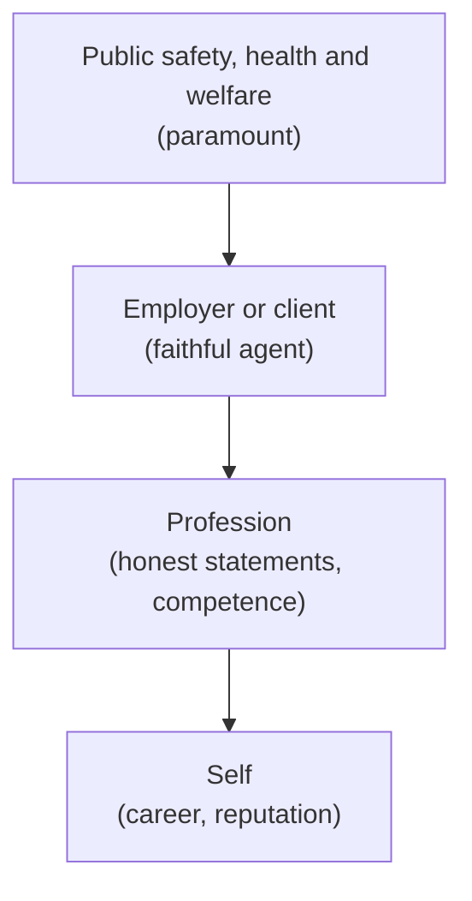
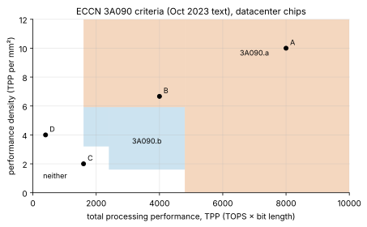

<!-- status: verified -->
# 26-07 · Engineering Ethics and Professional Responsibility

| | |
|---|---|
| **Course** | [26 · Engineering Design and Professional Practice](../README.md) |
| **University equivalent** | The professional-responsibility component of an ABET-accredited engineering program (codes of ethics, licensure, safety, intellectual property, case studies), as tested in the FE exam's Ethics and Professional Practice area, with quantitative risk reasoning from reliability and functional safety |
| **Prerequisites** | [26-02](26-02-design-reviews-and-standards.md) (datasheets, errata, standards and patents), [25-09](../../25-fabrication-packaging-test-and-reliability/chapters/25-09-reliability-physics.md) (FIT rates), [25-10](../../25-fabrication-packaging-test-and-reliability/chapters/25-10-qualification-and-functional-safety.md) (functional safety), [03-05](../../03-probability-statistics-and-random-variables/chapters/03-05-estimation-and-hypothesis-testing.md) (confidence bounds) |
| **Estimated study hours** | 5 |
| **Last verified** | 2026-11-26 |

**Learning objectives.** After this chapter you can:

1. State the fundamental canons of the NSPE Code of Ethics and apply them to engineering situations, including when they pull against each other.
2. Describe the US licensure path (FE exam, experience, PE exam) and what the FE exam expects in ethics and professional practice.
3. Quantify safety claims: fleet-level risk, failure-rate budgets, common-cause failures in redundant protections, and the evidence needed to demonstrate a failure rate.
4. Distinguish patents, mask-work protection, trade secrets and copyright, and the obligations they create for engineers who change employers.
5. Explain, at an awareness level, how export controls apply to advanced chips, and compute the performance metric that classifies them.

---

## 1. Big picture

Engineers make decisions whose consequences reach people who never agreed to the risk: the patient under a radiation machine, the driver of a car whose brake controller runs on a chip, the user whose data passes through a processor with a security flaw. Professional ethics is the set of obligations that comes with that power. This chapter covers the codes engineers have written for themselves, the licensure system that enforces them for some engineers, and the areas where chip engineers most often face hard choices: safety, honesty in data and claims, intellectual property, and export controls. It treats ethics as a practical discipline, with numbers where numbers help, and with the reminder that some obligations are not for sale at any price.

- **Where it shows up:** tape-out and release decisions (26-05), datasheets and errata (26-02), functional safety (25-10), security disclosures (18-11), moving between employers, and every sale of advanced chips across a border.
- **Why the FE exam cares:** Ethics and Professional Practice is 4–6 of the FE Electrical and Computer exam's questions, covering codes of ethics, intellectual property and safety [R-655].
- **Why a corporate development reader cares:** diligence must check a target's safety record, its IP provenance (are its designs its own?), its export-control compliance and its culture of raising problems. These failures do not appear in the financial statements until they appear all at once.
- **What this chapter is not:** legal advice. It teaches awareness: what the rules cover, where to look, and when to call the compliance or legal team.

## 2. Intuition first

**The order of obligations.** An engineer owes duties to several parties: the public, the employer or client, the profession and the engineer's own conscience. Most of the time they agree. When they conflict, the codes rank them, and the public comes first.

**Analogy: fiduciary duty.** A CFA charterholder knows the structure: duties to clients and to the integrity of markets come before the adviser's own interests. Engineering codes have the same shape, with one difference in who sits at the top: the engineer's highest duty is to the public, a party that never signed the contract and usually never knows the engineer's name. **Where the analogy breaks:** a client harmed by bad advice loses money that can be measured and, sometimes, recovered; a person harmed by an unsafe product may lose health or life, which cannot. And engineering errors are copied into every unit shipped, so a small per-unit risk becomes a large fleet-level one (§3.3).

**Why numbers belong in ethics.** "Is it safe?" has no yes-or-no answer; "what is the chance of harm across the fleet, and what evidence supports that figure?" does. Quantitative reasoning cannot decide what risk is acceptable, but it exposes claims that hide a large total behind a small per-unit number, or a confident rate behind too little evidence.

## 3. Theory

### 3.1 Codes of ethics

The National Society of Professional Engineers (NSPE) Code of Ethics (revised July 2019) opens with six fundamental canons. Engineers, in the fulfillment of their professional duties, shall [R-654]:

1. "Hold paramount the safety, health, and welfare of the public."
2. "Perform services only in areas of their competence."
3. "Issue public statements only in an objective and truthful manner."
4. "Act for each employer or client as faithful agents or trustees."
5. "Avoid deceptive acts."
6. "Conduct themselves honorably, responsibly, ethically, and lawfully so as to enhance the honor, reputation, and usefulness of the profession."

The order matters. Canon 4 makes the engineer a faithful agent of the employer, but canon 1 comes first: loyalty to an employer does not extend to endangering the public. The code's rules of practice make the escalation explicit: "If engineers' judgment is overruled under circumstances that endanger life or property, they shall notify their employer or client and such other authority as may be appropriate" [R-654].

**Applying the canons to chip work.**

- *Canon 1 (safety):* a known erratum in an automotive or medical part is a safety matter, not only a customer-relations one.
- *Canon 2 (competence):* signing off a design review (26-02) in an area you do not understand is a breach, however senior you are.
- *Canon 3 (truthful statements):* a datasheet's guaranteed limits must be guaranteed; typical values must be labelled as such (26-02 §3.4).
- *Canon 4 (faithful agent):* keep the employer's confidential information confidential, including after you leave (§3.5).
- *Canon 5 (no deception):* benchmark claims that hide their conditions (26-04 §9) deceive customers.

Professional societies have their own codes; IEEE, the main society for electrical engineers, publishes one in its policies. The FE exam asks about codes of ethics "of professional and technical societies" and about the NCEES Model Law and Model Rules, which govern licensed engineers [R-655].

### 3.2 Licensure

In the US, states license professional engineers (PEs). The usual path is a bachelor's degree from an ABET-accredited program, the Fundamentals of Engineering (FE) exam, about four years of qualifying experience, and the Principles and Practice of Engineering (PE) exam [R-655]. NCEES describes the PE exam as "designed for engineers with a minimum of four years of post-college work experience in their chosen engineering discipline", with three Electrical and Computer exams (Computer Engineering; Electronics, Controls and Communications; Power) [R-655]. A license matters most where engineers sign and seal work for the public, such as power systems and building electrical design. Engineers designing chips inside a company work under the company's quality and safety processes instead, but the ethical obligations of §3.1 apply to them all the same.

The FE exam's Ethics and Professional Practice area lists "A. Codes of ethics (e.g., professional and technical societies, NCEES Model Law and Model Rules) B. Intellectual property (e.g., copyright, trade secrets, patents, trademarks) C. Safety (e.g., grounding, material safety data, PPE, radiation protection)" [R-655].

### 3.3 Safety, quantified

**Rare per unit, common per fleet.** If each of $N$ units independently suffers a dangerous failure with probability $p$ over some period, the chance that at least one does is

$$
P_{any} = 1 - (1 - p)^N \approx 1 - e^{-Np},
$$

and the expected number of events is $Np$. With $Np$ much larger than 1 an event is all but certain. A defect too rare to see in a lab becomes a near-certainty somewhere in a fleet of tens of millions.

**Failure-rate budgets.** Failure rates are quoted in FIT, failures per $10^9$ device-hours (25-09). A fleet of $N$ devices each operating $t$ hours at $\lambda$ FIT expects

$$
E[\text{failures}] = \lambda \times 10^{-9} \times N t.
$$

Functional-safety standards set targets for the probability of hardware failures that violate a safety goal: under ISO 26262-5, below 100 FIT for ASIL B and C and below 10 FIT for ASIL D [R-614] **[Established, as cited in 25-10]**. A target of 10 FIT is not zero: across a large fleet it still predicts hundreds of events (Example 26-07.2). This is why safety-critical chips are designed with safety mechanisms (25-10) that detect faults and move the system to a safe state, rather than relying on the absence of faults.

**Redundancy and common cause.** Two independent protections that each fail on demand with probability $p$ both fail with probability $p^2$. In practice some failures hit both at once, for the same reason: a shared design error, a shared power supply, the same software. The **beta-factor model** puts a fraction $\beta$ of each channel's failures into a common cause:

$$
P_{both} \approx \beta p + \big[(1 - \beta)p\big]^2.
$$

Once $\beta$ exceeds about $p$, the common-cause term dominates, so redundancy buys much less than $p^2$ suggests. The defence is **diversity**: protections that work by different means. The Therac-25 radiation therapy machine shows what happens without it. Between June 1985 and January 1987, "six known accidents involved massive overdoses by the Therac-25 — with resultant deaths and serious injuries"; Leveson and Turner list among the contributing factors "overconfidence in the software and removal of hardware interlocks (making the software into a single point of failure that could lead to an accident)", and conclude that "A lesson to be learned from the Therac-25 accidents is not to remove standard hardware interlocks when adding computer control" [R-656] **[Established]**.

**What failure-free evidence proves.** If a population accumulates $T$ device-hours with no failures, the 95% upper confidence bound on a constant failure rate is

$$
\lambda_U = \frac{-\ln(1 - 0.95)}{T} = \frac{2.996}{T},
$$

because $P(\text{no failures} \mid \lambda) = e^{-\lambda T}$, and $\lambda_U$ is the rate at which that probability falls to 5% (03-05). With $k$ failures the bound becomes $\chi^2_{0.95,\,2k+2}/(2T)$. Turned around, showing a rate below $\lambda$ with 95% confidence and no failures needs $T = 2.996/\lambda$ device-hours. For the rates safety standards ask for, that is far more than any test can run, which is why safety cases combine field data, accelerated testing (25-09, 25-10) and design analysis. An absence of failures in the field is evidence, but often much weaker evidence than it sounds.

**When judgment is overruled.** The Space Shuttle Challenger (flight 51-L) was lost when the seals in a joint of its right solid rocket motor failed. The Presidential Commission's 1986 report found that the decision to launch "was flawed": those who made it "were unaware of the initial written recommendation of the contractor advising against the launch at temperatures below 53 degrees Fahrenheit and the continuing opposition of the engineers at Thiokol after the management reversed its position", and that Thiokol's management had reversed its position "contrary to the views of its engineers in order to accommodate a major customer" [R-657] **[Established]**. Two lessons carry into chip work. First, the burden of proof belongs on the claim of safety, not on the engineers raising a concern. Second, concerns must reach the people who decide, in writing, which is what NSPE rule II.1.a requires.

### 3.4 Honesty in data and claims

Most ethical failures in chip companies are not dramatic. They are small dishonesties under schedule pressure: a characterization run that quietly drops outliers, a datasheet "typical" value taken from the best wafer, a known erratum left out of a customer notice, a benchmark run with settings the customer will never use. Each one violates canon 3 or canon 5, and together they destroy the trust that datasheets and errata exist to create (26-02). The professional standard is simple to state: report what was measured, under what conditions, with the uncertainty; label typical values as typical; publish errata promptly to the customers affected; and keep raw data.

### 3.5 Intellectual property

Engineers create and handle four kinds of intellectual property:

- **Patents** protect inventions (a new circuit, a new method). In the US a patent's term ends "20 years from the date on which the application for the patent was filed", subject to maintenance fees and some adjustments [R-658]. In exchange the invention is published.
- **Mask works** protect the layout of a chip. Under the Semiconductor Chip Protection Act, protection starts on registration or first commercial exploitation, whichever comes first, lasts ten years, and runs "to the end of the calendar year in which they would otherwise expire" [R-658].
- **Trade secrets** protect information kept secret: process recipes, design methods, test limits, customer data. Information qualifies only if "the owner thereof has taken reasonable measures to keep such information secret" and it "derives independent economic value … from not being generally known" [R-658]. Since 2016, owners can sue for misappropriation in federal court under the Defend Trade Secrets Act [R-658].
- **Copyright** protects expression: RTL code, firmware, documents. **Trademarks** protect names and logos.

**For engineers changing employers.** Your skills and general knowledge go with you; your employer's trade secrets, code, documents and confidential data do not. Taking design files, test limits or customer lists to a new employer is both an ethical breach (canon 4) and potentially unlawful. The new employer should not want them either: tainted IP can contaminate its own products. Clean-room procedures, which separate people who have seen a competitor's confidential material from those designing the new product, exist for this reason.

**Open source.** Open-source licenses (for RTL, tools and firmware) grant rights with conditions, some of which require publishing derived code. Using such code in a product without following its license is an IP violation, even though the code is free to download.

### 3.6 Export controls

Governments control the export of goods, software and technology with military or strategic uses. In the US, the Export Administration Regulations (EAR), administered by the Bureau of Industry and Security (BIS), classify items by Export Control Classification Number (ECCN). Since October 2022, rules have restricted exports of advanced computing chips and semiconductor manufacturing equipment to certain destinations [R-659] **[Established, as of Nov 2026]**.

**How an advanced chip is classified.** As revised in October 2023, ECCN 3A090 covers integrated circuits with "a 'total processing performance' of 4800 or more", or "a 'total processing performance' of 1600 or more and a 'performance density' of 5.92 or more", with a second tier (3A090.b) at lower thresholds [R-659]. The metrics are defined as

$$
\text{TPP} = 2 \times \text{MacTOPS} \times (\text{bit length}), \qquad \text{performance density} = \frac{\text{TPP}}{\text{die area (mm}^2)},
$$

aggregated over all processing units on the chip. Since a multiply-accumulate counts as two operations, $2 \times \text{MacTOPS}$ is the dense operations rate in TOPS, so TPP is TOPS × bit length: the rule notes that 4800 is reached by "600 tera integer operations … at 8 bits or 300 tera FLOPS … at 16 bits" [R-659]. Items "not designed or marketed for use in datacenters" are excluded unless their TPP reaches 4800 [R-659].

**A moving target.** The rules have changed repeatedly: a January 2025 "AI Diffusion" framework that BIS announced it would rescind in May 2025; a January 2026 change to case-by-case review of exports of "the Nvidia H200 and its equivalents" to China and Macau; and a November 2026 interim final rule on remote access to advanced chips through overseas data centers, which also formally rescinds the AI Diffusion regulations [R-659]. Any specific question needs the current rule and the company's compliance team.

**What it means for engineers.** Export controls cover not only shipping chips but also **technology**: design data, process know-how and technical assistance, including sharing them with foreign nationals and through cloud access. Engineers should know which of their projects are controlled, route questions to their trade-compliance team, and never treat a classification as a technical judgment they can make alone.

### 3.7 Confidentiality and conflicts of interest

Engineers and those who evaluate them (the reader included) receive confidential information: a supplier's roadmap under a nondisclosure agreement, a target's design data in a data room, a customer's product plans. Using it outside the purpose for which it was shared, or trading on it, breaches canon 4 and, often, the law. A conflict of interest arises when a personal interest (a shareholding in a supplier, a job offer from a competitor) could bias a professional judgment; the standard remedy is disclosure and, where needed, stepping back from the decision.

## 4. Worked examples

Probabilities, fleet sizes and chip parameters are **assumed** for teaching unless a source is cited. Classification examples apply the 2023 3A090 criteria as published [R-659] and are not compliance advice.

### Example 26-07.1 · Rare per unit, common per fleet (tier A)

**Setup.** A chip has a one-in-a-million chance per unit per year of a dangerous failure, and 50 million units are in service. Find (a) the expected number of failures per year, (b) the probability of at least one, and (c) the probability of at least one if the per-unit risk were one in a billion.

**Solution.**

- (a) $10^{-6} \times 5 \times 10^7$ = **50** a year.
- (b) $1 - (1 - 10^{-6})^{5 \times 10^7} \approx 1 - e^{-50}$, which is **1.0** to any precision that matters.
- (c) $1 - e^{-0.05}$ = **0.0488**.

**Units check.** Probability per unit × units = expected events. ✓

**Sanity check.** A risk invisible in any lab test is a certainty in the field: safety arguments must be made at the fleet level.

### Example 26-07.2 · What a 10 FIT target means (tier B)

**Setup.** An ASIL D chip meets the 10 FIT target for hardware failures that violate its safety goal [R-614]. It goes into 10 million cars, each driven 1 hour a day for 12 years. Find (a) the operating hours per car, (b) the expected number of such failures across the fleet, (c) the same at the ASIL B target of 100 FIT, and (d) the probability that a given car experiences one over its life at 10 FIT.

**Solution.**

- (a) $365 \times 12$ = **4380** hours.
- (b) $10 \times 10^{-9} \times 10^7 \times 4380$ = **438** failures.
- (c) **4380** failures.
- (d) $1 - e^{-10 \times 10^{-9} \times 4380}$ = **4.38e-5**, about one car in 23,000.

**Units check.** FIT × 10⁻⁹ per hour × device-hours = failures. ✓

**Sanity check.** The target bounds the rate; it does not promise zero events. What makes the system safe is that each of those faults is detected and handled (25-10), which is why the safety mechanisms, not the FIT number alone, carry the safety case.

### Example 26-07.3 · Two interlocks that fail together (tier B)

**Setup.** A machine has two protections against an overdose, each failing on demand with probability $10^{-3}$. Find the probability that both fail (a) if they are independent, and (b) if 5% of failures have a common cause ($\beta$ = 0.05). (c) By what factor does the common cause raise the risk?

**Solution.**

- (a) $(10^{-3})^2$ = **1.0e-6**.
- (b) $0.05 \times 10^{-3} + (0.95 \times 10^{-3})^2 = 5.0 \times 10^{-5} + 9.0 \times 10^{-7}$ = **5.09e-5** (the exact beta-factor expression, which subtracts a negligible overlap, gives the same to three figures).
- (c) **50.9** times.

**Units check.** Probabilities are dimensionless. ✓

**Sanity check.** The common-cause term alone is 50 times the independent product: redundancy built from two copies of the same thing buys little. A software check plus a hardware interlock, working by different physics, keeps $\beta$ small, which is exactly what the Therac-25 lacked [R-656].

### Example 26-07.4 · What a clean field record proves (tier B)

**Setup.** A new chip has run 3 million device-hours in the field with no failures. Find (a) the 95% upper bound on its failure rate, in FIT, and (b) the failure-free device-hours needed to support a claim of 10 FIT at 95% confidence, also in device-years.

**Solution.**

- (a) $\lambda_U = 2.996/(3 \times 10^6)$ h⁻¹ = **999** FIT, about 1,000 FIT.
- (b) $T = 2.996/(10 \times 10^{-9})$ = **3.00e8** device-hours, or **3.42e4** device-years (8,760 hours each).

**Units check.** A dimensionless constant divided by hours gives a rate per hour; × 10⁹ gives FIT. ✓

**Sanity check.** Three million clean hours sounds impressive but cannot rule out a rate a hundred times the ASIL D target. A claim of 10 FIT rests on design analysis and accelerated testing, with field data accumulating slowly behind it.

### Example 26-07.5 · Is this accelerator export-controlled? (tier B)

**Setup.** Apply the 2023 3A090 criteria [R-659] to four datacenter chips (dense rates, no sparsity): A, 1,000 TOPS at 8 bits on 800 mm²; B, 250 TFLOPS at 16 bits on 600 mm²; C, 200 TOPS at 8 bits on 800 mm²; D, 50 TOPS at 8 bits on 100 mm². Find each chip's TPP and performance density, and which criterion, if any, it meets.

**Solution.** TPP = TOPS × bit length; density = TPP/area.

- A: TPP = **8000**, density **10.0**: 3A090.a.1 (TPP ≥ 4800).
- B: TPP = **4000**, density **6.67**: 3A090.a.2 (TPP ≥ 1600 and density ≥ 5.92).
- C: TPP = **1600**, density **2.0**: below 3A090.b.1 (needs TPP ≥ 2400) and 3A090.b.2 (needs density ≥ 3.2), so neither.
- D: TPP = **400**: neither.

**Units check.** TOPS × bits gives the rule's TPP units; TPP per mm² gives density. ✓

**Sanity check.** B is controlled despite a TPP below 4800 because it packs its performance densely; C, with the same TPP floor, is not, because its density is low. The rule's thresholds, its technical notes (multiple precisions, sparsity, "applicable die area") and later changes all matter in practice, which is why classification belongs to the compliance team.

### Example 26-07.6 · When does protection end? (tier A)

**Setup.** (a) A patent application is filed in the US on 15 March 2026. When does the patent's term end, assuming fees are paid and no adjustment applies? (b) A chip's layout is first sold on 10 June 2026 and registered as a mask work on 1 September 2026. When does protection end?

**Solution.**

- (a) Twenty years from filing: **15 March 2046** [R-658].
- (b) Protection starts at the earlier date, 10 June 2026; ten years later is 10 June 2036, and the term runs to the end of that calendar year: **31 December 2036** [R-658].

**Units check.** Dates. ✓

**Sanity check.** A patent's clock starts at filing, not at grant, so a slow examination shortens the useful term (adjustments can restore some of it). Mask-work protection is short by design: a layout's commercial life is short, and the circuit ideas themselves are protected, if at all, by patents.

<!-- answer-key -->

| ID | Quantity | Value | Unit |
|---|---|---|---|
| Ex 26-07.1a | expected failures | 50 | per year |
| Ex 26-07.1b | P(at least one) | 1.0 | |
| Ex 26-07.1c | P(at least one), 1e-9 | 0.0488 | |
| Ex 26-07.2a | hours per car | 4380 | h |
| Ex 26-07.2b | fleet failures, 10 FIT | 438 | |
| Ex 26-07.2c | fleet failures, 100 FIT | 4380 | |
| Ex 26-07.2d | per-car probability | 4.38e-5 | |
| Ex 26-07.2d1 | one car in | 2.3e4 | |
| Ex 26-07.3a | independent | 1.0e-6 | |
| Ex 26-07.3b | with common cause | 5.09e-5 | |
| Ex 26-07.3b1 | common-cause term | 5.0e-5 | |
| Ex 26-07.3b2 | independent term | 9.0e-7 | |
| Ex 26-07.3c | ratio | 50.9 | |
| Ex 26-07.3d | common term over independent product | 50 | |
| Ex 26-07.4a | 95% upper bound | 999 | FIT |
| Ex 26-07.4b | hours for 10 FIT | 3.00e8 | h |
| Ex 26-07.4b1 | device-years | 3.42e4 | |
| Ex 26-07.4c | -ln(0.05) | 2.996 | |
| Ex 26-07.5a | TPP, A | 8000 | |
| Ex 26-07.5a1 | density, A | 10.0 | |
| Ex 26-07.5b | TPP, B | 4000 | |
| Ex 26-07.5b1 | density, B | 6.67 | |
| Ex 26-07.5c | TPP, C | 1600 | |
| Ex 26-07.5c1 | density, C | 2.0 | |
| Ex 26-07.5d | TPP, D | 400 | |
| Txt 26-07.1 | units for one expected failure | 1e7 | |
| Txt 26-07.2 | bound for 1e8 hours | 30.0 | FIT |
| Txt 26-07.3 | TPP at 300 TFLOPS, 16 bits | 4800 | |

## 5. Simulate it

The lab is [labs/26-07-lab/](../labs/26-07-lab/README.md). `safety.py` implements fleet probabilities, FIT-based fleet failures, the beta-factor model, zero-failure and chi-square upper bounds, TPP and performance density, and protection-term dates.

**Predict, then run.**

1. *Predict* the fleet size at which a one-in-a-million risk has an even chance of occurring, then plot the fleet probability against fleet size.
2. *Predict* the beta factor at which common-cause failures equal independent ones for $p = 10^{-3}$, then plot $P_{both}$ against $\beta$.
3. *Predict* the failure-free hours needed to show 1 FIT at 95% confidence, then plot the hours needed against the target rate.
4. *Predict* the 95% bounds after 1, 2 and 3 failures in $10^9$ device-hours, then compute them.

*Figure 1. The 2023 ECCN 3A090 criteria as regions of TPP and performance density [R-659]: chips A and B fall in 3A090.a, chips C and D in neither. Region boundaries follow the published text; the figure is an aid to reading it, not a classification tool.*

## 6. Engineering tradeoffs

| Knob | Improves | Costs | Typical decision owner |
|---|---|---|---|
| More safety margin and diverse redundancy | Probability of harm, robustness to common causes | Area, power, cost, design time | Safety manager and chief architect |
| More validation before release | Confidence in the failure-rate claim | Schedule (26-05) | VP engineering with the safety manager |
| Prompt, complete errata disclosure | Customer safety and trust | Short-term sales friction and support cost | Product line with quality and legal |
| Patent filing | Exclusivity, licensing revenue, defense | Publication of the invention, filing cost | IP counsel with engineering |
| Keeping know-how as trade secret | No publication, no expiry | Protection only while secrecy is maintained | Engineering leadership with legal |
| Strict export and data-access controls | Compliance | Slower collaboration, restricted markets | Trade-compliance team |

## 7. Numbers to know

- **FE exam:** Ethics and Professional Practice, 4–6 questions (codes of ethics, intellectual property, safety) [R-655] **[Established]**.
- **Licensure:** a PE typically needs about four years of experience after an accredited degree, plus the FE and PE exams [R-655] **[Established]**.
- **ISO 26262 targets:** below 100 FIT (ASIL B, C) and below 10 FIT (ASIL D) for hardware failures violating a safety goal [R-614] **[Established]**.
- **Zero-failure bound:** 95% upper bound ≈ 3/T (the "rule of three"; exactly 2.996/T).
- **IP terms (US):** patents 20 years from filing; mask works 10 years, to the end of the calendar year [R-658] **[Established]**.
- **Export thresholds (ECCN 3A090, 2023):** TPP ≥ 4800, or TPP ≥ 1600 with performance density ≥ 5.92 [R-659] **[Established, as of Nov 2026; rules change often]**.
- **Case anchors:** Therac-25, six massive overdoses in 1985–1987 [R-656]; Challenger, launched over its contractor's engineers' objections (1986 report) [R-657]; Pentium FDIV, a $475 M replacement charge [R-321].

## 8. Common mistakes

- **Treating loyalty to the employer as the top duty.** The codes put public safety first; the employer comes after.
- **Quoting a per-unit risk for a fleet product.** Multiply by the fleet: rare per unit is common in the field.
- **Counting two copies of the same protection as independent.** Common causes dominate unless the protections are diverse.
- **Reading a clean field record as proof.** Zero failures in $T$ hours bound the rate only at about $3/T$.
- **Assuming publicly downloadable means free to use.** Open-source licenses have conditions; trade secrets of a former employer are not yours to bring.
- **Classifying export-controlled items yourself.** Know the rules exist and what they cover; leave classification to the compliance team.
- **Escalating verbally only.** Concerns about safety should be put in writing to the people who decide.

## 9. Practitioner lens

**State of play (as of Nov 2026).**

- **Codes of ethics** for US engineers center on NSPE's six canons (revised July 2019), with safety paramount [R-654] **[Established]**.
- **Export controls on advanced computing** have been revised repeatedly since October 2022; in November 2026 BIS added rules on remote access to advanced chips through overseas data centers and formally rescinded the AI Diffusion regulations [R-659] **[Established]**. Companies selling AI accelerators now carry compliance work (customer screening, data-center due diligence) that did not exist five years ago.
- **Safety standards** for automotive and industrial electronics (25-10) turn ethical obligations into engineering targets and evidence requirements, and their reach grows as chips take over control functions.

**Commercial relevance.** Ethics failures become financial events. A safety recall, a trade-secret suit, an export violation or a concealed erratum can cost far more than the program that caused it, as the $475 M FDIV charge shows for a bug that was not even a safety issue [R-321]. In diligence, the questions in this section belong beside the financial ones.

**Marketing vs Reality.**

- *"Zero field failures."* Ask how many device-hours, and compute the bound: zero failures in 3 million hours is consistent with 1,000 FIT (Example 26-07.4).
- *"Fully redundant."* Ask whether the redundant channels share design, software, power or clock; if they do, common causes dominate.
- *"Meets ASIL D."* Ask for the safety case: the metrics, the assumptions and who assessed them. A FIT target is a rate, not a guarantee of no events.
- *"Not subject to export controls."* Ask for the classification, who made it and when; the rules have changed several times since 2022.
- *"All our IP is original."* Ask about clean-room practices for hires from competitors and about open-source license compliance.

**Questions for engineering leaders.**

1. *"How does an engineer here raise a safety concern that management disagrees with, and what happened the last time?"* Strong: a written escalation path, an example, and evidence that the concern was heard. Evasive: "our door is always open".
2. *"How do you decide what goes into an erratum, and how fast do customers get it?"* Strong: criteria, a timeline and a record of past notices. Evasive: "we handle it case by case with key customers".
3. *"What failure rate do you claim for your safety-critical parts, and what evidence supports it?"* Strong: the rate, the device-hours and acceleration data, and the confidence level. Evasive: "no field failures".
4. *"How do you prevent former employers' IP from entering your designs?"* Strong: onboarding attestations, clean-room procedures, code scanning for licenses. Evasive: "we trust our people".
5. *"Who classifies your products for export, and how did the November 2026 rule change your processes?"* Strong: a named compliance function and specific changes. Evasive: "our distributors handle that".

## 10. Concept check

**Q1.** Which NSPE canon governs a conflict between an employer's instruction and public safety, and what does the code require if the engineer is overruled?

Answer

Canon 1: hold paramount the safety, health and welfare of the public; it ranks above the duty to act as a faithful agent (canon 4). If overruled where life or property is endangered, the engineer must notify the employer or client "and such other authority as may be appropriate" (rule II.1.a) [R-654].

**Q2.** A failure has probability $10^{-7}$ per unit per year. How many units make one failure a year expected?

Answer

$1/10^{-7}$ = **1e7** units: ten million units in service.

**Q3.** Why does adding a second, identical software check add little safety?

Answer

Both copies share the same design, so the same error defeats both: the common-cause fraction $\beta$ is large and $P_{both} \approx \beta p$, not $p^2$. A diverse protection (a hardware interlock) is needed.

**Q4.** A part shows no failures in $10^8$ device-hours. What 95% upper bound on its rate does that support, in FIT?

Answer

$2.996/10^8$ per hour = **30.0** FIT.

**Q5.** An engineer leaving a chip company wants to take a copy of the test limits she wrote. May she?

Answer

No. The test limits belong to the employer and are likely a trade secret (kept confidential, valuable because not generally known). Her skills and general knowledge go with her; the employer's documents and data do not (canon 4) [R-658].

**Q6.** What is the TPP of a chip delivering 300 TFLOPS dense at 16 bits, and does it reach 3A090's 4800 threshold?

Answer

$300 \times 16$ = **4800**: it reaches the threshold exactly, the example the rule itself gives [R-659].

Problem set: [26-07 problems](../problems/26-07-problems.md) · Worked solutions: [26-07 solutions](../solutions/26-07-solutions.md)

## 11. Key terms

[Code of ethics](../../../reference/glossary.md#code-of-ethics) · [Professional engineer (PE)](../../../reference/glossary.md#professional-engineer-pe) · [Common-cause failure](../../../reference/glossary.md#common-cause-failure) · [Beta-factor model](../../../reference/glossary.md#beta-factor-model) · [Rule of three](../../../reference/glossary.md#rule-of-three) · [Patent](../../../reference/glossary.md#patent) · [Mask work](../../../reference/glossary.md#mask-work) · [Trade secret](../../../reference/glossary.md#trade-secret) · [Clean room (IP)](../../../reference/glossary.md#clean-room-ip) · [Export control](../../../reference/glossary.md#export-control) · [Total processing performance (TPP)](../../../reference/glossary.md#total-processing-performance-tpp) · [Conflict of interest](../../../reference/glossary.md#conflict-of-interest)

## 12. Connections

- **Previous:** [26-06](26-06-team-structures-and-sizing.md) on the teams whose members carry these obligations; [26-05](26-05-schedule-and-respin-risk.md) on the schedule pressure that tests them; [26-02](26-02-design-reviews-and-standards.md) on datasheets, errata and patents in standards.
- **Background:** [25-09](../../25-fabrication-packaging-test-and-reliability/chapters/25-09-reliability-physics.md) and [25-10](../../25-fabrication-packaging-test-and-reliability/chapters/25-10-qualification-and-functional-safety.md) for FIT rates and functional safety; [18-11](../../18-embedded-systems-and-microcontrollers/chapters/18-11-hardware-security.md) for security disclosure; [03-05](../../03-probability-statistics-and-random-variables/chapters/03-05-estimation-and-hypothesis-testing.md) for confidence bounds.
- **Next:** Course 27 applies the whole curriculum to real system architectures.
- **Used later:** [28-06](../../28-technical-diligence-and-leadership-fluency/chapters/28-06-red-and-green-flags.md) and [28-08](../../28-technical-diligence-and-leadership-fluency/chapters/28-08-integration-risk.md) use safety, IP and compliance as diligence signals.

## 13. Further study

- NSPE, *Code of Ethics for Engineers* (rev. July 2019), with the NSPE Board of Ethical Review's case collection for worked applications.
- N. G. Leveson and C. S. Turner, "An Investigation of the Therac-25 Accidents," *IEEE Computer*, July 1993 [R-656].
- *Report of the Presidential Commission on the Space Shuttle Challenger Accident* (1986), chapters IV and V [R-657].
- NCEES, *FE Reference Handbook*, ethics section, and the FE specification [R-655].
- The Bureau of Industry and Security's pages on advanced computing rules, read with a compliance professional [R-659].

## 14. Sources

1. NSPE Code of Ethics: [R-654].
2. NCEES FE ethics topics, PE exam and licensure: [R-655].
3. ISO 26262-5 hardware-metric targets: [R-614].
4. Therac-25 accidents: [R-656].
5. Challenger accident report: [R-657].
6. US statutes on patents, mask works and trade secrets: [R-658].
7. US export controls on advanced computing chips: [R-659].
8. The Pentium FDIV charge: [R-321].
