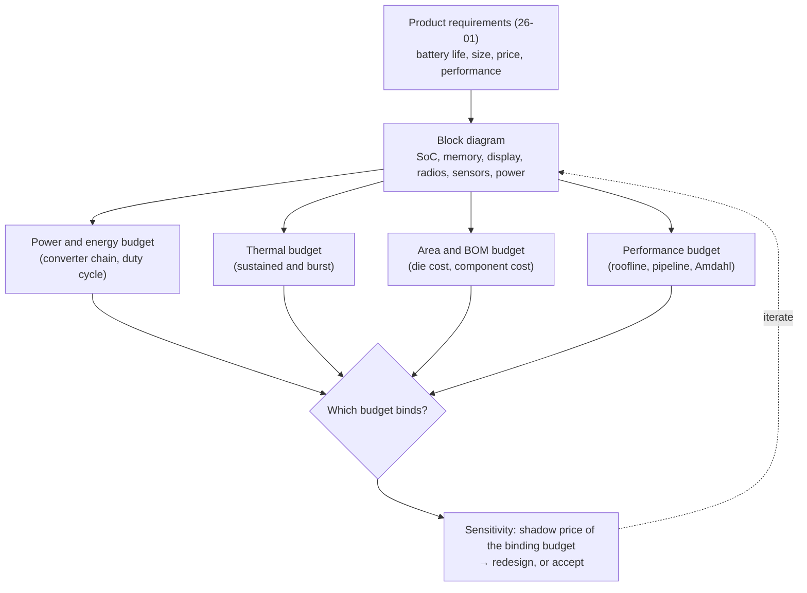
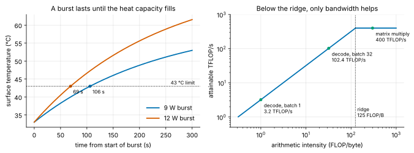

<!-- status: verified -->
# 27-01 · Method: Analyzing a System End to End

| | |
|---|---|
| **Course** | [27 · System Architectures (Case-Study Course)](../README.md) |
| **University equivalent** | The opening method lectures of a systems-design case-study seminar: decomposition, budget trees and bottleneck analysis, as used in senior design and computer-systems courses |
| **Prerequisites** | [26-01](../../26-engineering-design-and-professional-practice/chapters/26-01-requirements-and-specifications.md) (requirements, duty-cycle and error budgets), [14-01](../../14-computer-organization-and-architecture/chapters/14-01-performance-power-iron-law.md) (dynamic power and $P \propto f^3$ under DVFS, Amdahl's law), [14-15](../../14-computer-organization-and-architecture/chapters/14-15-roofline-and-benchmarks.md) (roofline), [15-01](../../15-control-systems/chapters/15-01-modeling-dynamic-systems.md) (thermal RC models), [22-08](../../22-power-electronics-and-energy-conversion/chapters/22-08-pmics.md) (PMICs and power trees), [26-03](../../26-engineering-design-and-professional-practice/chapters/26-03-engineering-economics-1.md) (cost stack and margin) |
| **Estimated study hours** | 4 |
| **Last verified** | 2026-11-26 |

**Learning objectives.** After this chapter you can:

1. Decompose a product into subsystems, draw its block diagram and the budget tree that allocates power, area and cost to each block.
2. Build a power budget through a converter chain, find where the losses go, and compute battery life.
3. Find a system's sustained and burst power limits from a thermal RC model, and say which limit binds.
4. Locate the bottleneck of a system with roofline, pipeline, Amdahl and Little's-law analysis.
5. Roll up a bill of materials and use sensitivities, including the shadow price of a watt, to decide where to spend a budget.

---

## 1. Big picture

Courses 06 to 26 built the parts: transistors, circuits, processors, memories, radios, power converters, packages and the economics that pay for them. A product is all of them at once, and it works only if every budget closes together: the battery lasts long enough, the case stays cool enough, the die fits the cost, the data path keeps up, and the price leaves a margin. This course takes real product classes apart with the tools of the earlier courses. This chapter supplies the method that every case study uses, so that each later chapter can spend its time on what is specific to a phone, a watch, a car or a datacenter rack.

- **Why it exists:** a system is a set of coupled budgets. Spending in one (a faster core) draws on others (power, heat, area, cost), and the decision that matters is which budget binds.
- **Where it shows up in chips:** every SoC specification starts as a budget tree (26-01); the architecture review checks that it closes; post-silicon, thermal throttling and battery complaints are budgets that did not.
- **Where it shows up in products and deals:** teardowns, analyst models and diligence all decompose a product into a block diagram and a cost and power breakdown; the skill is to know which number to doubt.
- **What this chapter adds:** five reusable models (power tree, thermal RC, roofline, pipeline with Little's law, BOM roll-up) and one decision tool, the shadow price, which converts a watt or a dollar saved in one place into performance or margin elsewhere.

## 2. Intuition first

**A system is a set of accounts that must all balance.** Every block draws on several accounts at once: energy (the battery), power (the heat the case can shed), area (the die and the board), bandwidth (the memory bus), cost (the BOM) and time (latency through the pipeline). A design closes when no account is overdrawn. The first question in any system analysis is therefore not "how fast is it?" but "which account runs out first?", because that account sets the real limit, and the others have slack that can be traded for it.

**Analogy: a company's financial statements.** A finance reader knows that a business can be profitable and still run out of cash, or have cash and no growth. Profit, cash, leverage and return are separate constraints, and the one that binds decides the strategy. A product's power, heat, cost and performance are the same kind of separate constraints, and the analyst's job is the same: find the binding one and price the others in its terms. **Where the analogy breaks:** financial accounts are fungible through markets (cash can be borrowed), while physical budgets convert only at rates set by physics and design (a watt of heat cannot be borrowed from next quarter), and some, like the skin temperature of a device in a hand, are hard limits with no price at all.

## 3. Theory

### 3.1 Decomposition and the budget tree

Start from the requirements (26-01) and draw two views of the system:

- the **functional view**, which says what flows where: data from sensor to processor to memory to radio; power from battery through converters to loads; heat from die to case to air;
- the **physical view**, which says what is built: dies, packages, boards, battery, display, enclosure.

Each requirement then becomes a **budget tree**: a total at the root, allocated to blocks at the leaves, with margin held back at each level (26-01 §3.3). The power tree, the thermal path, the BOM and the latency of a data path are all budget trees of this kind. Interfaces between blocks matter as much as the blocks: a memory bus, a power rail, a thermal interface material or a connector is a shared resource that two budgets draw on.

### 3.2 Power and energy: the converter chain

Each load is fed through one or more converters (22-08). If a load draws power $P_k$ through a converter of efficiency $\eta_k$, the battery supplies $P_k/\eta_k$ and the converter turns the difference into heat:

$$
P_{batt} = \sum_k \frac{P_k}{\eta_k}, \qquad P_{loss} = P_{batt} - \sum_k P_k, \qquad \eta_{sys} = \frac{\sum_k P_k}{P_{batt}} .
$$

Converters in series multiply: two stages of 0.9 give 0.81. A **linear regulator** (LDO) passes its load current straight through, so it cannot do better than $\eta = V_{out}/V_{in}$; dropping 3.7 V to 1.8 V wastes more power than it delivers (Example 27-01.1). With a usable battery energy $E_u$ in watt-hours, the run time is

$$
t = \frac{E_u}{\bar P_{batt}}, \qquad \bar P_{batt} = \sum_m d_mP_{batt,m},
$$

the duty-weighted average over the use profile, exactly as 26-01 §3.3 did for currents. Units: Wh ÷ W = h. ✓

Two consequences follow. First, a converter's loss is charged to the battery and to the thermal budget at the same time: every watt wasted heats the device. Second, the dominant term is the largest $d_mP_{batt,m}$, not the largest instantaneous power, so a small always-on load with a poor converter can cost more battery than a large load that runs briefly.

### 3.3 Thermal: sustained and burst limits

Heat flows from the junction through a chain of thermal resistances to the air (25-08), and the temperature rise is power times resistance, $\Delta T = P\theta$, with $\theta$ in °C/W. A handheld device has two temperature limits: the silicon junction, whose maximum the chip vendor specifies, and the surface the user touches, which in practice is a much tighter limit. For a device whose total power $P$ flows to its surface through a surface-to-ambient resistance $\theta_{sa}$, the **sustained power** is

$$
P_{sus} = \frac{T_{s,max} - T_a}{\theta_{sa}} .
$$

The junction limit applies to the processor's own power $P_{soc}$ through its junction-to-surface resistance $\theta_{js}$: $T_j = T_s + P_{soc}\theta_{js}$.

**Bursts.** The device also stores heat in its mass: a thermal capacitance $C_{th}$ in J/°C. With one dominant capacitance the temperature follows the first-order RC response of 15-01: after a step to power $P$ from an initial temperature $T_0$,

$$
T(t) = T_\infty - (T_\infty - T_0)e^{-t/\tau}, \qquad T_\infty = T_a + P\theta_{sa}, \qquad \tau = \theta_{sa}C_{th} .
$$

Solving $T(t_b) = T_{s,max}$ gives the **burst duration**

$$
t_b = \tau\ln\frac{T_\infty - T_0}{T_\infty - T_{s,max}},
$$

defined when $T_\infty > T_{s,max}$ (otherwise the power is sustainable). Units: (°C/W)(J/°C) = J/W = s. ✓ So a device can run well above its sustained power for a time set by its heat capacity, which is why benchmarks that run for a minute report much higher scores than a game played for an hour. If bursts of power $P_b$ alternate with idle periods at $P_i$ much faster than $\tau$, the case sees only the average, and the largest sustainable burst duty is

$$
d_{max} = \frac{P_{sus} - P_i}{P_b - P_i} .
$$

> **Going deeper — more than one time constant.** A real device has a fast junction-to-package time constant (milliseconds to seconds) and a slow case time constant (minutes). The fast one decides how long a core can turbo before the junction limit bites; the slow one decides how long the device stays comfortable. Thermal control loops (15-12) estimate both from on-die sensors and throttle the clock before either limit is crossed.

### 3.4 Area, cost and the bill of materials

The die's cost follows 25-04 and 26-03: area sets dies per wafer and yield, and the cost per good die rises faster than area. At the product level, the **bill of materials** (BOM) is the sum of component costs, and the cost of goods sold adds assembly, test, royalties and logistics:

$$
\text{BOM} = \sum_k c_k, \qquad \text{COGS} = \text{BOM} + c_{other}, \qquad \text{GM} = \frac{\text{ASP} - \text{COGS}}{\text{ASP}} .
$$

The sensitivity of margin to a component is simple and often overlooked: a change $\Delta c_k$ moves the gross margin by $-\Delta c_k/\text{ASP}$, regardless of how large the component's share is. A volatile commodity part (memory) can therefore move margin as much as the processor does (Example 27-01.5).

### 3.5 Performance: finding the bottleneck

Four models locate most bottlenecks.

**Roofline (14-15).** A processor with peak rate $\Pi$ (operations per second) and memory bandwidth $\beta$ (bytes per second) runs a kernel of arithmetic intensity $I$ (operations per byte moved) at

$$
\Pi_{att} = \min(\Pi, I\beta) .
$$

Below the **ridge point** $I^* = \Pi/\beta$ the kernel is memory bound and only bandwidth helps; above it, only compute helps. Generating text with a large language model one token at a time reads every weight once per token, so its intensity is about two operations (a multiply and an add) per weight, divided by the bytes per weight: about 1 operation per byte at 16-bit precision. Decode is therefore far below the ridge of any modern accelerator, and its speed is set by bandwidth:

$$
\text{tokens/s} \approx \frac{\beta}{N_p b} ,
$$

with $N_p$ parameters of $b$ bytes each. Serving $B$ users together reuses each weight $B$ times, multiplying the intensity by $B$; this batching is how servers reach the ridge.

**Pipelines.** In a chain of stages each able to process $r_k$ items per second, the throughput is the minimum, $r = \min_k r_k$, and the slowest stage is the bottleneck. Speeding up any other stage changes nothing; speeding up the bottleneck helps only until the next-slowest stage takes over.

**Amdahl's law (14-01).** If a fraction $f_k$ of the original time is sped up by $s_k$, the overall speedup is $1/\sum_k (f_k/s_k)$. An accelerator that makes 40% of a workload 20 times faster gives only 1.61× overall, and an infinitely fast one only 1.67×.

**Little's law (14-08).** In any stable system, the average number of items in flight equals the arrival rate times the time each spends inside: $L = \lambda W$. It gives the **mean** occupancy (frames in a camera pipeline, packets in a switch, requests in a memory controller) with no assumption about distributions; the peak, which is what sizes a buffer, does depend on how arrivals and service times vary.

### 3.6 Sensitivity and the shadow price

Once one budget binds, every other budget has a price in its units. Under a power cap, for example, a watt saved anywhere can be spent on clock frequency. With dynamic power $P_{dyn} \propto f^3$ under voltage–frequency scaling (14-01), performance at a fixed dynamic budget varies as $f \propto P_{dyn}^{1/3}$, so

$$
\frac{d\ln(\text{perf})}{dP} = \frac{1}{3P_{dyn}} .
$$

This is the **shadow price** of a watt: at a 3 W dynamic budget, one watt is worth about 11% of performance at the margin (Example 27-01.6). It converts a leakage saving, a better regulator or a cooler package into performance, and lets dissimilar proposals be compared on one scale.

The same logic gives a design rule. Suppose a change multiplies instructions per clock (IPC) by $g$ and dynamic power at a fixed frequency by $p$. Under the cap, frequency must fall by $p^{-1/3}$, so performance changes by $g\,p^{-1/3}$, and the change pays only if

$$
g > p^{1/3} .
$$

A wider core that buys 15% IPC for 20% more power wins ($1.2^{1/3}$ = 1.063); one that buys 10% IPC for 40% more power loses ($1.4^{1/3}$ = 1.119). Under a power cap, efficiency is performance.

### 3.7 The method, step by step

1. **Requirements.** Write the use profile and the hard limits (battery life, temperatures, size, price) as in 26-01.
2. **Block diagram.** Draw the functional and physical views; mark every shared resource.
3. **Budgets.** Roll up power through the converter chain, heat through the thermal path, cost through the BOM, and data through the pipeline.
4. **Bottleneck.** Find the binding budget and, within it, the binding block.
5. **Sensitivity.** Price the binding budget in the units of the others (the shadow price) and test the candidate changes against it.
6. **Sanity check.** Compare every number with public data (datasheets, teardowns, measurements) and with physics (energy per operation, bandwidth per pin); a claim that needs a budget to be overdrawn is wrong somewhere.

## 4. Worked examples

All component values below are **assumed** for teaching unless a source is cited. Intermediate values are shown rounded but carried at full precision, so recomputing from the displayed figures can differ in the last digit.

### Example 27-01.1 · Where does the battery go? (tier A)

**Setup.** A handheld device's loads in its main use mode are: the SoC 1.8 W through a buck converter of 88% efficiency; DRAM 0.4 W through a 90% buck; the display 1.2 W through an 85% boost; the radio 0.6 W through a 90% buck; and sensors 0.2 W at 1.8 V through an LDO from the battery rail, which sits at 3.7 V under this load. The battery is 5,000 mAh at a nominal 3.85 V (its average over a discharge), 90% usable. Find (a) the battery-side power and the system efficiency, (b) the loss in each converter, (c) the run time, and (d) the run time if the LDO is replaced by a 90% buck.

**Solution.**

- (a) The LDO's efficiency is at most $1.8/3.7$ = **48.6**%. Battery-side powers: SoC $1.8/0.88$ = **2.045** W; DRAM **0.444** W; display **1.412** W; radio **0.667** W; sensors $0.2/0.486$ = **0.411** W. Total **4.98** W for **4.2** W of load: efficiency **84.3**%, a loss of **0.779** W.
- (b) Losses: SoC buck **0.245** W, display boost **0.212** W, LDO **0.211** W, radio **0.067** W, DRAM **0.044** W. The LDO, feeding the smallest load, wastes as much as the display's boost converter.
- (c) Energy $5.0 \times 3.85$ = **19.25** Wh, **17.325** Wh usable; run time $17.325/4.98$ = **3.48** h.
- (d) A buck saves $0.411 - 0.222$ = **0.189** W, giving **3.62** h, **8.2** minutes more.

**Units check.** W ÷ (dimensionless) = W; W ÷ W = efficiency; Wh ÷ W = h. ✓

**Sanity check.** The converter losses are about a sixth of the battery power, and every watt of them also heats the device (Example 27-01.2). The cheapest fix is often the smallest load's converter.

### Example 27-01.2 · Sustained power, bursts and the binding limit (tier B)

**Setup.** The device of Example 27-01.1 sheds heat through its surface with $\theta_{sa}$ = 4.0 °C/W to 25 °C air. Its surface must stay at or below 43 °C (an assumed design limit), and the SoC junction at or below 95 °C with $\theta_{js}$ = 6.0 °C/W from junction to surface. Components other than the SoC dissipate 1.0 W. The device's thermal capacitance is 60 J/°C. Find (a) the sustained total power, the sustained SoC power and the junction temperature there; (b) starting from a steady 2.0 W, how long a 9 W burst (8 W SoC plus the other 1 W) can last; (c) the largest SoC power the junction allows at the end of the burst; and (d) the largest duty cycle of 9 W bursts alternating with 2 W idle, if the bursts are short compared with the time constant.

**Solution.**

- (a) $P_{sus} = (43 - 25)/4.0$ = **4.5** W in total, so the SoC may dissipate **3.5** W. Its junction is then at $43 + 3.5 \times 6.0$ = **64** °C: the surface, not the junction, is the binding limit.
- (b) At 2.0 W the surface sits at $25 + 2.0 \times 4.0$ = **33** °C. $\tau = 4.0 \times 60$ = **240** s; the burst heads for $T_\infty = 25 + 9 \times 4.0$ = **61** °C, reaching 43 °C after $t_b = 240\ln[(61 - 33)/(61 - 43)]$ = **106** s.
- (c) With the surface at 43 °C, the junction allows $(95 - 43)/6.0$ = **8.67** W from the SoC: the 8 W burst fits, with little room.
- (d) $d_{max} = (4.5 - 2.0)/(9 - 2.0)$ = **0.357**: bursts can run about a third of the time.

**Units check.** °C ÷ (°C/W) = W; (°C/W)(J/°C) = s. ✓

**Sanity check.** The device runs at twice its sustained power for under two minutes and then must throttle. A one-minute benchmark sees the burst; an hour of gaming sees the 4.5 W limit. Both numbers are honest, and only one describes the user's experience.

### Example 27-01.3 · Compute or memory bound? (tier B)

**Setup.** An accelerator has a peak of 400 TFLOP/s at 16-bit precision and 3.2 TB/s of memory bandwidth (assumed). (a) Find its ridge point. (b) A large matrix multiplication has an intensity of 300 FLOP/byte; what rate does it reach? (c) A 7-billion-parameter language model with 16-bit weights decodes one token at a time for one user (intensity about 1 FLOP/byte): find the attainable rate, its fraction of peak and the tokens per second. (d) What do 32 users batched together reach, and which upgrade, double compute or double bandwidth, helps decode?

**Solution.**

- (a) $I^* = 400/3.2$ = **125** FLOP/byte.
- (b) 300 > 125, so it is compute bound at **400** TFLOP/s.
- (c) $1 \times 3.2$ = **3.2** TFLOP/s, **0.8**% of peak. Each token reads $7 \times 10^9 \times 2$ = **14** GB, so $3.2 \times 10^{12}/(14 \times 10^9)$ = **228.6**, about **229** tokens/s.
- (d) Intensity 32: **102.4** TFLOP/s, still below the ridge, giving $32 \times 228.6$ = **7314** tokens/s in total. Doubling bandwidth doubles decode speed; doubling compute does nothing until the batch exceeds 125.

**Units check.** (FLOP/s)/(byte/s) = FLOP/byte; (byte/s)/(byte/token) = token/s. ✓

**Sanity check.** A chip's peak TFLOP/s says little about single-user decode speed; its memory bandwidth says almost everything. This is why inference accelerators are sold on HBM bandwidth (23-05) and why batching is the economics of serving.

### Example 27-01.4 · The slowest stage and the buffer it needs (tier B)

**Setup.** A camera pipeline has five stages with capacities in frames per second: sensor readout 120, image signal processor (ISP) 90, NPU enhancement 72, video encoder 60, and storage, which writes 0.5 MB compressed frames at 40 MB/s. Each raw frame is 12 MB, and a frame takes 80 ms from readout to storage. Find (a) the throughput and bottleneck, (b) the new throughput if the encoder is upgraded to 120 frames/s, (c) the frames in flight and the frame buffers needed at 60 frames/s, and (d) the DRAM traffic if each raw frame is written to and read from DRAM three times.

**Solution.**

- (a) Storage manages $40/0.5$ = **80** frames/s; the minimum is the encoder's **60** frames/s.
- (b) The NPU becomes the bottleneck at **72** frames/s: a 2× encoder buys 20%.
- (c) $L = \lambda W = 60 \times 0.080$ = **4.8** frames in flight. With deterministic arrivals and service the peak equals the mean, so five buffers suffice; budgeting them all at the raw 12 MB (the compressed frames after the encoder are far smaller) gives **60** MB of DRAM, a conservative figure.
- (d) $3 \times 2 \times 12 \times 60$ = **4.32** GB/s, about **5.6**% of the 76.8 GB/s peak of a 64-bit LPDDR5X-9600 interface [R-490] (23-04), which the memory budget must carry alongside everything else.

**Units check.** frames/s × s = frames; MB × frames/s = MB/s. ✓

**Sanity check.** The pipeline's slowest stage sets the rate, Little's law sets the memory, and the memory traffic lands on a shared bus: three budgets from one block diagram.

### Example 27-01.5 · Rolling up a BOM (tier B)

**Setup.** A phone's BOM (assumed, $): SoC 130; memory (DRAM and flash) 95; display 85; cameras 65; RF front end 40; battery and power 25; mechanical 55; other 60. Assembly, test, royalties and logistics add $45. The maker's net selling price is $950. Find (a) the BOM, COGS and gross margin, (b) the SoC's and memory's shares of the BOM, (c) the margin if memory prices rise 30%, and (d) the margin if the SoC costs 10% less.

**Solution.**

- (a) BOM **$555**; COGS **$600**; GM $(950 - 600)/950$ = **36.8**%.
- (b) SoC **23.4**%; memory **17.1**%.
- (c) Memory +$28.50: COGS **$628.50**, GM **33.8**%, **3.0** points lower.
- (d) SoC −$13: COGS **$587**, GM **38.2**%, **1.37** points higher.

**Units check.** $ ÷ $ = dimensionless. ✓

**Sanity check.** A memory price swing moves the margin more than twice as much as a meaningful SoC saving, because $\Delta\text{GM} = -\Delta c/\text{ASP}$ depends on dollars, not shares. This is why a memory-price swing shows up so directly in a phone maker's gross margin.

### Example 27-01.6 · The shadow price of a watt (tier C)

**Setup.** From Example 27-01.2, the SoC may dissipate 3.5 W sustained, of which 0.5 W is static (leakage) and 3.0 W dynamic, with $P_{dyn} \propto f^3$. (a) Power gating cuts static power by 0.3 W, and the saving goes to frequency. Find the exact performance gain and the linear estimate from the shadow price. (b) A wider core raises IPC by 15% and dynamic power at fixed frequency by 20%. Find the performance change at the cap. (c) What power increase would make that core break even?

**Solution.**

- (a) The dynamic budget becomes 3.3 W, so $f/f_0 = (3.3/3.0)^{1/3}$ and performance rises **3.23**%. The shadow price is $1/(3 \times 3.0)$ = **0.111** per watt, **11.1**% per W, so 0.3 W is worth about **3.33**%, close to exact.
- (b) Frequency falls by $(1/1.2)^{1/3}$ = **0.941**, so performance is $1.15 \times 0.941$ = **1.082**: **8.2**% faster.
- (c) Break-even where $1.15 = p^{1/3}$: $p$ = **1.52**, a 52% power increase.

**Units check.** Ratios of powers and frequencies are dimensionless; the shadow price is per watt. ✓

**Sanity check.** Under a thermal cap a watt is worth about a tenth of the performance, so a 0.3 W leakage fix is worth a few percent of speed, the same as a modest microarchitecture change. The rule $g > p^{1/3}$ explains why efficient cores win in thermally limited products.

<!-- answer-key -->

| ID | Quantity | Value | Unit |
|---|---|---|---|
| Ex 27-01.1a | LDO efficiency | 48.6 | % |
| Ex 27-01.1a1 | SoC battery-side power | 2.045 | W |
| Ex 27-01.1a2 | DRAM battery-side power | 0.444 | W |
| Ex 27-01.1a3 | display battery-side power | 1.412 | W |
| Ex 27-01.1a4 | radio battery-side power | 0.667 | W |
| Ex 27-01.1a5 | sensor battery-side power | 0.411 | W |
| Ex 27-01.1a6 | battery power | 4.98 | W |
| Ex 27-01.1a7 | load power | 4.2 | W |
| Ex 27-01.1a8 | system efficiency | 84.3 | % |
| Ex 27-01.1a9 | total loss | 0.779 | W |
| Ex 27-01.1b | SoC buck loss | 0.245 | W |
| Ex 27-01.1b1 | display boost loss | 0.212 | W |
| Ex 27-01.1b2 | LDO loss | 0.211 | W |
| Ex 27-01.1b3 | radio buck loss | 0.067 | W |
| Ex 27-01.1b4 | DRAM buck loss | 0.044 | W |
| Ex 27-01.1c | battery energy | 19.25 | Wh |
| Ex 27-01.1c1 | usable energy | 17.325 | Wh |
| Ex 27-01.1c2 | run time | 3.48 | h |
| Ex 27-01.1d | saving with a buck | 0.189 | W |
| Ex 27-01.1d1 | run time with a buck | 3.62 | h |
| Ex 27-01.1d2 | extra minutes | 8.2 | min |
| Ex 27-01.2a | sustained total power | 4.5 | W |
| Ex 27-01.2a1 | sustained SoC power | 3.5 | W |
| Ex 27-01.2a2 | junction temperature | 64 | °C |
| Ex 27-01.2b | starting surface temperature | 33 | °C |
| Ex 27-01.2b1 | time constant | 240 | s |
| Ex 27-01.2b2 | burst final temperature | 61 | °C |
| Ex 27-01.2b3 | burst duration | 106 | s |
| Ex 27-01.2c | SoC limit from the junction | 8.67 | W |
| Ex 27-01.2d | largest burst duty | 0.357 | |
| Ex 27-01.3a | ridge point | 125 | FLOP/byte |
| Ex 27-01.3b | matrix multiply rate | 400 | TFLOP/s |
| Ex 27-01.3c | decode rate | 3.2 | TFLOP/s |
| Ex 27-01.3c1 | fraction of peak | 0.8 | % |
| Ex 27-01.3c2 | tokens per second | 229 | |
| Ex 27-01.3d | batch-32 rate | 102.4 | TFLOP/s |
| Ex 27-01.3d1 | batch-32 tokens per second | 7314 | |
| Ex 27-01.4a | storage capacity | 80 | frames/s |
| Ex 27-01.4a1 | throughput | 60 | frames/s |
| Ex 27-01.4b | throughput after upgrade | 72 | frames/s |
| Ex 27-01.4c | frames in flight | 4.8 | |
| Ex 27-01.4c1 | buffer memory | 60 | MB |
| Ex 27-01.4d | DRAM traffic | 4.32 | GB/s |
| Ex 27-01.5a | BOM | 555 | $ |
| Ex 27-01.5a1 | COGS | 600 | $ |
| Ex 27-01.5a2 | gross margin | 36.8 | % |
| Ex 27-01.5b | SoC share | 23.4 | % |
| Ex 27-01.5b1 | memory share | 17.1 | % |
| Ex 27-01.5c | COGS after memory rise | 628.50 | $ |
| Ex 27-01.5c1 | margin after memory rise | 33.8 | % |
| Ex 27-01.5c2 | margin change | 3.0 | points |
| Ex 27-01.5d | COGS after SoC cut | 587 | $ |
| Ex 27-01.5d1 | margin after SoC cut | 38.2 | % |
| Ex 27-01.5d2 | margin change | 1.37 | points |
| Ex 27-01.6a | exact gain | 3.23 | % |
| Ex 27-01.6a1 | shadow price | 0.111 | per W |
| Ex 27-01.6a2 | shadow price | 11.1 | % per W |
| Ex 27-01.6a3 | linear estimate | 3.33 | % |
| Ex 27-01.6b | frequency factor | 0.941 | |
| Ex 27-01.6b1 | performance factor | 1.082 | |
| Ex 27-01.6b2 | gain | 8.2 | % |
| Ex 27-01.6c | break-even power factor | 1.52 | |
| Txt 27-01.1 | wider core threshold, 20% power | 1.063 | |
| Txt 27-01.2 | wider core threshold, 40% power | 1.119 | |
| Txt 27-01.3 | Amdahl, 40% at 20× | 1.61 | |
| Txt 27-01.4 | Amdahl, 40% infinitely fast | 1.67 | |
| Txt 27-01.5 | two stages of 0.9 | 0.81 | |
| Txt 27-01.6 | Q1 chain efficiency | 0.810 | |
| Txt 27-01.7 | Q4 throughput | 30 | items/s |
| Txt 27-01.8 | Q5 requests inside | 3 | |
| Txt 27-01.9 | battery life overstated without converters | 18.6 | % |
| Ex 27-01.1d0 | buck input power for the sensors | 0.222 | W |
| Ex 27-01.3c3 | bytes read per token | 14 | GB |
| Ex 27-01.3c4 | tokens per second, unrounded | 228.6 | |
| Ex 27-01.4d1 | share of a 76.8 GB/s interface | 5.6 | % |

## 5. Simulate it

The lab is [labs/27-01-lab/](../labs/27-01-lab/README.md). `sysbudget.py` implements the power tree, the thermal RC limits, the roofline, the pipeline and Little's law, Amdahl's law, the BOM roll-up and performance under a power cap.

1. *Predict* how many minutes of run time Example 27-01.1 gains if the display's boost converter improves from 85% to 92%. Then compute it.
2. *Predict* how long a 12 W burst lasts from Example 27-01.2's 2 W steady state, then plot burst duration against burst power from 5 to 15 W.
3. *Predict* the batch size at which Example 27-01.3's decode becomes compute bound, then plot attainable rate against batch size on the roofline.
4. *Predict* the exact and linear gains if power gating saves a full watt in Example 27-01.6, then plot both against the watts saved.

*Figure 1. Two budgets that bind in different ways. Left: a burst can exceed the sustained limit until the device's heat capacity fills (Example 27-01.2; Lab Part 2). Right: decode sits far left of the ridge, where only bandwidth helps (Example 27-01.3).*

## 6. Engineering tradeoffs

| Knob | Improves | Costs | Typical decision owner |
|---|---|---|---|
| Higher-efficiency converters (buck instead of LDO, more phases) | Battery life and heat | Board area, inductors, cost, noise | Power architect |
| Larger battery | Run time | Volume, weight, cost | Product management with industrial design |
| Better thermal path (vapor chamber, graphite, fan) | Sustained power and performance | Thickness, cost, acoustics | Mechanical and thermal engineering |
| Higher burst (turbo) limits | Responsiveness and short benchmarks | Throttling later; skin temperature | SoC power management with product |
| More memory bandwidth | Memory-bound workloads (AI decode, graphics) | Power, pins, package and memory cost | SoC architect |
| Wider cores or accelerators | Performance per clock | Area and power; pays under a cap only if $g > p^{1/3}$ | CPU and SoC architects |
| Cheaper or second-source components | Margin | Performance, risk, qualification effort | Sourcing with engineering |
| Larger buffers | Throughput under bursts | DRAM capacity and bandwidth | System architect |

## 7. Numbers to know

| Quantity | Value | Note |
|---|---|---|
| LDO efficiency | at most $V_{out}/V_{in}$ | Timeless; 1.8 V from 3.7 V is at best 48.6% |
| Converters in series | efficiencies multiply | Timeless |
| Shadow price of a watt under a cap | $1/(3P_{dyn})$ per W | Timeless model, $P_{dyn} \propto f^3$ (14-01) |
| Decode speed | about bandwidth ÷ bytes of weights per token | Timeless model; ignores KV-cache traffic |
| HBM2 access energy | about 3.9 pJ/bit | O'Connor et al., MICRO 2017 [R-459] |
| Ridge point | peak rate ÷ bandwidth | Timeless |
| Burst duration | $\tau\ln[(T_\infty - T_0)/(T_\infty - T_{max})]$ | Timeless; one dominant time constant |

## 8. Common mistakes

- **Adding load powers and forgetting the converters.** The battery supplies the load powers divided by efficiencies; in Example 27-01.1 leaving them out overstates battery life by **18.6**%.
- **Quoting peak power as sustained.** A burst limit set by heat capacity is not a sustained limit set by heat flow; ask how long the number lasts.
- **Optimizing a stage that is not the bottleneck.** In a pipeline only the slowest stage sets throughput.
- **Reading peak TOPS or TFLOP/s as delivered performance.** Below the ridge, bandwidth sets the rate.
- **Ranking components by BOM share when judging margin risk.** Margin moves with dollars changed, not with shares; volatile commodities can dominate.
- **Comparing proposals in different units.** Convert watts, dollars and area into the units of the binding budget (the shadow price) before choosing.
- **Ignoring shared resources.** A memory bus, a rail or a thermal path serves several blocks; each block's budget can close while the shared resource is overdrawn.

## 9. Practitioner lens

**State of play (as of Nov 2026).**

- **Teardowns are the public's system analysis.** Firms such as TechInsights and iFixit publish die photographs, component identifications and package structures; for example, a teardown of NVIDIA's B200 module identified two near-reticle GPU dies and eight HBM3E stacks on a CoWoS-L interposer [R-586], and iFixit's identification of a 2025 flagship phone listed several separate PMICs from two vendors [R-438] **[Established: teardown]**. Teardown cost estimates are models built on such identifications, not invoices **[Industry estimate]**.
- **Memory energy and bandwidth dominate AI systems.** Moving a bit to or from HBM2 costs about 3.9 pJ (O'Connor et al.) [R-459] **[Established]**, far more than an on-chip arithmetic operation (23-01), which is why bandwidth and data reuse decide AI performance per watt.

**Commercial relevance.** In diligence, the method of this chapter is how a claim is checked. A battery-life claim decomposes into a use profile, a power tree and a battery; a performance claim into a roofline and a workload; a margin claim into a BOM and a price. Each can be rebuilt from public parts and physics, and an inconsistency between them is the most reliable sign of an overstated plan.

**Marketing vs Reality.**

- *"Up to 50 TOPS."* Peak, at the lowest precision, with sparsity if allowed, for as long as the burst lasts. Ask the precision, the sustained figure and the memory bandwidth behind it.
- *"All-day battery life."* Under which use profile, at what screen brightness, with which radios? Rebuild it with a power tree.
- *"X% faster than the previous generation."* On which workload, and was it compute or memory bound? A memory-bound workload gains nothing from extra compute.
- *"Industry-leading efficiency."* Efficiency at which operating point? Under a cap, perf/W is perf; at a light load, idle power dominates.

**Questions for engineering leaders.**

1. *"Which budget binds in this product, and what is the next one?"* Strong: names the binding budget (for example, skin temperature), quantifies the margin on the others and explains the order. Evasive: "we have optimized everything".
2. *"What is a watt worth to you, in performance or battery life?"* Strong: a number from their own thermal and DVFS model, used to judge proposals. Evasive: no conversion between budgets.
3. *"What does the device sustain after ten minutes of the heaviest realistic workload?"* Strong: a measured sustained figure and the throttling profile. Evasive: only burst benchmarks.
4. *"Which workloads are memory bound on this chip, and how did that shape the memory system?"* Strong: a roofline of key workloads and the bandwidth decision it drove. Evasive: peak TOPS only.
5. *"Which BOM items move your margin most, and how do you hedge them?"* Strong: names the volatile parts (memory, display) with their sensitivity and contracts. Evasive: "the SoC is our biggest cost".

## 10. Concept check

**Q1.** Two converters of 92% and 88% efficiency feed a load in series. What is the chain's efficiency?

Answer

Efficiencies multiply: $0.92 \times 0.88$ = **0.810**, so 81.0%.

**Q2.** Why can a phone run at twice its sustained power for a minute but not for an hour?

Answer

Its heat capacity absorbs the extra heat for a while, so the surface temperature rises along an RC curve with a time constant of minutes. Once it reaches its limit, only the heat that the surface can shed (the sustained power) can be dissipated.

**Q3.** An accelerator has a ridge point of 100 FLOP/byte. A workload has an intensity of 20. Will doubling peak compute help?

Answer

No. At an intensity below the ridge the workload is memory bound; only more bandwidth or more data reuse (higher intensity) helps.

**Q4.** A pipeline's stages run at 50, 30 and 40 items/s. The 50 items/s stage is made twice as fast. What happens to throughput?

Answer

Nothing: throughput stays at the slowest stage's **30** items/s.

**Q5.** A queue receives 200 requests/s and each spends 15 ms inside. How many are inside on average?

Answer

Little's law: $200 \times 0.015$ = **3** requests.

**Q6.** Under a power cap with $P_{dyn} \propto f^3$, a design change gives 6% more IPC for 20% more power at fixed frequency. Is it worth it?

Answer

No: it pays only if $g > p^{1/3}$, and $1.2^{1/3}$ = **1.063** > 1.06, so performance falls slightly.

Problem set: [27-01 problems](../problems/27-01-problems.md) · Worked solutions: [27-01 solutions](../solutions/27-01-solutions.md).

## 11. Key terms

[Budget tree](../../../reference/glossary.md#budget-tree) · [Power tree](../../../reference/glossary.md#power-tree) · [Sustained power](../../../reference/glossary.md#sustained-power) · [Burst duration](../../../reference/glossary.md#burst-duration) · [Thermal time constant](../../../reference/glossary.md#thermal-time-constant) · [Bottleneck](../../../reference/glossary.md#bottleneck) · [Bill of materials (BOM)](../../../reference/glossary.md#bill-of-materials-bom) · [Shadow price](../../../reference/glossary.md#shadow-price) · [Roofline model](../../../reference/glossary.md#roofline-model) · [Ridge point](../../../reference/glossary.md#ridge-point) · [Little's law](../../../reference/glossary.md#littles-law)

## 12. Connections

- **Previous:** [26-07](../../26-engineering-design-and-professional-practice/chapters/26-07-engineering-ethics.md) closed the professional-practice course; this course applies everything before it.
- **Prerequisites:** [26-01](../../26-engineering-design-and-professional-practice/chapters/26-01-requirements-and-specifications.md) (budgets and duty cycles), [14-01](../../14-computer-organization-and-architecture/chapters/14-01-performance-power-iron-law.md) (power, DVFS, Amdahl), [14-15](../../14-computer-organization-and-architecture/chapters/14-15-roofline-and-benchmarks.md) (roofline), [15-01](../../15-control-systems/chapters/15-01-modeling-dynamic-systems.md) (thermal RC), [22-08](../../22-power-electronics-and-energy-conversion/chapters/22-08-pmics.md) (power trees), [25-08](../../25-fabrication-packaging-test-and-reliability/chapters/25-08-thermal-engineering.md) (thermal resistance networks), [26-03](../../26-engineering-design-and-professional-practice/chapters/26-03-engineering-economics-1.md) (cost and margin).
- **Next:** [27-02](27-02-smartphone-soc.md) applies the method to the smartphone SoC.
- **Used later:** every case study in this course ([27-03](27-03-wearables-smartwatch.md) to [27-08](27-08-edge-ai-and-iot.md)) uses these budgets; Course 28 uses them to test product claims in diligence.

## 13. Further study

- Hennessy and Patterson, *Computer Architecture: A Quantitative Approach*: the chapters on quantitative design principles (Amdahl's law, power and energy) and on domain-specific architectures (the roofline in practice).
- S. Williams, A. Waterman and D. Patterson, "Roofline: An Insightful Visual Performance Model for Multicore Architectures," *Communications of the ACM*, 2009 (the original roofline paper, 14-15).
- 22-08 and its lab for PMIC power trees, and 25-08 for thermal resistance networks.

## 14. Sources

1. HBM2 access energy (O'Connor et al., MICRO 2017): [R-459].
2. NVIDIA B200 teardown (TechInsights, as reported): [R-586].
3. Phone PMIC identification (iFixit): [R-438].
4. LPDDR5X-9600 peak bandwidth of a 64-bit interface (as reported for Samsung's LPDDR5X-PIM): [R-490].
