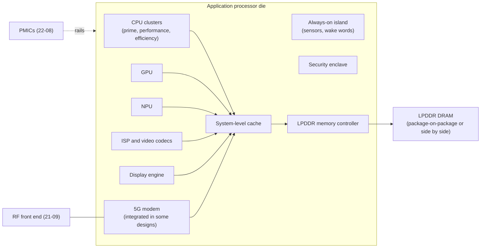
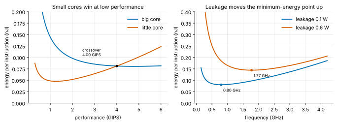

<!-- status: verified -->
# 27-02 · The Smartphone SoC

| | |
|---|---|
| **Course** | [27 · System Architectures (Case-Study Course)](../README.md) |
| **University equivalent** | The mobile-SoC case study of a computer-systems or SoC-design seminar: heterogeneous multicore, DVFS and energy per task, the memory system, power and thermal envelopes, and the economics of integration |
| **Prerequisites** | [27-01](27-01-system-analysis-method.md) (budgets, thermal RC, roofline, shadow price), [14-01](../../14-computer-organization-and-architecture/chapters/14-01-performance-power-iron-law.md) (dynamic power and DVFS), [23-04](../../23-memory-and-storage-technology/chapters/23-04-dram-interfaces.md) (LPDDR interfaces), [19-06](../../19-digital-vlsi-design/chapters/19-06-power-and-low-power-design.md) (leakage, power gating, minimum-energy operation), [25-04](../../25-fabrication-packaging-test-and-reliability/chapters/25-04-yield-and-die-cost.md) (die cost), [21-12](../../21-rf-and-microwave-engineering/chapters/21-12-modem-baseband-and-standards.md) (modems) |
| **Estimated study hours** | 8 |
| **Last verified** | 2026-11-26 |

**Learning objectives.** After this chapter you can:

1. Draw the block diagram of a flagship smartphone SoC, say what each block does, and explain why it is integrated on the die or kept outside it.
2. Model energy per instruction against performance for heterogeneous CPU cores, and find the crossover between a small and a large core and the minimum-energy frequency.
3. Compute a phone's memory bandwidth from its LPDDR interface, the demand of its clients and the effect of a system-level cache, and bound on-device language-model speed.
4. Compare a phone's peak CPU power with its sustained thermal envelope, and estimate how far the clock must fall to stay within it.
5. Estimate die cost at a given node and area, and explain how integration choices (modem, packaging) and the 2026 memory price spike shape a phone's bill of materials.

---

## 1. Big picture

A smartphone's application processor (AP) is the most integrated consumer chip ever built in volume: CPUs, a GPU, a neural processing unit, image and video processors, display engines, security processors, an always-on subsystem and, in many designs, a 5G modem, all on one die about the size of a fingernail, sharing one memory bus and one thermal budget of a few watts. More than a billion phones shipped in 2025 [R-666], and their APs set the volume, the node schedule and much of the IP economics of the leading-edge foundries.

- **Why it exists:** a phone must do bursts of heavy work (launching an app, taking a photo, running a model) inside a battery and a hand-held thermal envelope. Specialized, integrated blocks do each task at a fraction of the energy a general CPU would need.
- **Where it shows up:** every flagship phone; its blocks reappear in tablets, laptops (27-05), watches (27-03), cars (27-06) and edge AI devices (27-08).
- **What decides it:** energy per task (not peak speed), memory bandwidth (shared by everything), sustained power (set by the hand, not the silicon) and cost per die at the newest node.
- **Why it matters to a business reader:** the AP is one of the two or three largest items in a flagship's BOM [R-665], the reason phone makers design their own silicon, and the first customer of each new process node.

## 2. Intuition first

**One die, many specialists, one bus, one radiator.** A phone SoC is like a company that houses many specialist teams in one building: each team (CPU, GPU, NPU, camera pipeline, modem) is fast at its own work, but they all share the same lifts (the memory bus), the same power supply (the PMIC rails) and the same air conditioning (the case's ability to shed heat). Adding a brilliant new team helps only if the lifts and the air conditioning can carry it.

**Analogy: a portfolio of specialists under a cash constraint.** A CFO allocates a fixed cash budget across divisions with different returns per dollar; a phone allocates a fixed energy and thermal budget across blocks with different performance per watt. The best allocation sends each task to the block with the highest return per joule for that task. **Where the analogy breaks:** cash can be moved instantly and stored; heat cannot be borrowed from tomorrow, and the "return" of a block depends on whether the shared memory bus can feed it, a coupling a portfolio rarely has.

## 3. Theory

### 3.1 Anatomy of a flagship SoC (2025–2026)

All the 2025–2026 flagship APs share the same skeleton (as of Nov 2026):

| SoC (year) | Node (vendor's words) | CPU | Notable | Source |
|---|---|---|---|---|
| Apple A19 Pro (2025) | "third-generation 3-nanometer" (A19) | 6 cores | 6-core GPU with Neural Accelerators; 16-core Neural Engine; modem outside the AP | [R-660] |
| Apple A20 Pro (2026) | "latest 2-nanometer" | 6 cores | 7-core GPU; "Dual 16-core Neural Engine"; memory moved beside the die | [R-660] |
| Qualcomm 8 Elite Gen 5 (2025) | "3nm" | 2 prime to 4.74 GHz + 6 to 3.62 GHz | integrated X85 modem; triple 20-bit ISPs | [R-661] |
| Qualcomm 8 Elite Gen 6 (2026) | "2nm" | 2 prime to 5.0 GHz + 6 to 4.0 GHz | integrated X105 modem; LPDDR5X or LPDDR6 | [R-661] |
| MediaTek Dimensity 9500 (2025) | "TSMC N3P" | 1 at 4.21 GHz + 3 + 4 | LPDDR5X-10667; 10 MB SLC; integrated sub-6 GHz 5G | [R-662] |
| MediaTek Dimensity 9600 Pro (2026) | "2nm" | 2 to 4.55 GHz + 3 + 3 | first LPDDR6 support; "models up to 30B parameters" | [R-662] |
| Samsung Exynos 2600 (2025) | "industry's first 2nm GAA" | deca-core | "Heat Path Block" package | [R-663] |
| Google Tensor G5 (2025) | "3 nm process node from TSMC" | — | "up to 60% more powerful TPU" | [R-663] |

Four patterns stand out. **Heterogeneous CPUs:** every design mixes a few large, fast cores with smaller ones (§3.2). **Specialized accelerators:** the NPU, ISP and video codecs do fixed-function work at far lower energy than the CPU. **A shared memory system:** all blocks share one LPDDR interface, typically 64 bits wide [R-664], behind a system-level cache (§3.3). **The node schedule:** 2025's flagships were 3 nm-class, 2026's moved to 2 nm-class, with Samsung's first 2 nm gate-all-around part arriving first [R-660–R-663].

**Integrated or discrete modem?** Qualcomm and MediaTek integrate the 5G modem into the AP [R-661, R-662]; Apple ships its own modems (C1, C1X, C2) as separate chips [R-660]. Integration saves the chip-to-chip link's power, area and package cost and lets the modem share the SLC and power management. A separate modem decouples schedules and process nodes, avoids putting a large, RF-adjacent block on the most expensive node, and for Apple replaces a supplier's part with its own, a strategic rather than purely technical choice.

### 3.2 Heterogeneous cores and the energy of a task

**Energy per instruction.** For a core with effective switched capacitance $c$ per cycle (farads), running at frequency $f$ with supply $V$ and executing IPC instructions per cycle, the dynamic energy per instruction is $cV^2/\text{IPC}$ (14-01). Leakage adds a static power $P_s$ that is charged for as long as the core is on, $P_s/(\text{IPC}\cdot f)$ per instruction. Above threshold, the supply needed rises roughly linearly with frequency, $V = V_0 + kf$, so

$$
E_{inst}(f) = \frac{c(V_0 + kf)^2}{\text{IPC}} + \frac{P_s}{\text{IPC}\cdot f} .
$$

Units: F × V² = J; W ÷ (instructions/s) = J/instruction. ✓

The first term rises with frequency (higher voltage), the second falls (less time leaking). Their sum has a **minimum-energy frequency** $f^*$ where $dE/df = 0$:

$$
2ck(V_0 + kf^*) = \frac{P_s}{f^{*2}} ,
$$

a cubic in $f^*$ solved numerically (Example 27-02.3). Running faster than $f^*$ costs energy for speed; running slower wastes energy in leakage. When leakage is high (a hot die), $f^*$ moves up: this is the physics behind **race to idle**, finishing quickly and power-gating, which wins when leakage dominates and loses when it does not (19-06).

**Why mix core sizes.** A large core has a high IPC but switches much more capacitance per cycle; a small core has a low IPC and low capacitance. At a low performance target the small core can run near its efficient voltage while the large core, even slowed down, carries its large $c$ and leakage, so the small core uses less energy per instruction. At a high target the small core must be pushed to a high voltage (its $V$ rises steeply near its maximum), and the large core, running relaxed, becomes more efficient. The two curves cross at a **crossover performance** (Example 27-02.2), and the operating system's scheduler moves threads across it. Phones therefore carry a few large "prime" cores for bursts, several mid-size cores and, in some designs, small efficiency cores for background work.

### 3.3 The memory system

**Peak bandwidth.** An LPDDR interface of width $w$ bits at a data rate of $R$ transfers per second delivers

$$
\beta = \frac{R\,w}{8} \quad \text{bytes/s} .
$$

A 64-bit LPDDR5X-10667 interface gives about 85 GB/s (Example 27-02.1); LPDDR6 raises the data rate range to 10,667–14,400 MT/s and reorganizes the channel into more, narrower sub-channels for concurrency [R-667]. Apple's claim that A20 Pro has "50 percent more memory bandwidth than A19 Pro" [R-660] can come from a faster data rate, a wider bus or both; the claim alone does not say which (Problem 27-02.7).

**Demand.** Every client draws on the same bus: the display engine reads each frame (and the compositor writes and reads layers), the camera pipeline moves raw frames through DRAM (27-01 Example 27-01.4), the GPU streams textures and render targets, the CPU and NPU stream data and weights. The total must fit within a practical fraction of the peak, since real DRAM efficiency is well below 100% once refresh, bank conflicts and read–write turnarounds are counted (23-04).

**The system-level cache.** A last-level cache shared by all clients (MediaTek lists 10 MB on the Dimensity 9500 [R-662]) intercepts a fraction $h$ of each client's traffic. DRAM traffic becomes

$$
T_{DRAM} = \sum_k D_k(1 - h_k),
$$

and every byte kept on chip also saves the far higher energy of a DRAM access (27-01 §3.5, 23-01). An SLC is therefore both a bandwidth and an energy device.

**On-device language models.** Decode reads every weight once per token, so its speed is bounded by bandwidth (27-01 §3.5): tokens/s ≤ $\beta/(N_pb)$ for $N_p$ parameters of $b$ bytes. Apple's on-device model has about 3 billion parameters and is trained for 2-bit weights [R-668], which halves the bytes per token compared with 4-bit and doubles the bound (Example 27-02.5). Quantization is therefore a bandwidth and energy decision as much as a model-quality one.

### 3.4 Power and thermal envelope

Independent measurements put a flagship AP's CPU at about 12 W (A19 Pro) to 19 W (Snapdragon 8 Elite Gen 5) at full multi-core load, and its GPU at about 12 W in a graphics benchmark [R-664] **[Industry estimate]**. A phone can shed only a few watts indefinitely through its case (27-01 Example 27-01.2), so these are burst powers. Under sustained load the SoC must lower voltage and frequency until its power fits the envelope, and because power falls faster than frequency ($P \propto f^3$ near the top of the DVFS range, 14-01), a large cut in power costs a smaller cut in speed (Example 27-02.4).

Phone makers attack the envelope from the package outward: Apple credits a vapor chamber with "up to 40 percent better sustained performance" on iPhone 17 Pro, and for A20 Pro moved the DRAM from on top of the die to beside it, "removing the memory from the thermal path" so the die can touch the vapor chamber directly [R-660]; Samsung's Exynos 2600 adds a "Heat Path Block" in its package [R-663]. Package-on-package (PoP) memory saves board area and shortens the memory wires, but it puts a DRAM die, which must stay cool, between the processor and the heat spreader; side-by-side packaging trades area for a better thermal path.

### 3.5 Node, die cost and the bill of materials

**Die cost.** With the dies-per-wafer and yield models of 25-04, a ~99 mm² die (A19 Pro measures 98.6 mm² [R-664]) on a 3 nm-class wafer reported at about $18,500 [R-575] costs a few tens of dollars (Example 27-02.6). The same die on a 2 nm wafer, reported at over $30,000 [R-575], costs about 70% more before any shrink, so a move to 2 nm pays only if density, power or performance gains (or a smaller die) cover it. Die sizes differ markedly between vendors: about 98.6 mm² (A19 Pro), 126.2 mm² (Snapdragon 8 Elite Gen 5) and 140.8 mm² (Dimensity 9500) [R-664], reflecting different choices of cache size, GPU size and integrated modem.

**The BOM.** TechInsights estimated that in the iPhone 17 Pro Max the camera subsystem was the largest cost (more than 27%) and the A19 Pro the second (about 15%) [R-665]. In 2026 memory prices changed the ranking: TrendForce reported memory rising from about 10% of a Pro iPhone's BOM to about 34% in 3Q26, overtaking the AP and the display, and a BOM about 38% higher than the previous model's [R-665] **[Industry estimate]**. As 27-01 §3.4 showed, a component's dollars, not its share, move the margin, and memory's dollars moved most.

## 4. Worked examples

All core, cache and DRAM-energy parameters below are **assumed** for teaching; sourced values carry their R-number. Intermediate values are shown rounded but carried at full precision.

### Example 27-02.1 · How much of the bus is left? (tier A)

**Setup.** A phone AP has a 64-bit LPDDR5X-10667 interface. Its clients demand: display composition 3 × (3,000 × 1,400 pixels × 4 bytes × 120 Hz); the camera pipeline of Example 27-01.4, 4.32 GB/s; the GPU 30 GB/s; the CPU 10 GB/s. (a) Find the peak bandwidth, and that of a 64-bit LPDDR5X-9600 interface. (b) Find the display traffic and the total demand as a fraction of the 10667 peak. (c) A system-level cache catches 40% of the GPU's and the CPU's traffic. Find the DRAM traffic and its fraction of peak.

**Solution.**

- (a) $10667 \times 10^6 \times 64/8$ = **85.3** GB/s; LPDDR5X-9600: **76.8** GB/s.
- (b) One read of a frame each refresh is $3000 \times 1400 \times 4 \times 120$ = **2.016** GB/s, so composition takes **6.05** GB/s. Total **50.4** GB/s, **59.0**% of peak.
- (c) The SLC removes $0.4 \times 40$ = 16 GB/s: DRAM traffic **34.4** GB/s, **40.3**% of peak.

**Units check.** transfers/s × bits ÷ 8 = bytes/s. ✓

**Sanity check.** Using 59% of peak is already near the practical limit of a DRAM interface (23-04), so the SLC is what leaves headroom for an AI model running at the same time.

### Example 27-02.2 · When does the big core win? (tier B)

**Setup.** A big core has IPC 6, $c$ = 1.2 nF, $V = 0.45 + 0.12f$ (V, f in GHz), $P_s$ = 0.10 W and $f_{max}$ = 4.2 GHz. A little core has IPC 2.5, $c$ = 0.22 nF, $V = 0.45 + 0.30f$, $P_s$ = 0.02 W and $f_{max}$ = 2.4 GHz. (a) Find each core's energy per instruction at 1 GIPS (10⁹ instructions/s) and their ratio. (b) Find the little core's energy per instruction at its maximum, 6.0 GIPS. (c) Find the crossover performance.

**Solution.**

- (a) Big: $f = 1/6$ GHz, $V$ = 0.47 V, $E = 1.2 \times 0.47^2/6 + 0.10/(6 \times 0.1667)$ = **0.144** nJ. Little: $f$ = 0.4 GHz, $V$ = 0.57 V, $E = 0.22 \times 0.57^2/2.5 + 0.02/1.0$ = **0.0486** nJ. The little core uses **2.97** times less energy.
- (b) At 2.4 GHz, $V$ = 1.17 V: $E = 0.22 \times 1.17^2/2.5 + 0.02/6.0$ = **0.124** nJ.
- (c) Setting the two curves equal (by bisection) gives **4.00** GIPS: below it the little core is more efficient; above it, the big core.

**Units check.** nF × V² = nJ; W ÷ (10⁹ instructions/s) = nJ per instruction. ✓

**Sanity check.** The crossover sits at two-thirds of the little core's maximum, where its voltage has climbed steeply; schedulers move a thread to a big core well before the small one is flat out.

### Example 27-02.3 · The minimum-energy frequency and race to idle (tier C)

**Setup.** For the big core of Example 27-02.2: (a) find the frequency that minimizes energy per instruction and the energy there; (b) compare with the energy at 4.2 GHz; (c) repeat (a) for a hot die whose leakage is 0.6 W.

**Solution.**

- (a) Solving $2ck(V_0 + kf) = P_s/f^2$, that is $0.288(0.45 + 0.12f)f^2 = 0.10$, numerically: $f^*$ = **0.798** GHz, $E$ = **0.0805** nJ.
- (b) At 4.2 GHz, $V$ = **0.954** V and $E$ = **0.186** nJ, **2.31** times the minimum: speed costs energy.
- (c) With $P_s$ = 0.6 W, $f^*$ = **1.77** GHz and $E$ = **0.144** nJ: high leakage pushes the best frequency up, toward racing to idle.

**Units check.** nF × V/GHz × V × GHz² = nJ × GHz = W, matching $P_s$. ✓

**Sanity check.** A phone's background tasks run near $f^*$ on small cores; a hot phone shifts the best operating point upward, one reason governors use temperature as an input.

### Example 27-02.4 · Burst power, sustained power and the clock (tier B)

**Setup.** The SoC of Example 27-02.2 has two big cores and four little cores. (a) Find each core's power at its maximum frequency and the cluster's total. Compare with the measured full-load CPU power of a six-core flagship [R-664]. (b) The phone's sustained envelope leaves 3.0 W for the two big cores (assumed, from 27-01 Example 27-01.2). Find the frequency at which each big core draws 1.5 W, as a fraction of 4.2 GHz, and its performance.

**Solution.**

- (a) Big: $1.2 \times 0.954^2 \times 4.2 + 0.10$ = **4.69** W; little: $0.22 \times 1.17^2 \times 2.4 + 0.02$ = **0.743** W. Cluster: $2 \times 4.69 + 4 \times 0.743$ = **12.3** W, close to the about 12 W measured for the six-core A19 Pro at full CPU load [R-664].
- (b) Solving $1.2(0.45 + 0.12f)^2f + 0.10 = 1.5$: $f$ = **2.25** GHz, **53.6**% of maximum, at $V$ = **0.720** V; each big core then delivers **13.5** GIPS against 25.2 at full speed.

**Units check.** nF × V² × GHz = W. ✓

**Sanity check.** Cutting a big core's power from 4.7 W to 1.5 W (a factor of 3.1) costs only a factor of 1.9 in frequency, because voltage falls with frequency. That is why sustained phone performance is roughly half of the peak, not a third.

### Example 27-02.5 · How fast can a phone run a 3-billion-parameter model? (tier B)

**Setup.** An on-device model has 3 billion parameters [R-668]. The phone has the 85.3 GB/s interface of Example 27-02.1, and reading DRAM costs 4.0 pJ/bit (assumed). (a) Find the bandwidth-bound decode speed with 2-bit and with 4-bit weights. (b) Find the DRAM energy per token for each. (c) At 20 tokens/s with 2-bit weights, what power does the weight traffic alone draw?

**Solution.**

- (a) 2-bit: $3 \times 10^9 \times 2/8$ = 0.75 GB per token, $85.3/0.75$ = **114** tokens/s. 4-bit: 1.5 GB, **56.9** tokens/s.
- (b) $3 \times 10^9 \times 2 \times 4.0$ pJ = **24.0** mJ per token at 2 bits; **48.0** mJ at 4 bits.
- (c) $24.0 \times 20$ = **0.48** W, a sixth of a 3 W sustained budget before any computation.

**Units check.** bits × J/bit = J; J/token × tokens/s = W. ✓

**Sanity check.** These are upper bounds: the model shares the bus with the display and everything else, and the KV cache adds traffic. Halving the bits doubles the bound and halves the energy, which is why phone models are aggressively quantized.

### Example 27-02.6 · What does the die cost? (tier B)

**Setup.** Using 25-04's dies-per-wafer formula (300 mm wafers, rounded down) and Poisson yield: (a) a 98.6 mm² die [R-664] on a 3 nm-class wafer at $18,500 [R-575] with $D_0$ = 0.10 cm⁻² (assumed); (b) a 140.79 mm² die [R-664] on the same wafer; (c) the 98.6 mm² die on a 2 nm wafer at $30,000 [R-575] with $D_0$ = 0.15 cm⁻² (assumed, an early node).

**Solution.**

- (a) DPW **649**, yield **0.906**, cost $18{,}500/(649 \times 0.906)$ = **$31.46**.
- (b) DPW **445**, yield **0.869**, cost **$47.86**: 43% more area costs 52% more.
- (c) DPW 649, yield **0.863**, cost **$53.59**, **1.70** times the 3 nm cost for the same area.

**Units check.** $ ÷ dies = $/die. ✓

**Sanity check.** Tens of dollars per die against a phone price near a thousand: the AP's cost matters less than its performance per watt, but at 2 nm the cost step is large enough that the die must shrink or earn its premium.

### Example 27-02.7 · The memory price spike in a BOM (tier B)

**Setup.** TrendForce reported memory rising from about 10% to about 34% of a Pro iPhone's BOM, and the BOM rising about 38% [R-665]. (a) If only memory's cost changed, what multiple of its earlier cost would memory have reached, and by how much would the BOM have risen? (b) How does that compare with the reported 38%?

**Solution.**

- (a) With other costs fixed at 0.90 of the old BOM, memory $m$ satisfies $m/(m + 0.90) = 0.34$, so $m$ = 0.464: **4.64** times its earlier 0.10, and the BOM is **1.364** times the old, **36.4**% higher.
- (b) The memory spike alone accounts for 36.4 of the reported 38 points; the remaining **1.6** points must come from other components, such as the move to a 2 nm AP.

**Units check.** Shares are dimensionless. ✓

**Sanity check.** The two analyst figures are consistent with each other and with memory driving almost all the increase.

<!-- answer-key -->

| ID | Quantity | Value | Unit |
|---|---|---|---|
| Ex 27-02.1a | LPDDR5X-10667 bandwidth | 85.3 | GB/s |
| Ex 27-02.1a1 | LPDDR5X-9600 bandwidth | 76.8 | GB/s |
| Ex 27-02.1b | one frame read per refresh | 2.016 | GB/s |
| Ex 27-02.1b1 | display composition | 6.05 | GB/s |
| Ex 27-02.1b2 | total demand | 50.4 | GB/s |
| Ex 27-02.1b3 | fraction of peak | 59.0 | % |
| Ex 27-02.1c | SLC savings | 16 | GB/s |
| Ex 27-02.1c1 | DRAM traffic | 34.4 | GB/s |
| Ex 27-02.1c2 | fraction of peak | 40.3 | % |
| Ex 27-02.2a | big core at 1 GIPS | 0.144 | nJ |
| Ex 27-02.2a0 | big core voltage at 1 GIPS | 0.47 | V |
| Ex 27-02.2a1 | little core at 1 GIPS | 0.0486 | nJ |
| Ex 27-02.2a2 | little core voltage at 1 GIPS | 0.57 | V |
| Ex 27-02.2a3 | ratio | 2.97 | |
| Ex 27-02.2b | little core at 6.0 GIPS | 0.124 | nJ |
| Ex 27-02.2b1 | little core voltage at maximum | 1.17 | V |
| Ex 27-02.2c | crossover | 4.00 | GIPS |
| Ex 27-02.3a | minimum-energy frequency | 0.798 | GHz |
| Ex 27-02.3a1 | minimum energy | 0.0805 | nJ |
| Ex 27-02.3b | voltage at 4.2 GHz | 0.954 | V |
| Ex 27-02.3b1 | energy at 4.2 GHz | 0.186 | nJ |
| Ex 27-02.3b2 | ratio | 2.31 | |
| Ex 27-02.3c | hot minimum-energy frequency | 1.77 | GHz |
| Ex 27-02.3c1 | hot minimum energy | 0.144 | nJ |
| Ex 27-02.4a | big core power | 4.69 | W |
| Ex 27-02.4a1 | little core power | 0.743 | W |
| Ex 27-02.4a2 | cluster power | 12.3 | W |
| Ex 27-02.4b | frequency at 1.5 W | 2.25 | GHz |
| Ex 27-02.4b1 | fraction of maximum | 53.6 | % |
| Ex 27-02.4b2 | voltage | 0.720 | V |
| Ex 27-02.4b3 | performance | 13.5 | GIPS |
| Ex 27-02.4b4 | performance at full speed | 25.2 | GIPS |
| Ex 27-02.4b5 | power reduction factor | 3.1 | |
| Ex 27-02.4b6 | frequency reduction factor | 1.9 | |
| Ex 27-02.5a | tokens per second, 2-bit | 114 | |
| Ex 27-02.5a0 | bytes per token, 2-bit | 0.75 | GB |
| Ex 27-02.5a1 | tokens per second, 4-bit | 56.9 | |
| Ex 27-02.5b | energy per token, 2-bit | 24.0 | mJ |
| Ex 27-02.5b1 | energy per token, 4-bit | 48.0 | mJ |
| Ex 27-02.5c | power at 20 tokens/s | 0.48 | W |
| Ex 27-02.6a | dies per wafer | 649 | |
| Ex 27-02.6a1 | yield | 0.906 | |
| Ex 27-02.6a2 | cost per good die | 31.46 | $ |
| Ex 27-02.6b | dies per wafer | 445 | |
| Ex 27-02.6b1 | yield | 0.869 | |
| Ex 27-02.6b2 | cost per good die | 47.86 | $ |
| Ex 27-02.6b3 | area increase | 43 | % |
| Ex 27-02.6b4 | cost increase | 52 | % |
| Ex 27-02.6c | yield at 2 nm | 0.863 | |
| Ex 27-02.6c1 | cost per good die | 53.59 | $ |
| Ex 27-02.6c2 | cost ratio | 1.70 | |
| Ex 27-02.7a | other costs | 0.90 | |
| Ex 27-02.7a0 | memory after | 0.464 | |
| Ex 27-02.7a1 | memory multiple | 4.64 | |
| Ex 27-02.7a2 | BOM multiple | 1.364 | |
| Ex 27-02.7a3 | BOM increase | 36.4 | % |
| Ex 27-02.7b | unexplained points | 1.6 | points |
| Txt 27-02.1 | 2 nm die cost premium | 70 | % |

## 5. Simulate it

The lab is [labs/27-02-lab/](../labs/27-02-lab/README.md). `socmodel.py` implements LPDDR bandwidth and SLC traffic, the energy-per-instruction model with its crossover and minimum-energy frequency, core power, bandwidth-bound decode and its DRAM energy, die cost, and the BOM memory shift.

1. *Predict* the crossover performance if the little core's voltage slope falls from 0.30 to 0.25 V/GHz, then plot both energy curves.
2. *Predict* how the minimum-energy frequency of the big core moves as leakage rises from 0.05 to 1.0 W, then plot it.
3. *Predict* the decode speed of the 3-billion-parameter model at 2 bits on a 64-bit LPDDR6 interface at 14,400 MT/s, then plot tokens/s against bits per weight for LPDDR5X-10667 and LPDDR6-14400.
4. *Predict* the cost per good die of a 120 mm² die at 3 nm and 2 nm, then plot cost against area for both nodes.

*Figure 1. Energy per instruction for the cores of Examples 27-02.2 and 27-02.3 (assumed parameters).*

## 6. Engineering tradeoffs

| Knob | Improves | Costs | Typical decision owner |
|---|---|---|---|
| More big cores or higher peak clock | Burst performance, benchmarks | Area, peak power, throttling | SoC architect with product |
| More efficiency cores | Background energy, battery life | Area, scheduler complexity | CPU and OS teams |
| Larger SLC | DRAM bandwidth and energy | Die area and cost | SoC architect |
| Faster or wider LPDDR (LPDDR6) | Bandwidth for GPU and AI | Memory cost, power, package complexity | SoC and memory architects |
| Integrated modem | Power, board area, BOM | Die area at the newest node, schedule coupling | SoC strategy and modem teams |
| Side-by-side memory instead of PoP | Sustained performance (thermal path) | Board area, package cost | Packaging and thermal teams |
| Earlier move to the newest node | Performance per watt | Die cost (Example 27-02.6), yield risk | Executive product and silicon leadership |
| Aggressive model quantization | On-device AI speed and energy | Model quality | AI and silicon teams together |

## 7. Numbers to know

| Quantity | Value | Note |
|---|---|---|
| Smartphones shipped, 2025 | about 1.26 billion, +1.9% | IDC preliminary, Jan 2026 [R-666] |
| Flagship AP die area | about 99 (A19 Pro), 126 (8 Elite Gen 5), 141 mm² (Dimensity 9500) | Die-photo measurements, 2025 [R-664] **[Industry estimate]** |
| Phone memory bus | 64-bit, standard | [R-664] |
| LPDDR5X-10667, 64-bit | about 85 GB/s peak | Arithmetic from the data rate [R-662] |
| LPDDR6 data rate | 10,667–14,400 MT/s | JEDEC, July 2025, as reported [R-667] |
| Full-load CPU power | about 12 W (A19 Pro) to 19 W (8 Elite Gen 5) | Third-party measurement, Sep–Oct 2025 [R-664] **[Industry estimate]** |
| AP share of a flagship BOM | about 15% (A19 Pro, iPhone 17 Pro Max) | TechInsights, 2025 [R-665] **[Industry estimate]** |
| Memory share of a Pro iPhone BOM | about 10% (2025) to about 34% (3Q26) | TrendForce, Aug 2026 [R-665] **[Industry estimate]** |
| Flagship battery | 5,088 mAh (iPhone 17 Pro Max, eSIM) | Apple, as reported, Sep 2025 [R-669] |

## 8. Common mistakes

- **Equating peak clock with delivered speed.** Peak frequencies last seconds to minutes; sustained performance is set by the envelope (Example 27-02.4).
- **Assuming the biggest core is the most efficient.** Below the crossover, small cores use several times less energy per instruction.
- **Assuming slower is always more efficient.** Below the minimum-energy frequency, leakage makes slow operation cost more energy (Example 27-02.3).
- **Counting compute TOPS for on-device AI and ignoring bandwidth.** Decode speed is bounded by bytes per token and bus bandwidth.
- **Reading "50% more bandwidth" as a data-rate claim.** It may be a wider bus; ask which.
- **Comparing die costs without the wafer price and yield.** The same area costs about 70% more on an early 2 nm wafer (Example 27-02.6).
- **Using one year's BOM shares.** Memory's share moved from about 10% to about 34% within a year [R-665].

## 9. Practitioner lens

**State of play (as of Nov 2026).**

- **2 nm arrived in phones in 2026.** Apple's A20 Pro ("latest 2-nanometer"), Qualcomm's 8 Elite Gen 6 ("2nm") and MediaTek's Dimensity 9600 Pro ("Advanced 2nm SoC") followed Samsung's Exynos 2600 ("industry's first 2nm GAA") [R-660–R-663] **[Established: vendor statements]**. Google's Tensor G5 stayed on a TSMC 3 nm node [R-663].
- **Apple is replacing its last major external chips.** C1 (2025), C1X and C2 (2026) are Apple-designed modems, C2 with mmWave "in the U.S." [R-660]; whether every model and region uses C2 should be checked against teardowns **[Contested in press]**.
- **Memory is now the cost story.** Memory's share of a Pro iPhone's BOM rose to about 34% in 3Q26 [R-665] **[Industry estimate]**, and analysts tie 2026's weaker shipment outlook to memory prices.
- **On-device AI is bandwidth-shaped.** Vendors quote model sizes ("models up to 30B parameters" [R-662]; Apple's ~3B, 2-bit model [R-668]) and speedups ("Gemini Nano runs 2.6x faster" [R-668]); the governing physics is bytes per token against bus bandwidth (Example 27-02.5).

**Commercial relevance.** The AP decides much of a phone's differentiation and a sizeable share of its cost, and it is where vertical integration pays: Apple's in-house CPUs, GPUs, NPUs and now modems, Google's Tensor and Samsung's Exynos all exist to capture margin and control the roadmap. For a semiconductor company, the phone AP market rewards node leadership, IP breadth (modem, GPU, NPU) and the ability to ship a new chip every year without slipping.

**Marketing vs Reality.**

- *"The fastest CPU in any smartphone"* [R-660]. Usually a single-thread burst score; ask for sustained multi-core performance at the phone's envelope and the energy per task.
- *"Up to 40 percent better sustained performance"* [R-660]. A real improvement in the thermal path; ask under which workload and for how long.
- *"Runs models up to 30B parameters"* [R-662]. Runs at what speed, at what precision, with how much DRAM and how much of the bus? Apply the bandwidth bound.
- *"50 percent more memory bandwidth"* [R-660]. From a faster data rate or a wider bus? The latter costs package and memory cost.

**Questions for engineering leaders.**

1. *"What fraction of peak CPU performance does the phone sustain after ten minutes, and what limits it?"* Strong: a measured sustained figure, the envelope in watts and the binding limit (skin temperature). Evasive: peak benchmark scores only.
2. *"Where is the big-to-little crossover on your cores, and how does your scheduler use it?"* Strong: energy-per-task curves by core type and the policy. Evasive: "we use the big cores for performance".
3. *"How much of the memory bus does a camera recording plus an on-device model use, and what does the SLC save?"* Strong: a traffic budget by client. Evasive: "LPDDR5X is fast enough".
4. *"Why is the modem integrated (or not), and what would change your decision?"* Strong: power, area, schedule and cost trade quantified. Evasive: "it's our strategy".
5. *"What does the move to 2 nm buy per dollar of die cost?"* Strong: a cost per good die by node and the performance-per-watt gain. Evasive: "it's the leading node".

## 10. Concept check

**Q1.** Why do phone SoCs mix large and small CPU cores?

Answer

Below a crossover performance, a small core does the same work with several times less energy per instruction; above it, the small core must run at a high voltage and the large core becomes more efficient. Mixing them lets the scheduler stay on the lower energy curve across the range.

**Q2.** Can running a task more slowly ever cost more energy?

Answer

Yes. Below the minimum-energy frequency, leakage, which is paid for every second the core is on, outweighs the dynamic-energy savings of a lower voltage. When leakage is high (a hot die), it pays to finish quickly and power-gate.

**Q3.** What peak bandwidth does a 64-bit LPDDR5X-9600 interface give?

Answer

$9600 \times 10^6 \times 8$ bytes = **76.8** GB/s.

**Q4.** Why does a system-level cache save energy as well as bandwidth?

Answer

Every byte served on chip avoids a DRAM access, which costs far more energy per bit than an on-chip SRAM access (23-01). The cache reduces both the traffic and the energy of the memory system.

**Q5.** What bounds the decode speed of an on-device language model, and how does quantization change it?

Answer

Memory bandwidth divided by the bytes of weights read per token. Halving the bits per weight halves the bytes and doubles the bound (and halves the DRAM energy per token).

**Q6.** Why might a phone maker move DRAM from on top of the SoC to beside it?

Answer

Package-on-package memory sits in the SoC's heat path, so the DRAM, which must stay cool, limits the processor. Moving it beside the die lets the die touch the heat spreader or vapor chamber directly, raising sustained power at the cost of board area.

Problem set: [27-02 problems](../problems/27-02-problems.md) · Worked solutions: [27-02 solutions](../solutions/27-02-solutions.md).

## 11. Key terms

[Application processor (AP)](../../../reference/glossary.md#application-processor-ap) · [Heterogeneous multicore](../../../reference/glossary.md#heterogeneous-multicore) · [Energy per instruction](../../../reference/glossary.md#energy-per-instruction) · [Minimum-energy point](../../../reference/glossary.md#minimum-energy-point) · [Race to idle](../../../reference/glossary.md#race-to-idle) · [Dynamic voltage and frequency scaling (DVFS)](../../../reference/glossary.md#dynamic-voltage-and-frequency-scaling-dvfs) · [System-level cache (SLC)](../../../reference/glossary.md#system-level-cache-slc) · [Neural processing unit (NPU)](../../../reference/glossary.md#neural-processing-unit-npu) · [Image signal processor (ISP)](../../../reference/glossary.md#image-signal-processor-isp) · [Integrated modem](../../../reference/glossary.md#integrated-modem) · [Package-on-package (PoP)](../../../reference/glossary.md#package-on-package-pop) · [Thermal throttling](../../../reference/glossary.md#thermal-throttling)

## 12. Connections

- **Previous:** [27-01](27-01-system-analysis-method.md) supplied the budgets, thermal model and roofline used here.
- **Prerequisites:** [14-01](../../14-computer-organization-and-architecture/chapters/14-01-performance-power-iron-law.md) (DVFS), [19-06](../../19-digital-vlsi-design/chapters/19-06-power-and-low-power-design.md) (leakage and minimum-energy operation), [23-04](../../23-memory-and-storage-technology/chapters/23-04-dram-interfaces.md) (LPDDR), [25-04](../../25-fabrication-packaging-test-and-reliability/chapters/25-04-yield-and-die-cost.md) (die cost), [21-12](../../21-rf-and-microwave-engineering/chapters/21-12-modem-baseband-and-standards.md) (modems), [22-08](../../22-power-electronics-and-energy-conversion/chapters/22-08-pmics.md) (PMICs).
- **Next:** [27-03](27-03-wearables-smartwatch.md) shrinks the same blocks into a watch, where the always-on island and the battery dominate.
- **Used later:** [27-05](27-05-pc-soc.md) scales the phone AP into a PC SoC; [27-08](27-08-edge-ai-and-iot.md) reuses the NPU and bandwidth arguments for edge AI; Course 28 uses the BOM and die-cost reasoning in diligence.

## 13. Further study

- Hennessy and Patterson, *Computer Architecture: A Quantitative Approach*: the sections on energy efficiency, heterogeneous and domain-specific architectures.
- Arm's public documentation of heterogeneous (big.LITTLE and DynamIQ) CPU clusters and energy-aware scheduling, for how operating systems use the crossover.
- Apple, "Apple Intelligence Foundation Language Models Tech Report 2025" (arXiv 2507.13575) for a vendor's account of fitting a model to a phone's memory and bandwidth [R-668].

## 14. Sources

1. Apple A19/A19 Pro/A20 Pro and C1/C1X/C2 statements: [R-660].
2. Qualcomm Snapdragon 8 Elite Gen 5 and Gen 6 product briefs: [R-661].
3. MediaTek Dimensity 9500 and 9600 Pro: [R-662].
4. Samsung Exynos 2600 and Google Tensor G5: [R-663].
5. Die areas, memory bus width and measured CPU and GPU power: [R-664].
6. BOM shares and the 2026 memory price spike (TechInsights, TrendForce): [R-665].
7. 2025 smartphone shipments (IDC): [R-666].
8. LPDDR6 data rates (JEDEC, as reported): [R-667].
9. On-device language models (Apple, Google): [R-668].
10. Flagship battery capacity: [R-669].
11. Leading-edge wafer price estimates: [R-575].
