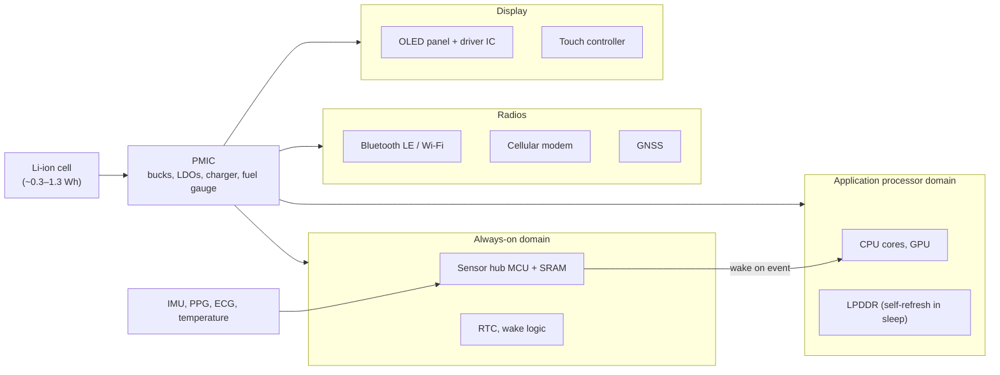
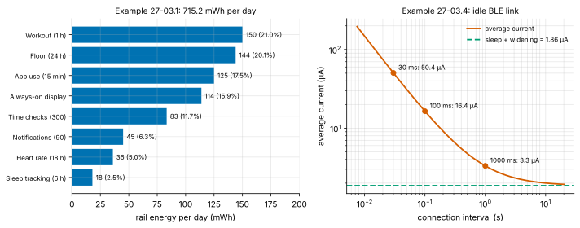

<!-- status: verified -->
# 27-03 · Wearables I: The Smartwatch

| | |
|---|---|
| **Course** | [27 · System Architectures (Case-Study Course)](../README.md) |
| **University equivalent** | The wearable-device case study of an embedded-systems or low-power-design seminar: power domains and duty cycling, sensor hubs, display and radio energy, battery sizing and the day-in-the-life budget |
| **Prerequisites** | [27-01](27-01-system-analysis-method.md) (budget trees, thermal RC), [27-02](27-02-smartphone-soc.md) (energy per instruction, the AP), [18-09](../../18-embedded-systems-and-microcontrollers/chapters/18-09-ultra-low-power-design.md) (power modes, duty cycling, reservoir capacitors), [18-10](../../18-embedded-systems-and-microcontrollers/chapters/18-10-sensors.md) (IMUs and PPG), [22-08](../../22-power-electronics-and-energy-conversion/chapters/22-08-pmics.md) (PMICs, PFM, power gating), [22-09](../../22-power-electronics-and-energy-conversion/chapters/22-09-batteries-charging-fuel-gauging.md) (batteries), [17-12](../../17-communication-systems/chapters/17-12-multiple-access-and-cellular-wifi.md) (cellular and Wi-Fi) |
| **Estimated study hours** | 7 |
| **Last verified** | 2026-11-26 |

**Learning objectives.** After this chapter you can:

1. Draw a smartwatch's architecture (application processor, always-on domain and sensor hub, PMIC, radios, display, sensors) and justify which functions belong in which power domain.
2. Build a day-in-the-life energy budget, compute battery life, and rank the items by their leverage on it.
3. Compute display power from luminance, average pixel level and refresh rate, and explain why OLED panels with LTPO backplanes make an always-on display affordable.
4. Compute the energy of a Bluetooth LE connection event and of a cellular paging cycle, and trade the average current against latency.
5. Evaluate microwatt-scale design choices (sensor batching against a hub, the always-on floor and its converters, battery cell geometry, peak current in the cold) and say which ones matter for a given budget.

---

## 1. Big picture

A smartwatch is a phone's worth of functions (a processor that runs apps, a high-resolution display, Bluetooth, Wi-Fi, often cellular and satellite links, GNSS, a dozen sensors) squeezed around a battery of one to two and a half watt-hours (1.461 Wh in an Apple Watch Series 12, 2.444 Wh in an Ultra 4 [R-671]), roughly a tenth of a flagship phone's [R-669]. The engineering problem is not speed but **energy per day**: every block must be asleep almost all the time, and the few that cannot sleep (the clock face, the step counter, the heart-rate sensor, the link to the phone) must run on milliwatts or less.

- **Why it exists:** health and fitness sensing needs a device worn continuously against the skin; notifications and payments need one that is always at hand. Both need a day or more of battery life in a few cubic centimetres.
- **Where it shows up:** smartwatches and fitness bands, and the same always-on techniques in phones (27-02), earbuds and glasses (27-04), and IoT and edge-AI nodes (27-08).
- **What decides it:** the always-on floor (what the watch burns doing nothing), the display (the largest active load), the radios' idle cost, and a battery whose size is set by the case and the wrist.
- **How many:** about 35 million smartwatches shipped in the first quarter of 2025 alone [R-675], with Apple, Samsung, Google, Huawei, Xiaomi and Garmin as the familiar names and Qualcomm's wearable platforms inside many of the non-Apple designs [R-672, R-673].
- **Why it matters to a business reader:** battery life is the spec customers notice first, the sensors carry the health claims (and the regulatory exposure), and the silicon mix (an application processor at an advanced node plus an always-on coprocessor at an older one) is a design choice with direct cost and supply-chain consequences.

## 2. Intuition first

**A night watchman and an executive.** A watch keeps two "employees". The **application processor (AP)** is a capable executive: fast, but expensive to wake and expensive per hour. The **always-on domain**, with its **sensor hub** (a small microcontroller-class core with its own memory and sensor interfaces), is a night watchman: slow, but it costs almost nothing to keep on duty. The watchman counts steps, watches the accelerometer for a raised wrist, keeps the clock face ticking and buffers sensor data. It wakes the executive only when a decision needs her: the user looks at the watch, a notification arrives, a workout starts.

*Figure 0. A smartwatch's power domains (generic; real designs differ in which radios and sensors they include).*

**The finance analogy: runway.** A battery is a startup's cash and the watch's average power is its burn rate; life is runway, cash divided by burn. Burn has a **fixed** part (the always-on floor, paid every hour whether or not the user does anything) and a **variable** part (display time, workouts, notifications). Waking the AP is like paying a fixed commission on every trade: you batch trades to amortize it, but batching delays execution, so latency limits how far you can batch.

*Where the analogy breaks:* the cash is not fixed. A cold or aged battery holds less usable energy, and a large current drawn from a small cell can collapse its voltage and shut the watch down while energy remains (Example 27-03.6). And burn items are not independent: coalescing wakes changes the cost of each one.

## 3. Theory

### 3.1 Partitioning: put each job in the cheapest domain that meets its deadline

Chapter 27-02 showed that a core's energy per instruction is roughly $cV^2/\text{IPC}$ plus leakage over throughput. A microcontroller-class hub core running at a low voltage from a mature-node, low-leakage process spends far less energy per operation on simple, steady work than an application core that must also be fast. But the AP has two costs the hub avoids entirely: a large **wake-up energy** (restoring clocks, caches, DRAM out of self-refresh and the operating system's state) and a high **floor** when it is merely idle.

The rule that follows is a partitioning rule: **assign each function to the lowest-energy domain that meets its compute need and its latency.** Clock-face updates, step counting, wrist-raise detection, heart-rate sampling and buffering of sensor data belong in the always-on domain; rendering an app, running a voice model or decoding a notification's rich content belongs in the AP. The quantitative version is the batching analysis of §3.4.

### 3.2 The day-in-the-life budget

A battery of capacity $Q$ (A·h) stores energy

$$
E_b = \int_0^Q V(q)\,dq \approx Q\,V_{nom},
$$

where $V(q)$ is the cell's voltage as charge $q$ is drawn and $V_{nom}$ is its nominal (average) voltage. In mA·h and volts, $E_b$ comes out in mW·h. A watch's day is a list of activities $i$, each drawing rail power $P_i$ for $t_i$ hours per day. The rail energy per day and the energy drawn from the battery through converters of efficiency $\eta$ are

$$
E_{day} = \sum_i P_i\,t_i, \qquad E_{day,b} = \frac{E_{day}}{\eta},
$$

and the battery life in hours is

$$
L = 24\ \text{h} \times \frac{u\,\eta\,E_b}{E_{day}},
$$

where $u \le 1$ is the usable fraction of the rated energy (lower when the cell is cold or aged). The structure is the weighted average of 03-03: average power is $\sum_i P_i\,(t_i/24\ \text{h})$, each power weighted by its share of the day.

The **leverage** of each item follows from differentiating: $L \propto 1/E_{day}$, so $dL/L = -dE_{day}/E_{day}$. A small cut $\delta E_i$ in one item lengthens life by the fraction $\delta E_i/E_{day}$. An item's share of the daily energy is its leverage, which is why the first thing a battery-life review produces is a pie chart.

> **Math refresher — a ratio's sensitivity.** If $L = k/E$ then $dL/dE = -k/E^2 = -L/E$, so $dL/L = -dE/E$: a 1% cut in $E$ gives about 1% more $L$. For larger cuts use the exact form: cutting $E$ by a fraction $x$ multiplies $L$ by $1/(1 - x)$, so a 20% cut gives 25% more life, not 20%.

### 3.3 Display power

The display is usually the largest active load. Its power has two parts: the light the pixels emit, and the electronics that refresh them.

**Emission.** A display's brightness is specified as **luminance** $L_v$, in candela per square metre (cd/m², also called nits): luminous intensity per unit projected area, in a given direction. A good display emits roughly equally in all directions as seen from its surface (a **Lambertian emitter**), so its luminance is the same from every viewing angle while the intensity per unit area falls as $\cos\theta$ away from the normal. The total luminous flux leaving area $A$ is then the integral of $L_v\cos\theta$ over the hemisphere:

$$
\Phi = A\int_0^{2\pi}\!\!\int_0^{\pi/2} L_v\cos\theta\,\sin\theta\,d\theta\,d\phi
= A\,L_v\,2\pi\left[\frac{\sin^2\theta}{2}\right]_0^{\pi/2} = \pi\,L_v\,A .
$$

Units: cd/m² × m² × sr = cd·sr = lm. ✓

> **Math refresher — solid angle.** A solid angle $\Omega$ is the area a cone cuts on a unit sphere, measured in steradians (sr); the whole sphere is $4\pi$ sr and a hemisphere $2\pi$ sr. In spherical coordinates the element is $d\Omega = \sin\theta\,d\theta\,d\phi$. One candela is one lumen per steradian, so integrating intensity over solid angle gives lumens. The $\cos\theta$ in the integral is why the result is $\pi$, not the hemisphere's $2\pi$.

An OLED pixel emits only when lit, so the flux depends on what is shown. Define the **average pixel level (APL)** as the average, over all pixels, of each pixel's luminance as a fraction of full-white luminance $L_v$ at the current brightness setting: a black screen has APL 0, full white has APL 1. The electrical power for emission is the flux divided by the panel's **luminous efficacy** $\eta_v$ (lm/W, light out per electrical watt in, including the circular polarizer that absorbs much of the emitted light):

$$
P_{emit} = \frac{\pi\,L_v\,A\,\text{APL}}{\eta_v}.
$$

This is a first-order model: red, green and blue subpixels have different efficacies, and efficacy itself varies with current. But it captures the two facts that shape watch faces: power is proportional to brightness, and an OLED's power is proportional to how much of the screen is lit. A backlit LCD burns its backlight whatever is displayed, which is why watch makers moved to OLED and why always-on faces are mostly black.

**Refresh.** Each frame, the display driver IC (DDIC) charges every pixel's storage capacitor through the panel's data lines. Charging capacitance $C$ through a swing $V$ costs $CV^2$ per cycle (07-01), so the driver power is a static part plus an energy per frame times the frame rate:

$$
P_{drv} = P_0 + E_f\,f_r .
$$

At low luminance the refresh term dominates, so cutting the frame rate is what makes an always-on display cheap.

**Why the refresh rate can fall: LTPO.** Between refreshes each pixel holds its brightness as a voltage on a storage capacitor $C_{st}$, isolated by a switching thin-film transistor (TFT). That switch leaks a current $I_{off}$, so the voltage droops at $dV/dt = I_{off}/C_{st}$. If the eye notices a luminance change once the droop exceeds $\Delta V$, the pixel can hold for at most

$$
t_{hold} = \frac{C_{st}\,\Delta V}{I_{off}},
$$

and the frame rate must stay above about $1/t_{hold}$. Low-temperature polysilicon (LTPS) TFTs have high mobility (good for the drive transistor that sets the pixel current) but leak too much to hold for a second. Oxide-semiconductor TFTs leak orders of magnitude less. An **LTPO** (low-temperature polycrystalline oxide) backplane uses both: LTPS for driving and an oxide switch for holding. That lets the panel refresh at as little as 1 Hz for a static always-on face (Problem 27-03.7).

> **Going deeper — reflective and memory-in-pixel displays.** A memory-in-pixel (MIP) LCD stores each pixel's state in a small latch under the pixel and reflects ambient light rather than emitting its own, so a static image costs almost nothing and sunlight makes it more readable rather than less. The price is color depth, contrast and resolution; sports watches that advertise multi-week battery lives have historically used them (§9).

### 3.4 Sensor path: AP batching against an always-on hub

Let an accelerometer produce samples at rate $f_s$. Each sample costs energy $E_s$ to process on the AP, and each AP wake costs $E_w$ (exit sleep, run, return). If the sensor's FIFO buffers $N$ samples and the AP wakes once per batch, the average power is

$$
P_{AP}(N) = f_sE_s + \frac{f_sE_w}{N}.
$$

The first term is the cost of the work; the second is the wake overhead amortized over the batch. Batching drives the second term toward zero, but a batch of $N$ samples delays the response by up to $N/f_s$. A latency limit $\tau$ (for example, the display must light within about 150 ms of a wrist raise) caps the batch:

$$
N \le f_s\,\tau .
$$

An always-on hub processes every sample at its own cost $E_h \ll E_s$, runs at a standing power $P_h$, and wakes the AP only for events at rate $r$:

$$
P_{hub} = P_h + f_sE_h + rE_w .
$$

The hub wins whenever $P_{hub} < P_{AP}(N_{max})$. Two lessons follow. If latency is loose (step counting, sleep staging), batching on the AP can come close to the hub, but only if the AP's per-sample energy $f_sE_s$ is itself below the hub's power: no batch size removes the first term. If latency is tight, $N$ is small and the wake overhead dominates: the hub wins by an order of magnitude (Example 27-03.3). For an AP that is cheap per sample, solving $P_{AP}(N) = P_{hub}$ gives the break-even batch $N^* = f_sE_w/(P_{hub} - f_sE_s)$ (Problem 27-03.8).

### 3.5 The Bluetooth LE link

The watch stays connected to its phone over Bluetooth LE nearly all day. In a **connection**, the two devices meet at agreed instants, one **connection interval** $T_{ci}$ apart. At each **connection event** the central (the phone) transmits first and the peripheral (the watch) answers, even if neither has data: an empty packet keeps the link synchronized.

**Air time.** An uncoded LE packet carries a preamble (1 octet on the 1 Mb/s PHY, 2 on the 2 Mb/s PHY), a 4-octet access address, a 2-octet PDU header, the payload (0–251 octets), a 4-octet message-integrity check (MIC) when the link is encrypted and the payload is not empty, and a 3-octet CRC. Vendor timing examples and a receiver paper agree with these sizes [R-676]; the normative source is the Bluetooth Core Specification, Vol 6, Part B. Its air time at bit rate $R$ is

$$
t_{pkt} = \frac{8\,(n_{pre} + 4 + 2 + n_{pay} + n_{MIC} + 3)}{R}.
$$

An empty packet on the 1M PHY is 10 octets, 80 µs. Consecutive packets are separated by the inter-frame space $T_{IFS} = 150$ µs.

**Energy per event.** The peripheral wakes early (crystal start-up, radio ramp, a processor to run the link layer), listens for the central's packet, turns around and replies. With currents $I_{pre}$, $I_{rx}$, $I_{tx}$ for durations $t_{pre}$, $t_{rx}$, $t_{tx}$, and the turnaround counted at the receive current, the charge per event is

$$
Q_{ev} = I_{pre}t_{pre} + I_{rx}(t_{rx} + T_{IFS}) + I_{tx}t_{tx}.
$$

**Window widening.** The watch's sleep clock drifts, so it must open its receiver early by an amount proportional to the time since the last anchor point: $w = s\,T$, where $s$ is the sum of the two devices' sleep-clock accuracies (for example 50 ppm each, $s = 100 \times 10^{-6}$) and $T$ the time between events. The specification allows each sleep clock up to ±500 ppm; a crystal gives about 50 ppm, and the full window is $2sT$ wide around the expected anchor [R-676]. Receiving for an extra $sT$ every $T$ seconds costs an average current $I_{rx}s$, independent of the interval.

**Average current.** With a sleep current $I_{sl}$ between events,

$$
I_{avg}(T) = I_{sl} + I_{rx}\,s + \frac{Q_{ev}}{T}.
$$

The last term falls as $1/T$; the first two set a floor that no interval removes. Lengthening the interval saves energy but delays messages from the phone. **Peripheral latency** $k$ lets the watch skip up to $k$ events when it has nothing to send ($T = (k+1)T_{ci}$ for the receive side) while still answering at once when it does: the watch keeps fast uplink and sleeps through most events. Data itself is cheap: a full 251-octet packet carries 2008 bits for a few microjoules, so the daily cost of keeping the link alive usually exceeds the cost of the data it carries (Example 27-03.4).

### 3.6 Cellular and Wi-Fi: paging

A cellular watch registered on a network must listen for **paging** (the network's "you have a call or data" message) at scheduled occasions. With **discontinuous reception (DRX)**, the modem sleeps between paging occasions one DRX cycle $T_c$ apart; each wake (resynchronize, receive the paging channel) costs charge $Q_p$. The average current has the same form as the BLE link:

$$
I_{avg} = I_{sl} + \frac{Q_p}{T_c}.
$$

LTE cycles of a few hundred milliseconds to 2.56 s are standard, and **extended DRX (eDRX)** stretches the cycle to tens of seconds or more for devices that can tolerate the delay (17-12). The trade is again power against reachability: an incoming call can wait up to one cycle (Problem 27-03.11). Wi-Fi's equivalent is waking for the access point's beacons (every DTIM period). Watches keep Wi-Fi and cellular off whenever the phone is reachable over Bluetooth, because the phone link is the cheapest radio on the device.

### 3.7 The always-on floor

The **floor** is what the watch draws when the user does nothing and the display is off: the AP in its deepest retention state with DRAM in self-refresh, the always-on hub and its sensors, the radios' link maintenance, the touch controller's idle scanning, the PMIC's own quiescent current, and leakage everywhere else. It runs for 24 hours a day, so a few milliwatts of floor cost as much energy as an hour of heavy use.

Two things make the floor harder than it looks.

- **Each item runs through its own converter at its own light-load efficiency.** A rail delivering tens of microwatts may convert at well under 80%, and an LDO feeding a low-voltage rail from the battery is capped at $V_{out}/V_{in}$ (22-08 §3.3 derives the PFM/PWM and buck/LDO crossovers).
- **The floor is not one number but a ledger.** It is the sum of many small items, and the biggest are often not the microwatt blocks engineers optimize first but the AP's sleep state and its background wakes (Example 27-03.5).

Power gating a block saves its leakage but costs energy to restore its state, so it pays only for idle periods longer than the break-even time $t_{BE} = E_{ov}/(P_{retain} - P_{off})$ (22-08 §3.8; Problem 27-03.10).

### 3.8 The battery: geometry, resistance and the cold

**Small cells are less dense.** A cell's active electrode stack is wrapped in a pouch or can, with seals, tabs and insulation of roughly fixed thickness whatever the cell's size. Model a box cell of outer dimensions $a_1 \times a_2 \times a_3$ with total non-active thickness $t_k$ along each axis. Its active fraction is

$$
f = \prod_{k=1}^{3}\left(1 - \frac{t_k}{a_k}\right) \approx 1 - \sum_k \frac{t_k}{a_k}\quad (t_k \ll a_k),
$$

and the cell's energy density is $f$ times the active stack's. The overheads stay fixed while the dimensions shrink, so a watch cell gives up a far larger fraction of its volume than a phone cell (Example 27-03.6). Watch batteries are custom-shaped for that reason, and makers reach for higher-density chemistries (silicon-rich anodes) first in small devices.

**Small cells sag more.** A cell's internal resistance $R_{int}$ scales roughly inversely with its electrode area, so a small cell has a large $R_{int}$, and $R_{int}$ rises steeply in the cold (22-09). A burst of current $I$ (a cellular transmission, the AP and display at full power) drops the terminal voltage to

$$
V_t = V_{oc} - I\,R_{int}.
$$

If $V_t$ falls below the PMIC's undervoltage lockout, the watch browns out and resets even though charge remains. The largest current that stays safe is $I_{max} = (V_{oc} - V_{min})/R_{int}$. A reservoir capacitor can carry a short burst (18-09 §3.6), but a millisecond-scale cellular burst needs millifarads, far beyond what fits in a watch. So the PMIC limits peak current, the fuel gauge reports "empty" early in the cold, and the software reserves capacity for the radio.

### 3.9 Heat

A watch's sustained power is limited by the temperature of its back against the skin. With the first-order thermal model of 27-01, a case-to-ambient thermal resistance $\theta$ and an allowed rise $\Delta T$ give a sustained power $P = \Delta T/\theta$. With an assumed 8 K allowed rise and $\theta = 40$ K/W, that is about 0.20 W. Watches can burst above it for seconds (launching an app) but not for minutes, which is one reason heavy work (speech recognition, large models) is sent to the phone.

## 4. Worked examples

All parameters below are illustrative assumptions chosen to be of realistic size; they are not measurements of any product. §7 and §9 give dated, sourced figures.

### Example 27-03.1 · A day in the life (tier A)

**Setup.** A watch has a 320 mAh, 3.85 V cell. Its day: an always-on floor of 6 mW for 24 h; 6 h of sleep tracking (display off, PPG and accelerometer, 3 mW above the floor); a 60 min workout with GPS at 150 mW; 300 time checks of 4 s each at 250 mW (bright display plus AP); 90 notifications of 6 s each at 300 mW; 15 min of app use at 500 mW; periodic heart-rate sampling during the 18 waking hours at 2 mW; and an always-on display at 7 mW whenever the screen is not otherwise in use while awake. All rails are fed at 85% efficiency. (The activity counts follow the profile Apple publishes for its 24-hour rating [R-670]; the powers are our assumptions.) Find (a) the battery energy, (b) the hours of always-on display, (c) the daily rail and battery energy, (d) the average battery power, (e) the battery life new and after aging to 80% capacity, (f) each item's share, and (g) the life with the always-on display turned off and with a 2 h workout instead of 1 h.

**Solution.**

- (a) $E_b = 320\ \text{mAh} \times 3.85\ \text{V}$ = **1232** mWh.
- (b) The display is in always-on mode for the 18 waking hours minus the workout (1 h), time checks ($300 \times 4$ s = 1200 s = **0.333** h), notifications ($90 \times 6$ s = 540 s = **0.15** h) and app use (0.25 h): $18 - 1 - 0.333 - 0.15 - 0.25$ = **16.27** h.
- (c) Item energies (mWh): floor $6 \times 24$ = **144**; always-on display $7 \times 16.27$ = **113.9**; time checks $250 \times 0.333$ = **83.3**; notifications $300 \times 0.15$ = **45.0**; app use $500 \times 0.25$ = **125**; workout $150 \times 1$ = **150**; sleep tracking $3 \times 6$ = **18.0**; heart rate $2 \times 18$ = **36.0**. The sum is $E_{day}$ = **715.2** mWh at the rails and $715.2/0.85$ = **841.4** mWh from the battery.
- (d) $\bar P_b = 841.4/24$ = **35.06** mW.
- (e) $L = 24 \times 0.85 \times 1232/715.2$ = **35.1** h new; with $u = 0.8$, **28.1** h.
- (f) Shares of $E_{day}$: workout **21.0**%, floor **20.1**%, app use **17.5**%, always-on display **15.9**%, time checks **11.7**%, notifications **6.3**%, heart rate **5.0**%, sleep tracking **2.5**%.
- (g) Without the always-on display, $E_{day} = 715.2 - 113.9$ = **601.3** mWh and $L$ = **41.8** h. With a 2 h workout the extra hour at 150 mW replaces an hour of always-on display at 7 mW: $E_{day} = 715.2 + 143$ = **858.2** mWh and $L$ = **29.3** h.

**Units check.** mAh × V = mWh; mW × h = mWh; mWh/mWh is dimensionless, times 24 h gives hours. ✓

**Sanity check.** Average battery power of 35 mW matches a watch that lasts "a day and a half new, a day when old", the usual design target. No single item dominates. The fixed floor costs as much as the workout, and the always-on display, which reviewers blame first, is only 16% of the energy. Turning it off buys **6.7** hours.

### Example 27-03.2 · What a pixel costs (tier B)

**Setup.** An OLED watch panel has an active area of 14 cm² ($1.4 \times 10^{-3}$ m²) and a panel luminous efficacy of 10 lm/W. Its driver draws 2 mW static plus 0.3 mJ per frame. Find the display power for (a) an always-on face at 50 cd/m², APL 0.15, refreshed at 1 Hz; (b) the same face refreshed at 60 Hz (a backplane that cannot hold); (c) indoor use at 600 cd/m², APL 0.30, 60 Hz; (d) outdoor use at 2000 cd/m², APL 0.30, 60 Hz; (e) a white always-on face (APL 1.0) at 50 cd/m², 1 Hz.

**Solution.**

- (a) $\Phi = \pi \times 50 \times 1.4 \times 10^{-3} \times 0.15 = 0.0330$ lm, so $P_{emit} = 0.0330/10$ W = **3.30** mW. $P_{drv} = 2 + 0.3 \times 1 = 2.3$ mW. Total **5.60** mW.
- (b) $P_{drv} = 2 + 0.3 \times 60$ = **20.0** mW, total **23.3** mW, **4.16** times (a). At always-on brightness the refresh costs more than the light.
- (c) $P_{emit} = \pi \times 600 \times 1.4 \times 10^{-3} \times 0.30/10$ W = **79.2** mW; total **99.2** mW.
- (d) $P_{emit}$ = **264** mW; total **284** mW.
- (e) $P_{emit} = \pi \times 50 \times 1.4 \times 10^{-3}/10$ W = 22.0 mW; total **24.3** mW, more than four times the dark face.

**Units check.** cd/m² × m² × (sr) = lm; lm ÷ (lm/W) = W; mJ × Hz = mW. ✓

**Sanity check.** The always-on display in Example 27-03.1 was 7 mW: this panel's 5.6 mW plus about **1.4** mW for touch scanning and the hub's once-a-minute face updates. Outdoor brightness nearly triples the power, which is why watches boost brightness only when the ambient-light sensor demands it, and why an always-on display needs both a dark face (OLED) and a low refresh rate (LTPO). Without either it would cost more than the floor.

### Example 27-03.3 · Who watches the wrist? (tier B)

**Setup.** The accelerometer streams at $f_s = 50$ Hz. On the AP each sample costs $E_s = 20$ µJ and each wake $E_w = 0.5$ mJ. An always-on hub has a standing power of 0.15 mW, spends 1 µJ per sample and wakes the AP for one gesture per minute on average. A wrist raise must light the display within 150 ms. Find the average power (a) if the AP wakes for every sample, (b) for the largest batch that meets the latency limit, (c) with the hub, and (d) for latency-tolerant step logging with 10 s batches on the AP.

**Solution.**

- (a) $P = f_s(E_s + E_w) = 50 \times 0.52$ mJ/s = **26.0** mW.
- (b) $N_{max} = f_s\tau = 50 \times 0.15$ = **7** samples (140 ms). $P_{AP}(7) = 50 \times 0.020 + 50 \times 0.5/7 = 1.0 + 3.571$ = **4.57** mW.
- (c) $P_{hub} = 0.15 + 50 \times 0.001 + 0.5/60 = 0.15 + 0.05 + 0.0083$ = **0.208** mW, **21.9** times less than (b).
- (d) $N = 500$: $P_{AP} = 1.0 + 0.05$ = **1.05** mW. Even with the wake cost amortized away, the AP's 1.0 mW of per-sample work is **4.8** times the hub's total.

**Units check.** Hz × mJ = mJ/s = mW. ✓

**Sanity check.** Reacting to every sample on the AP would cost **4.3** times the whole 6 mW floor of Example 27-03.1, which is why no watch does it. The hub's advantage has two sources: no wake overhead (it never sleeps) and a cheaper operation (a small core at low voltage). Batching attacks only the first.

### Example 27-03.4 · Keeping the phone link alive (tier B)

**Setup.** A watch's BLE radio (3.0 V supply) draws 1.2 mA for 250 µs of wake-up before each event, 3.6 mA receiving and 4.1 mA transmitting at 0 dBm, and 1.5 µA asleep; the two sleep clocks total 100 ppm. Each idle event exchanges empty packets on the 1M PHY. Find (a) the charge per event, (b) the average current at connection intervals of 30 ms, 100 ms and 1 s, and at 30 ms with a peripheral latency of 4, (c) the power and daily energy at 30 ms, and (d) the energy to upload 100 kB of health data on the 2M PHY with 251-octet encrypted packets, each acknowledged by an empty packet.

**Solution.**

- (a) $t_{rx} = t_{tx} = 80$ µs (10 octets). $Q_{ev} = 1.2 \times 250 + 3.6 \times (80 + 150) + 4.1 \times 80$ nC $= 300 + 828 + 328$ nC = **1.456** µC.
- (b) The widening term is $3.6\ \text{mA} \times 100 \times 10^{-6}$ = **0.36** µA. $I_{avg} = 1.5 + 0.36 + 1.456/T$ µA: at 30 ms, **50.4** µA; at 100 ms, **16.4** µA; at 1 s, **3.32** µA. With latency 4 the watch listens every 150 ms: **11.6** µA.
- (c) At 30 ms: $3.0\ \text{V} \times 50.39\ \mu\text{A}$ = **151** µW, or $0.151 \times 24$ = **3.63** mWh per day.
- (d) A data packet is $2 + 4 + 2 + 251 + 4 + 3 = 266$ octets: $8 \times 266/2$ = **1064** µs. The acknowledgment is 11 octets (44 µs), and two inter-frame spaces make a cycle of $1064 + 150 + 44 + 150$ = **1408** µs, a throughput of $2008\ \text{bits}/1408\ \mu\text{s}$ = **1.43** Mb/s. Charge per packet: $4.1 \times 1064 + 3.6 \times (44 + 300)$ nC = 5.60 µC, or **16.8** µJ at 3.0 V. 100 kB needs $\lceil 100\,000/251 \rceil$ = **399** packets: **6.70** mJ.

**Units check.** mA × µs = nC; µC/s = µA; V × µA = µW; µW × h = µWh. ✓

**Sanity check.** A whole day of link at 30 ms costs 3.63 mWh, nearly two thousand times the 6.70 mJ (**0.0019** mWh) of a 100 kB upload. Keeping the link idle costs far more than moving data over it. Raising the interval or using peripheral latency is the lever; at 1 s the link costs **10** µW, close to the floor of the widening and sleep currents.

### Example 27-03.5 · Auditing the floor (tier B)

**Setup.** Example 27-03.1 assumed a 6 mW floor at the rails, 7.06 mW from the battery. An audit itemizes it (rail power; converter efficiency):

- AP in retention with LPDDR self-refresh: 2.0 mW; 80%.
- Background AP wakes, 60 per hour of 0.5 s at 120 mW; 88%.
- The always-on hub of Example 27-03.3, 0.208 mW; 75%.
- The accelerometer in low-power mode, 10 µA at 1.8 V; 75%.
- The BLE link of Example 27-03.4 at 30 ms, 0.151 mW; 85%.
- Touch controller idle scanning, 0.5 mW; 85%.
- Wi-Fi beacon listening (averaged over the hours the phone is out of range), 0.8 mW; 85%.
- Leakage of other chips, drawn directly from the battery, 0.30 mW.
- PMIC quiescent current, 25 µA at 3.85 V.

Find (a) the battery-side total, (b) the margin against the budget, (c) the share of the AP's two items and of the three microwatt-class items (hub, accelerometer, BLE), and (d) the saving if background wakes are coalesced from 60 to 12 per hour, each wake costing 0.2 s of fixed overhead plus 0.3 s of work per original task at 120 mW.

**Solution.**

- (a) Battery side, item by item (mW): $2.0/0.80 = 2.50$; background $60 \times 0.5 \times 120/3600 = 1.00$ at the rail, $1.00/0.88 = 1.136$; hub $0.208/0.75 = 0.278$; accelerometer $0.018/0.75 = 0.024$; BLE $0.151/0.85 = 0.178$; touch $0.5/0.85 = 0.588$; Wi-Fi $0.8/0.85 = 0.941$; leakage 0.300; PMIC $0.025 \times 3.85 = 0.096$. Total **6.04** mW.
- (b) Margin $7.06 - 6.04$ = **1.02** mW, **14.4**% of the budget.
- (c) AP items $(2.50 + 1.136)/6.04$ = **60.2**%; hub, accelerometer and BLE together **7.9**%.
- (d) Coalesced, each of 12 wakes per hour carries five tasks: $0.2 + 5 \times 0.3 = 1.7$ s at 120 mW, $12 \times 1.7 \times 120/3600$ = **0.68** mW at the rail, saving $(1.00 - 0.68)/0.88$ = **0.364** mW from the battery.

**Units check.** mW ÷ (efficiency) = mW; mA × V = mW; per-hour counts × s × mW ÷ 3600 s/h = mW. ✓

**Sanity check.** The microwatt blocks that dominate datasheet marketing are **8**% of this floor; the AP's sleep state and its background activity are **60**%. Coalescing wakes, the batching idea of Example 27-03.3 applied to software, saves more than the hub, accelerometer and BLE link draw combined. An audit also shows where the budget's margin is, and here it is comfortable.

### Example 27-03.6 · The cell: geometry and the cold (tier C)

**Setup.** (a) A watch cell measures 28 × 24 × 3.6 mm. Seals and tabs take 3.0 mm of length and 3.0 mm of width, and the pouch 0.25 mm of thickness; the active stack stores 700 Wh/L. Find its active fraction, energy, capacity at 3.85 V and cell-level energy density. Compare a 150 × 70 × 5.0 mm phone cell with the same overheads. (b) Near the end of the day the watch cell's open-circuit voltage is 3.70 V and its internal resistance 0.30 Ω at 25 °C, tripling to 0.90 Ω at −10 °C. The PMIC shuts down below 3.20 V. A cellular burst with the AP and display active draws 0.8 A. Find the terminal voltage at both temperatures, the largest safe current in the cold, and the reservoir capacitor needed to supply the excess for a 1 ms burst with 0.1 V of droop.

**Solution.**

- (a) $f = (25/28)(21/24)(3.35/3.6)$ = **0.727**. Active volume $25 \times 21 \times 3.35 = 1758.75$ mm³ = $1.759 \times 10^{-3}$ L, so $E$ = $1.759 \times 10^{-3} \times 700$ = **1.23** Wh, a capacity of $1231/3.85$ = **320** mAh (the cell of Example 27-03.1). Cell density $0.727 \times 700$ = **509** Wh/L. The phone cell: $f = (147/150)(67/70)(4.75/5.0)$ = **0.891**, **624** Wh/L. The watch cell is **0.816** times as dense.
- (b) $V_t = 3.70 - 0.8 \times 0.30$ = **3.46** V at 25 °C; $3.70 - 0.8 \times 0.90$ = **2.98** V at −10 °C, below the 3.20 V lockout: the watch resets. $I_{max} = (3.70 - 3.20)/0.90$ = **0.556** A. The excess $0.8 - 0.556 = 0.244$ A for 1 ms with 0.1 V droop needs $C = I\Delta t/\Delta V = 0.244 \times 10^{-3}/0.1$ = **2.44** mF.

**Units check.** mm/mm dimensionless; L × Wh/L = Wh; Wh/V = Ah; V − A·Ω = V; A·s/V = F. ✓

**Sanity check.** The watch loses about **27**% of its volume to packaging against **11**% for the phone, the fixed-overhead effect of §3.8. In the cold, a watch that showed 20% charge can die at the first cellular burst; the cure is not a 2.44 mF capacitor, which would not fit, but current limiting, a higher shutdown threshold and a fuel gauge that knows the temperature.

<!-- answer-key -->

| ID | Quantity | Value | Unit |
|---|---|---|---|
| Ex 27-03.1a | battery energy | 1232 | mWh |
| Ex 27-03.1b | always-on display hours | 16.27 | h |
| Ex 27-03.1c1 | floor energy | 144 | mWh |
| Ex 27-03.1c2 | always-on display energy | 113.9 | mWh |
| Ex 27-03.1c3 | time checks energy | 83.3 | mWh |
| Ex 27-03.1c4 | notifications energy | 45.0 | mWh |
| Ex 27-03.1c5 | app use energy | 125 | mWh |
| Ex 27-03.1c6 | workout energy | 150 | mWh |
| Ex 27-03.1c7 | sleep tracking energy | 18.0 | mWh |
| Ex 27-03.1c8 | heart-rate energy | 36.0 | mWh |
| Ex 27-03.1c | daily rail energy | 715.2 | mWh |
| Ex 27-03.1c9 | daily battery energy | 841.4 | mWh |
| Ex 27-03.1d | average battery power | 35.06 | mW |
| Ex 27-03.1e | battery life, new | 35.1 | h |
| Ex 27-03.1e1 | battery life at 80% capacity | 28.1 | h |
| Ex 27-03.1f1 | workout share | 21.0 | % |
| Ex 27-03.1f2 | floor share | 20.1 | % |
| Ex 27-03.1f3 | app share | 17.5 | % |
| Ex 27-03.1f4 | always-on display share | 15.9 | % |
| Ex 27-03.1f5 | time checks share | 11.7 | % |
| Ex 27-03.1g | life without always-on display | 41.8 | h |
| Ex 27-03.1g1 | life with 2 h workout | 29.3 | h |
| Ex 27-03.2a | always-on emission power | 3.30 | mW |
| Ex 27-03.2a1 | always-on display power at 1 Hz | 5.60 | mW |
| Ex 27-03.2b | driver power at 60 Hz | 20.0 | mW |
| Ex 27-03.2b1 | always-on display power at 60 Hz | 23.3 | mW |
| Ex 27-03.2b2 | ratio 60 Hz to 1 Hz | 4.16 | — |
| Ex 27-03.2c | indoor emission power | 79.2 | mW |
| Ex 27-03.2c1 | indoor display power | 99.2 | mW |
| Ex 27-03.2d | outdoor emission power | 264 | mW |
| Ex 27-03.2d1 | outdoor display power | 284 | mW |
| Ex 27-03.2e | white always-on face power | 24.3 | mW |
| Ex 27-03.3a | AP wakes every sample | 26.0 | mW |
| Ex 27-03.3b | largest batch within 150 ms | 7 | samples |
| Ex 27-03.3b1 | AP power at N = 7 | 4.57 | mW |
| Ex 27-03.3c | hub power | 0.208 | mW |
| Ex 27-03.3c1 | ratio AP(N = 7) to hub | 21.9 | — |
| Ex 27-03.3d | AP power with 10 s batches | 1.05 | mW |
| Ex 27-03.4a | charge per idle event | 1.456 | µC |
| Ex 27-03.4b | window-widening current | 0.36 | µA |
| Ex 27-03.4b1 | average current at 30 ms | 50.4 | µA |
| Ex 27-03.4b2 | average current at 100 ms | 16.4 | µA |
| Ex 27-03.4b3 | average current at 1 s | 3.32 | µA |
| Ex 27-03.4b4 | average current at 30 ms, latency 4 | 11.6 | µA |
| Ex 27-03.4c | link power at 30 ms | 151 | µW |
| Ex 27-03.4c1 | link energy per day at 30 ms | 3.63 | mWh |
| Ex 27-03.4d | data packet air time | 1064 | µs |
| Ex 27-03.4d1 | packet cycle time | 1408 | µs |
| Ex 27-03.4d2 | throughput | 1.43 | Mb/s |
| Ex 27-03.4d3 | energy per data packet | 16.8 | µJ |
| Ex 27-03.4d4 | packets for 100 kB | 399 | — |
| Ex 27-03.4d5 | energy for 100 kB | 6.70 | mJ |
| Ex 27-03.5a | audited floor, battery side | 6.04 | mW |
| Ex 27-03.5b | margin against budget | 1.02 | mW |
| Ex 27-03.5b1 | margin fraction | 14.4 | % |
| Ex 27-03.5c | AP share of floor | 60.2 | % |
| Ex 27-03.5c1 | microwatt items share | 7.9 | % |
| Ex 27-03.5d | coalesced background power | 0.68 | mW |
| Ex 27-03.5d1 | battery-side saving | 0.364 | mW |
| Ex 27-03.6a | active fraction, watch cell | 0.727 | — |
| Ex 27-03.6a1 | watch cell energy | 1.23 | Wh |
| Ex 27-03.6a2 | watch cell capacity | 320 | mAh |
| Ex 27-03.6a3 | watch cell energy density | 509 | Wh/L |
| Ex 27-03.6a4 | active fraction, phone cell | 0.891 | — |
| Ex 27-03.6a5 | phone cell energy density | 624 | Wh/L |
| Ex 27-03.6a6 | density ratio watch to phone | 0.816 | — |
| Ex 27-03.6b | terminal voltage at 25 °C | 3.46 | V |
| Ex 27-03.6b1 | terminal voltage at −10 °C | 2.98 | V |
| Ex 27-03.6b2 | largest safe current in the cold | 0.556 | A |
| Ex 27-03.6b3 | reservoir capacitor for the excess | 2.44 | mF |
| Txt 27-03.1 | sustained power at 8 K and 40 K/W | 0.20 | W |
| Txt 27-03.2 | Series 12 implied average battery power | 60.9 | mW |
| Txt 27-03.3 | Ultra 4 implied average battery power | 48.9 | mW |
| Txt 27-03.4 | Pixel Watch 4 41 mm implied average current | 10.8 | mA |
| Txt 27-03.5 | Pixel Watch 4 45 mm implied average current | 11.4 | mA |
| Txt 27-03.6 | fēnix 8 always-on to gesture power ratio | 2.29 | — |
| Txt 27-03.7 | solar share of daily energy (fēnix 8 Solar) | 25 | % |
| Txt 27-03.8 | smartwatches shipped, Q2 2026 | 37 | million |
| Txt 27-03.9 | AP share of Series 11 visible BOM | 15.9 | % |
| Ex 27-03.1b1 | time-check hours | 0.333 | h |
| Ex 27-03.1b2 | notification hours | 0.15 | h |
| Ex 27-03.1f6 | notifications share | 6.3 | % |
| Ex 27-03.1f7 | heart-rate share | 5.0 | % |
| Ex 27-03.1f8 | sleep-tracking share | 2.5 | % |
| Ex 27-03.1g2 | daily rail energy without always-on display | 601.3 | mWh |
| Ex 27-03.1g3 | added energy, second workout hour | 143 | mWh |
| Ex 27-03.1g4 | daily rail energy with 2 h workout | 858.2 | mWh |
| Ex 27-03.1g5 | life gained without always-on display | 6.7 | h |
| Ex 27-03.2a2 | always-on luminous flux | 0.0330 | lm |
| Ex 27-03.2a3 | driver power at 1 Hz | 2.3 | mW |
| Ex 27-03.2a4 | touch and update allowance | 1.4 | mW |
| Ex 27-03.2e1 | white always-on face emission | 22.0 | mW |
| Ex 27-03.3b2 | per-sample work on the AP | 1.0 | mW |
| Ex 27-03.3b3 | wake term at N = 7 | 3.571 | mW |
| Ex 27-03.3b4 | batch latency at N = 7 | 140 | ms |
| Ex 27-03.3c2 | hub event term | 0.0083 | mW |
| Ex 27-03.3d1 | ratio of per-sample-every-sample to floor | 4.3 | — |
| Ex 27-03.3d2 | AP per-sample work to hub total | 4.8 | — |
| Ex 27-03.4a1 | empty packet air time, 1M | 80 | µs |
| Ex 27-03.4a2 | wake-up charge | 300 | nC |
| Ex 27-03.4a3 | receive and turnaround charge | 828 | nC |
| Ex 27-03.4a4 | transmit charge | 328 | nC |
| Ex 27-03.4b5 | listening period with latency 4 | 150 | ms |
| Ex 27-03.4d6 | data packet octets | 266 | octets |
| Ex 27-03.4d7 | acknowledgment air time, 2M | 44 | µs |
| Ex 27-03.4d8 | charge per data packet | 5.60 | µC |
| Ex 27-03.4d9 | bits per data packet | 2008 | bits |
| Ex 27-03.4d10 | upload energy | 0.0019 | mWh |
| Ex 27-03.4d12 | link power at 1 s | 10 | µW |
| Ex 27-03.5a1 | AP retention, battery side | 2.50 | mW |
| Ex 27-03.5a2 | background wakes, rail | 1.00 | mW |
| Ex 27-03.5a3 | background wakes, battery side | 1.136 | mW |
| Ex 27-03.5a4 | hub, battery side | 0.278 | mW |
| Ex 27-03.5a5 | accelerometer, rail | 0.018 | mW |
| Ex 27-03.5a6 | accelerometer, battery side | 0.024 | mW |
| Ex 27-03.5a7 | BLE, battery side | 0.178 | mW |
| Ex 27-03.5a8 | touch, battery side | 0.588 | mW |
| Ex 27-03.5a9 | Wi-Fi, battery side | 0.941 | mW |
| Ex 27-03.5a10 | PMIC quiescent power | 0.096 | mW |
| Ex 27-03.5a11 | budgeted floor, battery side | 7.06 | mW |
| Ex 27-03.5c2 | microwatt items, rounded | 8 | % |
| Ex 27-03.5c3 | AP items, rounded | 60 | % |
| Ex 27-03.5d2 | coalesced wake duration | 1.7 | s |
| Ex 27-03.6a7 | watch cell active volume | 1758.75 | mm³ |
| Ex 27-03.6a8 | watch packaging loss | 27 | % |
| Ex 27-03.6a9 | phone packaging loss | 11 | % |
| Ex 27-03.6b4 | excess current | 0.244 | A |
| Txt 27-03.10 | life multiplier for a 20% energy cut | 1.25 | — |
| Txt 27-03.11 | life increase for a 20% energy cut | 25 | % |
| Txt 27-03.12 | white-face emission multiplier | 6.7 | — |
| Txt 27-03.13 | current at a 10 s interval | 2.0 | µA |

## 5. Simulate it

The lab is [labs/27-03-lab/](../labs/27-03-lab/README.md). `watchmodel.py` implements the day budget and battery life, OLED emission and refresh power, pixel hold time, AP batching against a hub, BLE air time and connection-event current, paging current, light-load converter input power and the buck/LDO crossover, power-gating break-even, cell active fraction, terminal voltage and solar harvest.

1. *Predict* the battery life of Example 27-03.1 if the floor drops from 6 to 4 mW and the always-on display stays on, then sweep the floor from 2 to 10 mW and plot life against it.
2. *Predict* the connection interval at which the BLE link's average current is twice its floor ($I_{sl} + I_{rx}s$), then plot average current against interval on log axes.
3. *Predict* the always-on display power at 10 Hz, then plot display power against refresh rate for APL 0.15 and 1.0.
4. *Predict* the batch size at which the AP's batched power equals the hub's for an AP with $E_s = 2$ µJ, then plot both against $N$.

*Figure 1. The day budget of Example 27-03.1 and the BLE link current of Example 27-03.4 (assumed parameters).*

## 6. Engineering tradeoffs

| Knob | Improves | Costs | Typical decision owner |
|---|---|---|---|
| Always-on display (OLED + LTPO) | Glanceability, user satisfaction | 10–20% of daily energy, panel cost | Product with display team |
| Stronger always-on domain (bigger hub, more SRAM) | Features without waking the AP, floor | Die area, firmware split across two processors | SoC architect, sensor and firmware teams |
| Longer BLE connection interval, peripheral latency | Link energy | Notification latency, audio not possible | Connectivity firmware |
| Cellular and satellite radios | Independence from the phone, safety features | Peak current, antenna volume, BOM, certification | Product and RF teams |
| Bigger battery | Life | Thickness, weight, comfort, cost | Industrial design with product |
| Higher-density chemistry (silicon-rich anode) | Energy per volume | Cycle life, swelling, cost | Battery team with suppliers |
| Brighter peak display | Outdoor legibility | Peak power, heat, burn-in | Display team |
| More sensors (ECG, temperature, blood-pressure trends) | Health features | Power, area on the back, regulatory work | Health product and regulatory |
| Advanced node for the AP | Active energy per operation | Wafer cost, leakage at idle | SoC strategy |

## 7. Numbers to know

| Quantity | Value | Note |
|---|---|---|
| Smartwatch battery energy | 1.461 Wh (Series 12, 46 mm), 2.444 Wh (Ultra 4) | Teardown labels, Oct 2026 [R-671] |
| Smartwatch battery capacity | 325 / 455 mAh (Pixel Watch 4, 41/45 mm); 390 / 445 mAh (Galaxy Watch9, 40/44 mm); 800 mAh (Galaxy Watch Ultra2) | Manufacturer specifications, 2025–2026 [R-672] |
| Rated life, everyday use | 24 h (Series 12); 50 h (Ultra 4); 30 / 40 h with always-on display (Pixel Watch 4) | Manufacturer profiles [R-670, R-672] |
| Implied average battery power | at most 60.9 mW (Series 12), 48.9 mW (Ultra 4) | Our arithmetic: rated energy over rated life |
| Implied average current | 10.8 mA (Pixel Watch 4, 41 mm), 11.4 mA (45 mm) | Our arithmetic: mAh over rated hours |
| Always-on display, multi-day watch | 16 days with gesture wake against 7 days always-on (fēnix 8 AMOLED, 47 mm), 2.29 times the average power | Garmin manual, Nov 2026 [R-674] |
| Peak and minimum brightness | 2000 nits peak, 1 nit minimum (Series 12); 3,000 nits (Galaxy Watch9) | [R-670, R-672] |
| Always-on refresh | down to 1 Hz (LTPO3) | Apple, Sep 2026 [R-670] |
| Watch application processors | Exynos W1000 (5 cores, 3 nm); Qualcomm SDW6100 (5 cores, 3 nm); W5+ Gen 1 (4 nm SoC with a 22 nm always-on co-processor) | [R-672, R-673] |
| Display share of watch BOM | 22.6–32.3% (four Android watches) | TechInsights, Jun 2026 [R-675] **[Industry estimate]** |
| AP share of a watch's visible BOM | 15.9% ($23.90 of $150.38, Series 11 5G) | TechInsights [R-675] **[Industry estimate]** |
| Smartwatch shipments | 34.8 million in Q1 2025 (+4.8%); about 37 million in Q2 2026 (−4.2%) | IDC [R-675] **[Industry estimate]** |
| BLE timing | empty packet 80 µs (1M PHY); inter-frame space 150 µs; payload up to 251 octets | [R-676] (physics of the standard: stable) |
| Sleep-clock accuracy | at most ±500 ppm allowed; about 50 ppm with a crystal | [R-676] |
| BLE radio currents | about 3.6–5.3 mA receiving, 4.1–5.1 mA transmitting at 0 dBm | Vendor data sheets [R-406] |
| Accelerometer, low-power mode | about 10 µA (accelerometer only, 25 Hz) | Bosch BMI270 data sheet [R-074] |

## 8. Common mistakes

- **Multiplying mAh by the wrong voltage.** Capacity in mAh means nothing across cells of different chemistry or across converters; compare energy (mWh) at the nominal voltage, and remember that the rails see $\eta$ times it.
- **Budgeting the floor as one number.** The floor is a ledger of a dozen items on different rails, each with its own light-load efficiency; the biggest item is often the AP's sleep state, not the microwatt blocks.
- **Optimizing what is easy to measure.** Shaving microamps off a sensor while the AP wakes sixty times an hour is effort in the wrong place: rank items by their share of the day (§3.2).
- **Ignoring wake-up energy.** "The AP only runs for 2 ms" is not cheap if waking it costs 0.5 mJ; count wake overheads separately and batch them.
- **Forgetting the refresh term.** At always-on brightness the driver and refresh can cost more than the light; a dark face at 60 Hz is not an always-on design.
- **Treating rated battery life as a property of the watch.** It is a property of a usage profile; a different profile (longer workouts, cellular, a white face) gives a different number.
- **Assuming energy is energy.** A small cold cell can brown out at a current it supplies easily when warm; peak current, not average energy, sets the shutdown.
- **Counting the BLE data and forgetting the link.** The idle connection's cost per day dwarfs the data; choose the interval and latency first.

## 9. Practitioner lens

**State of play (as of Nov 2026).**

- **Two processors per watch is the norm.** Qualcomm's W5+ Gen 1 paired a 4 nm application SoC with a 22 nm always-on co-processor (QCC5100) that takes "display, sensors, audio ... and notifications offload", and claimed "30-60% lower power on typical use cases" [R-673] **[Industry estimate: vendor claim]**. Google's Pixel Watch 4 lists a "Snapdragon® W5 Gen 2" with a "Cortex-M55 co-processor" [R-672]. The partition of §3.1 is the industry's answer, not just a textbook one.
- **Application processors moved to 3 nm.** Samsung's Galaxy Watch8 uses its "Exynos W1000 (5 Core, 3nm)" and the 2026 Watch9 a "Qualcomm SDW6100 (Penta-Core, 3nm)" from the Snapdragon Wear Elite platform [R-672]. Apple's specification page gives the S11's cores and Neural Engine but no node [R-670]; press reports of a 2 nm S11 are unconfirmed **[Contested]**.
- **Battery life is stuck near a day for slim watches.** Apple's Series 12 is rated "up to 24 hours" on a 1.461 Wh cell, as the Series 11 was [R-670, R-671]; the larger Ultra 4 reaches 50 hours on 2.444 Wh; Google rates the Pixel Watch 4 at 30 or 40 hours with the always-on display [R-672]. Gains come from bigger cells in larger cases and faster charging ("15 minutes now gets up to 12 hours" [R-670]) more than from lower power.
- **The display decides multi-day designs.** Garmin's fēnix 8 AMOLED 47 mm lasts "16 days with Gesture" but "7 days with Always On Display" [R-674]: when the floor is tiny, the always-on display is most of the power (more than half here), unlike Example 27-03.1, where the floor and active use dominate.
- **Cellular and satellite are spreading.** Apple's cellular Series 12 "Supports RedCap for 5G" [R-670]; the Ultra 4 includes "Emergency SOS, Find My, and Messages via satellite" [R-670]; Apple's first MediaTek baseband (MT6815W) appeared in the Series 11 5G [R-675]. Each adds peak current (§3.8) and antenna volume.

**Commercial relevance.** A watch's silicon is a portfolio: an application processor at an advanced node, an always-on co-processor at a mature one, a PMIC, a cellular modem and RF front end, a BLE/Wi-Fi combo, sensor analog front ends and a display driver. The display subsystem is the largest BOM item in teardown comparisons (22.6–32.3% across four watches) and the AP the largest single chip ($23.90 of $150.38 visible in a Series 11 5G, 15.9%) [R-675] **[Industry estimate]**. Volumes are a few tens of millions of units per quarter and no longer growing fast: IDC estimates smartwatch shipments fell 4.2% in Q2 2026 to about 37 million (25.0% of about 148 million wearables) [R-675] **[Industry estimate]**. For a chip company, the attractive positions are the always-on and sensing silicon (where power is the spec), the cellular modem (where few can compete) and the PMIC.

**Marketing vs Reality.**

- *"Up to 24 hours of battery life"* [R-670]. True for a stated profile (300 time checks, 90 notifications, 15 minutes of app use, a 60-minute workout, 6 hours of sleep tracking). Your profile is not that profile; ask what the life is with 2 hours of GPS workouts or a cellular day, and after two years of aging.
- *"30-60% lower power on typical use cases"* [R-673]. Against what baseline, at which use case? A co-processor cuts the floor and the always-on display's cost; it does not cut app use or GPS.
- *"16 days"* [R-674]. With gesture wake; with the always-on display it is 7. Days-long ratings are display-mode statements.
- *"Up to 28 days with solar"* [R-674]. Under "3 hours per day outside in 50,000 lux". Solar supplies a quarter of the daily energy there, and none on an office day.
- *"Most accurate heart rate sensing in a wearable"* [R-670]. Accuracy claims rest on a vendor's test protocol and population; ask for the protocol, the population and the error distribution (03-05).

**Questions for engineering leaders.**

1. *"What is the floor, itemized by rail, and what is its biggest item?"* Strong: a ledger like Example 27-03.5 with converter efficiencies and a named largest item. Evasive: "the co-processor keeps the floor low".
2. *"How many times per hour does the application processor wake when the user does nothing, and why?"* Strong: a count, the wake energy and the batching policy. Evasive: "only when needed".
3. *"What fraction of the day's energy is the always-on display, and what refresh rate and APL does the default face run at?"* Strong: a share with the face's measured APL and refresh. Evasive: "LTPO makes it negligible".
4. *"What happens at −10 °C and 20% charge when the cellular radio transmits?"* Strong: the cell's resistance curve, the shutdown threshold and the current limits. Evasive: "we meet the battery-life spec".
5. *"What does the always-on co-processor not do, and how often does that force the AP awake?"* Strong: a list of functions that still need the AP with their rates. Evasive: "everything runs on the co-processor".
6. *"How does rated life change after 500 cycles?"* Strong: a capacity-fade figure and the end-of-life rating. Evasive: the day-one number.

## 10. Concept check

1. Why does a watch need an always-on domain if its AP has a deep-sleep mode?

   

Answer

   Deep sleep is cheap to stay in but expensive to leave: every exit costs a wake energy (clocks, caches, DRAM, the operating system's state). Functions that need frequent, low-latency attention (wrist-raise detection, step counting, face updates) would wake the AP many times a second. A hub that never sleeps and spends little per operation does them for a fraction of the energy (Example 27-03.3: 0.21 mW against 4.6 mW).

   

2. An OLED face at 50 cd/m² draws 3.3 mW of emission power at APL 0.15. What happens if the face is redesigned white, and if the brightness is doubled?

   

Answer

   Emission power is proportional to both APL and luminance. White (APL 1.0) multiplies it by 6.7, to 22 mW; doubling the brightness doubles it. Neither changes the refresh term.

   

3. Why can an LTPO panel refresh at 1 Hz when an LTPS panel cannot?

   

Answer

   Between refreshes the pixel's storage capacitor holds its voltage through a switching TFT whose leakage sets the droop rate, $dV/dt = I_{off}/C_{st}$. Oxide TFTs leak orders of magnitude less than polysilicon ones, so the hold time $C_{st}\Delta V/I_{off}$ stretches from tens of milliseconds to seconds.

   

4. The BLE link's average current at a 1 s interval is 3.3 µA. Why does lengthening the interval to 10 s not cut it to a tenth?

   

Answer

   Two terms do not depend on the interval: the sleep current (1.5 µA) and the window-widening current $I_{rx}s$ (0.36 µA), because the early-listening window grows in proportion to the interval. Only the event term $Q_{ev}/T$ (1.46 µA at 1 s) falls; at 10 s the total is about 2.0 µA.

   

5. A product manager wants 25% more battery life. The engineer offers to cut the daily energy by 20%. Is that enough?

   

Answer

   Yes. Life is proportional to $1/E_{day}$, so cutting $E_{day}$ by 20% multiplies life by $1/0.8 = 1.25$.

   

6. Why can a watch at 20% charge die in the cold when it would last hours indoors?

   

Answer

   Its internal resistance rises in the cold, so a current burst (cellular transmission, AP and display) drops the terminal voltage below the PMIC's lockout even though charge remains. The limit is peak current, $I_{max} = (V_{oc} - V_{min})/R_{int}$, not energy.

   

7. What fraction of the day's energy does an always-on display take in Example 27-03.1, and why is it a product decision rather than an engineering one?

   

Answer

   About 16%. The engineering (OLED, LTPO, dark faces, hub-driven updates) has already made it cheap; whether 6–7 hours of extra life is worth a watch that looks dead when glanced at is a judgment about what users value.

   

Problems: [27-03 problem set](../problems/27-03-problems.md) · Solutions: [27-03 solutions](../solutions/27-03-solutions.md)

## 11. Key terms

[Always-on domain](../../../reference/glossary.md#always-on-domain) · [Sensor hub](../../../reference/glossary.md#sensor-hub) · [Duty cycling](../../../reference/glossary.md#duty-cycling) · [Luminance](../../../reference/glossary.md#luminance) · [Lambertian emitter](../../../reference/glossary.md#lambertian-emitter) · [Average pixel level (APL)](../../../reference/glossary.md#average-pixel-level-apl) · [Luminous efficacy](../../../reference/glossary.md#luminous-efficacy) · [LTPO backplane](../../../reference/glossary.md#ltpo-backplane) · [Always-on display (AOD)](../../../reference/glossary.md#always-on-display-aod) · [Memory-in-pixel (MIP) display](../../../reference/glossary.md#memory-in-pixel-mip-display) · [Connection interval](../../../reference/glossary.md#connection-interval) · [Peripheral latency](../../../reference/glossary.md#peripheral-latency) · [Window widening](../../../reference/glossary.md#window-widening) · [Discontinuous reception (DRX)](../../../reference/glossary.md#discontinuous-reception-drx) · [Always-on floor](../../../reference/glossary.md#always-on-floor) · [Quiescent current](../../../reference/glossary.md#quiescent-current) · [Break-even time](../../../reference/glossary.md#break-even-time) · [Brownout](../../../reference/glossary.md#brownout) · [Internal resistance](../../../reference/glossary.md#internal-resistance) · [Photoplethysmography (PPG)](../../../reference/glossary.md#photoplethysmography-ppg) · [Energy harvesting](../../../reference/glossary.md#energy-harvesting)

## 12. Connections

- **Previous:** [27-02 The Smartphone SoC](27-02-smartphone-soc.md): the watch's AP is a scaled-down phone AP, and the phone is the watch's radio and compute partner.
- **Next:** [27-04 Wearables II: Earbuds and Smart Glasses](27-04-wearables-earbuds-and-glasses.md): smaller batteries still (earbuds), and a display and compute problem that runs into heat (glasses).
- **Prerequisites used here:** budgets and thermal limits ([27-01](27-01-system-analysis-method.md)); power modes, duty cycling and reservoir capacitors ([18-09](../../18-embedded-systems-and-microcontrollers/chapters/18-09-ultra-low-power-design.md)); sensors ([18-10](../../18-embedded-systems-and-microcontrollers/chapters/18-10-sensors.md)); PMICs and light-load efficiency ([22-08](../../22-power-electronics-and-energy-conversion/chapters/22-08-pmics.md)); batteries ([22-09](../../22-power-electronics-and-energy-conversion/chapters/22-09-batteries-charging-fuel-gauging.md)); cellular paging ([17-12](../../17-communication-systems/chapters/17-12-multiple-access-and-cellular-wifi.md)); link budgets for BLE ([21-11](../../21-rf-and-microwave-engineering/chapters/21-11-link-budgets.md)).
- **Used later:** the same floor, hub and radio-duty-cycle analysis governs earbuds (27-04) and battery-powered IoT nodes (27-08); the energy-per-task view returns in the PC SoC (27-05).

## 13. Further study

- Chapter 18-09 (ultra-low-power design) and 22-08 (PMICs) of this curriculum for the circuit-level derivations this chapter applies.
- A photometry chapter of any optics or display-technology text for luminance, luminous intensity and Lambertian emission (look for the derivation of $\Phi = \pi L A$).
- The Bluetooth Core Specification, Vol 6 (Low Energy Controller), Part B (Link Layer): packet format, connection events and window widening; vendor application notes on BLE power estimation (Nordic's online power profiler, TI and Silicon Labs app notes) give measured event-current profiles.
- 3GPP TS 36.304 and TS 38.304 (idle-mode procedures) for DRX and eDRX paging.
- Teardown reports (iFixit, TechInsights) of recent watches to see the battery, PMIC and SoC partitioning in hardware.

## 14. Sources

1. Apple Watch Series 12 and Ultra 4 specifications, battery profiles and charging claims; Series 11 release: [R-670].
2. Apple Watch battery energy from teardown (iFixit): [R-671].
3. Google Pixel Watch 4 and Samsung Galaxy Watch8, Watch9 and Watch Ultra2 specifications: [R-672].
4. Qualcomm Snapdragon W5+ Gen 1 hybrid architecture: [R-673].
5. Garmin fēnix 8 battery life by display mode and with solar: [R-674].
6. Smartwatch shipments (IDC) and bills of materials (TechInsights): [R-675].
7. Bluetooth LE packet timing, sleep-clock accuracy and window width (Silicon Labs, TI, arXiv 2105.00141): [R-676].
8. Bluetooth LE radio currents: [R-406].
9. Accelerometer low-power current (Bosch BMI270): [R-074].
10. Flagship phone battery capacity: [R-669].
