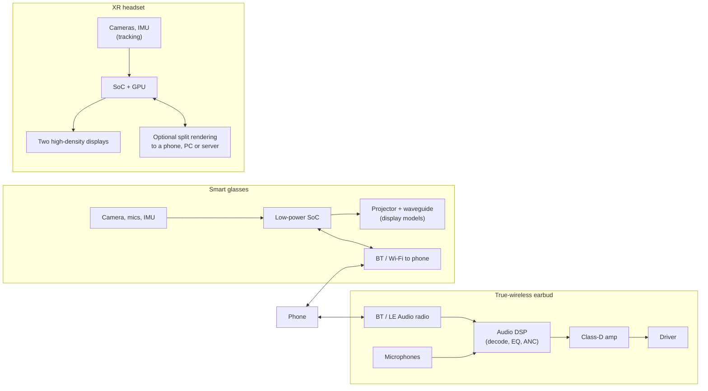
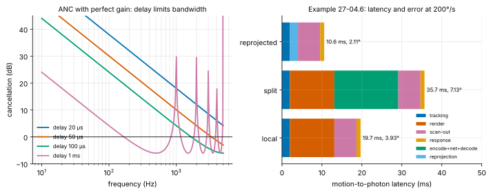

<!-- status: verified -->
# 27-04 · Wearables II: Earbuds and Smart Glasses / XR

| | |
|---|---|
| **Course** | [27 · System Architectures (Case-Study Course)](../README.md) |
| **University equivalent** | The hearables and AR/VR case study of an embedded-systems, audio-DSP or mixed-reality systems seminar: audio chains and noise cancellation, wireless audio, head-worn thermal and display limits, latency and offloaded rendering |
| **Prerequisites** | [27-03](27-03-wearables-smartwatch.md) (day budgets, BLE events, LTPO and APL), [27-01](27-01-system-analysis-method.md) (thermal budgets, bottlenecks), [11-06](../../11-signals-and-systems/chapters/11-06-continuous-time-fourier-transform.md) (delay as a linear phase), [15-08](../../15-control-systems/chapters/15-08-pid-control.md) (feedback), [25-08](../../25-fabrication-packaging-test-and-reliability/chapters/25-08-thermal-engineering.md) (convection), [04-09](../../04-physics-for-ee/chapters/04-09-waves-and-optics.md) (optics) |
| **Estimated study hours** | 8 |
| **Last verified** | 2026-11-26 |

**Learning objectives.** After this chapter you can:

1. Draw the architecture of a true-wireless earbud and of smart glasses and an XR headset, and say what limits each: battery, heat, weight or latency.
2. Compute a speaker's electrical power from loudness and sensitivity, and explain why amplifiers, DSP and radios, not the sound itself, set an earbud's power.
3. Derive the cancellation that active noise control achieves with a given delay, and the delay budget that cancellation at a given frequency demands.
4. Compute an LE Audio stream's frame size, air time, radio duty cycle and current, and an earbud's battery life and case recharges.
5. Estimate the heat a pair of glasses can shed, the power a waveguide display needs, the registration error that latency causes and what foveated and split rendering save.

---

## 1. Big picture

Earbuds, smart glasses and XR headsets are computers worn on the head, and the head is unforgiving. An earbud must fit in the ear with a battery of a couple of hundred milliwatt-hours. Glasses must weigh about what ordinary glasses weigh and must not warm the temples. A headset can be heavier, but every watt it burns sits on the face, and every millisecond of delay between a head turn and the image shifting makes the world swim. These are large markets: ear-worn devices were 64.9% of the roughly 148 million wearables IDC counted in the second quarter of 2026 [R-677], and XR headsets and glasses grew 35.3% year on year in the same quarter, with Meta holding 68.7% [R-681].

- **Why they exist:** private audio and calls without wires; noise cancellation; information and AI assistance in the field of view; immersive computing.
- **Where they show up:** true-wireless earbuds and hearing-health features; camera and audio glasses with AI assistants; display glasses; mixed-reality headsets.
- **What decides them:** for earbuds, energy per hour of audio in a cell of about 0.2 Wh; for glasses, heat and weight before compute; for headsets, latency, pixels per second and the heat of rendering them.
- **Why it matters to a business reader:** these are the device classes where custom silicon (audio SoCs, AR co-processors, sensor fusion chips) and partnerships with phone makers decide who can ship, and where the gap between a demo and a product people wear all day is widest.

## 2. Intuition first

**Three devices, three binding constraints.** An earbud is a battery problem: the sound itself costs microwatts, but the radio, the noise-cancelling DSP and the amplifier's idle draw run every second the bud is in the ear. Glasses are a heat and energy problem: a slim frame can shed at most a watt or two without feeling warm, an all-day battery of a few watt-hours allows only about 200 mW on average, and so the radio link to the phone is part of the processor. A headset is a latency and pixel problem: it must render billions of pixels per second and show each within about 20 ms of the head moving.

*Figure 0. Generic block diagrams; real products differ in which blocks they include and where the processing runs.*

**The finance analogy: fixed costs and the deal's binding covenant.** A business can fail on cash, on leverage or on a covenant long before it fails on profit; which constraint binds decides the strategy. An earbud's binding covenant is energy, a pair of glasses' is heat, a headset's is latency. Optimizing the non-binding one (a faster processor in glasses that cannot shed its heat) creates no value.

*Where the analogy breaks:* the constraints interact physically. Moving compute from the glasses to the phone relieves heat but adds radio energy and latency; a bigger battery in a headset adds weight on the neck. There is no single "currency" to convert them into.

## 3. Theory

### 3.1 What an earbud spends its energy on

A true-wireless earbud contains a Bluetooth SoC with one or more DSP cores, two to four microphones with their ADCs, a class-D amplifier driving a miniature speaker ("driver"), sensors for in-ear detection, touch and head tracking, a charger and a cell of a few tens of milliamp-hours. The charging case is a second power system: a larger cell, a charger and a boost converter that recharges the buds.

**The sound itself is nearly free.** Loudness is measured as **sound pressure level**, $\text{SPL} = 20\log_{10}(p/p_0)$ dB with $p_0 = 20$ µPa. A driver's **sensitivity** $S$ is the SPL it produces in the ear (or a standard ear simulator) for 1 mW of electrical input. Because acoustic power scales with $p^2$ and the driver is linear, each 10 dB of SPL needs ten times the power:

$$
P_{el} = 1\ \text{mW} \times 10^{(\text{SPL} - S)/10}.
$$

With $S$ of about 100–110 dB/mW (an assumed typical range for earbud drivers), comfortable listening at 80–85 dB SPL needs only microwatts (Example 27-04.2). What costs power is everything around the driver: the amplifier's quiescent draw (biasing, switching even at idle), the decoder and the audio DSP, noise cancellation, and the radio.

**Class-D efficiency at low output.** A class-D amplifier switches its output stage at hundreds of kilohertz to megahertz and filters the result. Its efficiency is $P_{out}/(P_{out}/\eta_{sw} + P_q)$, where $\eta_{sw}$ covers conduction and switching losses that scale with output and $P_q$ is the fixed draw. At microwatt outputs $P_q$ dominates, so the amplifier's efficiency at realistic listening levels is a few percent, however good its full-power figure (22-08 met the same effect in PMICs at light load).

### 3.2 Active noise cancellation and the delay budget

**Active noise cancellation (ANC)** measures noise with a microphone and plays an inverted copy through the driver so that the two cancel at the eardrum. A **feedforward** microphone on the outside hears the noise before it arrives; a **feedback** microphone inside the ear hears the residual and corrects it, a feedback loop with the stability and bandwidth trade of 15-08. Real systems combine both.

The physics of the limit is phase. Suppose the noise at the eardrum is a tone $n(t) = \cos(2\pi ft)$ and the system produces an anti-noise copy with gain $g$ that arrives $\tau$ late, $-g\cos(2\pi f(t - \tau))$. In phasor form (02-01) the residual is

$$
R = 1 - g\,e^{-j2\pi f\tau}, \qquad |R|^2 = (1 - g\cos\phi)^2 + (g\sin\phi)^2, \quad \phi = 2\pi f\tau .
$$

With perfect gain ($g = 1$), $|R|^2 = 2 - 2\cos\phi = 4\sin^2(\phi/2)$, so

$$
|R| = 2\left|\sin(\pi f\tau)\right|, \qquad \text{attenuation} = -20\log_{10}\bigl(2\sin(\pi f\tau)\bigr)\ \text{dB}.
$$

Three consequences follow.

1. **Delay limits bandwidth.** For a target attenuation $A$ at frequency $f$, the delay must satisfy $2\sin(\pi f\tau) \le 10^{-A/20}$, so $\tau \le \arcsin(10^{-A/20}/2)/(\pi f)$. Twenty decibels at 500 Hz allows only about 32 µs (Example 27-04.3).
2. **Too much delay makes noise louder.** $|R| > 1$ whenever $\sin(\pi f\tau) > 1/2$, that is for $1/(6\tau) < f < 5/(6\tau)$, and again in each later band of width $2/(3\tau)$; between those bands the residual dips below 1 but never reliably. Averaged over broadband noise, $|R|^2 = 4\sin^2(\pi f\tau)$ averages 2, so the noise power doubles (+3 dB). A 1 ms delay, typical of block-based audio processing, amplifies noise from 167 Hz to 833 Hz and over most of the band above it.
3. **Gain error limits depth.** At $\tau = 0$ the residual is $|1 - g|$: a 5% gain error caps cancellation at 26 dB, however small the delay.

This is why ANC runs on dedicated low-latency hardware filters fed by microphones sampled far faster than the audio rate, not on the block-based audio path that decodes music, and why ANC works best at low frequencies (engine rumble) and is supplemented by passive sealing (ear tips) at high ones.

> **Math refresher — delay is a linear phase.** A delay of $\tau$ multiplies a signal's Fourier transform by $e^{-j2\pi f\tau}$ (11-06): its magnitude is untouched and its phase falls linearly with frequency. A fixed delay is therefore a small phase error at low frequency and a large one at high frequency, which is exactly the shape of the ANC limit.

### 3.3 LE Audio: frames, packets and duty cycle

Classic Bluetooth audio (A2DP over BR/EDR) streams a continuous codec bitstream. **LE Audio** carries audio over Bluetooth Low Energy using **connected isochronous streams (CIS)**: at fixed intervals equal to the codec's frame duration, the phone sends one packet per earbud and the earbud acknowledges. Its standard codec, **LC3** (low-complexity communication codec), works in frames of 10 ms or 7.5 ms at sample rates up to 48 kHz; it is LE Audio's default codec, in the role SBC plays in classic A2DP, and Android supports LE Audio and broadcast audio [R-678].

At bit rate $B$ and frame duration $T_f$, each frame carries

$$
n = \frac{B\,T_f}{8}\ \text{octets},
$$

and on the LE 2M PHY its packet (preamble 2 octets, access address 4, header 2, payload $n$, MIC 4, CRC 3, as in 27-03 §3.5) occupies $t = 8(n + 15)/2$ µs. The radio is on for the packet, an inter-frame space and the acknowledgment, plus a wake-up overhead, once per frame, so its average current is

$$
I_{avg} = \frac{I_{pre}t_{pre} + I_{rx}(t + T_{IFS}) + I_{tx}t_{ack}}{T_f} .
$$

The radio duty cycle is under 10% at typical music bit rates (Example 27-04.4), which is why LE Audio's radio costs about a milliwatt and the audio DSP, not the radio, dominates an earbud's budget. Shorter frames lower latency (gaming, conversation) but repeat the fixed overheads more often. Broadcast isochronous streams (Auracast is the Bluetooth SIG's brand for broadcast audio) send the same audio to any number of receivers with no acknowledgment, so one transmitter can serve a whole venue.

### 3.4 Batteries and the case

An earbud's life is $L = \eta E_b/P$ with the energy $E_b = QV_{nom}$ of a cell of a few tens of milliamp-hours. Its case holds a larger cell; a fraction $\eta_t$ of its energy (lost in the case's boost converter, the contacts and the bud's charger) reaches the buds, so the case delivers

$$
N = \frac{\eta_tE_{case}}{2E_b}
$$

full recharges of a pair, and the total listening time is $(1 + N)L$. Tiny cells pay the packaging penalty of 27-03 §3.8 even more severely, and button-shaped rechargeable lithium cells are a natural fit for a rounded housing.

### 3.5 Glasses: the heat a frame can shed

A pair of glasses has no fan and no heat sink beyond its own surfaces, which touch the temples and the nose. The heat a surface sheds by natural convection and radiation is

$$
P = hA\,\Delta T,
$$

where $h$ is a combined heat-transfer coefficient. Radiation alone gives about $4\varepsilon\sigma T^3$, which is 5.7 W/m²·K for an emissivity of 0.9 near 30 °C, and still-air natural convection adds a few W/m²·K more, so $h$ of about 5–10 W/m²·K is a reasonable range for a warm frame; $A$ the area that is warm and $\Delta T$ the allowed rise above ambient. A frame offers some tens of square centimetres and a modest comfortable rise, so the sustained budget is of the order of a watt: a Meta research paper puts it at about 1–2 W for a touch limit near 40 °C, [R-682]; a slimmer frame held to a stricter rise allows a few hundred milliwatts (Example 27-04.5). Energy is often the tighter limit: the same paper notes that all-day use on a 3 Wh battery means an average of about 200 mW for the whole system. With 27-01's thermal RC model, bursts above it (taking a video, running a vision model) last minutes, not hours, before the frame reaches its limit.

The consequences shape the product. Heavy compute is sent to the phone (or a separate compute puck) over Bluetooth or Wi-Fi; the glasses' own processor is a low-power SoC optimized for always-on sensing, camera capture and the radio; and placing the battery in the temples can balance the weight.

### 3.6 Display glasses: waveguides waste light

Display glasses project an image from a tiny source (micro-LED, LCoS or micro-OLED) into a **waveguide**, a thin transparent plate that guides the light by total internal reflection and couples it out towards the eye over an **eyebox** large enough to tolerate the glasses sitting differently on different faces. Spreading the light over the eyebox, and the couplers' own efficiency, means only a small fraction of the source's light reaches the pupil. The industry summarizes this as a waveguide efficiency in **nits per lumen**: eye-side luminance per lumen injected. The display's electrical power is then

$$
P = \frac{L_v\,\text{APL}}{\eta_{wg}\,\eta_{src}},
$$

with $L_v$ the required luminance (high outdoors, where the display competes with daylight seen through the lens), $\eta_{wg}$ in nits/lm and $\eta_{src}$ the source's luminous efficacy in lm/W. This form holds for **emissive** sources (micro-LED, micro-OLED), which light only the pixels in use. An **LCoS** panel is lit across its whole area by LEDs and blocks the light it does not need, so its source power follows the peak luminance, $P \approx L_{v,peak}/(\eta_{wg}\eta_{src})$, and falls with content only if the LEDs are dimmed when the whole image is dim. With plausible values a full-white image would consume most of the frame's thermal budget, so display glasses show sparse content (a few lines of text, an arrow) at low APL (Example 27-04.5).

### 3.7 Headsets: pixels, foveation and latency

**Pixel rate.** Two displays of $W \times H$ pixels refreshed at $f_r$ must be fed $2WHf_r$ pixels per second, every one of them rendered by a GPU or composited. High-resolution headsets reach billions of pixels per second, which is why their SoCs resemble laptop chips and why they draw watts, not milliwatts.

**Foveated rendering.** The eye resolves fine detail only in the fovea, a few degrees around the gaze. With eye tracking, a headset can render a central region of angular size $\theta_f$ at full resolution and the rest of the field of view $\theta_{FOV}$ at a linear scale $s < 1$. For square regions, the shading work relative to full resolution is

$$
w = \left(\frac{\theta_f}{\theta_{FOV}}\right)^2 + \left[1 - \left(\frac{\theta_f}{\theta_{FOV}}\right)^2\right]s^2 .
$$

A 20° fovea in a 100° field with the periphery at a quarter of the linear resolution cuts the work to 10% (Example 27-04.6).

**Motion-to-photon latency.** If the head turns at angular velocity $\omega$ and the image reflects a pose that is $\tau$ old, the virtual world is misplaced by

$$
\theta_{err} = \omega\,\tau .
$$

At 200°/s, a brisk head turn, 20 ms puts virtual objects 4° off: more than a hundred pixels at 30 pixels per degree. The latency budget is the sum of tracking, rendering (one frame), scan-out (on average half a frame) and the display's response. Two techniques defend it. **Late-stage reprojection** (also called timewarp) re-samples the finished frame with the newest pose just before scan-out, so the perceived latency becomes tracking plus reprojection plus scan-out, not the full rendering time. **Split rendering** sends the pose to a phone, PC or server, renders there and streams the frame back: it moves watts off the head (Example 27-04.6) but adds encoding, network round trip and decoding to the latency, which only on-device reprojection can hide.

> **Going deeper — vergence and accommodation.** Headsets present each eye an image focused at a fixed distance while the eyes converge on virtual objects at varying depths. The mismatch between where the eyes point and where they focus causes discomfort in some users. Varifocal and light-field displays address it at a large cost in optics and compute.

## 4. Worked examples

All parameters below are illustrative assumptions of realistic size; they are not measurements of any product. §7 and §9 give dated, sourced figures.

### Example 27-04.1 · An earbud's budget (tier A)

**Setup.** An earbud has a 50 mAh, 3.85 V cell. While playing music with ANC on, its rails draw: radio and link layer 1.0 mW (Example 27-04.4 gives the radio's share), audio decoding and DSP (equalization, spatial audio, voice pickup) 10.0 mW, ANC 8.0 mW, amplifier 1.0 mW (Example 27-04.2), sensors 1.0 mW, PMIC and leakage 0.5 mW, all through 85% conversion. Its case holds 500 mAh at 3.85 V and delivers 70% of its energy to the buds. Find (a) the bud's energy, (b) the rail and battery power with ANC on and off, (c) the life in each case, (d) each item's share with ANC on, (e) the case's recharges and the total listening time with ANC on, and (f) the life if a more efficient DSP halves the 10 mW.

**Solution.**

- (a) $E_b = 50 \times 3.85$ = **192.5** mWh.
- (b) ANC on: $1.0 + 10.0 + 8.0 + 1.0 + 1.0 + 0.5$ = **21.5** mW at the rails, $21.5/0.85$ = **25.3** mW from the cell. ANC off: **13.5** mW, **15.9** mW.
- (c) $192.5/25.29$ = **7.61** h with ANC on; $192.5/15.88$ = **12.1** h with it off.
- (d) DSP **46.5**%, ANC **37.2**%, radio, amplifier and sensors **4.7**% each, PMIC and leakage **2.3**%.
- (e) The case holds $500 \times 3.85 = 1925$ mWh and delivers **1347.5** mWh; a pair takes $2 \times 192.5 = 385$ mWh, so the case gives **3.5** recharges, and the total is $(1 + 3.5) \times 7.61$ = **34.2** h.
- (f) $21.5 - 5.0 = 16.5$ mW: **9.92** h.

**Units check.** mAh × V = mWh; mWh/mW = h. ✓

**Sanity check.** The radio, which dominated classic Bluetooth earbuds' budgets, is under 5% here; the DSP and ANC are **84**%. That is why earbud chips race to better process nodes and dedicated audio accelerators, and why a vendor that can run ANC and spatial audio in fewer milliwatts wins hours of battery life in the same ear. The case multiplies the "battery life" on the box several times: 4.5 times here.

### Example 27-04.2 · What loudness costs (tier A)

**Setup.** An earbud driver has a sensitivity of 105 dB SPL/mW. Its class-D amplifier converts at 90% (excluding its fixed draw) and draws 1.0 mW quiescent. Find the electrical power to the driver and the amplifier's efficiency at (a) 85 dB SPL, (b) 100 dB SPL and (c) 110 dB SPL.

**Solution.**

- (a) $P = 10^{(85 - 105)/10}$ mW = **0.0100** mW (10 µW). Efficiency $0.01/(0.01/0.9 + 1.0)$ = **0.99**%.
- (b) $10^{-0.5}$ = **0.316** mW; efficiency **23.4**%.
- (c) $10^{0.5}$ = **3.16** mW; efficiency **70.1**%.

**Units check.** dB differences divided by 10 give a power ratio; mW in, mW out. ✓

**Sanity check.** At normal listening levels the driver needs about a hundredth of a milliwatt; the amplifier's idle milliwatt is a hundred times larger. Halving the amplifier's quiescent draw buys more battery life than any improvement in the driver.

### Example 27-04.3 · How fast must ANC be? (tier B)

**Setup.** An ANC path cancels noise with perfect gain but a delay $\tau$ (the excess of the anti-noise path, electronics plus driver and acoustic path, over the noise's own acoustic path from the feedforward microphone to the ear). (a) With $\tau = 50$ µs, find the attenuation at 100 Hz, 500 Hz, 1 kHz and 3 kHz. (b) Find the largest delay that gives 20 dB at 500 Hz. (c) A designer proposes running ANC on the music DSP with 1 ms of block latency. Find the attenuation at 100 Hz and 500 Hz and the frequency above which it amplifies noise. (d) With $\tau = 50$ µs and a 5% gain error, find the attenuation at 100 Hz.

**Solution.**

- (a) $A = -20\log_{10}(2\sin(\pi f\tau))$: at 100 Hz, $2\sin(0.01571) = 0.0314$, **30.1** dB; at 500 Hz, **16.1** dB; at 1 kHz, **10.1** dB; at 3 kHz, **0.84** dB.
- (b) $\tau = \arcsin(0.1/2)/(\pi \times 500)$ = **31.8** µs.
- (c) At 100 Hz, $2\sin(\pi \times 100 \times 10^{-3}) = 0.618$: only **4.18** dB. At 500 Hz, $2\sin(\pi/2) = 2$: **−6.02** dB, the noise doubles in amplitude. Amplification starts at $1/(6\tau)$ = **167** Hz.
- (d) $|R|^2 = (1 - 1.05\cos\phi)^2 + (1.05\sin\phi)^2$ with $\phi = 2\pi \times 100 \times 50 \times 10^{-6} = 0.0314$: $|R| = 0.0595$, **24.5** dB, against 30.1 dB with perfect gain.

**Units check.** $f\tau$ is dimensionless (Hz × s); dB of an amplitude ratio uses $20\log_{10}$. ✓

**Sanity check.** The numbers match experience: ANC is strong on low rumble and weak on voices and clatter above a kilohertz, where ear tips do the work. A millisecond of delay, invisible in music playback, ruins cancellation; the gain must also be calibrated, since a 5% error costs several decibels.

### Example 27-04.4 · An LE Audio stream (tier B)

**Setup.** An earbud receives LC3 at 96 kb/s in 10 ms frames over a CIS on the LE 2M PHY, encrypted, and acknowledges each packet with an empty packet. Its radio draws 3.6 mA receiving, 4.1 mA transmitting and 1.2 mA for a 200 µs wake-up per event, from 3.0 V; $T_{IFS} = 150$ µs. Find (a) the octets per frame, the packet's air time and the acknowledgment's, (b) the radio duty cycle, (c) the average current and power, and (d) the current with 7.5 ms frames at the same bit rate.

**Solution.**

- (a) $n = 96\,000 \times 0.010/8$ = **120** octets. Packet: $2 + 4 + 2 + 120 + 4 + 3 = 135$ octets, $8 \times 135/2$ = **540** µs. Empty acknowledgment: 11 octets, **44** µs.
- (b) Radio on (receive, turnaround, transmit): $540 + 150 + 44 = 734$ µs per 10 ms, a duty cycle of **7.34**% (plus the wake-up).
- (c) Charge per frame: $1.2 \times 200 + 3.6 \times (540 + 150) + 4.1 \times 44 = 240 + 2484 + 180.4$ = **2904** nC. $I_{avg} = 2904\ \text{nC}/10\ \text{ms}$ = **290** µA, and $3.0 \times 0.290$ = **0.871** mW.
- (d) 7.5 ms frames carry **90** octets: 105 octets, **420** µs. Charge $240 + 3.6 \times 570 + 180.4 = 2472$ nC per 7.5 ms: **330** µA. Shorter frames cost **13.5**% more current for 2.5 ms less latency.

**Units check.** b/s × s = bits; octets × 8 / (Mb/s) = µs; mA × µs = nC; nC/ms = µA. ✓

**Sanity check.** Under a milliwatt for the radio, against tens of milliwatts for the whole earbud: in LE Audio the radio is no longer the dominant cost. Real links add retransmissions and the occasional relay between buds, but the duty cycle stays low.

### Example 27-04.5 · Glasses that must stay cool (tier B)

**Setup.** A pair of display glasses has 60 cm² of warm surface with a combined heat-transfer coefficient of 8 W/m²·K, and may run 8 K above ambient; its thermal time constant is 300 s. (a) Find the sustained power. (b) Its waveguide delivers 300 nits per lumen and its emissive (micro-LED) projector 10 lm/W; outdoors the image must reach 1000 nits. Find the display power at APL 0.05 (a few lines of text) and at full white, and the full-white share of the thermal budget. (c) The glasses idle at 0.10 W and start recording video at 0.60 W. How long until the frame reaches its limit?

**Solution.**

- (a) $P = 8 \times 0.0060 \times 8$ = **0.384** W.
- (b) Flux at full white $1000/300 = 3.33$ lm; at APL 0.05, 0.167 lm. Power $0.167/10$ W = **16.7** mW sparse, and **333** mW full white, **86.8**% of the budget.
- (c) The steady rise at 0.60 W would be $0.60/(8 \times 0.006)$ = **12.5** K; the idle rise is **2.08** K. From 27-01, $t = \tau\ln[(\Delta T_\infty - \Delta T_0)/(\Delta T_\infty - \Delta T_{max})] = 300\ln(10.42/4.50)$ = **252** s, about four minutes.

**Units check.** W/(m²·K) × m² × K = W; nits ÷ (nits/lm) = lm; lm ÷ (lm/W) = W. ✓

**Sanity check.** A few hundred milliwatts is the whole budget, and a bright, full-screen image would use most of it before any compute. Sparse content, low APL and offload to the phone are physics, not product taste; continuous video capture is thermally limited to minutes. With an LCoS projector the sparse-content saving disappears unless the LEDs dim with the content: the panel is lit for the brightest pixel shown.

### Example 27-04.6 · A headset's pixels and latency (tier C)

**Setup.** A headset has two 3660 × 3200 displays at 90 Hz, a 100° field of view and eye tracking. Its on-device pipeline has 2 ms of tracking, one 90 Hz frame of rendering, half a frame of average scan-out and 1 ms of display response. (a) Find the pixel rate. (b) Find the shading work with a 20° fovea at full resolution and the periphery at a quarter of the linear resolution. (c) Find the motion-to-photon latency and the registration error for a 200°/s head turn at an assumed 30 pixels per degree (a simple average of 3660 pixels over 100° would give 37; the effective figure depends on the lens). (d) Split rendering adds 3 ms of encoding, 10 ms of network round trip and 3 ms of decoding: find the latency and error. (e) With late-stage reprojection on the headset (2 ms), find the perceived latency and error. (f) Local rendering draws 8 W; streaming at 100 Mb/s costs 10 nJ/bit of radio energy plus 0.5 W of decoding. Find the streaming power.

**Solution.**

- (a) $2 \times 3660 \times 3200 \times 90$ = **2.11** × 10⁹ pixels/s.
- (b) $w = 0.2^2 + (1 - 0.2^2) \times 0.25^2 = 0.04 + 0.96 \times 0.0625$ = **0.100**: a tenth of the shading.
- (c) $2 + 11.1 + 5.6 + 1$ = **19.7** ms; $\theta = 200 \times 0.0197$ = **3.93**°, or **118** pixels.
- (d) $19.7 + 16$ = **35.7** ms; **7.13**°, **214** pixels.
- (e) $2 + 2 + 5.6 + 1$ = **10.6** ms; **2.11**°, **63.3** pixels.
- (f) $100 \times 10^6 \times 10 \times 10^{-9} + 0.5$ = **1.50** W, against 8 W on the head.

**Units check.** pixels × Hz = pixels/s; deg/s × s = deg; Mb/s × nJ/bit = mW × 10³. ✓

**Sanity check.** Split rendering takes 6.5 W off the face but nearly doubles the latency; only reprojection, which uses the latest head pose at the last moment, makes it tolerable. Foveation's tenfold saving in idealized shading work, an upper bound on the GPU power saved since geometry, memory traffic and display power do not shrink with it, is why eye tracking is in high-end headsets. The 20° full-resolution region is far wider than the eye's few-degree fovea, to leave margin for eye-tracking error and latency.

<!-- answer-key -->

| ID | Quantity | Value | Unit |
|---|---|---|---|
| Ex 27-04.1a | bud energy | 192.5 | mWh |
| Ex 27-04.1b | rail power, ANC on | 21.5 | mW |
| Ex 27-04.1b1 | battery power, ANC on | 25.3 | mW |
| Ex 27-04.1b2 | rail power, ANC off | 13.5 | mW |
| Ex 27-04.1b3 | battery power, ANC off | 15.9 | mW |
| Ex 27-04.1c | life, ANC on | 7.61 | h |
| Ex 27-04.1c1 | life, ANC off | 12.1 | h |
| Ex 27-04.1d | DSP share | 46.5 | % |
| Ex 27-04.1d1 | ANC share | 37.2 | % |
| Ex 27-04.1d2 | radio, amplifier or sensor share | 4.7 | % |
| Ex 27-04.1d3 | PMIC and leakage share | 2.3 | % |
| Ex 27-04.1e0 | case energy | 1925 | mWh |
| Ex 27-04.1e | energy delivered by case | 1347.5 | mWh |
| Ex 27-04.1e1 | energy per pair recharge | 385 | mWh |
| Ex 27-04.1e2 | recharges | 3.5 | — |
| Ex 27-04.1e3 | total listening time | 34.2 | h |
| Ex 27-04.1f0 | rail power with halved DSP | 16.5 | mW |
| Ex 27-04.1f | life with halved DSP | 9.92 | h |
| Ex 27-04.1g | DSP plus ANC share | 84 | % |
| Ex 27-04.2a | power at 85 dB SPL | 0.0100 | mW |
| Ex 27-04.2a1 | efficiency at 85 dB SPL | 0.99 | % |
| Ex 27-04.2b | power at 100 dB SPL | 0.316 | mW |
| Ex 27-04.2b1 | efficiency at 100 dB SPL | 23.4 | % |
| Ex 27-04.2c | power at 110 dB SPL | 3.16 | mW |
| Ex 27-04.2c1 | efficiency at 110 dB SPL | 70.1 | % |
| Ex 27-04.3a0 | residual at 100 Hz, 50 µs | 0.0314 | — |
| Ex 27-04.3a | attenuation at 100 Hz | 30.1 | dB |
| Ex 27-04.3a1 | attenuation at 500 Hz | 16.1 | dB |
| Ex 27-04.3a2 | attenuation at 1 kHz | 10.1 | dB |
| Ex 27-04.3a3 | attenuation at 3 kHz | 0.84 | dB |
| Ex 27-04.3b | largest delay for 20 dB at 500 Hz | 31.8 | µs |
| Ex 27-04.3c0 | residual at 100 Hz, 1 ms | 0.618 | — |
| Ex 27-04.3c | attenuation at 100 Hz, 1 ms | 4.18 | dB |
| Ex 27-04.3c1 | attenuation at 500 Hz, 1 ms | -6.02 | dB |
| Ex 27-04.3c2 | amplification threshold, 1 ms | 167 | Hz |
| Ex 27-04.3d0 | residual with 5% gain error | 0.0595 | — |
| Ex 27-04.3d | attenuation with 5% gain error | 24.5 | dB |
| Ex 27-04.4a | octets per 10 ms frame | 120 | octets |
| Ex 27-04.4a1 | packet octets | 135 | octets |
| Ex 27-04.4a2 | packet air time | 540 | µs |
| Ex 27-04.4a3 | acknowledgment air time | 44 | µs |
| Ex 27-04.4b0 | radio-on time per frame | 734 | µs |
| Ex 27-04.4b | radio duty cycle | 7.34 | % |
| Ex 27-04.4c0 | charge per frame | 2904 | nC |
| Ex 27-04.4c | average current | 290 | µA |
| Ex 27-04.4c1 | radio power | 0.871 | mW |
| Ex 27-04.4d | octets per 7.5 ms frame | 90 | octets |
| Ex 27-04.4d1 | packet octets, 7.5 ms | 105 | octets |
| Ex 27-04.4d2 | packet air time, 7.5 ms | 420 | µs |
| Ex 27-04.4d3 | charge per 7.5 ms frame | 2472 | nC |
| Ex 27-04.4d4 | average current, 7.5 ms | 330 | µA |
| Ex 27-04.4d5 | extra current for 7.5 ms frames | 13.5 | % |
| Ex 27-04.5a | sustained power | 0.384 | W |
| Ex 27-04.5b0 | flux at full white | 3.33 | lm |
| Ex 27-04.5b1 | flux at APL 0.05 | 0.167 | lm |
| Ex 27-04.5b | display power, sparse | 16.7 | mW |
| Ex 27-04.5b2 | display power, full white | 333 | mW |
| Ex 27-04.5b3 | full-white share of budget | 86.8 | % |
| Ex 27-04.5c0 | steady rise at 0.60 W | 12.5 | K |
| Ex 27-04.5c1 | idle rise | 2.08 | K |
| Ex 27-04.5c2 | log numerator | 10.42 | K |
| Ex 27-04.5c3 | log denominator | 4.50 | K |
| Ex 27-04.5c | time to limit | 252 | s |
| Ex 27-04.6a | pixel rate | 2.11 | Gpixel/s |
| Ex 27-04.6b | foveated shading work | 0.100 | — |
| Ex 27-04.6c0 | render frame | 11.1 | ms |
| Ex 27-04.6c1 | average scan-out | 5.6 | ms |
| Ex 27-04.6c | local latency | 19.7 | ms |
| Ex 27-04.6c2 | local error | 3.93 | deg |
| Ex 27-04.6c3 | local error in pixels | 118 | pixels |
| Ex 27-04.6d1 | split-rendering addition | 16 | ms |
| Ex 27-04.6d | split latency | 35.7 | ms |
| Ex 27-04.6d2 | split error | 7.13 | deg |
| Ex 27-04.6d3 | split error in pixels | 214 | pixels |
| Ex 27-04.6e | reprojected latency | 10.6 | ms |
| Ex 27-04.6e2 | reprojected error | 2.11 | deg |
| Ex 27-04.6e3 | reprojected error in pixels | 63.3 | pixels |
| Ex 27-04.6f | streaming power | 1.50 | W |
| Ex 27-04.6f1 | power taken off the head | 6.5 | W |
| Txt 27-04.1 | delay for 20 dB at 500 Hz | 32 | µs |
| Txt 27-04.2 | amplification threshold for 1 ms | 167 | Hz |
| Txt 27-04.3 | depth limit for 5% gain error | 26 | dB |
| Txt 27-04.4 | error at 200°/s and 20 ms | 4 | deg |
| Txt 27-04.5 | foveated work | 10 | % |
| Txt 27-04.6 | ANC power increase, Samsung ratings | 17 | % |
| Txt 27-04.7 | ANC power increase, Google ratings | 50 | % |
| Txt 27-04.8 | average-power cut, Ray-Ban Meta Gen 1 to Gen 2 | 34 | % |
| Txt 27-04.9 | Galaxy XR pixels | 27 | million |
| Txt 27-04.10 | radiative heat-transfer coefficient | 5.7 | W/m²·K |
| Txt 27-04.11 | upper end of first amplification band, 1 ms | 833 | Hz |
| Txt 27-04.12 | case multiple of one charge | 4.5 | — |

## 5. Simulate it

The lab is [labs/27-04-lab/](../labs/27-04-lab/README.md). `headworn.py` implements speaker power and class-D efficiency, the ANC residual and delay budget, LC3 frames, LE packet air time and stream current, earbud life and case recharges, the heat a surface sheds, waveguide display power, registration error, pixel rate, foveated work and stream power.

1. *Predict* the frequency at which a 50 µs delay leaves 10 dB of cancellation, then plot attenuation against frequency for delays from 20 µs to 1 ms.
2. *Predict* the radio current at 192 kb/s in 10 ms frames, then plot current against bit rate for 7.5 ms and 10 ms frames.
3. *Predict* the warm area a pair of glasses needs to shed 0.5 W at an 8 K rise, then plot sustained power against area.
4. *Predict* the shading work for a 30° fovea with a quarter-scale periphery, then plot work against fovea size.

*Figure 1. The ANC delay limit of Example 27-04.3 and the latency budgets of Example 27-04.6 (assumed parameters). The 1 ms curve's narrow notches fall where the delay is a whole number of periods; they are too narrow to help against real, broadband noise.*

## 6. Engineering tradeoffs

| Knob | Improves | Costs | Typical decision owner |
|---|---|---|---|
| More ANC microphones and faster ANC filters | Cancellation depth and bandwidth | DSP power, mic cost, calibration | Audio DSP and acoustics teams |
| LE Audio (LC3) instead of classic Bluetooth audio | Radio energy, multi-device and broadcast audio | Phone and ecosystem support, latency tuning | Connectivity and platform teams |
| Shorter LC3 frames (7.5 ms) | Latency for games and calls | Radio and DSP overhead per second | Product with connectivity |
| Bigger earbud cell | Listening time | Size, fit, weight in the ear | Industrial design |
| Compute on the glasses vs on the phone | Latency, independence from the phone | Heat in the frame, battery, weight | System architect |
| Display in the glasses (waveguide) | Glanceable information | Weight, power, cost, optical artifacts | Product and optics teams |
| Eye tracking and foveated rendering | GPU power or pixel quality | Sensors, calibration, privacy | Headset platform team |
| Split rendering | Power and heat on the head | Latency, network dependence, a remote GPU | Platform and cloud teams |
| External battery pack | Head weight | Cable, convenience | Industrial design with product |

## 7. Numbers to know

| Quantity | Value | Note |
|---|---|---|
| Earbud listening time per charge (ANC on) | 8 h (AirPods Pro 3, Pixel Buds Pro 2); 6 h (Galaxy Buds4 Pro) | Manufacturer ratings, 2024–2026 [R-677] |
| Earbud and case cells | 61 / 530 mAh (Galaxy Buds4 Pro); 1.334 Wh case (AirPods Pro 3) | Samsung; iFixit [R-677] |
| ANC's cost in rated life | 7/6 (Samsung) to 12/8 (Google): ANC adds **17**–**50**% to average power | Our arithmetic on vendor ratings [R-677] |
| Earbud audio SoC compute | eNPU 64 GOPS; DSP 2 × 500 MHz + 1 × 250 MHz (Qualcomm S7 Pro Gen 1) | Vendor brief [R-678] **[Industry estimate]** |
| LC3 frame durations | 7.5 and 10 ms; 8–48 kHz; 20–400 bytes per frame (liblc3) | [R-678] |
| Glasses battery | 160 → 210 mAh (Ray-Ban Meta Gen 1 → Gen 2); 248 mAh, 960 mWh (Ray-Ban Display) | Meta; iFixit [R-679] |
| Glasses rated life | 8 h typical (Ray-Ban Meta Gen 2); 6 h mixed use (Ray-Ban Display) | Meta [R-679] |
| Display share of glasses BOM | 50.8% (Ray-Ban Display) | TechInsights, Jun 2026 [R-679] **[Industry estimate]** |
| Glasses power targets | about 200 mW average for all day on 3 Wh; about 1–2 W sustained at a ~40 °C touch limit | Meta research paper [R-682] |
| Headset pixels | 23 million (Vision Pro M5); 2 × 3,552 × 3,840 = **27** million (Galaxy XR) | Apple, Samsung [R-680] |
| Headset rated life | 2.5 h general use (Vision Pro M5); 2 h (Galaxy XR) | [R-680] |
| Headset weight | 750–800 g plus a 353 g battery (Vision Pro M5); 545 g plus 302 g (Galaxy XR) | [R-680] |
| Passthrough latency | "within 12 milliseconds" (Apple R1) | Apple, Oct 2025 [R-680] |
| Motion-to-photon target | under 15–20 ms ("broad consensus") | IEEE Network, 2018 [R-682] |

## 8. Common mistakes

- **Blaming the speaker for an earbud's power.** The driver needs microwatts; the amplifier's idle draw, the DSP and ANC need milliwatts.
- **Treating ANC as a filter problem only.** Delay sets the bandwidth before any filter design; a millisecond of latency makes noise louder above about 167 Hz.
- **Assuming a higher bit rate doubles the radio's cost.** Per-frame overheads (wake-up, turnaround, acknowledgment) are fixed; air time scales with the payload only.
- **Reading "battery life with case" as earbud battery life.** The case multiplies the listening time; the earbud's own life per charge is what a listener feels in a long flight or a workday of calls.
- **Designing glasses around a phone processor.** A frame sheds at most a watt or two and an all-day battery allows about 200 mW on average; anything sustained above that must move to the phone or be duty-cycled.
- **Quoting display brightness without APL and source type.** An emissive waveguide display's power scales with the fraction of the field lit, an LCoS display's with its peak brightness; full-white specifications describe a mode no product sustains.
- **Ignoring latency in split rendering.** Moving rendering off the head saves watts but adds a network round trip; without reprojection and pose prediction the world swims.

## 9. Practitioner lens

**State of play (as of Nov 2026).**

- **Earbuds have converged on about 6–8 hours with ANC.** AirPods Pro 3 and Pixel Buds Pro 2 are rated at 8 hours with ANC, Galaxy Buds4 Pro at 6 hours from a 61 mAh cell [R-677]. Vendors differ on what ANC costs: Samsung rates 6 hours on and 7 off, Google 8 on and 12 off [R-677]. The difference is design and measurement profile, and a reason to ask for the profile.
- **The compute inside the bud keeps growing.** Qualcomm's S7 Pro Gen 1 pairs a 64 GOPS NPU with three DSP cores and supports LE Audio and its own Wi-Fi-based audio link (XPAN) [R-678] **[Industry estimate: vendor]**; Apple's H2 and Google's Tensor A1 are in-house equivalents [R-677]. Features such as hearing assistance, heart-rate sensing and live translation are examples of what that compute can run.
- **LE Audio is supported on Android.** LC3 "replaces the SBC codec used for A2DP" in Android's LE Audio stack, and broadcast audio is supported [R-678]. Adoption on the phone side decides how fast earbuds can rely on it.
- **Glasses are the growth story, and audio glasses are most of it.** IDC counts 35.3% growth for XR headsets and glasses in Q2 2026, with display-less audio glasses 70.3% of shipments and display glasses 14.3% [R-681] **[Industry estimate]**. Meta's Ray-Ban Display uses Qualcomm's AR1 platform, a 600 × 600 LCoS panel and a 960 mWh battery for 6 hours of mixed use [R-679].
- **Battery chemistry did not double glasses' life; system design did.** Meta's cell grew from 160 to 210 mAh between generations "yet the product shipped with claims of double the runtime ... The extra gains came from system-level efficiency improvements" [R-679]: about **34**% less average power.
- **Headsets remain heavy and short-lived.** Vision Pro (M5) weighs 750–800 g plus a 353 g battery and lasts 2.5 hours; Galaxy XR 545 g plus 302 g for 2 hours [R-680].

**Commercial relevance.** Ear-worn devices are the largest wearable category by units (64.9% of shipments in Q2 2026 [R-677]), and their silicon (a Bluetooth audio SoC with DSP, NPU and ANC) is a contested market between in-house designs (Apple, Google) and merchant platforms (Qualcomm and others). Glasses are smaller but growing fast and are display- and optics-heavy in cost: displays are 50.8% of the Ray-Ban Display's BOM [R-679] **[Industry estimate]**. For a chip company, the positions to watch are low-power always-on vision and audio SoCs, display drivers and micro-displays, and the phone-side silicon that does the offloaded work.

**Marketing vs Reality.**

- *"Up to 24 hours of listening time"* (with the case) [R-677]. The bud lasts 8; the case recharges it. Ask for the single-charge figure, at what volume (Apple tests at 50%) and with which features on.
- *"Almost twice the battery life"* [R-679]. From 31% more charge and system efficiency; ask which workloads got cheaper and whether video capture did.
- *"Streams new images to the displays within 12 milliseconds"* [R-680]. That is the passthrough path, not the full rendering pipeline of every app; ask for motion-to-photon latency under load.
- *"64 GOPS"* in an earbud [R-678]. Peak operations at what precision and power? What fits in the earbud's few milliwatts is the real limit.
- *All-day AI glasses.* At about 200 mW average [R-682], an always-on camera and on-glass model cannot run continuously; ask for the duty cycle and what is offloaded.

**Questions for engineering leaders.**

1. *"What does ANC cost in your rated life, and in which mode were the ratings measured?"* Strong: on and off figures with the profile, volume and features. Evasive: the case-inclusive total.
2. *"What is the latency of your ANC path, and up to what frequency does it cancel?"* Strong: a delay in microseconds and a cancellation curve. Evasive: "industry-leading ANC".
3. *"What is the glasses' average power across a day, and its sustained thermal limit?"* Strong: both numbers and the workload split between glasses and phone. Evasive: battery capacity alone.
4. *"What fraction of the display's light reaches the eye, and what APL does the UI assume?"* Strong: nits per lumen and a UI brightness budget. Evasive: peak nits.
5. *"What is your motion-to-photon latency with split rendering, and how is the remainder hidden?"* Strong: a stage-by-stage budget with reprojection and prediction. Evasive: average network latency only.

## 10. Concept check

1. An earbud driver needs 10 µW at normal listening levels. Why does the earbud draw tens of milliwatts?

   

Answer

   The amplifier's quiescent draw, the audio DSP (decoding, equalization, spatial audio), ANC (several microphones, low-latency filters) and the radio all run continuously. In Example 27-04.1 the DSP and ANC are 84% of the budget; the sound itself is a rounding error.

   

2. Why can't ANC run on the same DSP pipeline that decodes the music?

   

Answer

   That pipeline processes blocks of samples with milliseconds of latency. Cancellation at frequency $f$ needs a delay $\tau$ with $2\sin(\pi f\tau)$ well below 1; 1 ms already amplifies noise above 167 Hz. ANC needs a dedicated path with tens of microseconds of latency.

   

3. What limits cancellation even with zero delay?

   

Answer

   Gain (and phase) mismatch between the noise at the eardrum and the anti-noise: the residual is $|1 - g|$, so 5% error caps cancellation at 26 dB. Fit and seal change the acoustic path, so ANC must adapt.

   

4. An LE Audio stream at 96 kb/s keeps the radio on for about 7% of each frame. What dominates the remaining radio energy, and why does doubling the bit rate not double it?

   

Answer

   Fixed per-frame costs: the wake-up, the inter-frame space and the acknowledgment. Only the packet's air time grows with the payload; the rest is paid once per frame whatever the bit rate.

   

5. Why do smart glasses send heavy compute to the phone?

   

Answer

   A slim frame sheds at most a watt or two by natural convection and radiation without feeling warm ($P = hA\Delta T$), and an all-day battery allows only about 200 mW on average. Sending a compressed image costs far less energy than processing it locally, and the phone has a larger battery and more surface to shed heat.

   

6. What is late-stage reprojection and what does it not fix?

   

Answer

   Re-sampling the finished frame with the newest head pose just before scan-out, so rendering and network delays no longer add registration error. It cannot remove tracking, reprojection, scan-out and display latency, and it cannot invent content revealed by motion (disocclusions); pose prediction addresses the first.

   

7. How does eye tracking save GPU power?

   

Answer

   It lets the headset render only the region the fovea sees at full resolution and the rest at reduced resolution: a 20° fovea with a quarter-scale periphery in a 100° field needs a tenth of the shading work.

   

Problems: [27-04 problem set](../problems/27-04-problems.md) · Solutions: [27-04 solutions](../solutions/27-04-solutions.md)

## 11. Key terms

[Sound pressure level (SPL)](../../../reference/glossary.md#sound-pressure-level-spl) · [Driver sensitivity](../../../reference/glossary.md#driver-sensitivity) · [Class-D amplifier](../../../reference/glossary.md#class-d-amplifier) · [Active noise cancellation (ANC)](../../../reference/glossary.md#active-noise-cancellation-anc) · [LE Audio](../../../reference/glossary.md#le-audio) · [LC3 codec](../../../reference/glossary.md#lc3-codec) · [Connected isochronous stream (CIS)](../../../reference/glossary.md#connected-isochronous-stream-cis) · [Auracast](../../../reference/glossary.md#auracast) · [Waveguide display](../../../reference/glossary.md#waveguide-display) · [Eyebox](../../../reference/glossary.md#eyebox) · [Foveated rendering](../../../reference/glossary.md#foveated-rendering) · [Motion-to-photon latency](../../../reference/glossary.md#motion-to-photon-latency) · [Late-stage reprojection](../../../reference/glossary.md#late-stage-reprojection) · [Split rendering](../../../reference/glossary.md#split-rendering) · [Pose prediction](../../../reference/glossary.md#pose-prediction) · [Average pixel level (APL)](../../../reference/glossary.md#average-pixel-level-apl) · [Connection interval](../../../reference/glossary.md#connection-interval)

## 12. Connections

- **Previous:** [27-03 Wearables I: The Smartwatch](27-03-wearables-smartwatch.md): the day budget, BLE events and display physics reused here.
- **Next:** [27-05 The PC SoC](27-05-pc-soc.md): from milliwatts to tens of watts, where the GPU and unified memory of the headset return at laptop scale.
- **Prerequisites used here:** delay as linear phase ([11-06](../../11-signals-and-systems/chapters/11-06-continuous-time-fourier-transform.md)); feedback ([15-08](../../15-control-systems/chapters/15-08-pid-control.md)); convection ([25-08](../../25-fabrication-packaging-test-and-reliability/chapters/25-08-thermal-engineering.md)); budgets and burst duration ([27-01](27-01-system-analysis-method.md)); BLE packets ([27-03](27-03-wearables-smartwatch.md)).
- **Used later:** latency budgets return in automotive sensor fusion (27-06) and in datacenter inference serving (27-07); duty-cycled radios and tiny batteries in IoT nodes (27-08).

## 13. Further study

- An acoustics or audio-engineering text's chapter on active noise control (for example, the feedforward and feedback ANC structures and the filtered-x LMS algorithm) for the adaptive filters this chapter treats as ideal.
- Vendor application notes on LE Audio and LC3 (Bluetooth SoC vendors publish power estimates for isochronous streams) and the LC3 specification for the codec's frame structure.
- Survey papers on mixed-reality rendering (foveated rendering, reprojection, split and remote rendering) in ACM SIGGRAPH and IEEE VR proceedings, and on waveguide displays in optics journals.
- Chapter 25-08 of this curriculum for convection and radiation coefficients behind $hA\Delta T$.

## 14. Sources

1. AirPods Pro 3, Galaxy Buds4 Pro and Pixel Buds Pro 2 specifications; AirPods Pro 3 case cell (iFixit); IDC earwear share: [R-677].
2. Qualcomm S7 Pro Gen 1 brief; Android LE Audio overview; liblc3 frame durations and sizes: [R-678].
3. Ray-Ban Meta Gen 2 and Ray-Ban Display (Meta, Engineering at Meta, iFixit, TechInsights): [R-679].
4. Apple Vision Pro (M5) and Samsung Galaxy XR specifications: [R-680].
5. XR headset and glasses shipments (IDC): [R-681].
6. Glasses power and thermal targets (Meta research paper), Google Glass measurements, motion-to-photon consensus (IEEE Network): [R-682].
7. Bluetooth LE packet format and timing: [R-676].
