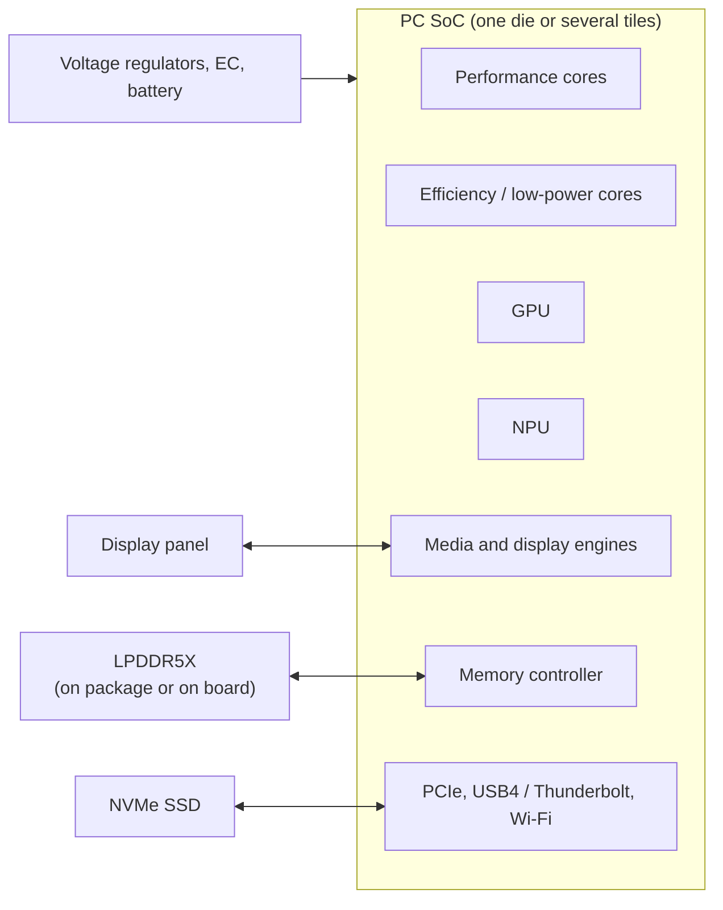
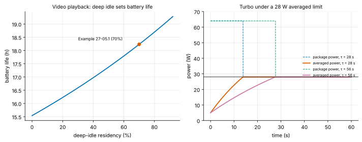

<!-- status: reviewed -->
# 27-05 · The PC SoC

| | |
|---|---|
| **Course** | [27 · System Architectures (Case-Study Course)](../README.md) |
| **University equivalent** | The client-processor case study of a computer-architecture or SoC-design course: heterogeneous CPU, GPU and NPU integration, memory systems, power management and packaging economics (Hennessy & Patterson, *Computer Architecture: A Quantitative Approach*, chapters on memory-hierarchy design and domain-specific architectures) |
| **Prerequisites** | [27-02](27-02-smartphone-soc.md) (heterogeneous cores, bandwidth-bound AI, die cost), [27-01](27-01-system-analysis-method.md) (thermal budgets), [14-01](../../14-computer-organization-and-architecture/chapters/14-01-performance-power-iron-law.md) (performance and power), [23-04](../../23-memory-and-storage-technology/chapters/23-04-dram-interfaces.md) (LPDDR), [19-06](../../19-digital-vlsi-design/chapters/19-06-power-and-low-power-design.md) (power gating), [25-07](../../25-fabrication-packaging-test-and-reliability/chapters/25-07-advanced-packaging-and-chiplets.md) (chiplets), [26-04](../../26-engineering-design-and-professional-practice/chapters/26-04-engineering-economics-2.md) (chiplet economics) |
| **Estimated study hours** | 6 |
| **Last verified** | 2026-11-26 |

**Learning objectives.** After this chapter you can:

1. Draw the block diagram of a laptop SoC (CPU clusters, GPU, NPU, media and display engines, memory controller, I/O) and explain how it differs from a phone's.
2. Compute battery life from package power-state residency and platform power, and identify what keeps a laptop out of its deepest idle states.
3. Compute how long a processor can turbo under an averaged power limit, and what the turbo buys.
4. Compute unified-memory bandwidth, decide which language models fit and how fast they run locally, and compare NPU, GPU and CPU energy for sustained AI work.
5. Compare monolithic and chiplet construction by cost per good part and interconnect power, and judge memory-on-package.

---

## 1. Big picture

A laptop SoC must do what a phone SoC does (heterogeneous CPU cores, a GPU, an NPU, media engines, an always-on island) across a far wider power range: from well under a watt at idle with the lid open, through a few watts playing video, to tens of watts or more for minutes of compilation, rendering or gaming. It must run decades of x86 or, increasingly, Arm software, drive several large displays and fast external I/O, and in 2026 run local AI models. About 285 million PCs shipped in 2025 (IDC, +8.1%), but shipments fell 20.1% year on year in the third quarter of 2026 (IDC, Oct 2026) [R-687] **[Industry estimate]**.

- **Why it exists:** one chip that is both an all-day battery device and a workstation, with the memory capacity and I/O that phones do not need.
- **Where it shows up:** laptops of every class, compact desktops, handheld game consoles and, at the high end, small AI workstations.
- **What decides it:** energy at light load (battery life), performance at a sustained power limit (the chassis), memory bandwidth and capacity (GPU and AI), and cost per good part (which pushes the industry to chiplets).
- **Why it matters to a business reader:** the PC is where x86 incumbents, Apple's in-house silicon and Arm newcomers compete head to head; where the NPU became a marketing requirement; and where packaging choices (chiplets, memory-on-package) decide margins and supply flexibility.

## 2. Intuition first

**A household with a very uneven calendar.** A laptop spends most of its life almost idle (a cursor blinking, a video, a document) and occasionally sprints (a compile, an export, a game). Its design is like budgeting for a household that spends little most days and a lot on a few: the fixed costs (display, memory, always-on I/O) dominate the ordinary days, and the credit line (turbo power, limited by the chassis's heat capacity and an averaged power limit) covers the sprints.

*Figure 0. A generic laptop SoC; vendors split these blocks across one die or several tiles in a package.*

**The finance analogy: a revolving credit line.** Turbo is like a revolving line of credit: the averaged power limit is the credit limit, and spending above it is allowed until the running balance (an exponentially weighted average of power) reaches the limit. A quiet period pays the balance down and restores the ability to sprint.

*Where the analogy breaks:* the "balance" is two things at once, an electrical policy (the averaged power limit the firmware enforces) and a physical one (the temperature of the die and the chassis). Either can stop the sprint, and the physical one does not care about the policy.

## 3. Theory

### 3.1 What is different from a phone

A phone SoC (27-02) and a laptop SoC share the heterogeneous-core idea, but the laptop differs in four ways.

- **Power range.** A phone's sustained envelope is a few watts; a laptop chip is configured for tens of watts, and up to 120 W in the largest designs (AMD rates its Ryzen AI Max+ 395 at a default 55 W, configurable from 45 to 120 W [R-684]), and bursts above its sustained limit. The same CPU microarchitecture must be efficient at both ends, which is why laptop chips add a low-power island of small cores for the near-idle states that dominate battery life.
- **Memory capacity and bandwidth.** Laptops carry 16–128 GB of memory on a 128-bit or wider bus (Apple's M5 Max up to 128 GB at 614 GB/s; AMD's Strix Halo 128 GB on a 256-bit bus [R-683, R-684]), several times a phone's, because their GPUs and, now, local language models need it. Microsoft's Copilot+ PC class requires at least 16 GB [R-686].
- **I/O.** PCIe lanes for SSDs and discrete GPUs, USB4/Thunderbolt and multiple external displays add controllers and PHYs that a phone lacks.
- **Software compatibility.** x86 vendors carry an instruction set that Arm-based PCs must translate or emulate; that history shapes the choices of cores and of memory model.

### 3.2 Battery life from power-state residency

At light load a laptop's SoC moves rapidly between states: **active** (some cores running), **shallow idle** (cores clock-gated, caches and fabric on) and **deep package idle** (most of the chip power-gated, memory in self-refresh, only an always-on island awake). If the package spends fractions $r_i$ of the time in states drawing $P_i$, its average power is the residency-weighted sum

$$
\bar P_{SoC} = \sum_i r_i P_i, \qquad \sum_i r_i = 1,
$$

and the battery life is $L = E_b/(\bar P_{SoC} + P_{plat})$, where $P_{plat}$ is everything else: display, memory, SSD, Wi-Fi, the embedded controller and conversion losses. Two lessons follow (Example 27-05.1). At light load the **display** is usually the largest single item, so SoC efficiency gains are diluted. And **deep-idle residency** matters more than active efficiency: a background task that wakes the package every few milliseconds keeps it in shallow idle and can cost hours of battery life, which is why operating systems coalesce timers (27-03's batching argument) and why "modern standby" depends on every device driver cooperating.

### 3.3 Turbo under an averaged power limit

Laptops let the package exceed its sustained power for a while. A common policy limits the exponentially weighted moving average (EWMA) of package power, with time constant $\tau$, to a sustained limit $P_1$, while allowing instantaneous power up to a burst limit $P_2$. The EWMA $y(t)$ obeys $\tau\,dy/dt = P(t) - y$. Starting from $y(0) = P_0$ and running at $P_2$,

$$
y(t) = P_2 - (P_2 - P_0)e^{-t/\tau},
$$

which reaches $P_1$ at

$$
t_{turbo} = \tau\ln\frac{P_2 - P_0}{P_2 - P_1}.
$$

This is the same equation as 27-01's thermal burst duration, because the EWMA is a first-order low-pass filter, a stand-in for the heat capacity it protects. A laptop that has been idle ($P_0$ small) turbos longest; one that just finished a task turbos briefly. What turbo buys is limited: with performance roughly proportional to the cube root of power near the top of the voltage–frequency curve (27-01's rule), more than doubling the power buys about a third more speed. Turbo exists because many tasks are short, not because high power is efficient.

> **Math refresher — the exponentially weighted moving average.** In discrete time, $y_{k} = y_{k-1} + a(P_k - y_{k-1})$ with $a = 1 - e^{-\Delta t/\tau}$ averages recent samples with weights that decay by $e^{-\Delta t/\tau}$ per step. It is the discrete form of $\tau\,dy/dt = P - y$, the RC low-pass filter of 07-02, and the same smoothing finance uses for volatility estimates.

### 3.4 Unified memory and local AI

In a **unified-memory** SoC the CPU, GPU and NPU share one pool of DRAM behind one memory controller. Its bandwidth is the bus width times the transfer rate,

$$
BW = \frac{w}{8}\,R,
$$

so a 128-bit LPDDR5X bus at 8533 MT/s gives about 137 GB/s and a 256-bit bus at 8000 MT/s 256 GB/s. A discrete GPU has its own faster but smaller memory (GDDR) and talks to the CPU over PCIe; data that does not fit must cross that much slower link.

Local language models make the trade concrete (27-01, 27-02). **Decoding** reads every weight once per token, so it is bandwidth-bound:

$$
\text{tokens/s} \le \frac{BW}{N_p\,b/8},
$$

with $N_p$ parameters at $b$ bits each, for a dense model at batch 1 with the KV cache ignored; for a mixture-of-experts model use the parameters active per token, and at long contexts add the KV-cache reads (27-07 §3.7). **Prefill** (processing the prompt) does about $2N_p$ operations per token and is compute-bound:

$$
t_{prefill} = \frac{2N_pT}{\text{TOPS}\times u},
$$

for a prompt of $T$ tokens at utilization $u$. Capacity decides which models run at all; bandwidth decides how fast they talk; NPU or GPU TOPS decide how fast they read the prompt (Example 27-05.3). A unified pool of 64–128 GB lets a laptop hold models that a discrete GPU with 8–16 GB cannot, at lower bandwidth.

### 3.5 NPU, GPU or CPU?

An NPU is an array of low-precision multiply–accumulate units with local memory and little control logic; a GPU is a programmable throughput engine; a CPU is a latency engine. For a sustained AI workload of $O$ operations per second, assuming the engine's quoted efficiency applies to useful operations at the utilization actually achieved, the power is $O$ divided by the engine's efficiency in TOPS/W, plus whatever it costs to keep the engine awake. Sustained, low-power, always-on tasks (camera effects in a video call, live captions, noise suppression) belong on the NPU, where efficiency is highest; bursty, large or new models often run on the GPU, which has more throughput and better software support; the CPU is the fallback (Example 27-05.4). Peak TOPS describes the NPU's best case; decoding a language model is limited by memory bandwidth, not TOPS.

### 3.6 Monolithic or chiplets?

A **monolithic** SoC puts everything on one die at one node. A **chiplet** (tile) design splits it: compute tiles on the newest node, I/O and media on an older, cheaper one, joined in an advanced package (25-07). With the die-cost model of 25-04 (dies per wafer and Poisson yield $e^{-AD_0}$), the cost of a good package is

$$
C = \frac{\sum_k C_{die,k} + C_{pkg}}{Y_{asm}},
$$

with each tile's cost per good die $C_{die,k}$, the packaging cost $C_{pkg}$ and the assembly yield $Y_{asm}$ (assuming tiles are tested before assembly). Chiplets win when the die would be large (yield falls exponentially with area), when parts of the design gain little from the new node (I/O and analog barely shrink, 20-12), and when tiles can be reused across products (26-04). They lose on the interconnect: moving data between tiles costs energy per bit several times that of an on-die wire, so a die-to-die link carrying $B$ bytes per second draws $8B\,E_{bit}$ (Example 27-05.5), plus area for the interface and latency for anything that crosses it.

### 3.7 Memory on package

Placing LPDDR packages on the SoC substrate (as Intel's Lunar Lake does [R-685]) shortens the channel between the memory controller and the DRAM. A shorter, cleaner channel needs less drive and termination, so its I/O energy per bit falls, and it saves board area, which matters in thin laptops. The costs are flexibility (memory cannot be upgraded and every capacity is a separate SKU), the SoC vendor's exposure to memory prices (27-02's 2026 price spike) and package size. The power saving scales with traffic: it matters under heavy GPU or AI load and little at idle, when DRAM traffic is small (Example 27-05.6).

## 4. Worked examples

All parameters below are illustrative assumptions of realistic size unless a source is cited; §7 and §9 give dated, sourced figures.

### Example 27-05.1 · Battery life from residency (tier A)

**Setup.** During video playback a laptop's SoC spends 8% of the time active at 5.0 W, 22% in shallow idle at 1.2 W and 70% in deep package idle at 0.25 W. The rest of the platform draws 3.0 W: display 1.8 W, memory 0.3 W, SSD 0.1 W, Wi-Fi 0.2 W, other (embedded controller, audio, conversion losses) 0.6 W. The battery holds 70 Wh. Find (a) the SoC's average power, (b) the total and the battery life, (c) the SoC's and the display's shares, and (d) the life if a misbehaving background task keeps the package out of deep idle (the 70% moves to shallow idle).

**Solution.**

- (a) $\bar P_{SoC} = 0.08 \times 5.0 + 0.22 \times 1.2 + 0.70 \times 0.25 = 0.400 + 0.264 + 0.175$ = **0.839** W.
- (b) $0.839 + 3.0$ = **3.84** W; $70/3.839$ = **18.2** h.
- (c) SoC **21.9**%; display **46.9**%.
- (d) $0.08 \times 5.0 + 0.92 \times 1.2$ = **1.504** W; total **4.50** W; **15.5** h, **2.7** h less.

**Units check.** Fractions × W = W; Wh/W = h. ✓

**Sanity check.** The SoC is a fifth of the power at this light load; the display is nearly half. Yet one misbehaving task, by stealing deep-idle residency, costs 15% of the battery life: idle residency, not peak efficiency, is the SoC's lever on a laptop's battery rating.

### Example 27-05.2 · How long can it turbo? (tier B)

**Setup.** A package has a sustained limit $P_1$ = 28 W enforced on the exponentially weighted average of its power with $\tau$ = 28 s, and a burst limit $P_2$ = 64 W. Find (a) the turbo duration from an idle average of 5 W and (b) from 20 W, just after another task, and (c) the speedup turbo buys if performance scales as the cube root of power.

**Solution.**

- (a) $t = 28\ln[(64 - 5)/(64 - 28)] = 28\ln(59/36)$ = **13.8** s.
- (b) $28\ln(44/36)$ = **5.62** s.
- (c) $(64/28)^{1/3}$ = **1.317**: **2.29** times the power for 31.7% more speed.

**Units check.** s × ln(W/W) = s. ✓

**Sanity check.** Turbo covers an app launch or a short export, not a long compile; a second burst right after the first is much shorter. The same chip in a thicker laptop with a higher $P_1$ would sustain more, which is why reviews of "the same chip" in different laptops differ so much.

### Example 27-05.3 · A local language model (tier B)

**Setup.** Compare two laptops: A has a 128-bit LPDDR5X-8533 bus, B a 256-bit LPDDR5X-8000 bus; both have 64 GB or more of unified memory and can give the GPU or NPU most of it. A third laptop C has a discrete GPU with 16 GB of memory at 448 GB/s. Find (a) A's and B's bandwidth, (b) the footprint of a 70-billion-parameter model at 4 bits and the decode bound on A and B, (c) the decode bound for an 8-billion-parameter 4-bit model on B and C, and (d) the prefill time for a 1000-token prompt to the 70B model at 50 TOPS and 40% utilization.

**Solution.**

- (a) A: $128/8 \times 8533 \times 10^6$ = **136.5** GB/s. B: $256/8 \times 8000 \times 10^6$ = **256** GB/s.
- (b) $70 \times 10^9 \times 4/8$ = **35** GB. Decode bound: A **3.90** tokens/s; B **7.31** tokens/s.
- (c) 8B at 4 bits is 4 GB: B **64.0** tokens/s; C **112** tokens/s. But C cannot hold the 70B model (35 GB > 16 GB) at all without spilling across PCIe.
- (d) $2 \times 70 \times 10^9 \times 1000/(50 \times 10^{12} \times 0.4)$ = **7.0** s.

**Units check.** bits/8 × transfers/s = bytes/s; (GB/s)/GB = 1/s per token; ops/(ops/s) = s. ✓

**Sanity check.** Unified memory wins on capacity (the big model runs), the discrete GPU on bandwidth (the small model runs faster). A seven-second wait before the first word is why prompt processing, not decoding, is where NPU and GPU TOPS show up in user experience.

### Example 27-05.4 · Where should the camera effects run? (tier B)

**Setup.** Background blur and eye-contact correction in a video call need 12 billion operations per frame at 30 frames/s. Assume efficiencies of 6 TOPS/W for the NPU, 1.5 TOPS/W for the GPU (which also costs 0.5 W to keep awake) and 0.3 TOPS/W for the CPU. Find the power on each and the share of a 70 Wh battery a one-hour call uses for the effects alone.

**Solution.**

- Work: $30 \times 12 \times 10^9$ = **360** GOPS.
- NPU: $360 \times 10^9/(6 \times 10^{12})$ W = **0.060** W, **0.086**% of the battery per hour.
- GPU: $0.240 + 0.5$ = **0.74** W, **1.06**%.
- CPU: **1.20** W, **1.71**%.

**Units check.** ops/s ÷ (ops/s per W) = W; Wh/Wh dimensionless. ✓

**Sanity check.** On the NPU the effects are almost free; on the GPU the wake-up cost dominates the work; on the CPU they cost about a third of the laptop's total 3.84 W in Example 27-05.1. This is the business case for NPUs in laptops: not peak TOPS, but sustained features at milliwatts.

### Example 27-05.5 · One die or two tiles? (tier C)

**Setup.** Option M is a 240 mm² monolithic die on a 3 nm-class wafer at \$18,500 [R-575] with $D_0$ = 0.10 cm⁻². Option T splits it into a 100 mm² compute tile on the same node and a 160 mm² SoC/I/O tile (the split adds 20 mm² of die-to-die interface and duplicated logic, so the tiles total 260 mm²) on a 7 nm-class wafer at \$9,346 (a 2020 model price [R-576] **[Industry estimate]**; the 3 nm price is a 2024 press report [R-575], so part of the gap is the prices' different vintages) with $D_0$ = 0.07 cm⁻², assembled in a \$6 package with 98% assembly yield (tiles tested before assembly). Use 300 mm wafers and 25-04's dies-per-wafer formula. Find (a) M's dies per wafer, yield and cost per good die, (b) each tile's cost and T's cost per good package, (c) T's cost relative to M, (d) T's cost if both tiles were on the 3 nm-class node at $D_0$ = 0.10 cm⁻², and (e) the power of a 200 GB/s die-to-die link at 0.5 pJ/bit against 0.05 pJ/bit on die.

**Solution.**

- (a) $\lfloor \pi \cdot 300^2/(4 \cdot 240) - \pi \cdot 300/\sqrt{480} \rfloor$ = **251** dies; yield $e^{-2.40 \times 0.10}$ = **0.787**; cost $18\,500/(251 \times 0.787)$ = **\$93.70**.
- (b) Compute tile: **640** dies, yield **0.905**, **$31.95**. SoC tile: **389** dies, yield **0.894**, **$26.87**. Package: $(31.95 + 26.87 + 6)/0.98$ = **\$66.14**.
- (c) $66.14/93.70$ = **0.706**: 29% cheaper.
- (d) With the SoC tile on the 3 nm-class wafer at $D_0$ = 0.10 cm⁻²: **\$95.67**, slightly more than M, chiefly because of the 20 mm² the split adds.
- (e) $200 \times 10^9 \times 8 \times 0.5 \times 10^{-12}$ = **0.80** W against **0.08** W on die.

**Units check.** mm² against mm² in the dies formula; $/wafer ÷ good dies = $/die; B/s × bits/B × J/bit = W. ✓

**Sanity check.** The saving comes from putting the 62% of the silicon that does not benefit from 3 nm (the 160 mm² SoC tile) on a cheaper node and from the smaller dies' higher yield; split everything on the same node and the extra interface silicon and package erase it. The 0.7 W the link costs under load is the chiplet's tax, paid in battery life and heat.

### Example 27-05.6 · Memory on the package (tier B)

**Setup.** Assume LPDDR5X I/O energy of 6 pJ/bit with memory on the motherboard and 4 pJ/bit with memory on the package. Find the I/O power for each at 60 GB/s (heavy GPU use) and at 2 GB/s (video playback), and the saving at each.

**Solution.**

- 60 GB/s: $60 \times 10^9 \times 8 \times 6 \times 10^{-12}$ = **2.88** W against **1.92** W, saving **0.96** W.
- 2 GB/s: **0.096** W against **0.064** W, saving **0.032** W.

**Units check.** B/s × bits/B × J/bit = W. ✓

**Sanity check.** Under load the saving is about a watt; at video playback it is 32 mW, **0.83**% of Example 27-05.1's 3.84 W. Memory-on-package is a performance-per-watt and board-area decision more than a battery-life one, and it ties capacity to the SoC SKU.

<!-- answer-key -->

| ID | Quantity | Value | Unit |
|---|---|---|---|
| Ex 27-05.1a1 | active contribution | 0.400 | W |
| Ex 27-05.1a2 | shallow-idle contribution | 0.264 | W |
| Ex 27-05.1a3 | deep-idle contribution | 0.175 | W |
| Ex 27-05.1a | SoC average power | 0.839 | W |
| Ex 27-05.1b | total power | 3.84 | W |
| Ex 27-05.1b1 | battery life | 18.2 | h |
| Ex 27-05.1c | SoC share | 21.9 | % |
| Ex 27-05.1c1 | display share | 46.9 | % |
| Ex 27-05.1d | SoC power without deep idle | 1.504 | W |
| Ex 27-05.1d1 | total without deep idle | 4.50 | W |
| Ex 27-05.1d2 | life without deep idle | 15.5 | h |
| Ex 27-05.1d3 | life lost | 2.7 | h |
| Ex 27-05.1d4 | life lost, share | 15 | % |
| Ex 27-05.2a | turbo from 5 W | 13.8 | s |
| Ex 27-05.2b | turbo from 20 W | 5.62 | s |
| Ex 27-05.2c | turbo speed factor | 1.317 | — |
| Ex 27-05.2c1 | power ratio | 2.29 | — |
| Ex 27-05.2c2 | speed gain | 31.7 | % |
| Ex 27-05.3a | laptop A bandwidth | 136.5 | GB/s |
| Ex 27-05.3a1 | laptop B bandwidth | 256 | GB/s |
| Ex 27-05.3b | 70B 4-bit footprint | 35 | GB |
| Ex 27-05.3b1 | decode bound on A | 3.90 | tokens/s |
| Ex 27-05.3b2 | decode bound on B | 7.31 | tokens/s |
| Ex 27-05.3c0 | 8B 4-bit footprint | 4 | GB |
| Ex 27-05.3c | 8B decode bound on B | 64.0 | tokens/s |
| Ex 27-05.3c1 | 8B decode bound on C | 112 | tokens/s |
| Ex 27-05.3d | prefill time | 7.0 | s |
| Ex 27-05.4a | work rate | 360 | GOPS |
| Ex 27-05.4b | NPU power | 0.060 | W |
| Ex 27-05.4b1 | NPU battery share per hour | 0.086 | % |
| Ex 27-05.4c0 | GPU work power | 0.240 | W |
| Ex 27-05.4c | GPU power | 0.74 | W |
| Ex 27-05.4c1 | GPU battery share per hour | 1.06 | % |
| Ex 27-05.4d | CPU power | 1.20 | W |
| Ex 27-05.4d1 | CPU battery share per hour | 1.71 | % |
| Ex 27-05.5a | monolithic dies per wafer | 251 | — |
| Ex 27-05.5a0 | monolithic exponent A D0 | 0.240 | — |
| Ex 27-05.5a3 | monolithic area | 2.40 | cm² |
| Ex 27-05.5a1 | monolithic yield | 0.787 | — |
| Ex 27-05.5a2 | monolithic cost | 93.70 | $ |
| Ex 27-05.5b | compute-tile dies per wafer | 640 | — |
| Ex 27-05.5b1 | compute-tile yield | 0.905 | — |
| Ex 27-05.5b2 | compute-tile cost | 31.95 | $ |
| Ex 27-05.5b3 | SoC-tile dies per wafer | 389 | — |
| Ex 27-05.5b4 | SoC-tile yield | 0.894 | — |
| Ex 27-05.5b5 | SoC-tile cost | 26.87 | $ |
| Ex 27-05.5b6 | tiled package cost | 66.14 | $ |
| Ex 27-05.5c | cost ratio | 0.706 | — |
| Ex 27-05.5c1 | saving | 29 | % |
| Ex 27-05.5d | tiles both on 3 nm-class | 95.67 | $ |
| Ex 27-05.5e | die-to-die link power | 0.80 | W |
| Ex 27-05.5e1 | on-die equivalent | 0.08 | W |
| Ex 27-05.6a | off-package I/O power at 60 GB/s | 2.88 | W |
| Ex 27-05.6a1 | on-package I/O power at 60 GB/s | 1.92 | W |
| Ex 27-05.6a2 | saving at 60 GB/s | 0.96 | W |
| Ex 27-05.6b | off-package I/O power at 2 GB/s | 0.096 | W |
| Ex 27-05.6b1 | on-package I/O power at 2 GB/s | 0.064 | W |
| Ex 27-05.6b2 | saving at 2 GB/s | 0.032 | W |
| Ex 27-05.6b3 | saving as share of playback power | 0.83 | % |
| Txt 27-05.1 | 128-bit LPDDR5X-8533 bandwidth | 137 | GB/s |
| Txt 27-05.2 | 256-bit LPDDR5X-8000 bandwidth | 256 | GB/s |
| Txt 27-05.3 | average laptop power in Apple's video test | 3.02 | W |
| Txt 27-05.4 | same, rounded | 3 | W |
| Txt 27-05.5 | decode bound, 128B 4-bit at 256 GB/s | 4 | tokens/s |

## 5. Simulate it

The lab is [labs/27-05-lab/](../labs/27-05-lab/README.md). `pcsoc.py` implements residency power and battery life, turbo duration and an EWMA power trace, bus bandwidth, model footprints, decode and prefill bounds, accelerator power, die cost and the chiplet package cost, and link power.

1. *Predict* the battery life if deep-idle residency rises to 85%, then plot life against deep-idle residency.
2. *Predict* the turbo duration with a 56 s time constant, then simulate the averaged power through a 60 s task.
3. *Predict* the largest 4-bit model that decodes at 10 tokens/s on a 256 GB/s bus, then plot tokens/s against model size.
4. *Predict* the area at which two equal tiles beat one die, then plot both costs against area.

*Figure 1. Deep-idle residency and battery life (Example 27-05.1) and turbo under an averaged power limit (Example 27-05.2), with assumed parameters.*

## 6. Engineering tradeoffs

| Knob | Improves | Costs | Typical decision owner |
|---|---|---|---|
| More performance cores | Multi-threaded throughput | Area, idle leakage, peak power | SoC architect with product |
| Low-power island (small cores near the memory controller) | Light-load and idle battery life | Area, scheduler complexity | SoC and OS teams |
| Wider memory bus (256-bit and up) | GPU and local-AI bandwidth | Package pins, memory cost, idle power | SoC architect |
| Memory on package | I/O energy, board area | Upgradeability, SKUs, memory-price exposure | Product and supply chain |
| Bigger NPU | Sustained AI features at low power | Area that idles for many users | SoC strategy |
| Chiplets (tiles) | Yield, node mix, reuse | Packaging cost, die-to-die power and latency | SoC architect with packaging |
| Higher turbo limits | Responsiveness, short benchmarks | Heat, fan noise, battery drain | OEM with SoC vendor |
| x86 vs Arm instruction set | Compatibility (x86); efficiency and vertical integration (Arm) | Emulation cost or ecosystem migration | Platform strategy |

## 7. Numbers to know

Product figures are vendor specifications as of Nov 2026.

| Quantity | Value | Note |
|---|---|---|
| PC shipments | 284.7 million in 2025 (+8.1%); 62.7 million in Q3 2026 (−20.1%) | IDC [R-687] **[Industry estimate]** |
| Copilot+ PC minimum | NPU 40+ TOPS, 16 GB RAM, 256 GB storage | Microsoft [R-686] |
| NPU peak | up to 50 TOPS (Ryzen AI Max+ 395); up to 60 TOPS (Ryzen AI 400) | AMD [R-684] |
| Unified-memory bandwidth | 153 GB/s (M5); 170 GB/s (M6); 307 / 614 GB/s (M5 Pro / Max); 256 GB/s (Strix Halo, 256-bit LPDDR5X-8000) | Apple, AMD [R-683, R-684] |
| Unified-memory capacity | up to 128 GB (M5 Max, Strix Halo); 96 GB assignable to Strix Halo's GPU | [R-683, R-684] |
| Laptop chip power | default 55 W, configurable 45–120 W (Strix Halo) | AMD [R-684] |
| Laptop battery and rating | 72.4 Wh, up to 24 h video (14-inch MacBook Pro, M6): **3.02** W average | Apple; our arithmetic [R-683] |
| Memory on package | up to 40% lower PHY power, up to 250 mm² board area saved (Lunar Lake) | Intel, Hot Chips 2024 [R-685] **[Industry estimate]** |
| Modern Standby target | ≥ 9 days; DRIPS ≥ 98% "Excellent", ≥ 80% required | Microsoft [R-686] |
| Chiplet laptop packages | 3 dies on InFO-oS (Strix Halo); two dies in Apple's Fusion Architecture (M5 Pro/Max) | [R-683, R-684] |

## 8. Common mistakes

- **Quoting battery life without the platform.** At light load the display and the rest of the platform outweigh the SoC; an SoC efficiency gain of 20% may move battery life by a few percent.
- **Optimizing active power and ignoring idle residency.** One process that wakes the package often can cost more battery life than a node shrink saves.
- **Reading turbo frequency as sustained performance.** Turbo lasts seconds to tens of seconds under the averaged limit, and less after another task; long tasks run at the sustained limit.
- **Comparing NPUs by peak TOPS.** Decoding a language model is bandwidth-bound; TOPS help prefill and vision workloads, and only at the utilization the software achieves.
- **Assuming chiplets are always cheaper.** Split on the same node with a costly package and the extra silicon, assembly loss and link power can make them dearer (Example 27-05.5d).
- **Treating memory-on-package as a battery-life feature.** Its I/O saving scales with traffic; at idle it is a fraction of a percent.

## 9. Practitioner lens

**State of play (as of Nov 2026).**

- **Unified memory has become the AI selling point** (vendor specifications and claims). Apple's M5 Max offers up to 128 GB at 614 GB/s, and the base M6 170 GB/s [R-683]; AMD's Ryzen AI Max+ 395 pairs 128 GB on a 256-bit LPDDR5X-8000 bus with a 40-CU GPU and lets 96 GB serve the GPU, marketed as running "up to 128 Billion parameter LLMs" [R-684]. Example 27-05.3's bounds apply directly.
- **NPUs are table stakes, set by Microsoft's bar.** Copilot+ PCs need an NPU of 40+ TOPS, 16 GB and 256 GB [R-686]; AMD's Ryzen AI 400 claims up to 60 TOPS [R-684]. The NPU's value is sustained low-power features (Example 27-05.4), not decode speed.
- **Chiplets have arrived in laptops in different forms.** Strix Halo uses three dies (two CPU chiplets and a large I/O die with GPU and NPU) on TSMC's InFO-oS [R-684] **[Industry estimate: teardown]**; Apple's M5 Pro and Max connect "two dies ... into a single SoC" [R-683]; Intel's Lunar Lake put memory on the package with "up to 40% lower PHY power" [R-685]. Each is a bet on the cost and power trade of Example 27-05.5.
- **Battery life is now a platform discipline.** Apple rates the 14-inch MacBook Pro at up to 24 hours of video on 72.4 Wh, an average of about **3** W for the whole laptop [R-683]; Microsoft grades Modern Standby by DRIPS residency and asks for at least nine days [R-686], the residency argument of §3.2 written as a specification.
- **The market turned down in 2026.** After 8.1% growth in 2025, IDC counted a 20.1% fall in Q3 2026 [R-687] **[Industry estimate]**.

**Commercial relevance.** The PC SoC market is where x86 incumbents, Apple's vertically integrated silicon and Arm entrants compete for the same customer, and where memory, packaging and NPU decisions are made in public. For a semiconductor company the pressure points are memory (capacity and price now shape both performance and BOM), advanced packaging capacity (chiplets and memory-on-package), and the software ecosystem that decides whether an NPU's TOPS are used at all.

**Marketing vs Reality.**

- *"Up to 24 hours"* [R-683]. Video streaming with the display "8 clicks from the bottom" and the keyboard light off; wireless web is 16 hours on the same machine. Ask which test and at what brightness.
- *"Up to 126 TOPS overall"* [R-684]. A sum of NPU, GPU and CPU peaks that no workload uses at once; ask what one engine sustains on your model and at what power.
- *"Run up to 128 billion parameter LLMs"* [R-684]. It fits; at 256 GB/s the decode bound for a dense 4-bit 128B model is about **4** tokens/s (Example 27-05.3's arithmetic); a mixture-of-experts model of that size, reading only its active experts, would be faster.
- *"40+ TOPS NPU"* [R-686]. Microsoft states no precision, and vendors usually quote INT8 peak; what matters is the utilization the runtime achieves and whether the application uses the NPU at all.
- *"Up to 40% lower PHY power"* [R-685]. A share of the memory I/O power, not of the laptop's; at idle the saving is small (Example 27-05.6).

**Questions for engineering leaders.**

1. *"What is the platform power breakdown during your battery-life test, and what is the SoC's share?"* Strong: a measured breakdown with display brightness and residencies. Evasive: the SoC's TDP.
2. *"What deep-idle residency do you reach in video playback and in Modern Standby, and what breaks it?"* Strong: residency numbers and a list of offending drivers or services. Evasive: "our idle power is industry-leading".
3. *"How long does your chip turbo in our chassis, and what does it sustain after ten minutes?"* Strong: power limits, $\tau$ and measured sustained performance. Evasive: peak clock only.
4. *"What is the decode rate of a 4-bit 70B model on your memory system, and what limits prefill?"* Strong: bandwidth-bound and compute-bound figures with utilization. Evasive: peak TOPS.
5. *"Why chiplets (or not), and what does the die-to-die link cost in power?"* Strong: cost per good part by option and pJ/bit of the link. Evasive: "chiplets are the future".

## 10. Concept check

1. Why can a faster, more efficient SoC barely change a laptop's video-playback battery life?

   

Answer

   At light load the display and the rest of the platform draw most of the power (the display alone is nearly half in Example 27-05.1). The SoC's share is about a fifth, so even a large SoC improvement moves the total little; what the SoC controls most is how much of the time it spends in deep idle.

   

2. A laptop turbos for 14 s after idling but only 6 s after finishing a task. Why?

   

Answer

   The limit applies to an exponentially weighted average of power. After a task, the average starts high, so it reaches the sustained limit sooner: $t = \tau\ln[(P_2 - P_0)/(P_2 - P_1)]$ shrinks as $P_0$ rises.

   

3. Why does a laptop with unified memory run a 70-billion-parameter model that a laptop with a faster 16 GB discrete GPU cannot?

   

Answer

   Capacity: at 4 bits the model needs 35 GB, which fits in a large unified pool but not in 16 GB of GPU memory. The discrete GPU's higher bandwidth only helps models that fit.

   

4. When should camera effects run on the NPU rather than the GPU?

   

Answer

   When they run continuously at modest throughput: the NPU's efficiency (TOPS/W) is several times the GPU's, and the GPU also costs power just to stay awake. The GPU is the better choice for short bursts that need its throughput or models the NPU cannot run.

   

5. Why do chiplets save money in Example 27-05.5 but not in 27-05.5d?

   

Answer

   The saving came from putting the SoC tile on a cheaper node and from the smaller dies' higher yield. On the same node, the split adds 20 mm² of interface silicon, a package and assembly loss, and here the yield gain does not pay for them; without the interface area, splitting on one node could still pay at this size (Problem 27-05.8 and the lab assume none).

   

6. What does memory-on-package buy and cost?

   

Answer

   Lower I/O energy per bit and less board area, which matter under heavy memory traffic and in thin designs. It costs upgradeability and SKU flexibility and exposes the SoC vendor to memory prices; at idle the energy saving is small.

   

Problems: [27-05 problem set](../problems/27-05-problems.md) · Solutions: [27-05 solutions](../solutions/27-05-solutions.md)

## 11. Key terms

[Package C-state](../../../reference/glossary.md#package-c-state) · [State residency](../../../reference/glossary.md#state-residency) · [Modern standby](../../../reference/glossary.md#modern-standby) · [Sustained power](../../../reference/glossary.md#sustained-power) · [Turbo power limit](../../../reference/glossary.md#turbo-power-limit) · [Unified memory](../../../reference/glossary.md#unified-memory) · [Memory on package](../../../reference/glossary.md#memory-on-package) · [Prefill and decode](../../../reference/glossary.md#prefill-and-decode) · [Chiplet](../../../reference/glossary.md#chiplet) · [Die-to-die interface](../../../reference/glossary.md#die-to-die-interface) · [Neural processing unit (NPU)](../../../reference/glossary.md#neural-processing-unit-npu) · [Heterogeneous multicore](../../../reference/glossary.md#heterogeneous-multicore)

## 12. Connections

- **Previous:** [27-04 Wearables II](27-04-wearables-earbuds-and-glasses.md): the headset's GPU and pixel budget at laptop scale.
- **Next:** [27-06 Automotive E/E Architecture and ADAS Compute](27-06-automotive-ee-architecture.md): central compute in cars, where safety and long life replace battery life as the binding constraint.
- **Prerequisites used here:** heterogeneous cores and bandwidth-bound AI ([27-02](27-02-smartphone-soc.md)); thermal bursts ([27-01](27-01-system-analysis-method.md)); LPDDR ([23-04](../../23-memory-and-storage-technology/chapters/23-04-dram-interfaces.md)); power gating ([19-06](../../19-digital-vlsi-design/chapters/19-06-power-and-low-power-design.md)); chiplets and their economics ([25-07](../../25-fabrication-packaging-test-and-reliability/chapters/25-07-advanced-packaging-and-chiplets.md), [26-04](../../26-engineering-design-and-professional-practice/chapters/26-04-engineering-economics-2.md)).
- **Used later:** the memory-bandwidth and power-limit arguments return at datacenter scale in 27-07; the NPU-at-milliwatts argument in edge AI (27-08).

## 13. Further study

- Hennessy and Patterson, *Computer Architecture: A Quantitative Approach*, the chapters on memory hierarchy and domain-specific architectures.
- Vendor architecture presentations at Hot Chips and ISSCC (client SoCs are presented most years) for tile partitioning, power management and memory systems.
- Operating-system documentation on idle states and modern standby (for example, Microsoft's hardware design guidance) for how software decides residency.
- Chapters 25-07 and 26-04 of this curriculum for the packaging and economic side of chiplets.
- Lecture videos: Onur Mutlu's *Computer Architecture* lectures at ETH Zürich (recorded and public) on the memory system and heterogeneous processors.

## 14. Sources

1. Apple M5, M5 Pro/Max and M6 MacBook Pro specifications and battery tests: [R-683].
2. AMD Ryzen AI Max+ 395 specifications, Variable Graphics Memory, Strix Halo packaging (TechInsights), Ryzen AI 400: [R-684].
3. Intel Lunar Lake memory on package (Hot Chips 2024): [R-685].
4. Copilot+ PC requirements and Modern Standby targets (Microsoft): [R-686].
5. PC shipments (IDC): [R-687].
6. Leading-edge and 2020 model wafer prices: [R-575], [R-576].
