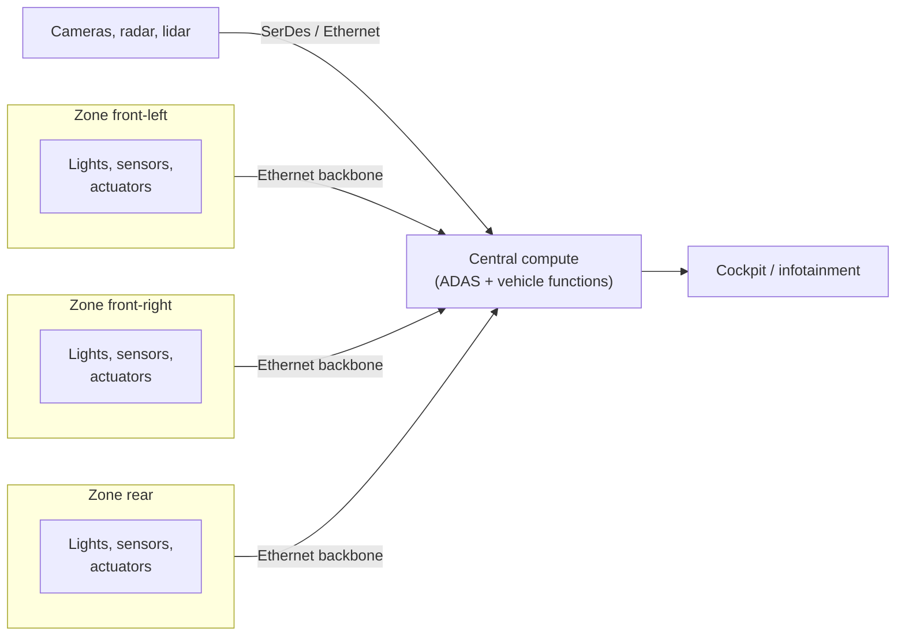
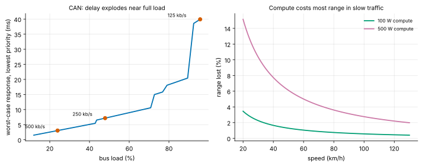

<!-- status: verified -->
# 27-06 · Automotive E/E Architecture and ADAS Compute

| | |
|---|---|
| **Course** | [27 · System Architectures (Case-Study Course)](../README.md) |
| **University equivalent** | The automotive-electronics case study of an embedded-systems or vehicle-systems course: in-vehicle networks and their timing, electrical/electronic architecture, driver-assistance compute and functional safety |
| **Prerequisites** | [27-01](27-01-system-analysis-method.md) (budgets), [17-13](../../17-communication-systems/chapters/17-13-computer-networks-fundamentals.md) (networks), [18-07](../../18-embedded-systems-and-microcontrollers/chapters/18-07-rtos-concepts.md) (real-time scheduling), [24-03](../../24-high-speed-io-signal-integrity-and-photonics/chapters/24-03-serdes-architecture.md) (SerDes), [25-10](../../25-fabrication-packaging-test-and-reliability/chapters/25-10-qualification-and-functional-safety.md) (qualification and functional safety), [26-07](../../26-engineering-design-and-professional-practice/chapters/26-07-engineering-ethics.md) (FIT budgets and fleet risk) |
| **Estimated study hours** | 9 |
| **Last verified** | 2026-11-26 |

**Learning objectives.** After this chapter you can:

1. Explain distributed, domain and zonal E/E architectures and estimate what a zonal layout saves in wiring.
2. Compute a CAN frame's length with bit stuffing, a bus's load and a message's worst-case response time, and choose between CAN, CAN FD, automotive Ethernet and camera SerDes links.
3. Size the sensor bandwidth and the AI compute of a driver-assistance system, and the driving range its power costs an electric vehicle.
4. Relate latency to distance travelled and stopping distance, and diagnostic coverage to residual failure rate against an ASIL budget.
5. Explain what a software-defined vehicle changes in the silicon and the update pipeline, and question claims about autonomy compute.

---

## 1. Big picture

A modern car carries dozens of electronic control units, kilometres of wiring, a handful of networks and, increasingly, a central computer rated at hundreds of int8 TOPS (NVIDIA quotes up to 1,000 for DRIVE AGX Thor [R-700]), still a fraction of one datacenter accelerator (27-07). Its electronics must survive fifteen years of heat, cold and vibration, meet functional-safety standards for anything that can steer or brake, and accept software updates over the air. Driver-assistance computers are rated in tens to hundreds of TOPS: Mobileye's EyeQ 6 High is 34 int8 TOPS, and its highest system tier is quoted as "> 4x" of them [R-688].

- **Why it exists:** features (driver assistance, infotainment, electrification) arrived one control unit at a time; the resulting complexity, wiring weight and software fragmentation now push the industry to consolidate into a few powerful computers.
- **Where it shows up:** every new vehicle; most visibly in electric vehicles and in driver-assistance and automated-driving systems.
- **What decides it:** wiring cost and weight, network bandwidth and timing, compute per watt (range in an EV), functional safety and the cost of keeping software current for a decade or more.
- **Why it matters to a business reader:** automotive is one of the largest and longest-lived semiconductor markets, with high qualification barriers; central compute and zonal controllers are reshaping who supplies what, from microcontrollers to AI processors.

## 2. Intuition first

**From a company of specialists to a headquarters with regional offices.** The classic car was like a company where every function hired its own specialist and ran its own phone line to every desk it needed (one ECU per function, wired point to point). The **domain** architecture grouped specialists into departments (powertrain, chassis, body, infotainment) each with a manager (domain controller). The **zonal** architecture reorganizes by geography: a few regional offices (zone controllers) handle everything physically near them, and a headquarters (central computer) makes the decisions, connected by a fast backbone.

*Figure 0. A zonal architecture: local I/O terminates in zone controllers; decisions run on central compute (generic).*

**The finance analogy: shared services.** Consolidating ECUs into central compute is like a company moving finance, HR and IT from every business unit into shared services: fewer, larger systems, lower duplication, easier upgrades, but a single point whose failure matters more, so it must be built with redundancy and governance (here, functional safety).

*Where the analogy breaks:* a company can tolerate a slow shared service; a car cannot tolerate a late braking command. Timing guarantees, not just throughput, decide the design.

## 3. Theory

### 3.1 Three architectures

- **Distributed:** each function (window lift, engine control, airbag) has its own ECU, wired to its sensors and actuators and to a shared bus. Simple to add a feature; expensive in total wiring, ECU count and software integration.
- **Domain:** functions are grouped by domain under a domain controller (powertrain, chassis, body, infotainment, ADAS). Fewer ECUs, but wiring still follows function: a domain controller in the centre of the car is wired to its endpoints in every corner.
- **Zonal:** endpoints are wired to the nearest **zone controller**, which also distributes power; zones connect over a high-speed backbone (Ethernet) to **central compute**, where most software runs. Wiring follows geography, so endpoint wires are short and the long runs become a few backbone links (Example 27-06.5).

The zonal step is also a software step: once functions run on a central computer with an operating system and middleware, they can be updated together and new features added without new boxes, which is what "software-defined vehicle" means in hardware terms.

### 3.2 CAN: arbitration, frames and timing

The **Controller Area Network (CAN)** is still the workhorse for control messages. Every node sees a two-wire differential bus with two states: **dominant** (logic 0), driven, and **recessive** (logic 1), the idle state. If any node transmits dominant, the bus is dominant: a wired-AND.

**Arbitration.** A frame begins with an identifier transmitted most significant bit first. Each transmitter reads the bus while sending; a node that sends recessive but reads dominant has lost to a lower identifier and stops. The lowest identifier wins without a collision or lost time, so **the identifier is the priority**, and the bus behaves like a fixed-priority, non-preemptive scheduler.

**Frame length and bit stuffing.** A classic data frame with an 11-bit identifier and $n$ data bytes has 34 + 8n bits from start-of-frame to the end of the CRC (start bit, identifier, control bits, data length, data, 15-bit CRC), then 13 more (CRC delimiter, acknowledgment slot and delimiter, 7-bit end-of-frame, 3-bit interframe space). To keep receivers synchronized, after five identical bits the transmitter inserts one opposite **stuff bit**. Stuff bits are themselves counted in the next run, so the worst case is one stuff bit per four bits after the first, and the worst-case frame is

$$
N_{bits}(n) = 34 + 8n + 13 + \left\lfloor \frac{34 + 8n - 1}{4} \right\rfloor ,
$$

135 bits for 8 data bytes, 270 µs at 500 kb/s. The payload is only 64 of those 135 bits.

**Bus load and response time.** A set of periodic messages $i$ with frame times $C_i$ and periods $T_i$ loads the bus to $U = \sum C_i/T_i$. Because the bus is a fixed-priority non-preemptive scheduler, a message's worst-case response time (18-07's response-time analysis) is

$$
w_i = B_i + \sum_{j \in hp(i)} \left\lceil \frac{w_i + \tau_{bit}}{T_j} \right\rceil C_j , \qquad R_i = w_i + C_i .
$$

The **queuing time** $w_i$ runs from the worst-case release until message $i$ wins arbitration; it is found by iteration, starting from $w_i = B_i$ and evaluating the right side with the current $w_i$ until it stops changing. Here $B_i$ is the longest lower-priority frame, which may have just started (non-preemption); $hp(i)$ are the higher-priority messages; and $\tau_{bit}$ is one bit time (the reciprocal of the bit rate), the margin that counts a higher-priority message released just as message $i$'s arbitration begins, which still beats it. This single-instance form is exact when the **level-$i$ busy period** (the longest stretch the bus stays busy with message $i$ and higher-priority traffic) is no longer than $T_i$ and messages have no release jitter; otherwise later instances of message $i$ must be checked too (Davis et al., §13). In Example 27-06.1 the busy period at 125 kb/s is 39.9 ms, well inside the 100 ms period. As $U$ approaches 1, the response times of low-priority messages grow far faster than $U$ (Example 27-06.1), which is why designers keep CAN loads well below saturation.

**Beyond classic CAN.** **CAN FD** keeps arbitration at the classic rate but switches to a faster data phase and allows up to 64 data bytes; **CAN XL** goes further in both. **Automotive Ethernet** carries the backbone and higher-rate data over single twisted pairs: 10BASE-T1S (a multidrop bus that can replace CAN in zones), 100BASE-T1 and 1000BASE-T1, and multi-gigabit links. Cameras need still more and usually use point-to-point **SerDes** links (24-03) that carry raw video in one direction and control in the other. CAN XL reaches 20 Mb/s and beyond with data fields of up to 2048 bytes; 10BASE-T1S was standardized in IEEE 802.3cg-2019 multi-gigabit automotive Ethernet in 802.3ch-2020 [R-689], and 25 Gb/s automotive Ethernet in 802.3cy-2023 [R-700].

### 3.3 Sensor bandwidth

A camera produces $P$ pixels per frame at $f$ frames per second and $b$ bits per pixel:

$$
R_{cam} = P\,f\,b .
$$

An 8-megapixel camera at 30 frames/s and 12 bits per pixel (raw sensor data) produces 2.88 Gb/s; eight of them produce 23 Gb/s. Radar and lidar are much smaller per sensor (megabits to a few hundred megabits per second). The camera load is why the central computer's input is a bank of SerDes receivers rather than an Ethernet port, and why some designs compress or process images near the camera (Example 27-06.2).

### 3.4 Sizing ADAS compute and its cost in range

A perception network that needs $G$ operations per frame, run on $N_c$ cameras at $f$ frames/s, needs a sustained $N_cfG$ operations per second. Real accelerators achieve a utilization $u$ of their peak, so the peak rating required is

$$
\text{TOPS}_{peak} = \frac{N_cfG}{u},
$$

before tracking, fusion, planning and redundancy multiply it (Example 27-06.3).

In an electric vehicle the computer's power $P_c$ competes with the power to drive. At speed $v$ with consumption $e$ (Wh/km), driving draws $P_d = ev$, and the fraction of range lost to a constant compute load is

$$
\frac{\Delta R}{R} = \frac{P_c}{P_c + P_d}.
$$

It is largest in slow city driving, where $P_d$ is small (Example 27-06.4).

### 3.5 Latency is distance

A car at speed $v$ travels $vt$ during a latency $t$: at 130 km/h, 100 ms is 3.6 m. The stopping distance adds the braking distance $v^2/(2a)$ for deceleration $a$:

$$
d_{stop} = vt + \frac{v^2}{2a}.
$$

Every stage between photon and brake (exposure, transfer, perception, planning, actuation) spends part of $t$. This is why perception runs at a fixed frame rate with bounded latency, and why a fast average is not enough: the design must bound the worst case.

### 3.6 Functional safety in the architecture

ISO 26262 assigns each safety goal an **automotive safety integrity level (ASIL)**, from A to D, and sets hardware targets for the item's probability of violating it (26-07 gives the FIT targets and what they mean for a fleet). An SoC with raw failure rate $\lambda$ whose safety mechanisms (lockstep cores, ECC, built-in self-test, watchdogs) detect a fraction $DC$ of failures, the **diagnostic coverage**, leaves a residual rate

$$
\lambda_{res} = \lambda\,(1 - DC).
$$

Two refinements matter in practice. The formula applies to the safety-related part of $\lambda$ and counts single-point and residual faults, the ones that violate the safety goal at once; **latent faults**, which stay hidden until a second fault, are measured by a separate latent-fault metric. And the hardware targets (26-07) exist for ASIL B to D; the sources used here give none for ASIL A [R-614]. Budgets are shared among an item's parts, so a large SoC needs high coverage to fit its share (Example 27-06.6). Systems that must keep working after a fault (higher automation levels, where the driver is not an immediate fallback) need **fail-operational** designs: redundant compute and power paths, with independent failure modes, not just detection. A central computer that consolidates many functions inherits the strictest of their ASILs unless it isolates them (mixed-criticality partitioning in hardware and software).

### 3.7 Software-defined vehicles and updates

A **software-defined vehicle** separates hardware from features: central compute with headroom, a service-oriented software platform and **over-the-air (OTA)** updates that can change behaviour for the vehicle's life. The hardware consequences are concrete: compute and memory headroom bought at launch for features not yet written, storage for two software images (so an update can be installed beside the running one and rolled back), secure boot and update authentication (18-11), and a cellular link sized for multi-gigabyte downloads. An update of $S$ gigabytes at an effective $r$ megabits per second takes $8000S/r$ seconds, and a fleet multiplies it into petabytes.

## 4. Worked examples

All parameters below are illustrative assumptions of realistic size unless a source is cited; §7 and §9 give dated, sourced figures.

### Example 27-06.1 · A CAN bus under load (tier B)

**Setup.** A chassis CAN bus carries twelve periodic messages, listed in priority order (identifier order) with data length and period: two 8-byte messages every 5 ms; three 8-byte every 10 ms; one 4-byte and two 8-byte every 20 ms; one 2-byte and one 8-byte every 50 ms; two 8-byte every 100 ms. Using worst-case bit stuffing, find (a) the length and duration of an 8-byte frame at 500 kb/s and its payload efficiency, (b) the bus load at 500, 250 and 125 kb/s, and (c) the worst-case response time of the highest- and lowest-priority messages at each rate.

**Solution.**

- (a) $34 + 64 + 13 + \lfloor 97/4 \rfloor = 111 + 24$ = **135** bits, **270** µs at 500 kb/s. Payload efficiency $64/135$ = **47.4**%.
- (b) Summing $C_i/T_i$ by period group at 500 kb/s: **10.8**% (5 ms), **8.1**% (10 ms), **3.65**% (20 ms), **0.84**% (50 ms) and **0.54**% (100 ms), a total of **23.9**%. Halving the bit rate doubles every frame time, so the load is **47.9**% at 250 kb/s and **95.7**% at 125 kb/s.
- (c) The highest-priority message waits at most for one lower-priority frame already on the bus, then sends: $0.27 + 0.27$ = **0.54** ms at 500 kb/s.

  For the lowest-priority message $B = 0$ (nothing ranks below it). At 125 kb/s, $\tau_{bit}$ = **8** µs and the frames take $C$ = **1.08** ms (8 bytes), **0.76** ms (4 bytes) and **0.60** ms (2 bytes). Starting from $w = 0$, the first pass counts each of the eleven higher-priority messages once: $9 \times 1.08 + 0.76 + 0.60$ = **11.08** ms. Each later pass counts, for every higher-priority message, the instances released before $w + \tau_{bit}$: at $w$ = 11.08 ms that is three of each 5 ms message and two of each 10 ms message, giving **18.64** ms. The iteration runs

  $$
  w:\ 0 \to 11.08 \to 18.64 \to 20.80 \to 29.12 \to 31.28 \to 36.68 \to 38.84 \to 38.84\ \text{ms},
  $$

  so $R = 38.84 + 1.08$ = **39.9** ms at 125 kb/s. The same iteration gives **3.04** ms at 500 kb/s and **7.16** ms at 250 kb/s (Problem 27-06.14 does the 250 kb/s case by hand).

**Units check.** bits ÷ (bits/s) = s; ms ÷ ms dimensionless. ✓

**Sanity check.** Halving the bit rate doubles the load but more than doubles the worst-case delay; at 96% load the lowest-priority message waits thirteen times longer than at 24%. It still meets its 100 ms deadline here, but the margin is thinner than 39.9 ms suggests. Charging each error 31 bit times plus a retransmitted 8-byte frame, one error frame raises the response to **61.0** ms and three to **99.7** ms; a fourth makes it **101.0** ms, a miss. Two more 8-byte messages every 100 ms raise it to **79.8** ms, and four more push the load past 100%, so no response time is bounded at all. This is why CAN networks are budgeted at well under full load, and why new traffic moves to CAN FD or Ethernet.

### Example 27-06.2 · How much data comes in? (tier A)

**Setup.** A driver-assistance system has eight 8-megapixel cameras at 30 frames/s and 12 bits per pixel, five radars at 20 Mb/s each, and one lidar producing 2.0 million points/s at 16 bytes per point. Find each data rate, the total and the cameras' share.

**Solution.**

- One camera: $8 \times 10^6 \times 30 \times 12$ = **2.88** Gb/s; eight: **23.04** Gb/s.
- Radars: $5 \times 20$ Mb/s = **0.10** Gb/s. Lidar: $2.0 \times 10^6 \times 16 \times 8$ = **0.256** Gb/s.
- Total **23.4** Gb/s; cameras **98.5**%.

**Units check.** pixels/frame × frames/s × bits/pixel = bits/s. ✓

**Sanity check.** The cameras carry about **65** times the data of the radars and lidar together (one camera carries about **144** times a 20 Mb/s radar's data and **11** times the lidar's), so camera links (one SerDes lane per camera) and on-chip image processing are where the data problem lives; radar and lidar fit on ordinary Ethernet links.

### Example 27-06.3 · Sizing the ADAS computer (tier B)

**Setup.** The perception network needs 80 billion operations per camera frame. Find (a) the sustained operations per second for Example 27-06.2's cameras, (b) the peak TOPS needed at 30% utilization, (c) the peak with a factor of 2 for fusion, planning and redundancy, and (d) the power of such a chip at 2.5 TOPS/W of peak.

**Solution.**

- (a) $8 \times 30 \times 80 \times 10^9$ = **19.2** TOPS sustained.
- (b) $19.2/0.30$ = **64** TOPS.
- (c) **128** TOPS.
- (d) $128/2.5$ = **51.2** W.

**Units check.** frames/s × ops/frame = ops/s; TOPS ÷ TOPS/W = W. ✓

**Sanity check.** Tens of watts for a driver-assistance computer is plausible for a liquid- or air-cooled module in the car; the utilization assumption carries a factor of three and is the number to challenge in any vendor claim.

### Example 27-06.4 · What compute costs in range (tier B)

**Setup.** An electric car consumes 150 Wh/km at an urban 50 km/h and 180 Wh/km at a highway 110 km/h. Find the fraction of range lost to a 500 W automated-driving computer and to a 100 W driver-assistance computer in each case.

**Solution.**

- Driving power: urban $150 \times 50$ = **7.5** kW; highway $180 \times 110$ = **19.8** kW.
- 500 W: urban $0.5/(0.5 + 7.5)$ = **6.25**%; highway $0.5/(0.5 + 19.8)$ = **2.46**%.
- 100 W: urban **1.32**%; highway **0.50**%.

**Units check.** Wh/km × km/h = W. ✓

**Sanity check.** A robotaxi-class computer costs several percent of range in town, where such vehicles spend their time; a 100 W driver-assistance box costs about one percent. Compute efficiency is an EV range lever, but battery size and aerodynamics dominate on the highway.

### Example 27-06.5 · Wiring by geography (tier C)

**Setup.** A 4.5 m × 1.8 m car has four clusters of 12 endpoints (lights, sensors, actuators) near its corners, centred at (0.5, 0.3), (0.5, 1.5), (4.0, 0.3) and (4.0, 1.5) m, with the endpoints at offsets of ±0.2 m and 0 along the car and ±0.15 m across it, plus a second set at half those along-car offsets and double the across-car offsets. In the domain design each endpoint is wired to one of three domain controllers at (1.5, 0.9), (2.0, 0.9) and (2.5, 0.9) m, each cluster's twelve endpoints being shared four to each controller. In the zonal design each endpoint is wired to a zone controller at its cluster centre, and each zone has one backbone link to central compute at (2.25, 0.9) m. Wires run along the car's axes (Manhattan distance). Find the total wire length of each design and the saving.

**Solution.**

- Domain: every endpoint lies on one side of all three controllers, so the along-car distances simply add, and which four endpoints go to which controller does not matter. Each front cluster's along-car wiring is $4 \times (1.5 + 2.0 + 2.5) - 12 \times 0.5 = 24 - 6$ = **18** m, each rear cluster's $12 \times 4.0 - 24$ = **24** m. Across the car, a cluster centred 0.6 m from the controllers' line has endpoints at 0.75, 0.45, 0.9 and 0.3 m from it, three of each: $3 \times 2.4$ = **7.2** m per cluster. The total is $2 \times (18 + 7.2) + 2 \times (24 + 7.2)$ = **112.8** m.
- Zonal: each cluster's endpoints lie $2 \times (0.35 + 0.15 + 0.35) + 2 \times (0.4 + 0.3 + 0.4)$ = **3.9** m from its zone controller, so the endpoint wiring is **15.6** m; each zone is $1.75 + 0.6$ = **2.35** m from central compute, so the backbone is $4 \times (1.75 + 0.6)$ = **9.4** m, total **25.0** m.
- Saving $1 - 25.0/112.8$ = **77.8**%.

**Units check.** Sums of metres. ✓

**Sanity check.** The saving comes from replacing many long runs (every endpoint to the middle of the car) with short local runs and four long ones. Real harnesses also carry power, and backbone links are heavier, so the mass saving is smaller than the length saving; but the direction, and the reduced number of connectors and controllers, is why the industry is moving to zones.

### Example 27-06.6 · Latency, distance and a safety budget (tier B)

**Setup.** (a) How far does a car at 130 km/h travel during 100 ms of perception and decision latency? (b) Find its stopping distance at 8 m/s² of braking with 100 ms and with 300 ms of total latency. (c) The ADAS SoC has a raw failure rate of 600 FIT and may contribute 5 FIT of residual failures to an ASIL D item. What diagnostic coverage does it need, and what residual rate does 99% coverage give? (d) How many residual events per year would 5 FIT mean in 5 million cars driven 1.5 hours a day?

**Solution.**

- (a) $130/3.6 \times 0.1$ = **3.61** m.
- (b) Braking distance $36.1^2/(2 \times 8)$ = **81.5** m; stopping **85.1** m with 100 ms and **92.3** m with 300 ms.
- (c) $DC \ge 1 - 5/600$ = **99.17**%; at 99%, $600 \times 0.01$ = **6.0** FIT, over the share.
- (d) $5 \times 10^6 \times 1.5 \times 365 \times 5 \times 10^{-9}$ = **13.7** events per year.

**Units check.** m/s × s = m; (m/s)²/(m/s²) = m; FIT × 10⁻⁹/h × h = events. ✓

**Sanity check.** Two hundred milliseconds of extra latency costs 7.2 m at highway speed, more than a car length: latency is a safety parameter. A tenth of a percent of diagnostic coverage decides whether the SoC fits its budget, and even a compliant design produces a dozen residual events a year across a large fleet, which is why the fleet-level view of 26-07 matters.

<!-- answer-key -->

| ID | Quantity | Value | Unit |
|---|---|---|---|
| Ex 27-06.1a | 8-byte frame, worst case | 135 | bits |
| Ex 27-06.1a0 | frame bits before stuffing | 111 | bits |
| Ex 27-06.1a2 | worst-case stuff bits | 24 | bits |
| Ex 27-06.1a1 | 8-byte frame time at 500 kb/s | 270 | µs |
| Ex 27-06.1a3 | payload efficiency | 47.4 | % |
| Ex 27-06.1b | bus load at 500 kb/s | 23.9 | % |
| Ex 27-06.1b1 | bus load at 250 kb/s | 47.9 | % |
| Ex 27-06.1b2 | bus load at 125 kb/s | 95.7 | % |
| Ex 27-06.1c | highest-priority response at 500 kb/s | 0.54 | ms |
| Ex 27-06.1c1 | lowest-priority response at 500 kb/s | 3.04 | ms |
| Ex 27-06.1c2 | lowest-priority response at 250 kb/s | 7.16 | ms |
| Ex 27-06.1c3 | lowest-priority response at 125 kb/s | 39.9 | ms |
| Ex 27-06.1c4 | ratio of lowest-priority delays, 125 to 500 kb/s | 13 | — |
| Ex 27-06.1b3 | load of 5 ms messages at 500 kb/s | 10.8 | % |
| Ex 27-06.1b4 | load of 10 ms messages | 8.1 | % |
| Ex 27-06.1b5 | load of 20 ms messages | 3.65 | % |
| Ex 27-06.1b6 | load of 50 ms messages | 0.84 | % |
| Ex 27-06.1b7 | load of 100 ms messages | 0.54 | % |
| Ex 27-06.1t | bit time at 125 kb/s | 8 | µs |
| Ex 27-06.1t1 | 8-byte frame at 125 kb/s | 1.08 | ms |
| Ex 27-06.1t2 | 4-byte frame at 125 kb/s | 0.76 | ms |
| Ex 27-06.1t3 | 2-byte frame at 125 kb/s | 0.60 | ms |
| Ex 27-06.1w1 | queuing time, pass 1 | 11.08 | ms |
| Ex 27-06.1w2 | queuing time, pass 2 | 18.64 | ms |
| Ex 27-06.1w3 | queuing time, pass 3 | 20.80 | ms |
| Ex 27-06.1w4 | queuing time, pass 4 | 29.12 | ms |
| Ex 27-06.1w5 | queuing time, pass 5 | 31.28 | ms |
| Ex 27-06.1w6 | queuing time, pass 6 | 36.68 | ms |
| Ex 27-06.1w7 | converged queuing time | 38.84 | ms |
| Ex 27-06.1e1 | response with one error frame | 61.0 | ms |
| Ex 27-06.1e3 | response with three error frames | 99.7 | ms |
| Ex 27-06.1e4 | response with four error frames | 101.0 | ms |
| Ex 27-06.1m2 | response with two more 100 ms messages | 79.8 | ms |
| Ex 27-06.2d | cameras against radars and lidar | 65 | — |
| Ex 27-06.2d1 | one camera against one radar | 144 | — |
| Ex 27-06.2d2 | one camera against the lidar | 11 | — |
| Ex 27-06.2a | one camera | 2.88 | Gb/s |
| Ex 27-06.2a1 | eight cameras | 23.04 | Gb/s |
| Ex 27-06.2b | radars | 0.10 | Gb/s |
| Ex 27-06.2b1 | lidar | 0.256 | Gb/s |
| Ex 27-06.2c | total | 23.4 | Gb/s |
| Ex 27-06.2c1 | camera share | 98.5 | % |
| Ex 27-06.3a | sustained work | 19.2 | TOPS |
| Ex 27-06.3b | peak at 30% utilization | 64 | TOPS |
| Ex 27-06.3c | peak with factor 2 | 128 | TOPS |
| Ex 27-06.3d | power at 2.5 TOPS/W | 51.2 | W |
| Ex 27-06.4a | urban driving power | 7.5 | kW |
| Ex 27-06.4a1 | highway driving power | 19.8 | kW |
| Ex 27-06.4b | 500 W, urban | 6.25 | % |
| Ex 27-06.4b1 | 500 W, highway | 2.46 | % |
| Ex 27-06.4c | 100 W, urban | 1.32 | % |
| Ex 27-06.4c1 | 100 W, highway | 0.50 | % |
| Ex 27-06.5a | domain wiring | 112.8 | m |
| Ex 27-06.5b | zonal endpoint wiring | 15.6 | m |
| Ex 27-06.5b1 | zonal backbone | 9.4 | m |
| Ex 27-06.5b2 | zonal total | 25.0 | m |
| Ex 27-06.5c | saving | 77.8 | % |
| Ex 27-06.5d | along-car wiring, front cluster | 18 | m |
| Ex 27-06.5d1 | along-car wiring, rear cluster | 24 | m |
| Ex 27-06.5d2 | across-car wiring per cluster | 7.2 | m |
| Ex 27-06.5d3 | zonal endpoint wiring per cluster | 3.9 | m |
| Ex 27-06.5d4 | one backbone link | 2.35 | m |
| Ex 27-06.6a | distance in 100 ms at 130 km/h | 3.61 | m |
| Ex 27-06.6b0 | braking distance | 81.5 | m |
| Ex 27-06.6b | stopping distance, 100 ms | 85.1 | m |
| Ex 27-06.6b1 | stopping distance, 300 ms | 92.3 | m |
| Ex 27-06.6b2 | extra distance for 200 ms | 7.2 | m |
| Ex 27-06.6c | diagnostic coverage needed | 99.17 | % |
| Ex 27-06.6c1 | residual at 99% | 6.0 | FIT |
| Ex 27-06.6d | fleet events per year at 5 FIT | 13.7 | events |
| Ex 27-06.6v | speed at 130 km/h | 36.1 | m/s |
| Txt 27-06.1 | distance per 100 ms at 50 km/h | 1.4 | m |
| Txt 27-06.2 | distance per 100 ms at 130 km/h | 3.6 | m |
| Txt 27-06.3 | 8-byte frame time at 500 kb/s (table) | 270 | µs |
| Txt 27-06.4 | camera raw rate (table) | 2.88 | Gb/s |
| Txt 27-06.5 | level-i busy period at 125 kb/s | 39.9 | ms |

## 5. Simulate it

The lab is [labs/27-06-lab/](../labs/27-06-lab/README.md). `automodel.py` implements CAN frame length, bus load and response time; camera data rate, TOPS sizing and range loss; reaction and stopping distance; star and zonal wiring; residual FIT, fleet events and update time.

1. *Predict* the lowest-priority response time on Example 27-06.1's bus at 125 kb/s with one more 8-byte, 100 ms message, then plot the lowest-priority response time against bit rate.
2. *Predict* how many 8-megapixel cameras fit within 40 Gb/s, then plot input rate against camera count.
3. *Predict* the range lost to a 500 W computer at 30 km/h, then plot range loss against speed.
4. *Predict* the stopping distance at 130 km/h with 0.5 s of latency, then plot it against latency.

*Figure 1. CAN response time against load for Example 27-06.1's message set, and the range cost of compute against speed, with consumption assumed to rise linearly from 140 Wh/km at 20 km/h to 190 Wh/km at 130 km/h (close to, but not the same as, Example 27-06.4's two points).*

## 6. Engineering tradeoffs

| Knob | Improves | Costs | Typical decision owner |
|---|---|---|---|
| Zonal architecture | Wiring length and mass, ECU count, software consolidation | Redesign, a new backbone, safety partitioning in central compute | E/E architecture team with OEM leadership |
| CAN FD / CAN XL instead of classic CAN | Payload and bandwidth on the same priority model | Transceivers, timing margins, tooling | Network architecture |
| Automotive Ethernet backbone | Bandwidth, IP-based software | Switches, time-synchronization (TSN) complexity | Network and software platform teams |
| More cameras or higher resolution | Perception range and coverage | Input bandwidth, compute, power, cost | ADAS system team |
| Bigger central AI computer | Features, headroom for future software | Power (range), cooling, cost at launch | Product with ADAS and E/E teams |
| Lower perception latency | Stopping distance, safety margin | Frame rate, compute, pipelining effort | ADAS software and SoC teams |
| Higher diagnostic coverage | Residual failure rate (ASIL fit) | Area (lockstep, ECC, BIST), verification effort | Safety manager with SoC team |
| Fail-operational redundancy | Availability for higher automation levels | Duplicate compute, power and sensors | System safety and product |
| OTA update capability | Features and fixes over the vehicle's life | Storage for two images, security, cellular cost | Software platform and security teams |

## 7. Numbers to know

Product and market figures are as of Nov 2026.

| Quantity | Value | Note |
|---|---|---|
| Classic CAN | up to 135 bits per 8-byte frame; 270 µs at 500 kb/s | Arithmetic from the frame format (§3.2) |
| CAN FD | up to 64 data bytes, faster data phase | §3.2 |
| CAN XL | 20 Mb/s and higher; 1–2048 data bytes | CiA [R-689] |
| Automotive Ethernet standards | 10BASE-T1S in IEEE 802.3cg-2019; multi-gigabit PHYs in 802.3ch-2020; 25 Gb/s in 802.3cy-2023 | IEEE [R-689, R-700] |
| Camera link standard | MIPI A-PHY v2.1 (Sep 2026): up to 15 m, 24 and 32 Gb/s gears; IEEE 2977-2021 | MIPI [R-700] |
| ADAS SoC | 34 TOPS int8, 7 nm (EyeQ 6 High); 5 TOPS (EyeQ 6 Lite) | Mobileye [R-688] |
| Automated-driving tiers | "2x", "> 3x", "> 4x" EyeQ 6 High (SuperVision, Chauffeur, Drive), as Mobileye writes them | Mobileye [R-688] |
| Robotaxi compute | dual DRIVE AGX Thor SoCs (Hyperion) | NVIDIA [R-688] |
| Central-compute SoC | up to 1,000 INT8 TOPS, 64 GB LPDDR5X, up to 273 GB/s (DRIVE AGX Thor); up to 400 TOPS on 3 nm (Renesas R-Car X5H, sampling) | NVIDIA, Renesas [R-700] |
| ECU and harness consolidation | 17 → 7 ECUs and 2.6 km less wiring (Rivian R1, 2024); harness about 600 m shorter and about 30% lighter (BMW iX3, 2026) | Rivian; Infineon [R-700] |
| Automotive semiconductor market | US$ 74.4 B in 2025 (2024: 69.9 B) | TechInsights via Infineon [R-700] **[Industry estimate]** |
| Cyber-security and update rules | UN R155 and R156 in force 22 Jan 2021 | EU Official Journal [R-700] |
| Camera raw data | 2.88 Gb/s for 8 MP, 30 fps, 12-bit | Arithmetic (§3.3) |
| ASIL hardware targets | < 100 FIT (ASIL B, C), < 10 FIT (ASIL D) | ISO 26262-5 via 26-07 [R-614] |
| Distance per 100 ms | **1.4** m at 50 km/h, **3.6** m at 130 km/h | Arithmetic (§3.5) |

## 8. Common mistakes

- **Sizing a CAN bus by average load.** Worst-case response time, which grows steeply near saturation, decides whether deadlines are met; use worst-case frame lengths with stuffing.
- **Forgetting blocking.** Even the highest-priority CAN message can wait for a lower-priority frame already on the bus.
- **Quoting peak TOPS as capability.** Utilization, network size and the rest of the pipeline (fusion, planning, redundancy) decide what a computer can do.
- **Ignoring compute in range.** Hundreds of watts of compute cost several percent of an EV's range in town, where automated driving is most often deployed.
- **Treating latency as a performance metric only.** Every 100 ms at highway speed is several metres of travel before the brakes act.
- **Equating ASIL compliance with zero risk.** The targets bound residual rates; across millions of vehicles, residual events still happen (26-07).
- **Assuming consolidation is free.** A central computer that hosts several functions must meet the highest ASIL among them or isolate them, and it becomes a single point whose failure matters more.

## 9. Practitioner lens

**State of play (as of Nov 2026).**

- **Compute is tiered by multiplying chips** (vendor claims). Mobileye sells one EyeQ 6 High (34 int8 TOPS, 7 nm) for premium driver assistance, "2x" for its hands-off SuperVision, "> 3x" for eyes-off Chauffeur and "> 4x" for driverless Drive [R-688] **[Established as manufacturer claims]**. NVIDIA's robotaxi platform pairs two DRIVE AGX Thor SoCs, each quoted at up to 1,000 INT8 TOPS; Renesas's R-Car X5H, sampling since Dec 2025, claims up to 400 TOPS on 3 nm with chiplet acceleration [R-688, R-700] **[Established as manufacturer claims]**. The pattern matches §3.4 and §3.6: more autonomy means more perception, more planning and redundancy for fail-operational behaviour.
- **Networks are being re-plumbed.** CAN remains for control; CAN XL (20 Mb/s and higher, data fields of up to 2048 bytes) targets backbones and sub-backbones, 10BASE-T1S multidrop Ethernet targets zones, and multi-gigabit automotive Ethernet (802.3ch, and 25 Gb/s in 802.3cy) carries backbones and high-rate sensors [R-689, R-700] **[Established]**. Long camera links have their own standard, MIPI A-PHY, now at v2.1 with 24 and 32 Gb/s gears over up to 15 m [R-700].
- **Architecture is consolidating, and it shows in production.** Rivian's second-generation R1 cut 17 ECUs to 7 and removed 2.6 km of wiring per vehicle; Infineon reports the BMW iX3's harness about 600 m shorter and about 30% lighter than its predecessors' [R-700] **[Established as company statements]**. Software platforms that can be updated over the air (§3.7) come with regulation: UN R155 (cyber security) and R156 (software updates) entered into force on 22 Jan 2021 [R-700] **[Established]**, and the hardware consequences (headroom, dual images, secure boot) are now part of SoC requirements.

**Commercial relevance.** Automotive semiconductors are a long-cycle, high-barrier market, about US$ 74.4 billion in 2025 by TechInsights' count [R-700] **[Industry estimate]**; NVIDIA's automotive segment, for scale, reported US$ 2.3 billion for its fiscal 2026 [R-700]. The market is defined by qualification (25-10), functional safety (ISO 26262) and supply commitments of a decade or more. The shift to zonal architectures moves value from many small ECUs (and their microcontrollers) toward fewer zone controllers, a few high-end SoCs and networking silicon (Ethernet switches and PHYs, SerDes for cameras); the shift to automation moves value into AI compute and sensors. For an investor or acquirer, the questions are which supplier owns the central compute socket and the software stack on it, and who supplies the zones.

**Marketing vs Reality.**

- *"34 DL TOPS"* [R-688]. Peak int8 operations; ask for the utilization on the vendor's own perception stack and the frame rate per camera it sustains.
- *"Up to 2,000 FP4 (1,000 INT8) TFOPS"* (sic) [R-700]. The FP4 figure is twice the INT8 one because FP4 operands are half the width; compare chips at the same precision, and ask whether the figure assumes sparsity.
- *"Level 4-capable"* [R-688]. A capability of a hardware platform, not a certified product; the safety case, operating domain and validation miles decide what the vehicle may do.
- *"20 Mbit/s and higher"* [R-689]. "Depends on the physical network design": cable length, number of nodes and transceivers set the real rate.
- *"Software-defined vehicle."* Ask how much compute and memory headroom ships at launch, how updates are validated against functional safety, and how long the hardware will be supported.

**Questions for engineering leaders.**

1. *"What is the worst-case load on your busiest CAN bus, and the worst-case response time of its lowest-priority safety message?"* Strong: numbers from a response-time analysis. Evasive: average load.
2. *"How many TOPS does your perception stack use per camera at what utilization, and what headroom is left?"* Strong: a per-stage budget. Evasive: the chip's peak TOPS.
3. *"What does your central computer cost in range, in city driving?"* Strong: watts at each operating mode and the range arithmetic. Evasive: highway figures only.
4. *"What is the photon-to-brake latency, and its worst case?"* Strong: a stage-by-stage budget with jitter. Evasive: an average.
5. *"Which ASIL does the central computer carry, how are mixed-criticality functions isolated, and what is the residual FIT budget per part?"* Strong: a safety architecture with numbers. Evasive: "we are ISO 26262 compliant".

## 10. Concept check

1. Why does the lowest CAN identifier win arbitration without corrupting the frame?

   

Answer

   The bus is a wired-AND: dominant (0) overrides recessive (1). Every transmitter reads back each bit; a node that sends recessive but reads dominant knows a lower identifier is transmitting and stops. The winning frame continues undisturbed.

   

2. Why does an 8-byte CAN frame take up to 135 bits?

   

Answer

   111 bits of frame structure and data, plus up to 24 stuff bits: after five identical bits a complementary bit is inserted, and in the worst case stuff bits recur every four bits over the 98-bit stuffed region.

   

3. Why do worst-case response times grow so fast as bus load approaches 100%?

   

Answer

   A low-priority message must wait while all higher-priority traffic released during its wait is sent; the wait extends the window in which more higher-priority frames arrive. Near full load this feedback makes the busy period very long, so response time rises much faster than load.

   

4. Why do cameras dominate the central computer's input?

   

Answer

   Data rate is pixels × frame rate × bits per pixel: an 8 MP camera at 30 fps and 12 bits is 2.88 Gb/s, about 144 times a 20 Mb/s radar and 11 times a 0.256 Gb/s lidar; eight cameras carry about 65 times the data of all the other sensors together (Example 27-06.2).

   

5. Why does compute cost more range in town than on the highway?

   

Answer

   Range loss is $P_c/(P_c + P_d)$, and driving power $P_d = ev$ is small at low speed. A 500 W computer is 6% of the power at 50 km/h but under 3% at 110 km/h.

   

6. What does diagnostic coverage buy, and what does it not?

   

Answer

   It turns detected faults into safe reactions, leaving a residual rate $\lambda(1 - DC)$ that must fit the ASIL budget. It does not keep the function working: fail-operational systems need redundancy, not just detection.

   

Problems: [27-06 problem set](../problems/27-06-problems.md) · Solutions: [27-06 solutions](../solutions/27-06-solutions.md)

## 11. Key terms

[E/E architecture](../../../reference/glossary.md#e-e-architecture) · [Zone controller](../../../reference/glossary.md#zone-controller) · [Central compute (vehicle)](../../../reference/glossary.md#central-compute-vehicle) · [Controller Area Network (CAN)](../../../reference/glossary.md#controller-area-network-can) · [Bit stuffing](../../../reference/glossary.md#bit-stuffing) · [CAN FD](../../../reference/glossary.md#can-fd) · [Automotive Ethernet](../../../reference/glossary.md#automotive-ethernet) · [Response-time analysis](../../../reference/glossary.md#response-time-analysis) · [Diagnostic coverage](../../../reference/glossary.md#diagnostic-coverage) · [Fail-operational](../../../reference/glossary.md#fail-operational) · [Software-defined vehicle](../../../reference/glossary.md#software-defined-vehicle) · [Over-the-air (OTA) update](../../../reference/glossary.md#over-the-air-ota-update)

## 12. Connections

- **Previous:** [27-05 The PC SoC](27-05-pc-soc.md): heterogeneous compute and memory bandwidth, now under safety and lifetime constraints.
- **Next:** [27-07 The AI Datacenter Server and Rack](27-07-ai-datacenter-server-and-rack.md): the same AI accelerators at the other end of the power scale.
- **Prerequisites used here:** response-time analysis ([18-07](../../18-embedded-systems-and-microcontrollers/chapters/18-07-rtos-concepts.md)); SerDes ([24-03](../../24-high-speed-io-signal-integrity-and-photonics/chapters/24-03-serdes-architecture.md)); qualification and safety ([25-10](../../25-fabrication-packaging-test-and-reliability/chapters/25-10-qualification-and-functional-safety.md)); FIT budgets and fleet risk ([26-07](../../26-engineering-design-and-professional-practice/chapters/26-07-engineering-ethics.md)).
- **Used later:** failure-rate arithmetic returns in 27-07 (interruptions of a training job across tens of thousands of accelerators); secure boot and over-the-air updates return at microcontroller scale in 27-08.

## 13. Further study

- R. I. Davis, A. Burns, R. J. Bril and J. J. Lukkien, "Controller Area Network (CAN) schedulability analysis: Refuted, revisited and revised", *Real-Time Systems* 35 (2007): the standard reference for CAN response-time analysis and the worst-case stuffing bound.
- ISO 26262 (road vehicles, functional safety), parts 1, 5 and 9, for ASIL determination and hardware metrics; ISO 21448 (SOTIF) for performance limitations of sensing and perception.
- SAE J3016 for the levels of driving automation.
- Vendor technical documentation for central compute platforms and zonal controllers, and the IEEE 802.3 automotive Ethernet amendments (802.3bw, 802.3bp, 802.3cg, 802.3ch).

## 14. Sources

1. Mobileye EyeQ 6 and NVIDIA DRIVE platform statements: [R-688].
2. CAN XL (CiA) and IEEE 802.3cg/802.3ch automotive Ethernet standards: [R-689].
3. ISO 26262 hardware targets (via 26-07): [R-614].
4. R. I. Davis, A. Burns, R. J. Bril and J. J. Lukkien, "Controller Area Network (CAN) schedulability analysis: Refuted, revisited and revised", *Real-Time Systems* 35 (2007), for the worst-case frame length and response-time analysis.
