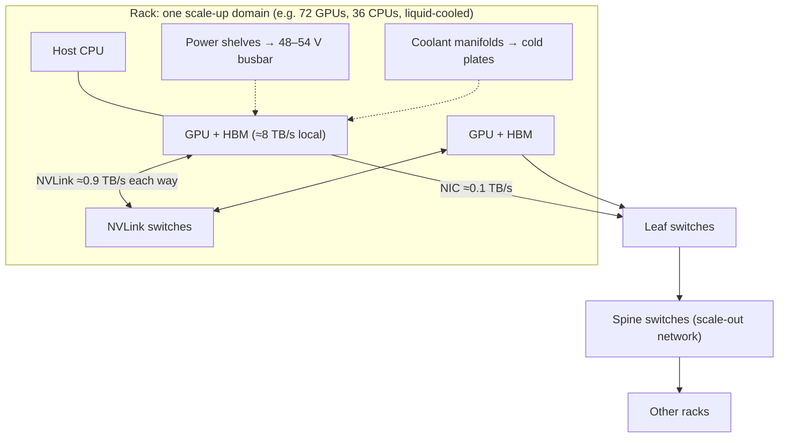

<!-- status: reviewed -->
# 27-07 · The AI Datacenter Server and Rack

| | |
|---|---|
| **Course** | [27 · System Architectures (Case-Study Course)](../README.md) |
| **University equivalent** | The warehouse-scale-computer and domain-specific-architecture units of a graduate computer-architecture course (Hennessy & Patterson, chapters on warehouse-scale computers and domain-specific architectures), with the systems part of a machine-learning-systems course: parallel training, collectives, reliability and serving |
| **Prerequisites** | [27-01](27-01-system-analysis-method.md) (budgets), [14-14](../../14-computer-organization-and-architecture/chapters/14-14-ai-accelerators.md) (AI accelerators), [14-15](../../14-computer-organization-and-architecture/chapters/14-15-roofline-and-benchmarks.md) (roofline), [23-05](../../23-memory-and-storage-technology/chapters/23-05-hbm-in-depth.md) (HBM), [24-05](../../24-high-speed-io-signal-integrity-and-photonics/chapters/24-05-pcie-cxl-ethernet.md) and [24-06](../../24-high-speed-io-signal-integrity-and-photonics/chapters/24-06-d2d-memory-phys-scale-up.md) (scale-out and scale-up links), [22-10](../../22-power-electronics-and-energy-conversion/chapters/22-10-datacenter-power-delivery.md) (rack power delivery), [25-08](../../25-fabrication-packaging-test-and-reliability/chapters/25-08-thermal-engineering.md) (liquid cooling), [03-02](../../03-probability-statistics-and-random-variables/chapters/03-02-random-variables-and-distributions.md) (the exponential distribution) |
| **Estimated study hours** | 10 |
| **Last verified** | 2026-11-26 |

**Learning objectives.** After this chapter you can:

1. Describe the anatomy of a rack-scale AI system, read its datasheet per device, and normalize compute figures for precision and sparsity before comparing them.
2. Build a rack power budget and turn it into facility power and accelerators per megawatt.
3. Estimate the compute, time and energy of a training run from model size, tokens, accelerator count and utilization.
4. Derive the ring and hierarchical all-reduce times and explain why scale-up domains exist.
5. Compute the interruption rate of a large job, the optimal checkpoint interval and the effective training time.
6. Model a rack's inference throughput, per-user speed, energy per token and cost per million tokens, and question vendor performance claims.

---

## 1. Big picture

The AI datacenter has made the rack, not the chip, the unit of design and sale. NVIDIA's GB200 NVL72 joins 72 GPUs and 36 CPUs in one liquid-cooled rack whose 72-GPU NVLink domain, in NVIDIA's words, "acts as a single, massive GPU" [R-690]. Google sells its Ironwood TPUs in pods of 256 or 9,216 chips, the larger spanning nearly 10 MW [R-693]. Such a rack draws 120–142 kW, depending on generation and definition [R-098], [R-600], and NVIDIA is leading a move to 800 V DC distribution for 1 MW racks from 2027 [R-691]. Every earlier course meets here: the accelerator (14-14), HBM (23-05), SerDes and optics (24-03 to 24-09), power delivery (22-10), cooling (25-08) and reliability physics (25-09). This chapter puts them together and asks the system questions: how long does training take, what limits scaling, how often does the job fail, and what does a token cost?

- **Why it exists:** training and serving large models need more compute and memory than any chip can hold, so thousands of accelerators must cooperate as tightly as one.
- **Where it shows up:** hyperscale and "neocloud" datacenters, sovereign AI clusters and enterprise inference racks; the accelerators of NVIDIA and AMD, the in-house designs of the largest cloud companies, and the suppliers of their switches, optics, power and cooling.
- **What decides it:** memory bandwidth, interconnect bandwidth at each level of the hierarchy, power and cooling per rack, reliability at scale, and the total cost per useful operation.
- **Why it matters to a business reader:** AI infrastructure has become a central market for semiconductors, from accelerators and HBM to networking, optics and power silicon. Its economics turn on utilization and power: a rack's capital cost dwarfs its electricity, so the questions that decide value are how busy it is kept, how many useful tokens it delivers per megawatt, and who owns each layer of the system.

## 2. Intuition first

**A bandwidth ladder.** Think of an AI cluster as a set of steps, each about ten times narrower than the one above. A GPU reads its own HBM at about 8 TB/s. It reaches the other GPUs in its rack over NVLink at 0.9 TB/s in each direction. Beyond the rack it talks over the network at a fraction of that, about 0.1 TB/s for one 800 Gb/s port (an assumed port speed; Example 27-07.1). Almost every design decision in this chapter follows from the ladder. Work that exchanges data constantly is kept on the upper steps. Only what must cross racks goes down to the network, and it is arranged so that every port carries a small share.

*Figure 0. The hierarchy of a rack-scale AI system: local memory, the scale-up domain, the scale-out network, and the power and cooling that feed the rack. Bandwidths are per GPU (Example 27-07.1).*

**A convoy.** A synchronous training job is a convoy of thousands of ships that must all finish each step before any starts the next. It moves at the pace of the slowest ship (a "straggler") and stops whenever any ship breaks down. If each ship breaks down once in about 6 years, a convoy of 16,000 stops every few hours (Example 27-07.5). So the convoy saves its position at intervals (checkpoints), and after a breakdown it resumes from the last save. The analogy breaks down in one place: a real convoy can leave a broken ship behind. A training job historically could not, because each accelerator holds a unique slice of the model. Newer systems keep spares and rebuild the slice from redundant copies, which is exactly the engineering the analogy hides.

**A factory with fixed costs.** For inference, a rack behaves like a capital-intensive factory: the depreciation runs whether or not it is producing. The production technique is batching. Each step reads the model's weights once and serves every sequence in the batch. A bigger batch spreads the weight reads over more output, until the per-sequence memory (the KV cache) dominates. Batching raises output per rack but makes each customer wait longer for each token, so throughput and interactivity trade against each other (Example 27-07.6). The financial analogy is a fixed-cost business choosing between volume and service level. Where it breaks down: the "inventory" here is memory capacity, and running out of it caps the batch abruptly.

## 3. Theory

### 3.1 Anatomy of a rack and how to read its datasheet

A rack-scale system has five parts:

- **Accelerators with stacked memory.** Each package holds one or two compute dies with HBM stacks beside them (23-05). The GB200 NVL72's 72 GPUs carry 13.4 TB of HBM3E at 576 TB/s in total [R-690]. AMD's MI355X holds 288 GB at 8 TB/s on an OAM module rated at 1400 W typical board power [R-692]. Google's Ironwood holds 192 GB at 7.37 TB/s per chip [R-693].
- **Host CPUs** that run the operating system, feed data and manage the accelerators. In GB200 a Grace CPU shares each "superchip" with two GPUs [R-690].
- **A scale-up fabric** that joins a domain of accelerators with memory-like bandwidth and latency: NVLink (24-06); AMD's Infinity Fabric, seven links of 144 GB/s peak each on MI355X [R-692]; or Google's inter-chip interconnect (ICI), 1.2 TB/s bidirectional per Ironwood chip [R-693].
- **A scale-out network** of NICs and leaf–spine switches (24-05) joining domains into a cluster, with optics for anything longer than a few metres (24-09).
- **Power and cooling:** power shelves feeding a 48–54 V busbar today and 800 V DC for future megawatt racks (22-10) [R-691], and liquid cold plates carrying most of the heat (25-08) [R-600].

**Reading the datasheet per device.** A rack datasheet quotes totals, so divide by the device count before comparing. Then check three things.

1. **Direction.** NVLink's "1.8 TB/s" per GPU counts both directions (24-06). One GPU can send at 0.9 TB/s while it receives at 0.9 TB/s.
2. **Precision.** Halving the bits per operand roughly doubles the peak rate: FP4 is about twice FP8, which is twice BF16.
3. **Sparsity.** With 2:4 structured sparsity, hardware skips two of every four weights and the peak doubles again, for models pruned to that pattern. AMD's MI355X page lists OCP-FP8 at 5 PFLOPs dense and 10.1 PFLOPs "with Structured Sparsity" [R-692]. NVIDIA's GB200 table footnotes its Tensor Core rows and lists NVFP4 as "1,440 | 720 PFLOPS"; the footnote's text did not appear on the page as read [R-690], so dense or sparse must be asked. Our reading **[Contested]**: if the lower NVFP4 figure, 720 PFLOPS, is dense, the 2× rule of item 2 puts dense FP8 near 360 PFLOPS, so the table's single FP8 figure of 720 PFLOPS must include sparsity. Dense FP8 is then about 5 PFLOP/s per GPU and 625 FLOP/byte (Example 27-07.1).

The figure that matters for most AI work is the **machine balance**: peak compute over memory bandwidth, in FLOP per byte (23-01; the roofline's ridge point, 14-15). A kernel with lower arithmetic intensity than the balance is memory-bound. Example 27-07.1 shows that three rival accelerators, compared at dense FP8 (our reading of NVIDIA's figures), sit at nearly the same balance, about 625 FLOP/byte. HBM sets the bandwidth each can buy (23-05); how much compute to put against it is a design choice, and the three designers made almost the same one.

### 3.2 The power and heat budget

A rack's input power is the sum of its loads divided by the conversion efficiency of its power shelves:

$$
P_{\text{in}} = \frac{\sum_k n_k P_k + P_{\text{fans}}}{\eta_{\text{conv}}}
$$

with $n_k$ devices of kind $k$ drawing $P_k$ (W) each, fans and pumps $P_{\text{fans}}$, and the power shelf's efficiency $\eta_{\text{conv}}$. Accelerators dominate, but CPUs, memory, NICs, switches, regulators and conversion losses add a third or more (Example 27-07.2). The facility then multiplies by its **power usage effectiveness** (PUE), total facility power over IT power. Google reports a fleet PUE of 1.09; an industry survey average for 2025 was 1.54 [R-445] **[Industry estimate]**. The number that sizes a campus is the **all-in power per accelerator**, rack input times PUE divided by accelerator count. In Example 27-07.2 it is 1.40 times the chip's own rating at the rack input and 1.68 times at the facility meter.

How that power is delivered at 48–54 V or 800 V, and how the heat is carried away by about 90% liquid and 10% air, are the subjects of 22-10 and 25-08; the numbers here only need their results. One subtlety matters at system level: **provisioned** power differs from **average** power. NVIDIA says its MaxLPS feature lowers the provisioned power of a GB200 NVL72 rack from 125 kW to 90 kW, fitting 39% more racks in the same envelope "while preserving workload throughput" [R-601] **[Established as a vendor claim]**; the source does not describe the mechanism. Our check: 125/90 is 38.9% more. For a site with a fixed grid connection, provisioning, not average consumption, sets the rack count.

> **Deeper:** see companion repo *Datacenter Networking* for fabric topologies, scale-up and scale-out networks, and how operators deploy and service them at cluster scale.

### 3.3 Training compute, time and energy

**Counting FLOPs.** A dense layer multiplies an input vector $\mathbf{x}$ of length $d_{\text{in}}$ by a weight matrix $\mathbf{W}$ of size $d_{\text{out}} \times d_{\text{in}}$.

> **Math refresher — the cost of a matrix product.** Each of the $d_{\text{out}}$ outputs $y_i = \sum_j W_{ij}x_j$ takes $d_{\text{in}}$ multiplications and $d_{\text{in}}$ additions (counting the first as an add to zero), so $\mathbf{y} = \mathbf{W}\mathbf{x}$ costs $2d_{\text{in}}d_{\text{out}}$ FLOPs: **two FLOPs per weight**. A product of an $m \times k$ and a $k \times n$ matrix costs $2mkn$.

Training each token costs three such products per layer:

- **Forward pass.** $\mathbf{y} = \mathbf{W}\mathbf{x}$: 2 FLOPs per weight.
- **Gradient for the input.** $\partial L/\partial\mathbf{x} = \mathbf{W}^{\mathsf T}\,\partial L/\partial\mathbf{y}$, which back-propagates the error: another 2 FLOPs per weight.
- **Gradient for the weights.** $\partial L/\partial\mathbf{W} = (\partial L/\partial\mathbf{y})\,\mathbf{x}^{\mathsf T}$, accumulated over the tokens: another 2.

So a dense model with $N$ parameters costs $6N$ FLOPs per training token (in a mixture-of-experts model only the $N_{\text{act}}$ parameters a token uses do this work, so use $6N_{\text{act}}$), and a run over $D$ tokens costs

$$
C_{\text{train}} \approx 6ND \quad \text{(FLOP)}.
$$

The rule leaves out three things, each small for large models at moderate context: the attention scores (which grow with context length), the embeddings, and the optimizer update (which runs once per step, not per token). Meta reports 3.8 × 10²⁵ FLOPs for Llama 3 405B on 15.6 trillion tokens; the rule gives 3.79 × 10²⁵ (Example 27-07.3) [R-694].

**Time and utilization.** With $n$ accelerators of peak rate $F_{\text{peak}}$ (FLOP/s), the run takes

$$
t = \frac{6ND}{n\,F_{\text{peak}}\,u},
$$

where $u$ is the **model FLOPs utilization (MFU)**: the useful model FLOPs actually achieved, as a fraction of peak. MFU absorbs everything that is not useful math: memory stalls, communication not hidden behind compute, pipeline bubbles and load imbalance. Meta reports 38–43% BF16 MFU for Llama 3 405B, 380–430 TFLOP/s per H100 [R-694]. A 2× faster chip at half the MFU buys nothing, which is why MFU at scale is the first number to ask for.

**Energy.** The energy is power times time:

$$
E = n\,P_{\text{acc}}\,k_{\text{sys}}\,\text{PUE}\;t.
$$

Here $P_{\text{acc}}$ is the accelerator power and $k_{\text{sys}}$ the all-in factor for the rest of the server and network. Time lost to failures (§3.6) burns power without progress, so $t$ is elapsed time, not compute time.

### 3.4 Parallelism: what runs where

A model too large for one accelerator is split in several ways at once. Each split communicates in its own pattern, and the bandwidth ladder decides where it can run.

- **Data parallelism (DP).** Every replica processes different data. Their gradients are averaged once per step with an all-reduce (§3.5). The traffic is large, but it comes once per step and can overlap with the backward pass, so it can cross the network.
- **Tensor parallelism (TP).** Each layer's matrices are split across devices, which must exchange activations several times per layer. The traffic is frequent and on the critical path, so it stays inside the scale-up domain.
- **Pipeline parallelism (PP).** Consecutive layers sit on different devices, and activations pass point to point between stages. The pipeline must fill and drain, leaving idle "bubbles".
- **Context and expert parallelism.** Context parallelism splits a long sequence across devices. In a **mixture-of-experts** (MoE) model, which routes each token through a few of many expert sub-networks, expert parallelism puts different experts on different devices, with all-to-all traffic between them.

Llama 3 405B used TP 8, matching its eight-GPU NVLink servers, with PP 16 and DP 64 or 128 across the network; for long-context training, context parallelism was 16 [R-694]. A larger scale-up domain such as 72 GPUs lets more of the frequent traffic stay on NVLink. That, more than raw FLOPS, is the case for rack-scale systems.

> **Going deeper — the pipeline bubble.** With $p$ pipeline stages and $m$ micro-batches per step in the simplest schedule, each stage idles for $p - 1$ of the $m + p - 1$ micro-batch slots. The bubble fraction is $(p-1)/(m+p-1)$, so pipelines need many micro-batches per step. Interleaved schedules shrink the bubble further at the cost of more communication; see Narayanan et al. in §13.

### 3.5 Collectives: the all-reduce

An **all-reduce** leaves every one of $p$ devices holding the elementwise sum of all their vectors, each of $S$ bytes. The **ring all-reduce** arranges the devices in a ring and splits each vector into $p$ chunks of $S/p$ bytes. It runs in two phases.

1. **Reduce-scatter.** In each of $p - 1$ steps, every device sends one chunk to its right-hand neighbour and adds the chunk it receives from its left to its own copy. After $p - 1$ steps, device $i$ holds chunk $i$ summed over all devices.
2. **All-gather.** In $p - 1$ more steps, the reduced chunks circulate the ring until every device holds all of them.

Each step, every device sends and receives $S/p$ bytes at the same time over a full-duplex link of bandwidth $B$ (bytes/s) in each direction, and pays a fixed start-up latency $\alpha$ (s). The total time is

$$
T_{\text{ring}} = 2(p-1)\left(\alpha + \frac{S}{pB}\right) = 2\,\frac{p-1}{p}\,\frac{S}{B} + 2(p-1)\,\alpha .
$$

The bandwidth term barely depends on $p$. Each device sends $2(p-1)/p \approx 2$ times its vector, whatever the ring's size: for $p = 72$ the factor is 1.97. It cannot be beaten by much. Intuitively, if each chunk is finished on one device, every device must send out the $(p-1)S/p$ bytes of its vector that belong to chunks finished elsewhere, since it cannot fold them into anything it keeps; and it must then receive the $p - 1$ finished chunks it lacks, another $(p-1)S/p$. (Counting what a device receives during the reduction is not enough: contributions can arrive already summed, so only $S/p$ need arrive.) Patarasuk and Yuan prove the bound in general (§13). The latency term, by contrast, grows linearly with $p$, which is why very large flat rings are slow even for small messages.

**Hierarchical all-reduce.** Group the $p = p_1 p_2$ devices into $p_2$ scale-up domains of $p_1$ devices, with bandwidth $B_1$ inside a domain and $B_2$ per device across domains. Then:

1. reduce-scatter inside each domain: each device now holds a shard of $S/p_1$ bytes summed over its domain;
2. all-reduce each shard across the $p_2$ domains, among the devices holding the same shard, each over its own network port;
3. all-gather inside each domain.

Ignoring latency,

$$
T_{\text{hier}} = 2\,\frac{p_1-1}{p_1}\,\frac{S}{B_1} + 2\,\frac{p_2-1}{p_2}\,\frac{S}{p_1 B_2}.
$$

The network term is divided by $p_1$. Every device's port carries only its own $1/p_1$ shard, so the domain's $p_1$ ports act as one pipe of bandwidth $p_1 B_2$. A larger scale-up domain therefore cuts network traffic per device in proportion. With 72 GPUs per rack, the network carries 1/72 of the gradient per GPU, and the all-reduce runs about 8 times faster than a flat ring over the network (Example 27-07.4).

> **Deeper:** see companion repo *LLM Inference Engineering* for collective libraries, all-to-all traffic in mixture-of-experts models, and how serving systems overlap communication with compute.

### 3.6 Reliability at scale and checkpointing

**Why big jobs fail often.** Suppose each of $N$ components fails independently with a constant rate $\lambda = 1/m$, an exponential lifetime of mean $m$ (03-02; this $m$ is unrelated to the micro-batch count of §3.4). A synchronous job stops at the first failure.

> **Math refresher — the minimum of exponentials.** The probability that one component survives to time $t$ is $e^{-\lambda t}$. All $N$ survive with probability $(e^{-\lambda t})^N = e^{-N\lambda t}$, which is again exponential, with rate $N\lambda$. So the job's mean time between failures is
>
> $$
> M = \frac{m}{N}.
> $$

Ten times more accelerators means ten times more frequent interruptions. Meta counted 419 unexpected interruptions in 54 days of Llama 3 405B training on up to 16,384 GPUs, one every 3.09 hours [R-694]. About 78% were confirmed or suspected hardware issues, and GPUs and their HBM were the largest share [R-694]. Silent data corruption appears on that list too: an accelerator that computes wrong answers without raising an error is harder to catch than one that stops.

**Young's checkpoint interval.** The job saves its state every $\tau$ seconds of work. Each save takes $\delta$ seconds, and each failure costs a restart of $R$ seconds plus the work done since the last checkpoint, on average $\tau/2$. To first order, for $\delta \ll \tau \ll M$, the fraction of elapsed time lost is

$$
f(\tau) = \frac{\delta}{\tau} + \frac{\tau/2 + R}{M}.
$$

The first term falls with $\tau$ (fewer saves) and the second rises (more rework per failure). Setting $df/d\tau = -\delta/\tau^2 + 1/(2M) = 0$ gives **Young's interval**

$$
\tau^{*} = \sqrt{2\delta M}, \qquad f(\tau^{*}) = \sqrt{\frac{2\delta}{M}} + \frac{R}{M}.
$$

At the optimum the two checkpoint terms are equal. The overhead grows only as the square root of the failure rate, but the restart term $R/M$ grows linearly: at large scale, restart time dominates. The **effective training time**, Meta's term for useful training time over elapsed time, is $1 - f$. Meta reports more than 90% for Llama 3, while sustaining at least one interruption a day from automated maintenance [R-694]. Example 27-07.5 shows what that requires: saves of about ten seconds and restarts under ten minutes.

> **Going deeper — beyond first order.** Daly's higher-order estimate (§13) corrects $\tau^*$ when $\delta$ is not small compared with $M$. Production systems also checkpoint asynchronously (copying state to host memory and writing it out in the background), keep redundant in-memory copies on peer nodes, and swap in spare nodes, all to shrink $\delta$ and $R$ rather than tune $\tau$.

Two more scale effects belong in the reliability budget. Meta saw a 1–2% day-night throughput swing from temperature-dependent DVFS. It also saw synchronized power changes "on the order of tens of megawatts" when thousands of GPUs pause together for a checkpoint or collective [R-694]. The second is a power-delivery problem (22-10).

### 3.7 Serving a model from a rack

In decoding, each step produces one token for each of the $B$ sequences in a batch (14-14, 23-01); here $B$ is the batch size, not a link bandwidth as in §3.5. The step must read the weights once, $W$ bytes shared by the whole batch, and every sequence's KV cache, $K$ bytes each. It must also compute $2N_{\text{act}}$ FLOPs per token, where $N_{\text{act}}$ is the number of parameters a token actually uses: all of them in a dense model, the routed experts in an MoE model. With aggregate memory bandwidth $B_{\text{mem}}$, achieved fraction $\eta$ and peak compute $F$,

$$
t_{\text{step}} = \max\!\left(\frac{W + BK}{\eta B_{\text{mem}}},\; \frac{2N_{\text{act}}B}{F}\right).
$$

For large models the memory term usually wins by a wide margin. From the step time follow:

- **Throughput** $\Theta = B/t_{\text{step}}$ tokens per second per rack.
- **Per-user speed** $1/t_{\text{step}}$, tokens per second for each sequence (its "interactivity").
- **Energy per token** $P_{\text{rack}}/\Theta$.

As $B$ grows, the weight reads are amortized and $\Theta$ climbs toward the ceiling $\eta B_{\text{mem}}/K$ set by the KV cache. Meanwhile each step lengthens, so every user's speed falls. Memory capacity $C$ (not the training compute $C_{\text{train}}$ of §3.3) caps the batch at $B_{\max} = \lfloor (C - W)/K \rfloor$. The resulting curve of throughput against per-user speed is the **throughput–interactivity frontier**. In the memory-bound region it is a straight line. Writing $s = 1/t_{\text{step}}$ for the per-user speed, the step-time equation gives $B = (\eta B_{\text{mem}}/s - W)/K$, so

$$
\Theta = Bs = \frac{\eta B_{\text{mem}}}{K} - \frac{W}{K}\,s .
$$

Each token per second of per-user speed costs $W/K$ tokens per second of rack throughput: the ratio of the weights to one sequence's KV cache (625 in Example 27-07.6). Real frontiers bend away from the line where compute or communication starts to bind. A serving system chooses a point on it to meet a latency target, and any single performance number is one point on it. Two notes on the model:

- **MoE weights.** For an MoE model at large batch, nearly every expert is touched in each step, so $W$ is close to the full weight size even though each token uses only a few experts.
- **What it ignores.** Communication between the devices that share the model is left out. The rack's NVLink domain keeps it small, but not zero.

**Cost per token.** A rack's annual cost is its capital $K_{\text{cap}}$ (not the KV-cache size $K$) spread over its life $L$ years, plus energy:

$$
\text{cost per } 10^6 \text{ tokens} = \frac{K_{\text{cap}}/L + P_{\text{rack}}\,\text{PUE}\cdot 8760\ \text{h}\cdot c_e}{\Theta\,U\cdot 3.1536\times 10^{7}\ \text{s}/10^6},
$$

with electricity price $c_e$ per kWh, utilization $U$, and a year of 8760 h, or 3.1536 × 10⁷ s, in both terms. With realistic assumptions the capital term is several times the energy term (Example 27-07.6), so the levers that matter most are utilization and batch, then power. This is the total-cost-of-ownership logic of 26-04 applied to tokens.

## 4. Worked examples

All parameters below are illustrative assumptions unless a source is cited; §7 and §9 give dated, sourced figures.

### Example 27-07.1 · Reading a rack's datasheet (tier A)

**Setup.** NVIDIA's GB200 NVL72 table lists, for the whole rack, 72 GPUs, 13.4 TB of HBM3E at 576 TB/s, 130 TB/s of NVLink bandwidth and 720 PFLOPS at FP8 [R-690]. Find per GPU:

- (a) the HBM capacity, (b) its bandwidth, (c) the NVLink bandwidth and (d) the FP8 rate;
- (e) the machine balance at the listed FP8 rate, and at half of it, the dense rate our reading in §3.1 implies **[Contested]**. Compare with the dense FP8 balance of MI355X (5 PFLOP/s, 8 TB/s) [R-692] and of Ironwood (4,614 TFLOP/s FP8, 7.37 TB/s) [R-693];
- (f) the bandwidth ratios from HBM to NVLink (0.9 TB/s per direction) and from NVLink to an 800 Gb/s (0.1 TB/s) network port per GPU (assumed), and from HBM to network.

**Solution.**

- (a) $13.4\ \text{TB}/72$ = **186** GB; (b) $576/72$ = **8.00** TB/s; (c) $130/72$ = **1.81** TB/s, consistent with the stated 1.8 TB/s per GPU; (d) $720/72$ = **10.0** PFLOP/s.
- (e) $10.0 \times 10^{15}/8.00 \times 10^{12}$ = **1250** FLOP/byte; at half the rate, **625**. MI355X: $5 \times 10^{15}/8 \times 10^{12}$ = **625**; Ironwood: $4.614 \times 10^{15}/7.37 \times 10^{12}$ = **626**.
- (f) $8.00/0.9$ = **8.89**; $0.9/0.1$ = **9.00**; HBM to network **80.0**.

**Units check.** TB ÷ devices = TB per device; FLOP/s ÷ (bytes/s) = FLOP/byte. ✓

**Sanity check.** Compared at dense FP8, with NVIDIA's figure halved as §3.1 reads it, three designs from three companies land within 0.2% of the same balance. HBM technology sets the bandwidth available per chip (23-05); the compute put against it is each designer's choice, and here the three chose almost alike. The factor-of-two ambiguity in (e) is the difference between memory-bound and compute-bound for a kernel at 1000 FLOP/byte, so "dense or sparse?" is not a pedantic question. Each step down the ladder in (f) costs about a factor of nine, which is why §3.4 places parallelism by communication frequency.

### Example 27-07.2 · A rack's power budget (tier B)

**Setup.** Assume a rack of 18 compute trays and 9 switch trays with:

- 72 GPUs at 1.2 kW;
- 36 CPUs, with their memory, at 0.30 kW;
- per compute tray, 0.60 kW of NICs, storage and board regulators;
- switch trays at 0.80 kW each, and 2.0 kW of fans and pumps;
- power shelves 97% efficient.

Find (a) the busbar load and the input power, (b) the GPU share of input power and the input power per GPU, (c) the facility power at a PUE of 1.2, and (d) how many such racks, and GPUs, 100 MW of facility power supports, with the facility power per GPU. (e) Compare with Ironwood's pod of 9,216 chips in nearly 10 MW [R-693].

**Solution.**

- (a) $72 \times 1.2 + 36 \times 0.30 + 18 \times 0.60 + 9 \times 0.80 + 2.0 = 86.4 + 10.8 + 10.8 + 7.2 + 2.0$ = **117.2** kW at the busbar; input $117.2/0.97$ = **120.8** kW.
- (b) $86.4/120.8$ = **71.5**%; $120.8/72$ = **1.68** kW per GPU.
- (c) $120.8 \times 1.2$ = **145.0** kW.
- (d) $100\,000/145.0 = 689.7$, so **689** racks and $689 \times 72$ = **49608** GPUs; $145.0/72$ = **2.01** kW per GPU.
- (e) $10\ \text{MW}/9216$ = **1.09** kW per chip, all-in at the pod (Google does not say whether facility overhead is included).

**Units check.** kW ÷ kW = fraction; kW ÷ GPU = kW per GPU. ✓

**Sanity check.** 120.8 kW sits at the low end of the 120–142 kW range vendors give for NVL72-class racks [R-098], [R-600]. A "1.2 kW GPU" costs 2 kW at the meter. A campus planner who counts GPUs per megawatt from chip ratings, 100 MW/1.2 kW = 83,333, overestimates the count by 68%.

### Example 27-07.3 · How much compute does a frontier model take? (tier B)

**Setup.** Meta's Llama 3 405B has 405 × 10⁹ parameters and was trained on 15.6 × 10¹² tokens, with a reported 3.8 × 10²⁵ FLOPs. It ran on up to 16,384 H100 GPUs at 700 W TDP, achieving 400 TFLOP/s per GPU at that scale [R-694]. Find:

- (a) $6ND$ and how far it falls from the reported figure;
- (b) the days of pure compute at 16,384 GPUs and 400 TFLOP/s;
- (c) the GPUs' power at TDP, and their energy over that time;
- (d) the facility energy with an all-in factor of 1.5 for the rest of the servers and network and a PUE of 1.1 (both assumed), and its cost at $0.08/kWh (assumed);
- (e) how many GPUs at the same rate would finish in 30 days with 90% effective training time.

**Solution.**

- (a) $6 \times 405 \times 10^9 \times 15.6 \times 10^{12}$ = **3.79e25** FLOP, **0.24**% below the reported (rounded) 3.8 × 10²⁵.
- (b) $3.79 \times 10^{25}/(16\,384 \times 400 \times 10^{12})$ = **5.78 × 10⁶** s = **66.9** days.
- (c) $16\,384 \times 700\ \text{W}$ = **11.5** MW; $11.5\ \text{MW} \times 5.78 \times 10^6\ \text{s}$ = 6.63 × 10¹³ J = **18.4** GWh.
- (d) $18.4 \times 1.5 \times 1.1$ = **30.4** GWh, costing **2.43** million dollars.
- (e) $3.79 \times 10^{25}/(400 \times 10^{12} \times 0.9 \times 30 \times 86\,400)$ = **40625** GPUs.

**Units check.** FLOP ÷ (FLOP/s) = s; W × s = J, and 1 GWh = 3.6 × 10¹² J. ✓

**Sanity check.** The 6ND rule reproduces Meta's figure to a quarter of a percent. A frontier run's electricity costs a few million dollars, far less than the tens of thousands of accelerators it runs on. Time is the binding constraint: finishing in a month instead of two takes 2.48 times the GPUs, or a higher MFU.

### Example 27-07.4 · Synchronizing gradients across sixteen racks (tier B)

**Setup.** A job on 1,152 GPUs in 16 racks of 72 all-reduces S = 10 GB of gradients each step (assumed). Each GPU has 0.9 TB/s per direction on NVLink and 100 GB/s on the network (an 800 Gb/s port, assumed). Find:

- (a) the time for a flat ring at network speed over all 1,152 GPUs;
- (b) the time of the in-rack reduce-scatter and all-gather;
- (c) the shard size, the time of the cross-rack all-reduce of each shard, the hierarchical total and its speed-up;
- (d) with 100 ms of compute per step and no overlap, the fraction of each step spent communicating, flat and hierarchical;
- (e) the flat ring's latency term at α = 5 µs per step (assumed);
- (f) the aggregate network bandwidth of one rack's ports.

**Solution.**

- (a) $2 \times (1151/1152) \times 10\ \text{GB}/(100\ \text{GB/s})$ = **199.8** ms.
- (b) $2 \times (71/72) \times 10\ \text{GB}/(900\ \text{GB/s})$ = **21.9** ms.
- (c) The shard is $10/72$ = **0.139** GB; $2 \times (15/16) \times 0.139/100$ = **2.60** ms; total **24.5** ms, a speed-up of **8.15**.
- (d) Flat: $199.8/(199.8 + 100)$ = **66.6**%; hierarchical: $24.5/124.5$ = **19.7**%.
- (e) $2 \times 1151 \times 5\ \mu\text{s}$ = **11.5** ms.
- (f) $72 \times 0.1$ = **7.2** TB/s.

**Units check.** bytes ÷ (bytes/s) = s. ✓

**Sanity check.** The hierarchical scheme sends almost every byte over NVLink and gives each network port only 1/72 of the gradient, so the rack's 72 ports act as one 7.2 TB/s pipe. The flat ring's latency term alone, 11.5 ms, is nearly half the hierarchical total: at thousands of devices a flat ring is slow even before bandwidth. Real systems also overlap the all-reduce with the backward pass, which hides much of (d).

### Example 27-07.5 · Failures, checkpoints and effective training time (tier C)

**Setup.** Llama 3 405B training saw 419 unexpected interruptions in 54 days on up to 16,384 GPUs [R-694]. Find:

- (a) the mean time between unexpected interruptions $M$;
- (b) the MTBF per GPU-equivalent if every interruption is charged to one of the 16,384 GPUs' share of the system, in hours, years and FIT (failures per 10⁹ hours);
- (c) Young's interval for a checkpoint save of δ = 60 s (assumed);
- (d) the lost fraction with a 10-minute restart (assumed), and the effective training time;
- (e) the largest δ that allows 90% effective training time even with instant restarts, and, with δ = 10 s, the largest restart time that allows 90%.

**Solution.**

- (a) $54 \times 24\ \text{h}/419$ = **3.09** h = **11135** s.
- (b) $16\,384 \times 3.093$ h = **5.07 × 10⁴** h = **5.79** years (8760 h each); $10^9/50\,677$ = **1.97 × 10⁴** FIT.
- (c) $\tau^* = \sqrt{2 \times 60 \times 11\,135}$ = **1156** s = **19.3** min.
- (d) $\delta/\tau^* = 60/1156$ = **5.19**%, equal to $\tau^*/(2M)$, together **10.4**%. Restarts add $600/11\,135$ = **5.39**%, a total of **15.8**% and an effective training time of **84.2**%.
- (e) $\sqrt{2\delta/M} \le 0.10$ gives $\delta \le 0.01\,M/2$ = **55.7** s. With δ = 10 s the checkpoint overhead is $\sqrt{20/11\,135}$ = **4.24**%, leaving $(0.10 - 0.0424) \times 11\,135$ = **642** s = **10.7** min for restarts.

**Units check.** h × GPUs = GPU-hours per failure; √(s × s) = s. ✓

**Sanity check.** An MTBF of five to six years per GPU's share of the system is respectable, yet 16,384 of them stop the job every three hours. By (e), Meta's more than 90% needs saves of about ten seconds with restarts under ten minutes (a 55.7 s save leaves no room for restarts at all), which is why fast asynchronous checkpointing and automated recovery are as much a part of a training system as the accelerators.

### Example 27-07.6 · Serving a large model from one rack (tier C)

**Setup.** An MoE model has 1.0 × 10¹² parameters, 4.0 × 10¹⁰ active per token, stored at 4 bits (0.5 byte per parameter), and a KV cache of 0.8 GB per sequence (all assumed). It runs on one NVL72-class rack with 576 TB/s and 13.4 TB of HBM and 720 PFLOP/s at FP4 (the lower of the listed NVFP4 figures, read as dense [R-690] **[Contested]**). Assume the rack achieves 50% of peak bandwidth and draws 130 kW, within the vendors' range [R-098]. Find:

- (a) the weight bytes, and the time to read them at the achieved and at the peak bandwidth;
- (b) at B = 256: the memory and compute times per step, and their ratio;
- (c) the throughput, the per-user speed and the energy per token;
- (d) the largest batch that fits in HBM, the step time, throughput and per-user speed there, and the throughput ceiling. Then the gain in throughput and the loss in per-user speed against (c);
- (e) the cost per million tokens at B = 256. Assume $3.0 million of capital over four years (an assumption, not a quoted price), PUE 1.2, $0.08/kWh and 60% utilization. Find the annual capital and energy costs, the tokens per year, the cost, and energy's share of cost.

**Solution.**

- (a) $10^{12} \times 0.5$ = **0.5** TB; at 288 TB/s, **1.74** ms; at the peak 576 TB/s, **0.868** ms.
- (b) $t_{\text{mem}} = (0.5 + 256 \times 0.0008)\ \text{TB}/288\ \text{TB/s}$ = **2.45** ms; $t_{\text{cmp}} = 2 \times 4 \times 10^{10} \times 256/7.2 \times 10^{17}$ = **0.0284** ms; memory-bound by a factor of **86**.
- (c) $\Theta = 256/2.447\ \text{ms}$ = **1.05 × 10⁵** tokens/s; per user $1/2.447\ \text{ms}$ = **409** tokens/s; $130\ \text{kW}/1.046 \times 10^5$ = **1.24** J per token.
- (d) $B_{\max} = \lfloor (13.4 - 0.5)\ \text{TB}/0.8\ \text{GB} \rfloor$ = **16125**. Then $t = (0.5 + 12.9)/288$ s = **46.5** ms, $\Theta$ = **3.47 × 10⁵** tokens/s and **21.5** tokens/s per user. The ceiling is $\eta B_{\text{mem}}/K = 288 \times 10^{12}/0.8 \times 10^9$ = **3.60 × 10⁵** tokens/s. Against (c), throughput rises **3.31** times while per-user speed falls **19.0** times.
- (e) Capital $3.0\ \text{M}/4$ = **750000** dollars a year; energy $130 \times 1.2 \times 8760 \times 0.08$ = **109325** dollars a year; tokens $1.046 \times 10^5 \times 0.6 \times 3.1536 \times 10^7$ = **1.98 × 10¹²** a year. Cost $859\,325/1.98 \times 10^6$ = **0.434** dollars per million tokens, of which energy is **12.7**%.

**Units check.** bytes ÷ (bytes/s) = s; W ÷ (tokens/s) = J/token; dollars ÷ (millions of tokens) = dollars per million tokens. ✓

**Sanity check.** At these assumptions capital is 6.86 times the energy bill: an operator earns its return by batching and keeping the rack busy, and power matters most where it limits how many racks a site can hold (§3.2). The move from (c) to (d), 3.3 times the output for each user waiting 19 times longer per token, is the throughput–interactivity frontier. Every inference benchmark claim is a point on it (Figure 1, left). The per-user speeds here are upper bounds, because communication and scheduling overheads are ignored.

<!-- answer-key -->

| ID | Quantity | Value | Unit |
|---|---|---|---|
| Ex 27-07.1a | HBM per GPU | 186 | GB |
| Ex 27-07.1b | HBM bandwidth per GPU | 8.00 | TB/s |
| Ex 27-07.1c | NVLink bandwidth per GPU | 1.81 | TB/s |
| Ex 27-07.1d | FP8 rate per GPU (listed) | 10.0 | PFLOP/s |
| Ex 27-07.1e | machine balance at listed FP8 | 1250 | FLOP/byte |
| Ex 27-07.1e1 | machine balance at half the listed rate | 625 | FLOP/byte |
| Ex 27-07.1e2 | MI355X dense FP8 balance | 625 | FLOP/byte |
| Ex 27-07.1e3 | Ironwood FP8 balance | 626 | FLOP/byte |
| Ex 27-07.1f | HBM to NVLink ratio | 8.89 | — |
| Ex 27-07.1f1 | NVLink to network ratio | 9.00 | — |
| Ex 27-07.1f2 | HBM to network ratio | 80.0 | — |
| Ex 27-07.2a | busbar load | 117.2 | kW |
| Ex 27-07.2a1 | rack input power | 120.8 | kW |
| Ex 27-07.2b | GPU share of input | 71.5 | % |
| Ex 27-07.2b1 | input power per GPU | 1.68 | kW |
| Ex 27-07.2c | facility power per rack | 145.0 | kW |
| Ex 27-07.2d | racks in 100 MW | 689 | racks |
| Ex 27-07.2d1 | GPUs in 100 MW | 49608 | GPUs |
| Ex 27-07.2d2 | facility power per GPU | 2.01 | kW |
| Ex 27-07.2e | Ironwood power per chip | 1.09 | kW |
| Ex 27-07.3a | training compute 6ND | 3.79e25 | FLOP |
| Ex 27-07.3a1 | shortfall against reported | 0.24 | % |
| Ex 27-07.3b | compute time | 5.78e6 | s |
| Ex 27-07.3b1 | compute time | 66.9 | days |
| Ex 27-07.3c | GPU power at TDP | 11.5 | MW |
| Ex 27-07.3c1 | GPU energy | 18.4 | GWh |
| Ex 27-07.3d | facility energy | 30.4 | GWh |
| Ex 27-07.3d1 | electricity cost | 2.43 | M$ |
| Ex 27-07.3e | GPUs for 30 days | 40625 | GPUs |
| Ex 27-07.4a | flat ring time | 199.8 | ms |
| Ex 27-07.4b | in-rack phases | 21.9 | ms |
| Ex 27-07.4c | shard size | 0.139 | GB |
| Ex 27-07.4c1 | cross-rack all-reduce | 2.60 | ms |
| Ex 27-07.4c2 | hierarchical total | 24.5 | ms |
| Ex 27-07.4c3 | speed-up | 8.15 | — |
| Ex 27-07.4d | communication fraction, flat | 66.6 | % |
| Ex 27-07.4d1 | communication fraction, hierarchical | 19.7 | % |
| Ex 27-07.4e | flat ring latency term | 11.5 | ms |
| Ex 27-07.4f | rack aggregate network bandwidth | 7.2 | TB/s |
| Ex 27-07.5a | mean time between interruptions | 3.09 | h |
| Ex 27-07.5a1 | mean time between interruptions | 11135 | s |
| Ex 27-07.5b | MTBF per GPU-equivalent | 5.07e4 | h |
| Ex 27-07.5b1 | MTBF per GPU-equivalent | 5.79 | years |
| Ex 27-07.5b2 | failure rate per GPU-equivalent | 1.97e4 | FIT |
| Ex 27-07.5c | Young's interval | 1156 | s |
| Ex 27-07.5c1 | Young's interval | 19.3 | min |
| Ex 27-07.5d | checkpoint-writing share | 5.19 | % |
| Ex 27-07.5d1 | checkpoint overhead at the optimum | 10.4 | % |
| Ex 27-07.5d2 | restart share | 5.39 | % |
| Ex 27-07.5d3 | total lost fraction | 15.8 | % |
| Ex 27-07.5d4 | effective training time | 84.2 | % |
| Ex 27-07.5e | largest save time for 90% | 55.7 | s |
| Ex 27-07.5e1 | checkpoint overhead with 10 s saves | 4.24 | % |
| Ex 27-07.5e2 | largest restart time | 642 | s |
| Ex 27-07.5e3 | largest restart time | 10.7 | min |
| Ex 27-07.6a | weight bytes | 0.5 | TB |
| Ex 27-07.6a1 | weight read at achieved bandwidth | 1.74 | ms |
| Ex 27-07.6a2 | weight read at peak bandwidth | 0.868 | ms |
| Ex 27-07.6b | memory time per step | 2.45 | ms |
| Ex 27-07.6b1 | compute time per step | 0.0284 | ms |
| Ex 27-07.6b2 | memory to compute ratio | 86 | — |
| Ex 27-07.6c | throughput at B = 256 | 1.05e5 | tokens/s |
| Ex 27-07.6c1 | per-user speed at B = 256 | 409 | tokens/s |
| Ex 27-07.6c2 | energy per token | 1.24 | J |
| Ex 27-07.6d | largest batch | 16125 | sequences |
| Ex 27-07.6d1 | step time at largest batch | 46.5 | ms |
| Ex 27-07.6d2 | throughput at largest batch | 3.47e5 | tokens/s |
| Ex 27-07.6d3 | per-user speed at largest batch | 21.5 | tokens/s |
| Ex 27-07.6d4 | throughput ceiling | 3.60e5 | tokens/s |
| Ex 27-07.6d5 | throughput gain | 3.31 | — |
| Ex 27-07.6d6 | per-user slowdown | 19.0 | — |
| Ex 27-07.6e | annual capital cost | 750000 | $ |
| Ex 27-07.6e1 | annual energy cost | 109325 | $ |
| Ex 27-07.6e2 | tokens per year | 1.98e12 | tokens |
| Ex 27-07.6e3 | cost per million tokens | 0.434 | $ |
| Ex 27-07.6e4 | energy share of cost | 12.7 | % |
| Txt 27-07.1 | ring factor 2(p−1)/p at p = 72 | 1.97 | — |
| Txt 27-07.2 | Ironwood pod FP8 peak | 42.5 | EFLOP/s |
| Txt 27-07.3 | Ironwood pod over El Capitan's 1.7 | 25 | — |
| Txt 27-07.4 | Ironwood pod over El Capitan's HPL-MxP | 2.55 | — |
| Txt 27-07.5 | more racks from 125 to 90 kW provisioning | 38.9 | % |
| Txt 27-07.6 | MTBF per GPU-equivalent, rounded | 6 | years |
| Txt 27-07.7 | all-in power over chip rating, rack input | 1.40 | — |
| Txt 27-07.8 | all-in power over chip rating, facility | 1.68 | — |
| Txt 27-07.9 | GPUs per 100 MW from chip ratings | 83333 | GPUs |
| Txt 27-07.10 | overestimate from chip ratings | 68 | % |
| Txt 27-07.11 | GPU ratio for 30 days against 16,384 | 2.48 | — |
| Txt 27-07.12 | capital over energy cost | 6.86 | — |
| Txt 27-07.13 | MI355X Infinity Fabric links | 7 | links |
| Txt 27-07.14 | MI355X Infinity Fabric link bandwidth | 144 | GB/s |
| Txt 27-07.15 | weights over KV cache, frontier slope | 625 | — |
| Txt 27-07.16 | Ironwood pod over El Capitan's 1.809 | 23.5 | — |
| Txt 27-07.17 | Ironwood pod over LineShine's 2.198 | 19.3 | — |

## 5. Simulate it

The lab is [labs/27-07-lab/](../labs/27-07-lab/README.md). `rackmodel.py` implements per-device datasheet figures and machine balance, the rack and facility power budget, 6ND training compute, time and energy, ring and hierarchical all-reduce, Young's interval and the lost fraction, the decode step model with its frontier, and cost per million tokens.

1. *Predict* how the hierarchical all-reduce of Example 27-07.4 changes if the same 1,152 GPUs come in 8-GPU servers instead of 72-GPU racks. Then plot all-reduce time against scale-up domain size.
2. *Predict* Young's interval and the effective training time if the job of Example 27-07.5 doubles to 32,768 GPUs. Then plot effective training time against checkpoint interval for several save times.
3. *Predict* the throughput and per-user speed of Example 27-07.6 at B = 1024. Then plot the throughput–interactivity frontier.
4. *Predict* the cost per million tokens of Example 27-07.6 if electricity doubles to $0.16/kWh. Then plot cost against utilization.

*Figure 1. The throughput–interactivity frontier of Example 27-07.6's rack, and effective training time against checkpoint interval for Example 27-07.5's interruption rate with a 10-minute restart (assumed parameters). The B = 6575 marker is Problem 27-07.11's answer; try that problem before reading it off the figure.*

## 6. Engineering tradeoffs

| Knob | Improves | Costs | Typical decision owner |
|---|---|---|---|
| Larger scale-up domain (8 → 72 GPUs and beyond) | Tensor and expert parallelism stay on fast links; network traffic per device falls by the domain size | Switch silicon, copper cabling, rack power density, liquid cooling, a larger failure domain | System architects with the accelerator vendor |
| Lower precision (BF16 → FP8 → FP4) | Peak FLOPs, memory capacity and bandwidth per parameter | Accuracy risk, calibration effort, software support | ML research and inference teams |
| More HBM per accelerator | Larger batch and longer context, fewer devices per model | Package cost, power, HBM supply | Accelerator product management |
| Liquid cooling and higher rack power | More compute per rack and per floor area; shorter, cheaper copper links | Facility retrofit, coolant distribution, service procedures | Datacenter engineering |
| Higher distribution voltage (800 V DC) | Less copper and conversion loss for megawatt racks | New safety practice, protection and supply chain | Facility power engineering |
| Checkpoint frequency | Less rework per failure | Save overhead, storage bandwidth | Training infrastructure team |
| Hot spares and fast restart | Effective training time at large scale | Idle capacity, orchestration software | Cluster operations |
| Larger inference batch | Throughput and cost per token | Per-user speed (latency), memory capacity | Serving platform with product owners |
| Utilization target | Cost per token | Headroom for bursts, queueing delay | Capacity planning and finance |

## 7. Numbers to know

| Quantity | Typical value (as of Nov 2026) | Source |
|---|---|---|
| Rack-scale system | 72 GPUs and 36 CPUs in one NVLink domain, liquid-cooled (GB200 NVL72) | [R-690] |
| Rack HBM and bandwidth | 13.4 TB at 576 TB/s (GB200 NVL72); GB300 1.5× the HBM | [R-690] |
| Scale-up bandwidth per accelerator | 1.8 TB/s NVLink (both directions); 1.2 TB/s ICI (Ironwood) | [R-690], [R-693] |
| Accelerator memory | 288 GB at 8 TB/s (MI355X); 192 GB at 7.37 TB/s (Ironwood) | [R-692], [R-693] |
| Accelerator power | 1400 W typical board power (MI355X); 700 W TDP (H100, as used for Llama 3) | [R-692], [R-694] |
| Dense FP8 machine balance | about 625 FLOP/byte (MI355X, Ironwood) | Example 27-07.1 |
| Rack power | 120–142 kW for NVL72-class racks, depending on definition | [R-098], [R-600] |
| Next rack power step | 800 V DC for 1 MW racks from 2027 (NVIDIA plan) | [R-691] |
| PUE | 1.09 (Google fleet); 1.54 (2025 industry survey average) | [R-445] |
| Training MFU | 38–43% BF16 (Llama 3 405B on up to 16K H100) | [R-694] |
| Large-job interruptions | 419 unexpected in 54 days on up to 16K GPUs; more than 90% effective training time | [R-694] |
| Rules of thumb (timeless) | Training $\approx 6ND$ FLOP; ring all-reduce $2(p-1)S/(pB)$; Young's interval $\sqrt{2\delta M}$; job MTBF $m/N$ | §3 |

## 8. Common mistakes

- **Comparing rack totals with device figures, or bidirectional with unidirectional bandwidth.** Divide by the device count, and check whether a link figure counts both directions.
- **Comparing FLOPS across precisions or with and without sparsity.** Normalize to one precision, dense, before comparing; the factor is often two or four.
- **Sizing a site from chip power.** All-in power per accelerator, including servers, network, conversion and PUE, was 1.68 times the chip rating in Example 27-07.2.
- **Treating peak FLOPS as delivered FLOPS.** Training time follows from MFU, typically under half of peak at scale (§3.3).
- **Assuming the all-reduce cost grows with the number of devices.** The ring's bandwidth term is nearly constant in $p$; what grows is the latency term, and what shrinks it is the scale-up domain (§3.5).
- **Quoting per-component MTBF for a cluster.** A job's interruption rate scales with the number of components; 16,000 reliable parts fail every few hours (§3.6).
- **Reading one inference number without its operating point.** Throughput and per-user speed trade against each other; ask for the curve, the model, the precision, the context length and the batch (§3.7).
- **Forgetting that capital dominates token cost.** Utilization and batch move cost per token far more than electricity price (Example 27-07.6).

## 9. Practitioner lens

**State of play (as of Nov 2026).**

- **The rack is the product.** NVIDIA ships GB200 and GB300 NVL72 racks of 72 GPUs and 36 CPUs in one NVLink domain, fully liquid-cooled in the GB300 case [R-690]. Its next generation is described as entirely liquid-cooled with 45 °C coolant [R-601]. Google offers Ironwood in pods of 256 or 9,216 chips joined by ICI [R-693]. AMD's MI355X is an OAM module with 288 GB of HBM3E at 1400 W [R-692]. NVL72-class racks draw 120–142 kW [R-098], [R-600] (R-098 is a search-excerpt reading), and NVIDIA plans 800 V DC for 1 MW racks from 2027 [R-691]. All are vendor specifications and plans **[Established as manufacturer claims]**.
- **Power is the site-level constraint.** With a fixed grid connection, the metric is useful work per megawatt, which is why lower provisioned power (125 kW to 90 kW per rack with NVIDIA's MaxLPS, a vendor claim) translates directly into more racks [R-601]. Synchronized training can swing site load by tens of megawatts [R-694]. The IEA's base case has data-centre electricity roughly doubling between 2024 and 2030 [R-099] **[Industry estimate; read from search excerpts]**.
- **Reliability is a design target.** Meta's Llama 3 report is a rare public account of failures at scale: an unexpected interruption every 3.09 hours on 16K GPUs, about 78% hardware-related, with GPUs and HBM the largest share, and more than 90% effective training time through automation [R-694] **[Established as Meta's reported figures]**. Its root-cause table does not add up, which is itself a useful reminder to foot every table (Problem 27-07.7).

**Commercial relevance.** Value in AI infrastructure has spread from the accelerator die to the system around it:

- HBM (23-05) and advanced packaging (25-07);
- the scale-up switch and its copper or optical cabling (24-06, 24-09);
- NICs and scale-out switches (24-05);
- power shelves and, soon, 800 V conversion (22-10);
- coolant distribution and cold plates (25-08);
- the software that keeps a 16,000-GPU job running.

Customers buy tokens per megawatt and dollars per token, not FLOPS. That shifts competition toward whoever controls the scale-up domain and the system integration: proprietary NVLink against open alternatives such as UALink (24-06), and merchant GPUs against hyperscalers' own accelerators such as Google's TPUs. For a corporate-development reader, the diligence questions are which layer a target owns, whether it is designed into the next rack generation, and how exposed it is to a shift in precision, cooling or power architecture.

**Marketing vs Reality.**

- *"130 TB/s of NVLink bandwidth"* [R-690]. The sum over 72 GPUs and both directions; one GPU sends at 0.9 TB/s (Example 27-07.1).
- *"1,440 PFLOPS"* of NVFP4 [R-690]. The higher of two listed FP4 figures, with a footnote whose text the page as read did not show. Compare dense figures at the same precision. AMD lists dense and sparse separately, a factor of two apart [R-692].
- *"More than 24x the compute power of the world's largest supercomputer"* [R-693]. Google's claim of April 2025: 9,216 × 4,614 TFLOP/s is 42.5 EFLOP/s of FP8 peak, and 42.5/1.7 = 25 against El Capitan as Google quoted it. As of Nov 2026 El Capitan is No. 2 at 1.809 EFLOP/s and LineShine No. 1 at 2.198 EFLOP/s [R-038], so the same arithmetic gives 23.5 and 19.3. Either way the denominator is HPL, a double-precision measured benchmark [R-038]. Against El Capitan's mixed-precision HPL-MxP result of 16.680 EFLOP/s [R-055] the ratio is 2.55, and that still sets a peak against a measurement **[Contested]**.
- *"LLM Inference 30x vs. NVIDIA H100 GPU"* [R-690]. Measured at one operating point: 50 ms between output tokens, 5 s to the first token, 32,768 input and 1,024 output tokens, against H100 servers "scaled over InfiniBand". That is where a 72-GPU NVLink domain helps most. Ask for the whole throughput–interactivity curve.
- *"1400W typical board power"* [R-692] versus a "TDP" [R-694]. Vendors define power differently (25-08); compare all-in rack and facility power per accelerator.
- *"Higher than 90% effective training time"* [R-694]. Defined as useful training time over elapsed time. Ask how rework after a restart is counted.

**Questions for engineering leaders.**

1. *"What MFU do you sustain on your largest training job, and how does it fall as you scale?"* Strong: measured MFU by job size, with the parallelism layout. Evasive: peak FLOPS per chip.
2. *"What is your mean time between job interruptions at 10,000 accelerators and above, and your effective training time?"* Strong: an interruption log by root cause, with checkpoint and restart times. Evasive: component MTBF figures.
3. *"Show me the throughput–interactivity curve for a named model on your rack. At what per-user speed is your headline number measured?"* Strong: the full curve, with model, precision, context and batch. Evasive: a single point.
4. *"What is the all-in power per accelerator at the facility meter, and the PUE at design load?"* Strong: a chip, server, rack and facility breakdown. Evasive: chip TDP.
5. *"How do you handle the power swings of synchronized training?"* Strong: rack or site energy storage, power capping and ramp control (22-10). Evasive: "the utility handles it".
6. *"What fails most often in your fleet, and how fast is it replaced?"* Strong: failure rates by component (GPU, HBM, optics, NIC), spares policy and repair time. Evasive: "our hardware is very reliable".

## 10. Concept check

1. Why build a 72-GPU scale-up domain when the network can already reach every GPU?

   

Answer

   Tensor and expert parallelism exchange data many times per layer, on the critical path. They need memory-like bandwidth and latency, which only the scale-up fabric provides: about nine times the network's bandwidth per GPU. A larger domain also divides the network traffic of the data-parallel all-reduce by the domain size (§3.5).

   

2. Where does the 6 in $6ND$ come from?

   

Answer

   Each weight costs 2 FLOPs (a multiply and an add) per token in the forward pass, 2 for back-propagating the error to the layer's input, and 2 for the weight gradient: 6 per parameter per token.

   

3. Why does the bandwidth term of a ring all-reduce hardly change as the ring grows?

   

Answer

   Each device sends and receives $2(p-1)/p$ times its vector, which approaches 2 for large $p$, and all links work in parallel. What grows with $p$ is the number of steps, and so the latency term $2(p-1)\alpha$.

   

4. Why does a job on $N$ accelerators fail $N$ times as often as one?

   

Answer

   With independent exponential lifetimes the time to the first failure among $N$ is exponential with $N$ times the rate, so the mean time between interruptions is $m/N$. A synchronous job stops at the first failure.

   

5. Why does Young's interval grow only as the square root of the time between failures?

   

Answer

   It balances save overhead $\delta/\tau$, falling as $1/\tau$, against rework $\tau/(2M)$, rising as $\tau$. The two are equal at $\tau^* = \sqrt{2\delta M}$, the geometric mean of $2\delta$ and $M$.

   

6. Why does a rack's decode throughput keep rising with batch size while each user's speed falls?

   

Answer

   Each step reads the weights once for the whole batch, so a larger batch spreads that cost over more tokens. But each sequence adds its own KV-cache reads, so the step lengthens and every user waits longer per token. Throughput approaches the ceiling $\eta B_{\text{mem}}/K$ while per-user speed keeps falling.

   

7. Two accelerators are quoted at 10 and 5 PFLOPS. Name three reasons the comparison may be meaningless.

   

Answer

   They may be at different precisions (FP4 against FP8), one may include structured sparsity, and one may be a rack or superchip figure rather than per device. Even normalized, peak is not delivered: memory-bound work runs at the machine balance, not peak.

   

Problems: [27-07 problem set](../problems/27-07-problems.md) · Solutions: [27-07 solutions](../solutions/27-07-solutions.md)

## 11. Key terms

[Rack-scale system](../../../reference/glossary.md#rack-scale-system) · [Scale-up fabric](../../../reference/glossary.md#scale-up-fabric) · [NVLink](../../../reference/glossary.md#nvlink) · [Machine balance](../../../reference/glossary.md#machine-balance) · [Structured sparsity](../../../reference/glossary.md#structured-sparsity) · [Power usage effectiveness (PUE)](../../../reference/glossary.md#power-usage-effectiveness-pue) · [Model FLOPs utilization (MFU)](../../../reference/glossary.md#model-flops-utilization-mfu) · [Data parallelism](../../../reference/glossary.md#data-parallelism) · [Tensor parallelism](../../../reference/glossary.md#tensor-parallelism) · [Pipeline parallelism](../../../reference/glossary.md#pipeline-parallelism) · [Mixture of experts (MoE)](../../../reference/glossary.md#mixture-of-experts-moe) · [All-reduce](../../../reference/glossary.md#all-reduce) · [Ring all-reduce](../../../reference/glossary.md#ring-all-reduce) · [Hierarchical all-reduce](../../../reference/glossary.md#hierarchical-all-reduce) · [Young's checkpoint interval](../../../reference/glossary.md#youngs-checkpoint-interval) · [Effective training time](../../../reference/glossary.md#effective-training-time) · [Silent data corruption](../../../reference/glossary.md#silent-data-corruption) · [KV cache](../../../reference/glossary.md#kv-cache) · [Throughput–interactivity frontier](../../../reference/glossary.md#throughput-interactivity-frontier) · [Total cost of ownership (TCO)](../../../reference/glossary.md#total-cost-of-ownership-tco)

## 12. Connections

- **Previous:** [27-06 Automotive E/E Architecture and ADAS Compute](27-06-automotive-ee-architecture.md): AI compute under safety constraints and a few hundred watts; here the same kind of accelerator at a hundred kilowatts per rack.
- **Next:** [27-08 Edge AI and IoT](27-08-edge-ai-and-iot.md): inference at milliwatts, where energy per inference replaces cost per token.
- **Prerequisites used here:** accelerators and roofline ([14-14](../../14-computer-organization-and-architecture/chapters/14-14-ai-accelerators.md), [14-15](../../14-computer-organization-and-architecture/chapters/14-15-roofline-and-benchmarks.md)); the KV cache ([23-01](../../23-memory-and-storage-technology/chapters/23-01-memory-hierarchy-and-memory-wall.md)); HBM ([23-05](../../23-memory-and-storage-technology/chapters/23-05-hbm-in-depth.md)); fabric size ([24-05](../../24-high-speed-io-signal-integrity-and-photonics/chapters/24-05-pcie-cxl-ethernet.md)); scale-up links ([24-06](../../24-high-speed-io-signal-integrity-and-photonics/chapters/24-06-d2d-memory-phys-scale-up.md)); optics ([24-09](../../24-high-speed-io-signal-integrity-and-photonics/chapters/24-09-lpo-and-cpo.md)); rack power ([22-10](../../22-power-electronics-and-energy-conversion/chapters/22-10-datacenter-power-delivery.md)); cooling ([25-08](../../25-fabrication-packaging-test-and-reliability/chapters/25-08-thermal-engineering.md)); reliability ([25-09](../../25-fabrication-packaging-test-and-reliability/chapters/25-09-reliability-physics.md)); total cost of ownership ([26-04](../../26-engineering-design-and-professional-practice/chapters/26-04-engineering-economics-2.md)).
- **Used later:** Course 28's technical-diligence chapters use this chapter's questions on MFU, interruptions and the inference frontier; the course capstones reuse the power and cost models.

## 13. Further study

- L. A. Barroso, U. Hölzle and P. Ranganathan, *The Datacenter as a Computer: Designing Warehouse-Scale Machines*, 3rd ed. (Morgan & Claypool, 2018): power, cooling, efficiency and cost at datacenter scale.
- J. L. Hennessy and D. A. Patterson, *Computer Architecture: A Quantitative Approach*, 6th ed. (2017), chapters 6 (warehouse-scale computers) and 7 (domain-specific architectures, including the TPU).
- P. Patarasuk and X. Yuan, "Bandwidth optimal all-reduce algorithms for clusters of workstations", *Journal of Parallel and Distributed Computing* 69 (2009): the ring all-reduce and its bandwidth bound.
- J. W. Young, "A first order approximation to the optimum checkpoint interval", *Communications of the ACM* 17 (1974); J. T. Daly, "A higher order estimate of the optimum checkpoint interval for restart dumps", *Future Generation Computer Systems* 22 (2006).
- J. Kaplan et al., "Scaling Laws for Neural Language Models", arXiv:2001.08361 (2020): the $6N$ FLOPs-per-token rule.
- D. Narayanan et al., "Efficient Large-Scale Language Model Training on GPU Clusters Using Megatron-LM", SC21 (arXiv:2104.04473): tensor, pipeline and data parallelism combined, and pipeline schedules.
- The Llama 3 paper's infrastructure section [R-694]: a rare public account of a 16K-GPU training system, its parallelism and its failures.
- Lecture videos: MIT 6.5940 *TinyML and Efficient Deep Learning Computing* (Song Han; recorded lectures are public) for its lectures on distributed training and efficient inference, and Onur Mutlu's *Computer Architecture* lectures at ETH Zürich for the memory-system side.

## 14. Sources

1. NVIDIA GB200 NVL72 and GB300 NVL72 specifications and claims: [R-690].
2. NVIDIA 800 V DC architecture: [R-691]; earlier search-excerpt reading and rack power ranges: [R-098].
3. AMD Instinct MI355X specifications: [R-692].
4. Google Ironwood TPU specifications and pod claims: [R-693].
5. Llama 3 405B compute, parallelism, utilization and interruptions: [R-694].
6. NVL72 rack power and the air/liquid split: [R-600]; next-generation liquid cooling and provisioned power: [R-601].
7. PUE figures: [R-445].
8. HPL as a double-precision benchmark: [R-038]; El Capitan's HPL-MxP result: [R-055].
9. Data-centre electricity outlook (IEA): [R-099].
10. P. Patarasuk and X. Yuan (2009), J. W. Young (1974), J. T. Daly (2006), J. Kaplan et al. (2020) and D. Narayanan et al. (2021), as listed in §13, for the all-reduce bound, the checkpoint interval, the 6N rule and the parallelism strategies.
