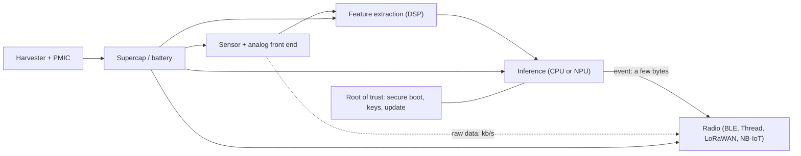

<!-- status: verified -->
# 27-08 · Edge AI and IoT

| | |
|---|---|
| **Course** | [27 · System Architectures (Case-Study Course)](../README.md) |
| **University equivalent** | The system-design case study of a senior IoT or embedded-machine-learning course: on-device inference on microcontrollers ("TinyML"), low-power wide-area radios, energy harvesting and device security over a product's life |
| **Prerequisites** | [27-01](27-01-system-analysis-method.md) (budgets), [27-03](27-03-wearables-smartwatch.md) (always-on design), [14-14](../../14-computer-organization-and-architecture/chapters/14-14-ai-accelerators.md) (accelerators, quantization), [18-09](../../18-embedded-systems-and-microcontrollers/chapters/18-09-ultra-low-power-design.md) (power modes, duty cycling), [18-08](../../18-embedded-systems-and-microcontrollers/chapters/18-08-boot-and-firmware-update.md) and [18-11](../../18-embedded-systems-and-microcontrollers/chapters/18-11-hardware-security.md) (boot, updates, security), [21-11](../../21-rf-and-microwave-engineering/chapters/21-11-link-budgets.md) (link budgets), [22-09](../../22-power-electronics-and-energy-conversion/chapters/22-09-batteries-charging-fuel-gauging.md) (batteries) |
| **Estimated study hours** | 6 |
| **Last verified** | 2026-11-26 |

**Learning objectives.** After this chapter you can:

1. Count the MACs, weight memory and activation memory of a small neural network, and estimate its latency and energy per inference on a microcontroller CPU and on an NPU.
2. Decide whether to compute at the edge or send the data, from the energy per bit of the radio and the energy per inference.
3. Compute LoRa time on air, transmit energy and the messages a duty-cycle limit allows, and compare low-power radios.
4. Estimate a sensor node's battery life, including self-discharge, and size a photovoltaic harvester and a supercapacitor for energy-neutral operation.
5. Budget the time, energy and airtime of secure boot and firmware updates over a product's support period, and question edge-AI marketing claims.

---

## 1. Big picture

Most of the world's connected devices are not phones or servers. They are sensors, meters, switches, tags and small appliances. IoT Analytics expected 21.1 billion connected IoT devices by the end of 2025 [R-699] **[Industry estimate]**. Many run for years on a battery or on harvested energy, so their design question is the opposite of the datacenter's in 27-07. The datacenter asks how to spend 100 kW well; the sensor asks how to do anything useful on 10 µW. Machine learning has moved into this world ("TinyML"), and microcontrollers now ship with neural processing units: Arm's Ethos-U85 scales from 128 to 2048 MAC units [R-695]. The system architect's job is to choose what to sense, what to compute locally, what to send, over which radio, powered by what, and how to keep it secure and updatable for a decade.

- **Why it exists:** sensing everywhere is valuable (industrial monitoring, buildings, agriculture, health, retail), but wires and battery changes are expensive, so devices must be small, cheap and frugal.
- **Where it shows up:** microcontrollers with NPUs, Bluetooth, Thread, Wi-Fi, LoRaWAN and cellular IoT radios, power-management and harvesting ICs, secure elements.
- **What decides it:** energy per useful result (inference, measurement, message), radio range against energy, the cost of maintenance visits, and security obligations over the support period.
- **Why it matters to a business reader:** the IoT market is a volume market with long product lives and thin margins. Edge AI and regulation such as the EU's Cyber Resilience Act are changing what a competitive microcontroller must include [R-312].

## 2. Intuition first

**Every microjoule has a job.** A coin cell holds about 2.4 kJ (Example 27-08.1). Spread over a year, that is 77 µW on average. A microcontroller running flat out draws tens of milliwatts, and a radio transmitting draws about a hundred. So the device must sleep almost all the time, and every wake-up must earn its energy. Think of the battery as a fixed budget for the product's whole life, and of each activity as a recurring expense. The design is a budget-allocation problem, the same discipline as 27-01, at a scale a million times smaller.

**Send the answer, not the data.** A microphone produces 256 kb/s. Sending that over a radio costs milliwatts, all the time. Deciding locally that someone said "lights on" costs microjoules a few times a second, and the message that follows is a few bytes (Example 27-08.2). Edge AI is, first of all, data compression with a purpose. The analogy is a branch office that sends headquarters a summary rather than every receipt. It breaks down when headquarters needs the receipts later: a device that throws raw data away cannot be re-analysed, which is why many systems keep a small buffer or send raw data occasionally.

**Range is bought with time.** A LoRa radio reaches kilometres by spreading each bit over many chirps. Each step in spreading factor doubles the time on air and buys about 2.5 dB of sensitivity [R-274]. Time on air is energy, and in Europe's unlicensed bands it is also rationed by law (Example 27-08.3). Coverage, battery life and message rate form a three-way trade, and the network setting that chooses the spreading factor moves all three at once.

*Figure 0. An edge-AI node: the sensing chain, the choice between sending events and raw data, the energy path, and the security functions that span the device's life.*

## 3. Theory

### 3.1 A neural network on a microcontroller

**Counting MACs.** A convolution layer producing an output of $H \times W \times C_{\text{out}}$ from $C_{\text{in}}$ input channels with $k \times k$ kernels performs

$$
\text{MACs}_{\text{conv}} = H\,W\,C_{\text{out}}\,k^2\,C_{\text{in}}
$$

multiply-accumulates (14-14). Small networks for microcontrollers replace it with a **depthwise-separable convolution**: a $k \times k$ filter applied to each channel separately ($H W C_{\text{in}} k^2$ MACs), then a $1 \times 1$ "pointwise" convolution that mixes channels ($H W C_{\text{in}} C_{\text{out}}$). The ratio to a standard convolution is

$$
\frac{H W C_{\text{in}}k^2 + H W C_{\text{in}}C_{\text{out}}}{H W C_{\text{out}}k^2 C_{\text{in}}} = \frac{1}{C_{\text{out}}} + \frac{1}{k^2}.
$$

For $k = 3$ and 64 output channels that is 0.127, so the layer needs 7.89 times fewer MACs and as many fewer weights. The price is some accuracy for a given size, recovered by training.

**Memory.** Weights live in flash, one byte each at int8 (quantization, 14-14), with 32-bit biases. Activations live in SRAM. A layer's input and output must both be present, so the SRAM needed is set by the largest pair, not by the sum over layers. Inference libraries for microcontrollers plan this working buffer, often called the **tensor arena**, ahead of time. A network fits a part when its weights fit the flash budget and its largest pair of activation tensors fits the SRAM left over by the application.

**Latency and energy.** With an engine that sustains $m$ MACs per cycle at clock $f$ and utilization $u$,

$$
t_{\text{inf}} = \frac{\text{MACs}}{m\,u\,f}, \qquad E_{\text{inf}} = P_{\text{active}}\,t_{\text{inf}}.
$$

A microcontroller CPU with SIMD instructions sustains one or two MACs per cycle. An NPU performs hundreds per cycle. Arm's Ethos-U85 scales from 128 to 2048 MAC units, "up to 4 TOPs of performance at 1 GHz" [R-695]; 2048 MACs × 2 operations × 1 GHz is 4.10 TOPS. Depthwise layers keep an NPU's utilization low, because each output uses only nine MACs. The NPU's advantage is therefore smaller than its peak ratio, but still an order of magnitude in energy (Example 27-08.1). Arm claims "up to 90% energy reduction" for the Ethos-U55 [R-695].

**The always-on budget.** A device that listens continuously runs inference at a rate $r$ (inferences per second) and keeps its sensor front end powered:

$$
P_{\text{avg}} = r\,E_{\text{inf}} + P_{\text{front end}} + P_{\text{sleep}}.
$$

This is Amdahl's law for energy. Once an NPU shrinks $rE_{\text{inf}}$, the microphone, its amplifier and the feature extraction dominate. The next gain comes from the analog front end, for example by waking the digital chain only when there is sound.

### 3.2 Compute here, or send it there?

A radio costs energy per bit, $e_{\text{bit}}$, counting the payload plus its share of headers, wake-up and listening. Sending raw data at rate $R_{\text{raw}}$ (bits/s) costs $R_{\text{raw}}e_{\text{bit}}$. Computing locally costs $P_{\text{avg}}$ from §3.1, plus the radio energy of the much smaller results. Local inference wins when

$$
P_{\text{avg,local}} + R_{\text{result}}\,e_{\text{bit}} < R_{\text{raw}}\,e_{\text{bit}}.
$$

At the edge, raw data rates are kilobits to megabits per second and results are a few bytes per event, so the inequality usually holds by an order of magnitude or more (Example 27-08.2). The MLPerf Tiny authors make the same point: edge inference avoids "the energy cost associated with wireless communication, which at this scale is far higher than that of compute" [R-696]. The second reason is bandwidth. A long-range low-power radio cannot carry raw audio at all, so for those links local inference is not an optimization but the only option.

### 3.3 Choosing a radio

The radio decides range, energy per message, data rate, who owns the infrastructure, and what the regulator allows.

| Radio family | Typical role | Range lever | Who runs the network | Constraint to check |
|---|---|---|---|---|
| Bluetooth LE | Wearables, phone accessories, beacons | Coded PHY (lower rate) | The user's phone or a hub | Needs a phone or gateway nearby |
| IEEE 802.15.4 (Thread, Zigbee) | Home and building automation | Mesh hops | A local border router | Mesh routers need power |
| Wi-Fi | Cameras, appliances, anything mains-powered | Access points | The building | Energy per association and keep-alive |
| LoRaWAN | Meters, agriculture, cities | Spreading factor | Private or community gateways | Duty-cycle limits, airtime fairness |
| NB-IoT and LTE-M | Meters, trackers, anywhere with coverage | Repetitions, coverage classes | A mobile operator | Subscription cost, module price |

Wi-Fi and Bluetooth carry the most IoT connections, at 32% and 24% in IoT Analytics' 2025 count [R-699]. Each range lever trades time for sensitivity, as 21-11 showed: NB-IoT reaches its coverage by repetition and LoRa by spreading.

**LoRa's time on air.** LoRa is chirp spread spectrum: each symbol is a frequency sweep across bandwidth $BW$ carrying $SF$ bits in $2^{SF}$ chips, so the symbol time is

$$
T_s = \frac{2^{SF}}{BW}.
$$

Each step in $SF$ doubles $T_s$ while adding only one bit per symbol, so the bit rate roughly halves. In exchange the demodulator works at 2.5 dB lower SNR: from −7.5 dB at SF7 to −20 dB at SF12 [R-274]. Semtech's data sheet gives a packet's time on air as a preamble of $n_{\text{preamble}} + 4.25$ symbols plus

$$
n_{\text{payload}} = 8 + \max\!\left(\left\lceil\frac{8PL - 4SF + 28 + 16\,CRC - 20\,IH}{4(SF - 2DE)}\right\rceil (CR + 4),\ 0\right)
$$

payload symbols [R-697]. The symbols in this formula are:

- $PL$, the payload in bytes;
- $CRC = 1$ when a checksum is sent;
- $IH = 1$ for a packet without a header;
- $CR = 1$ for coding rate 4/5;
- $DE = 1$ when low-data-rate optimization is on, which the data sheet mandates "when the symbol duration exceeds 16ms" [R-697].

**Duty-cycle law.** Europe's 868 MHz rules (ETSI EN 300 220-2) limit each device's transmit time per sub-band. The common LoRaWAN channels sit in sub-bands with a 1% limit, others allow 0.1% or 10% [R-698]. A 1% limit is 36 seconds of airtime per hour. Community networks add their own rules: The Things Network's fair-use policy allows "30 seconds per day" of uplink airtime per node and "10 messages per day" of downlink [R-698]. Example 27-08.3 turns these into messages.

**Cellular IoT** (NB-IoT, LTE-M) avoids duty-cycle limits and gateway ownership at the cost of a subscription and a more complex modem. Its sleep modes (PSM, eDRX) were covered in 27-03.

### 3.4 Battery life and energy harvesting

**Battery life.** A periodic sensor node spends energy per message ($E_{\text{msg}}$: sensing, transmitting, listening for a reply) $N$ times a day, plus a sleep floor:

$$
E_{\text{day}} = N\,E_{\text{msg}} + P_{\text{sleep}}\cdot 86\,400\ \text{s}, \qquad \text{life} = \frac{\eta_{\text{usable}}\,E_{\text{batt}}}{E_{\text{day}} + E_{\text{self-discharge, day}}}.
$$

Primary lithium cells lose a little capacity every year whatever the load. For a node that sends a few messages a day, this **self-discharge** can rival the load itself, and the cell's shelf life, not the electronics, ends the product (Example 27-08.4). A ten-year claim must therefore state the reporting interval, the radio settings and the cell's self-discharge.

**Harvesting.** A harvester converts light, heat, vibration or radio waves into electrical power. Indoor light is the most common source, and its power follows from photometry. Illuminance $E_v$ (lux, lumens per square metre) becomes irradiance $E_e = E_v/K$ (W/m²), where $K$ is the luminous efficacy of the light's spectrum. $K$ is at most 683 lm/W, the SI definition for green light at 540 THz; a white light source's broader spectrum gives less. A photovoltaic cell of area $A$ and efficiency $\eta_{pv}$ behind a converter of efficiency $\eta_{c}$ delivers

$$
P_h = \frac{E_v}{K}\,A\,\eta_{pv}\,\eta_c .
$$

A few hundred lux of office light on a few square centimetres yields hundreds of microwatts at best (Example 27-08.5). That is plenty for a periodic sensor and not enough for always-on listening.

**Energy neutrality.** Over each light–dark cycle, harvested energy must exceed consumed energy, and storage must carry the load through the dark:

$$
\int_{\text{cycle}} P_h\,dt \ge \int_{\text{cycle}} P_{\text{load}}\,dt, \qquad E_{\text{store}} \ge P_{\text{avg}}\,T_{\text{dark}}.
$$

A supercapacitor stores $\tfrac12 CV^2$, but the electronics run only between $V_{\max}$ and the minimum operating voltage $V_{\min}$, so the usable energy is $\tfrac12 C(V_{\max}^2 - V_{\min}^2)$. The capacitance needed is

$$
C = \frac{2E_{\text{store}}}{V_{\max}^2 - V_{\min}^2}.
$$

Harvesting PMICs also track the cell's maximum power point (MPPT, introduced in 06-09) and must cold-start from an empty store, a design detail that decides whether a node left in a drawer for a month wakes up again.

### 3.5 Security over the product's life

An edge device is a computer left in public for years. Its security rests on a root of trust (18-11):

- **Device identity:** a unique key per device, so one extracted key does not open the fleet.
- **Secure boot:** the boot code hashes the firmware image and verifies a signature before running it (18-08).
- **Authenticated updates:** signed images, delivered over the air, with protection against rolling back to old versions.

Each has a cost the system budget must carry:

- **Hashing.** The time is the image size times the cycles per byte.
- **Signature verification.** A public-key check takes millions of cycles in software, unless the part has a crypto accelerator.
- **Updates.** An update costs radio energy and airtime in proportion to its size. On a duty-cycled long-range link, a full firmware image can take weeks (Example 27-08.6).

Regulation now makes this mandatory. The EU's Cyber Resilience Act entered into force on 10 December 2024. Its vulnerability-reporting obligations apply from 11 September 2026 and its main obligations from 11 December 2027. It requires security updates over a support period of "no less than five years" unless the product's expected use is shorter, and it lists "Microcontrollers with security-related functionalities" among its Class I important products [R-312]. Certification schemes such as PSA Certified grade the root of trust in levels [R-312]. For the architect, the consequence is concrete: update energy and airtime belong in the battery budget, and update delivery belongs in the radio choice.

## 4. Worked examples

All parameters below are illustrative assumptions unless a source is cited; §7 and §9 give dated, sourced figures.

### Example 27-08.1 · A keyword spotter on a microcontroller (tier B)

**Setup.** A keyword spotter takes 49 × 10 audio features. It has:

- a 10 × 4 convolution with stride 2 and 64 filters, giving 25 × 5 × 64;
- four depthwise-separable blocks (3 × 3 depthwise, then 1 × 1 pointwise, 64 channels);
- global average pooling, and a fully connected layer to 12 classes.

Weights are int8 and biases int32. Find:

- (a) the MACs per inference;
- (b) the weight memory, and the SRAM for the largest pair of activation tensors.

It runs on (i) a CPU at 200 MHz sustaining 1.5 MACs per cycle and drawing 20 mW, or (ii) an NPU with 128 MACs per cycle at 200 MHz and 25% utilization, the system drawing 40 mW. Find:

- (c) the latency and energy per inference on each, the energy saving and the speed-up.

The device runs 10 inferences a second, its front end draws 0.300 mW and it sleeps at 0.005 mW, on a CR2032 cell (225 mAh at 3.0 V). Find:

- (d) the average power and the life in days on each engine, and the front end's share of power with the NPU.

**Solution.**

- (a) The first convolution: $25 \times 5 \times 64 \times 10 \times 4$ = 320,000. Each depthwise layer: $25 \times 5 \times 64 \times 9$ = 72,000; each pointwise: $25 \times 5 \times 64 \times 64$ = 512,000. The output layer: 768. Total **2.66 × 10⁶** MACs.
- (b) Weights: $2560 + 4 \times (576 + 4096) + 768$ = **22016** bytes, plus 588 biases × 4 bytes = **2352** bytes: **24368** bytes, **23.8** KiB of flash. The largest pair of activations is $2 \times 25 \times 5 \times 64$ = **16000** bytes of SRAM.
- (c) CPU: $2.66 \times 10^6/(1.5 \times 200 \times 10^6)$ = **8.86** ms and $20\ \text{mW} \times 8.86\ \text{ms}$ = **177** µJ. NPU: $2.66 \times 10^6/(128 \times 0.25 \times 200 \times 10^6)$ = **0.415** ms and **16.6** µJ. The NPU uses **90.6**% less energy and is **21.3** times faster.
- (d) The cell holds $0.225 \times 3.0 \times 3600$ = **2430** J. CPU: $10 \times 177\ \mu\text{J} + 0.305\ \text{mW}$ = **2.08** mW, lasting **13.5** days. NPU: **0.471** mW, **59.7** days, with the front end taking **63.7**% of the power.

**Units check.** MAC ÷ (MAC/cycle × cycle/s) = s; W × s = J; J ÷ W = s. ✓

**Sanity check.** The model is of the same order as MLPerf Tiny's reference keyword spotter, 38.6K parameters in a 52.5 KB file [R-696]. The NPU's 21-fold speed-up is far below its 85-fold peak ratio of MACs per cycle, because the depthwise layers leave it idle. Its energy saving is close to Arm's "up to 90%". The system gain is only 4.4 times, because after the NPU the front end dominates.

### Example 27-08.2 · Send the answer, not the data (tier A)

**Setup.** The device of Example 27-08.1 could instead stream its raw audio, 16 kHz at 16 bits, over a radio costing 20 nJ per bit all-in. Find:

- (a) the raw rate and the radio power, and the ratio to the NPU node's 0.471 mW;
- (b) how many times too slow LoRa's fastest 125 kHz rate, 9,380 b/s [R-274], would be;
- (c) the average radio power of reporting a 20-byte event once a minute instead.

**Solution.**

- (a) $16\,000 \times 16$ = **256000** b/s; $256\,000 \times 20\ \text{nJ}$ = **5.12** mW, **10.9** times the local-inference node.
- (b) $256\,000/9380$ = **27.3** times too slow.
- (c) $160 \times 20\ \text{nJ}/60\ \text{s}$ = **53.3** nW.

**Units check.** b/s × J/b = W. ✓

**Sanity check.** Streaming costs ten times more energy on a short-range radio and is impossible on a long-range one. Reporting events costs a hundred-thousandth of streaming. This is why voice assistants keep wake-word detection on the device, and why long-range sensors send features or decisions.

### Example 27-08.3 · LoRa airtime and the duty-cycle budget (tier B)

**Setup.** A node sends a 20-byte LoRa packet (bandwidth 125 kHz, coding rate 4/5, 8-symbol preamble, explicit header, CRC on) at SF7 and at SF12. Find:

- (a) the symbol time, (b) the payload symbols and (c) the time on air at each spreading factor, and their ratio;
- (d) the transmit energy at +13 dBm, 29 mA [R-697], from 3.3 V (assumed);
- (e) how many packets fit in a 1% duty cycle per hour [R-698] and in The Things Network's 30 seconds a day [R-698].

**Solution.**

- (a) $T_s = 2^7/125\ \text{kHz}$ = **1.024** ms; at SF12, **32.768** ms. That exceeds 16 ms, so $DE = 1$.
- (b) SF7: $8 + \lceil(160 - 28 + 28 + 16)/28\rceil \times 5 = 8 + 7 \times 5$ = **43**. SF12: $8 + \lceil(160 - 48 + 28 + 16)/40\rceil \times 5 = 8 + 4 \times 5$ = **28**.
- (c) SF7: $(12.25 + 43) \times 1.024$ = **56.6** ms; SF12: $(12.25 + 28) \times 32.768$ = **1319** ms, **23.3** times longer.
- (d) $0.0566 \times 0.029 \times 3.3$ = **5.41** mJ at SF7; **126** mJ at SF12.
- (e) 36 s per hour: **636** packets at SF7, **27** at SF12. 30 s per day: **530** at SF7, **22** at SF12.

**Units check.** chips ÷ (chips/s) = s; s × A × V = J. ✓

**Sanity check.** The five SF steps buy 12.5 dB of demodulator margin, about four times the range in free space, and cost 23 times the airtime and energy. A node pushed to SF12 by distance can send fewer than one packet an hour on a community network. Adaptive data rate, which gives every node the fastest SF its link allows, is the most important energy setting in a LoRaWAN deployment.

### Example 27-08.4 · Ten years on a battery? (tier B)

**Setup.** A sensor node reports every 15 minutes (96 messages a day) with the packet of Example 27-08.3. Each message costs:

- the transmission;
- two receive windows of 5 symbols at 10.8 mA [R-697];
- a 50 ms sensor reading at 5 mA.

All of this is at 3.3 V, and the node sleeps at 10 µW. Its lithium–thionyl chloride cell holds 2.6 Ah at 3.6 V; 80% is usable and the cell self-discharges 1% of its capacity a year (all assumed). Find:

- (a) the energy per message at SF7 and SF12;
- (b) the daily energy and the life without self-discharge;
- (c) the self-discharge per day and the life with it;
- (d) the daily airtime at each SF.

**Solution.**

- (a) Receive: $2 \times 5 \times 1.024\ \text{ms} \times 10.8\ \text{mA} \times 3.3\ \text{V}$ = 0.365 mJ at SF7 (11.7 mJ at SF12). Sensor: **0.825** mJ. Totals **6.60** mJ at SF7 and **139** mJ at SF12.
- (b) SF7: $96 \times 6.60\ \text{mJ} + 10\ \mu\text{W} \times 86\,400\ \text{s}$ = **1.50** J a day. The usable energy is $0.8 \times 2.6 \times 3.6 \times 3600$ = **26957** J, lasting **49.3** years. SF12: **14.2** J a day, **5.21** years.
- (c) Self-discharge: $0.01 \times 33\,696\ \text{J}/365$ = **0.923** J a day. Lives: **30.5** years at SF7 and **4.89** at SF12.
- (d) $96 \times 56.6$ ms = **5.43** s a day at SF7; **127** s at SF12, four times The Things Network's 30 s.

**Units check.** mA × V × s = mJ; J ÷ (J/day) = days. ✓

**Sanity check.** At SF7 the battery outlasts any plausible product life, and self-discharge consumes 38% of the cell. At SF12 the same node lasts under five years and breaks a community network's fair-use rule. The gateway's position, through the SF it forces, is the battery-life specification.

### Example 27-08.5 · Running on office light (tier C)

**Setup.** The SF7 node of Example 27-08.4 gets a 20 cm² photovoltaic cell under 300 lux of LED office light for 10 hours a day. Assume a luminous efficacy of radiation of 300 lm/W, 20% cell efficiency and 80% converter efficiency. Find:

- (a) the irradiance, the harvested power and the daily harvest;
- (b) the node's average power and the margin of harvest over load;
- (c) the energy for a 62-hour weekend of darkness, and the supercapacitor that stores it between 4.0 V and 2.2 V;
- (d) whether the always-listening NPU node of Example 27-08.1 could run on the same cell, and what area it would need.

**Solution.**

- (a) $300/300$ = 1 W/m² = **100** µW/cm². Then $20\ \text{cm}^2 \times 100\ \mu\text{W/cm}^2 \times 0.2 \times 0.8$ = **320** µW, and $320\ \mu\text{W} \times 36\,000\ \text{s}$ = **11.5** J a day.
- (b) $1.50\ \text{J}/86\,400\ \text{s}$ = **17.3** µW; the margin is $11.52/1.50$ = **7.69**.
- (c) $17.3\ \mu\text{W} \times 62 \times 3600\ \text{s}$ = **3.87** J; $C = 2 \times 3.87/(4.0^2 - 2.2^2)$ = **0.694** F, so a 1 F part.
- (d) The node needs $0.471\ \text{mW} \times 86\,400$ = **40.7** J a day, **3.53** times the harvest, so it cannot. It would need **70.7** cm² of cell.

**Units check.** lm/m² ÷ lm/W = W/m²; J ÷ V² = F. ✓

**Sanity check.** A business-card-sized cell powers a periodic sensor with a large margin. Always-on listening needs a palm-sized cell even after the NPU. Harvesting favours event-driven designs. The weekend, not the night, sizes the store.

### Example 27-08.6 · The cost of staying secure (tier B)

**Setup.** A node boots a 512 KiB image at 64 MHz and 10 mW. Find:

- (a) the SHA-256 time in software at 30 cycles per byte and with a hash engine at 2 cycles per byte;
- (b) the ECDSA P-256 verification time at 4 million cycles;
- (c) the boot-check energy each way.

A 128 KiB update must then be delivered. Find:

- (d) the receive energy over a radio at 20 nJ per bit;
- (e) over LoRa at SF7 in 50-byte fragments (63-byte frames with headers): the frames, time on air per frame, total airtime, receive energy at 10.8 mA and 3.3 V, and that energy in days of Example 27-08.4's SF7 budget;
- (f) the gateway time at a 10% duty cycle, and the days needed at 10 downlinks a day [R-698].

(All costs are assumed except where cited.)

**Solution.**

- (a) $524\,288 \times 30/64 \times 10^6$ = **0.246** s; with the engine, **16.4** ms.
- (b) $4 \times 10^6/64 \times 10^6$ = **62.5** ms.
- (c) $(0.246 + 0.0625) \times 10\ \text{mW}$ = **3.08** mJ in software; **0.789** mJ with the engine.
- (d) $131\,072 \times 8 \times 20\ \text{nJ}$ = **21.0** mJ.
- (e) $\lceil 131\,072/50 \rceil$ = **2622** frames of **118.0** ms each, **309** s of airtime and $309 \times 0.0108 \times 3.3$ = **11.0** J, **7.36** days of the node's energy.
- (f) $309/0.10$ s = **51.6** min of gateway time; at 10 downlinks a day, **262** days.

**Units check.** bytes × cycles/byte ÷ cycles/s = s; s × A × V = J. ✓

**Sanity check.** Secure boot costs millijoules, negligible unless the device reboots constantly. Updates are a different matter. On a short-range radio a full image is cheap, but on a duty-cycled long-range link it costs a week of energy and months of a community network's downlink allowance. Long-range fleets must plan for small delta updates, multicast delivery or a second radio, and the Cyber Resilience Act's support period makes that plan mandatory.

<!-- answer-key -->

| ID | Quantity | Value | Unit |
|---|---|---|---|
| Ex 27-08.1a | MACs per inference | 2.66e6 | MAC |
| Ex 27-08.1a1 | first convolution MACs | 320000 | MAC |
| Ex 27-08.1a2 | depthwise layer MACs | 72000 | MAC |
| Ex 27-08.1a3 | pointwise layer MACs | 512000 | MAC |
| Ex 27-08.1a4 | output layer MACs | 768 | MAC |
| Ex 27-08.1b | weight bytes | 22016 | bytes |
| Ex 27-08.1b1 | bias bytes | 2352 | bytes |
| Ex 27-08.1b2 | total parameter bytes | 24368 | bytes |
| Ex 27-08.1b3 | parameter memory | 23.8 | KiB |
| Ex 27-08.1b4 | activation SRAM | 16000 | bytes |
| Ex 27-08.1c | CPU latency | 8.86 | ms |
| Ex 27-08.1c1 | CPU energy | 177 | µJ |
| Ex 27-08.1c2 | NPU latency | 0.415 | ms |
| Ex 27-08.1c3 | NPU energy | 16.6 | µJ |
| Ex 27-08.1c4 | energy saving | 90.6 | % |
| Ex 27-08.1c5 | speed-up | 21.3 | — |
| Ex 27-08.1d | coin-cell energy | 2430 | J |
| Ex 27-08.1d1 | average power, CPU | 2.08 | mW |
| Ex 27-08.1d2 | life, CPU | 13.5 | days |
| Ex 27-08.1d3 | average power, NPU | 0.471 | mW |
| Ex 27-08.1d4 | life, NPU | 59.7 | days |
| Ex 27-08.1d5 | front-end share with NPU | 63.7 | % |
| Ex 27-08.1e | peak MAC ratio NPU to CPU | 85 | — |
| Ex 27-08.1e1 | system power ratio | 4.4 | — |
| Ex 27-08.2a | raw audio rate | 256000 | b/s |
| Ex 27-08.2a1 | streaming radio power | 5.12 | mW |
| Ex 27-08.2a2 | ratio to local inference | 10.9 | — |
| Ex 27-08.2b | shortfall of LoRa's fastest rate | 27.3 | — |
| Ex 27-08.2c | event reporting power | 53.3 | nW |
| Ex 27-08.3a | symbol time, SF7 | 1.024 | ms |
| Ex 27-08.3a1 | symbol time, SF12 | 32.768 | ms |
| Ex 27-08.3b | payload symbols, SF7 | 43 | symbols |
| Ex 27-08.3b1 | payload symbols, SF12 | 28 | symbols |
| Ex 27-08.3c | time on air, SF7 | 56.6 | ms |
| Ex 27-08.3c1 | time on air, SF12 | 1319 | ms |
| Ex 27-08.3c2 | ratio | 23.3 | — |
| Ex 27-08.3d | transmit energy, SF7 | 5.41 | mJ |
| Ex 27-08.3d1 | transmit energy, SF12 | 126 | mJ |
| Ex 27-08.3e | packets per hour at 1%, SF7 | 636 | packets |
| Ex 27-08.3e1 | packets per hour at 1%, SF12 | 27 | packets |
| Ex 27-08.3e2 | packets per day in 30 s, SF7 | 530 | packets |
| Ex 27-08.3e3 | packets per day in 30 s, SF12 | 22 | packets |
| Ex 27-08.4a | receive windows, SF7 | 0.365 | mJ |
| Ex 27-08.4a1 | receive windows, SF12 | 11.7 | mJ |
| Ex 27-08.4a2 | sensor reading | 0.825 | mJ |
| Ex 27-08.4a3 | energy per message, SF7 | 6.60 | mJ |
| Ex 27-08.4a4 | energy per message, SF12 | 139 | mJ |
| Ex 27-08.4b | daily energy, SF7 | 1.50 | J |
| Ex 27-08.4b1 | usable cell energy | 26957 | J |
| Ex 27-08.4b2 | life, SF7, no self-discharge | 49.3 | years |
| Ex 27-08.4b3 | daily energy, SF12 | 14.2 | J |
| Ex 27-08.4b4 | life, SF12, no self-discharge | 5.21 | years |
| Ex 27-08.4c | self-discharge per day | 0.923 | J |
| Ex 27-08.4c1 | life, SF7, with self-discharge | 30.5 | years |
| Ex 27-08.4c2 | life, SF12, with self-discharge | 4.89 | years |
| Ex 27-08.4c3 | self-discharge share at SF7 | 38 | % |
| Ex 27-08.4d | daily airtime, SF7 | 5.43 | s |
| Ex 27-08.4d1 | daily airtime, SF12 | 127 | s |
| Ex 27-08.5a | irradiance | 100 | µW/cm² |
| Ex 27-08.5a1 | harvested power | 320 | µW |
| Ex 27-08.5a2 | daily harvest | 11.5 | J |
| Ex 27-08.5b | node average power | 17.3 | µW |
| Ex 27-08.5b1 | harvest margin | 7.69 | — |
| Ex 27-08.5c | weekend energy | 3.87 | J |
| Ex 27-08.5c1 | supercapacitor | 0.694 | F |
| Ex 27-08.5d | always-listening daily energy | 40.7 | J |
| Ex 27-08.5d1 | ratio to harvest | 3.53 | — |
| Ex 27-08.5d2 | cell area needed | 70.7 | cm² |
| Ex 27-08.6a | software hash time | 0.246 | s |
| Ex 27-08.6a1 | hash engine time | 16.4 | ms |
| Ex 27-08.6b | signature verification | 62.5 | ms |
| Ex 27-08.6c | boot-check energy, software | 3.08 | mJ |
| Ex 27-08.6c1 | boot-check energy, engine | 0.789 | mJ |
| Ex 27-08.6d | update over short-range radio | 21.0 | mJ |
| Ex 27-08.6e | LoRa frames | 2622 | frames |
| Ex 27-08.6e1 | time on air per frame | 118.0 | ms |
| Ex 27-08.6e2 | total airtime | 309 | s |
| Ex 27-08.6e3 | receive energy | 11.0 | J |
| Ex 27-08.6e4 | days of node energy | 7.36 | days |
| Ex 27-08.6f | gateway time at 10% | 51.6 | min |
| Ex 27-08.6f1 | days at 10 downlinks a day | 262 | days |
| Txt 27-08.1 | depthwise-separable MAC ratio | 0.127 | — |
| Txt 27-08.2 | reduction factor | 7.89 | — |
| Txt 27-08.3 | Ethos-U85 peak at 2048 MACs and 1 GHz | 4.10 | TOPS |
| Txt 27-08.4 | coin-cell average power over a year | 77 | µW |
| Txt 27-08.5 | 1% duty cycle per hour | 36 | s |
| Txt 27-08.6 | demodulator margin SF7 to SF12 | 12.5 | dB |
| Txt 27-08.7 | free-space range factor for 12.5 dB | 4.2 | — |
| Txt 27-08.8 | 2048 MACs at 200 MHz | 0.82 | TOPS |
| Txt 27-08.9 | 128 MACs at 200 MHz | 0.05 | TOPS |

## 5. Simulate it

The lab is [labs/27-08-lab/](../labs/27-08-lab/README.md). `edgemodel.py` implements:

- MAC and memory counts for convolutional, depthwise and pointwise layers, and the chapter's keyword spotter;
- inference latency, average power and life;
- LoRa symbol time, payload symbols, time on air and duty-cycle message counts;
- photovoltaic harvest, supercapacitor sizing and hashing time.

1. *Predict* the NPU's latency, energy and coin-cell life in Example 27-08.1 if its utilization doubles to 50%. Then plot life against inference rate for both engines.
2. *Predict* the time on air of Example 27-08.3's packet at SF9. Then plot time on air and packets per hour against spreading factor.
3. *Predict* Example 27-08.4's battery life at SF10. Then plot life against reporting interval for SF7 and SF12.
4. *Predict* the supercapacitor for three days of darkness in Example 27-08.5. Then plot the harvest margin against illuminance.

*Figure 1. LoRa airtime and duty-cycle capacity against spreading factor (Example 27-08.3), and sensor battery life against reporting interval (Example 27-08.4's assumptions).*

## 6. Engineering tradeoffs

| Knob | Improves | Costs | Typical decision owner |
|---|---|---|---|
| NPU on the microcontroller | Energy and latency per inference by an order of magnitude | Die area and price, toolchain lock-in, low utilization on some layers | MCU product line with the customer's ML team |
| Smaller, depthwise-separable, int8 models | Flash, SRAM, MACs and energy | Accuracy, training and quantization effort | Embedded ML engineers |
| Inference at the edge instead of streaming | Radio energy, bandwidth, privacy | Loss of raw data, model updates in the field | System architect with product management |
| Higher LoRa spreading factor | Range and link margin | Airtime, energy and capacity, roughly doubled per step | Network planner (adaptive data rate) |
| More gateways or a denser network | Lower spreading factors, battery life | Infrastructure cost and backhaul | Network operator or the customer |
| Cellular IoT instead of unlicensed LPWAN | Coverage without owning gateways, no duty-cycle law | Subscription and module cost, modem energy | Product management and finance |
| Energy harvesting | No battery changes, longer life | Cell area and cost, storage, cold-start design | Hardware lead with the field-service owner |
| Hardware crypto and a secure element | Boot time, side-channel resistance, certification level | Unit cost, provisioning flow | Security architect |
| Update strategy (delta, multicast, second radio) | Update energy and airtime over the support period | Firmware complexity, storage for two images | Firmware lead under the compliance owner |

## 7. Numbers to know

| Quantity | Typical value (as of Nov 2026) | Source |
|---|---|---|
| Connected IoT devices | 21.1 billion expected at the end of 2025 (Wi-Fi 32%, Bluetooth 24% of connections) | [R-699] |
| Microcontroller NPU | Ethos-U85: 128–2048 MACs, up to 4 TOPs at 1 GHz, transformer support | [R-695] |
| Edge-AI benchmark | MLPerf Tiny: keyword spotting, visual wake words, image classification, anomaly detection; µJ per inference | [R-696] |
| Reference keyword-spotting model | 38.6K parameters, 52.5 KB, 90% accuracy target | [R-696] |
| LoRa demodulator SNR | −7.5 dB at SF7 to −20 dB at SF12, in 2.5 dB steps | [R-274] |
| LoRa radio currents (SX1276) | Transmit 29 mA at +13 dBm, 120 mA at +20 dBm; receive 10.8 mA; sleep 0.2 µA | [R-697] |
| EU 868 MHz duty cycles | 0.1%, 1% or 10% by sub-band; 1% for the common LoRaWAN channels | [R-698] |
| Community-network fair use | 30 s uplink airtime and 10 downlinks per node per day (The Things Network) | [R-698] |
| EU Cyber Resilience Act | In force 10 Dec 2024; reporting from 11 Sep 2026; main obligations from 11 Dec 2027; support at least 5 years | [R-312] |
| Rules of thumb (timeless) | DS-conv MAC ratio $1/C_{\text{out}} + 1/k^2$; $T_s = 2^{SF}/BW$; $C = 2E/(V_{\max}^2 - V_{\min}^2)$ | §3 |

## 8. Common mistakes

- **Quoting TOPS for a microcontroller workload.** Small models with depthwise layers use a fraction of an NPU's peak; compare microjoules and milliseconds per inference on the actual model (MLPerf Tiny measures exactly this).
- **Optimizing the inference and forgetting the front end.** After an NPU, the microphone, amplifier and feature extraction can dominate the always-on budget (Example 27-08.1).
- **Comparing radios by data rate or range alone.** Energy per delivered message, network ownership and regulation decide the choice.
- **Assuming the spreading factor is fixed.** It follows the link; a node that moves out of range, or loses its nearest gateway, can see its battery life fall tenfold (Example 27-08.4).
- **Ignoring duty-cycle and fair-use rules.** A design that works in the lab can be illegal or throttled in the field.
- **Quoting battery life without self-discharge, temperature and reporting interval.** For low-duty nodes, the cell, not the electronics, sets the life.
- **Sizing harvest storage for one night.** Weekends, holidays and dark winters set the store (Example 27-08.5).
- **Leaving updates out of the energy budget.** A full image over a long-range link can cost a week of energy and months of airtime allowance (Example 27-08.6).

## 9. Practitioner lens

**State of play (as of Nov 2026).**

- **NPUs are reaching microcontrollers.** Arm's third-generation Ethos-U85 scales from 128 to 2048 MAC units, "up to 4 TOPs of performance at 1 GHz", and adds transformer support. Arm says it is 20% more energy efficient than the Ethos-U55 and U65 [R-695]. The Ethos-U55 with a Cortex-M55 is marketed as a "480 times uplift in ML performance over existing Cortex-M based systems" and "up to 90% energy reduction in about 0.1mm²" [R-695].
- **Benchmarks exist.** MLPerf Tiny measures accuracy, latency and energy in microjoules per inference on four tasks, with reference models from a 52.5 KB keyword spotter to a 325 KB visual-wake-words network [R-696].
- **Connectivity is fragmented.** IoT Analytics counted Wi-Fi in 32% of IoT connections and Bluetooth in 24%, with 21.1 billion connected devices expected at the end of 2025 [R-699] **[Industry estimate]**. LPWAN and cellular IoT serve the long-range, low-rate tail.
- **Regulation is arriving.** The EU Cyber Resilience Act's reporting obligations applied from September 2026, and its main obligations apply from December 2027 [R-312].

**Commercial relevance.** Edge AI turns the microcontroller, a mature and price-competitive product, into a differentiated one: NPU, memory for models, toolchains and model zoos become selling points. The market is long-tailed, with thousands of customers, long design-in cycles and product lives of a decade. Revenue is therefore sticky, but each socket is small. Security certification and CRA compliance are becoming a market gate that favours vendors with mature secure-boot, key-provisioning and update infrastructure. For a corporate-development reader, the questions are:

- whether a target's edge-AI advantage survives a competitor adding a licensed NPU;
- whether its software and model ecosystem locks customers in;
- how its connectivity portfolio matches the radios customers actually deploy.

**Marketing vs Reality.**

- *"480 times uplift in ML performance"* [R-695]. Against "existing Cortex-M based systems", meaning a CPU without an NPU. Our keyword spotter shows a 21-fold speed-up at realistic utilization, and the system power fell only 4.4 times. Ask for MLPerf Tiny latency and energy on named parts.
- *"Up to 4 TOPs"* [R-695]. At 1 GHz and the largest configuration; at a 200 MHz microcontroller clock the same 2048 MACs give 0.82 TOPS, and the smallest configuration 0.05 TOPS (Problem 27-08.13).
- *"10-year battery life."* True only for a stated reporting interval, spreading factor, temperature and cell; Example 27-08.4 spans 4.89 to 30.5 years for one design.
- *"Under a milliwatt"* [R-696]. An average over a duty cycle, not the active power; check what the sensor front end adds.
- *"Secure by design."* Ask which certification level (PSA Certified level, SESIP) and how keys are provisioned, and what the update path costs on the deployed radio.

**Questions for engineering leaders.**

1. *"What are the energy and latency per inference of your production model on the target part, measured, and how do they compare with MLPerf Tiny results?"* Strong: measured µJ and ms with the model named. Evasive: TOPS or TOPS/W.
2. *"After the NPU, what dominates your always-on power?"* Strong: a breakdown by front end, feature extraction, inference, radio and sleep. Evasive: the NPU's efficiency.
3. *"What battery life do you quote, at which reporting interval, spreading factor or coverage class, temperature and self-discharge?"* Strong: a table across conditions. Evasive: one headline number.
4. *"What happens to battery life if a node loses its nearest gateway or moves indoors?"* Strong: life at the worst-case SF or coverage class, and a plan. Evasive: "adaptive data rate handles it".
5. *"How will you deliver security updates for the full support period, and what does one update cost in energy and airtime?"* Strong: update size, delivery mechanism and budget. Evasive: "we support OTA".
6. *"How are device keys provisioned, and what is your certification level?"* Strong: per-device keys injected in a secure flow, a named certification. Evasive: a shared key or "encryption".

## 10. Concept check

1. Why do microcontroller networks use depthwise-separable convolutions?

   

Answer

   They factor a $k \times k$ convolution into a per-channel spatial filter and a 1 × 1 channel mixer, cutting MACs and weights by the factor $1/C_{\text{out}} + 1/k^2$, about eight times for 3 × 3 kernels and 64 channels.

   

2. Why is an NPU's speed-up on a small network much smaller than its ratio of peak MACs per cycle?

   

Answer

   Depthwise layers perform only $k^2$ MACs per output and cannot fill a wide MAC array, and small layers leave little work to parallelize, so utilization is low. The speed-up equals the peak ratio times the NPU's utilization divided by the CPU's.

   

3. When does computing at the edge save energy?

   

Answer

   When the inference energy plus the radio energy of the result is below the radio energy of the raw data. Raw sensor rates are kilobits per second and results are bytes per event, so it usually saves an order of magnitude or more; on long-range links it is also the only way to fit the bandwidth.

   

4. What does one step up in LoRa spreading factor buy and cost?

   

Answer

   It buys 2.5 dB of demodulator sensitivity. It doubles the symbol time, so it roughly doubles time on air, transmit energy and duty-cycle use, and halves the messages a network can carry.

   

5. Why can self-discharge set a sensor's life?

   

Answer

   A node that reports a few times a day may use only a joule or two daily, comparable to the capacity a primary cell loses each day through self-discharge. The battery then ages out rather than being used up.

   

6. Why does the weekend, not the night, size a harvester's energy store?

   

Answer

   The store must carry the load through the longest dark period, and in an office that is the weekend: 62 hours or more, not 14.

   

7. Why is a firmware update a system-level cost on a LoRaWAN device?

   

Answer

   A full image is thousands of frames: minutes of airtime, joules of receive energy, and far more gateway downlink time than duty cycles and fair-use rules allow per day. Updates must be small, multicast or carried by another radio.

   

Problems: [27-08 problem set](../problems/27-08-problems.md) · Solutions: [27-08 solutions](../solutions/27-08-solutions.md)

## 11. Key terms

[TinyML](../../../reference/glossary.md#tinyml) · [Depthwise-separable convolution](../../../reference/glossary.md#depthwise-separable-convolution) · [Tensor arena](../../../reference/glossary.md#tensor-arena) · [Quantization (neural networks)](../../../reference/glossary.md#quantization-neural-networks) · [Low-power wide-area network (LPWAN)](../../../reference/glossary.md#low-power-wide-area-network-lpwan) · [LoRa](../../../reference/glossary.md#lora) · [Spreading factor (LoRa)](../../../reference/glossary.md#spreading-factor-lora) · [Time on air](../../../reference/glossary.md#time-on-air) · [Adaptive data rate (ADR)](../../../reference/glossary.md#adaptive-data-rate-adr) · [Duty cycling](../../../reference/glossary.md#duty-cycling) · [Energy harvesting](../../../reference/glossary.md#energy-harvesting) · [Energy-neutral operation](../../../reference/glossary.md#energy-neutral-operation) · [Luminous efficacy of radiation](../../../reference/glossary.md#luminous-efficacy-of-radiation) · [Secure boot](../../../reference/glossary.md#secure-boot) · [Over-the-air (OTA) update](../../../reference/glossary.md#over-the-air-ota-update) · [Cyber Resilience Act (CRA)](../../../reference/glossary.md#cyber-resilience-act-cra)

## 12. Connections

- **Previous:** [27-07 The AI Datacenter Server and Rack](27-07-ai-datacenter-server-and-rack.md): AI at a hundred kilowatts per rack; here at microwatts per device.
- **Next:** Course 28 ([28-01 Technology Evaluation Framework](../../28-technical-diligence-and-leadership-fluency/chapters/28-01-technology-evaluation-framework.md)) turns these system views into technical diligence.
- **Prerequisites used here:** budgets ([27-01](27-01-system-analysis-method.md)); always-on design ([27-03](27-03-wearables-smartwatch.md)); accelerators and quantization ([14-14](../../14-computer-organization-and-architecture/chapters/14-14-ai-accelerators.md)); low-power design ([18-09](../../18-embedded-systems-and-microcontrollers/chapters/18-09-ultra-low-power-design.md)); boot, updates and security ([18-08](../../18-embedded-systems-and-microcontrollers/chapters/18-08-boot-and-firmware-update.md), [18-11](../../18-embedded-systems-and-microcontrollers/chapters/18-11-hardware-security.md)); link budgets ([21-11](../../21-rf-and-microwave-engineering/chapters/21-11-link-budgets.md)); batteries ([22-09](../../22-power-electronics-and-energy-conversion/chapters/22-09-batteries-charging-fuel-gauging.md)); maximum power transfer and MPPT ([06-09](../../06-circuit-analysis-1-dc/chapters/06-09-maximum-power-transfer.md)).
- **Used later:** capstone C3 (a wearable sensor node's power budget and battery-life model) and Course 28's diligence questions on edge-AI claims and battery-life specifications.

## 13. Further study

- C. Banbury et al., "MLPerf Tiny Benchmark", arXiv:2106.07597 (2021) [R-696]: the benchmark tasks, reference models and energy measurement.
- P. Warden and D. Situnayake, *TinyML: Machine Learning with TensorFlow Lite on Arduino and Ultra-Low-Power Microcontrollers* (O'Reilly, 2019): a practical introduction to models on microcontrollers.
- A. G. Howard et al., "MobileNets: Efficient Convolutional Neural Networks for Mobile Vision Applications", arXiv:1704.04861 (2017): depthwise-separable convolutions and their cost.
- Semtech SX1276/77/78/79 data sheet, §4.1 (LoRa modem, time on air) [R-697]; the LoRa Alliance's LoRaWAN Regional Parameters (RP002) for each region's channels and limits.
- Arm's Ethos-U and Cortex-M documentation, and the PSA Certified and Cyber Resilience Act materials cited in 18-11 [R-312].

## 14. Sources

1. Arm Ethos-U55 and Ethos-U85 product pages: [R-695].
2. MLPerf Tiny benchmark paper: [R-696].
3. Semtech SX1276/77/78/79 data sheet, Rev. 7: time on air, currents: [R-697]; demodulator SNR and bit rates: [R-274].
4. EU 868 MHz duty cycles and The Things Network's fair-use policy: [R-698].
5. IoT Analytics, connected IoT devices: [R-699].
6. EU Cyber Resilience Act and PSA Certified: [R-312].
7. A. G. Howard et al. (2017), for depthwise-separable convolutions.
