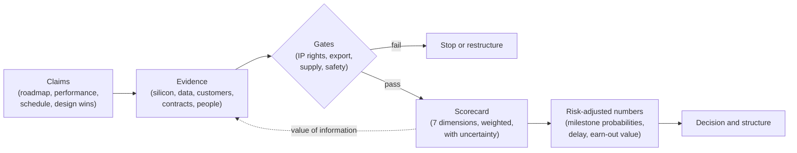

<!-- status: verified -->
# 28-01 · A Framework for Evaluating a Chip Company's Technology

| | |
|---|---|
| **Course** | [28 · Technical Diligence and Engineering Leadership Fluency](../README.md) |
| **University equivalent** | No direct university equivalent: industry technical-diligence practice, organized with the tools of a decision-analysis course (R. T. Clemen and T. Reilly, *Making Hard Decisions with DecisionTools*, the chapters on multi-attribute decisions and the value of information) |
| **Prerequisites** | [03-01](../../03-probability-statistics-and-random-variables/chapters/03-01-probability-in-ee-language.md) (Bayes' rule, base rates), [03-04](../../03-probability-statistics-and-random-variables/chapters/03-04-joint-distributions-and-clt.md) (variance of sums, correlation), [26-04](../../26-engineering-design-and-professional-practice/chapters/26-04-engineering-economics-2.md) (decision trees, the value of flexibility), [26-05](../../26-engineering-design-and-professional-practice/chapters/26-05-schedule-and-respin-risk.md) (respins and expected monetary value), [26-06](../../26-engineering-design-and-professional-practice/chapters/26-06-team-structures-and-sizing.md) (teams and design-cost estimates), [27-01](../../27-system-architectures/chapters/27-01-system-analysis-method.md) (the system-analysis method) |
| **Estimated study hours** | 6 |
| **Last verified** | 2026-11-26 |

**Learning objectives.** After this chapter you can:

1. Lay out the seven dimensions of a chip company's technology (architecture, implementation, IP position, team, roadmap, ecosystem and software, manufacturing and supply) and name, for each, the evidence that tests it.
2. Build a weighted scorecard, decide which dimensions are gates rather than weights, and compute how score uncertainty propagates to the total and to the chance of ranking two targets the wrong way round.
3. Update the probability of a technical claim from diligence evidence with likelihood ratios, and recognize when two pieces of evidence are really one.
4. Turn technical milestones into risk-adjusted numbers: expected silicon spins and delay, chained milestone probabilities, and the value of a milestone-based earn-out.
5. Decide which diligence work is worth paying for from its expected value of information.

---

## 1. Big picture

Every acquisition, venture investment and partnership in semiconductors rests on a forecast that is mostly technical: will this chip work, at this power, on this schedule, and will customers be able to use it? A financial model can be built in a day; the inputs that drive it (the tape-out date, the probability that first silicon is good enough to ship, the size of the software gap, the supply of advanced packaging) come from engineering. Technical diligence is the discipline of turning those questions into evidence and the evidence into numbers a business decision can use. This chapter gives the framework the rest of Course 28 fills in: seven dimensions to examine, a scorecard that respects uncertainty, Bayes' rule for weighing evidence, milestone probabilities for pricing risk, and the value of information for deciding what to examine first.

- **Why it exists:** chip programmes fail more often than they succeed at the first attempt. Only 14% of IC/ASIC projects reported first-silicon success in 2024 and 5% in 2026 (about 3–8% given the 2026 sample; the survey changed its recruitment in 2024), against about 30% historically [R-018, R-621, R-622], so a target's plan should be read against base rates, not against its own optimism.
- **Where it shows up:** acquisition and venture diligence, licensing and partnership decisions, make-or-buy reviews of a supplier, and internal portfolio reviews of one's own programmes.
- **What it produces:** not a verdict but a calibrated view: probabilities for the milestones that matter, the evidence behind each, the gates that would stop the deal, and a list of what would change the view.
- **Why it matters to this learner:** the success criterion of a fluent, skeptical conversation with a VP of Engineering is met only if the questions are aimed at the dimensions that move value, and the answers are weighed by how much they should move belief.

## 2. Intuition first

**A credit analyst's discipline, applied to silicon.** A credit analyst does not ask whether a borrower is "good"; they decompose the question (capacity, collateral, covenants), assign each part to evidence, and price what remains uncertain. Technical diligence does the same with a chip company. The seven dimensions are the decomposition; the evidence is what the target can show, not what it says; and the price of the remaining uncertainty appears as probabilities, delays and contingent payments.

The analogy breaks down in two places. First, credit risk is a portfolio of many small, partly independent exposures, while a chip programme is a few large, correlated, nearly binary events: a mask set works or it does not, and a single architectural mistake can sink every product built on it. Second, a borrower's financial statements are audited; a target's benchmark slides are not. Evidence quality varies far more in technical diligence, so weighing evidence (§3.3) matters as much as gathering it.

**Three habits.**

- **Start from base rates.** A plan that assumes working first silicon assumes something that most projects do not achieve. The prior belongs to the industry; the target's evidence moves it.
- **Separate gates from weights.** A target with brilliant architecture and no right to use its own key IP is not a 4-out-of-5 company; it is not investable. Some dimensions must pass before the others are scored.
- **Spend diligence effort where it can change the decision.** The most uncertain dimension is not always the most important; the right one to examine is where uncertainty, weight and decision sensitivity meet (§3.5).

## 3. Theory

### 3.1 The seven dimensions and their evidence

The framework divides a chip company's technology into seven dimensions. Each has evidence that tests it well and evidence that only appears to.

| Dimension | What it covers | Strong evidence | Weak evidence | Taught in |
|---|---|---|---|---|
| Architecture | The idea: dataflow, memory system, interconnect, precision, programmability, and whether it matches the workload's arithmetic intensity | Analytic models and simulations the team can defend from first principles; measured efficiency on silicon for representative workloads | Peak TOPS; a single benchmark chosen by the target | 14-15, 23-01, 27-07 |
| Implementation | Whether the idea is built well: timing, power, area, verification, DFT, signal and power integrity, packaging | Silicon in hand at the target clock and voltage; coverage and bug-trend data; respin history | "Taped out"; simulation results only | 19-10 to 19-13, 25-12, 26-05 |
| IP position | Ownership and freedom to operate: patents, licences (Arm, SerDes, memory PHYs), open-source obligations, trade secrets | Licence agreements and their terms (change of control); freedom-to-operate opinions; inventor records | A patent count | 26-04, 26-07 |
| Team | Who can do it again: key people, tape-out history, depth in verification and physical design | Named people with shipped products; retention plans; attrition data | Résumés of founders alone | 26-06, 28-07 |
| Roadmap | Whether the next products are credible: cadence, node and packaging choices, funding | Plans consistent with design-cost and schedule base rates; funded milestones | A slide of future products with no resourcing | 25-05, 26-05 |
| Ecosystem and software | Whether customers can use it: compilers, runtimes, drivers, model support, reference designs | Customers running their own code; release history; issue trackers | "Full software stack" | 27-02, 27-05, 27-07 |
| Manufacturing and supply | Whether it can be built at volume: foundry and node access, packaging and HBM supply, test, qualification | Wafer and packaging allocations, yields by lot, qualification reports | "We have a partnership with the foundry" | 25-04 to 25-11 |

Two observations shape the rest of the chapter. First, strong evidence is almost always *measured on artefacts* (silicon, code, contracts, people), and weak evidence is almost always *a statement about them*. Second, the dimensions are not independent: a weak team degrades implementation and roadmap together, and a software gap usually reflects a staffing choice. That correlation matters when scores are combined (§3.2).

### 3.2 Scorecards, gates and uncertainty

**Weighted scores.** Score each dimension $i$ on a common scale, here 1 (poor) to 5 (excellent), as $s_i$, and choose weights $w_i \ge 0$ with $\sum_i w_i = 1$. The **weighted scorecard** total is

$$
S = \sum_{i=1}^{n} w_i s_i .
$$

The weights express what matters for this decision: an acquirer buying a team for its next product weights team and roadmap heavily; one buying a product to sell next quarter weights implementation, software and supply.

**Arithmetic or geometric.** The arithmetic sum lets a strong dimension compensate a weak one fully. That is often wrong in technology: excellent hardware does not compensate for software customers cannot use. A **weighted geometric score**

$$
G = \prod_{i=1}^{n} s_i^{\,w_i}, \qquad \ln G = \sum_i w_i \ln s_i ,
$$

penalizes a weak dimension more, because the logarithm is concave: lowering one score from 3 to 1 costs $w\ln 3$ in $\ln G$, while raising another from 3 to 5, the same two points, gains only $w\ln(5/3)$, less than half as much. By the inequality of weighted arithmetic and geometric means, $G \le S$, with equality only when all scores are equal; the gap grows with the spread of the scores (Example 28-01.1).

**Gates.** Some dimensions should not be traded at all. A **knockout gate** is a condition that must hold before any score counts: the target owns or has transferable rights to its essential IP; its products can be sold to its intended customers under export controls (26-07; [R-659]); it has a credible path to wafers and packaging; it meets the functional-safety standard its market demands. A gate failure is not a low score but a reason to stop or to restructure the deal (an escrow, an indemnity, a carve-out). Gates keep the scorecard honest: a weighted sum cannot express "worthless unless".

**Uncertainty in the scores.** Each score is an estimate. Model the true score of dimension $i$ as a random variable with mean $s_i$ (the analyst's estimate) and standard deviation $\sigma_i$, which is large when the evidence is thin (management presentations only) and small when it is strong (silicon, code, contracts examined).

> **Math refresher — variance of a weighted sum.** For random variables $X_i$ with variances $\sigma_i^2$ and correlations $\rho_{ij}$, the variance of $Y = \sum_i w_iX_i$ is
>
> $$
> \operatorname{Var}(Y) = \sum_i w_i^2\sigma_i^2 + 2\sum_{i<j} w_iw_j\rho_{ij}\sigma_i\sigma_j .
> $$
>
> It follows from expanding $\operatorname{E}[(Y - \operatorname{E}Y)^2]$ and using $\operatorname{Cov}(X_i, X_j) = \rho_{ij}\sigma_i\sigma_j$ (03-04). With independent scores only the first sum remains.

The weights enter squared, so a heavily weighted dimension with thin evidence dominates the total's uncertainty. Each term $w_i^2\sigma_i^2$ is that dimension's **contribution to the variance**, and the largest contributions mark where diligence effort reduces uncertainty most (Example 28-01.2).

Correlation makes it worse. Analysts who are impressed by a founder tend to score team, architecture and roadmap high together, the **halo effect**; that is a positive correlation between score *errors*, and it inflates the variance through the second sum. With all $\rho_{ij} = \rho > 0$ the variance can be several times the independent value, so a scorecard built from one impressive meeting is far less certain than its tidy numbers suggest.

**Comparing two targets.** Let $D = S_A - S_B$ be the difference of two targets' totals, with independent errors between targets. Its mean is $\mu_D = S_A - S_B$ (the estimates) and its variance $\sigma_D^2 = \operatorname{Var}(S_A) + \operatorname{Var}(S_B)$. If the errors are roughly normal, the probability that B is truly ahead although A scores higher is

$$
P(D < 0) = \Phi\!\left(-\frac{\mu_D}{\sigma_D}\right),
$$

where $\Phi$ is the standard normal distribution function (03-02). When $\lvert\mu_D\rvert$ is small against $\sigma_D$, the ranking is a coin flip and the scorecard has not yet decided anything.

> **Going deeper — multi-attribute utility.** The weighted sum is the simplest multi-attribute utility function. It assumes *preferential independence* (the value of a better architecture score does not depend on the software score) and constant trade-offs between dimensions. The geometric form assumes instead that dimensions are complements. Decision analysis (Clemen and Reilly; see Further study, §13) elicits the form and the weights from the decision maker with swing-weighting and trade-off questions; in practice the robust lesson is to test whether the ranking survives a change of form and of weights before trusting it.

### 3.3 Weighing evidence: Bayes' rule in odds form

Let $T$ be a claim, for example "the first silicon meets its performance target at its production clock". Before diligence the analyst holds a **prior** probability $P(T)$, best anchored on base rates. Evidence $E$ arrives. Bayes' rule (03-01) gives

$$
P(T \mid E) = \frac{P(E \mid T)P(T)}{P(E \mid T)P(T) + P(E \mid \bar T)P(\bar T)} .
$$

Divide the equation for $P(T \mid E)$ by the corresponding one for $P(\bar T \mid E)$: the denominators cancel, and with odds $O = P/(1 - P)$,

$$
O(T \mid E) = O(T)\cdot\Lambda, \qquad \Lambda = \frac{P(E \mid T)}{P(E \mid \bar T)} .
$$

The **likelihood ratio** $\Lambda$ is the whole of what the evidence says: how much more likely this observation is if the claim is true than if it is false. Evidence with $\Lambda > 1$ supports the claim, $\Lambda < 1$ counts against it, and $\Lambda = 1$ is irrelevant however impressive it looks. Two consequences follow.

- **Independent evidence multiplies.** If $E_1, E_2, \dots$ are conditionally independent given $T$ (and given $\bar T$), the **posterior odds** are $O(T)\prod_k \Lambda_k$; in logarithms, the weights of evidence add.
- **Correlated evidence does not.** If a customer "confirmed" a benchmark by running it on the evaluation board and software image the target supplied, the confirmation is largely the target's own demo again: $P(E_2 \mid T, E_1)$ is not much larger than $P(E_2 \mid \bar T, E_1)$. Counting both at full strength double-counts one source (Example 28-01.3).

The odds form also answers the practical question of how strong evidence must be. To move a claim from prior probability $p_0$ to a target $p_1$, the combined likelihood ratio must be

$$
\Lambda_{\text{required}} = \frac{p_1/(1 - p_1)}{p_0/(1 - p_0)} .
$$

From 20% to 80% requires $\Lambda = 4/0.25$ = **16**. A polished slide deck has $\Lambda$ near 1, because a team whose silicon does not work produces polished slides too. What has a high $\Lambda$ is evidence a failing team could not easily produce: silicon running the analyst's own workload, a customer's independent measurements, or a production purchase order.

### 3.4 Technical milestones as probabilities

**Spins.** A chip rarely reaches production on its first mask set. 26-05 models the number of tape-outs with a per-attempt success probability (constant in its simplest form). The industry survey of 2024 gives the distribution directly: read from the report's chart, the share of IC/ASIC projects needing 1, 2, 3, 4, 5 and 6 spins before production was about 14, 25, 28, 16, 10 and 4% [R-645] **[Industry estimate: chart readings, ±1 point]**. If $q_k$ is the probability of needing $k$ spins, the expected number is $\bar k = \sum_k kq_k$, and for a plan that budgets $m$ spins, the expected number of spins *beyond* the plan is

$$
\operatorname{E}[\max(0, k - m)] = \sum_{k > m}(k - m)\,q_k .
$$

Each extra spin costs up to a full mask set (tens of millions of dollars at the leading edge [R-623] **[Industry estimate; Contested]**; a metal-only respin replaces only the metal masks [R-648]) and several months (26-05), so this expectation converts directly into expected delay and cost (Example 28-01.4).

**Milestone chains.** Value usually depends on a chain of events: the tape-out lands on time, the silicon works, the product qualifies, and a customer ramps. If stage $j$ succeeds with probability $p_j$, conditional on the earlier stages, the chain succeeds with probability

$$
P = \prod_j p_j .
$$

Chains are fragile: four stages at 0.8 each give 0.41. The conditional form matters: the probability that a customer ramps is higher *given* that the silicon works than it is unconditionally, so each $p_j$ must be estimated assuming the previous stages succeeded.

**Earn-outs.** A buyer can move part of the technical risk to the sellers with **contingent consideration**, an **earn-out**: part of the price is paid only if a milestone (a revenue level, a product release) is reached by a date. A binary payment $X$ due in $t$ years with probability $p$, discounted at rate $r$, is worth

$$
PV = \frac{pX}{(1 + r)^t}
$$

to a risk-neutral party. Buyer and seller can hold different values of $p$, which is precisely why earn-outs help close deals: each side values the contingent part at its own estimate (Example 28-01.5). Technical diligence supplies the buyer's $p$, usually as a chain: $p = p_{\text{tech}} \times p_{\text{market}}$.

### 3.5 The value of information

Diligence costs money and time, so each piece of work should be judged by how much it could improve the decision. Consider a choice between buying a target, worth an upside $U$ if its technology works (probability $p$) and a loss $L < 0$ if not, and passing (worth 0). Without more information the best expected value is $\max(pU + (1 - p)L,\ 0)$.

With **perfect information** the buyer would learn the outcome first and buy only if it works, for an expected value $pU$. The difference is the **expected value of perfect information**:

$$
\text{EVPI} = pU - \max\bigl(pU + (1 - p)L,\ 0\bigr).
$$

No diligence step is worth more than the EVPI.

Real tests are imperfect. A test (an independent benchmark of the silicon, a code review, a customer reference) passes a working technology with probability $a$, its **sensitivity**, and fails a broken one with probability $b$, its **specificity**. Then $P(\text{pass}) = pa + (1 - p)(1 - b)$, Bayes' rule gives $P(\text{works} \mid \text{pass})$ and $P(\text{works} \mid \text{fail})$, the buyer chooses the best action after each result, and the **expected value of sample information** is

$$
\text{EVSI} = P(\text{pass})\max(V_{\text{pass}}, 0) + P(\text{fail})\max(V_{\text{fail}}, 0) - \max\bigl(pU + (1 - p)L,\ 0\bigr),
$$

where $V_{\text{pass}}$ and $V_{\text{fail}}$ are the expected values of buying after each result. A test is worth doing when its EVSI exceeds its cost, including the cost of delay. A test whose result would not change the decision has an EVSI of zero, however interesting its answer (Example 28-01.6). The same logic ranks diligence workstreams: the most valuable is the one most likely to flip the decision, which is usually the heavily weighted, poorly evidenced dimension of §3.2.

> **Going deeper — information value theory.** R. A. Howard's 1966 paper (see Further study, §13) formalized the value of information in decision analysis, building on Raiffa and Schlaifer's earlier statistical decision theory. The general form is a preposterior analysis: average, over the possible results of the test, the best decision's expected value given each result. Production diligence rarely computes it exactly, but even a rough EVSI exposes tests that cannot change the decision and tests that are cheap relative to what they protect.

### 3.6 A consistency check on the roadmap

A roadmap is a set of claims about money, people and time, and it can be checked against base rates before any technical deep-dive.

- **Money.** Months of runway are cash divided by monthly burn. A leading-edge chip from a startup was estimated at \$50–75 million at 7 nm including software (SemiAnalysis, 2022), and leading-edge NRE at \$30–100 million or more (2026) [R-623] **[Industry estimate]**; from-scratch design-cost estimates run far higher (IBS, via Arm's prospectus: about \$249 million at 7 nm and \$725 million at 2 nm [R-019] **[Contested]**). A roadmap of two leading-edge chips in two years on a smaller budget should explain what it reuses.
- **People.** 26-06 converts a design cost into engineer-years at a loaded cost per engineer. A design team that is a tenth of the implied size is either reusing a great deal or planning to fail.
- **Time.** Most IC/ASIC projects miss their original schedule (about three in four in 2024 and 2026 [R-018]); a roadmap whose dates assume first-time success inherits that risk.

None of these checks proves a roadmap wrong; each identifies the question to ask (Problem 28-01.13).

## 4. Worked examples

All parameters below are illustrative assumptions unless a source is cited; the deal terms in Example 28-01.5 are public, but the probabilities are assumptions for teaching, not an assessment of the deal.

### Example 28-01.1 · Two targets, two ways to add (tier A)

**Setup.** An acquirer compares two AI-accelerator startups on the seven dimensions with weights 0.20 (architecture), 0.15 (implementation), 0.15 (IP position), 0.15 (team), 0.10 (roadmap), 0.15 (ecosystem and software) and 0.10 (manufacturing and supply). Target A scores 4.5, 4.0, 3.0, 4.5, 4.0, 2.0 and 3.5; target B scores 3.5, 3.5, 4.0, 3.5, 3.5, 4.0 and 3.5. Find (a) each weighted arithmetic score and the difference, and (b) each weighted geometric score. Which leads under each?

**Solution.**

- (a) A: $0.20 \times 4.5 + 0.15 \times 4.0 + 0.15 \times 3.0 + 0.15 \times 4.5 + 0.10 \times 4.0 + 0.15 \times 2.0 + 0.10 \times 3.5 = 0.900 + 0.600 + 0.450 + 0.675 + 0.400 + 0.300 + 0.350$ = **3.675**. B: **3.650**. A leads by **0.025**.
- (b) $\ln G_A = 0.20\ln 4.5 + 0.15\ln 4 + 0.15\ln 3 + 0.15\ln 4.5 + 0.10\ln 4 + 0.15\ln 2 + 0.10\ln 3.5 = 1.267$, so $G_A$ = **3.55**; $G_B$ = **3.64**. B leads.

**Units check.** Weights are dimensionless and sum to 1, so both totals are on the 1–5 score scale. ✓

**Sanity check.** A's scores spread from 2.0 to 4.5 and B's from 3.5 to 4.0, so A's geometric score falls further below its arithmetic score, as the inequality of means requires. The two forms disagree about the ranking, and the cause is one number: A's 2.0 for software. Whether excellent hardware can make up for software customers cannot use is a business judgment, and the scorecard's form should state it rather than hide it.

### Example 28-01.2 · How sure is the ranking? (tier B)

**Setup.** A's scores rest mostly on management presentations: standard deviations of 0.75 for architecture and team and 0.5 for the other five. B has shipped products and a customer base, so each of its scores has a standard deviation of 0.4. Treat all errors as independent and normal. Find (a) the variance and standard deviation of $D = S_A - S_B$, (b) the probability that B is truly ahead on the arithmetic score, and (c) the share of the variance contributed by architecture and by team.

**Solution.**

- (a) $\operatorname{Var}(D) = \sum_i w_i^2(\sigma_{A,i}^2 + \sigma_{B,i}^2)$. Architecture contributes $0.04 \times (0.5625 + 0.16) = 0.0289$; team $0.0225 \times 0.7225 = 0.0163$; implementation, IP and software $0.0225 \times 0.41 = 0.0092$ each; roadmap and supply $0.01 \times 0.41 = 0.0041$ each. The total is **0.0810**, so $\sigma_D$ = **0.285**.
- (b) $P(D < 0) = \Phi(-0.025/0.285) = \Phi(-0.088)$ = **46.5**%.
- (c) Architecture is **35.7**% of the variance and team **20.1**%.

**Units check.** Variances in score units squared; their square root in score units; the ratio $\mu_D/\sigma_D$ is dimensionless. ✓

**Sanity check.** A 0.025 lead against a 0.285 standard deviation decides nothing: the ranking is almost a coin flip. The variance shares say where to look next. An architecture deep-dive (an independent model of A's dataflow on the acquirer's workloads) attacks over a third of the uncertainty; a review of A's software, the cause of Example 28-01.1's disagreement, attacks only **11.4**% of the variance but could swing the decision on its own. Both belong at the top of the plan (§3.5).

### Example 28-01.3 · What the evidence says (tier B)

**Setup.** The claim: target A's first silicon meets its performance target at its production clock. The analyst's prior is 0.25. That sits above the 5–14% first-silicon success rates of [R-018] because this claim is narrower than "ships without a respin": silicon can meet its performance target at its clock and still need a functional respin for an unrelated bug. Three pieces of evidence arrive, with the analyst's estimates of their likelihoods:

- $E_1$: a live demonstration of a standard workload at the claimed clock, $P(E_1 \mid T) = 0.9$, $P(E_1 \mid \bar T) = 0.3$ (a team with marginal silicon can still stage a demo);
- $E_2$: an independent customer reports the same performance on its own model, $P(E_2 \mid T) = 0.8$, $P(E_2 \mid \bar T) = 0.2$;
- $E_3$: management declines to share power measurements at that clock, $P(E_3 \mid T) = 0.3$, $P(E_3 \mid \bar T) = 0.6$.

Find (a) the prior odds, (b) the posterior odds and probability with independent evidence, and (c) the posterior if it emerges that the customer ran its test on the target's own evaluation board and software, so that given $E_1$ its likelihood ratio is only 1.5.

**Solution.**

- (a) $O = 0.25/0.75$ = **0.333**.
- (b) $\Lambda_1 = 3$, $\Lambda_2 = 4$, $\Lambda_3 = 0.5$. Posterior odds $0.333 \times 3 \times 4 \times 0.5$ = **2.00**, probability $2/3$ = **66.7**%.
- (c) Odds $0.333 \times 3 \times 1.5 \times 0.5$ = **0.750**, probability $0.75/1.75$ = **42.9**%.

**Units check.** Probabilities and likelihood ratios are dimensionless; odds $O$ convert to probability as $O/(1 + O)$. ✓

**Sanity check.** The refusal to share power data halves the odds; its weight is real, because a team with good numbers usually shows them. Discovering that the customer's "independent" result was the target's own setup drops the posterior from two-thirds to under one-half: the same evidence counted once rather than twice. The question that separates the cases, "whose hardware and software did the customer use?", costs nothing to ask.

### Example 28-01.4 · How many spins? (tier B)

**Setup.** Use the 2024 distribution of spins before production [R-645]: 14, 25, 28, 16, 10 and 4% of projects needed 1 to 6 spins (chart readings; they total 97%, so renormalize). A target's plan assumes two spins. Each extra spin costs 4 months and a \$25 million mask set (assumed, within the \$10–40 M range of leading-edge estimates [R-623]). Find (a) the expected number of spins, (b) the probability that two or fewer suffice, (c) the expected spins beyond plan, and (d) the expected delay and extra mask cost.

**Solution.**

- (a) $\bar k = (1 \times 14 + 2 \times 25 + 3 \times 28 + 4 \times 16 + 5 \times 10 + 6 \times 4)/97 = 286/97$ = **2.95** spins.
- (b) $(14 + 25)/97$ = **40.2**%.
- (c) $(1 \times 28 + 2 \times 16 + 3 \times 10 + 4 \times 4)/97 = 106/97$ = **1.09** spins.
- (d) $1.09 \times 4$ = **4.37** months and $1.09 \times 25$ = **27.3** million dollars.

**Units check.** Spins × months/spin = months; spins × dollars/spin = dollars. ✓

**Sanity check.** A two-spin plan is already more cautious than most slides, yet the base rate says it holds only two times in five and costs about four months and \$27 million in expectation. The survey is vendor-sponsored, its sample changed in 2024 [R-621] and it over-represents processor-class projects [R-622], and renormalizing assumes the missing 3% is reading error: if it is a "7 or more" bar, placing it at 7 spins gives $(28 + 32 + 30 + 16 + 15)/100$ = **1.21** spins beyond plan instead of 1.09. Treat these as a prior to be moved by the target's own history (its past tape-outs and their outcomes), not as a forecast.

### Example 28-01.5 · Valuing an earn-out (tier C)

**Setup.** Marvell agreed in December 2025 to acquire Celestial AI for upfront consideration of about \$3.25 billion, with up to about \$2.25 billion more (at the signing share value) contingent on revenue milestones through fiscal 2029, paid in full if cumulative revenue exceeds \$2.0 billion [R-547]. For teaching, treat the contingent part as a single payment of \$2.25 billion, made 3.2 years after signing if the threshold is met, and assume a buyer's view of $p_{\text{tech}} = 0.6$ (the product qualifies and ramps in time) and $p_{\text{market}} = 0.5$ (customers adopt at the volume needed), with a 10% discount rate. Find (a) the buyer's probability, (b) the discount factor and present value of the earn-out, (c) the expected present value of total consideration and the maximum nominal total, and (d) the probability at which the expected total would reach \$4.0 billion.

**Solution.**

- (a) $p = 0.6 \times 0.5$ = **0.30**.
- (b) $1.10^{3.2}$ = **1.357**; $PV = 0.30 \times 2.25/1.357$ = **0.498** billion dollars.
- (c) $3.25 + 0.498$ = **3.75** billion dollars expected, against a maximum of $3.25 + 2.25$ = **5.50** billion.
- (d) $p = (4.0 - 3.25) \times 1.357/2.25$ = **0.452**.

**Units check.** Probability × dollars ÷ (dimensionless discount factor) = dollars. ✓

**Sanity check.** At this buyer's view the contingent part is worth about half a billion dollars today, against a headline of up to \$2.25 billion: the earn-out lets a seller who believes in the product claim a high price, and a buyer who doubts it pay a lower expected one. The simplifications matter: the real terms pay partly for intermediate milestones, and paying in shares adds the buyer's own stock-price exposure. Diligence moves the number that matters most here, $p_{\text{tech}}$: raising it from 0.6 to 0.9 would raise the earn-out's value by half.

### Example 28-01.6 · Is a silicon test worth buying? (tier C)

**Setup.** Buying a target gains \$500 million of value if its technology works and loses \$200 million if it does not (net of price, assumed); passing is worth 0. The prior probability that it works is 0.4. An independent lab can benchmark the silicon on the buyer's workloads; it passes working technology with probability 0.8 and fails broken technology with probability 0.9. Find (a) the expected value of buying now and the EVPI; (b) the probability of a pass, and the probability that the technology works after a pass and after a fail; (c) the expected value of buying after each result; and (d) the EVSI.

**Solution.**

- (a) $0.4 \times 500 + 0.6 \times (-200)$ = **80** million dollars, so buy. EVPI $= 0.4 \times 500 - 80$ = **120** million dollars.
- (b) $P(\text{pass}) = 0.4 \times 0.8 + 0.6 \times 0.1$ = **0.38**. $P(\text{works} \mid \text{pass}) = 0.32/0.38$ = **0.842**; $P(\text{works} \mid \text{fail}) = 0.08/0.62$ = **0.129**.
- (c) After a pass: $0.842 \times 500 - 0.158 \times 200$ = **389.5** million dollars, so buy. After a fail: $0.129 \times 500 - 0.871 \times 200$ = **−109.7** million dollars, so pass.
- (d) $\text{EVSI} = 0.38 \times 389.5 + 0.62 \times 0 - 80$ = **68.0** million dollars.

**Units check.** Probabilities × millions of dollars = millions of dollars. ✓

**Sanity check.** The test is worth up to \$68 million, more than half the \$120 million that perfect information would be worth, because a fail flips the decision from buy to pass. A benchmark campaign typically costs a small fraction of that, so the case for it is overwhelming unless it delays the deal past a deadline. Had the prior been 0.9, the buyer would buy whatever the test said and the same test would be worth nothing (Problem 28-01.12).

<!-- answer-key -->

| ID | Quantity | Value | Unit |
|---|---|---|---|
| Ex 28-01.1a | A, weighted arithmetic score | 3.675 | — |
| Ex 28-01.1a1 | B, weighted arithmetic score | 3.650 | — |
| Ex 28-01.1a2 | A's lead | 0.025 | — |
| Ex 28-01.1b0 | ln of A's geometric score | 1.267 | — |
| Ex 28-01.1b | A, weighted geometric score | 3.55 | — |
| Ex 28-01.1b1 | B, weighted geometric score | 3.64 | — |
| Ex 28-01.2a0 | architecture variance term | 0.0289 | — |
| Ex 28-01.2a1 | team variance term | 0.0163 | — |
| Ex 28-01.2a2 | implementation, IP or software term | 0.0092 | — |
| Ex 28-01.2a3 | roadmap or supply term | 0.0041 | — |
| Ex 28-01.2a | variance of the difference | 0.0810 | — |
| Ex 28-01.2a4 | standard deviation of the difference | 0.285 | — |
| Ex 28-01.2a5 | standardized lead | 0.088 | — |
| Ex 28-01.2b | probability B is ahead | 46.5 | % |
| Ex 28-01.2c | architecture share of variance | 35.7 | % |
| Ex 28-01.2c1 | team share of variance | 20.1 | % |
| Ex 28-01.2c2 | software share of variance | 11.4 | % |
| Ex 28-01.3a | prior odds | 0.333 | — |
| Ex 28-01.3b | posterior odds, independent | 2.00 | — |
| Ex 28-01.3b1 | posterior probability, independent | 66.7 | % |
| Ex 28-01.3c | posterior odds, correlated | 0.750 | — |
| Ex 28-01.3c1 | posterior probability, correlated | 42.9 | % |
| Ex 28-01.4a | expected spins | 2.95 | spins |
| Ex 28-01.4b | probability two spins suffice | 40.2 | % |
| Ex 28-01.4c | expected spins beyond plan | 1.09 | spins |
| Ex 28-01.4d | expected delay | 4.37 | months |
| Ex 28-01.4d1 | expected extra mask cost | 27.3 | million \$ |
| Ex 28-01.4e | spins beyond plan, residue at 7 | 1.21 | spins |
| Ex 28-01.5a | buyer's probability | 0.30 | — |
| Ex 28-01.5b0 | discount factor | 1.357 | — |
| Ex 28-01.5b | present value of the earn-out | 0.498 | billion \$ |
| Ex 28-01.5c | expected total consideration | 3.75 | billion \$ |
| Ex 28-01.5c1 | maximum nominal total | 5.50 | billion \$ |
| Ex 28-01.5d | break-even probability for 4.0 B | 0.452 | — |
| Ex 28-01.6a | expected value of buying now | 80 | million \$ |
| Ex 28-01.6a1 | EVPI | 120 | million \$ |
| Ex 28-01.6b | probability of a pass | 0.38 | — |
| Ex 28-01.6b1 | P(works given pass) | 0.842 | — |
| Ex 28-01.6b2 | P(works given fail) | 0.129 | — |
| Ex 28-01.6c | value of buying after a pass | 389.5 | million \$ |
| Ex 28-01.6c1 | value of buying after a fail | -109.7 | million \$ |
| Ex 28-01.6d | EVSI | 68.0 | million \$ |
| Txt 28-01.1 | likelihood ratio from 20% to 80% | 16 | — |
| Txt 28-01.2 | four stages at 0.8 | 0.41 | — |

## 5. Simulate it

The lab is [labs/28-01-lab/](../labs/28-01-lab/README.md). `dilmodel.py` implements:

- weighted arithmetic and geometric scores, gates, score variance with correlation, and the probability of rank reversal (analytic and Monte Carlo);
- Bayes' rule in odds form and the likelihood ratio a target probability requires;
- spin statistics against a plan, milestone chains and earn-out values;
- EVPI and EVSI for a buy-or-pass decision.

1. *Predict* the probability that B is ahead if an architecture deep-dive revises A's architecture score from 4.5 to 4.0 with a standard deviation of 0.3. Then plot the probability against A's revised architecture score.
2. *Predict* the posterior of Example 28-01.3 if a fourth signal arrives: a second customer ends its evaluation, with a likelihood ratio of 0.25. Then plot posterior against prior for several likelihood ratios.
3. *Predict* the expected delay of Example 28-01.4 if the plan budgets three spins instead of two. Then sample 10,000 projects from the distribution and plot their delays.
4. *Predict* the EVSI of Example 28-01.6 if the lab's specificity falls from 0.9 to 0.7. Then plot EVSI against sensitivity for several specificities.

*Figure 1. How much evidence moves belief, and what a test is worth: posterior against prior for several likelihood ratios (§3.3), and the EVSI of Example 28-01.6's test against its sensitivity and specificity (§3.5).*

## 6. Engineering tradeoffs

| Knob | Improves | Costs | Typical decision owner |
|---|---|---|---|
| Deeper technical diligence (deep-dives, independent tests) | Lower score variance; fewer surprises after close | Time, fees, competitive position in an auction | Deal lead with the CTO's office |
| Geometric rather than arithmetic scoring | Penalizes a fatal weakness; resists one dazzling dimension | Can understate a fixable gap (software can be hired) | Investment committee |
| Hard gates (IP, export, supply, safety) | Stops unfixable deals early | May kill a deal that a structure (escrow, carve-out) could save | General counsel with the deal lead |
| Earn-outs and milestone payments | Shares technical risk with sellers; bridges valuation gaps | Disputes over milestone definitions; integration incentives distorted | Corporate development with finance |
| Weighting the team over the product | Captures the value of the next generation | Exposure to key-person departures (28-07) | Acquiring business unit |
| Relying on the target's own data | Speed and low cost | Correlated evidence; selection by the target | Diligence lead |

## 7. Numbers to know

Figures are as of Nov 2026 unless dated otherwise.

| Quantity | Value | Note |
|---|---|---|
| IC/ASIC first-silicon success | 5% (2026), 14% (2024); about 30–33% in 2010–2020 and 24% in 2022 | Wilson Research Group / Siemens EDA [R-018, R-621, R-622] **[Established as reported; trend Contested]** |
| Projects behind schedule | about 75% (2024 and 2026), against about 66% historically | Same surveys [R-018, R-645] **[Established as reported]** |
| Spins before production (2024) | 1: 14%, 2: 25%, 3: 28%, 4: 16%, 5: 10%, 6: 4%; mean **2.95** | Chart readings [R-645]; mean derived (Example 28-01.4) |
| Leading-edge NRE and mask sets | NRE \$30–100 M+, mask set \$10–20 M at 3–5 nm (2026); about \$40 M mask sets at 3 nm (2022 estimate) | [R-623] **[Industry estimate; Contested]** |
| From-scratch design cost | about \$249 M (7 nm) and \$725 M (2 nm) | IBS via Arm's F-1 [R-019] **[Contested]** |
| R&D intensity | 8.6% (NVIDIA FY2026) to 26.1% (Intel FY2025) of revenue | 10-K filings [R-017] **[Established]** |
| Earn-out example | \$3.25 B upfront plus up to about \$2.25 B on revenue milestones (Marvell–Celestial AI, 2025) | [R-547] **[Established: company announcement]** |
| Evidence needed from 20% to 80% | likelihood ratio **16** | §3.3 |

## 8. Common mistakes

- **Starting from the target's plan instead of the base rate.** A plan that assumes working first silicon has a prior well below one half behind it (§3.4).
- **Counting the same evidence twice.** A customer reference that used the target's board, software and engineers is mostly the target's demo again (Example 28-01.3).
- **Letting a weighted sum hide a fatal flaw.** No architecture score compensates for not owning the IP or not being allowed to ship; make those gates.
- **Reading a small scorecard lead as a decision.** Compute the standard deviation of the difference; leads smaller than it are noise (Example 28-01.2).
- **Scoring everything after one impressive meeting.** The halo effect correlates the errors and makes the total far less certain than it looks.
- **Commissioning diligence that cannot change the decision.** A test whose every result leads to the same action is worth nothing to the decision, however interesting (§3.5).
- **Treating "taped out" as "working".** A tape-out is a database sent to the foundry; it says nothing about how the silicon behaves (28-03).

## 9. Practitioner lens

**State of play (as of Nov 2026).**

- **The base rate for working first silicon is at a record low.** The 2026 Wilson Research Group study reports 5% first-silicon success among IC/ASIC respondents, from 14.4% in 2024, with about three in four projects behind schedule [R-018, R-622] **[Established as reported]**. The survey changed its recruitment in 2024 and its 2026 sample leans towards CPU, GPU and AI-accelerator projects, so the trend is **[Contested]**, and the 2026 figure is fragile (16 of about 320 respondents, a 95% interval of roughly 3–8% [R-622]). That most complex chips need more than one spin is not in doubt [R-645].
- **Even the leaders respin and slip.** NVIDIA "executed a change to the Blackwell GPU [mask] to improve production yields" in 2024 [R-646], and Intel built in "additional validation time" for Sapphire Rapids, moving production to 2022 [R-647] **[Established: company statements as reported]**. A target that claims it will not need such margins should be asked why.
- **Deal structures price technical risk explicitly.** Marvell's acquisition of Celestial AI paired about \$3.25 billion upfront with up to about \$2.25 billion contingent on revenue milestones through fiscal 2029 [R-547] **[Established for the terms]**. Contingent consideration is how a buyer turns a technical probability into a price.
- **Gates increasingly sit outside engineering.** US export controls define thresholds by "total processing performance" and "performance density" (ECCN 3A090) [R-659] **[Established: regulatory text]**; a chip's addressable market can depend on a number its architects chose. Supply is another: estimates of TSMC's or the industry's CoWoS run rate at the end of 2026 range from about 88,000 wafers per month (a June 2025 forecast) to 160,000, and one estimate that adds 50,000–60,000 of OSAT capacity approaches 200,000; Goldman Sachs's 106,000 is an annual total divided by 12, a different basis [R-588] **[Industry estimate; Contested]**, and a target's packaging allocation can gate its ramp.

**Commercial relevance.** For a corporate-development team the framework does three jobs. It structures the diligence plan (which dimensions, which evidence, in what order of value of information); it disciplines the valuation (milestone probabilities and expected delays feed the model, and the gap between buyer's and seller's probabilities is where earn-outs live); and it organizes the conversation with the target's engineering leaders around evidence rather than assertions. Its output to an investment committee is a short list: the gates and their status, the three uncertainties that move value most, the probability attached to each, and what would change it.

**Marketing vs Reality.**

- *"We taped out last quarter."* A database went to the foundry. Ask which stepping, when silicon returned, what fraction of the validation plan has passed, and what the respin plan is.
- *"First-pass silicon success."* Ask what "success" means: boots and runs a demo, or meets specification across voltage, temperature and process corners and ships without a respin? Against a 5–14% base rate, the claim deserves evidence with a high likelihood ratio.
- *"Our customers have validated our performance."* Ask whose hardware, software and engineers were used. A customer who ran its own model on its own setup is strong evidence; one who watched the target's demo is not.
- *"We have a full software stack."* Ask which customer workloads run unmodified today, how many releases have shipped, and the size and age of the open issue list. Software is where Example 28-01.1's ranking turned.

**Questions for engineering leaders.**

1. *"Walk me through your last three tape-outs: what went wrong on each, and what changed afterwards?"* Strong: specific bugs, root causes and process changes, including a respin owned without defensiveness. Evasive: "our tape-outs have all been successful", with no detail.
2. *"What would have to be true for your next product to slip by six months?"* Strong: named risks with probabilities and mitigations (a risk register, 26-05). Evasive: "we have built in margin".
3. *"Which of your performance numbers come from silicon, and which from simulation?"* Strong: a clear split, with the conditions of each silicon measurement. Evasive: a blend presented as one number.
4. *"Who outside the company has run their own code on your silicon, and what did they find?"* Strong: named customers or partners, with results the acquirer can verify. Evasive: logos without contacts.
5. *"What do you license, from whom, and what happens to those licences on a change of control?"* Strong: a list with terms, already reviewed by counsel. Evasive: "standard terms".
6. *"If you lost your two most senior engineers tomorrow, what would stop?"* Strong: named successors and documented ownership. Evasive: "everyone is replaceable", or a silence (28-07).

## 10. Concept check

1. Why does a heavily weighted dimension with thin evidence dominate the uncertainty of a scorecard?

   

Answer

   Each dimension contributes $w_i^2\sigma_i^2$ to the variance of the total. Weight enters squared, and thin evidence means a large $\sigma_i$, so the product is largest where both are large.

   

2. When is a weighted geometric score preferable to an arithmetic one?

   

Answer

   When the dimensions are complements, so a weak one cannot be compensated by a strong one (excellent hardware with unusable software). The geometric score falls further below the arithmetic one as the scores spread, so it penalizes a weak dimension more.

   

3. What makes a piece of evidence strong in Bayes' terms?

   

Answer

   A likelihood ratio far from 1: the evidence is much more likely if the claim is true than if it is false. Evidence a failing team could easily produce (slides, a staged demo) has a ratio near 1, however impressive it looks.

   

4. Why must two customer references sometimes count as one?

   

Answer

   If both used the target's own board, software and support, their results are not conditionally independent: given the first, the second is likely whether or not the claim is true. Multiplying their full likelihood ratios double-counts one source.

   

5. A plan budgets two spins. What does the 2024 spin distribution say about it?

   

Answer

   Two or fewer spins sufficed for about 40% of projects, and the expected number of spins beyond two is about 1.1 (Example 28-01.4). The plan holds roughly two times in five unless the target's own history is better than the base rate.

   

6. Why does an earn-out help buyer and seller agree?

   

Answer

   The contingent payment is worth $pX/(1 + r)^t$, and each side values it at its own probability $p$. A confident seller counts it near its face value; a skeptical buyer counts it at much less. The headline price can satisfy the seller while the buyer's expected cost stays acceptable.

   

7. When is a diligence test worth nothing, however accurate?

   

Answer

   When no result could change the decision, for example when the prior is so high that the buyer would buy even after a fail. Then the EVSI is zero.

   

Problems: [28-01 problem set](../problems/28-01-problems.md) · Solutions: [28-01 solutions](../solutions/28-01-solutions.md)

## 11. Key terms

[Technical due diligence](../../../reference/glossary.md#technical-due-diligence) · [Weighted scorecard](../../../reference/glossary.md#weighted-scorecard) · [Weighted geometric score](../../../reference/glossary.md#weighted-geometric-score) · [Knockout gate](../../../reference/glossary.md#knockout-gate) · [Halo effect](../../../reference/glossary.md#halo-effect) · [Likelihood ratio](../../../reference/glossary.md#likelihood-ratio) · [Posterior odds](../../../reference/glossary.md#posterior-odds) · [Earn-out](../../../reference/glossary.md#earn-out) · [Expected value of perfect information (EVPI)](../../../reference/glossary.md#expected-value-of-perfect-information-evpi) · [Expected value of sample information (EVSI)](../../../reference/glossary.md#expected-value-of-sample-information-evsi) · [First-silicon success](../../../reference/glossary.md#first-silicon-success) · [Respin](../../../reference/glossary.md#respin)

## 12. Connections

- **Previous:** [27-08 Edge AI and IoT](../../27-system-architectures/chapters/27-08-edge-ai-and-iot.md), the last of Course 27's case studies, whose system models supply most of the evidence this framework weighs.
- **Next:** [28-02 Validating Claims](28-02-validating-claims.md): first-principles checks of TOPS/W, benchmarks and tape-out status, the evidence with the highest likelihood ratios.
- **Prerequisites used here:** Bayes' rule and base rates ([03-01](../../03-probability-statistics-and-random-variables/chapters/03-01-probability-in-ee-language.md)); variance of sums ([03-04](../../03-probability-statistics-and-random-variables/chapters/03-04-joint-distributions-and-clt.md)); decision trees ([26-04](../../26-engineering-design-and-professional-practice/chapters/26-04-engineering-economics-2.md)); respins and expected monetary value ([26-05](../../26-engineering-design-and-professional-practice/chapters/26-05-schedule-and-respin-risk.md)); teams and design-cost estimates ([26-06](../../26-engineering-design-and-professional-practice/chapters/26-06-team-structures-and-sizing.md)).
- **Used later:** each dimension gets its own tools in [28-02](28-02-validating-claims.md) (claims), [28-03](28-03-silicon-maturity-scales.md) (maturity), [28-04](28-04-question-banks-digital-ai-memory-interconnect.md) and [28-05](28-05-question-banks-analog-rf-power-packaging-embedded.md) (domain questions), [28-07](28-07-evaluating-engineering-teams.md) (teams) and [28-08](28-08-integration-risk.md) (integration); the framework is the skeleton of the diligence memo in [capstone C4](../../../capstones/README.md).

## 13. Further study

- R. T. Clemen and T. Reilly, *Making Hard Decisions with DecisionTools*: the chapters on multi-attribute decisions (swing weights, trade-offs) and on the value of information.
- R. A. Howard, "Information Value Theory", *IEEE Transactions on Systems Science and Cybernetics* SSC-2 (1966): the origin of the value of information in decision analysis.
- D. Kahneman, *Thinking, Fast and Slow* (2011): base-rate neglect and the halo effect, the two biases this chapter's tools are built to resist.
- Lecture videos: MIT OpenCourseWare 6.041SC *Probabilistic Systems Analysis and Applied Probability* (John Tsitsiklis's recorded lectures) for Bayes' rule and inference.

## 14. Sources

1. Wilson Research Group / Siemens EDA functional verification studies, 2022–2026: first-silicon success and schedules [R-018, R-621, R-622]; 2024 respin causes and spin distribution [R-645].
2. Mask-set and NRE estimates [R-623]; IBS design-cost estimates via Arm's F-1 [R-019].
3. R&D intensity from 10-K filings [R-017].
4. Marvell's acquisition of Celestial AI: deal terms [R-547].
5. NVIDIA's Blackwell mask change [R-646]; Intel's Sapphire Rapids validation delays [R-647].
6. US export controls on advanced computing chips (ECCN 3A090) [R-659]; CoWoS capacity estimates [R-588].
