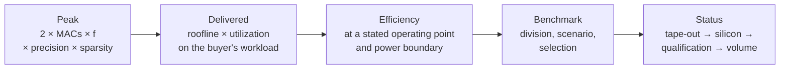

<!-- status: verified -->
# 28-02 · Validating Claims: TOPS/W, Benchmarks, Tapeout Status

| | |
|---|---|
| **Course** | [28 · Technical Diligence and Engineering Leadership Fluency](../README.md) |
| **University equivalent** | No direct university equivalent: the quantitative-evaluation units of a computer-architecture course (Hennessy & Patterson, *Computer Architecture: A Quantitative Approach*, chapter 1 on measuring and reporting performance), applied to industry claims, with the evaluation method of Sze, Chen, Yang and Emer, "How to Evaluate Deep Neural Network Processors" (2020) |
| **Prerequisites** | [28-01](28-01-technology-evaluation-framework.md) (evidence and likelihood ratios), [14-01](../../14-computer-organization-and-architecture/chapters/14-01-performance-power-iron-law.md) (performance, $P = \alpha CV^2f$), [14-14](../../14-computer-organization-and-architecture/chapters/14-14-ai-accelerators.md) (AI accelerators), [19-06](../../19-digital-vlsi-design/chapters/19-06-power-and-low-power-design.md) (power and DVFS), [14-15](../../14-computer-organization-and-architecture/chapters/14-15-roofline-and-benchmarks.md) (roofline and benchmarks), [23-01](../../23-memory-and-storage-technology/chapters/23-01-memory-hierarchy-and-memory-wall.md) (the energy of memory), [25-01](../../25-fabrication-packaging-test-and-reliability/chapters/25-01-process-flow-overview.md) (process flow and masks), [25-10](../../25-fabrication-packaging-test-and-reliability/chapters/25-10-qualification-and-functional-safety.md) (qualification), [27-01](../../27-system-architectures/chapters/27-01-system-analysis-method.md) (system analysis) |
| **Estimated study hours** | 6 |
| **Last verified** | 2026-11-26 |

**Learning objectives.** After this chapter you can:

1. Reconstruct a peak-throughput claim from MAC count, clock, precision and sparsity, and convert it to delivered throughput with a roofline and a utilization.
2. Turn an efficiency claim (TOPS/W) into energy per operation and test it against the first-principles energy of arithmetic and of moving data.
3. Name the conditions behind a number (operating point, power boundary, batch and latency bound) and restate two claims on a common basis.
4. Read a benchmark result: divisions and scenarios, the geometric mean of ratios, and the inflation of a best-of-N claim.
5. Say what tape-out, MPW silicon, steppings and qualification each prove, and check a tape-out-to-production schedule against fab cycle times and qualification durations.

---

## 1. Big picture

Most of what a diligence team hears about a chip arrives as a number with an adjective: "up to 1,000 TOPS", "industry-leading 50 TOPS/W", "MLPerf-leading", "taped out and on track for production next year". Each is true under some conditions and misleading under others. This chapter turns the numbers back into the physics and arithmetic that produce them: a MAC count and a clock for throughput, energy per operation for efficiency, a statistical method for benchmarks, and fab and qualification times for schedules. Each check takes minutes with a calculator, and together they produce the evidence with the highest likelihood ratios in the framework of 28-01: either the claim reconstructs from first principles, or it does not.

- **Why it exists:** peak numbers are set by datasheet arithmetic, not by workloads; efficiency numbers are measured at favorable operating points and power boundaries; benchmarks are selected; and schedules are written by the people who will be judged by them.
- **Where it shows up:** every investor presentation, product brief and analyst day, and every competitive comparison an acquirer's own team prepares.
- **What it produces:** each claim restated on a common basis (same precision, same sparsity, same power boundary, same workload), with the conditions that make it true and the evidence that would confirm it.
- **The governing rule:** a number without its conditions is not a measurement. Sze and colleagues put it in the title of their tutorial: "TOPS/W (alone) considered harmful" [R-492].

## 2. Intuition first

**A yield to worst, not a headline coupon.** A bond analyst does not compare bonds by coupon; a callable bond's headline rate tells you little until you compute the yield to the call date least favorable to the investor. A chip's peak TOPS is the coupon: real, contractual, and nearly irrelevant to what the buyer will earn. The delivered throughput on the buyer's workload, at the buyer's latency target and power boundary, is the yield to worst. The analogy is tighter than it looks, because both conversions require the same two things: the full terms (the call schedule; the precision, sparsity and operating point) and a model of the scenario (rates; the workload's arithmetic intensity).

Where it breaks down: a bond's terms are in its indenture, fully disclosed. A chip's terms are often in a footnote, sometimes one whose text does not appear on the page (27-07 [R-690]), so the first step is frequently to ask for them.

**Four questions for any number.**

- **Of what?** Which operation (INT8, FP8, FP4), dense or sparse, counted how (one MAC as two operations is the convention)?
- **Where?** At which power boundary: the compute core, the package, the card, the server, the facility meter?
- **When?** At which operating point (voltage, clock, temperature) and for how long (before or after thermal throttling)?
- **On what?** On which workload, at which batch size and latency target, chosen by whom?

## 3. Theory

### 3.1 Peak throughput, precision and sparsity

An accelerator with $N_{\text{MAC}}$ multiply-accumulate units at clock $f$ performs one MAC per unit per cycle at its native precision. Counting a MAC as two operations (a multiply and an add), its **peak throughput** is

$$
F_{\text{peak}} = 2N_{\text{MAC}}f\cdot k_{\text{prec}}\cdot k_{\text{sparse}} ,
$$

in operations per second, where $k_{\text{prec}}$ is the throughput multiplier of a narrower format (commonly 2 each time the operand width halves, when one unit performs two narrower MACs) and $k_{\text{sparse}}$ is 2 for 2:4 structured sparsity, in which hardware skips two of every four weights for models pruned to that pattern (27-07 §3.1). A datasheet number is therefore a product of four factors, and the same silicon can be quoted at four values up to a factor of four apart (1×, 2×, 2× and 4× the dense, native-precision rate). NVIDIA's HGX B200 table, for instance, prints "FP4 Tensor Core 144 PFLOPS | 72 PFLOPS" for eight GPUs with a footnote that the specification is "sparse | dense" [R-147]; the first check of any figure is which product it is.

**A precision-normalized measure.** US export controls define a **total processing performance** that removes the precision factor: $\text{TPP} = 2 \times \text{MacTOPS} \times \text{bit length}$, where MacTOPS is the peak MAC rate in units of $10^{12}$ per second at that bit length [R-659]. When the hardware packs two narrower MACs into each wide one, halving the bit length doubles MacTOPS and halves the bit length, so TPP is unchanged; a part that gains less (or more) than 2× per halving has a TPP that depends on the precision used, so ask which precision the classification rests on. How sparse rates count toward TPP is not settled in the text logged here, so check the dense figure. A chip reaches the control threshold of 4800 at, for example, 600 int8 TOPS (300 MacTOPS) [R-659], whatever precision its headline uses. For diligence, TPP is a quick way both to compare chips across precisions and to tell whether a product's market depends on an export license (28-01 §3.2's gates).

**Delivered throughput.** No workload runs at peak. The roofline (14-15) bounds the attainable rate by the memory system: with off-chip bandwidth $B$ (bytes/s) and arithmetic intensity $I$ (operations per byte moved),

$$
F_{\text{att}} = \min\left(F_{\text{peak}},\ I\cdot B\right),
$$

and the **utilization** $u = F_{\text{delivered}}/F_{\text{peak}}$ absorbs the rest: idle units during data movement, layers that do not map onto the array, control overhead. Sze and colleagues write throughput as operations per second per processing element × number of elements × utilization, and stress that processors rarely run at peak [R-492]. A claim is only as good as the utilization behind it, and the utilization only as good as the workload it was measured on.

### 3.2 Efficiency from first principles

An efficiency in TOPS/W is an energy per operation in disguise:

$$
E_{\text{op}} = \frac{1}{\eta}, \qquad \eta\ \text{in TOPS/W} \;\Rightarrow\; E_{\text{op}} = \frac{1}{\eta \times 10^{12}}\ \text{J}.
$$

Fifty TOPS/W is **20** fJ per operation; 100 TOPS/W is 10 fJ. That energy must pay for the arithmetic and for moving every operand to it. A lower bound follows from adding the two:

$$
E_{\text{op}} \ \ge\ E_{\text{arith}} + \sum_{\ell}\frac{E_{\ell}}{I_{\ell}} ,
$$

where $E_{\text{arith}}$ is the energy of the arithmetic per operation, and for each memory level $\ell$ (on-chip SRAM, off-chip DRAM) $E_\ell$ is its energy per byte and $I_\ell$ the operations performed per byte fetched from it. Reuse (keeping a weight or an activation in registers or SRAM and using it many times) raises $I_\ell$ and shrinks each term.

The reference numbers come from Horowitz's ISSCC 2014 survey at 45 nm and 0.9 V [R-208, R-458] **[Established]**: an 8-bit multiply costs 0.2 pJ and an 8-bit add 0.03 pJ, so an 8-bit MAC costs about 0.23 pJ, or 115 fJ per operation; a 32-bit read from an 8 KB SRAM costs 5 pJ; and a 32-bit DRAM read costs 640 pJ, which is **20** pJ per bit (the figure's values as reproduced in MIT 6.5930's lecture slides [R-458]; the paper's prose puts a whole DRAM access at 1 to 2 nJ and DRAM I/O alone at over 20 pJ per bit, so 20 pJ/bit is a floor). HBM2 brings the off-chip cost down to about 3.9 pJ per bit [R-459]. Newer nodes and lower voltages cut the arithmetic energy by a factor that is itself a claim to examine: dynamic energy scales with switched capacitance and with $V^2$ (14-01), so a quoted efficiency implies a node and a voltage, and the two must be consistent with each other.

> **Math refresher — why TOPS/W is a property of the voltage.** Dynamic power is $P = \alpha CV^2f$ (14-01), and the operations per second scale with $f$. The energy per operation, $P/F \propto \alpha CV^2f/f = \alpha CV^2$, does not depend on the clock at all. Running slower saves energy per operation only if it allows a lower voltage. Two efficiencies at voltages $V_1$ and $V_2$ therefore differ by $(V_2/V_1)^2$ when leakage is small (Example 28-02.3).

The practical consequences are sharp. A claim of 100 TOPS/W at INT8 asks for 10 fJ per operation, about a twelfth of the 45 nm arithmetic alone; and if off-chip DRAM may take only a tenth of the budget, every byte fetched from DRAM must feed $160\ \text{pJ}/1\ \text{fJ}$ = 160,000 operations (Example 28-02.2). Such figures describe kernels whose data live on chip, not systems that stream weights from memory.

### 3.3 Conditions: operating point and power boundary

**Operating point.** A chip is specified over a range of voltage and frequency, and dynamic voltage and frequency scaling (DVFS, 19-06) moves it between operating points. Peak throughput is quoted at the highest point; efficiency is best near the lowest. A product brief that pairs "200 TOPS" with "20 TOPS/W" may be quoting two operating points that cannot coexist: at the peak point the efficiency falls by $(V_{\text{peak}}/V_{\text{eff}})^2$, and the power rises as $V^2f$ (Example 28-02.3). The honest pair is the throughput and efficiency *at the same point*, plus the point's voltage, clock and junction temperature, and whether it can be sustained without throttling (27-01 §3.3).

**Power boundary.** Efficiency also depends on where the power is measured. Moving outward:

- the **compute core** (the arrays and their SRAM), the most flattering boundary;
- the **chip or package**, adding I/O, controllers, interconnect and leakage;
- the **card or module**, adding DRAM, voltage regulators and their losses;
- the **server or rack**, adding host CPU share, network, fans and power-supply losses;
- the **facility**, multiplied by the PUE (27-07 §3.2).

With core power $P_c$, memory $P_m$, I/O $P_{io}$, conversion efficiency $\eta_c$, a system overhead factor $k_{\text{sys}}$ and the facility's PUE, the power at successive boundaries is

$$
P_{\text{card}} = \frac{P_c + P_m + P_{io}}{\eta_c}, \qquad P_{\text{sys}} = k_{\text{sys}}P_{\text{card}}, \qquad P_{\text{fac}} = \text{PUE}\cdot P_{\text{sys}} .
$$

The same delivered throughput divided by each gives an efficiency that can fall by a factor of two or more from core to meter (Example 28-02.4). Comparisons are valid only at the same boundary, and the boundary that matters to a buyer is the one it pays for.

### 3.4 Benchmarks and how to read them

A benchmark fixes the workload and the rules, which is its value; the rules decide what it proves.

**Divisions and scenarios.** MLPerf's closed division requires a model "equivalent to the reference or alternative implementation" and allows quantization calibration but no retraining; the open division allows arbitrary models and retraining, and its results must be called "MLPerf Open" [R-224] **[Established: rules as read]**. Closed results compare hardware and software stacks on the same task; open results show what a vendor can do with freedom, which is interesting but not comparable. Inference results come in scenarios: offline (throughput), server (Poisson arrivals, maximum throughput under a latency bound), single-stream and multistream (percentile latencies) [R-224]. A chatbot claim should be read from the server or interactive scenario, not offline (27-07 §3.7's frontier).

**Means of ratios.** Speedups are ratios, and the right average of ratios is the **geometric mean**. SPEC CPU defines each benchmark's ratio as the reference machine's time over the tested machine's, and the overall metric as the geometric mean of the ratios [R-223]. The reason is consistency: with ratios $r_i = t_{\text{ref},i}/t_{A,i}$,

$$
\frac{\text{GM}_i(t_{\text{ref},i}/t_{A,i})}{\text{GM}_i(t_{\text{ref},i}/t_{B,i})} = \text{GM}_i\!\left(\frac{t_{B,i}}{t_{A,i}}\right),
$$

because the reference times cancel inside the product. The ranking of A and B does not depend on the reference machine. The arithmetic mean has no such property: changing the reference can reverse the ranking, and "A is 1.9× faster than B" and "B is 0.75× as fast as A" can both be computed from the same data (Example 28-02.5, Problem 28-02.8). SPEC also separates *base* results, which require the same compiler flags for every module, from *peak* results, which allow per-benchmark tuning [R-223]; a vendor's comparison should say which.

**Selection.** A vendor that measures $N$ workloads and shows the best reports the maximum of $N$ draws. If the per-workload speedups are lognormal with median $m$ (their logarithms normal, with mean $\ln m$ and standard deviation $\sigma$), the typical best is about

$$
\text{best} \approx m\,e^{\sigma\,\operatorname{E}[Z_{(N)}]},
$$

the exponential of the expected maximum logarithm, where $\operatorname{E}[Z_{(N)}]$ is the expected maximum of $N$ standard normal variables (because $e^x$ is convex, this slightly understates the *mean* best): 1.16 for $N = 5$, **1.54** for $N = 10$ and 1.87 for $N = 20$. With $m = 1.5\times$ and $\sigma = 0.3$, the best of ten is about **2.4**×: an "up to 2.4×" headline is what a typical 1.5× product produces when the best case is shown (Example 28-02.5). The defense is to ask for the full distribution, or to pick the workloads oneself.

> **Going deeper — expected maxima.** The maximum of $N$ independent variables with distribution function $\Phi$ has distribution $\Phi^N$, so $\operatorname{E}[Z_{(N)}] = \int x\,N\phi(x)\Phi(x)^{N-1}\,dx$. For large $N$ it grows like $\sqrt{2\ln N}$, slowly but without limit: there is always a better-looking best case if one tests enough workloads.

### 3.5 Silicon status: what each milestone proves

Status claims form a ladder. Each step proves something specific and leaves the rest open; 28-03 develops the full maturity scale, and this section gives the checks.

- **Tape-out.** The design database is released to the mask shop. It proves the design closed timing and verification to the team's own criteria, not that the silicon works.
- **Multi-project wafer (MPW) silicon.** Several customers share one mask set and a shuttle run [R-581]. It proves function at small sample size; it says nothing about yield, cost or volume, because the masks and often the wafer lot are not the product's.
- **First silicon (A0) and bring-up.** Dedicated masks, an engineering lot, and weeks to months of lab validation (25-12). The status to ask about is the fraction of the validation plan that has passed, at which corners.
- **Steppings.** Later mask revisions: a metal-only change reuses the transistor masks, and wafers held before the metal layers can be finished quickly [R-648]; a full-layer change repeats the whole fab cycle. Production parts carry stepping names: Intel's specification update for Sapphire Rapids lists steppings E-5, S-3 and B-3 for its XCC, MCC and HBM variants [R-647].
- **Qualification.** Stress tests on samples from several lots, for example 1000 hours of high-temperature operating life at a junction of at least 125 °C on 3 lots of 77 units with zero failures under JEDEC JESD47G [R-061]. Qualification proves reliability to the market's standard; only after it can a part be called production.

**Schedule arithmetic.** Each step takes time that physics and logistics fix. A wafer at an advanced node spends about 14–20 weeks in the fab (2021 estimate), at about 1–1.5 days per mask layer (2017 estimate) [R-020] **[Industry estimate]**; 80 mask layers (about 7 nm [R-020]) at 1–1.5 days is **11.4** to **17.1** weeks. Qualification life testing alone is 1000 hours, **5.95** weeks, before the reports. A schedule from tape-out to volume production is therefore at least the sum

$$
T = T_{\text{masks}} + T_{\text{fab}} + T_{\text{pkg+test}} + T_{\text{bring-up}} + n_{\text{respin}}\,T_{\text{respin}} + T_{\text{qual}} + T_{\text{report}},
$$

with each respin adding masks, a fab cycle (shorter for a metal-only change from held wafers) and packaging and test. Steps can overlap only where the logic allows: qualification needs production-representative silicon, so it cannot start before the last stepping. A plan that is shorter than this sum assumes either working first silicon or overlaps that need explaining (Example 28-02.6). Against base rates in which only 5–14% of projects reach first-silicon success [R-018], a plan with no respin is the optimistic case, not the expected one (28-01 §3.4).

## 4. Worked examples

All parameters are illustrative assumptions unless a source is cited.

### Example 28-02.1 · Reconstructing "up to 157 TOPS" (tier A)

**Setup.** An NPU has 32,768 INT8 MAC units at 1.2 GHz, and its brief says "up to 157 TOPS". Find (a) the dense INT8 peak, (b) what makes 157, (c) the delivered throughput at 35% utilization (dense INT8), and (d) the MacTOPS, the TPP and its fraction of the 4800 threshold [R-659].

**Solution.**

- (a) $2 \times 32\,768 \times 1.2 \times 10^9$ = **78.6** TOPS.
- (b) $2 \times 78.6$ = **157** TOPS: either 2:4 sparsity at INT8 or dense INT4 (two 4-bit MACs per unit). The brief must say which; they are not the same capability.
- (c) $0.35 \times 78.6$ = **27.5** TOPS.
- (d) MacTOPS $= 32\,768 \times 1.2 \times 10^9/10^{12}$ = **39.3**; TPP $= 2 \times 39.3 \times 8$ = **629**, which is **13.1**% of 4800. At INT4 the MacTOPS doubles and the bit length halves, so the TPP is the same.

**Units check.** MACs × cycles/s × 2 ops/MAC = ops/s; TPP is dimensionless by the rule's definition. ✓

**Sanity check.** The headline is twice the dense INT8 capability and over five times what a 35%-utilized workload sees. TPP, being precision-normalized, shows at once that this part is far below the 3A090 advanced-computing thresholds (28-08 §3.5). That settles only one control: the entity list, end-use rules and other export classifications still need checking before anyone says no license is required.

### Example 28-02.2 · Can it really be 100 TOPS/W? (tier B)

**Setup.** An edge-AI startup claims 100 TOPS/W at INT8. Using the 45 nm energies of [R-208, R-458] and HBM2's 3.9 pJ/bit [R-459], find (a) the energy per operation and per MAC; (b) the 45 nm energy of an 8-bit MAC, per operation, and the factor the claim requires beyond it; (c) DRAM's energy per byte and the operations per DRAM byte needed for DRAM to take at most 10% of the budget; (d) the same for HBM2.

**Solution.**

- (a) $1/(100 \times 10^{12})$ J = **10** fJ per operation, **20** fJ per MAC.
- (b) $0.2 + 0.03$ = **230** fJ per MAC, **115** fJ per operation: the claim needs **11.5** times less than 45 nm arithmetic.
- (c) $640\ \text{pJ}/4\ \text{bytes}$ = **160** pJ per byte (20 pJ/bit). With 1 fJ per operation allowed, $160\ \text{pJ}/1\ \text{fJ}$ = **160000** operations per byte.
- (d) $3.9 \times 8$ = **31.2** pJ per byte, so **31200** operations per byte.

**Units check.** W ÷ (ops/s) = J/op; J/byte ÷ J/op = ops/byte. ✓

**Sanity check.** An 11.5-fold improvement over 45 nm arithmetic is plausible at an advanced node and a low voltage, so the arithmetic part of the claim can be true. The data-movement part cannot be true for a model that streams its weights from DRAM: language-model decode at batch 1 performs about two operations per weight byte (27-05 §3.4), and even a large matrix multiplication with perfect on-chip reuse reaches only thousands. The claim describes the compute array on on-chip data. The diligence question is what the efficiency is on the buyer's model, at the module boundary.

### Example 28-02.3 · Two numbers, two operating points (tier B)

**Setup.** A brief quotes "200 TOPS" and "20 TOPS/W". The efficiency was measured at 0.60 V and 400 MHz, where the chip delivers 80 TOPS at 4.0 W; the 200 TOPS is at 0.90 V and 1.0 GHz. Assume dynamic power only. Find (a) the power at the peak point, (b) the efficiency there, and (c) the same efficiency from the energy-per-operation scaling of §3.2.

**Solution.**

- (a) $4.0 \times (0.90/0.60)^2 \times (1.0/0.4)$ = **22.5** W.
- (b) $200/22.5$ = **8.89** TOPS/W.
- (c) $20/(0.90/0.60)^2 = 20/2.25$ = **8.89** TOPS/W, the same.

**Units check.** W × (V/V)² × (Hz/Hz) = W; TOPS ÷ W = TOPS/W. ✓

**Sanity check.** The brief's two numbers cannot hold together: at 200 TOPS the chip runs at 8.89 TOPS/W and draws 22.5 W, against the **10** W that 200 TOPS at 20 TOPS/W would imply. Leakage changes both points (the part of the 4.0 W anchor that is leakage does not scale with frequency), so ask for measured power at the point you will ship. The question that resolves it is "what are throughput and efficiency at the same operating point, and which point will our product use?"

### Example 28-02.4 · Where the watts are counted (tier B)

**Setup.** An accelerator card delivers 50 TOPS on the buyer's workload. Its core draws 10 W, its DRAM 3 W and its I/O 1.5 W; the card's regulators are 90% efficient; the server adds a factor of 1.3 (host share, fans, supply losses); the facility's PUE is 1.2 (all assumed). Find the efficiency at the core, card, server and facility.

**Solution.**

- Core: $50/10$ = **5.0** TOPS/W.
- Card: $(10 + 3 + 1.5)/0.9$ = **16.1** W, so **3.10** TOPS/W.
- Server: $16.1 \times 1.3$ = **20.9** W, so **2.39** TOPS/W.
- Facility: $20.9 \times 1.2$ = **25.1** W, so **1.99** TOPS/W.

**Units check.** W ÷ (dimensionless efficiency) = W; TOPS ÷ W = TOPS/W. ✓

**Sanity check.** The same chip is a "5 TOPS/W" part in its brief and a 2 TOPS/W part at the meter. Neither number is wrong; comparing a competitor's card-level figure with this core-level one would be. The buyer's TCO (26-04 §3.6) runs on the facility figure.

### Example 28-02.5 · Averaging speedups, and the best of ten (tier B)

**Setup.** A vendor reports speedups over a competitor of 1.2, 1.5, 0.8 and 4.0 on four workloads. Find (a) the arithmetic and geometric means; (b) the same means of the competitor's speedups over the vendor, and what each implies about the vendor; (c) for a product whose per-workload log speedups have median 1.5× and standard deviation 0.3, the expected best of ten workloads, using $\operatorname{E}[Z_{(10)}]$.

**Solution.**

- (a) Arithmetic $(1.2 + 1.5 + 0.8 + 4.0)/4$ = **1.875**; geometric $(1.2 \times 1.5 \times 0.8 \times 4.0)^{1/4}$ = **1.55**.
- (b) The inverses are 0.833, 0.667, 1.25 and 0.25. Their arithmetic mean is **0.75**, which says the vendor is $1/0.75$ = **1.33**× faster, contradicting (a)'s 1.875. Their geometric mean is **0.645** $= 1/1.55$, consistent with (a).
- (c) $\operatorname{E}[Z_{(10)}]$ = **1.54**, so the expected best is $1.5\,e^{0.3 \times 1.54}$ = **2.38**×.

**Units check.** Ratios and their means are dimensionless. ✓

**Sanity check.** The arithmetic mean is dominated by the single 4.0× workload and depends on which machine is the reference; the geometric mean gives the same answer either way. A typical 1.5× product shows "up to 2.4×" if its best of ten is the headline; only the distribution, or workloads the buyer chose, reveal which kind of product it is.

### Example 28-02.6 · "Production nine months after tape-out" (tier C)

**Setup.** A company taped out a leading-edge chip and plans volume production nine months later. Assume 3 weeks for masks, 16 weeks in the fab (within the 14–20 weeks of [R-020]), 4 weeks for packaging and test, and 12 weeks of bring-up and validation; a full-layer respin repeats masks, fab and packaging; qualification needs 1000 hours of life test [R-061] plus 2 weeks for reports. Find (a) the plan's length in weeks, (b) the time to production with one full respin, in weeks and months, and (c) the time if the first silicon is production-worthy.

**Solution.**

- (a) Nine months is $9 \times 30.44/7$ = **39.1** weeks.
- (b) First silicon and bring-up: $3 + 16 + 4 + 12 = 35$ weeks. One respin: $3 + 16 + 4 = 23$ weeks. Qualification: $1000/168$ = **5.95** weeks, plus 2. Total **66.0** weeks, **15.2** months.
- (c) Without a respin: $35 + 5.95 + 2$ = **43.0** weeks, **9.88** months.

**Units check.** Weeks throughout; months = weeks × 7/30.44. ✓

**Sanity check.** Even with working first silicon the plan is about a month short, so it must already assume overlaps: qualification starting on bring-up material, or a shorter validation. One respin is optimistic: the median project in the 2024 survey needs three spins, two respins (28-01 Example 28-01.4), which puts production about $66.0 + 23$ = **89.0** weeks, **20.5** months, out. Both totals are floors, because each respin path omits revalidating the new silicon. The questions are which steps overlap, what silicon the qualification will use, and what the plan is if A0 needs a respin.

<!-- answer-key -->

| ID | Quantity | Value | Unit |
|---|---|---|---|
| Ex 28-02.1a | dense INT8 peak | 78.6 | TOPS |
| Ex 28-02.1b | doubled peak | 157 | TOPS |
| Ex 28-02.1c | delivered at 35% | 27.5 | TOPS |
| Ex 28-02.1d | MacTOPS | 39.3 | — |
| Ex 28-02.1d1 | TPP | 629 | — |
| Ex 28-02.1d2 | fraction of the 4800 threshold | 13.1 | % |
| Ex 28-02.2a | energy per operation at 100 TOPS/W | 10 | fJ |
| Ex 28-02.2a1 | energy per MAC | 20 | fJ |
| Ex 28-02.2b | 45 nm 8-bit MAC energy | 230 | fJ |
| Ex 28-02.2b1 | per operation | 115 | fJ |
| Ex 28-02.2b2 | improvement required | 11.5 | — |
| Ex 28-02.2c | DRAM energy per byte | 160 | pJ |
| Ex 28-02.2c1 | operations per DRAM byte | 160000 | ops/byte |
| Ex 28-02.2d | HBM2 energy per byte | 31.2 | pJ |
| Ex 28-02.2d1 | operations per HBM2 byte | 31200 | ops/byte |
| Ex 28-02.3a | power at the peak point | 22.5 | W |
| Ex 28-02.3b | efficiency at the peak point | 8.89 | TOPS/W |
| Ex 28-02.3c | efficiency from V² scaling | 8.89 | TOPS/W |
| Ex 28-02.3d | power implied by the brief | 10 | W |
| Ex 28-02.4a | core efficiency | 5.0 | TOPS/W |
| Ex 28-02.4b | card power | 16.1 | W |
| Ex 28-02.4b1 | card efficiency | 3.10 | TOPS/W |
| Ex 28-02.4c | server power | 20.9 | W |
| Ex 28-02.4c1 | server efficiency | 2.39 | TOPS/W |
| Ex 28-02.4d | facility power | 25.1 | W |
| Ex 28-02.4d1 | facility efficiency | 1.99 | TOPS/W |
| Ex 28-02.5a | arithmetic mean speedup | 1.875 | — |
| Ex 28-02.5a1 | geometric mean speedup | 1.55 | — |
| Ex 28-02.5b | arithmetic mean of inverses | 0.75 | — |
| Ex 28-02.5b1 | implied speedup | 1.33 | — |
| Ex 28-02.5b2 | geometric mean of inverses | 0.645 | — |
| Ex 28-02.5c | expected maximum of 10 normals | 1.54 | — |
| Ex 28-02.5c1 | expected best of ten | 2.38 | — |
| Ex 28-02.6a | nine months in weeks | 39.1 | weeks |
| Ex 28-02.6b | qualification life test | 5.95 | weeks |
| Ex 28-02.6b1 | total with one respin | 66.0 | weeks |
| Ex 28-02.6b2 | total with one respin | 15.2 | months |
| Ex 28-02.6c | total without a respin | 43.0 | weeks |
| Ex 28-02.6c1 | total without a respin | 9.88 | months |
| Ex 28-02.6d | total with two respins | 89.0 | weeks |
| Ex 28-02.6d1 | total with two respins | 20.5 | months |
| Txt 28-02.1 | energy per operation at 50 TOPS/W | 20 | fJ |
| Txt 28-02.2 | DRAM energy per bit | 20 | pJ |
| Txt 28-02.3 | 80 layers at 1 day per layer | 11.4 | weeks |
| Txt 28-02.4 | 80 layers at 1.5 days per layer | 17.1 | weeks |
| Txt 28-02.5 | expected maximum of 5 normals | 1.16 | — |
| Txt 28-02.6 | expected maximum of 20 normals | 1.87 | — |
| Txt 28-02.7 | best of ten, median 1.5, spread 0.3 | 2.4 | — |

## 5. Simulate it

The lab is [labs/28-02-lab/](../labs/28-02-lab/README.md). `claimcheck.py` implements:

- peak throughput with precision and sparsity factors, TPP, and the roofline;
- energy per operation, the first-principles energy floor and the intensity a memory level needs;
- dynamic-power scaling between operating points and the power at successive boundaries;
- arithmetic and geometric means, the expected maximum of $N$ normals and best-of-N inflation;
- the tape-out-to-production schedule sum.

1. *Predict* the attainable throughput and utilization of Example 28-02.1's NPU with 64 GB/s of memory bandwidth at an arithmetic intensity of 300 operations per byte. Then plot the roofline.
2. *Predict* the throughput, power and efficiency of Example 28-02.3's chip at 0.75 V and 700 MHz. Then plot efficiency and throughput along the voltage–frequency line.
3. *Predict* the expected best of twenty workloads for the product of Example 28-02.5(c). Then simulate many vendors' best-of-N headlines and compare with the formula.
4. *Predict* Example 28-02.6's schedule if the respin is metal-only, from wafers held before metal (2 weeks of masks and 6 of fab). Then plot time to production against the number of respins for both kinds.

*Figure 1. What a headline leaves out: the roofline that caps delivered throughput below the dense peak (and far below the "up to" figure), and the fall of efficiency with operating voltage that separates a peak-throughput point from a best-efficiency point.*

## 6. Engineering tradeoffs

| Knob | Improves | Costs | Typical decision owner |
|---|---|---|---|
| Quoting sparse or narrow-precision peaks | Headline throughput (2× each) | Credibility with technical buyers; comparability | Product marketing with architecture |
| Lower operating voltage | Efficiency (as $V^2$) | Throughput (lower clock), timing margin | Power and performance architects |
| On-chip memory for weights | Operations per DRAM byte; system efficiency | Die area and cost; model-size limits | Chip architect |
| Measuring at the card or system boundary | Comparability, honesty | A lower published number | Benchmarking team |
| Submitting to closed-division benchmarks | Comparable, audited results | Engineering effort; no hiding weak workloads | Software and performance leads |
| Metal-only respins (spare cells, held wafers) | Weeks saved per fix | Area for spares; only some bugs are fixable | Physical design and program management |

## 7. Numbers to know

Figures are as of Nov 2026 unless dated otherwise.

| Quantity | Value | Note |
|---|---|---|
| Ops per MAC | 2 (multiply + add) | Convention behind TOPS |
| Precision and sparsity factors | 2 per halving of operand width; 2 for 2:4 sparsity | §3.1; NVIDIA prints "sparse \| dense" [R-147] |
| Export-control TPP | $2 \times \text{MacTOPS} \times$ bit length; threshold 4800 (= 600 int8 TOPS) | ECCN 3A090 (2023 text) [R-659] **[Established]** |
| 45 nm energy (0.9 V) | 8-bit multiply 0.2 pJ, add 0.03 pJ; 32-bit SRAM read (8 KB) 5 pJ; 32-bit DRAM read 640 pJ | Horowitz, ISSCC 2014 [R-208, R-458] **[Established]** |
| HBM2 access energy | about 3.9 pJ/bit | O'Connor et al., MICRO-50, 2017 [R-459] **[Established, modeled]** |
| Efficiency to energy | 50 TOPS/W = **20** fJ/op; 100 TOPS/W = 10 fJ/op | §3.2 |
| Fab cycle time | 14–20 weeks at advanced nodes (2021); 1–1.5 days per mask layer (2017) | [R-020] **[Industry estimate]** |
| Qualification life test | 1000 h at $T_j \ge$ 125 °C, 3 lots × 77 units, 0 fails (JESD47G, 2009) | [R-061] **[Established]** |
| Best of N | $\operatorname{E}[Z_{(N)}]$ = 1.16, **1.54**, 1.87 for N = 5, 10, 20 | §3.4 |

## 8. Common mistakes

- **Comparing a sparse figure with a dense one,** or an INT4 figure with an INT8 one. Restate both at the same precision and sparsity, or use TPP.
- **Taking peak as delivered.** Delivered throughput is capped by the roofline and reduced by utilization on the buyer's workload.
- **Pairing numbers from different operating points.** Peak throughput and best efficiency are usually measured at different voltages.
- **Comparing efficiencies at different boundaries.** Core, chip, card, server and facility differ by factors of two or more.
- **Averaging ratios arithmetically.** Use the geometric mean, which does not depend on the reference.
- **Reading an open-division result as comparable,** or an offline throughput as a latency-bound one.
- **Treating "taped out" or "MPW silicon" as product status.** Neither proves yield, reliability or volume.
- **Accepting a schedule shorter than the sum of its physical steps** without asking which steps overlap and what silicon the qualification will use.

## 9. Practitioner lens

**State of play (as of Nov 2026).**

- **Dense and sparse conventions are inconsistent across vendors.** NVIDIA's HGX B200 table states "sparse | dense" and the dense figure is half the sparse [R-147]; a third-party analysis warns that the half rule does not carry over to later parts [R-147] **[Contested]**; and the GB200 NVL72 table marks its Tensor Core rows with a footnote whose text did not appear on the page as read (27-07, [R-690]). AMD's MI355X page lists dense and sparse separately [R-692]. The convention must be confirmed for each part.
- **The research community has formalized the critique.** Sze, Chen, Yang and Emer argue that TOPS/W alone is harmful and that accuracy, throughput, latency, energy, cost and flexibility must be reported together [R-492] **[Established: peer-reviewed tutorial]**.
- **Benchmarks evolve.** SPEC retired CPU 2017 on 17 November 2026 in favor of CPU 2026, with 52 benchmarks against 43 [R-223]; MLPerf's closed training table (v6.1) now lists language models up to DeepSeek-V3 at 671 billion parameters [R-224] **[Established]**. A comparison should cite the suite version and round.
- **Even leaders respin and slip.** NVIDIA respun a Blackwell mask for yield [R-646], and Intel added validation time and moved Sapphire Rapids production [R-647]; three in four IC/ASIC projects miss their original schedules [R-018] **[Established as reported]**.

**Commercial relevance.** In a competitive process, the target's numbers become the acquirer's model inputs within days. Restating them on a common basis is the cheapest high-value diligence there is: it takes hours, needs no access to the target's lab, and either confirms the claims or produces precise questions. It also protects the acquirer's own credibility: a valuation built on a sparse INT4 figure compared with a competitor's dense FP8 figure is a factor-of-four error that someone will eventually find.

**Marketing vs Reality.**

- *"Up to N TOPS."* "Up to" means the most favorable product of precision, sparsity and clock. Ask for dense throughput at the precision the buyer's models use, and for utilization on those models.
- *"Industry-leading TOPS/W."* Ask at which voltage, clock and temperature, at which power boundary, and on which workload. Then compute the energy per operation and check it against §3.2.
- *"MLPerf-leading."* Ask which division, scenario, round and submission category, and how many systems were in the comparison; check whether the claim is per chip, per system or per watt.
- *"N× faster than [competitor]."* Ask for the full per-workload table and the averaging method, and who chose the workloads.
- *"Taped out" or "silicon working".* Ask which stepping, from dedicated masks or an MPW, what fraction of the validation plan has passed, and the qualification plan and dates.

**Questions for engineering leaders.**

1. *"What is the dense throughput at INT8 and at FP8, and what utilization do you reach on [our model] at [our latency target]?"* Strong: separate numbers with conditions, and a measured utilization. Evasive: the "up to" figure again.
2. *"At what voltage and clock is your efficiency figure measured, and what are throughput and efficiency at the point you will ship?"* Strong: one table with both at each operating point, including junction temperature. Evasive: "typical conditions".
3. *"Where is the power measured: core, package, card or system?"* Strong: a power breakdown by boundary. Evasive: "chip power".
4. *"Which benchmark results are closed-division, and can we run our own workloads on your silicon?"* Strong: audited submissions and an offer of access. Evasive: a slide of best cases.
5. *"Walk me from tape-out to production: which steps overlap, what silicon will you qualify, and what happens to the date if you need a full respin?"* Strong: a schedule that adds up, with a respin branch. Evasive: a single date.

## 10. Concept check

1. Why can the same chip be quoted at four peak throughputs up to a factor of four apart?

   

Answer

   Peak throughput is $2N_{\text{MAC}}f$ times a precision factor (2 per halving of operand width) and a sparsity factor (2 for 2:4 sparsity). Dense or sparse, at the native or at half precision, gives four products.

   

2. What does TPP normalize away, and why is it useful in diligence?

   

Answer

   TPP = 2 × MacTOPS × bit length, so halving the precision doubles MacTOPS and halves the bit length, leaving TPP unchanged. It compares chips across precisions and shows at once whether a part approaches the export-control threshold of 4800.

   

3. What does a claim of 100 TOPS/W require of data movement?

   

Answer

   10 fJ per operation in total. If DRAM may take a tenth of that, each DRAM byte (about 160 pJ at the 45 nm reference) must feed about 160,000 operations, so the data must live on chip. The figure describes kernels on on-chip data, not systems streaming weights from memory.

   

4. Why does running a chip at a lower clock not, by itself, improve its TOPS/W?

   

Answer

   Dynamic energy per operation is $\alpha CV^2$, independent of frequency. Only the lower voltage that a lower clock permits improves the efficiency, as $V^2$.

   

5. Why is the geometric mean the right average of speedups?

   

Answer

   With ratios to a reference machine, the reference times cancel in the ratio of two geometric means, so the ranking does not depend on the reference. The arithmetic mean can reverse a ranking when the reference changes.

   

6. A vendor tested ten workloads and shows its best. How much should the headline be discounted?

   

Answer

   The expected best of ten normal draws is about 1.54 standard deviations above the median, so a product whose log speedups have spread $\sigma$ inflates its headline by about $e^{1.54\sigma}$: 2.4× instead of a median 1.5× at $\sigma = 0.3$.

   

7. What does MPW silicon prove, and what not?

   

Answer

   That the design functions on a few dies from shared masks. It does not prove yield, cost, volume capability or reliability, because the masks and usually the wafer lot are not the product's.

   

Problems: [28-02 problem set](../problems/28-02-problems.md) · Solutions: [28-02 solutions](../solutions/28-02-solutions.md)

## 11. Key terms

[Peak throughput](../../../reference/glossary.md#peak-throughput) · [Structured sparsity](../../../reference/glossary.md#structured-sparsity) · [Total processing performance (TPP)](../../../reference/glossary.md#total-processing-performance-tpp) · [Utilization (accelerator)](../../../reference/glossary.md#utilization-accelerator) · [Energy per operation](../../../reference/glossary.md#energy-per-operation) · [Power boundary](../../../reference/glossary.md#power-boundary) · [Dynamic voltage and frequency scaling (DVFS)](../../../reference/glossary.md#dynamic-voltage-and-frequency-scaling-dvfs) · [Geometric mean of ratios](../../../reference/glossary.md#geometric-mean-of-ratios) · [Best-of-N selection](../../../reference/glossary.md#best-of-n-selection) · [Multi-project wafer (MPW)](../../../reference/glossary.md#multi-project-wafer-mpw) · [Stepping](../../../reference/glossary.md#stepping) · [Tape-out](../../../reference/glossary.md#tape-out)

## 12. Connections

- **Previous:** [28-01 A Framework for Evaluating a Chip Company's Technology](28-01-technology-evaluation-framework.md): this chapter supplies the high-likelihood-ratio evidence that framework weighs.
- **Next:** [28-03 Maturity Scales for Silicon](28-03-silicon-maturity-scales.md): the status ladder of §3.5 developed into a full maturity scale for silicon and software.
- **Prerequisites used here:** $P = \alpha CV^2f$ ([14-01](../../14-computer-organization-and-architecture/chapters/14-01-performance-power-iron-law.md)); accelerators ([14-14](../../14-computer-organization-and-architecture/chapters/14-14-ai-accelerators.md)); roofline and benchmarks ([14-15](../../14-computer-organization-and-architecture/chapters/14-15-roofline-and-benchmarks.md)); the energy of memory ([23-01](../../23-memory-and-storage-technology/chapters/23-01-memory-hierarchy-and-memory-wall.md)); qualification ([25-10](../../25-fabrication-packaging-test-and-reliability/chapters/25-10-qualification-and-functional-safety.md)); fab cycle time ([25-01](../../25-fabrication-packaging-test-and-reliability/chapters/25-01-process-flow-overview.md)).
- **Used later:** the domain question banks of [28-04](28-04-question-banks-digital-ai-memory-interconnect.md) and [28-05](28-05-question-banks-analog-rf-power-packaging-embedded.md) apply these checks domain by domain, and the red flags of [28-06](28-06-red-and-green-flags.md) include the failures they expose.

## 13. Further study

- V. Sze, Y.-H. Chen, T.-J. Yang and J. S. Emer, "How to Evaluate Deep Neural Network Processors: TOPS/W (Alone) Considered Harmful," *IEEE Solid-State Circuits Magazine* 12(3), 2020 [R-492].
- M. Horowitz, "Computing's energy problem (and what we can do about it)," ISSCC 2014 [R-208]: the reference table of energy per operation and per access.
- J. L. Hennessy and D. A. Patterson, *Computer Architecture: A Quantitative Approach*: chapter 1 on measuring, reporting and summarizing performance (the geometric mean and its pitfalls).
- MLCommons inference and training rules (MLPerf) and the SPEC CPU run and reporting rules [R-223, R-224].
- Lecture videos: MIT 6.5930 *Hardware Architectures for Deep Learning* (Sze and Emer) course materials, from which [R-458]'s energy table is reproduced, and Onur Mutlu's *Computer Architecture* lectures at ETH Zürich for performance evaluation.

## 14. Sources

1. Accelerator throughput conventions (NVIDIA HGX B200 sparse | dense) [R-147]; GB200 NVL72 specifications [R-690]; AMD Instinct MI355X [R-692].
2. US export controls, ECCN 3A090 and TPP [R-659].
3. Energy per operation and access at 45 nm (Horowitz) [R-208, R-458]; HBM2 access energy (O'Connor et al.) [R-459].
4. Sze et al. on evaluating DNN processors [R-492].
5. SPEC CPU 2017 and 2026 [R-223]; MLPerf divisions and scenarios [R-224].
6. Fab cycle time [R-020]; JESD47G qualification [R-061]; multi-project wafers [R-581]; metal-only ECOs [R-648].
7. Schedules and steppings: [R-018], [R-646], [R-647].
