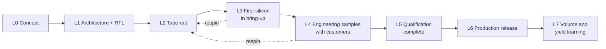

<!-- status: verified -->
# 28-03 · Maturity Scales for Silicon

| | |
|---|---|
| **Course** | [28 · Technical Diligence and Engineering Leadership Fluency](../README.md) |
| **University equivalent** | No direct university equivalent: the reliability-statistics units of a reliability-engineering course (failure-rate confidence bounds and accelerated life testing, as in JEDEC JESD85 practice) and the software-reliability-growth models of a software-engineering course (Goel and Okumoto, 1979), organized around NASA's technology readiness levels |
| **Prerequisites** | [28-01](28-01-technology-evaluation-framework.md) (milestone chains), [28-02](28-02-validating-claims.md) (silicon status), [03-05](../../03-probability-statistics-and-random-variables/chapters/03-05-estimation-and-hypothesis-testing.md) (confidence bounds), [25-09](../../25-fabrication-packaging-test-and-reliability/chapters/25-09-reliability-physics.md) (Arrhenius acceleration), [25-10](../../25-fabrication-packaging-test-and-reliability/chapters/25-10-qualification-and-functional-safety.md) (qualification), [26-05](../../26-engineering-design-and-professional-practice/chapters/26-05-schedule-and-respin-risk.md) (bug-discovery curves) |
| **Estimated study hours** | 4 |
| **Last verified** | 2026-11-26 |

**Learning objectives.** After this chapter you can:

1. Place a chip program on a silicon maturity scale from concept to volume production, relate it to NASA's technology readiness levels, and name the evidence each level requires.
2. Estimate a program's probability of reaching production and its remaining time from its current level, and turn them into a value multiplier.
3. Compute the failure-rate bound that a zero-failure (or one-failure) life test supports, with Arrhenius acceleration and a chi-square confidence level, and the sample size a target needs.
4. Fit a defect-discovery model to a software team's bug counts, and estimate the defects remaining and the time to a release criterion.
5. Combine silicon, qualification and software maturity into one view, with the least mature dimension as the binding one.

---

## 1. Big picture

"Where is the product?" is the most frequent question in any diligence, and the answers ("taped out", "sampling", "qualified", "in production") are words that sound like milestones but are used loosely. This chapter gives them a scale, ties each level to evidence, and turns position on the scale into numbers a valuation can use: the probability of reaching production, the time it will take, and the reliability and software quality the evidence supports. It builds on 28-02, which said what each milestone proves, by adding the arithmetic that says how much is left.

- **Why it exists:** value depends on maturity, and the same chip is worth very different amounts at tape-out and at qualification, because most of the risk sits in between (28-01 §3.4).
- **Where it shows up:** acquisition pricing and earn-out milestones, venture tranches tied to "first silicon" or "customer samples", supply agreements that start at "production release", and internal stage gates.
- **What it produces:** a level for silicon, a status for qualification and a level for software, each backed by evidence, and a probability-weighted view of what remains.
- **The governing rule:** a program is as mature as its least mature dimension. Production-quality silicon with immature software is not a production product.

## 2. Intuition first

**Clinical phases for chips.** A drug candidate's value depends on its phase (preclinical, Phase 1, 2, 3, approval) because each phase has a historical success rate and a typical duration, and investors price a candidate by the probability of reaching the market and the time to get there. A chip program has the same structure: architecture, tape-out, first silicon, engineering samples, qualification, production. Each step has a chance of failing (or of costing a respin) and a typical duration, and value rises as steps are passed.

The analogy breaks down in two places. First, drug-phase success rates are measured across thousands of trials and published; chip-stage probabilities are not, so the numbers in this chapter are assumptions to be informed by the industry's first-silicon base rates [R-018] and the target's own history. Second, a failed chip step is usually a delay and a cost (a respin), not the end of the program; probabilities of "never reaching production" are smaller than probabilities of "not reaching it on plan".

**Three dimensions mature separately.** Silicon (does the hardware work at specification?), qualification (will it keep working for the product's life?) and software (can customers use it?) each have their own ladder, and a program can be far along one and early on another. The diligence report should give a level for each.

## 3. Theory

### 3.1 A silicon maturity scale

NASA's technology readiness levels run from TRL 1, where basic scientific research is only starting, to TRL 9, where a technology has been "flight proven" during a successful mission; TRL 6 is "a fully functional prototype or representational model" and TRL 8 has been "tested and 'flight qualified'" [R-701] **[Established]**. They are a general scale for any technology. For silicon a more specific ladder is useful, and the mapping to TRL below is ours, by analogy.

| Level | Status | Evidence that establishes it | Evidence that does not | Analogous TRL |
|---|---|---|---|---|
| L0 | Concept | Analytic models and simulations of the architecture on target workloads | A pitch deck | 2–3 |
| L1 | Architecture and RTL | RTL in a repository, verification plan with coverage numbers, timing closure trends | "Design is 80% complete" | 4 |
| L2 | Tape-out | Mask-shop confirmation, sign-off reports (timing, power, physical verification) | A press release | 5 |
| L3 | First silicon in bring-up | Lab data at corners; the fraction of the validation plan passed; open-bug counts | A demo at one operating point | 5–6 |
| L4 | Engineering samples (ES) with customers | Customer-measured results; an errata list; sample shipment records | Logos on a slide | 6–7 |
| L5 | Qualification complete | A qualification report (life tests, ESD, latch-up, package tests) on production-representative silicon | "Qualification in progress" | 8 |
| L6 | Production release | Released part numbers, a stepping, yields by lot, a supply allocation | "Production-ready" | 8–9 |
| L7 | Volume and yield learning | Shipments, field-return data, yield trends | A forecast | 9 |

Two notes on the ladder. First, **respins loop back**: a respin at L3 or L4 returns the program to L2 for the new stepping, and most complex chips loop at least once (5–14% first-silicon success [R-018]). Second, a level is reached only with its evidence; a level claimed without it should be scored one lower, which is 28-01 §3.3's likelihood-ratio logic applied to status.

### 3.2 From level to probability, time and value

Let the program be at level $k$, and let each remaining transition $j$ succeed (possibly after a respin) with probability $p_j$, conditional on the earlier ones, taking $t_j$ months. Here $t_j$ is the expected duration of the stage *including* any respin delay: a stage that takes 4 months, or 8 if a respin (probability 0.5) is needed, has $t_j = 6$ months. The probability of reaching production and the time if every step succeeds are

$$
P_k = \prod_{j \ge k} p_j , \qquad T_k = \sum_{j \ge k} t_j .
$$

A risk-neutral buyer values the program at a fraction of a production-ready program's value $V$: the probability, discounted for the time still to wait at an annual rate $r$,

$$
\frac{V_k}{V} = \frac{P_k}{(1 + r)^{T_k/12}} .
$$

Here $V$ is the value *after* all remaining development spend. If the buyer pays the remaining NRE (masks, respins, qualification), subtract its present value $C_k$, which is spent whether or not the chain succeeds: $V_k = P_kV/(1 + r)^{T_k/12} - C_k$. Because $C_k$ is largest at the earliest levels, leaving it out understates how much reaching a later level is worth.

This **value multiplier** rises with each level passed, both because the remaining chain is shorter (higher $P_k$) and because the wait is shorter (smaller discount). Its ratio between two levels is the most a buyer should pay for the later level relative to the earlier one, other things equal (Example 28-03.2). The inputs $p_j$ and $t_j$ are assumptions; their value is in making the assumptions explicit and in showing which transition dominates the risk.

### 3.3 Qualification: what a life test proves

Qualification life tests run samples at elevated temperature and voltage and count failures. This section uses the thermal acceleration factor alone; the voltage stress adds a voltage-acceleration factor (25-09) that multiplies the equivalent hours and lowers the bound further, by an amount that depends on the mechanism's voltage model. A life test with $n$ devices for $t$ hours at a stress temperature represents $n\,t\,\text{AF}$ equivalent hours at the use temperature, where the **acceleration factor** for a thermally activated mechanism with activation energy $E_a$ is the Arrhenius ratio (25-09):

$$
\text{AF} = \exp\!\left[\frac{E_a}{k_B}\left(\frac{1}{T_{\text{use}}} - \frac{1}{T_{\text{stress}}}\right)\right],
$$

with Boltzmann's constant $k_B = 8.617 \times 10^{-5}$ eV/K (written with a subscript here because $k$ indexes maturity levels) and temperatures in kelvin. At $E_a$ = 0.7 eV between 55 °C and 125 °C, AF is **77.6** with exact constants; TI's app note quotes 78.6, which reproduces with $k_B = 8.6 \times 10^{-5}$ and $T = \text{°C} + 273$ [R-610].

**The failure-rate bound.** If failures occur at a constant rate $\lambda$, the number of failures in $T_{\text{eq}} = n\,t\,\text{AF}$ equivalent hours is Poisson with mean $\lambda T_{\text{eq}}$. Seeing zero failures has probability $e^{-\lambda T_{\text{eq}}}$. The **upper confidence bound** at confidence $C$ is the rate at which zero failures would occur with probability only $1 - C$:

$$
e^{-\lambda_C T_{\text{eq}}} = 1 - C \;\Rightarrow\; \lambda_C = \frac{-\ln(1 - C)}{T_{\text{eq}}} = \frac{\chi^2_{C;\,2}}{2T_{\text{eq}}},
$$

because the chi-square distribution with 2 degrees of freedom has quantile $\chi^2_{C;2} = -2\ln(1 - C)$. With $r$ failures (here $r$ counts failures, not the discount rate of §3.2) the general bound is $\lambda_C = \chi^2_{C;\,2r+2}/(2T_{\text{eq}})$, and multiplying by $10^9$ gives FIT (failures per $10^9$ device-hours) [R-610].

> **Math refresher — why chi-square appears.** The time to the $(r+1)$-th event of a Poisson process with rate $\lambda$ has a gamma distribution, and $2\lambda T$ for that time is chi-square with $2r + 2$ degrees of freedom. "At most $r$ failures in $T$" is the same event as "the $(r+1)$-th failure comes after $T$", so the bound on $\lambda$ is a chi-square quantile divided by $2T$. For $r = 0$ it reduces to the exponential case above.

Two consequences for diligence. First, a minimum qualification proves less than it sounds: JEDEC JESD47G's high-temperature operating life row is 1000 hours on 3 lots of 77 units with zero failures [R-061] (Rev G's row; whether Rev N of August 2026 changed it has not been checked here), which at an acceleration factor of 77.6 bounds the use failure rate at about **51** FIT at 60% confidence (the level common in industrial calculations [R-610]) and about 128 FIT at 90% (Example 28-03.3). Low single-digit FIT claims need far more device-hours, and TI's example uses 7,859 devices to reach about 1.5 FIT [R-610]. Second, the bound depends on $E_a$, which is assumed per failure mechanism (JEDEC JEP122 lists mechanisms and their activation energies [R-609]); a higher assumed $E_a$ gives a larger AF and a lower bound, so the activation energy behind a FIT claim is the first thing to ask about.

### 3.4 Software maturity: the defect-discovery curve

Software, compilers and drivers mature differently from silicon: there is no tape-out, but there is a discovery process. A widely used model (Goel and Okumoto, 1979) treats the cumulative number of defects found by testing time $t$ as

$$
m(t) = a\left(1 - e^{-bt}\right),
$$

where $a$ is the total number of defects that testing will eventually find and $b$ the per-defect discovery rate. Its consequences are simple:

- the discovery rate is $\lambda(t) = m'(t) = ab\,e^{-bt}$, falling exponentially;
- the defects still undiscovered are $a - m(t) = a\,e^{-bt}$;
- at the time the rate has fallen to $\lambda^*$, the remaining defects are exactly $\lambda^*/b$.

**A two-point fit.** With cumulative counts $m_1$ at $t_1$ and $m_2$ at $t_2 = 2t_1$, the ratio $m_2/m_1 = 1 + e^{-bt_1}$, so $e^{-bt_1} = m_2/m_1 - 1$, then $b = -\ln(m_2/m_1 - 1)/t_1$ and $a = m_1/(1 - e^{-bt_1})$. A release criterion of "fewer than $\lambda^*$ new defects per week" is met at $t^* = \ln(ab/\lambda^*)/b$ (Example 28-03.4). With more points, a least-squares fit is better, and the lab does one.

The model's assumptions (each defect found independently at the same rate, fixes introducing no new defects, steady test effort) rarely hold exactly, so its numbers are estimates; their value in diligence is to turn a bug tracker's history into a question with a number: "your curve says about 80 defects remain and you are finding 7 a week; what is your release criterion and when does it fall due?" 26-05 used the same curve for hardware verification.

### 3.5 One program, three ladders

A program's position is three positions: a silicon level (§3.1), a qualification status (none, in progress, complete for a stated standard, such as AEC-Q100 Grade 1 for −40 °C to +125 °C ambient [R-612]), and a software level (from "runs vendor demos" to "runs customers' models unmodified, with a release history"). The product is ready only when all three are. The **binding dimension** is the least mature, and it sets the remaining time: production silicon with a compiler that runs a third of the customer's models is a software program for the next year, and should be valued and staffed as one. In a scorecard (28-01 §3.2) this is a case for a geometric score or a gate, not an arithmetic average.

## 4. Worked examples

All parameters are illustrative assumptions unless a source is cited.

### Example 28-03.1 · Where is each product? (tier A)

**Setup.** Place each statement on the scale of §3.1 and say what evidence would confirm it: (a) "A0 silicon is back and boots Linux"; (b) "we are shipping samples to three hyperscalers"; (c) "qualification in progress, production next quarter"; (d) "the design has taped out on N3".

**Solution.**

- (a) **L3**, first silicon in bring-up. Confirm with the validation plan and the fraction passed at voltage and temperature corners; booting an operating system shows basic function, not specification.
- (b) **L4**, engineering samples, if the customers confirm receipt and are measuring; ask for the errata list and the customers' own results.
- (c) **Between L4 and L5.** "In progress" is not complete; ask which tests are running, on which stepping, and the planned report date. "Production next quarter" assumes the tests pass first time.
- (d) **L2**, tape-out. Confirm with the mask-shop or foundry confirmation and the sign-off reports.

**Units check.** Not applicable (qualitative). ✓

**Sanity check.** Each statement is one level lower if the confirming evidence is missing. The most frequent inflation is (c): a qualification "in progress" can still fail and force a respin, and the date depends on it.

### Example 28-03.2 · What maturity is worth (tier B)

**Setup.** From tape-out (L2), the remaining transitions are: first silicon boots (0.95, 4.5 months), engineering samples after any respin (0.80, 6 months), qualification (0.85, 5 months), production release (0.95, 2 months), all assumed. The discount rate is 15% a year. Find (a) the probability of reaching production and the time if all goes well, from L2; (b) the discount factor and value multiplier at L2; (c) the same at L4 (engineering samples shipped); (d) the ratio of the two multipliers.

**Solution.**

- (a) $P_2 = 0.95 \times 0.80 \times 0.85 \times 0.95$ = **0.614**; $T_2 = 4.5 + 6 + 5 + 2$ = **17.5** months.
- (b) $1.15^{17.5/12}$ = **1.226**, so $V_2/V = 0.614/1.226$ = **0.501**.
- (c) $P_4 = 0.85 \times 0.95$ = **0.8075**, $T_4$ = **7** months, $1.15^{7/12}$ = **1.085**, so $V_4/V$ = **0.744**.
- (d) $0.744/0.501$ = **1.49**.

**Units check.** Probabilities and discount factors are dimensionless; months ÷ 12 = years. ✓

**Sanity check.** Passing first silicon and engineering samples raises the value by half: a buyer could pay up to 1.49 times as much for the program at L4 as at L2, other things equal. The largest single risk is the 0.80 transition from first silicon to engineering samples, where respins live, so that is where diligence and deal milestones should concentrate.

### Example 28-03.3 · What a minimum qualification proves (tier B)

**Setup.** A part passes JESD47G's minimum high-temperature operating life test: 231 devices (3 lots × 77) for 1000 hours at a 125 °C junction with zero failures [R-061]. Assume a single mechanism with $E_a$ = 0.7 eV and a 55 °C use junction. Find (a) the acceleration factor with exact constants, (b) the equivalent device-hours, (c) the FIT bound at 60% and 90% confidence, and (d) TI's example of 7,859 devices with AF 78.6, at 60% [R-610].

**Solution.**

- (a) $\text{AF} = \exp[(0.7/8.617 \times 10^{-5})(1/328.15 - 1/398.15)]$ = **77.6**.
- (b) $231 \times 1000 \times 77.6$ = **1.79 × 10⁷** equivalent hours.
- (c) $\chi^2_{0.6;2}$ = **1.833**, so $1.833/(2 \times 1.79 \times 10^7) \times 10^9$ = **51.1** FIT. $\chi^2_{0.9;2}$ = **4.605**, giving **128** FIT.
- (d) $1.833 \times 10^9/(2 \times 7859 \times 1000 \times 78.6)$ = **1.48** FIT, TI's "1.5".

**Units check.** Devices × hours × AF = device-hours; FIT = failures per $10^9$ device-hours. ✓

**Sanity check.** A minimum qualification says the use failure rate is probably below about 50 FIT, not that it is a few FIT. A claim of single-digit FIT needs tens of times more device-hours (or failure-mechanism data), so the question is "on how many device-hours, at what activation energy and confidence?"

### Example 28-03.4 · How much software is left? (tier B)

**Setup.** A compiler team's tracker shows 300 defects found by week 10 of system testing and 420 by week 20. Fit the Goel–Okumoto model and find (a) $b$ and $a$, (b) the defects remaining and the discovery rate at week 20, (c) the week at which discovery falls to one a week and the weeks still to go, and (d) the defects remaining then.

**Solution.**

- (a) $e^{-10b} = 420/300 - 1 = 0.4$, so $b = -\ln 0.4/10$ = **0.0916** per week; $a = 300/(1 - 0.4)$ = **500**.
- (b) Remaining $500 \times 0.4^2$ = **80**; rate $500 \times 0.0916 \times 0.16$ = **7.33** per week.
- (c) $t^* = \ln(500 \times 0.0916/1)/0.0916$ = **41.7** weeks, **21.7** weeks after week 20.
- (d) $1/0.0916$ = **10.9** defects.

**Units check.** $b$ in 1/week; $ab$ in defects/week; $\ln(\cdot)/b$ in weeks. ✓

**Sanity check.** By count the team has found **84**% of the defects its curve predicts (420 of 500); by time it is less than halfway to a one-a-week criterion, because the last defects are the slowest to find. A launch at week 26 would ship with about **46** findable defects still undiscovered in expectation; whether that is acceptable depends on their severity, which is the next question.

### Example 28-03.5 · How many devices for a 10 FIT claim? (tier C)

**Setup.** A supplier wants to support "below 10 FIT at 55 °C, 60% confidence" with 1000-hour life tests at 125 °C and $E_a$ = 0.7 eV (AF 77.65, carried unrounded). Find the devices needed if zero failures are allowed, and if one failure is allowed ($\chi^2_{0.6;4}$ = **4.045**).

**Solution.**

- Zero failures: $n \ge 1.833 \times 10^9/(2 \times 10 \times 1000 \times 77.65)$, so **1181** devices.
- One failure: $n \ge 4.045 \times 10^9/(2 \times 10 \times 1000 \times 77.65)$, so **2605** devices.

**Units check.** $\chi^2 \times 10^9$ ÷ (FIT × hours × AF) = devices, since FIT counts failures per $10^9$ device-hours. ✓

**Sanity check.** Allowing one failure more than doubles the sample, because the bound must hold even if one device fails. Over a thousand devices on life test is a substantial program, which is why low-FIT claims usually rest on accumulated data across products on the same process rather than one product's qualification.

<!-- answer-key -->

| ID | Quantity | Value | Unit |
|---|---|---|---|
| Ex 28-03.2a | probability of production from L2 | 0.614 | — |
| Ex 28-03.2a1 | time from L2 if all goes well | 17.5 | months |
| Ex 28-03.2b | discount factor from L2 | 1.226 | — |
| Ex 28-03.2b1 | value multiplier at L2 | 0.501 | — |
| Ex 28-03.2c | probability of production from L4 | 0.8075 | — |
| Ex 28-03.2c1 | time from L4 | 7 | months |
| Ex 28-03.2c2 | discount factor from L4 | 1.085 | — |
| Ex 28-03.2c3 | value multiplier at L4 | 0.744 | — |
| Ex 28-03.2d | ratio of multipliers | 1.49 | — |
| Ex 28-03.3a | acceleration factor, exact constants | 77.6 | — |
| Ex 28-03.3b | equivalent device-hours | 1.79e7 | h |
| Ex 28-03.3c | chi-square, 60%, 2 dof | 1.833 | — |
| Ex 28-03.3c1 | FIT bound at 60% | 51.1 | FIT |
| Ex 28-03.3c2 | chi-square, 90%, 2 dof | 4.605 | — |
| Ex 28-03.3c3 | FIT bound at 90% | 128 | FIT |
| Ex 28-03.3d | TI example bound | 1.48 | FIT |
| Ex 28-03.4a | discovery rate constant | 0.0916 | 1/week |
| Ex 28-03.4a1 | total findable defects | 500 | defects |
| Ex 28-03.4b | remaining at week 20 | 80 | defects |
| Ex 28-03.4b1 | discovery rate at week 20 | 7.33 | per week |
| Ex 28-03.4c | week of one per week | 41.7 | weeks |
| Ex 28-03.4c1 | weeks still to go | 21.7 | weeks |
| Ex 28-03.4d | remaining then | 10.9 | defects |
| Ex 28-03.4e | expected remaining at week 26 | 46 | defects |
| Ex 28-03.4f | share found by week 20 | 84 | % |
| Ex 28-03.5a | chi-square, 60%, 4 dof | 4.045 | — |
| Ex 28-03.5b | devices, zero failures | 1181 | devices |
| Ex 28-03.5c | devices, one failure | 2605 | devices |
| Txt 28-03.1 | TI-style acceleration factor | 78.6 | — |
| Txt 28-03.2 | minimum qualification bound, rounded | 51 | FIT |

## 5. Simulate it

The lab is [labs/28-03-lab/](../labs/28-03-lab/README.md). `matscale.py` implements:

- stage chains: probability and time to production, and the value multiplier;
- Arrhenius acceleration, chi-square failure-rate bounds and qualification sample sizes;
- the Goel–Okumoto model: two-point fit, discovery rate, remaining defects and time to a rate.

1. *Predict* the value multiplier at L3 for Example 28-03.2's chain. Then plot the multiplier at each level from L2 to L5.
2. *Predict* the 60% and 90% FIT bounds for 1,000 devices on a zero-failure 1000-hour test (55 °C use, 0.7 eV). Then plot the bound against device count for both confidence levels.
3. *Predict* the parameters a least-squares fit recovers from weekly counts generated by Example 28-03.4's model and rounded to whole defects. Then fit and plot the curve.
4. *Predict* the FIT bound of Example 28-03.3 at 60% if the activation energy is 0.5 eV instead of 0.7, and if it is 1.0 eV. Then plot the bound against activation energy.

*Figure 1. What maturity is worth and what a life test proves: the value multiplier by level for an assumed stage chain (§3.2), and the failure-rate bound against sample size (§3.3).*

## 6. Engineering tradeoffs

| Knob | Improves | Costs | Typical decision owner |
|---|---|---|---|
| Buying earlier on the maturity scale | Price (lower multiplier); influence over the product | Risk of respins, qualification failure and delay | Corporate development with the business unit |
| Larger qualification samples | Tighter failure-rate bounds; credible low-FIT claims | Devices, ovens, time | Quality and reliability engineering |
| Higher assumed activation energy | Lower FIT bound on paper | Credibility, if the mechanism does not support it | Reliability engineering, reviewed by customers |
| Shipping software before the discovery rate falls | Earlier revenue and feedback | Field defects, support cost, reputation | Software leadership with product management |
| Milestone payments tied to maturity levels | Price that tracks risk | Disputes over evidence and definitions | Deal team and counsel |

## 7. Numbers to know

Figures are as of Nov 2026 unless dated otherwise.

| Quantity | Value | Note |
|---|---|---|
| Technology readiness levels | TRL 1 (research beginning) to TRL 9 (flight proven); TRL 6 a functional prototype | NASA [R-701] **[Established]** |
| First-silicon success | 5% (2026; about 3–8% given the sample), 14% (2024) of IC/ASIC projects | [R-018, R-622] **[Established as reported; trend Contested]** |
| Minimum HTOL qualification | 1000 h at $T_j \ge$ 125 °C, 3 lots × 77, 0 failures (JESD47G, 2009) | [R-061] **[Established]** |
| Arrhenius AF, 0.7 eV, 55 → 125 °C | **77.6** exact; 78.6 with rounded constants | [R-610] **[Established]** |
| FIT bound, minimum HTOL | about **51** FIT (60%), 128 FIT (90%) at 0.7 eV, 55 °C | Example 28-03.3 |
| Industrial confidence level | 60% "typical for industrial calculations" | TI [R-610] **[Established]** |
| AEC-Q100 grades | 0: −40 to +150 °C; 1: −40 to +125 °C; 2: −40 to +105 °C; 3: −40 to +85 °C ambient | Rev J [R-612] **[Established]** |

## 8. Common mistakes

- **Taking a status word at face value.** "Sampling", "qualified" and "production" each need their evidence; without it, score one level lower.
- **Ignoring the loop back.** A respin returns the program to tape-out for the new stepping; a plan without one is the optimistic case.
- **Reading a qualification pass as a low failure rate.** A minimum zero-failure test bounds the rate at tens of FIT, not single digits.
- **Accepting a FIT number without its activation energy and confidence.** Both can move it by large factors.
- **Counting found bugs instead of the discovery rate.** A falling rate, not a rising count, signals maturity.
- **Averaging maturity across dimensions.** The least mature dimension binds the schedule.

## 9. Practitioner lens

**State of play (as of Nov 2026).**

- **Respins are the norm.** With 5% of IC/ASIC projects reporting first-silicon success in 2026 and 14% in 2024 [R-018], a program between L2 and L4 should be modeled with at least one loop back. Production steppings carry the history: Intel's Sapphire Rapids specification update lists steppings E-5, S-3 and B-3 for its three variants [R-647] **[Established]**.
- **Qualification standards keep moving.** JESD47 reached revision N in August 2026 [R-611], and AEC-Q100 Rev J (2023) changed the Grade 0 temperature-cycling requirement from 2,000 to 1,500 cycles and added a bump shear test [R-612] **[Established]**. A target's qualification claim should name the revision.
- **Reliability claims rest on stated assumptions.** TI's published method uses JEDEC JESD85, a 60% confidence level "typical for industrial calculations", and a 0.7 eV activation energy [R-610] **[Established]**; another supplier's choices may differ, and the comparison needs the same basis.

**Commercial relevance.** Maturity levels are where valuation meets contract. Venture rounds are tranched on "first silicon" and "customer samples"; earn-outs pay on "production release" or revenue (28-01 §3.4); supply agreements start at qualification. Each is only as good as the definition behind the word, so a diligence team should insist that the definitions in the term sheet name the evidence of §3.1 (a released stepping, a qualification report to a named standard and revision, a defined software release criterion).

**Marketing vs Reality.**

- *"Production-ready."* Ask whether the part is released (part number, stepping, qualification report) or whether the team believes it will be.
- *"Fully qualified."* Ask to which standard and revision, on which stepping, with how many lots and devices, and whether the tests ran on production-representative silicon.
- *"Below 1 FIT."* Ask for device-hours, activation energy, use temperature and confidence; then compute the bound yourself (§3.3).
- *"Our software is mature."* Ask for the bug-discovery history and the release criterion, and which customer models run unmodified.

**Questions for engineering leaders.**

1. *"Which level is each product at, and what is the evidence?"* Strong: a level per product backed by named artefacts. Evasive: adjectives.
2. *"What is your stepping history, and what forced each new stepping?"* Strong: a list with root causes and metal-only versus full-layer changes. Evasive: "minor optimizations".
3. *"Show me your qualification plan and the device-hours behind your FIT number."* Strong: standard, revision, lots, devices, hours, activation energy and confidence. Evasive: a single FIT figure.
4. *"What is your defect-discovery rate on the compiler today, and your release criterion?"* Strong: a curve and a criterion with a date. Evasive: a count of fixed bugs.
5. *"Which dimension (silicon, qualification or software) is furthest behind?"* Strong: a candid answer with a plan. Evasive: "everything is on track".

## 10. Concept check

1. Why is a program at "first silicon in bring-up" worth much less than one with engineering samples at customers?

   

Answer

   The transition from first silicon to engineering samples carries most of the respin risk, and it lies ahead of the first program but behind the second. The value multiplier $P_k/(1 + r)^{T_k/12}$ rises as that transition is passed, by about a third (0.555 at L3 to 0.744 at L4, Lab 28-03 Part 1).

   

2. What does a zero-failure life test on 231 devices for 1000 hours prove?

   

Answer

   With an acceleration factor of about 78 it bounds the use failure rate at roughly 50 FIT with 60% confidence and 130 FIT with 90%. It does not show single-digit FIT.

   

3. Why does the chi-square distribution appear in failure-rate bounds?

   

Answer

   Failures of a constant-rate process form a Poisson process; at most $r$ failures in $T$ means the $(r+1)$-th failure comes after $T$, whose time is gamma-distributed, and $2\lambda T$ for it is chi-square with $2r + 2$ degrees of freedom.

   

4. Why does a higher assumed activation energy lower a FIT claim?

   

Answer

   It raises the Arrhenius acceleration factor, so the same test represents more equivalent hours at the use temperature, and the bound divides by those hours.

   

5. In the Goel–Okumoto model, how many defects remain when the discovery rate has fallen to $\lambda^*$?

   

Answer

   $\lambda^*/b$: the rate is $ab\,e^{-bt}$ and the remaining count is $a\,e^{-bt}$, so their ratio is always $b$.

   

6. Why is a program's maturity its least mature dimension?

   

Answer

   A product ships only when its silicon works, is qualified and has usable software. The furthest-behind dimension sets the remaining time, so averaging would hide the binding constraint.

   

Problems: [28-03 problem set](../problems/28-03-problems.md) · Solutions: [28-03 solutions](../solutions/28-03-solutions.md)

## 11. Key terms

[Technology readiness level (TRL)](../../../reference/glossary.md#technology-readiness-level-trl) · [Silicon maturity level](../../../reference/glossary.md#silicon-maturity-level) · [Engineering sample (ES)](../../../reference/glossary.md#engineering-sample-es) · [Value multiplier (maturity)](../../../reference/glossary.md#value-multiplier-maturity) · [Acceleration factor](../../../reference/glossary.md#acceleration-factor) · [Failure-rate confidence bound](../../../reference/glossary.md#failure-rate-confidence-bound) · [FIT (failures in time)](../../../reference/glossary.md#fit-failures-in-time) · [Goel–Okumoto model](../../../reference/glossary.md#goel-okumoto-model) · [Stepping](../../../reference/glossary.md#stepping) · [AEC-Q100](../../../reference/glossary.md#aec-q100)

## 12. Connections

- **Previous:** [28-02 Validating Claims](28-02-validating-claims.md): what each milestone proves.
- **Next:** [28-04 Domain Question Banks I](28-04-question-banks-digital-ai-memory-interconnect.md): diagnostic questions for digital, AI, memory and interconnect programs.
- **Prerequisites used here:** confidence bounds ([03-05](../../03-probability-statistics-and-random-variables/chapters/03-05-estimation-and-hypothesis-testing.md)); Arrhenius acceleration ([25-09](../../25-fabrication-packaging-test-and-reliability/chapters/25-09-reliability-physics.md)); qualification ([25-10](../../25-fabrication-packaging-test-and-reliability/chapters/25-10-qualification-and-functional-safety.md)); post-silicon validation ([25-12](../../25-fabrication-packaging-test-and-reliability/chapters/25-12-post-silicon-validation.md)); bug-discovery curves ([26-05](../../26-engineering-design-and-professional-practice/chapters/26-05-schedule-and-respin-risk.md)).
- **Used later:** maturity levels define the red flags of [28-06](28-06-red-and-green-flags.md) and the integration milestones of [28-08](28-08-integration-risk.md).

## 13. Further study

- A. L. Goel and K. Okumoto, "Time-Dependent Error-Detection Rate Model for Software Reliability and Other Performance Measures," *IEEE Transactions on Reliability* R-28(3), 206–211, 1979 (doi:10.1109/TR.1979.5220566).
- JEDEC JESD47 (stress-test-driven qualification), JESD85 (failure-rate calculation methods) and JEP122 (failure mechanisms and activation energies) [R-609, R-610, R-611]; AEC-Q100 for automotive [R-612].
- NASA's technology readiness levels page [R-701] and the NASA Systems Engineering Handbook (Rev 2) [R-626].
- Lecture videos: MIT OpenCourseWare 6.041SC *Probabilistic Systems Analysis and Applied Probability* (John Tsitsiklis's recorded lectures) for Poisson processes and confidence bounds.

## 14. Sources

1. NASA technology readiness levels [R-701].
2. First-silicon success [R-018]; Sapphire Rapids steppings [R-647].
3. JEDEC JESD47G qualification sample [R-061]; JESD47N [R-611]; JEP122H [R-609].
4. TI's FIT method, acceleration factor and HTOL example [R-610].
5. AEC-Q100 Rev J grades and changes [R-612].
6. Goel and Okumoto (1979), cited in §13.
