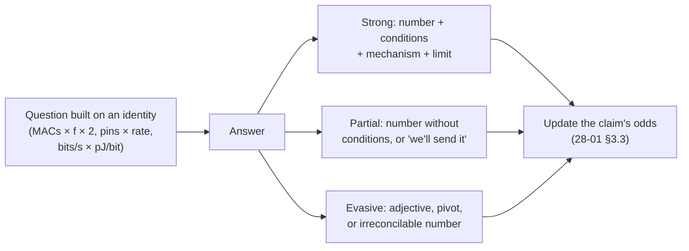

<!-- status: verified -->
# 28-04 · Domain Question Banks I: Digital/CPU, AI Accelerators, Memory, Interconnect and Optics

| | |
|---|---|
| **Course** | [28 · Technical Diligence and Engineering Leadership Fluency](../README.md) |
| **University equivalent** | No direct university equivalent: it applies the core results of computer architecture (Hennessy & Patterson, *Computer Architecture: A Quantitative Approach*), memory systems and high-speed I/O (this curriculum's Courses 14, 23 and 24) to diagnostic interviewing in industry diligence |
| **Prerequisites** | [28-01](28-01-technology-evaluation-framework.md) (evidence and likelihood ratios), [28-02](28-02-validating-claims.md) (first-principles checks), [14-01](../../14-computer-organization-and-architecture/chapters/14-01-performance-power-iron-law.md), [14-14](../../14-computer-organization-and-architecture/chapters/14-14-ai-accelerators.md), [23-05](../../23-memory-and-storage-technology/chapters/23-05-hbm-in-depth.md), [24-03](../../24-high-speed-io-signal-integrity-and-photonics/chapters/24-03-serdes-architecture.md), [24-06](../../24-high-speed-io-signal-integrity-and-photonics/chapters/24-06-d2d-memory-phys-scale-up.md), [24-09](../../24-high-speed-io-signal-integrity-and-photonics/chapters/24-09-lpo-and-cpo.md) |
| **Estimated study hours** | 6 |
| **Last verified** | 2026-11-26 |

**Learning objectives.** After this chapter you can:

1. For digital and CPU programs, decompose a performance-per-watt claim into IPC, frequency, voltage and process, and ask the questions that separate design gains from node gains.
2. For AI accelerators, check a claim against the ridge point, the decode arithmetic intensity and memory capacity, and ask for utilization at the buyer's batch and latency.
3. For memory, compute bandwidth and power per stack from interface width, pin rate and energy per bit, and ask about the numbers that govern supply and yield.
4. For interconnect and optics, compute link and port power from lane counts and energy per bit, and ask about reach, error rates, laser counts and serviceability.
5. Use a question bank as a sequence of tests: classify answers as strong, partial or evasive, and update a claim's probability with likelihood ratios.

---

## 1. Big picture

A diligence meeting with a chip company's engineering leaders lasts a few hours. The questions asked in it decide whether those hours produce evidence or a repeat of the marketing deck. This chapter and 28-05 give, for each major technical domain, a short list of the physical quantities that govern value, the back-of-envelope checks behind them, and a bank of diagnostic questions with the patterns that distinguish a strong answer from an evasive one. This chapter covers the digital half of a modern system: CPUs and digital logic, AI accelerators, memory, electrical interconnect and optics. 28-05 covers analog and mixed-signal, RF, power, packaging and embedded systems.

- **Why it exists:** a good question is one whose answer would change the analyst's belief (28-01 §3.3). Questions that any team could answer well regardless of the truth waste the meeting.
- **Where it shows up:** management presentations, expert calls, technical deep-dives in acquisitions and investments, and supplier qualification reviews.
- **What it produces:** for each claim, a calculated expectation, a question that tests it, and a record of the answer's quality that feeds the scorecard.
- **The rule of thumb:** ask for numbers with conditions, and compute your own version first. The strongest single signal in an interview is whether the engineer's numbers reproduce yours.

## 2. Intuition first

**An earnings call, with a calculator.** An experienced analyst on an earnings call does not ask "how is the business?"; they ask for gross margin by segment and check it against the reported totals before the call ends. Technical diligence works the same way. Every domain has a few identities, the technical equivalent of "revenue = units × price": throughput is MACs × clock × 2, bandwidth is pins × rate, power is bits per second × energy per bit. A question built on an identity has a checkable answer, and a team that knows its product answers it in the same units, with the conditions, often before the analyst finishes asking.

Where the analogy breaks down: financial statements are audited and standardized; engineering numbers are not. The same "TOPS" or "pJ/bit" can be measured in incompatible ways (28-02), so each question must pin down the conditions as well as the number.

**Three answer patterns.**

- **Strong:** a number with its conditions, a mechanism ("the gain comes from the larger reorder buffer and the new branch predictor, measured on SPECrate base"), and an honest limit ("on pointer-chasing workloads it is flat").
- **Partial:** the right kind of answer with missing conditions, or a number with a promise of data to follow. Neither moves belief much until the follow-up arrives.
- **Deferred for confidentiality:** "that is customer-confidential; it can go to the clean team" or "it is in the data room under NDA", naming the data and the channel. Before a clean-team process a supplier often *cannot* disclose per-customer qualifications or contract terms, so this is not evasion: score it near 1 and score the answer itself when it is produced.
- **Evasive:** an adjective instead of a number, a pivot to a different metric, an appeal to authority ("our customers are very happy"), or a number that cannot be reconciled with the identities.

## 3. Theory

Each section gives the governing quantities, the checks, and a question bank. The banks are starting points; a good interviewer adapts them to the target and asks for the evidence of 28-01 §3.1 behind each answer.

### 3.1 Digital logic and CPUs

**Governing quantities.** Performance is instructions per second, $\text{IPC} \times f$ (14-01). Dynamic power is $\alpha CV^2f$, and along a voltage–frequency line $V$ rises roughly in proportion to $f$, so at fixed design $P \propto f^3$ (27-01 §3.6). A gain in IPC usually costs switched capacitance (wider structures, more speculation). Process nodes are quoted as power reductions at the same speed or speed gains at the same power: TSMC's N2 against N3E, for example, is reported as 25–30% lower power or 10–15% higher performance [R-552] **[Industry estimate: vendor claim relayed by press]**.

**The iso-power check.** A claim of a performance ratio $R$ at the same power, with an IPC ratio $g_{\text{IPC}}$, needs a frequency ratio $R/g_{\text{IPC}}$, which costs a power factor $(R/g_{\text{IPC}})^3$ at fixed design. If the IPC changes also raise switched capacitance by a factor $g_C$, the power at the new frequency (equivalently, the energy per operation at the new operating point, against the new design run there unimproved) must fall by

$$
1 - \frac{1}{g_C\,(R/g_{\text{IPC}})^3}
$$

for the power to stay flat (Example 28-04.1). Measured against the *previous* product, energy per operation falls only by $1 - 1/R$, because the same power now buys $R$ times the work; the larger number above is what the node and design must deliver at the new, faster operating point. Set that against what the node offers; whatever remains must come from design (clock gating, voltage optimization, better cells), and should be explained.

| # | Question | Strong answer | Evasive answer |
|---|---|---|---|
| D1 | "Break your generational gain into IPC, frequency and node." | Separate factors that multiply to the headline, with the benchmark and its base or peak setting (28-02 §3.4) | One combined percentage |
| D2 | "At what voltage and junction temperature is the top frequency, and what is the all-core sustained frequency?" | A voltage–frequency table, single-core and all-core, with power | Turbo frequency only |
| D3 | "Which benchmark, which compiler and flags, base or peak?" | Named suite and version, base results, flags disclosed | "Industry-standard benchmarks" |
| D4 | "What does the IPC gain cost in area and power at the same frequency?" | Percentages for each, from the team's own models | "The gain is free" |
| D5 | "How much memory bandwidth per core, and how does performance scale with core count?" | GB/s per core and a scaling curve with the knee explained | Peak core count only |
| D6 | "What fraction of your verification plan is closed, and what is the bug-discovery rate?" | Coverage numbers and a falling discovery curve (28-03 §3.4) | "Verification is on track" |
| D7 | "How many steppings did the last product need, and why?" | A stepping history with root causes (28-03) | "Minor optimizations" |
| D8 | "Where does your software ecosystem stand (ISA, compilers, operating systems)?" | Upstream support status and named partners | "Fully compatible" |

### 3.2 AI accelerators

**Governing quantities.** Peak throughput is $2N_{\text{MAC}}f$ times precision and sparsity factors (28-02 §3.1); the machine balance, or **ridge point**, is $F_{\text{peak}}/B_{\text{mem}}$ in FLOP per byte (14-15, 27-07 §3.1). Language-model decode reads every weight once per step and uses each for one MAC per sequence in the batch, so with weights of $b_w$ bytes per parameter its arithmetic intensity is about

$$
I_{\text{decode}} \approx \frac{2N_b}{b_w}\ \text{FLOP per byte},
$$

for a batch of $N_b$ sequences, ignoring the KV cache (which lowers it further). Decode is memory-bound until $I_{\text{decode}}$ reaches the ridge, that is until $N_b \approx b_w F_{\text{peak}}/(2B_{\text{mem}})$. Memory capacity bounds the model and the batch: weights plus KV caches must fit (27-07 §3.7).

| # | Question | Strong answer | Evasive answer |
|---|---|---|---|
| A1 | "What is dense throughput at the precision our models use, and what utilization do you reach on [model] at [batch, latency]?" | Separate dense and sparse figures; measured utilization with conditions | The "up to" figure |
| A2 | "Where is your ridge point, and which of our workloads sit below it?" | FLOP per byte, with a workload-by-workload roofline | "We are compute-rich" |
| A3 | "What batch do you need to reach peak on decode, and what per-user speed does that leave?" | A throughput–interactivity curve (27-07) | One throughput number |
| A4 | "How large a model and KV cache fit per device and per scale-up domain?" | Capacity arithmetic with the parallelism used | "Scales to any model" |
| A5 | "Which models run unmodified through your compiler today, and how many needed hand-written kernels?" | A list, with release history and open issues | "We support all major frameworks" |
| A6 | "What is your MFU on a training job at scale, and how does it fall with size?" | Measured MFU by job size, with the parallel layout | Peak FLOPS per chip |
| A7 | "What does a rack of your devices draw, all-in, and what does it deliver per megawatt?" | A power budget by boundary (28-02 §3.3) | Chip TDP |
| A8 | "Which MLPerf division and scenario, which round?" | Closed-division submissions, scenario named | "MLPerf-class performance" |

### 3.3 Memory

**Governing quantities.** Bandwidth per device is interface width × pin rate ÷ 8. HBM3E stacks use a 1,024-bit interface, and Micron's run at up to 9.2 GT/s, about 1.2 TB/s [R-475]; JEDEC's HBM4 doubles the width to 2,048 bits at up to 8 Gb/s, about 2 TB/s per stack [R-520] **[Established: standard]**, and vendors have announced HBM4 at 11.7 Gb/s and up to 13 Gb/s, "up to 3.3 TB/s" per stack [R-475] **[Established as announcements]**. Power is bits per second × energy per bit: about 3.9 pJ/bit for HBM2 [R-459], and a 2026 measurement put HBM3E power at about 248 W, roughly 35% of an H200's 700 W, at 4.52 TB/s of reads [R-459] **[Industry estimate: preprint]**. The two energy figures have different boundaries: the 3.9 pJ/bit is a 2017 model of the DRAM access alone **[Established, modeled]**, while dividing the measured 248 W by the read rate gives an all-in figure that includes background power, refresh and the host side (Example 28-04.3(e)), so the larger number does not mean energy per bit got worse. Capacity is die density × the number of dies in the stack: sixteen 32 Gb dies give 64 GB, the HBM4 standard's maximum [R-520].

| # | Question | Strong answer | Evasive answer |
|---|---|---|---|
| M1 | "At what pin rate and stack height are you qualified with each customer, and at what rate do you ship in volume?" | Separate qualified and volume rates, by customer | The announced maximum |
| M2 | "What is your energy per bit at the shipping rate, measured how?" | pJ/bit with its test conditions and what it includes | "Industry-leading efficiency" |
| M3 | "What is your yield for the full stack, and where are the losses (die, stacking, base die)?" | A yield breakdown and a trend | "Yields are healthy" |
| M4 | "Who makes the base die, on which process, and what is your capacity plan?" | Named supplier and node, capacity by quarter | "We have secured capacity" |
| M5 | "How does thermal throttling or refresh affect sustained bandwidth?" | Sustained against peak, with the conditions | Peak only |
| M6 | "What stacking technology, and what does it limit (height, thermal resistance)?" | Named process and its limits (23-05) | "Proprietary" |
| M7 | "What fraction of your HBM output is committed under long-term agreements?" | A share and a term | "Strong demand" |

### 3.4 Electrical interconnect

**Governing quantities.** A port's rate is lanes × lane rate; a 1.6 Tb/s port is eight lanes at a 200 Gb/s class rate, the class the OIF's CEI-224G electrical interfaces are being written for [R-271] **[Established: OIF current work]**. SerDes power is aggregate bit rate × energy per bit; published 200 Gb/s-class transceivers report about 2–3 pJ/bit of analog power alone over 40–55 dB of channel loss [R-509] **[Established: peer-reviewed abstracts]**, with the DSP extra. Die-to-die links in advanced packages are far cheaper: UCIe's targets are 0.5 pJ/bit for standard packages and 0.25 pJ/bit for advanced ones, with shoreline bandwidth of 28–224 and 165–1,317 GB/s per mm respectively, counting both directions [R-524] **[Established as targets]**. Reach is set by channel loss in dB at the Nyquist frequency (24-01) and error rates are quoted before forward error correction (24-04).

| # | Question | Strong answer | Evasive answer |
|---|---|---|---|
| I1 | "Energy per bit: analog only, or with DSP, clocking and FEC?" | A breakdown with what each figure includes | One pJ/bit number |
| I2 | "At what channel loss and pre-FEC BER is that measured, and on which package and board?" | dB at Nyquist, BER and the test vehicle | "Long reach" |
| I3 | "Which standards does it comply with (OIF CEI, PCIe, Ethernet), and who has tested interoperability?" | Named specs and plugfests or partner results | "Standards-based" |
| I4 | "For die-to-die links: bump pitch, shoreline bandwidth per mm and energy per bit?" | UCIe-class metrics with the package (24-06) | "High bandwidth" |
| I5 | "What latency does the link add, end to end?" | Nanoseconds with the adapter and PHY included | "Low latency" |
| I6 | "How much of the die edge and power budget goes to I/O?" | mm of shoreline and watts by interface | Not tracked |

### 3.5 Optics

**Governing quantities.** Port power ÷ port rate gives energy per bit; NVIDIA's comparison of 25 W per port for pluggable transceivers against 5 W with co-packaged optics (CPO) is 15.6 against 3.125 pJ/bit if the port is 1.6 Tb/s, and it attributes part of the saving to reducing electrical loss from "up to 22 dB" to "~4 dB" and to "one laser per four lanes instead of one per lane" [R-543] **[Industry estimate: vendor claims]**. External lasers for CPO have a standard form factor, the OIF's field-replaceable ELSFP, with power classes up to 26 dBm per fiber core [R-548] **[Established: OIF implementation agreement]**. Reliability evidence is still building: Broadcom reports "one million link hours without a single link flap" in Meta's lab testing [R-546] **[Contested: lab against field]**. Even read as device-hours, $10^6$ hours with zero failures bounds the failure rate only at $-\ln 0.05/10^6$ per hour, about **3000** FIT at 95% confidence (28-03 §3.3), and link-hours across several devices per link are not device-hours.

| # | Question | Strong answer | Evasive answer |
|---|---|---|---|
| O1 | "What is the power per port, at which port speed, including lasers and DSP?" | Watts per port with the boundary, and pJ/bit | "5× more efficient" |
| O2 | "How many lasers per lane, where are they, and can they be replaced in the field?" | Laser count, location (external or on-package) and replacement procedure | "Highly reliable lasers" |
| O3 | "What field reliability data do you have, in device-hours, and how does it compare with pluggables in the field?" | Field data with failure counts converted to a FIT upper bound with its confidence (28-03 §3.3) | Lab data only, unlabelled |
| O4 | "What happens operationally when an optical engine fails inside a switch?" | Blast radius, replacement time and spares strategy | "It won't fail" |
| O5 | "What is your link budget: launch power, losses and receiver sensitivity, and the margin at end of life?" | dB budget with margin (24-07) | "Meets spec" |
| O6 | "Who supplies the lasers, modulators and packaging, and how many qualified sources are there?" | Named suppliers, second sources and capacity | "Strategic partners" |

### 3.6 A question bank as a sequence of tests

Each answer is evidence about a claim, and 28-01 §3.3's machinery applies directly. Before the meeting, write the claim and a prior. For each question, decide in advance what a strong, partial and evasive answer would look like, and assign likelihood ratios, for example 3 for strong, 1 for partial and 0.4 for evasive (assumed; a team whose claim is true is about three times as likely to give a strong answer as one whose claim is false). After the meeting the posterior odds are the prior odds times the product of the ratios, provided the answers are conditionally independent (Example 28-04.6). Two cautions apply:

- **Correlated answers.** Questions that probe the same fact (two ways of asking for utilization) are one test, not two; count the stronger answer once.
- **Fluency is not truth.** A polished speaker produces strong-sounding answers whether or not the claim holds. Only answers with checkable numbers and conditions earn a ratio above 1; the analyst's own calculation, done before the meeting, is what makes them checkable.

## 4. Worked examples

All parameters are illustrative assumptions unless a source is cited.

### Example 28-04.1 · "+25% at the same power" (tier B)

**Setup.** A CPU vendor claims 25% more performance than its previous generation at the same power, and says IPC rose 15%. Assume $P \propto f^3$ along the voltage–frequency line and that the IPC changes raised switched capacitance by 10%. Find (a) the frequency gain needed, (b) the power cost of that frequency at fixed design, (c) the total power factor, (d) the power reduction at the new operating point that the node and design must deliver, and (e) the fall in energy per operation against the previous product. Compare with N2's reported 25–30% power reduction against N3E [R-552].

**Solution.**

- (a) $1.25/1.15$ = **1.087**, **8.70**% higher frequency.
- (b) $1.087^3$ = **1.284**, **28.4**% more power.
- (c) $1.10 \times 1.284$ = **1.413**.
- (d) $1 - 1/1.413$ = **29.2**%.
- (e) $1 - 1/1.25$ = **20.0**%.

**Units check.** Ratios throughout. ✓

**Sanity check.** The claim needs a 29% power cut at the new operating point, at the top of the 25–30% iso-speed power reduction that N2 is reported to give against N3E (the comparison is like for like, since both are power at a given speed). If the product moved from N3E to N2, the claim is plausible but leaves no room for anything else to cost power; if it stayed on the same node, the design must deliver all 29% itself. Question D1 separates the two.

### Example 28-04.2 · Where decode sits on the roofline (tier B)

**Setup.** An accelerator offers 2 PFLOP/s of dense FP8 and 8 TB/s of memory bandwidth (assumed). A 70-billion-parameter model runs with FP8 weights (1 byte per parameter). Find (a) the ridge point, (b) the decode intensity and attainable throughput at batch 16 and its share of peak, (c) the batch at which decode reaches the ridge, and (d) the weight memory.

**Solution.**

- (a) $2 \times 10^{15}/(8 \times 10^{12})$ = **250** FLOP/byte.
- (b) $I = 2 \times 16/1$ = **32** FLOP/byte, so $32 \times 8 \times 10^{12}$ = **256** TFLOP/s, **12.8**% of peak.
- (c) $N_b = 250/2$ = **125** sequences.
- (d) $70 \times 10^9 \times 1$ byte = **70** GB.

**Units check.** FLOP/s ÷ (byte/s) = FLOP/byte; FLOP/byte × byte/s = FLOP/s. ✓

**Sanity check.** At a batch of 16 the device uses an eighth of its compute; it needs about 125 concurrent sequences to use it all, with KV caches for each. In this weight-only model the step time stays near the weight-read time whatever the batch, up to the ridge; in practice the KV-cache reads, which grow with batch × context, raise per-token latency and memory use and cap the batch first. That is why questions A1–A3 ask for utilization at the buyer's batch and latency, not peak.

### Example 28-04.3 · An HBM4 stack's bandwidth and power (tier B)

**Setup.** Find the bandwidth per stack of (a) HBM3E at 1,024 bits and 9.6 Gb/s [R-475], (b) JEDEC HBM4 at 2,048 bits and 8 Gb/s [R-520], and (c) a vendor's HBM4 at 11.7 and 13 Gb/s [R-475]. (d) At an assumed 6.5 pJ/bit (within the range modeled for HBM4 in [R-459]), what does one 11.7 Gb/s stack draw at full read bandwidth? (e) What energy per bit does the measured H200 figure imply (248 W at 4.52 TB/s), and what share of 700 W is it [R-459]?

**Solution.**

- (a) $1024 \times 9.6/8$ = **1228.8** GB/s.
- (b) $2048 \times 8/8$ = **2048** GB/s.
- (c) $2048 \times 11.7/8$ = **2995.2** GB/s; at 13 Gb/s, **3328** GB/s, the vendor's "up to 3.3 TB/s".
- (d) $2.995 \times 10^{12} \times 8 \times 6.5 \times 10^{-12}$ = **156** W.
- (e) $248/(4.52 \times 10^{12} \times 8)$ = **6.86** pJ/bit, and $248/700$ = **35.4**%.

**Units check.** bits × Gb/s ÷ 8 = GB/s; bits/s × J/bit = W. ✓

**Sanity check.** At full read bandwidth, memory power is a large share of an accelerator's budget, which is why M2 asks for energy per bit at the shipping rate and M5 for sustained bandwidth. The 6.5 pJ/bit is modeled at 4.8–8 Gb/s; at higher pin rates the vendor's own number is needed.

### Example 28-04.4 · What links cost (tier B)

**Setup.** (a) A 102.4 Tb/s switch uses SerDes at 3 pJ/bit (analog only [R-509]); find its SerDes power. (b) Two chiplets exchange 4 TB/s (32 Tb/s) in total, counting both directions, as UCIe's shoreline figures do. Find the link power at UCIe's 0.5 and 0.25 pJ/bit targets [R-524] and with a 3 pJ/bit long-reach SerDes. (c) Find the die edge needed for 4 TB/s at UCIe-A's shoreline range of 165–1,317 GB/s per mm [R-524].

**Solution.**

- (a) $102.4 \times 10^{12} \times 3 \times 10^{-12}$ = **307** W.
- (b) **16** W at 0.5 pJ/bit, **8** W at 0.25 pJ/bit, **96** W at 3 pJ/bit.
- (c) $4000/165$ = **24.2** mm to $4000/1317$ = **3.04** mm.

**Units check.** bits/s × J/bit = W; (GB/s) ÷ (GB/s per mm) = mm. ✓

**Sanity check.** Hundreds of watts of SerDes is a large fraction of a switch's power, so pJ/bit and what it includes (I1) decide competitiveness. Splitting a chip into chiplets is affordable only with package-level links an order of magnitude cheaper than board-level SerDes, and the shoreline they consume can be a binding constraint at the low end of the range.

### Example 28-04.5 · Pluggable against co-packaged optics (tier B)

**Setup.** NVIDIA compares 25 W per port with pluggable transceivers against 5 W with CPO, port speed not stated [R-543]. Find (a) the energy per bit for each if the port is 1.6 Tb/s and if it is 800 Gb/s; (b) for a switch with 144 ports of 800 Gb/s (assuming the per-port figures apply), the optics power each way and the saving; (c) the lasers needed at one per lane and at one per four lanes, with 4 lanes per 800 Gb/s port; (d) the ratio the 18 dB cut in electrical loss represents.

**Solution.**

- (a) At 1.6 Tb/s: **15.6** and **3.125** pJ/bit; at 800 Gb/s: **31.25** and **6.25** pJ/bit.
- (b) $144 \times 25$ = **3600** W against $144 \times 5$ = **720** W, a saving of **2880** W.
- (c) $144 \times 4$ = **576** lasers at one per lane, **144** at one per four lanes.
- (d) $10^{18/10}$ = **63.1**, a power ratio (the voltage ratio is $10^{18/20}$ = **7.94**); the SerDes power does not fall by that factor, because driver power depends on far more than the channel loss.

**Units check.** W ÷ (bits/s) = J/bit; dB ratio $10^{\text{dB}/10}$. ✓

**Sanity check.** The saving is real and large at switch scale, but the claim leaves the port speed unstated, which changes the energy per bit by a factor of two, and it compares against a vendor-chosen baseline whose port speed and generation are unstated. Questions O1–O4 turn the claim into the numbers a buyer needs: power at a stated port speed, laser count and replaceability, and field reliability.

### Example 28-04.6 · Scoring an interview (tier C)

**Setup.** The claim is that a target's accelerator delivers its stated utilization on the buyer's models; the prior is 0.5. Five answers are judged strong, strong, evasive, partial and strong, with likelihood ratios 3, 3, 0.4, 1 and 3 (assumed). Find the posterior odds and probability, assuming the answers are conditionally independent.

**Solution.** Prior odds 1; posterior odds $1 \times 3 \times 3 \times 0.4 \times 1 \times 3$ = **10.8**; probability $10.8/11.8$ = **91.5**%.

**Units check.** Odds and likelihood ratios are dimensionless. ✓

**Sanity check.** Three strong answers outweigh one evasive answer, but only if they were independent tests. If two of the "strong" answers were the same utilization figure asked two ways, count one: the odds become $3 \times 0.4 \times 1 \times 3 = 3.6$ and the probability 78% (Problem 28-04.11). Writing down the ratios before the meeting is what keeps the scoring honest.

<!-- answer-key -->

| ID | Quantity | Value | Unit |
|---|---|---|---|
| Txt 28-04.1 | zero-failure 95% bound from 10⁶ hours | 3000 | FIT |
| Ex 28-04.1a | frequency ratio | 1.087 | — |
| Ex 28-04.1a1 | frequency gain | 8.70 | % |
| Ex 28-04.1b | power factor from frequency | 1.284 | — |
| Ex 28-04.1b1 | power increase from frequency | 28.4 | % |
| Ex 28-04.1c | total power factor | 1.413 | — |
| Ex 28-04.1d | required power reduction at the new operating point | 29.2 | % |
| Ex 28-04.1e | energy-per-operation fall against the previous product | 20.0 | % |
| Ex 28-04.2a | ridge point | 250 | FLOP/byte |
| Ex 28-04.2b | decode intensity at batch 16 | 32 | FLOP/byte |
| Ex 28-04.2b1 | attainable throughput | 256 | TFLOP/s |
| Ex 28-04.2b2 | share of peak | 12.8 | % |
| Ex 28-04.2c | batch at the ridge | 125 | sequences |
| Ex 28-04.2d | weight memory | 70 | GB |
| Ex 28-04.3a | HBM3E stack bandwidth | 1228.8 | GB/s |
| Ex 28-04.3b | JEDEC HBM4 stack bandwidth | 2048 | GB/s |
| Ex 28-04.3c | HBM4 at 11.7 Gb/s | 2995.2 | GB/s |
| Ex 28-04.3c1 | HBM4 at 13 Gb/s | 3328 | GB/s |
| Ex 28-04.3d | stack power at 6.5 pJ/bit | 156 | W |
| Ex 28-04.3e | implied H200 energy per bit | 6.86 | pJ/bit |
| Ex 28-04.3e1 | memory share of 700 W | 35.4 | % |
| Ex 28-04.4a | switch SerDes power | 307 | W |
| Ex 28-04.4b | D2D link at 0.5 pJ/bit | 16 | W |
| Ex 28-04.4b1 | D2D link at 0.25 pJ/bit | 8 | W |
| Ex 28-04.4b2 | link at 3 pJ/bit | 96 | W |
| Ex 28-04.4c | shoreline at 165 GB/s/mm | 24.2 | mm |
| Ex 28-04.4c1 | shoreline at 1317 GB/s/mm | 3.04 | mm |
| Ex 28-04.5a | pluggable at 1.6 Tb/s | 15.6 | pJ/bit |
| Ex 28-04.5a1 | CPO at 1.6 Tb/s | 3.125 | pJ/bit |
| Ex 28-04.5a2 | pluggable at 800 Gb/s | 31.25 | pJ/bit |
| Ex 28-04.5a3 | CPO at 800 Gb/s | 6.25 | pJ/bit |
| Ex 28-04.5b | pluggable switch optics | 3600 | W |
| Ex 28-04.5b1 | CPO switch optics | 720 | W |
| Ex 28-04.5b2 | saving | 2880 | W |
| Ex 28-04.5c | lasers at one per lane | 576 | lasers |
| Ex 28-04.5c1 | lasers at one per four lanes | 144 | lasers |
| Ex 28-04.5d | 18 dB as a power ratio | 63.1 | — |
| Ex 28-04.5d1 | 18 dB as a voltage ratio | 7.94 | — |
| Ex 28-04.6a | posterior odds | 10.8 | — |
| Ex 28-04.6b | posterior probability | 91.5 | % |
| Ex 28-04.6c | odds counting the repeat once | 3.6 | — |
| Ex 28-04.6d | probability counting the repeat once | 78 | % |

## 5. Simulate it

The lab is [labs/28-04-lab/](../labs/28-04-lab/README.md). `qbank.py` implements the checks behind the question banks:

- the iso-power requirement for a CPU claim;
- the ridge point, decode intensity and attainable throughput;
- memory bandwidth and power per stack, SerDes and die-to-die link power, optics port power;
- posterior odds from a scored interview.

1. *Predict* the energy-per-operation reduction Example 28-04.1 needs if the IPC gain is 20% instead of 15%. Then map the requirement against IPC gain and claimed performance.
2. *Predict* the batch at which Example 28-04.2's accelerator reaches its ridge with 4-bit weights. Then plot decode utilization against batch for 8-bit and 4-bit weights.
3. *Predict* the memory power of eight 11.7 Gb/s HBM4 stacks at 6.5 pJ/bit and full read bandwidth. Then plot stack power against pin rate for 5.5, 6.5 and 7.5 pJ/bit.
4. *Predict* the posterior after a sixth answer, evasive (ratio 0.4), in Example 28-04.6. Then plot the posterior's trajectory answer by answer.

*Figure 1. Two checks behind the question banks: where decode sits on the roofline as the batch grows (§3.2), and the energy per bit across the link hierarchy (§3.4–3.5), from published targets and vendor claims.*

## 6. Engineering tradeoffs

| Knob | Improves | Costs | Typical decision owner |
|---|---|---|---|
| Wider, deeper CPU cores (IPC) | Single-thread performance | Area, switched capacitance, verification effort | CPU architecture |
| Higher clock along the V–f line | Performance | Power as $f^3$; reliability margin | Product and power architects |
| More compute against fixed HBM | Peak throughput | A higher ridge that decode cannot reach | Accelerator architecture |
| Narrower weights (FP8 to FP4) | Decode intensity per byte; capacity | Accuracy work; software support | Architecture with ML software |
| Faster HBM pin rates | Bandwidth | Energy and thermal load; yield and qualification | Memory supplier with GPU vendor |
| Chiplets with package-level links | Yield, reuse, mix of nodes | Link power, shoreline, packaging cost | SoC architecture with packaging |
| Co-packaged optics | Energy per bit, fewer lasers | Serviceability, new reliability risk, supply chain | Switch architecture with operators |

## 7. Numbers to know

Figures are as of Nov 2026 unless dated otherwise.

| Quantity | Value | Note |
|---|---|---|
| N2 against N3E | power −25% to −30%, or performance +10% to +15% | Vendor claims via press [R-552] |
| HBM3E | 1,024-bit interface, up to 9.2–9.6 Gb/s, about 1.2 TB/s per stack | [R-475] |
| HBM4 (JEDEC) | 2,048-bit, up to 8 Gb/s, about 2 TB/s per stack, up to 64 GB | JESD270-4 [R-520] |
| HBM4 (announced) | 11.7 Gb/s, up to 13 Gb/s, "up to 3.3 TB/s" per stack | Samsung [R-475] |
| Memory power | about 248 W, 35% of 700 W, on H200 at 4.52 TB/s | Preprint measurement [R-459] **[Industry estimate]** |
| 200G-class SerDes | about 2–3 pJ/bit analog over 40–55 dB | ISSCC/VLSI papers [R-509] |
| UCIe targets | 0.5 pJ/bit (standard), 0.25 pJ/bit (advanced); shoreline up to about 1.3 TB/s per mm | [R-524] |
| Optics per port | 25 W pluggable against 5 W CPO (port speed not stated) | NVIDIA [R-543] **[Industry estimate]** |
| External laser classes | up to 26 dBm per fiber core | OIF ELSFP [R-548] |
| Decode intensity | about $2B/b_w$ FLOP per byte | §3.2 |

## 8. Common mistakes

- **Asking questions whose answers cannot be checked.** "How is your architecture differentiated?" produces adjectives; "what is your utilization on this model at this batch?" produces a number.
- **Not doing the arithmetic before the meeting.** Without your own estimate you cannot tell a strong answer from a fluent one.
- **Accepting a pJ/bit or a power figure without its boundary.** Analog-only SerDes energy and all-in port power differ several-fold.
- **Comparing HBM by headline pin rate.** Qualified and shipping rates, energy per bit and yield decide supply and margin.
- **Counting the same answer twice.** Two questions about one fact are one test.
- **Forgetting the software questions.** For CPUs and accelerators, the ecosystem often decides adoption more than the silicon.

## 9. Practitioner lens

**State of play (as of Nov 2026).**

- **Memory sets the pace of AI accelerators.** HBM4 moved from JEDEC's 8 Gb/s baseline [R-520] to announced shipments at 11.7 Gb/s and samples of HBM4E at 14 Gb/s within about a year [R-475] **[Established as announcements]**, and measured memory power already reaches about a third of an accelerator's budget [R-459] **[Industry estimate: preprint]**. Diligence on an accelerator start-up is in large part diligence on its HBM access.
- **I/O energy is the new battleground.** 200 Gb/s-class SerDes report 2–3 pJ/bit analog [R-509]; UCIe's die-to-die targets sit an order of magnitude lower [R-524]; and NVIDIA's CPO claims cut optics power per port fivefold [R-543] **[Industry estimate]**. Each claim needs its boundary and its baseline.
- **A node step now offers about 25–30% iso-speed power.** N2's reported 25–30% power reduction against N3E [R-552] **[Industry estimate: vendor claim]** is about the whole budget of a typical generational claim (Example 28-04.1); design must carry more of the improvement, which is why D1 matters.
- **Optics reliability evidence is early.** Lab results of a million link-hours without a flap [R-546] are encouraging, but field data at scale, compared with pluggables in the field, are what an operator will ask for **[Contested]**.

**Commercial relevance.** These banks are written for the meetings that set price and structure. For an acquirer, the questions that matter most are those tied to the value drivers of 28-01: utilization and software for an accelerator start-up, qualified pin rate and yield for a memory supplier, energy per bit and interoperability for an interconnect company, field reliability and serviceability for an optics supplier. The analyst's pre-computed checks also protect the buyer after the deal: they become the integration milestones of 28-08.

**Marketing vs Reality.**

- *"X% more performance per watt."* Ask for the decomposition into IPC, frequency, node and design (Example 28-04.1).
- *"Highest bandwidth memory."* Ask for qualified pin rate by customer, energy per bit and yield.
- *"Lowest-power SerDes."* Ask whether the pJ/bit is analog only, at what loss and BER, and with which DSP and FEC.
- *"5× more efficient optics."* Ask for watts per port at a stated port speed and the baseline it is compared with. The same vendor's ratio moved from "3.5x more power efficiency" (March 2025) to "5x" on its product page within about a year [R-543]; ask what changed, the product or the baseline.

**Questions for engineering leaders.** The banks in §3.1–3.5 are the questions; three that work across all five domains are:

1. *"Which of your numbers come from silicon and which from simulation?"* Strong: a clear split with conditions. Evasive: a blend.
2. *"What is the one number you would most like us not to look at too closely?"* Strong: a candid answer with a plan. Evasive: "none". The question is unusual; its value is the reaction as much as the answer.
3. *"Who outside the company has reproduced your key numbers?"* Strong: named customers or partners with their own setups. Evasive: logos.

## 10. Concept check

1. Why does an iso-power performance claim need a large power cut at the new operating point?

   

Answer

   Along the voltage–frequency line power rises as about $f^3$, so even a modest frequency gain costs a lot of power, and IPC gains add switched capacitance. Example 28-04.1 needs a 29% cut, the whole of a modern node's reported gain.

   

2. Why is decode usually far below an accelerator's peak?

   

Answer

   Its arithmetic intensity is about $2B/b_w$ FLOP per byte, far below a ridge of hundreds of FLOP per byte unless the batch is large, so it is memory-bound.

   

3. How do you check an HBM bandwidth claim?

   

Answer

   Interface width × pin rate ÷ 8: 2,048 bits at 13 Gb/s is 3.3 TB/s per stack. Then ask whether that rate is qualified and shipping, and at what energy per bit.

   

4. Why must a pJ/bit figure come with what it includes?

   

Answer

   Analog front-end power, DSP, clocking and FEC are reported separately and can differ several-fold; a figure without its scope cannot be compared.

   

5. What makes an interview answer strong evidence?

   

Answer

   A number with conditions, a mechanism and a limit, checkable against the analyst's own calculation, so that a team whose claim is false would struggle to give it. That gives it a likelihood ratio well above 1.

   

6. Why should two answers about the same fact count once?

   

Answer

   They are not conditionally independent: given the first, the second is likely whatever the truth, so multiplying both ratios overstates the evidence.

   

Problems: [28-04 problem set](../problems/28-04-problems.md) · Solutions: [28-04 solutions](../solutions/28-04-solutions.md)

## 11. Key terms

[Diagnostic question](../../../reference/glossary.md#diagnostic-question) · [Iso-power claim](../../../reference/glossary.md#iso-power-claim) · [Ridge point](../../../reference/glossary.md#ridge-point) · [Decode arithmetic intensity](../../../reference/glossary.md#decode-arithmetic-intensity) · [Shoreline bandwidth density](../../../reference/glossary.md#shoreline-bandwidth-density) · [Energy per bit](../../../reference/glossary.md#energy-per-bit) · [Co-packaged optics](../../../reference/glossary.md#co-packaged-optics) · [Likelihood ratio](../../../reference/glossary.md#likelihood-ratio)

## 12. Connections

- **Previous:** [28-03 Maturity Scales for Silicon](28-03-silicon-maturity-scales.md).
- **Next:** [28-05 Domain Question Banks II](28-05-question-banks-analog-rf-power-packaging-embedded.md): analog and mixed-signal, RF, power, packaging and embedded systems.
- **Prerequisites used here:** performance and power ([14-01](../../14-computer-organization-and-architecture/chapters/14-01-performance-power-iron-law.md)); accelerators ([14-14](../../14-computer-organization-and-architecture/chapters/14-14-ai-accelerators.md)); HBM ([23-05](../../23-memory-and-storage-technology/chapters/23-05-hbm-in-depth.md)); SerDes ([24-03](../../24-high-speed-io-signal-integrity-and-photonics/chapters/24-03-serdes-architecture.md)); die-to-die links ([24-06](../../24-high-speed-io-signal-integrity-and-photonics/chapters/24-06-d2d-memory-phys-scale-up.md)); LPO and CPO ([24-09](../../24-high-speed-io-signal-integrity-and-photonics/chapters/24-09-lpo-and-cpo.md)); the rack-scale view ([27-07](../../27-system-architectures/chapters/27-07-ai-datacenter-server-and-rack.md)).
- **Used later:** the red flags of [28-06](28-06-red-and-green-flags.md) collect the evasive patterns; [28-10](28-10-conversation-scenarios.md) puts the banks to work in dialogue.

> **Deeper:** see companion repo *Datacenter Networking* for switch and optics architectures at cluster scale, and companion repo *LLM Inference Engineering* for serving-system questions beyond the hardware.

## 13. Further study

- J. L. Hennessy and D. A. Patterson, *Computer Architecture: A Quantitative Approach*: chapter 1 (performance, power and their measurement) and the chapters on memory hierarchy and domain-specific architectures.
- The primary sources behind each bank: JEDEC's HBM4 standard [R-520]; the ISSCC and VLSI SerDes papers of [R-509]; UCIe's key-metric targets [R-524]; OIF's ELSFP agreement [R-548].
- Lecture videos: Onur Mutlu's *Computer Architecture* lectures at ETH Zürich (recorded and public) on memory systems and accelerators.

## 14. Sources

1. TSMC N2 PPA claims [R-552].
2. HBM: JEDEC HBM4 [R-520]; HBM3E and HBM4 products [R-475]; HBM energy and measured power [R-459].
3. SerDes [R-509]; UCIe targets [R-524]; OIF CEI [R-271].
4. Optics: NVIDIA CPO claims [R-543]; Meta and Broadcom CPO reliability [R-546]; OIF ELSFP [R-548].
