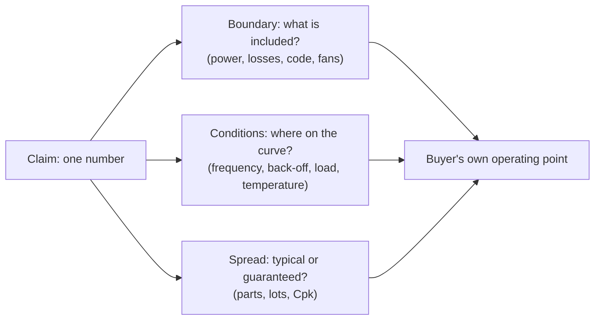

<!-- status: verified -->
# 28-05 · Domain Question Banks II: Analog/Mixed-Signal, RF, Power, Packaging, Embedded

| | |
|---|---|
| **Course** | [28 · Technical Diligence and Engineering Leadership Fluency](../README.md) |
| **University equivalent** | No direct university equivalent. It applies the core results of analog and mixed-signal IC design (Johns, Martin and Carusone, *Analog Integrated Circuit Design*), RF circuits (Razavi, *RF Microelectronics*), power electronics (Erickson and Maksimović, *Fundamentals of Power Electronics*), packaging and embedded systems (this curriculum's Courses 18, 20, 21, 22 and 25) to diagnostic interviewing in industry diligence |
| **Prerequisites** | [28-04](28-04-question-banks-digital-ai-memory-interconnect.md) (question banks as tests), [28-01](28-01-technology-evaluation-framework.md) (likelihood ratios), [03-05](../../03-probability-statistics-and-random-variables/chapters/03-05-estimation-and-hypothesis-testing.md) (Cpk and confidence intervals), [20-06](../../20-analog-and-mixed-signal-ic-design/chapters/20-06-data-converter-fundamentals.md), [20-10](../../20-analog-and-mixed-signal-ic-design/chapters/20-10-plls-and-jitter.md), [21-07](../../21-rf-and-microwave-engineering/chapters/21-07-power-amplifiers.md), [22-10](../../22-power-electronics-and-energy-conversion/chapters/22-10-datacenter-power-delivery.md), [25-07](../../25-fabrication-packaging-test-and-reliability/chapters/25-07-advanced-packaging-and-chiplets.md), [18-09](../../18-embedded-systems-and-microcontrollers/chapters/18-09-ultra-low-power-design.md) |
| **Estimated study hours** | 6 |
| **Last verified** | 2026-11-26 |

**Learning objectives.** After this chapter you can:

1. For data converters and clocks, place a claim against the published figure-of-merit frontier and the thermal-noise line, and compute the clock jitter an SNR claim requires.
2. For RF transmitters, compute ideal efficiency at power back-off for class-B and Doherty amplifiers, convert EVM to dB, and ask for efficiency with the real modulated signal.
3. For power conversion, turn efficiency points into watts of heat, multiply the efficiencies of a conversion chain, and check a power-density claim's boundary.
4. For packaging and embedded systems, compute interconnect density from pitch, compound known-good-die yields, estimate battery life from a duty cycle, and test a yield or battery-life claim against them.
5. Interpret typical and guaranteed specifications with Cpk and a confidence bound on the spread, and ask for distributions rather than single numbers.

---

## 1. Big picture

28-04 built question banks for the digital half of a system. This chapter covers the other half: the analog and mixed-signal circuits that connect chips to the physical world, the RF transmitters and receivers that connect them to each other without wires, the power converters that feed them, the packages that hold them, and the embedded controllers that run them. These domains share a property that makes diligence harder: their key numbers depend strongly on the conditions of measurement (input frequency, signal type, load, temperature, duty cycle), and data sheets report them as "typical" values whose spread across parts is usually not shown.

- **Why it exists:** a "70 dB SNR" ADC or a "98% efficient" power supply can be true under one set of conditions and irrelevant under the buyer's. The questions in this chapter pin down the conditions and the spread.
- **Where it shows up:** diligence on analog, RF, power-semiconductor, packaging and microcontroller companies; supplier qualification; and any system-level claim (battery life, radio range, rack power) that rests on these parts.
- **What it produces:** for each claim, the identity that governs it, the conditions that change it, and the question that tests it.
- **The rule of thumb:** ask for the curve, not the point, and for the distribution, not the typical value.

## 2. Intuition first

**Adjusted EBITDA.** A credit analyst never takes "adjusted EBITDA" at face value; the first question is what the adjustments are, and the second is how the number compares with peers that adjust differently. Analog, RF and power specifications behave the same way. "Power" may or may not include the reference, the clock and the calibration logic; "efficiency" may be measured at the best load point with fans powered separately; "battery life" may assume the most favorable code loop. The number is real, but its boundary is chosen by the company, so the boundary is the first thing to ask about.

Where the analogy breaks down: an accounting adjustment is a reporting choice, while an engineering boundary is a physical fact that the buyer can measure with the part and a bench. That makes engineering claims easier to settle, if the analyst asks for the test conditions and, where it matters, buys samples and measures them.

**Points against curves.** Most specifications in these domains are a single point on a curve:

- SNDR at one input frequency on a curve that falls with frequency;
- PA efficiency at peak power on a curve that falls with back-off;
- converter efficiency at the best load on a curve that falls at light and heavy load;
- MCU current on one code loop among many.

A strong answer gives the curve and says where the buyer's operating point lies on it.

## 3. Theory

As in 28-04, each section gives the governing quantities, the checks and a question bank. Strong and evasive answers follow the patterns of 28-04 §2: numbers with conditions, mechanisms and limits, against adjectives, pivots and numbers that cannot be reconciled.

### 3.1 Analog and mixed-signal: data converters and clocks

**Governing quantities.** An ideal $N$-bit quantizer driven by a full-scale sine has SNR $= 6.02N + 1.76$ dB (20-06). A real converter's signal-to-noise-and-distortion ratio (SNDR) is expressed as an effective number of bits, $\text{ENOB} = (\text{SNDR} - 1.76)/6.02$. Two figures of merit compare converters of different speeds and resolutions [R-336]:

$$
\text{FoM}_W = \frac{P}{f_s\,2^{\text{ENOB}}}, \qquad \text{FoM}_S = \text{SNDR} + 10\log_{10}\frac{f_s/2}{P}
$$

where $P$ is power in watts and $f_s$ the sample rate (for an oversampled converter, the Nyquist rate of the signal band). The Walden figure $\text{FoM}_W$, in joules per conversion step, is smaller for better converters and assumes power doubles per extra bit. The Schreier figure $\text{FoM}_S$, in dB, is larger for better converters and assumes power quadruples per extra bit, as thermal noise requires.

**The thermal line.** Murmann's ISSCC 2022 short course draws a line $P/f_s = 8kT \cdot \text{SNR}$ as the energy per sample of rail-to-rail class-B circuits at the noise limit, after Vittoz (1990) [R-336]. Substituting $P = 8kT \cdot \text{SNR} \cdot f_s$ into $\text{FoM}_S$ (with SNDR = SNR in dB) gives the figure a converter *on* that line would have:

$$
\text{FoM}_S = 10\log_{10}\text{SNR} + 10\log_{10}\frac{f_s}{2 \cdot 8kT \cdot \text{SNR} \cdot f_s} = 10\log_{10}\frac{1}{16\,kT}
$$

At 300 K, $16kT = 6.63 \times 10^{-20}$ J and the line sits at about 191.8 dB, independent of speed and resolution. It is a conservative reference, not a wall: 20-06 derives the bound for an ideal class-B driver charging a sampling capacitor, and at a Nyquist-frequency input that circuit needs only $4kT \cdot \text{SNR}$ per sample, so its bound is $10\log_{10}(1/8kT)$ = **194.8** dB, 3 dB above the line. A claim above about 192 dB therefore needs an explanation (a DR-based figure, the power boundary, or a circuit the line does not model), and none should exceed about 195 dB.

The best low-speed results sit 3–5 dB below the line: 189.2 dB for an oversampled noise-shaping SAR in a 1 kHz band and 186.8 dB for a Nyquist-rate converter. At high speed the frontier is far lower, 173.3 dB at 1 GS/s or faster and 159.3 dB at 10 GS/s or faster, because jitter and other speed-dependent costs, not kT/C noise, dominate there (Murmann survey, revision of Aug 2026) [R-336] **[Established: survey of ISSCC and VLSI papers]**. Two cautions from the survey itself: its tabulated power "sometimes … includes power for clocks, references, etc.; sometimes it doesn't" [R-339], and for delta-sigma modulators the decimation filter's power is excluded [R-343].

**Clock jitter.** Random timing error $\sigma_t$ on a sampled sine at $f_{in}$ limits SNR to

$$
\text{SNR}_j = -20\log_{10}(2\pi f_{in}\sigma_t)
$$

independent of sample rate [R-332]. Independent noise sources add in power, so a converter with thermal-and-quantization SNR $S_q$ (dB) and jitter-limited $S_j$ has total SNR $-10\log_{10}(10^{-S_q/10} + 10^{-S_j/10})$. At gigahertz inputs, a few tens of femtoseconds matter: published high-speed converters report aperture jitter of about 50–65 fs [R-332], and the best published PLLs reach about 16–21 fs of integrated jitter at 10–20 GHz [R-350] **[Established: data sheets and peer-reviewed papers]**. Jitter costs power: for an oscillator-limited PLL, halving the jitter needs four times the oscillator power [R-350].

| # | Question | Strong answer | Evasive answer |
|---|---|---|---|
| AM1 | "What is SNDR at an input near Nyquist, at what amplitude?" | SNDR against input frequency, at −1 dBFS, with the Nyquist-zone result | A low-frequency SNR only |
| AM2 | "What does the power figure include: references, buffers, clock, calibration logic, I/O?" | An itemized power budget | "Core power" without a list |
| AM3 | "How many parts, from how many lots, across which temperatures and supplies?" | Histograms with minimum, typical and maximum, and Cpk against the data-sheet limits | "Typical" |
| AM4 | "What calibration does it need, foreground or background, and does it track temperature and aging?" | The algorithms, their convergence time and residual error over temperature | "Self-calibrating" |
| AM5 | "What clock jitter did the bench use, and what will the product's PLL deliver?" | Both values, with the SNR budget that combines them | "Our clock is very clean" |
| AM6 | "Where does it sit against the published figure-of-merit frontier for its speed class?" | Its FoM and the nearest published results, and why it is above or below them | "Best in class" without a comparison |
| AM7 | "What did the last process port cost in time and respins, and how much of the design is digital?" | Months, respins and the scaling-friendly fraction (20-12) | "It ports easily" |
| AM8 | "Is there per-part trim, and what does test time cost?" | Trim steps, test seconds and their cost per unit (25-11) | "Production test is standard" |

### 3.2 RF: transmitters, receivers and their efficiency

> **Math refresher — decibels.** A ratio $x$ of *powers* is $10\log_{10}x$ dB, a ratio of *amplitudes* (voltages, currents, EVM) is $20\log_{10}x$ dB, because power goes as amplitude squared: 3 dB is a factor of 2 in power and 1.41 in amplitude, 20 dB a factor of 100 in power and 10 in amplitude. dBm is power relative to 1 mW (0 dBm = 1 mW, 30 dBm = 1 W), dBc is relative to the carrier, and dBFS relative to a converter's full scale. Decibels add where ratios multiply, which is why chains of gains and losses are summed in dB.

**Governing quantities.** A transmitter's power amplifier (PA) must reproduce a modulated signal whose peak power exceeds its average by the peak-to-average power ratio (PAPR), so it runs most of the time "backed off" below its peak. For an ideal class-B stage, the drain current is a half-sine of peak $I_p$; its DC component is $I_p/\pi$ and its fundamental amplitude $I_p/2$. With output voltage amplitude $V_o$ from supply $V_{DD}$:

$$
\eta = \frac{\tfrac12 V_o \cdot \tfrac12 I_p}{V_{DD} \cdot I_p/\pi} = \frac{\pi}{4}\,\frac{V_o}{V_{DD}} = \frac{\pi}{4}\,10^{-\text{BO}/20}
$$

where BO is the back-off in dB. Efficiency is 78.5% at full swing and falls in proportion to amplitude. A symmetric Doherty amplifier keeps a "carrier" amplifier at full voltage swing down to half the peak amplitude by presenting it with twice the load; below that point its efficiency is $(\pi/2)\,10^{-\text{BO}/20}$, twice class B, with a second 78.5% peak at 6 dB back-off (21-07). Real devices fall well short of these ideals. A published GaN MMIC Doherty (Pang et al., 2022) reports 38.5–46.5% drain efficiency at 6 dB back-off across 4.1–5.6 GHz and better than 38% average efficiency with a 6.5 dB-PAPR, 100 MHz OFDM signal after digital predistortion (DPD) [R-385]; another (Choi et al., 2022) reports 38.9–56.8% with an 8 dB-PAPR, 20 MHz LTE signal after DPD but only 38.5–50.2% with a 100 MHz NR signal without DPD, so bandwidth matters [R-385]; a GaN-on-Si module reports 51–53% at 8 W average with a 100 MHz LTE signal [R-385] **[Established: peer-reviewed papers]**.

**Signal quality.** Error vector magnitude (EVM) is the RMS error of the transmitted constellation relative to its RMS amplitude. When noise-like impairments dominate, $\text{EVM}_{\text{rms}}^2 \approx 1/\text{SNR}$, so $\text{EVM}_{\text{dB}} = 20\log_{10}\text{EVM} \approx -\text{SNR}_{\text{dB}}$. 3GPP requires 3.5% for 256-QAM (−29.1 dB) and 2.5% for 1024-QAM at a base station on carriers up to 4.2 GHz (2.8% above) [R-275] **[Established: standard]**; Wi-Fi 7 requires −38 dB for 4096-QAM [R-383]. Out-of-band leakage is limited by the adjacent-channel leakage ratio (ACLR), the ratio of in-channel to adjacent-channel power: at least 45 dB for an FR1 base station and 30 dB for a power-class-3 handset, often written −45 dBc and −30 dBc [R-383] **[Established: standard]**. Linearity, efficiency and EVM trade against one another, which is why an efficiency figure without the signal, the ACLR and the EVM it was measured with is incomplete.

| # | Question | Strong answer | Evasive answer |
|---|---|---|---|
| R1 | "What is the average efficiency with the real signal (PAPR, bandwidth), with ACLR and EVM in spec?" | Average efficiency, signal, ACLR and EVM together | Peak efficiency with a continuous wave |
| R2 | "Is DPD needed, and is its power (and the observation receiver) counted?" | DPD type, its power and who supplies it | "DPD is standard" |
| R3 | "What is the receive noise figure at the antenna, including filters and switches?" | A cascade from antenna to ADC (21-03) | The LNA's noise figure alone |
| R4 | "What margin do EVM and ACLR have to the 3GPP or IEEE limits at full power and temperature?" | Margins in dB at corners | "Compliant" |
| R5 | "Which bands and combinations, and who supplies the filters?" | Band list, filter technology and suppliers (21-09) | "All major bands" |
| R6 | "What is the phase noise and integrated jitter of the local oscillator at the carrier?" | dBc/Hz at offsets and integrated jitter, with the oscillator's FoM | "Low phase noise" |
| R7 | "Which certifications (regulatory, operator, Wi-Fi or Bluetooth) are complete?" | Named certifications with dates | "In progress" for all |

### 3.3 Power conversion

**Governing quantities.** A converter's efficiency $\eta = P_{out}/P_{in}$ sets its heat:

$$
P_{loss} = P_{in} - P_{out} = P_{out}\left(\frac{1}{\eta} - 1\right)
$$

Near 100%, small efficiency differences are large differences in heat: going from 97.5% to 98% cuts the loss by a fifth (Example 28-05.4). Stages in series multiply, $\eta_{\text{chain}} = \prod \eta_i$, and the last stage, which converts to the lowest voltage at the highest current, usually has the lowest efficiency and so often dominates the loss even though it carries the least power (22-10). Power density, in W/in³ or W/L, depends on what is counted: open-frame against cased, with or without hold-up capacitors, fans and connectors.

Published references show how much boundaries matter. A TI 65 W GaN adapter reference design reports 25.3 W/in³ without saying whether the figure is for a cased unit; a 5 kW totem-pole PFC stage reports 99% peak efficiency at 120 W/in³ open-frame, but it is a PFC stage alone [R-423]. Infineon's 8 kW AI-server supply reports 97.5% efficiency and 100 W/in³, against 32 W/in³ for an available 3 kW unit, while trade press reported 98% [R-423] **[Industry estimate; efficiency figure Contested]**.

**Device supply and ruggedness.** The switches set both performance and risk. A 650 V GaN transistor has no avalanche rating, only a transient over-voltage rating under stated pulse conditions, while a 1200 V SiC MOSFET may carry a short-circuit withstand time of 3 µs [R-430] **[Established: data sheet]** (22-06). Supply is shifting: TSMC told Navitas it would end GaN wafer foundry production by the end of July 2027 [R-432] **[Established as reported]**, and analysts describe SiC utilization near 50% upstream and 70% in device lines with the downturn expected to last until 2027–2028 [R-432] **[Industry estimate]**.

| # | Question | Strong answer | Evasive answer |
|---|---|---|---|
| P1 | "What is the efficiency at 10%, 20%, 50% and 100% load, at which input voltage and temperature, including fans and housekeeping?" | An efficiency curve with conditions | One peak figure |
| P2 | "Is the power density cased or open-frame, and does it include hold-up and connectors?" | The volume definition and dimensions | "Industry-leading density" |
| P3 | "Which switching devices, from which fabs, with what second sources?" | Named devices, foundries and qualified alternates | "Multiple suppliers" |
| P4 | "What ruggedness and field data exist for the wide-bandgap devices: over-voltage, short circuit, on-resistance drift?" | Ratings, test conditions and field returns | "GaN is mature now" |
| P5 | "What is the output droop for the processor's load step, and with how much capacitance?" | Millivolts for a stated A/µs step, with the capacitor bank | "Fast transient response" |
| P6 | "What is the hold-up time, and how does the supply behave on a line dropout?" | Milliseconds at full load and the sequencing | "Meets standards" |
| P7 | "What is the derating curve against ambient temperature and altitude?" | A curve | "Rated to full power" |

### 3.4 Packaging and thermal

**Governing quantities.** An area array of connections at pitch $p$ has a density of $1/p^2$; at $p$ in µm that is $10^6/p^2$ per mm². Pitch therefore matters quadratically. Flip-chip C4 bumps are about 130 µm, microbumps about 50 µm, and AMD's first hybrid-bonded stacking 9 µm [R-589] **[Contested: how that pitch is defined]**; TSMC's roadmap moves hybrid-bond pitch from 9 µm (2023) to 6 µm (2025) and 4.5 µm by 2029 [R-589] **[Established as roadmap]**. Intel reports EMIB bridges moving from a 55 to a 45 µm bump pitch, with 35–36 µm validated and 25 µm in testing [R-591] **[Industry estimate for the newest steps]**.

**Compound yield.** A multi-die package is good only if every die and every assembly step is good:

$$
Y_{\text{package}} = Y_{\text{assembly}} \prod_i Y_{\text{die},i}
$$

where each die yield is the probability that a die which passed its own test (a known-good die) survives into a working package. With eight or twelve memory stacks, even 99.5% per stack costs several points. TSMC reports yields "over 98%" on 5.5-reticle CoWoS without a public definition of what the yield covers [R-587] **[Contested: definition unstated]**; Example 28-05.5 shows why the definition decides whether the number can be an end-to-end package yield.

**Thermal.** Junction temperature is $T_j = T_{ref} + P\,\theta$, where $\theta$ is the thermal resistance from junction to the reference (case, cold plate or coolant) in K/W (25-08). At kilowatt power, a few hundredths of a kelvin per watt decide whether a part meets its junction limit.

| # | Question | Strong answer | Evasive answer |
|---|---|---|---|
| K1 | "Yield of what: which steps, which package size, over how many units?" | A definition, the units counted and the trend | A single percentage |
| K2 | "What pitch is in production, and what is qualified for our product?" | Production and qualified pitches, with reliability data [R-589], [R-591] | The roadmap's best number |
| K3 | "What is the known-good-die test coverage for each die type, and what happens to a package with one bad die?" | Coverage, test escapes and rework or scrap policy | "All dies are tested" |
| K4 | "What is the thermal resistance from junction to coolant, and the hot-spot temperature at full power?" | θ with its reference point, and measured hot-spot temperatures | Case temperature only |
| K5 | "What is the warpage at reflow and over temperature for this package size?" | Measured warpage with limits | "Within spec" |
| K6 | "What temperature-cycling and board-level reliability results exist for this package size?" | Cycles to failure and failure modes on the actual size | Results on a smaller package |
| K7 | "How much advanced-packaging capacity is contracted for the next two years?" | Contracted units by quarter | "We have a strong partnership" |

### 3.5 Embedded systems and microcontrollers

**Governing quantities.** A duty-cycled device's average current is its sleep current plus the charge of each active event divided by the period (18-09):

$$
I_{avg} = I_{sleep} + \sum_k \frac{I_k\,t_k}{T_k}
$$

where event $k$ draws $I_k$ (above the sleep current) for $t_k$ every $T_k$. Battery life is capacity divided by $I_{avg}$, before derating for temperature, self-discharge and pulse loading. The headline figures that feed this sum are where the boundaries hide. TI's MSPM0G3507 data sheet gives 101 µA/MHz running CoreMark from flash and 55 µA/MHz for a `while(1)` loop; standby with RTC and SRAM retained is 1.5 µA typical (4 µA maximum) at 25 °C but 4 µA typical (40 µA maximum) at 85 °C [R-310] **[Established: data sheet]**. A CR2032 coin cell is rated at 225 mAh at a 0.2 mA continuous drain (Panasonic's rating; other vendors differ), and higher pulse currents reduce the effective capacity [R-310] **[Established: data sheet]**.

**Security and safety obligations.** Embedded products now carry regulatory duties that are part of their value. The EU Cyber Resilience Act requires a support period of at least five years (or the expected use time if shorter), applies from 11 December 2027, and requires reporting of actively exploited vulnerabilities from 11 September 2026 [R-313] **[Established: regulation text]**. For automotive parts, ISO 26262 sets hardware metrics by ASIL: single-point fault metric at least 90%, 97% and 99% and latent-fault metric at least 60%, 80% and 90% for ASIL B, C and D [R-614] **[Established: standard]** (25-10).

| # | Question | Strong answer | Evasive answer |
|---|---|---|---|
| E1 | "Is the µA/MHz on CoreMark or a `while(1)` loop, from flash or RAM, at which voltage and regulator?" | The benchmark, memory, voltage and regulator mode | The lowest figure on the front page |
| E2 | "What are standby current and its maximum at 85 °C, with what retained?" | Typical and maximum over temperature, with retention | 25 °C typical only |
| E3 | "What does one wake-up cost in time and charge?" | Microseconds and microcoulombs, from a measured trace | "Instant wake" |
| E4 | "Under which duty cycle and battery derating is the battery life claimed?" | The profile, capacity derating and temperature | "Up to 10 years" |
| E5 | "What is your security support period, vulnerability-handling process and certification status?" | Years of support, a disclosure process and named certifications (CRA [R-313]) | "Secure by design" |
| E6 | "Which ASIL, and what SPFM and LFM did the analysis achieve?" | Metrics against ISO 26262 targets, with the assessor | "ASIL-ready" |
| E7 | "Who maintains the SDK, RTOS ports and toolchain support, and for how long?" | Named owners, release cadence and support term | "Community-supported" |

### 3.6 Typical, guaranteed and the spread between them

Data sheets in these domains separate **typical** values, usually the mean of characterization parts at nominal conditions, from **guaranteed** limits that every shipped part meets because production test or design margin ensures it. The gap between them depends on the spread across parts, lots and conditions, which is rarely published.

**Process capability.** For a parameter with mean $\mu$, standard deviation $\sigma$ and an upper specification limit USL, the one-sided capability index is

$$
C_{pk} = \frac{\text{USL} - \mu}{3\sigma}
$$

(03-05). If the parameter is normally distributed, the fraction of parts beyond the limit is $\Phi(-3C_{pk})$, where $\Phi$ is the standard normal distribution function: $C_{pk} = 1$ leaves about 1,350 ppm beyond a one-sided limit, and $C_{pk} = 2$ about 0.001 ppm. The tails of real distributions are often heavier than normal, so production test, not the normal model, is what guarantees a limit.

**Few parts, uncertain spread.** Characterization often uses a few tens of parts. With $n$ parts and sample standard deviation $s$, $(n-1)s^2/\sigma^2$ follows a chi-square distribution with $n - 1$ degrees of freedom, so with confidence $C$,

$$
\sigma \le s\sqrt{\frac{n-1}{\chi^2_{1-C;\,n-1}}}
$$

where $\chi^2_{1-C;\,n-1}$ is the lower $1 - C$ quantile. With 30 parts the 95% upper bound on $\sigma$ is about 1.28 times the measured $s$, which lowers the provable Cpk by the same factor (Problem 28-05.12). That bound treats the mean as known; allowing for uncertainty in the mean as well (Bissell's lower bound) lowers it slightly more. The diligence question is therefore not "what is the typical value?" but "how many parts, what spread, and what is guaranteed by test?".

## 4. Worked examples

All parameters are illustrative assumptions unless a source is cited.

### Example 28-05.1 · An ADC claim against the frontier (tier B)

**Setup.** A start-up claims a 1 GS/s ADC with 66 dB SNDR near Nyquist at 20 mW. Find (a) its ENOB, (b) its Walden figure, (c) its Schreier figure and the gap to the best published result at 1 GS/s or faster, 173.3 dB [R-336], and (d) the 8kT·SNR power floor at 300 K and the claim's ratio to it. (e) What Schreier figure would the same claim have at 2 mW?

**Solution.**

- (a) $(66 - 1.76)/6.02$ = **10.67** bits.
- (b) $0.020/(10^9 \times 2^{10.67})$ = **12.3** fJ per conversion step.
- (c) $66 + 10\log_{10}(5 \times 10^8/0.020)$ = **170.0** dB, **3.3** dB below the published best.
- (d) $8 \times 1.380649 \times 10^{-23} \times 300 \times 10^{6.6} \times 10^9$ = **0.132** mW; the claim uses **152** times that, **21.8** dB below the 191.8 dB thermal line.
- (e) $66 + 10\log_{10}(5 \times 10^8/0.002)$ = **180.0** dB.

**Units check.** W ÷ (samples/s × steps) = J per step; FoM_S in dB from a dimensionless SNDR plus 10 log₁₀(Hz/W), the convention of the survey. ✓

**Sanity check.** At 20 mW the claim is a few dB short of the best paper in its class, which is plausible for a product whose power includes more than a paper's core. At 2 mW it would beat every published 1 GS/s result by almost 7 dB. That does not make it false, but it moves the burden: ask for the measurement setup, the power boundary (AM2) and independent measurement. The thermal line is a consistency test: a claim above about 192 dB at room temperature needs an explanation, and none should exceed the 194.8 dB ideal class-B bound.

### Example 28-05.2 · The clock behind an SNR claim (tier B)

**Setup.** An RF-sampling receiver claims 60 dB SNR for a 2 GHz input. Find (a) the clock jitter that alone would limit SNR to 60 dB, (b) the jitter-limited SNR with a 100 fs clock, (c) the total SNR if the converter's own thermal and quantization noise give 62 dB, and (d) the jitter required for a total of 60 dB with that 62 dB converter.

**Solution.**

- (a) $\sigma_t = 10^{-60/20}/(2\pi \times 2 \times 10^9)$ = **79.6** fs.
- (b) $-20\log_{10}(2\pi \times 2 \times 10^9 \times 100 \times 10^{-15})$ = **58.0** dB.
- (c) $-10\log_{10}(10^{-5.80} + 10^{-6.2})$ = **56.6** dB.
- (d) $S_j = -10\log_{10}(10^{-6} - 10^{-6.2})$ = **64.3** dB, so $\sigma_t$ = **48.3** fs.

**Units check.** $2\pi f\sigma_t$ is dimensionless (Hz × s). ✓

**Sanity check.** The 48.3 fs is the *total* timing budget: the converter's own aperture jitter and the clock's jitter add root-sum-square and together must stay at or below it. The best published high-speed converters report aperture jitter alone of about 50–65 fs [R-332], so at full scale the claim exceeds the published state of the art even with a perfect clock. The formula assumes a full-scale sine, and an SNR quoted in dBFS but measured at a backed-off input can exceed it, so ask at what input amplitude it was measured (AM1) and with which clock (AM5): a bench clock source may meet a budget that the product's own PLL does not.

### Example 28-05.3 · A PA efficiency claim at back-off (tier B)

**Setup.** A GaN PA vendor claims 55% average efficiency for a 100 MHz signal with 8 dB PAPR at 8 W average output. Find (a) the ideal class-B efficiency at 8 dB back-off, (b) the ideal symmetric Doherty efficiency there, and (c) the DC power and dissipation at the claimed 55% and at 51%, the low end of the published module of [R-385].

**Solution.**

- (a) $(\pi/4) \times 10^{-8/20}$ = **31.3**%.
- (b) $(\pi/2) \times 10^{-8/20}$ = **62.5**%.
- (c) At 55%: $8/0.55$ = **14.5** W in, **6.55** W dissipated. At 51%: **15.7** W in, **7.69** W dissipated.

**Units check.** Efficiencies are ratios; W ÷ ratio = W. ✓

**Sanity check.** The claim is within the ideal Doherty's 62.5% at this back-off and a few points above a published GaN-on-Si module at the same average power and bandwidth. That makes it ambitious but not impossible; the questions are R1 and R2: with what ACLR and EVM, after which DPD, and is the DPD's power counted? The Choi results show that the same design loses several points when the bandwidth rises from 20 to 100 MHz. Efficiency at a single back-off point also only approximates the average over a real signal's envelope (21-07 Example 21-07.5 computes that average for OFDM), so ask for the measured average.

### Example 28-05.4 · Half a point of efficiency (tier B)

**Setup.** (a) An 8 kW server power supply is quoted at 97.5% efficiency by the vendor and 98% by the trade press [R-423]. Find the loss at full load in each case (assuming the quoted figure applies at full load; it is probably a peak figure, so ask for the curve, question P1), the difference, and the fractional reduction in heat. (b) Find the volume at 100 W/in³ and at the 32 W/in³ of an available 3 kW unit's density, in litres. (c) A rack delivers 1,000 W to processor cores through the supply (97.5%), a 48-to-12 V intermediate bus converter (97.5%, assumed) and core regulators (90%, assumed). Find the chain efficiency, the input power and each stage's loss.

**Solution.**

- (a) At 97.5%: $8000/0.975 - 8000$ = **205.1** W. At 98%: **163.3** W. Difference **41.9** W, **20.4**% less heat.
- (b) $8000/100$ = **80** in³ = **1.31** L; at 32 W/in³, **250** in³ = **4.10** L.
- (c) $0.975 \times 0.975 \times 0.90$ = **85.6**%; input **1168.8** W. Losses: core regulators $1000/0.90 - 1000$ = **111.1** W, intermediate converter **28.5** W, supply **29.2** W.

**Units check.** W ÷ ratio = W; (W) ÷ (W/in³) = in³; 1 in³ = 16.387 cm³. ✓

**Sanity check.** Half a point of efficiency at 98% is a fifth of the heat, which is why the two reported figures are not interchangeable. In the chain, the last stage loses more than the other two combined, so a claim about rack efficiency that quotes only the supply misses most of the loss (question P1, and 22-10).

### Example 28-05.5 · What a package yield can mean (tier C)

**Setup.** (a) Find the connection density per mm² for area arrays at 130 µm, 50 µm and 9 µm pitch, and the ratio of the last to the first [R-589]. (b) Find the density gain of Intel's move from 45 to 35 µm EMIB bump pitch [R-591]. (c) A package holds one compute die (survival 99% after known-good-die test) and eight memory stacks (99.5% each), with 98% assembly yield (all assumed). Find the package yield, and the yield if assembly were perfect. (d) Could these assumptions be consistent with a 98% end-to-end package yield?

**Solution.**

- (a) **59.2**, **400** and **12346** per mm²; ratio **209**.
- (b) $(45/35)^2$ = **1.65**, matching Intel's reported 65% increase [R-591].
- (c) $0.99 \times 0.995^8 \times 0.98$ = **93.2**%; with perfect assembly **95.1**%.
- (d) No: reaching 98% would need an assembly yield of $0.98/0.951$ = **103**%, which is impossible. A 98% figure must either cover fewer steps (for example, assembly alone) or rest on better die and stack survival than assumed here.

**Units check.** $10^6/p^2$ with $p$ in µm gives per mm²; yields are probabilities. ✓

**Sanity check.** Each halving of pitch quadruples density, which is why hybrid bonding changes what can be stacked. Yields multiply, so a package with many dies can only reach a high end-to-end yield if every input is near perfect; a single headline yield without a definition cannot be compared with anything (question K1).

### Example 28-05.6 · A battery-life claim (tier B)

**Setup.** A sensor node uses an MCU with the MSPM0G3507's data-sheet figures and a Bluetooth LE radio with the CC2340R5's [R-310]. Each second the MCU wakes for 2 ms at 32 MHz; every 10 s the radio transmits for 1 ms (5.1 mA) and receives for 1 ms (5.3 mA). Sleep current is 1.5 µA (MCU) plus 0.71 µA (radio). The battery is a 225 mAh CR2032 (Panasonic's rating; other vendors differ) [R-310]. Treat active currents as additions to sleep current and take a year as 8,766 hours. Find (a) the average current and battery life at 25 °C with the CoreMark figure of 101 µA/MHz, (b) the life at 85 °C, where the MCU's typical standby is 4 µA (the radio's 25 °C value is kept for lack of data), and (c) the life with the `while(1)` figure of 55 µA/MHz, and its ratio to (a).

**Solution.**

- (a) CPU $101 \times 32$ µA × 2 ms/1 s = 6.464 µA; radio $(5.1 + 5.3)$ mA × 1 ms/10 s = 1.04 µA; sleep 2.21 µA; total **9.714** µA. Life $225/0.009714$ = **23162** h = **2.64** years.
- (b) Sleep 4.71 µA, total **12.21** µA, **2.10** years.
- (c) CPU 3.52 µA, total **6.77** µA, **3.79** years, **1.43** times (a).

**Units check.** mA × ms ÷ s = µA; mAh ÷ mA = h. ✓

**Sanity check.** The CPU dominates, so the code loop behind the µA/MHz figure changes the life by more than 40%, and a warm environment by about 20% the other way. The coin cell's effective capacity also falls under pulse loads [R-310], so a "three-year" claim needs its profile, temperature and battery derating stated (E1, E2, E4).

<!-- answer-key -->

| ID | Quantity | Value | Unit |
|---|---|---|---|
| Txt 28-05.1 | 16kT at 300 K | 6.63 × 10^-20 | J |
| Txt 28-05.2 | Schreier figure on the 8kT·SNR line at 300 K | 191.8 | dB |
| Txt 28-05.2b | ideal class-B bound at a Nyquist input, 300 K | 194.8 | dB |
| Txt 28-05.3 | ideal class-B peak efficiency | 78.5 | % |
| Txt 28-05.4 | ppm beyond a one-sided limit, Cpk = 1 | 1350 | ppm |
| Txt 28-05.5 | ppm beyond a one-sided limit, Cpk = 2 | 0.001 | ppm |
| Txt 28-05.6 | 95% bound on σ over s, 30 parts | 1.28 | — |
| Txt 28-05.7 | heat cut from 90% to 91% efficiency | 11.0 | % |
| Txt 28-05.8 | loss at 97.5% as a share of output | 2.56 | % |
| Txt 28-05.9 | loss at 98% as a share of output | 2.04 | % |
| Txt 28-05.10 | 3 dB as a power ratio | 2 | — |
| Txt 28-05.11 | 3 dB as an amplitude ratio | 1.41 | — |
| Ex 28-05.1a | ENOB | 10.67 | bits |
| Ex 28-05.1b | Walden figure | 12.3 | fJ/conv-step |
| Ex 28-05.1c | Schreier figure | 170.0 | dB |
| Ex 28-05.1c1 | gap to best ≥ 1 GS/s | 3.3 | dB |
| Ex 28-05.1d | 8kT·SNR power floor | 0.132 | mW |
| Ex 28-05.1d1 | ratio to floor | 152 | — |
| Ex 28-05.1d2 | gap to the thermal line | 21.8 | dB |
| Ex 28-05.1e | Schreier figure at 2 mW | 180.0 | dB |
| Ex 28-05.2a | jitter for 60 dB alone | 79.6 | fs |
| Ex 28-05.2b | SNR with 100 fs | 58.0 | dB |
| Ex 28-05.2c | total SNR | 56.6 | dB |
| Ex 28-05.2d | jitter-limited SNR needed | 64.3 | dB |
| Ex 28-05.2d1 | jitter needed | 48.3 | fs |
| Ex 28-05.3a | ideal class-B efficiency at 8 dB | 31.3 | % |
| Ex 28-05.3b | ideal Doherty efficiency at 8 dB | 62.5 | % |
| Ex 28-05.3c | DC power at 55% | 14.5 | W |
| Ex 28-05.3c1 | dissipation at 55% | 6.55 | W |
| Ex 28-05.3c2 | DC power at 51% | 15.7 | W |
| Ex 28-05.3c3 | dissipation at 51% | 7.69 | W |
| Ex 28-05.4a | loss at 97.5% | 205.1 | W |
| Ex 28-05.4a1 | loss at 98% | 163.3 | W |
| Ex 28-05.4a2 | difference | 41.9 | W |
| Ex 28-05.4a3 | heat reduction | 20.4 | % |
| Ex 28-05.4b | volume at 100 W/in³ | 80 | in³ |
| Ex 28-05.4b1 | volume at 100 W/in³ | 1.31 | L |
| Ex 28-05.4b2 | volume at 32 W/in³ | 250 | in³ |
| Ex 28-05.4b3 | volume at 32 W/in³ | 4.10 | L |
| Ex 28-05.4c | chain efficiency | 85.6 | % |
| Ex 28-05.4c1 | input power | 1168.8 | W |
| Ex 28-05.4c2 | core-regulator loss | 111.1 | W |
| Ex 28-05.4c3 | intermediate-converter loss | 28.5 | W |
| Ex 28-05.4c4 | supply loss | 29.2 | W |
| Ex 28-05.5a | density at 130 µm | 59.2 | per mm² |
| Ex 28-05.5a1 | density at 50 µm | 400 | per mm² |
| Ex 28-05.5a2 | density at 9 µm | 12346 | per mm² |
| Ex 28-05.5a3 | ratio 9 µm to 130 µm | 209 | — |
| Ex 28-05.5b | EMIB 45 to 35 µm gain | 1.65 | — |
| Ex 28-05.5c | package yield | 93.2 | % |
| Ex 28-05.5c1 | with perfect assembly | 95.1 | % |
| Ex 28-05.5d | assembly yield needed for 98% | 103 | % |
| Ex 28-05.6a | average current, 25 °C | 9.714 | µA |
| Ex 28-05.6a1 | battery life | 23162 | h |
| Ex 28-05.6a2 | battery life | 2.64 | years |
| Ex 28-05.6b | average current, 85 °C | 12.21 | µA |
| Ex 28-05.6b1 | battery life, 85 °C | 2.10 | years |
| Ex 28-05.6c | average current, while(1) | 6.77 | µA |
| Ex 28-05.6c1 | battery life, while(1) | 3.79 | years |
| Ex 28-05.6c2 | ratio to CoreMark case | 1.43 | — |

## 5. Simulate it

The lab is [labs/28-05-lab/](../labs/28-05-lab/README.md). `bankcheck.py` implements the checks behind the question banks:

- ENOB, the Walden and Schreier figures and the thermal line;
- jitter-limited and combined SNR;
- ideal class-B and Doherty efficiency against back-off;
- converter loss and chain efficiency, area-array density and compound yield;
- duty-cycled average current and battery life, Cpk and the confidence bound on σ.

1. *Predict* the Schreier figure of Example 28-05.1's claim at 5 mW. Then plot claimed points against the published frontier and the thermal line.
2. *Predict* the highest input frequency at which a 50 fs clock still allows 60 dB SNR. Then plot jitter-limited SNR against input frequency for 25, 50, 100 and 200 fs.
3. *Predict* the ideal Doherty efficiency at 9 dB back-off. Then plot class-B and Doherty efficiency against back-off with the published GaN range.
4. *Predict* Example 28-05.6's battery life if the MCU wakes every 10 s instead of every second. Then plot life against the wake interval for both µA/MHz figures and at 85 °C.

![Left: ideal power-amplifier drain efficiency against output back-off from 0 to 12 dB, falling from 78.5% for class B and showing the Doherty's second peak at 6 dB, with published GaN Doherty results of 38.5 to 46.5% at 6 dB back-off marked as a bar; right: battery life of Example 28-05.6's sensor node on a CR2032 against the MCU's wake interval from 0.1 to 100 s on a log scale, for 101 µA/MHz at 25 °C, 55 µA/MHz at 25 °C and 101 µA/MHz at 85 °C, saturating at long intervals where sleep and radio currents dominate](../../../assets/figures/28-05/backoff-and-battery.svg)

*Figure 1. Two curves behind single-point claims: PA efficiency against back-off (§3.2), and battery life against duty cycle, code loop and temperature (§3.5).*

## 6. Engineering tradeoffs

| Knob | Improves | Costs | Typical decision owner |
|---|---|---|---|
| ADC resolution (ENOB) | Dynamic range, fewer analog gain stages | Power (×4 per bit at the thermal limit), clock quality, area | Mixed-signal architect |
| Background calibration | Accuracy over temperature and aging | Digital power, convergence time, test complexity | Converter designer with DSP team |
| Cleaner clock (lower jitter) | SNR at high input frequency | PLL power (×4 per halving), area, reference cost | Clocking lead |
| Doherty or envelope tracking | Efficiency at back-off | Bandwidth, linearity effort, DPD complexity | RF system architect |
| Wide-bandgap switches | Efficiency, power density | Device cost, supply concentration, ruggedness limits | Power-supply architect with procurement |
| More conversion stages near the load | Distribution loss | Board area, cost, an extra efficiency factor | Rack and board power architects |
| Finer bond pitch | Interconnect density and energy per bit | Process cost, yield and test challenges | Packaging with SoC architecture |
| More dies per package | Capability per package | Compound yield loss, thermal density | Product architect with operations |
| Deeper sleep modes | Battery life | Wake latency, lost state, software complexity | Embedded firmware lead |

## 7. Numbers to know

Figures are as of Nov 2026 unless dated otherwise.

| Quantity | Value | Note |
|---|---|---|
| Ideal quantizer SNR | $6.02N + 1.76$ dB | 20-06 |
| Schreier figure on the 8kT·SNR line | about 191.8 dB at 300 K (ideal class-B bound 194.8 dB) | §3.1, from [R-336] and 20-06 |
| Best published Schreier figures | 189.2 dB (oversampled, 1 kHz); 186.8 dB (Nyquist); 173.3 dB (≥ 1 GS/s); 159.3 dB (≥ 10 GS/s) | Murmann survey, Aug 2026 [R-336] |
| Best Walden figure | 0.35 fJ/conv-step (unchanged since 2019) | [R-336] |
| Jitter-limited SNR | $-20\log_{10}(2\pi f_{in}\sigma_t)$; 50 fs at 2 GHz gives 64.0 dB | [R-332] |
| Best PLL jitter | about 16–21 fs integrated at 10–20 GHz | [R-350] **[Established]** |
| Ideal class-B efficiency | 78.5% at peak, $(\pi/4)\,10^{-\text{BO}/20}$ at back-off | 21-07 |
| GaN Doherty (published) | 38.5–46.5% drain efficiency at 6 dB back-off (one MMIC, 4.1–5.6 GHz); 51–53% at 8 W average | [R-385] **[Established]** |
| 3GPP EVM | 3.5% (256-QAM), 2.5% (1024-QAM, carriers up to 4.2 GHz; 2.8% above) at a base station | [R-275] **[Established: standard]** |
| 8 kW server PSU | 97.5% (vendor) or 98% (press); 100 W/in³ | [R-423] |
| Flip-chip, microbump, hybrid-bond pitch | about 130, 50 and 9 µm; hybrid bonding to 4.5 µm by 2029 | [R-589] **[Industry estimate: roadmap]** |
| MCU active current | 101 µA/MHz (CoreMark) against 55 µA/MHz (`while(1)`) | MSPM0G3507 [R-310] |
| MCU standby | 1.5 µA typical at 25 °C, 4 µA typical at 85 °C | MSPM0G3507 [R-310] |
| CR2032 | 225 mAh at 0.2 mA (Panasonic; other vendors differ) | [R-310] **[Established: data sheet]** |
| ISO 26262 SPFM | ≥ 90%, 97%, 99% (ASIL B, C, D) | [R-614] **[Established: standard]** |

## 8. Common mistakes

- **Comparing converters by SNR at different input frequencies.** SNDR near Nyquist, at the buyer's frequency, is the comparable number.
- **Ignoring the power boundary.** A figure of merit computed from core power is not comparable with one that includes references, clocking and I/O.
- **Quoting PA efficiency at peak power.** Modulated signals spend most of their time backed off; average efficiency with the real signal is what sets heat and battery drain.
- **Treating efficiency points as small.** Between 97.5% and 98%, a fifth of the heat disappears; between 90% and 91%, about **11.0**%.
- **Multiplying yields you have not defined.** A step yield and an end-to-end package yield are different quantities.
- **Using typical sleep current at 25 °C for a product that lives in a warm enclosure.** Standby current can rise several-fold by 85 °C (1.5 to 4 µA typical for the MSPM0G3507 [R-310]).
- **Taking "typical" as "guaranteed".** Ask for the spread, the number of parts and what production test enforces.

## 9. Practitioner lens

**State of play (as of Nov 2026).**

- **Low-speed converter efficiency is near its ceiling.** The best published Schreier figure (189.2 dB, a low-speed converter) is within about 3 dB of the 8kT·SNR line, while high-speed converters sit far below it, and the best Walden figure has not moved since 2019 [R-336] **[Established]**. Claims of large leaps in converter efficiency deserve the checks of Example 28-05.1; claims of better integration, calibration and scaling-friendly design are where most progress now lies (20-12).
- **Wide-bandgap supply is in flux.** TSMC's planned exit from GaN foundry production by mid-2027 and SiC overcapacity [R-432] change the risk profile of power companies that depend on a single fab **[Established as reported; Industry estimate for utilization]**.
- **Packaging is the new scaling axis.** Hybrid-bond pitch is heading to 4.5 µm by 2029 [R-589] **[Industry estimate: roadmap]**, HBM4 kept microbumps after JEDEC relaxed the stack-height limit from 720 to 775 µm, postponing hybrid bonding to later generations [R-594] **[Established as reported]**, and 5.5-reticle CoWoS is in production with yields reported above 98% under an unstated definition [R-587] **[Contested: yield definition]**.
- **Embedded value now includes compliance.** The Cyber Resilience Act's vulnerability reporting applies from September 2026 and its full obligations from December 2027 [R-313], so a microcontroller company's security-update process and support term are part of what a buyer acquires **[Established]**.

**Commercial relevance.** In these domains the moat is often in the curve, not the point: an ADC that holds its SNDR to Nyquist, a PA that holds its efficiency at back-off, a supply that holds its efficiency at light load, an MCU that holds its standby current at 85 °C. Those properties come from design know-how, calibration IP and characterization data that a competitor cannot copy from a data sheet. Diligence that asks for curves and distributions finds that moat, or its absence; diligence that compares headline points finds marketing.

**Marketing vs Reality.**

- *"70 dB SNR ADC."* At which input frequency, which clock, and what power boundary? Compute the Schreier figure and compare it with the frontier for its speed class.
- *"55% efficient PA."* With which signal, which ACLR and EVM, and is the DPD counted?
- *"98% efficient power supply."* At which load and input voltage, with or without fans? Compute the heat at the buyer's load.
- *"Over 98% package yield."* Yield of which steps, over how many units?
- *"10-year battery life."* Under which duty cycle, at which temperature, with which code loop and which battery derating?

**Questions for engineering leaders.** The banks in §3.1–3.5 are the questions; three that work across all five domains are:

1. *"Show me the curve, not the point: where is our operating point on it?"* Strong: a plotted curve with the buyer's point marked. Evasive: the headline number again.
2. *"How many parts, from how many lots, and what is guaranteed by test?"* Strong: a sample size, a distribution and a production test limit. Evasive: "typical".
3. *"Which of your numbers would change most if we measured them ourselves?"* Strong: a candid answer with reasons (boundary, conditions, setup). Evasive: "none". As in 28-04, the reaction is part of the evidence.

## 10. Concept check

1. Why does the Schreier figure of a thermal-noise-limited converter sit near 192 dB regardless of speed, and is that a hard limit?

   

Answer

   The 8kT·SNR line sets power proportional to SNR × sample rate, and both cancel in $\text{FoM}_S$, leaving $10\log_{10}(1/16kT)$, about 191.8 dB at 300 K. It is a conservative line: the ideal class-B sampler of 20-06 at a Nyquist input does 3 dB better (194.8 dB), so a figure modestly above 192 dB calls for an explanation rather than a verdict of fraud.

   

2. Why does a high-frequency SNR claim depend on the clock?

   

Answer

   Timing error turns into amplitude error in proportion to the signal's slope, limiting SNR to $-20\log_{10}(2\pi f_{in}\sigma_t)$; at 2 GHz, tens of femtoseconds cost several dB.

   

3. Why does a PA's efficiency at peak power overstate its efficiency in use?

   

Answer

   Modulated signals have a PAPR of several dB, so the PA operates mostly backed off, where class-B efficiency falls in proportion to output amplitude. Doherty and similar techniques recover some of it.

   

4. Why is the difference between 97.5% and 98% efficiency significant?

   

Answer

   Loss is $P_{out}(1/\eta - 1)$; the step cuts the loss from **2.56**% to **2.04**% of output, about a fifth of the heat.

   

5. Why must a package yield come with a definition?

   

Answer

   Package yield is a product of die survival and assembly step yields; a figure for one step cannot be compared with an end-to-end figure, and with many dies an end-to-end yield near 98% needs nearly perfect inputs.

   

6. Why ask for standby current at 85 °C?

   

Answer

   Leakage rises steeply with temperature: the MSPM0G3507's typical standby rises from 1.5 µA at 25 °C to 4 µA at 85 °C, which cuts battery life in a warm product by about a fifth in Example 28-05.6.

   

7. What does Cpk add to a "typical" value?

   

Answer

   It relates the distance from the mean to the specification limit to the spread, giving the fraction of parts expected beyond the limit (about 1,350 ppm at Cpk = 1 for a normal distribution), and its uncertainty grows when few parts were measured.

   

Problems: [28-05 problem set](../problems/28-05-problems.md) · Solutions: [28-05 solutions](../solutions/28-05-solutions.md)

## 11. Key terms

[Schreier figure of merit](../../../reference/glossary.md#schreier-figure-of-merit) · [Walden figure of merit](../../../reference/glossary.md#walden-figure-of-merit) · [Thermal-noise ceiling (ADC)](../../../reference/glossary.md#thermal-noise-ceiling-adc) · [Aperture jitter](../../../reference/glossary.md#aperture-jitter) · [Output back-off](../../../reference/glossary.md#output-back-off) · [Doherty amplifier](../../../reference/glossary.md#doherty-amplifier) · [Error vector magnitude](../../../reference/glossary.md#error-vector-magnitude) · [Power density](../../../reference/glossary.md#power-density) · [Known-good die (KGD)](../../../reference/glossary.md#known-good-die-kgd) · [Duty cycling](../../../reference/glossary.md#duty-cycling) · [Process capability (Cp, Cpk)](../../../reference/glossary.md#process-capability-cp-cpk) · [Typical and guaranteed specifications](../../../reference/glossary.md#typical-and-guaranteed-specifications)

## 12. Connections

- **Previous:** [28-04 Domain Question Banks I](28-04-question-banks-digital-ai-memory-interconnect.md): digital/CPU, AI accelerators, memory, interconnect and optics.
- **Next:** [28-06 Red Flags and Green Flags](28-06-red-and-green-flags.md), which collects the evasive patterns of both banks.
- **Prerequisites used here:** converter metrics ([20-06](../../20-analog-and-mixed-signal-ic-design/chapters/20-06-data-converter-fundamentals.md)); jitter and PLLs ([20-10](../../20-analog-and-mixed-signal-ic-design/chapters/20-10-plls-and-jitter.md)); power amplifiers ([21-07](../../21-rf-and-microwave-engineering/chapters/21-07-power-amplifiers.md)); datacenter power ([22-10](../../22-power-electronics-and-energy-conversion/chapters/22-10-datacenter-power-delivery.md)); advanced packaging ([25-07](../../25-fabrication-packaging-test-and-reliability/chapters/25-07-advanced-packaging-and-chiplets.md)); ultra-low-power design ([18-09](../../18-embedded-systems-and-microcontrollers/chapters/18-09-ultra-low-power-design.md)); Cpk ([03-05](../../03-probability-statistics-and-random-variables/chapters/03-05-estimation-and-hypothesis-testing.md)).
- **Used later:** the integration risks of [28-08](28-08-integration-risk.md) (analog porting, supply concentration) and the dialogues of [28-10](28-10-conversation-scenarios.md).

> **Deeper:** see companion repo *Semiconductor Capital Equipment* for the bonding, test and packaging tools behind §3.4.

## 13. Further study

- D. A. Johns, K. Martin and T. Chan Carusone, *Analog Integrated Circuit Design*: the chapters on data-converter fundamentals and performance metrics.
- B. Razavi, *RF Microelectronics*: the chapters on power amplifiers (efficiency, back-off, Doherty) and transceiver specifications.
- R. W. Erickson and D. Maksimović, *Fundamentals of Power Electronics*: the chapters on converter losses and efficiency.
- B. Murmann's ADC performance survey (public on GitHub) [R-336]: plot your own claims against it.
- Lecture videos: Ali Hajimiri's Caltech analog circuit lectures and Tony Chan Carusone's data-converter lectures (both recorded and public).

## 14. Sources

1. Converter figures of merit, frontier and survey caveats [R-336], [R-339], [R-343]; jitter formula and values [R-332]; PLL jitter and power [R-350].
2. Power amplifiers: GaN Doherty results [R-385]; 3GPP and Wi-Fi requirements [R-383], [R-275].
3. Power conversion: reference designs and server supplies [R-423]; device data sheets [R-430]; GaN and SiC supply [R-432].
4. Packaging: hybrid-bond pitch [R-589]; EMIB pitch [R-591]; CoWoS yield statements [R-587]; HBM height and bonding [R-594].
5. Embedded: MCU, radio and coin-cell data [R-310]; Cyber Resilience Act [R-313]; ISO 26262 hardware metrics [R-614].
