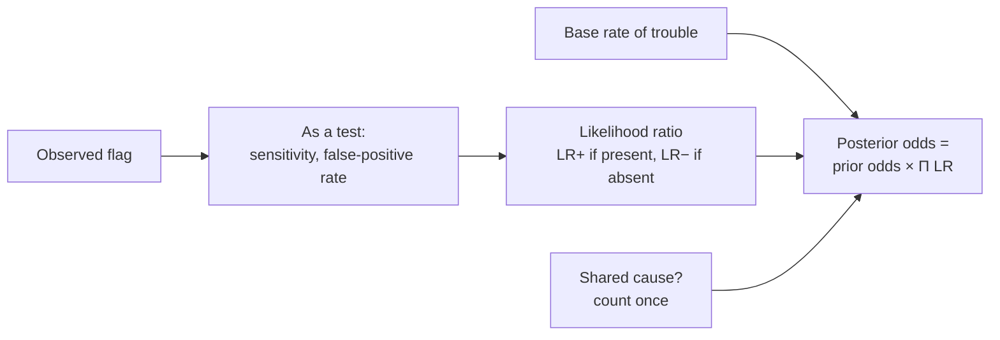

<!-- status: verified -->
# 28-06 · Red Flags and Green Flags

| | |
|---|---|
| **Course** | [28 · Technical Diligence and Engineering Leadership Fluency](../README.md) |
| **University equivalent** | No direct university equivalent. It applies the statistics of diagnostic tests (sensitivity, false-positive rate and likelihood ratios, as taught in biostatistics and decision analysis), the binomial distribution, and concentration measures from industrial organization to the warning signs and reassurances found in technical diligence |
| **Prerequisites** | [28-01](28-01-technology-evaluation-framework.md) (Bayes in odds form), [28-04](28-04-question-banks-digital-ai-memory-interconnect.md) and [28-05](28-05-question-banks-analog-rf-power-packaging-embedded.md) (question banks), [03-02](../../03-probability-statistics-and-random-variables/chapters/03-02-random-variables-and-distributions.md) (binomial distribution), [26-05](../../26-engineering-design-and-professional-practice/chapters/26-05-schedule-and-respin-risk.md) (schedule and respin risk), [26-06](../../26-engineering-design-and-professional-practice/chapters/26-06-team-structures-and-sizing.md) (team structures) |
| **Estimated study hours** | 4 |
| **Last verified** | 2026-11-26 |

**Learning objectives.** After this chapter you can:

1. Treat a red or green flag as a diagnostic test: compute its positive and negative likelihood ratios from its sensitivity and false-positive rate, and update a base rate with it.
2. Compute how often a checklist raises false alarms on a healthy company, and choose a flag-count threshold from the count distributions of healthy and troubled companies.
3. Recognize the technical, organizational and commercial flags that matter for chip companies, and name the evidence that confirms or clears each.
4. Quantify key-person risk, customer concentration and a design-win funnel's risk-adjusted value.
5. Combine several flags without double-counting correlated ones.

---

## 1. Big picture

28-04 and 28-05 built question banks: deliberate tests run in a meeting. Diligence also produces signals nobody asked for: a demo that runs only on an FPGA, a third slip of a tape-out date, a lead architect who left last quarter, a customer list dominated by one name. Experienced investors call these red flags and green flags. This chapter makes them quantitative. A flag is a test with a sensitivity and a false-positive rate, and its evidential weight is a likelihood ratio, exactly like an interview answer in 28-04 §3.6. Two consequences follow that intuition misses: a long checklist raises false alarms on healthy companies almost every time, and several flags that stem from one underlying fact are one piece of evidence, not several.

- **Why it exists:** flags are the most common form of diligence evidence, and the most often misweighed. Treating them as tests disciplines both the fear of a single red flag and the comfort of a single green one.
- **Where it shows up:** screening memos, investment-committee papers, expert calls, data-room reviews and post-close integration reviews.
- **What it produces:** for each flag, a likelihood ratio and the evidence that would confirm or clear it; for a checklist, a threshold that balances misses against false alarms.
- **The rule of thumb:** a flag is worth what it distinguishes. Ask how often it appears in healthy companies before deciding what it means here.

## 2. Intuition first

**A covenant breach against a missed quarter.** A credit analyst treats a covenant breach very differently from a single missed earnings estimate. Most companies miss an estimate now and then, so a miss tells you little; few healthy companies breach covenants, so a breach tells you a lot. The difference is the false-positive rate: how often the signal appears in companies that turn out fine. Red flags work the same way. "The tape-out slipped once" is common in healthy programmes (most chip projects run late); "the team cannot reproduce its own headline benchmark" is rare in healthy ones.

Where the analogy breaks down: covenants and estimates have long, public histories that give their base rates. Most technical flags do not, so their sensitivities and false-positive rates are judgments. The discipline is to write those judgments down before the meeting, as in 28-04, and to revise them as the record of past deals grows.

**Healthy companies have flags too.** If a checklist has 25 items and each appears in 4% of healthy companies, a healthy company shows at least one red flag nearly two times in three (Example 28-06.2). A single flag is therefore expected; what matters is how many, which ones, and whether they share a cause.

## 3. Theory

### 3.1 A flag is a diagnostic test

Let $T$ be "the company or programme is in trouble" (it will miss its plan by a margin that matters to the deal), with base rate $\pi = P(T)$. A flag $F$ has a **sensitivity** $s = P(F \mid T)$, the fraction of troubled companies that show it, and a **false-positive rate** $f = P(F \mid \bar T)$, the fraction of healthy companies that show it. From Bayes' rule in odds form (28-01 §3.3):

$$
\frac{P(T \mid F)}{P(\bar T \mid F)} = \frac{\pi}{1 - \pi} \cdot \frac{s}{f}, \qquad \frac{P(T \mid \bar F)}{P(\bar T \mid \bar F)} = \frac{\pi}{1 - \pi} \cdot \frac{1 - s}{1 - f}
$$

The ratio $\text{LR}^+ = s/f$ is the flag's weight when it is present, and $\text{LR}^- = (1 - s)/(1 - f)$ its weight when it is absent. Three lessons follow:

- **Rare-in-healthy beats common-in-troubled.** A flag present in 60% of troubled and 10% of healthy companies ($\text{LR}^+ = 6$) is more useful than one present in 90% of troubled and 50% of healthy ones ($\text{LR}^+ = 1.8$).
- **Absence is evidence too.** With $s = 0.6$ and $f = 0.1$, a missing flag multiplies the odds by $0.4/0.9 = 0.44$ (Example 28-06.1). A green flag is simply a signal whose likelihood ratio for trouble is below 1.
- **The base rate matters.** The same flag moves a 5% prior and a 40% prior to very different posteriors. For chip programmes, base rates are sobering: in the 2024 Wilson Research Group study only 14% of IC/ASIC projects reached first-silicon success, 75% were behind schedule, and about 30% needed four or more spins [R-621], [R-645] **[Industry estimate: vendor-sponsored survey; the 2024 sample method changed]**.

### 3.2 Many flags: false alarms and thresholds

A checklist of $n$ flags, each appearing independently in healthy companies with probability $f$, raises at least one false alarm with probability

$$
P(\ge 1 \mid \bar T) = 1 - (1 - f)^n \approx 1 - e^{-nf}
$$

and the expected number of false alarms is $nf$. With $n = 25$ and $f = 0.04$, that is 64% and one flag on average. In a troubled company each flag appears with probability $s$, so the count $K$ of flags is binomial in both cases: $K \sim \text{Bin}(n, f)$ if healthy and $\text{Bin}(n, s)$ if troubled (03-02).

A sensible rule is a **count threshold**: treat "$K \ge k$" as the red signal. Its sensitivity is $P(K \ge k \mid T)$, its false-positive rate $P(K \ge k \mid \bar T)$, and its likelihood ratio their quotient. Raising $k$ trades sensitivity for fewer false alarms. The threshold should depend on the costs: a missed problem in a large acquisition costs more than a few extra days of diligence, so the threshold for "investigate further" should be low, while the threshold for "walk away" should be high.

The binomial model assumes independence. Real flags cluster: a company with weak verification shows several related flags at once. §3.6 deals with that.

### 3.3 Technical flags

The table pairs common technical red flags with their green counterparts and the evidence that settles each. The likelihood ratios in later examples are assumptions; the evidence column is what replaces assumptions with facts.

| Area | Red flag | Green flag | Evidence that settles it |
|---|---|---|---|
| Claims | Headline numbers that cannot be reconciled with the identities of 28-02, 28-04 and 28-05 | Numbers that reproduce the analyst's own calculation, with conditions | The analyst's pre-meeting calculation; raw measurement data |
| Demos | Demonstrations only on FPGA, emulation or simulation, or on hand-picked units | Customer-run tests on production-intent silicon | Customer references; data logs; sample units to test |
| Silicon history | More spins than planned without root causes; vague errata | Spins and errata explained by root cause, consistent with plan | Stepping history, errata lists, bug-tracker trends (28-03) |
| Verification | Coverage claimed without a plan; few verification engineers | Plan-driven coverage, formal methods on control logic, bug-discovery curves flattening | Verification plan, coverage database, staffing ratio |
| Supply | Single source for wafers, packaging or a key IP block, with no plan | Qualified second sources or contracted capacity | Supply agreements, qualification reports |
| Roadmap | Next-generation claims that exceed node and design physics (28-04 §3.1) | A roadmap whose gains decompose into node, architecture and design | Decomposition with sources |

**Base rates for silicon history.** Because respins are common, a respin is a weak red flag; what matters is whether the count and causes are consistent with the plan and the industry base rate. In the 2024 study, logic or functional flaws contributed to about half of respins and analog flaws to about 30% [R-645], and the 2026 edition of the study reported first-silicon success of only 5% [R-321] **[Industry estimate; trend Contested because of the sampling change]**. A team that claims first-time-right silicon on every recent project is making a claim that is rare by these base rates; it is a strong green flag if the stepping history confirms it, and a red one if it does not (Problem 28-06.9).

**Verification staffing.** The same study series reported about a one-to-one ratio of verification to design engineers at peak, and about five to one in processor projects [R-321] **[Industry estimate]**. A ratio far below that is worth asking about, not because the ratio is a law but because verification debt shows up later as respins.

### 3.4 Organizational flags

**Key-person risk.** If each of $m$ key people leaves independently with annual probability $q$, the probability of losing at least one within $t$ years is

$$
P = 1 - (1 - q)^{mt}
$$

and the expected number of departures is $mqt$ (for small $q$). With five key engineers at 12% a year (assumed), the chance of losing at least one during a two-year integration is 72% (Example 28-06.3). Retention packages work by lowering $q$; their value is the reduction in expected damage, which depends on how replaceable each person is.

**Other organizational signals.**

- **Red:** a founder who cannot explain the architecture's key trade-off; senior departures shortly before a transaction; engineering leaders who defer every technical question to marketing; a hiring plan that assumes senior hires in a tight market without a track record of making them.
- **Green:** engineers who disagree with each other openly and specifically in meetings; documented design reviews (26-02); a bench of people who could replace each key person; candid post-mortems of past slips.

The team-evaluation methods behind these signals are the subject of 28-07.

### 3.5 Commercial flags

**Customer concentration.** For customer revenue shares $s_i$, the Herfindahl–Hirschman index is $\text{HHI} = \sum_i s_i^2$, and $1/\text{HHI}$ is the **effective number of customers**: the number of equal-sized customers that would give the same concentration. A company with $N$ equal customers has $\text{HHI} = 1/N$. A high HHI is a red flag because a single customer's design decision moves revenue by a large fraction, and because that customer has bargaining power over price and roadmap.

**The design-win funnel.** Chip companies report design wins: customer commitments to use a part in a product under development. A design win becomes revenue only if the customer's product launches, after a lag, and at volumes the customer forecast. A "pipeline" that sums the lifetime revenue of all design wins ignores all three. A risk-adjusted value multiplies by the probability of reaching production and discounts revenue to when it arrives:

$$
V = N_{\text{wins}} \cdot p_{\text{prod}} \cdot R_{\text{life}} \cdot \frac{1}{n}\sum_{k=k_0}^{k_0 + n - 1} (1 + r)^{-k}
$$

for $N_{\text{wins}}$ wins with lifetime revenue $R_{\text{life}}$ each, spread evenly over $n$ years starting in year $k_0$, at discount rate $r$. The ratio of the claimed pipeline to $V$ is a measure of how much optimism the headline contains (Example 28-06.5).

**Revenue mix.** Non-recurring engineering (NRE) revenue, paid for design work, is lumpier than product revenue. Among ASIC design-service companies, NRE was 24% of GUC's 2025 revenue and 19.1% of Socionext's fiscal-2025 net sales [R-652] **[Established: company results]**. A rising NRE share is not a red flag in itself, but a company whose NRE customers rarely convert to production is selling engineering hours, not products.

### 3.6 Correlated flags and the narrative trap

The product rule for likelihood ratios assumes flags are conditionally independent given the truth. Many are not. A slipped tape-out, a late first-silicon date and a revised revenue ramp may all report the same underlying delay; counting all three multiplies one piece of evidence three times. The remedy is to group flags by cause before multiplying, and to count each cause once, with the strongest flag's ratio (Example 28-06.6).

The opposite error is the **narrative trap**: once an analyst has a story ("this team is excellent"), confirming signals are noticed and disconfirming ones explained away. Writing down each flag's ratio before interpreting it, and asking what a healthy company's version of the same evidence would look like, guards against both errors.

## 4. Worked examples

All sensitivities, false-positive rates, base rates and financial parameters are illustrative assumptions unless a source is cited.

### Example 28-06.1 · One flag, present or absent (tier B)

**Setup.** Base rate of trouble: 20%. The red flag "the team cannot reproduce its headline benchmark on request" appears in 60% of troubled and 10% of healthy programmes. Find (a) its positive and negative likelihood ratios, (b) the posterior odds and probability of trouble if it is present, and (c) if it is absent.

**Solution.**

- (a) $\text{LR}^+ = 0.6/0.1$ = **6**; $\text{LR}^- = 0.4/0.9$ = **0.444**.
- (b) Prior odds $0.2/0.8 = 0.25$; posterior odds $0.25 \times 6$ = **1.5**, probability **60.0**%.
- (c) Posterior odds $0.25 \times 0.444$ = **0.111**, probability **10.0**%.

**Units check.** Probabilities, odds and ratios are dimensionless. ✓

**Sanity check.** The flag's presence triples the probability of trouble and its absence halves it. Neither outcome is a verdict; both are inputs to the next test.

### Example 28-06.2 · How often a checklist cries wolf (tier B)

**Setup.** A diligence checklist has 25 independent flags. Each appears in 4% of healthy and 30% of troubled companies. Find (a) the probability that a healthy company shows at least one flag and the expected number it shows, (b) the probability of three or more flags for a healthy and for a troubled company, the expected count for a troubled company, and the likelihood ratio of "three or more", and (c) the same likelihood ratio for a threshold of four.

**Solution.**

- (a) $1 - 0.96^{25}$ = **64.0**%; expected $25 \times 0.04$ = **1**.
- (b) Healthy: $P(K \ge 3)$ = **7.65**%. Troubled: expected $25 \times 0.3$ = **7.5**, $P(K \ge 3)$ = **99.1**%. Ratio $0.991/0.0765$ = **13.0**.
- (c) Healthy $P(K \ge 4)$ = **1.65**%, troubled **96.7**%, ratio **58.5**.

**Units check.** Binomial probabilities; counts. ✓

**Sanity check.** One or two flags are what a healthy company looks like under this checklist. Three or more are rare in healthy companies and almost universal in troubled ones, so the count carries much more weight than any single flag. The independence assumption flatters the healthy case; clustered flags would fatten both tails.

### Example 28-06.3 · Key-person risk (tier B)

**Setup.** A target's architecture rests on five key engineers, each with a 12% chance of leaving in any year (assumed, independent). Find (a) the probability of losing at least one within a year and the expected departures in a year, (b) the probability of losing at least one during a two-year integration, and (c) the same if retention packages halve the departure rate.

**Solution.**

- (a) $1 - 0.88^5$ = **47.2**%; expected $5 \times 0.12$ = **0.6**.
- (b) $1 - 0.88^{10}$ = **72.1**%.
- (c) $1 - 0.94^{10}$ = **46.1**%.

**Units check.** Probabilities per person-year compounded over person-years. ✓

**Sanity check.** Even halving attrition leaves nearly even odds of losing a key person during integration, so retention is necessary but not sufficient: the buyer also needs documented designs and a bench of successors (28-08).

### Example 28-06.4 · Customer concentration (tier A)

**Setup.** A target's revenue comes 45% from its largest customer, 20% from the next, 10% each from the third and fourth, and 15% from fifteen customers at 1% each. Find the HHI, the effective number of customers, and the revenue lost if the largest customer leaves and if the two largest leave.

**Solution.** $\text{HHI} = 0.45^2 + 0.20^2 + 2 \times 0.10^2 + 15 \times 0.01^2$ = **0.264**; effective number $1/0.264$ = **3.79**. Losing the largest costs **45**% of revenue; losing the two largest, **65**%.

**Units check.** Shares are fractions; HHI is dimensionless. ✓

**Sanity check.** Nineteen customers behave like fewer than four equal ones. The diligence questions follow: which product does the largest customer use, how long is its design cycle, and is there a second source it could switch to?

### Example 28-06.5 · A pipeline against its risk-adjusted value (tier B)

**Setup.** A target reports a "$120M design-win pipeline": 40 design wins with $3M of expected lifetime revenue each. Assume half reach production, revenue arrives evenly over years 2, 3 and 4, and the discount rate is 12%. Find (a) the average discount factor, (b) the risk-adjusted undiscounted revenue, (c) the risk-adjusted present value, and (d) the ratio of the claim to it.

**Solution.**

- (a) $\tfrac13(1.12^{-2} + 1.12^{-3} + 1.12^{-4})$ = **0.715**.
- (b) $40 \times 0.5 \times 3$ = **60** $M.
- (c) $60 \times 0.715$ = **42.9** $M.
- (d) $120/42.9$ = **2.80**.

**Units check.** $M × dimensionless factors = $M. ✓

**Sanity check.** The headline is nearly three times the risk-adjusted value, before margin and before any doubt about the customers' volume forecasts. The questions are the conversion rate of past design wins to production, and the lag.

### Example 28-06.6 · Combining flags with a shared cause (tier C)

**Setup.** Prior probability of trouble: 25%. Observed: three red flags with likelihood ratios 3 (tape-out slipped twice), 2.5 (first-silicon date moved) and 1.5 (high errata count on the last product), and two green flags with ratios 0.5 (customer-run benchmarks match claims) and 0.6 (low senior attrition). Find (a) the posterior odds and probability if all five are independent, and (b) the posterior if the first two red flags report the same delay and are counted once at the stronger ratio.

**Solution.**

- (a) Odds $\tfrac13 \times 3 \times 2.5 \times 1.5 \times 0.5 \times 0.6$ = **1.125**; probability **52.9**%.
- (b) Odds $\tfrac13 \times 3 \times 1.5 \times 0.5 \times 0.6$ = **0.45**; probability **31.0**%.

**Units check.** Odds and ratios are dimensionless. ✓

**Sanity check.** Double-counting one delay moves the posterior from a bit under a third to a bit over a half, enough to change a recommendation. Grouping by cause is the cheapest correction in diligence.

<!-- answer-key -->

| ID | Quantity | Value | Unit |
|---|---|---|---|
| Txt 28-06.1 | LR+ with s = 0.6, f = 0.1 | 6 | — |
| Txt 28-06.2 | LR+ with s = 0.9, f = 0.5 | 1.8 | — |
| Txt 28-06.3 | false alarms, 25 flags at 4% | 64 | % |
| Txt 28-06.4 | key-person loss over two years | 72 | % |
| Txt 28-06.5 | LR− with s = 0.6, f = 0.1 | 0.44 | — |
| Ex 28-06.1a | LR+ | 6 | — |
| Ex 28-06.1a1 | LR− | 0.444 | — |
| Ex 28-06.1b | posterior odds, present | 1.5 | — |
| Ex 28-06.1b1 | posterior, present | 60.0 | % |
| Ex 28-06.1c | posterior odds, absent | 0.111 | — |
| Ex 28-06.1c1 | posterior, absent | 10.0 | % |
| Ex 28-06.2a | at least one false flag | 64.0 | % |
| Ex 28-06.2a1 | expected false flags | 1 | flags |
| Ex 28-06.2b | three or more, healthy | 7.65 | % |
| Ex 28-06.2b1 | expected flags, troubled | 7.5 | flags |
| Ex 28-06.2b2 | three or more, troubled | 99.1 | % |
| Ex 28-06.2b3 | ratio for three or more | 13.0 | — |
| Ex 28-06.2c | four or more, healthy | 1.65 | % |
| Ex 28-06.2c1 | four or more, troubled | 96.7 | % |
| Ex 28-06.2c2 | ratio for four or more | 58.5 | — |
| Ex 28-06.3a | at least one leaves in a year | 47.2 | % |
| Ex 28-06.3a1 | expected departures | 0.6 | people |
| Ex 28-06.3b | at least one in two years | 72.1 | % |
| Ex 28-06.3c | with retention | 46.1 | % |
| Ex 28-06.4a | HHI | 0.264 | — |
| Ex 28-06.4b | effective customers | 3.79 | — |
| Ex 28-06.4c | revenue lost, largest | 45 | % |
| Ex 28-06.4c1 | revenue lost, two largest | 65 | % |
| Ex 28-06.5a | average discount factor | 0.715 | — |
| Ex 28-06.5b | risk-adjusted revenue | 60 | $M |
| Ex 28-06.5c | risk-adjusted present value | 42.9 | $M |
| Ex 28-06.5d | claim over value | 2.80 | — |
| Ex 28-06.6a | odds, all independent | 1.125 | — |
| Ex 28-06.6a1 | probability, all independent | 52.9 | % |
| Ex 28-06.6b | odds, shared cause once | 0.45 | — |
| Ex 28-06.6b1 | probability, shared cause once | 31.0 | % |

## 5. Simulate it

The lab is [labs/28-06-lab/](../labs/28-06-lab/README.md). `flagmodel.py` implements the models: likelihood ratios and posteriors, false-alarm probabilities, binomial count thresholds, key-person risk, HHI and the design-win funnel.

1. *Predict* the probability that a healthy company shows at least one of 50 flags, each with a 3% false-positive rate. Then plot that probability against the number of flags for false-positive rates of 2%, 5% and 10%.
2. *Predict* which count threshold gives Example 28-06.2's checklist a likelihood ratio above 100. Then tabulate sensitivity, false-positive rate and ratio for thresholds 1 to 8 and plot the two count distributions.
3. *Predict* the probability of losing at least one of Example 28-06.3's five engineers within three years. Then plot it against time for annual rates of 6%, 12% and 20%.
4. *Predict* Example 28-06.5's risk-adjusted value if only 40% of wins reach production. Then plot the value against the conversion rate and the discount rate.

*Figure 1. Why single flags mislead and counts inform: false alarms grow quickly with checklist length (§3.2), while the flag count separates healthy from troubled companies (Example 28-06.2).*

## 6. Engineering tradeoffs

| Knob | Improves | Costs | Typical decision owner |
|---|---|---|---|
| Longer checklist | Coverage of rare problems | More false alarms on healthy targets; analyst time | Diligence lead |
| Lower count threshold for "investigate" | Fewer missed problems | More follow-up work, deal friction | Deal team with technical advisers |
| Higher threshold for "walk away" | Fewer good deals lost | More bad deals pursued further | Investment committee |
| Grouping flags by cause | Honest evidence weight | Analyst judgment, time | Diligence lead |
| Retention packages | Lower key-person loss | Cash and equity cost; resentment among others | Acquirer's HR with business owner |
| Diversifying customers | Lower concentration risk | Sales cost; smaller deals; less focus | Target's management |
| Discounting the design-win pipeline | Realistic valuation | Friction with sellers | Corporate development |

## 7. Numbers to know

Figures are as of Nov 2026 unless dated otherwise.

| Quantity | Value | Note |
|---|---|---|
| First-silicon success (IC/ASIC) | about 30% historically; 24% (2022); 14% (2024); 5% (2026) | Wilson/Siemens studies; sampling changed in 2024 [R-621], [R-321] **[Industry estimate]** |
| Projects behind schedule | about 66% historically; 75% (2024) | [R-621] |
| Spins before production (2024) | 1: 14%, 2: 25%, 3: 28%, 4: 16%, 5: 10%, 6: 4% (chart readings) | [R-645] |
| Causes of respins (2024) | logic/functional about 50%, analog about 30% | [R-645] |
| Verification to design engineers | about 1:1 at peak; about 5:1 in processors | [R-321] **[Industry estimate]** |
| ASIC design-service NRE share | GUC 24% (2025); Socionext 19.1% (FY2025) | [R-652] |
| False alarms | $1 - (1 - f)^n \approx 1 - e^{-nf}$ | §3.2 |
| Effective number of customers | $1/\text{HHI}$ | §3.5 |

## 8. Common mistakes

- **Treating one red flag as a verdict.** Most healthy companies show one or two; ask how common the flag is among healthy companies.
- **Ignoring green flags and absent red flags.** Both carry evidence with a likelihood ratio below 1.
- **Counting one cause several times.** Group flags by underlying fact before multiplying.
- **Forgetting the base rate.** The same flag means different things for a mature product line and a first-silicon start-up.
- **Taking a design-win pipeline at face value.** Ask for conversion rates, lags and volumes.
- **Reading revenue diversity from the customer count.** Use the effective number of customers, $1/\text{HHI}$.
- **Writing the ratios after the meeting.** Judgments written after the evidence bend toward the story.

## 9. Practitioner lens

**State of play (as of Nov 2026).**

- **Base rates are getting worse, or the measurements are changing.** The Wilson/Siemens series moved from about 30% first-silicon success historically to 14% in 2024 and 5% in 2026, with 75% of projects behind schedule in 2024 [R-621], [R-321]. The 2024 change in sampling method makes the trend uncertain **[Contested]**, but either way a respin or a slip is a weak signal on its own.
- **Respin causes are shifting toward analog and reliability.** Logic flaws still lead, but analog flaws contributed to about 30% of 2024 respins and reliability to about 21% [R-645] **[Industry estimate: chart readings]**, so mixed-signal teams deserve as much scrutiny as digital ones.
- **Design-service revenue mixes are moving.** GUC's turnkey share rose to 75% of 2025 revenue while NRE fell to 24% [R-652] **[Established]**, a reminder that the revenue mix of a design-service company changes with its customers' production ramps.

**Commercial relevance.** Flags drive two decisions: whether to spend more diligence effort, and whether to change price or structure. Quantifying them helps with both. A count threshold tells the deal team when to escalate; likelihood ratios translate into probabilities that feed the valuation models of 28-01 (milestone chains, earn-outs) and the integration plans of 28-08. The habit of writing down a flag's sensitivity and false-positive rate, even roughly, also builds an institutional memory: after a few deals, the team's own data replace the guesses.

**Marketing vs Reality.**

- *"No red flags."* Under a long checklist that is itself unusual; ask which flags were checked and how.
- *"$120M design-win pipeline."* Ask how past wins converted to production, after what lag and at what fraction of forecast volume.
- *"First-time-right silicon."* Ask for the stepping history and the definition: shipped A0 to production, or first silicon that booted?
- *"Deep bench."* Ask who would take over each key person's role tomorrow, and what they have shipped.

**Questions for engineering leaders.**

1. *"What would a healthy company in your position look like on this point, and how do you differ?"* Strong: a specific comparison with numbers. Evasive: "We're unique."
2. *"Which of your last three slips had the same root cause?"* Strong: a cause analysis and what changed. Evasive: "Each was different and outside our control."
3. *"If your two most senior architects left tomorrow, what would slip?"* Strong: named successors and documentation. Evasive: "They won't leave."
4. *"How many of your design wins from three years ago are in production now?"* Strong: a number and the reasons for the misses. Evasive: a new pipeline figure.

## 10. Concept check

1. Why can a red flag that appears in most troubled companies still be weak evidence?

   

Answer

   Its weight is $\text{LR}^+ = s/f$. If it also appears in many healthy companies (high $f$), the ratio is near 1 and it distinguishes little.

   

2. What does the absence of a red flag tell you?

   

Answer

   It multiplies the odds of trouble by $\text{LR}^- = (1 - s)/(1 - f)$, below 1 for any informative flag, so absence is (usually modest) reassurance.

   

3. Why does a healthy company usually show at least one flag on a long checklist?

   

Answer

   With $n$ flags at false-positive rate $f$, the chance of at least one is $1 - (1 - f)^n$, which exceeds 60% for 25 flags at 4%.

   

4. When is the count of flags more informative than any single flag?

   

Answer

   When flags are roughly independent and each separates healthy from troubled companies a little: the count distributions then separate far more than any single flag (Example 28-06.2).

   

5. What does $1/\text{HHI}$ measure?

   

Answer

   The number of equal-sized customers that would give the same concentration: a company with 19 customers can behave like fewer than four.

   

6. Why should flags be grouped by cause before combining them?

   

Answer

   Flags with a shared cause are not conditionally independent; multiplying their ratios counts one fact several times and overstates the evidence.

   

Problems: [28-06 problem set](../problems/28-06-problems.md) · Solutions: [28-06 solutions](../solutions/28-06-solutions.md)

## 11. Key terms

[Red flag (diligence)](../../../reference/glossary.md#red-flag-diligence) · [Green flag (diligence)](../../../reference/glossary.md#green-flag-diligence) · [Positive and negative likelihood ratios](../../../reference/glossary.md#positive-and-negative-likelihood-ratios) · [Checklist false-alarm probability](../../../reference/glossary.md#checklist-false-alarm-probability) · [Key-person risk](../../../reference/glossary.md#key-person-risk) · [Herfindahl–Hirschman index (HHI)](../../../reference/glossary.md#herfindahl-hirschman-index-hhi) · [Design-win funnel](../../../reference/glossary.md#design-win-funnel) · [First-silicon success](../../../reference/glossary.md#first-silicon-success) · [Likelihood ratio](../../../reference/glossary.md#likelihood-ratio)

## 12. Connections

- **Previous:** [28-05 Domain Question Banks II](28-05-question-banks-analog-rf-power-packaging-embedded.md).
- **Next:** [28-07 Evaluating Engineering Teams](28-07-evaluating-engineering-teams.md), which develops the organizational signals of §3.4.
- **Prerequisites used here:** Bayes in odds form ([28-01](28-01-technology-evaluation-framework.md)); the binomial distribution ([03-02](../../03-probability-statistics-and-random-variables/chapters/03-02-random-variables-and-distributions.md)); respin and schedule risk ([26-05](../../26-engineering-design-and-professional-practice/chapters/26-05-schedule-and-respin-risk.md)); team structures ([26-06](../../26-engineering-design-and-professional-practice/chapters/26-06-team-structures-and-sizing.md)); post-silicon validation ([25-12](../../25-fabrication-packaging-test-and-reliability/chapters/25-12-post-silicon-validation.md)).
- **Used later:** key-person and integration risks in [28-08](28-08-integration-risk.md); the design-win funnel in [28-09](28-09-business-engineering-translation.md); flags in dialogue in [28-10](28-10-conversation-scenarios.md).

## 13. Further study

- Any biostatistics text's chapter on diagnostic tests (sensitivity, specificity, likelihood ratios and predictive values); the same algebra applies to diligence flags.
- D. Kahneman, *Thinking, Fast and Slow*: the chapters on base-rate neglect and the narrative fallacy.
- The Wilson Research Group functional verification studies (Siemens EDA, public reports and blog series) [R-621], [R-645].
- Lecture videos: MIT OpenCourseWare 6.041/6.431 *Probabilistic Systems Analysis and Applied Probability* (recorded and public), the lectures on Bayes' rule and the binomial distribution.

## 14. Sources

1. First-silicon success, schedules and spin counts: Wilson/Siemens 2024 report [R-621], [R-645]; 2026 study and verification staffing [R-321].
2. ASIC design-service revenue mix [R-652].
