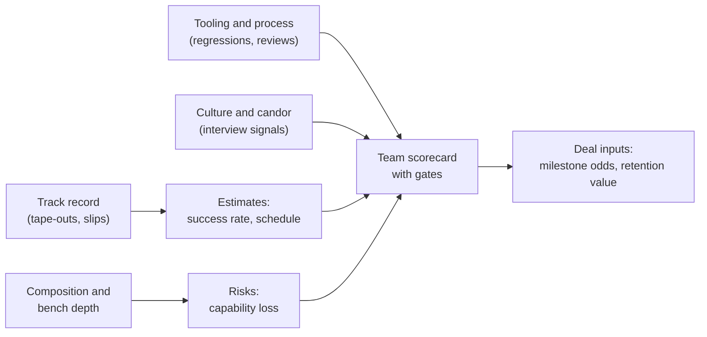

<!-- status: verified -->
# 28-07 · Evaluating Engineering Teams

| | |
|---|---|
| **Course** | [28 · Technical Diligence and Engineering Leadership Fluency](../README.md) |
| **University equivalent** | No direct university equivalent. It combines Bayesian estimation with conjugate priors (as in an introductory Bayesian statistics course), reference-class forecasting of schedules, and the team-structure material of engineering-management courses (this curriculum's 26-05 and 26-06) into a method for judging chip-design teams in diligence |
| **Prerequisites** | [28-06](28-06-red-and-green-flags.md) (flags and key-person risk), [28-01](28-01-technology-evaluation-framework.md) (scorecards and gates), [26-05](../../26-engineering-design-and-professional-practice/chapters/26-05-schedule-and-respin-risk.md), [26-06](../../26-engineering-design-and-professional-practice/chapters/26-06-team-structures-and-sizing.md), [19-13](../../19-digital-vlsi-design/chapters/19-13-verification-methods.md) (verification), [03-05](../../03-probability-statistics-and-random-variables/chapters/03-05-estimation-and-hypothesis-testing.md) (estimation) |
| **Estimated study hours** | 5 |
| **Last verified** | 2026-11-26 |

**Learning objectives.** After this chapter you can:

1. Estimate a team's first-silicon success rate from its tape-out history by shrinking it toward the industry base rate with a Beta prior, and state a credible interval.
2. Calibrate a team's schedule from its past overruns and compute the probability that a new plan is met and a P90 duration.
3. Assess team composition and bench depth, and compute the probability of losing a capability held by one, two or three people.
4. Evaluate tooling and process with capacity checks (regression throughput) and with interview signals about reviews, post-mortems and candor.
5. Combine dimensions into a team scorecard with a gate, and value the retention of a team in an acquisition.

---

## 1. Big picture

In many semiconductor acquisitions the team is the asset. A start-up with first silicon but no revenue is worth what its engineers can build next; a design-services acquisition buys people and their methods; even a mature product line depends on the few engineers who understand its analog blocks. Diligence must therefore judge a team the way it judges a chip: with evidence, base rates and checks, not impressions from a well-rehearsed presentation. This chapter turns the softer questions of team quality into estimates: a track record becomes a success rate with an interval, schedule history becomes a forecast, organizational depth becomes a probability of losing a capability, and the parts come together in a scorecard and a retention value.

- **Why it exists:** management presentations show teams at their best. Track records, bench depth and process discipline are what predict the next tape-out.
- **Where it shows up:** acqui-hires, design-service acquisitions, venture investments in pre-revenue chip companies, and supplier selection for custom silicon.
- **What it produces:** a team scorecard tied to evidence, an estimate of execution risk for the deal model (28-01 milestone chains), and a retention plan for integration (28-08).
- **The rule of thumb:** small track records deserve small adjustments from the base rate, and the deepest risk in a team is the capability that only one person holds.

## 2. Intuition first

**A fund manager's track record.** A CFA charterholder knows how to judge a fund manager with three good years: by asking how likely three good years are from luck alone, and by shrinking the manager's record toward the average of all managers in proportion to how little data there is. A chip team's tape-out record is the same kind of evidence. Four first-time-right chips out of five is impressive, but five projects is a small sample, and the industry base rate is low. The honest estimate lies between the team's raw rate and the base rate, closer to the base rate the shorter the record.

Where the analogy breaks down: fund returns are measured identically for everyone, while "first-silicon success" is defined by the team itself (booted, or shipped without a respin?), and projects differ in difficulty far more than market years do. The definition and the difficulty must be checked before the arithmetic means anything.

**Teams fail at their thinnest point.** A team of eighty with one person who understands the SerDes is, for SerDes purposes, a team of one. Diligence maps capabilities to people and looks for those single points of failure, just as a reliability engineer looks for components without redundancy.

## 3. Theory

### 3.1 Track record as evidence: shrinking toward the base rate

Let $\theta$ be a team's probability of first-silicon success on a project like the next one. Before looking at the team, the industry base rate gives a prior. A convenient prior is the Beta distribution, $\theta \sim \text{Beta}(\alpha_0, \beta_0)$, with mean $\alpha_0/(\alpha_0 + \beta_0)$ and "prior weight" $n_0 = \alpha_0 + \beta_0$, the number of projects' worth of evidence the prior is treated as. If the team then succeeded on $s$ of $n$ projects, independent given $\theta$, Bayes' rule gives

$$
p(\theta \mid s, n) \propto \theta^{s}(1 - \theta)^{n - s} \cdot \theta^{\alpha_0 - 1}(1 - \theta)^{\beta_0 - 1} = \theta^{\alpha_0 + s - 1}(1 - \theta)^{\beta_0 + n - s - 1}
$$

which is again a Beta distribution, $\text{Beta}(\alpha_0 + s, \beta_0 + n - s)$. Its mean is

$$
\hat\theta = \frac{\alpha_0 + s}{n_0 + n} = \frac{n_0}{n_0 + n}\,\theta_0 + \frac{n}{n_0 + n}\,\frac{s}{n}
$$

a weighted average of the prior mean $\theta_0$ and the team's raw rate $s/n$, with weight $n/(n_0 + n)$ on the team's own record. This is **shrinkage**: a short record moves the estimate a little, a long one a lot. The Beta distribution also gives a credible interval for $\theta$.

> **Math refresher — the Beta distribution.** $\text{Beta}(\alpha, \beta)$ has density proportional to $\theta^{\alpha - 1}(1 - \theta)^{\beta - 1}$ on $0 \le \theta \le 1$, mean $\alpha/(\alpha + \beta)$, and it is "conjugate" to the binomial: multiplying it by a binomial likelihood gives another Beta. Think of $\alpha$ and $\beta$ as counts of successes and failures already seen.

**Choosing the prior.** The base rate comes from industry surveys: first-silicon success was about 30% historically, 14% in the 2024 Wilson Research Group study and 5% in the 2026 study [R-621], [R-321] **[Industry estimate; the recruitment change between 2022 and 2024 makes the long-run trend uncertain]**. The prior weight $n_0$ expresses how much teams differ: a small $n_0$ says teams vary widely and a record should move the estimate quickly. Using $\theta_0 = 0.14$ and $n_0 = 10$ (assumed) is a reasonable default for a complex SoC typical of the survey sample, which over-represents CPU, GPU and AI-accelerator projects [R-622]; the 2026 figure of 5% is itself uncertain (a 95% interval of roughly 3–8%); a team doing simpler projects (mature node, reused IP) deserves a higher $\theta_0$.

**Checking the definition.** The surveys' spins-before-production chart treats a single spin as first-silicon success (about 14% of projects in 2024, matching the headline rate) [R-645], and the answers are self-reported. Teams sometimes count first silicon that merely booted, or count metal-only fixes as "no respin". The stepping history of shipped products (A0, A1, B0 …) settles the definition (28-03).

### 3.2 Schedule calibration

Most chip projects overrun: 75% were behind schedule in the 2024 study [R-621] **[Industry estimate: sponsored survey]**. Two kinds of evidence inform the next project's overrun. The *outside view* is the distribution of overruns across similar projects in the industry; using it is what **reference-class forecasting** means. The *inside view* is this team's own record. A good forecast starts from the outside view and moves toward the team's record as far as the record's length justifies, exactly as §3.1 shrinks a first-silicon record toward the base rate.

For the team's record, take the ratios $x_i = T_{\text{actual}}/T_{\text{plan}}$ of its $n$ past projects and work with their logarithms. Logs suit these ratios because the ratios are positive and right-skewed: a project can overrun by 100% but cannot finish in less than no time, and a lognormal model has that shape. With mean $\mu$ and sample standard deviation $s_{\ln}$ of the $\ln x_i$, the **plug-in** forecast treats both as known:

$$
\hat T_{50} = T_{\text{plan}}\,e^{\mu}, \qquad P(\text{on time}) = P(\ln x \le 0) = \Phi\!\left(-\frac{\mu}{s_{\ln}}\right), \qquad T_{90} = T_{\text{plan}}\,e^{\mu + z_{0.9}s_{\ln}}
$$

where $\Phi$ is the standard normal distribution function and $z_{0.9} = 1.2816$. $\hat T_{50}$ is the *median* duration; the mean of the lognormal is $T_{\text{plan}}\,e^{\mu + s_{\ln}^2/2}$, slightly longer.

With three or four projects the plug-in forecast is overconfident, because $\mu$ and $s_{\ln}$ are themselves uncertain: 28-05 §3.6 shows that the 95% bound on a standard deviation from four samples is almost three times the sample value. The standard correction is the **predictive** distribution. If the log-ratios are normal with unknown mean and variance, the next one follows a Student $t$ distribution with $n - 1$ degrees of freedom, centered on $\mu$ with scale $s_{\ln}\sqrt{1 + 1/n}$:

$$
P(\text{on time}) = F_{t,\,n-1}\!\left(-\frac{\mu}{s_{\ln}\sqrt{1 + 1/n}}\right), \qquad T_{90} = T_{\text{plan}}\exp\!\left(\mu + t_{0.9;\,n-1}\,s_{\ln}\sqrt{1 + 1/n}\right),
$$

where $F_{t,\,n-1}$ is the $t$ distribution function and $t_{0.9;\,n-1}$ its 90th percentile (1.638 for $n = 4$). For a record of three or four projects this multiplies the chance of an on-time finish several-fold and pushes the P90 out by months (Example 28-07.2). Read every such number as conditional on the next project resembling the last few. A team whose new plan assumes no overrun when every past project overran is a red flag of the kind in 28-06; a team that presents its own calibration, and compares it with the industry's, is a green one.

### 3.3 Composition and bench depth

**Composition.** A chip team's disciplines peak at different times (26-06 §3.1): architecture early, RTL and verification in the middle, physical design toward tape-out, validation and software after it. Two composition checks matter most in diligence:

- **Verification capacity.** The 2022 Wilson study found about a one-to-one ratio in the mean peak number of verification and design engineers per project (and said a 5-to-1 ratio is "not unusual" in processors), and that design engineers spent 49% of their time on verification [R-651] **[Industry estimate: sponsored survey]**. Head counts therefore understate verification effort; ask for time allocation, not only titles (Problem 28-07.10).
- **Coverage of the hard parts.** Map each critical capability (each analog block, the SerDes, the memory controller, DFT, the compiler for an accelerator) to the people who can own it.

**Bench depth.** If $k$ people can each own a capability, and each leaves independently with probability $q$ over the horizon, the capability is lost only if all $k$ leave:

$$
P(\text{lose capability}) = q^k
$$

With a horizon of $t$ years and annual rate $q_1$, $q = 1 - (1 - q_1)^t$. If $m$ capabilities each rest on a single person, the chance of losing at least one is $1 - (1 - q)^m$, the key-person formula of 28-06 §3.4 applied capability by capability. The independence assumption is optimistic: people who work together often leave together, after an acquisition, a missed bonus or a departing leader. Correlated departures make single points of failure worse than this formula says and make redundancy less protective than it appears.

### 3.4 Tooling, flow and capacity

A team's tools are part of its capability and much of its cost. Questions to settle:

- **Flow maturity.** Which EDA flows, at which versions; is there a scripted, reproducible flow from RTL to GDS, or a set of hand steps known to one person?
- **Verification infrastructure.** Regression frequency and pass rate; coverage closure against a plan; formal tools on control logic; emulation or FPGA prototyping capacity for system-level tests (19-13).
- **Compute capacity.** Whether the compute matches the verification plan. A regression budget of $N$ runs of $t$ CPU-hours on $C$ cores, with $L$ simulator licenses (one per running job), at utilization $u$ takes

$$
T = \frac{N\,t}{\min(C, L)\,u}
$$

hours of wall-clock time (Example 28-07.6). Licenses often bind before cores do, and they are a recurring cost. A plan that needs more weeks of regression than the schedule allows is a hidden schedule risk.

- **Licenses and portability.** Tool licenses tied to the target's company may not transfer in an acquisition; flows tuned to one foundry may not port (28-08).

### 3.5 Culture and process: interview signals

Culture shows in how a team handles bad news. The question bank below follows 28-04's pattern.

| # | Question | Strong answer | Evasive answer |
|---|---|---|---|
| T1 | "Walk us through your last respin: what escaped, why, and what changed?" | A specific bug, the verification gap and the process change, with dates | "A foundry issue" without detail |
| T2 | "Who could take over the SerDes (or another critical block) tomorrow?" | Named people with what they have shipped | "The whole team knows it" |
| T3 | "How did your last three schedules compare with plan, and how do you plan now?" | Ratios and a calibrated method | "We're always on time" |
| T4 | "Show us a design-review record where a decision was reversed." | A document with the dissent and the outcome | "We align early" |
| T5 | "What is your regression pass rate and how long does a full regression take?" | Numbers and the trend toward tape-out | "Very high" |
| T6 | "What fraction of design-engineer time goes to verification?" | A measured split | Head counts only |
| T7 | "What would you do differently on the last project?" | A candid, specific answer | "Nothing major" |

Two cautions apply. First, rehearsed candor exists: a team that has prepared polished answers about its failures may still be hiding the important one, so confirm stories with artifacts (bug trackers, review minutes, stepping histories). Second, culture is judged among engineers, not only leaders; meeting the second line of engineers without their managers present is often the most informative hour of a diligence.

### 3.6 A team scorecard and the value of retention

**Scorecard.** 28-01's scorecards apply directly. Score each dimension (track record, composition, verification discipline, tooling, culture, bench depth) from 1 to 5 against evidence, weight the scores, and compute both the weighted arithmetic score $\sum w_i x_i$ and the weighted geometric score $\prod x_i^{w_i}$. The geometric score punishes a single weak dimension, which matches how teams fail. Add **gates**: some weaknesses (no verification plan, a critical capability with no owner) disqualify a team regardless of its average.

**Retention value.** If a team of $N$ engineers would cost $V$ per engineer to replace (recruiting, ramp-up and the schedule lost while new hires learn the design), and a fraction $\rho$ stays through integration, the expected retained value is $N V \rho$. A retention package that raises retention from $\rho_0$ to $\rho_1$ is worth $N V(\rho_1 - \rho_0)$ before its cost; its break-even cost is that amount. The replacement value per engineer is a judgment, often well above salary for engineers who hold unique knowledge of the design. Two refinements matter in practice. A package is usually paid only to those who stay (unvested awards are forfeited), so its expected cost is about $\rho_1$ times the award per head, not the headline; and much of it goes to people who would have stayed anyway, a deadweight cost of $\rho_0 N$ awards. In an acquisition, payments contingent on continued employment are generally accounted for as post-combination compensation expense rather than purchase price (US GAAP, ASC 805); this is a pointer for the accountants, not accounting advice.

## 4. Worked examples

All base rates, prior weights, departure rates, scores and financial values are illustrative assumptions unless a source is cited.

### Example 28-07.1 · Four for five (tier B)

**Setup.** A team reports first-silicon success on 4 of its last 5 projects, confirmed by stepping histories. Use a Beta prior with mean 14% [R-621] and weight 10 projects. Find (a) the prior parameters, (b) the posterior mean, the team's raw rate and the weight on its own record, and (c) the 90% credible interval. (d) Repeat (b) and (c) for a team with 2 of 2.

**Solution.**

- (a) $\alpha_0 = 0.14 \times 10$ = **1.4**, $\beta_0$ = **8.6**.
- (b) Posterior $\text{Beta}(5.4, 9.6)$: mean $5.4/15$ = **36.0**%, against a raw rate of **80**%; weight $5/15$ = **0.333**.
- (c) 5th to 95th percentile: **17.4**% to **56.8**%.
- (d) Posterior $\text{Beta}(3.4, 8.6)$: mean **28.3**%, interval **10.0**% to **50.9**%.

**Units check.** Probabilities; Beta parameters count projects. ✓

**Sanity check.** The record more than doubles the estimate from the base rate, but five projects cannot prove an 80% rate: the interval still includes rates near the historical industry average of about 30%. Two for two moves the estimate less, as it should. The first team is very likely better than the 2024 base rate (its 5th percentile exceeds 14%); the second probably is, but not with 95% confidence. Neither is proven exceptional.

### Example 28-07.2 · Calibrating a schedule (tier B)

**Setup.** A team's last four projects took 1.25, 1.40, 1.30 and 1.10 times their planned durations. Its new plan is 18 months. Assuming lognormal overruns, find (a) the geometric mean overrun, (b) the standard deviation of the log-ratios (sample, $n - 1$), (c) the median and mean durations, (d) the probability of meeting the plan, (e) the P90 duration, both with the plug-in normal, and (f) the probability of meeting the plan and (g) the P90 from the $t$ predictive distribution.

**Solution.**

- (a) $\exp[\tfrac14\sum \ln x_i]$ = **1.258**.
- (b) $s_{\ln}$ = **0.101**.
- (c) Median $18 \times 1.258$ = **22.6** months; mean $18\,e^{\mu + s_{\ln}^2/2}$ = **22.8** months.
- (d) $\Phi(-\mu/s_{\ln}) = \Phi(-0.2293/0.1009)$ = **1.16**%.
- (e) $18\,e^{\mu + 1.2816s_{\ln}}$ = **25.8** months.
- (f) Scale $0.1009\sqrt{1.25} = 0.1129$; $F_{t,3}(-0.2293/0.1129)$ = **6.75**%.
- (g) $18\exp(0.2293 + 1.638 \times 0.1129)$ = **27.2** months.

**Units check.** Ratios are dimensionless; months × ratio = months. ✓

**Sanity check.** Every past project overran, so the chance of an on-time finish is small, but four projects cannot pin it down: the plug-in answer of about 1% becomes about 7% once the uncertainty in $\mu$ and $s_{\ln}$ is counted, and the P90 moves from about 26 to about 27 months. A deal model that uses the 18-month plan should instead use about 23 months, with a P90 of 27 or more, checked against the industry's overrun distribution; milestone payments (28-01) tied to the plan will very likely be missed.

### Example 28-07.3 · Bench depth (tier B)

**Setup.** Each engineer leaves with probability 12% a year (assumed, independent). Find the probability of losing a capability held by 1, 2 and 3 people over one year and over two years, and the probability of losing at least one of 6 single-person capabilities over two years.

**Solution.** One year: **12**%, **1.44**%, **0.173**%. Two years ($q = 1 - 0.88^2 = 0.2256$): **22.6**%, **5.09**%, **1.15**%. Six single-person capabilities over two years: $1 - 0.7744^6$ = **78.4**%.

**Units check.** Probabilities over the horizon. ✓

**Sanity check.** A second owner cuts the two-year risk by a factor of $1/0.2256$ = **4.43**, which is why cross-training the critical blocks is among the cheapest integration actions. Six single points of failure make losing at least one more likely than not over an integration (**78.4**%), and correlated departures would make it worse.

### Example 28-07.4 · A team scorecard (tier B)

**Setup.** Weights: track record 0.25, composition 0.20, verification discipline 0.20, tooling 0.15, culture 0.10, bench depth 0.10. Scores (1–5) from evidence: 4, 3, 2, 4, 3, 2. Gate: no dimension below 2. Find (a) the weighted and geometric scores and whether the gate passes, and (b) both scores if hiring and process changes raise verification discipline to 4.

**Solution.**

- (a) Weighted **3.10**, geometric **2.98**; the gate passes (lowest score 2).
- (b) Weighted **3.50**, geometric **3.42**.

**Units check.** Weighted averages of 1–5 scores. ✓

**Sanity check.** Fixing the weakest dimension raises the geometric score by 0.44, more than the 0.40 rise in the weighted score, because the geometric score rewards removing weaknesses. Verification discipline is therefore the integration priority for this team, and its cost belongs in the deal model.

### Example 28-07.5 · Paying to keep a team (tier B)

**Setup.** An acquirer values each of 60 engineers at $1.5M of replacement value (assumed). Without a retention package, 70% stay two years; a package costing $8M raises that to 85%. Find the expected retained value with and without the package, the gain, the net value of the package, and the retention gain needed per $1M of package cost to break even.

**Solution.** Without: $60 \times 1.5 \times 0.70$ = **63** \$M. With: **76.5** \$M. Gain **13.5** \$M; net of cost **5.5** \$M. Each \$1M of cost must raise retention by $1/(60 \times 1.5)$ = **1.11** points to break even.

**Units check.** Engineers × $M per engineer × fraction = $M. ✓

**Sanity check.** The package pays off here, but only because the replacement value is high. Its value is concentrated in the engineers who hold unique knowledge (Example 28-07.3), so packages weighted toward them are worth more per dollar than uniform ones.

### Example 28-07.6 · Is there enough compute to verify? (tier A)

**Setup.** A verification plan needs 2 million simulation runs of 30 CPU-minutes each before tape-out. The team has 2,000 cores at 80% utilization. Find the wall-clock days needed, and the days with 5,000 cores.

**Solution.** $2 \times 10^6 \times 0.5/(2000 \times 0.8)$ = **625** h = **26.0** days; with 5,000 cores, **10.4** days, provided the team holds at least 5,000 simulator licenses (with only 2,000 the extra cores sit idle and the answer stays 26.0 days).

**Units check.** runs × CPU-hours per run ÷ cores = hours. ✓

**Sanity check.** A month of regression for one full pass is acceptable only if the plan allows it, and regressions are rerun after every significant change. If the schedule shows two weeks for final regression, the team needs more compute, emulation, or a smaller test plan, and each has a cost.

<!-- answer-key -->

| ID | Quantity | Value | Unit |
|---|---|---|---|
| Ex 28-07.1a | prior α | 1.4 | — |
| Ex 28-07.1a1 | prior β | 8.6 | — |
| Ex 28-07.1b | posterior mean, 4 of 5 | 36.0 | % |
| Ex 28-07.1b1 | raw rate | 80 | % |
| Ex 28-07.1b2 | weight on the record | 0.333 | — |
| Ex 28-07.1c | 5th percentile | 17.4 | % |
| Ex 28-07.1c1 | 95th percentile | 56.8 | % |
| Ex 28-07.1d | posterior mean, 2 of 2 | 28.3 | % |
| Ex 28-07.1d1 | 5th percentile, 2 of 2 | 10.0 | % |
| Ex 28-07.1d2 | 95th percentile, 2 of 2 | 50.9 | % |
| Ex 28-07.2a | geometric mean overrun | 1.258 | — |
| Ex 28-07.2b | standard deviation of log-ratios | 0.101 | — |
| Ex 28-07.2c | median duration | 22.6 | months |
| Ex 28-07.2c1 | mean duration | 22.8 | months |
| Ex 28-07.2d | probability of meeting plan | 1.16 | % |
| Ex 28-07.2e | P90 duration, plug-in | 25.8 | months |
| Ex 28-07.2f | probability of meeting plan, t predictive | 6.75 | % |
| Ex 28-07.2g | P90 duration, t predictive | 27.2 | months |
| Txt 28-07.1 | 90th percentile of t with 3 degrees of freedom | 1.638 | — |
| Ex 28-07.3a | one year, one owner | 12 | % |
| Ex 28-07.3a1 | one year, two owners | 1.44 | % |
| Ex 28-07.3a2 | one year, three owners | 0.173 | % |
| Ex 28-07.3b | two years, one owner | 22.6 | % |
| Ex 28-07.3b1 | two years, two owners | 5.09 | % |
| Ex 28-07.3b2 | two years, three owners | 1.15 | % |
| Ex 28-07.3c | six single-owner capabilities | 78.4 | % |
| Ex 28-07.3d | risk reduction from a second owner | 4.43 | — |
| Ex 28-07.4a | weighted score | 3.10 | — |
| Ex 28-07.4a1 | geometric score | 2.98 | — |
| Ex 28-07.4b | weighted score, improved | 3.50 | — |
| Ex 28-07.4b1 | geometric score, improved | 3.42 | — |
| Ex 28-07.4c | rise in geometric score | 0.44 | — |
| Ex 28-07.4c1 | rise in weighted score | 0.40 | — |
| Ex 28-07.5a | retained value, no package | 63 | $M |
| Ex 28-07.5b | retained value, package | 76.5 | $M |
| Ex 28-07.5c | gain | 13.5 | $M |
| Ex 28-07.5d | net of cost | 5.5 | $M |
| Ex 28-07.5e | retention gain per $1M | 1.11 | points |
| Ex 28-07.6a | regression time | 625 | h |
| Ex 28-07.6a1 | regression time | 26.0 | days |
| Ex 28-07.6b | with 5,000 cores | 10.4 | days |

## 5. Simulate it

The lab is [labs/28-07-lab/](../labs/28-07-lab/README.md). `teameval.py` implements the models: Beta posteriors and intervals, lognormal schedule calibration, bench-depth risk, scorecards, retention value and regression capacity.

1. *Predict* the posterior mean for a team that succeeded on 5 of 5 projects (prior mean 14%, weight 10). Then plot the posterior mean and 90% interval against the number of projects for a team that always succeeds and one that succeeds half the time.
2. *Predict* the P90 duration for Example 28-07.2's team if it plans 24 months. Then plot the distribution of its duration.
3. *Predict* the probability of losing a capability held by two people over three years at 12% a year. Then plot capability-loss probability against time for one, two and three owners.
4. *Predict* the break-even cost of Example 28-07.5's retention package. Then plot net value against package cost for retention gains of 10, 15 and 20 points.

*Figure 1. Two team estimates: a track record shrunk toward the base rate (§3.1), and how bench depth protects a capability (§3.3).*

## 6. Engineering tradeoffs

| Knob | Improves | Costs | Typical decision owner |
|---|---|---|---|
| Stronger prior toward the base rate | Robustness to lucky records | Slower credit for genuinely strong teams | Diligence lead |
| Cross-training critical blocks | Bench depth | Engineer time during a busy program | Engineering managers |
| More verification engineers | Fewer escapes, fewer respins | Salary, management load, coordination channels (26-06) | VP of Engineering |
| More compute or emulation | Regression throughput | Capital and license cost | Engineering operations |
| Schedules from reference classes | Credible plans | Less attractive plans to present | Program management |
| Retention packages | Team stability | Cash and equity; internal fairness | Acquirer HR with business owner |
| Meeting engineers without managers | Honest signals | Sensitivity with management | Deal team |

## 7. Numbers to know

Figures are as of Nov 2026 unless dated otherwise.

| Quantity | Value | Note |
|---|---|---|
| First-silicon success (IC/ASIC) | about 30% historically; 14% (2024); 5% (2026) | [R-621], [R-321] **[Industry estimate]** |
| Projects behind schedule | 75% (2024) | [R-621] **[Industry estimate]** |
| Verification to design engineers | about 1:1 mean peak per project; up to about 5:1 in processors | 2022 study [R-651] **[Industry estimate]** |
| Design engineers' time on verification | 49% (2022) | [R-651] **[Industry estimate]** |
| Pairwise channels | $n(n - 1)/2$ | Brooks [R-650] |
| Beta posterior mean | $(\alpha_0 + s)/(n_0 + n)$ | §3.1 |
| Capability loss with $k$ owners | $q^k$ (independent departures) | §3.3 |

## 8. Common mistakes

- **Taking a short track record at face value.** Shrink it toward the base rate in proportion to its length.
- **Accepting the team's definition of success.** Check stepping histories: booted is not shipped.
- **Using the plan instead of the history.** A plan that ignores every past overrun is a forecast of the team's hopes. Start from the industry's overrun distribution and the team's record, and with only a few projects use the $t$ predictive distribution, not a normal with the sample spread treated as exact.
- **Counting heads instead of capabilities.** A large team can still have single points of failure.
- **Assuming departures are independent.** Teams leave together; plan for correlated loss.
- **Judging culture from the leadership presentation.** Meet the engineers who do the work.
- **Valuing a team at salary cost.** Replacement value includes ramp-up and lost schedule, and is concentrated in a few people.

## 9. Practitioner lens

**State of play (as of Nov 2026).**

- **Base rates are low and uncertain.** Survey-reported first-silicon success fell from about 30% historically to 14% in 2024 and 5% in 2026, with 75% of 2024 projects behind schedule [R-621], [R-321] **[Industry estimate; Contested trend]**. A team with a documented record well above these rates is genuinely scarce.
- **Verification is about half the work.** Verification headcount grew at about 6.2% a year from 2007 to 2022 against 2.7% for design, reaching parity at peak, and designers spent about half their time verifying in 2022 [R-651] **[Industry estimate, 2022]**; the 2026 study puts the verification share near 49%, against 53–57% in some earlier studies, so the share is high but not rising [R-018]. A team's verification capacity is the first thing to measure.
- **Leading-edge chips take very large teams.** NVIDIA described "thousands of NVIDIA engineers" spending "over three years" on Volta (10 May 2017) [R-653] **[Established: company statement]**, which is why acquiring a capable team is often faster than building one, and why acquirers pay for teams.

**Commercial relevance.** Team evaluation feeds three numbers in a deal: the probability that the next milestone succeeds (28-01's chains and earn-outs), the expected delay (which shifts every cash flow), and the cost of keeping the team (retention packages and the integration plan of 28-08). An acquirer that measures these with evidence can pay more for a genuinely strong team and less for a well-presented weak one.

**Marketing vs Reality.**

- *"World-class team."* Ask for the stepping history of every shipped product and the overrun of every recent project.
- *"We've never had a respin."* Ask how many projects, of what complexity, and what counts as a respin.
- *"Deep bench."* Ask who owns each critical block and who is second.
- *"We're hiring 50 engineers next year."* Ask how many senior engineers the team has hired in the last two years, and how long they took to become productive (26-06 §3.3).

**Questions for engineering leaders.**

1. *"What is your team's first-silicon record, by project, with steppings?"* Strong: a table with dates and causes. Evasive: "Mostly first-time-right."
2. *"Which three people, if they left, would hurt the most, and what have you done about it?"* Strong: names, successors and documentation. Evasive: "Nobody is irreplaceable."
3. *"How do you estimate schedules now, compared with five years ago?"* Strong: a method calibrated on history. Evasive: "We've become more efficient."
4. *"What did your last post-mortem change?"* Strong: a process change with evidence it worked. Evasive: "We hold post-mortems regularly."

## 10. Concept check

1. Why is a team's raw first-silicon rate a poor estimate when it has done few projects?

   

Answer

   With few projects the raw rate is noisy; the Beta posterior mean $(\alpha_0 + s)/(n_0 + n)$ weights it by $n/(n_0 + n)$ and the base rate by the rest, which reduces the error from luck.

   

2. What does the prior weight $n_0$ represent?

   

Answer

   How many projects' worth of evidence the base rate counts for: a large $n_0$ says teams are similar and records should move the estimate slowly; a small one says teams vary widely.

   

3. Why use log-ratios for schedule overruns?

   

Answer

   Overruns multiply durations; logarithms make them additive and roughly normal, so the geometric mean and a lognormal model give sensible forecasts and probabilities.

   

4. How does a second owner change the risk of losing a capability?

   

Answer

   From $q$ to $q^2$ for independent departures: with $q = 22.6\%$ over two years, from 22.6% to 5.1%. Correlated departures reduce this benefit.

   

5. Why does the geometric scorecard rise more than the weighted one when the weakest dimension improves?

   

Answer

   The geometric score multiplies $x_i^{w_i}$, so the relative change of a low score matters more; it rewards removing weaknesses, matching how teams fail.

   

6. What sets the value of a retention package?

   

Answer

   The number of engineers, their replacement value and the increase in retention it buys, $NV(\rho_1 - \rho_0)$, less its cost; it is concentrated in the engineers who hold unique knowledge.

   

Problems: [28-07 problem set](../problems/28-07-problems.md) · Solutions: [28-07 solutions](../solutions/28-07-solutions.md)

## 11. Key terms

[Track-record shrinkage](../../../reference/glossary.md#track-record-shrinkage) · [Beta distribution](../../../reference/glossary.md#beta-distribution) · [Reference-class forecasting](../../../reference/glossary.md#reference-class-forecasting) · [Bench depth](../../../reference/glossary.md#bench-depth) · [Key-person risk](../../../reference/glossary.md#key-person-risk) · [Weighted geometric score](../../../reference/glossary.md#weighted-geometric-score) · [Knockout gate](../../../reference/glossary.md#knockout-gate) · [Retention value](../../../reference/glossary.md#retention-value) · [First-silicon success](../../../reference/glossary.md#first-silicon-success)

## 12. Connections

- **Previous:** [28-06 Red Flags and Green Flags](28-06-red-and-green-flags.md).
- **Next:** [28-08 Post-Acquisition Integration Risk](28-08-integration-risk.md), where retention, tools and flows meet the acquirer's organization.
- **Prerequisites used here:** scorecards and gates ([28-01](28-01-technology-evaluation-framework.md)); key-person risk ([28-06](28-06-red-and-green-flags.md)); schedule and respin risk ([26-05](../../26-engineering-design-and-professional-practice/chapters/26-05-schedule-and-respin-risk.md)); team structures and Brooks's law ([26-06](../../26-engineering-design-and-professional-practice/chapters/26-06-team-structures-and-sizing.md)); verification methods ([19-13](../../19-digital-vlsi-design/chapters/19-13-verification-methods.md)); estimation ([03-05](../../03-probability-statistics-and-random-variables/chapters/03-05-estimation-and-hypothesis-testing.md)).
- **Used later:** [28-08](28-08-integration-risk.md) (retention and capability transfer) and the team-focused dialogues of [28-10](28-10-conversation-scenarios.md).

## 13. Further study

- A. Gelman et al., *Bayesian Data Analysis*: the chapter on single-parameter models (the beta-binomial model and conjugate priors).
- F. P. Brooks, *The Mythical Man-Month* (anniversary edition), chapters 2 and 3 [R-650].
- B. Flyvbjerg's published work on reference-class forecasting in large projects (journal articles are public).
- Lecture videos: MIT OpenCourseWare 6.041/6.431 *Probabilistic Systems Analysis and Applied Probability* (recorded and public), the lectures on Bayesian statistical inference.

## 14. Sources

1. First-silicon success and schedules: Wilson/Siemens 2024 [R-621] and 2026 [R-321] studies.
2. Verification staffing and time split: 2022 Wilson study [R-651].
3. Team size for a leading-edge GPU [R-653]; Brooks's law [R-650].
